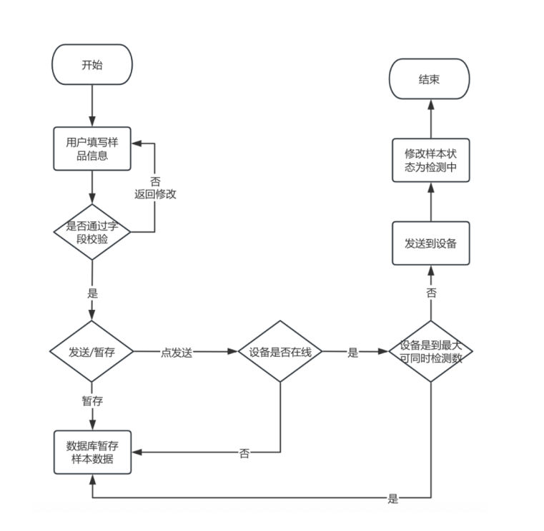
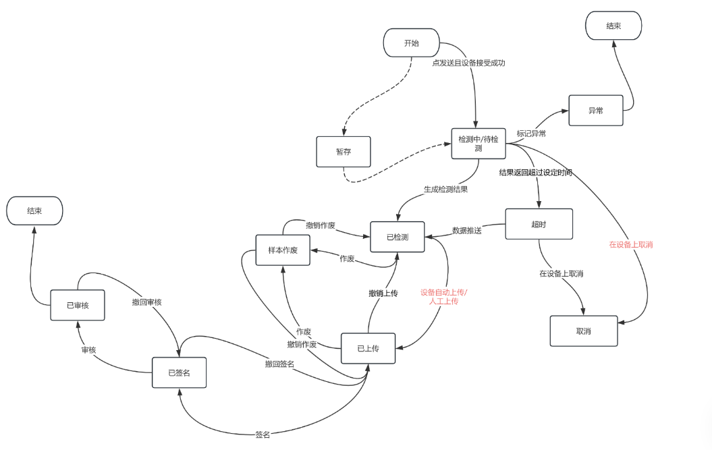

# 数据管理

数据管理模块包含检测分析、数据签名操作台、签批记录、在线数据、离线数据模块。

1.  **检测分析**：包含样品检测需求的编辑、暂存和发送以及相关检测结果的查询展示。检测分析详细分类如表 2-1 检测分析详细分类所示

    表 2-1 检测分析详细分类

    | 序号 | 取样 | 测样 | 习惯叫法/现功能模块 | 试验室 |
    | :---: | :---: | :---: | :---: | :--- |
    | 1 | 手动取样 | 手动测样 | 离线检测（BGA,Vicell,OSMO，Cedex） | 中试、小试 |
    | 2 | 手动取样 | 自动测样 | Load sample | 小试 |
    | 3 | 自动取样 | 手动测样 | 取样 | 小试 |
    | 4 | 自动取样 | 自动测样 | 自动化任务 | 小试 |

2.  **数据签名操作台**：包含检测结果的基础查看分析、签名、撤销签名、审核、撤销审核、操作记录查询等。

    ```mermaid
    flowchart TD
        Start([开始]) --> FillInfo[用户填写样品信息]
        FillInfo --> Validate{是否通过字段校验}
        Validate -- 否，返回修改 --> FillInfo
        Validate -- 是 --> SendOrHold{发送/暂存}

        SendOrHold -- 点发送 --> DeviceOnline{设备是否在线}
        SendOrHold -- 暂存 --> HoldDB[数据库暂存样本数据]

        DeviceOnline -- 否 --> HoldDB
        DeviceOnline -- 是 --> MaxCapacity{设备是否达到最大可同时检测数}

        MaxCapacity -- 是 --> HoldDB
        MaxCapacity -- 否 --> SendDevice[发送到设备]

        SendDevice --> UpdateStatus[修改样本状态为检测中]
        UpdateStatus --> End([结束])
    ```

    图 2-1检测需求发送操作流程

    ```mermaid
    flowchart TD
        Start([开始])
        End1([结束])
        End2([结束])

        Hold[暂存]
        Testing[检测中/待检测]
        Abnormal[异常]
        Timeout[超时]
        Tested[已检测]
        Voided[样本作废]
        Uploaded[已上传]
        Signed[已签名]
        Reviewed[已审核]
        Cancelled[取消]

        Start -- 点发送且设备接受成功 --> Testing
        Start -.-> Hold
        Hold -.-> Testing

        Testing -- 标记异常 --> Abnormal
        Abnormal --> End2

        Testing -- 结果返回超过设定时间 --> Timeout
        Testing -- 生成检测结果 --> Tested

        Timeout -- 数据推送 --> Tested
        Timeout -- 在设备上取消 --> Cancelled

        Tested -- 作废 --> Voided
        Voided -- 撤销作废 --> Tested

        Tested -- 设备自动上传/人工上传 --> Uploaded
        Uploaded -- 撤销上传 --> Tested
        Uploaded -- 作废 --> Voided
        Voided -- 撤销作废 --> Uploaded

        Uploaded -- 签名 --> Signed
        Signed -- 撤回签名 --> Uploaded

        Signed -- 审核 --> Reviewed
        Reviewed -- 撤回审核 --> Signed

        Reviewed --> End1
    ```
    图 2-2 样品检测及签名流程

3.  **签批记录**：所有记录查询展示
4.  **在线数据**：在线数据的查询、可视化及导出
5.  **离线数据**：在线数据的查询、可视化及导出

## 原图核对

以下原图对应正文中已转写的表格，保留用于核对字段、数值和布局。




