# 数据管理

## 检测分析

### 整体业务说明①（3.3）

1.  **权限说明**：当前模块项目－批次－培养全部基于当前用户的可见范围。
2.  **检测类型**：一共包含BGA、Vicell、OSMO、OSMO、Cedex四大类检测类型，不同检测类型根据不同品牌在物理特性略有区别，区别如下：

    |设备类型| 设备型号 | 设备物理形态 |左侧有没有暂存 | 发送模式 | 发送上限 | 左侧填写区 | 在设备上排队 | 列数 | 工作状态下可发送次数 |
    | --- | --- | --- | --- | --- | --- | --- | --- | --- | --- |
    | BGA | BGA | 单管 | 有 | 单发 | 1 | 100 | 否（无待检测） | 1 | 1 |
    | Cedex | Cedex Bio | --- | | 单发 | 24 | 24 | 否（无待检测） | 1 | 不限次数 |
    | Cedex | Cedex Bio HT | 矩阵（多行多列） | | 整列发 | 15 | 15 | 否（无待检测） | 6 | 6 |
    | OSMO | OSMO-1 | --- | 有 | 单发 | 1 | 25 | 否（无待检测） | 1 | 1 |
    | OSMO | OSMO-2 | --- | | 整列发 | 20 | 20 | 是（有待检测） | 1 | 不限次数 |
    | OSMO | OSMO-3 | --- | | 整列发 | 24 | 24 | 是（有待检测） | 1 | 不限次数 |
    | Vicell | Vicell | 圆盘（遮挡了3个） | | 整列发 | 9 | 12 | 是（有待检测） | 1 | 不限次数 |

    ### 检测分析样品发送操作流程

    #### 流程图

    ```mermaid
    flowchart TD
        Start([开始]) --> FillInfo[用户填写样品信息]
        FillInfo --> Validate{是否通过字段校验}
        Validate -- 否，返回修改 --> FillInfo
        Validate -- 是 --> SendOrHold{发送/暂存}

        SendOrHold -- 点发送 --> DeviceOnline{设备是否在线}
        SendOrHold -- 暂存 --> HoldDB[数据库暂存样本数据]

        DeviceOnline -- 否 --> HoldDB
        DeviceOnline -- 是 --> MaxCapacity{设备是否达到最大可同时检测数}

        MaxCapacity -- 是 --> HoldDB
        MaxCapacity -- 否 --> SendDevice[发送到设备]

        SendDevice --> UpdateStatus[修改样本状态为检测中]
        UpdateStatus --> End([结束])
    ```

    #### 步骤说明

    1.  **开始**
    2.  **用户填写样品信息**
    3.  **字段校验**
       - 校验不通过 → 提示"返回修改"，回到"用户填写样品信息"重新填写
       - 校验通过 → 进入下一步
    4.  **发送/暂存**（用户在此处二选一操作）
       - 选择"暂存" → 直接进入"数据库暂存样本数据"
       - 选择"点发送" → 进入设备在线校验
    5.  **设备是否在线**
       - 否 → 进入"数据库暂存样本数据"
       - 是 → 进入下一步：设备容量校验
    6.  **设备是否达到最大可同时检测数**
       - 是（已满） → 进入"数据库暂存样本数据"
       - 否（未满） → 进入"发送到设备"
    7.  **数据库暂存样本数据**：以下三种情况都会落到这一步
       - 用户主动选择"暂存"
       - 设备不在线
       - 设备已达到最大可同时检测数
    8.  **发送到设备** → **修改样本状态为检测中** → **结束**

    #### 备注

    - "数据库暂存样本数据"是一个汇聚节点，三条路径（用户主动暂存 / 设备离线 / 设备满载）都会汇入此处，暂存后的样本预计后续通过轮询或设备状态变化触发重新发送（原图未画出这部分，如需要请确认后续如何从暂存状态恢复发送）。
    - 修改样本状态为检测中：如果检测设备支持排队功能，则存在待检测状态的样本
    - 该流程只覆盖到"发送成功→检测中"，检测完成、结果回传等后续状态流转不在本图范围内。

    ### 检测记录状态机

    #### 状态流转图

    ```mermaid
    flowchart TD
        Start([开始])
        End1([结束])
        End2([结束])

        Hold[暂存]
        Testing[检测中/待检测]
        Abnormal[异常]
        Timeout[超时]
        Tested[已检测]
        Voided[样本作废]
        Uploaded[已上传]
        Signed[已签名]
        Reviewed[已审核]
        Cancelled[取消]

        Start -- 点发送且设备接受成功 --> Testing
        Start -.-> Hold
        Hold -.-> Testing

        Testing -- 标记异常 --> Abnormal
        Abnormal --> End2

        Testing -- 结果返回超过设定时间 --> Timeout
        Testing -- 生成检测结果 --> Tested

        Timeout -- 数据推送 --> Tested
        Timeout -- 在设备上取消 --> Cancelled

        Tested -- 作废 --> Voided
        Voided -- 撤销作废 --> Tested

        Tested -- 设备自动上传/人工上传 --> Uploaded
        Uploaded -- 撤销上传 --> Tested
        Uploaded -- 作废 --> Voided
        Voided -- 撤销作废 --> Uploaded

        Uploaded -- 签名 --> Signed
        Signed -- 撤回签名 --> Uploaded

        Signed -- 审核 --> Reviewed
        Reviewed -- 撤回审核 --> Signed

        Reviewed --> End1
    ```

    #### 状态说明

    | 状态 | 说明 |
    | --- | --- |
    | 暂存 | 点击发送时设备未接受/不满足条件，样本先存入数据库，等待后续再次发送（虚线箭头表示这条路径） |
    | 检测中/待检测 | 点发送且设备接受成功后进入的状态，样本正在设备上排队或检测 |
    | 异常 | 检测过程中被标记为异常，流程终止（直接到"结束"） |
    | 超时 | 检测结果返回超过设定时间后进入此状态 |
    | 已检测 | 检测完成并生成结果，或超时后数据仍被推送回来 |
    | 样本作废 | 从"已检测"或"已上传"状态被标记作废，可撤销作废恢复到作废前的状态 |
    | 已上传 | 检测结果已上传（设备自动上传或人工上传），可撤销上传退回"已检测" |
    | 已签名 | 已上传的结果被签名，可撤回签名退回"已上传" |
    | 已审核 | 已签名的结果被审核，可撤回审核退回"已签名"；审核通过后流程结束 |
    | 取消 | 超时后用户选择"在设备上取消" |

    #### 需要向你确认的一点

    图中"在设备上取消"这个红色标签出现了两处：一处明确是从**"超时"**状态发出、指向"取消"；另一处位置更靠下，视觉上似乎是从"已检测"或更早的状态经过一条较长的弧线指向"取消"，但具体是从哪个状态发出的，从图上不能100%确认。**为避免转换出错，这一条路径我没有画进流程图里**，麻烦确认一下"取消"这个状态除了从"超时"进入之外，是否还有其他状态也能直接走"在设备上取消"这个操作。

3.  检测操作台说明

    操作台包含上方设备筛选及记录查看区域、左侧需求队列区域和右侧检测列表区域。

    > **[图 image367.png | 章节：检测分析 / 整体业务说明①（3.3） | 上下文：操作台包含上方设备筛选及记录查看区域、左侧需求队列区域和右侧检测列表区域。]**
    > **OCR 文本：**
    > 请选择设备 | 实验室A | BGA001 | 检测中 1 | PH校准记录 | 所有检测记录
    > 需求队列 | 选择设备 | 选择状态 | 选择模式 | 样品ID/用户/设备编码 | 2016/09/01-2016/09/20 | 检索
    > 序号 | 暂存人 | 样品ID | 温度℃ | 操作 | 序号 | 样品ID | 上样时间 | 检测完成时间 | 设备编号 | 模式 | 用户 | 状态 | 操作
    > 张三 | 1D2-123F190319X03 | 35.6 | 发送 | 删除 | 1D2-123F190319X00 2026-05-30 12:12:28 2026-05-30 12:13:28 | BGA001 | 张三 | 检测中
    > 1D2-123F190319X04 2026-05-30 12:12:28 2026-05-30 12:13:28 | BGA001 | 张三 | （已检测）
    > 张三 | 1D2-123F190319X04 | 36.5 | 发送 | 删除 | 1D2-123F190319X05 2026-05-30 12:12:28 2026-05-30 12:13:28 | BGA001 | 张三 | 已上报）
    > 张三 | 1D2-123F190319X05 | 35 | 发送 | 暂存 | 删除 | 1D2-123F190319X06 2026-05-30 12:12:28 2026-05-30 12:13:28 | BGA001 | 张三 | 已签名
    > 空闲 | 1D2-123F190319X07 | 35 | 发送1 | 暂存 | 删除 | 1D2-123F190319X07 2026-05-30 12:12:28 2026-05-30 12:13:28 | BGA001 | 张三 | 样本作废
    > 空闲 | 样品ID | 温度 | +1 | 发送 | 删除 | 1D2-123F190319X08 2026-05-30 12:12:28 2026-05-30 12:13:28 | BGA001 | 张三 | （已取消）
    > 空闲 | 样品ID | 温度 | 发送 | 删除
    > 空闲 | 样品ID | 温度 | 删除
    > 空闲 | 样品ID | 温度
    > 空闲 | 样品ID | 温度 | 删除
    > 10 | 空闲 | 样品ID | 温度 | +1 | 删除
    > 11 | 空闲 | 样品ID | 温度 | 删除

    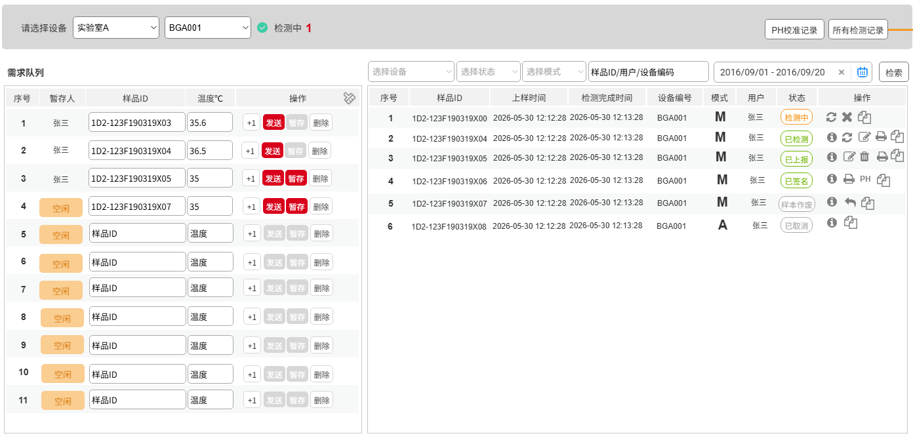

4.  **状态说明**：每条检测需求共包含以下状态

    注意：不同设备根据特性不同仅包含部分状态，具体见各设备的详细说明

    | 编号 | 状态 | 区域 | 说明 |
    | :---: | :--- | :--- | :--- |
    | 1 | 空闲 | 需求队列区域 | 最开始默认为空闲 删除/清空后置为“空闲” |
    | 2 | 暂存 | 需求队列区域 | 填写检测需求并点击【暂存】后，状态置为“暂存”，页面显示暂存人名称 |
    | 3 | 待检测 | 需求队列区域和检测列表区域 | 可排队&仅允许单个检测时，排队列表中按照顺序，从第2个开始，置为“待检测” |
    | 4 | 检测中 | 需求队列区域和检测列表区 | 不可排队时，发送后即为检测中 可排队&允许多个同时检测时，排队列表中全部为“检测中” 可排队&仅允许单个检测时，排队列表中按照顺序，第1个置为“检测中” |
    | 5 | 已检测 | 需求队列区域和检测列表区 | 当前样品ID拿到任一检测项结果后置为“已检测” |
    | 6 | 已上传 | 需求队列区域和检测列表区 | 当前样品ID所有检测项结果均已获取后，查询该样本ID是否存在历史已创建培养ID，若有则置为“已上传” |
    | 7 | 已签名 | 需求队列区域和检测列表区 | 用户可选择“已上传”的结果进行签名操作后置为“已签名” |
    | 8 | 已审核 | 需求队列区域和检测列表区 | 用户可选择“已签名”的结果进行“审核”操作后置为“已签名” |
    | 9 | 超时 | 需求队列区域和检测列表区 | 当前样品ID“检测中”状态的停留时间超过XX为超时 |
    | 10 | 样本作废/单条作废 | 需求队列区域和检测列表区 | 用户可选择“已上传”和“已检测”结果进行【作废】操作置为“样本作废” |
    | 11 | 异常 | 需求队列区域和检测列表区 | 用户手动标记异常后置为“异常” |
    | 12 | 已取消 | 需求队列区域和检测列表区 | 实验操作员在设备上手动取消的检测，置为“已取消” |
    | 13 | 删除 | 需求队列区域和检测列表区 | 用户可选择状态为“待检测”或“检测中”的样本进行手动删除 删除后的样本不会被查询出展示在页面 删除的样本ID后续可以重复使用 |

5.  需求队列区域各状态下支持的操作
    1.  每个操作都需在对应状态下才允许执行，后续章节不再重复说明
    2.  不同设备根据特性不同仅支持部分操作，具体见各设备的详细说明。

        | 编号 | 状态 | 编辑/修改 | 暂存 | 复制 | 发送 | 删除 | 清空 | 刷新 |
        | :---: | :---: | :---: | :---: | :---: | :---: | :---: | :---: | :---: |
        | 1 | 空闲 | √ | √ | √ | √ | √ | √ |  |
        | 2 | 暂存 | √ | √ | √ | √ | √ | √ | √ |
        | 3 | 待检测 |  |  | √ |  | √ | √ | √ |
        | 4 | 检测中 |  |  | √ |  | √ | √ | √ |
        | 5 | 已检测 |  |  | √ |  | √ | √ | √ |
        | 6 | 已上传 |  |  | √ |  | √ | √ | √ |
        | 7 | 已签名 |  |  | √ |  | √ | √ | √ |
        | 8 | 已审核 |  |  | √ |  | √ | √ | √ |
        | 9 | 超时 |  |  | √ |  | √ | √ | √ |
        | 10 | 样本作废/单条作废 |  |  | √ |  | √ | √ | √ |
        | 11 | 异常 |  |  | √ |  | √ | √ | √ |
        | 12 | 已取消 |  |  | √ |  | √ | √ | √ |

6.  检测列表区域各状态下支持的操作
7.  此处操作包含检测列表区域的操作以及数据签名操作台的操作
8.  每个操作都需在对应状态下才允许执行，后续章节不再重复说明
9.  不同设备根据特性不同仅支持部分操作，具体见各设备的详细说明。

    | 编号 | 状态 | 刷新 | 编辑 | 复制 | 标记异常 | 上传 | 撤回上传 | 删除 | 签名 | 审核 | 取消签名 | 取消审核 | 样品作废/单条作废 | 取消作废/取消单条作废 | 查看详情 | 打印 |
    | :---: | :--- | :---: | :---: | :---: | :---: | :---: | :---: | :---: | :---: | :---: | :---: | :---: | :---: | :---: | :---: | :---: |
    | 1 | 待检测 | √ |  | √ | √ |  |  | √ |  |  |  |  |  |  | √ | √ |
    | 2 | 检测中 | √ |  | √ | √ |  |  | √ |  |  |  |  |  |  | √ | √ |
    | 3 | 已检测 | √ | √ | √ |  | √ |  |  |  |  |  |  | √ |  | √ | √ |
    | 4 | 已上传 |  | √ | √ |  |  | √ |  |  |  |  |  | √ |  | √ | √ |
    | 5 | 已签名 |  |  | √ |  |  |  |  |  | √ | √ |  |  |  | √ | √ |
    | 6 | 已审核 |  |  | √ |  |  |  |  |  |  |  | √ |  |  | √ | √ |
    | 7 | 超时 |  |  | √ |  |  |  |  |  |  |  |  |  |  | √ | √ |
    | 8 | 样本作废/单条作废 |  |  | √ |  |  |  |  |  |  |  |  |  | √ | √ | √ |
    | 9 | 异常 |  |  | √ |  |  |  |  |  |  |  |  |  |  | √ | √ |
    | 10 | 已取消 |  |  | √ |  |  |  |  |  |  |  |  |  |  | √ | √ |

### BGA①

共分为上方设备筛选及记录查看区域、左侧需求队列区域和右侧检测列表区域

> **[图 image368.png | 章节：检测分析 / BGA① | 上下文：共分为上方设备筛选及记录查看区域、左侧需求队列区域和右侧检测列表区域]**
> **OCR 文本：**
> 请选择设备 | 实验室A | BGA001 | 检测中 1 | PH校准记录 | 所有检测记录
> 需求队列 | 选择设备 | 选择状态 | 选择模式 | 样品ID/用户/设备编码 | 2016/09/01-2016/09/20 | 检索
> 序号 | 暂存人 | 样品ID | 温度℃ | 操作 | 序号 | 样品ID | 上样时间 | 检测完成时间 | 设备编号 | 模式 | 用户 | 状态 | 操作
> 张三 | 1D2123F190319X03 | 35.6 | 发送 | 1D2-123F190319X00 2 | 2026-05-30 12:12:28 2026-05-30 12:13:28 | BGA001 | 张三 | 检测中
> 1D2-123F190319X04 | 2026-05-30 12:12:28 2026-05-30 12:13:28 | BGA001 | 张三 | 已检测
> 张三 | 1D2123F190319X04 | 36.5 | 发送 | 删除 | 1D2-123F190319X05 2026-05-30 12:12:28 2026-05-30 12:13:28 | BGA001 | 张三
> 张三 | 1D2123F190319X05 | 35 | +1 | 发送暂存 | 删除 | 1D2-123F190319X06 | 2026-05-30 12:12:28 2026-05-30 12:13:28 | BGA001 | 张三 | 已签名 | PH
> 空闲 | 1D2123F190319X07 | 35 | +1 | 发送暂存 | 删除 | 1D2-123F190319X07 | 2026-05-30 12:12:28 2026-05-30 12:13:28 | BGA001 | 张三 | 样本作废
> 空闲 | 样品ID | 温度 | 发送暂存 | 删除 | 1D2-123F190319X08 | 2026-05-30 12:12:28 2026-05-30 12:13:28 | BGA001 | 张三 | 已取消
> 空闲 | 样品ID | 温度 | +1 | 发送暂存 | 删除
> 空闲 | 样品ID | 温度 | +1 | 发送暂存 | 删除
> 空闲 | 样品ID | 温度 | +1 | 发送暂存
> 空闲 | 样品ID | 温度 | +1 | 发送暂存 | 删除
> 10 | 空闲 | 样品ID | 温度 | +1 | 发送 | 删除
> 11 | 空闲 | 样品ID | 温度 | +1 | 删除

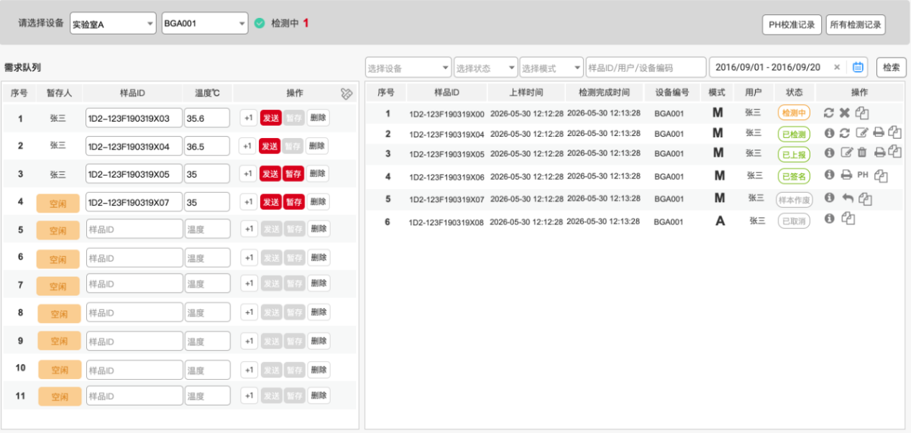

#### 设备筛选及记录查看区域

1.  设备筛选（区域内左侧）
2.  **实验室**：下拉框，单选，根据当前用户加入的实验室，下拉加载可选实验室名称，只授权一个实验室的人，默认选中这一个实验室，有多个实验室权限的人，按id排序选第一个
3.  **设备编号**：下拉框，单选，根据实验室联动选择当前实验室下的具体设备
4.  **通讯状态**：选择设备后检测设备的通讯状态，
    1.  **通讯正常**：计算当前检测中的记录数量
    2.  **通讯异常**：支持点击【刷新】，重新获取设备的通讯状态。
5.  **检测中数量**：统计当前设备当前处于检测中的数量
6.  记录查看（区域内右侧）
7.  **PH校准记录**：不在当前优先级内，待后续补充
8.  **所有检测记录**：跳转检测记录页面（见⑥2）2.1.8章节），带上当前实验室/设备/检测类型作为检索条件进行检索

#### 需求队列区域（3.3）

1.  **序号**：可以填写下发检测需求的通道，数量由当前设备类型的设置功能控制，
2.  **状态**：包含表中序号1-11共计11种状态，状态值为“空闲”或“暂存”时，当前通道才能填写/修改、点击开始、点击暂存等操作。

    表 2-2 BGA状态清单

    | 编号 | 状态 | 区域 | 说明 |
    | :---: | :--- | :--- | :--- |
    | 1 | 空闲 | 需求队列区域 | 最开始默认为空闲 删除/清空后置为“空闲” |
    | 2 | 暂存 | 需求队列区域 | 填写检测需求并点击【暂存】后，状态置为“暂存”，页面显示暂存人名称 |
    | 3 | 检测中 | 需求队列区域和检测列表区域 | 不可排队，发送后即为检测中 |
    | 4 | 已检测 | 需求队列区域和检测列表区 | 当前样品ID拿到任一检测项结果后置为“已检测” |
    | 5 | 已上传 | 需求队列区域和检测列表区 | 当前样品ID所有检测项结果均已获取后，查询该样本ID是否存在历史已创建培养ID，若有则置为“已上传” |
    | 6 | 已签名 | 需求队列区域和检测列表区 | 用户可选择“已上传”的结果进行签名操作后置为“已签名” |
    | 7 | 已审核 | 需求队列区域和检测列表区 | 用户可选择“已签名”的结果进行“审核”操作后置为“已签名” |
    | 8 | 超时 | 需求队列区域和检测列表区 | 当前样品ID“检测中”状态的停留时间超过XX为超时 以发送检测需求的时间作为起点，以所有检测项都检测完成的时间作为终点，若该时间超过设定时间（资源管理设备库检测设备模块根据不同型号设定）则置为超时 |
    | 9 | 样本作废/单条作废 | 需求队列区域和检测列表区 | 用户可选择“已上传”结果进行【作废】操作置为“样本作废” |
    | 10 | 异常 | 需求队列区域和检测列表区 | 用户手动标记异常后置为“异常” |
    | 11 | 已取消 | 需求队列区域和检测列表区 | 实验操作员在设备上手动取消的检测，置为“已取消” |
    | 12 | 删除 | 需求队列区域和检测列表区 | 用户可选择状态为“待检测”或“检测中”的样本进行手动删除 删除后的样本不会被查询出展示在页面 删除的样本ID后续可以重复使用 |

3.  **样品ID**：文本框，可编辑，必填字段，长度不允许超过XX位
4.  **温度（℃）**：文本框，必填，数值范围15-40，1位小数。。
5.  **+1**：根据当前信息自动往下找一个状态为空闲的通道填写信息，
6.  **中试**：所有字段保持一致。
7.  **小试**：样品ID自动增1，其余字段保持一致
8.  发送：
9.  置灰不能点击场景包括：
    1.  当前设备的检测中数量大于等于工作状态下可发送次数时置灰（从设备品牌/型号从设备管理中获取）
    2.  当前通道的状态不为“空闲”或“暂存”时，置灰
10. **暂存人校验**：当前通道为暂存状态时，必须为暂存人本人才能发送，否则发送失败；
11. **温度合格校验**：数值范围15-40，1位小数
12. **样品ID和温度非空校验**：存在空则提示字段为空，发送失败，提示失败信息
13. 样本ID合格校验：
    1.  **样本ID长度校验**：未通过则暂存失败，提示失败信息
    2.  **样品ID唯一性校验**：当一个实验室的一个检测类型下在已发送的且未删除的记录中存在样品ID重复（包括原ID和修改后ID）时，提示失败信息

        > **[图 image369.png | 章节：检测分析 / 需求队列区域（3.3） | 上下文：样品ID唯一性校验：当一个实验室的一个检测类型下在已发送的且未删除的记录中存在样品ID重复（包括原ID和修改后ID）时，提示失败信息]**
        > **OCR 文本：**
        >  当前样品/D已发送至检测设备， 请勿重复操作×

        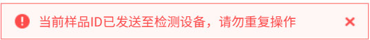

    3.  **关联培养ID校验**：样本ID无法关联到历史已创建培养ID时，提示信息，并支持返回修改或确定以非培养类检测暂存检测需求

        > **[图 image370.png | 章节：检测分析 / 需求队列区域（3.3） | 上下文：关联培养ID校验：样本ID无法关联到历史已创建培养ID时，提示信息，并支持返回修改或确定以非培养类检测暂存检测需求]**
        > **OCR 文本：**
        > 此样品ID无法识别到培养
        > 您可以选择返回修改或点确定
        > 做非培养类检测
        > 返回 | 确定

        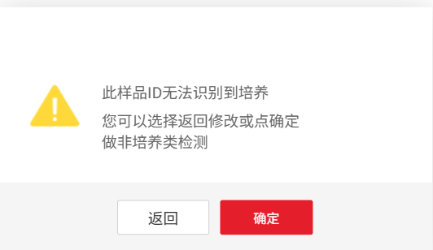

14. **通讯状态校验**：发送需求时需验证当前检测设备的通讯状态，若断开，提示设备断联信息

    > **[图 image371.png | 章节：检测分析 / 需求队列区域（3.3） | 上下文：通讯状态校验：发送需求时需验证当前检测设备的通讯状态，若断开，提示设备断联信息]**
    > **OCR 文本：**
    >  当前设备已离线，请先检查设备连接状态×

    

15. **成功发送**：检测需求成功下发后，该检测记录的状态为“检测中”，右侧检测列表自动新增一条记录，并提示发送成功信息
16. 暂存：
17. **样品ID和温度非空校验**：存在空则提示字段为空，暂存失败，提示失败信息
18. **暂存数量校验**：暂存数达到设备设定上限（由当前设备类型的设置功能控制，等于最大序号数）后，暂存失败，提示失败信息
19. **温度合格校验**：未通过则暂存失败，提示失败信息
20. 样品ID合格校验：
    1.  **样本ID长度校验**：未通过则暂存失败，提示失败信息
    2.  **样品ID唯一性校验**：当一个实验室的一个检测类型下在已暂存的且未删除的记录中存在样品ID重复时，提示信息

        > **[图 image372.png | 章节：检测分析 / 需求队列区域（3.3） | 上下文：样品ID唯一性校验：当一个实验室的一个检测类型下在已暂存的且未删除的记录中存在样品ID重复时，提示信息]**
        > **OCR 文本：**
        > 当前样品ID已暂存，请勿重复操作
        > 当前样品ID已发送至检测设备，请勿重复操作

        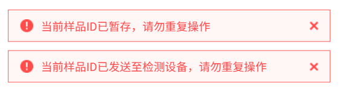

    3.  **关联培养ID校验**：样本ID无法关联到历史已创建培养ID时，提示信息，并支持返回修改或确定以非培养类检测暂存检测需求

        > **[图 image370.png | 章节：检测分析 / 需求队列区域（3.3） | 上下文：关联培养ID校验：样本ID无法关联到历史已创建培养ID时，提示信息，并支持返回修改或确定以非培养类检测暂存检测需求]**
        > **OCR 文本：**
        > 此样品ID无法识别到培养
        > 您可以选择返回修改或点确定
        > 做非培养类检测
        > 返回 | 确定

        

21. **成功暂存**：全部校验通过后，将检测需求暂存，提示成功信息。
    1.  暂存后状态栏显示暂存人姓名，【暂存】按钮置灰，当重新编辑ID或温度信息后，可重新暂存。
    2.  所有暂存信息到达晚上24点，自动清空
22. 删除：
23. 需二次确认删除

    > **[图 image373.png | 章节：检测分析 / 需求队列区域（3.3） | 上下文：需二次确认删除]**
    > **OCR 文本：**
    > 确定制除样品1D2-123F190319X03?
    > 删除后活无法质复，删除点击确定
    > 返回 | 确定

    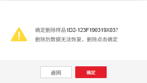

24. 确认后，清空填写区域信息，并将状态置为“空闲”
25. **清空**：清空所有填写区域信息，并将所有通道状态置为“空闲”
26. **清空前的二次确认**：若当前通道存在暂存/检测中状态通道，需要提示，再次确认后清空信息
27. 每天24点，自动清空所有通道

#### 检测列表区域（3.3）

1.  **筛选条件**：以下条件联合查询
2.  **设备**：下拉框，单选，根据实验室联动选择当前实验室下的具体设备
3.  **状态**：当前检测所处状态信息，共包含表中序号3-11共计9种状态
4.  **模式**：下拉选项，列表内容为手动、自动，不选就是全选
5.  **样品ID/设备/送检人**：文本框，支持样品ID/设备/送检人的模糊搜索
6.  **起止时间**：按照上样时间选择查询的开始和结束时间，最多支持查询15天，默认值为当前日期往前推15天
7.  **序号**：当前展示记录的行号
8.  **样品ID**：展示检测需求中的样品ID
9.  **上样时间**：检测需求发送成功时间
10. **检测完成时间**：与接口中传来的检测完成时间保持一致即可
11. **设备编号**：展示设备编号
12. 模式：

    | 序号 | 模式 | 检测方式 |
    | :---: | :---: | :---: |
    | 1 | 手动（M） | 手动取样&手动测样 |
    | 2 | 自动（A） | 自动取样&自动测样、自动测样Load Sample |

13. **送检人**：发送检测需求显示名
14. **状态**：当下的检测状态
15. **操作**：BGA各个状态下支持的操作及说明
16. **刷新**：支持重新获取当前检测需求所处状态
17. **编辑**：点击【编辑】，弹出编辑窗口

    > **[图 image374.png | 章节：检测分析 / 检测列表区域（3.3） | 上下文：编辑：点击【编辑】，弹出编辑窗口]**
    > **OCR 文本：**
    > 修改样品ID
    > 现样品ID | 1D2-123F190319X03 | 样品ID（新） | 请输入
    > 创建人 | 创建时间 | 2026-04-22:12:23:44
    > 修改前 | 修改后 | 操作时间 | 修改人
    > 1D2-123F190319X07 | 1D2-123F190319X03 | 2026-05-31 12:23:44 | 张三
    > 1D2-123F190319X06 | 1D2-123F190319X07 | 2026-05-31 12:23:42 | 张三
    > 1D2-123F190319X05 | 1D2-123F190319X06 | 2026-05-31 12:23:40 | 张三
    > 预设原因支持多选
    > 1、写错了
    > 2、 | 日期算错了
    > 3、没匹配到样品
    > 写错了
    > 原因*
    > 确定 | 取消

    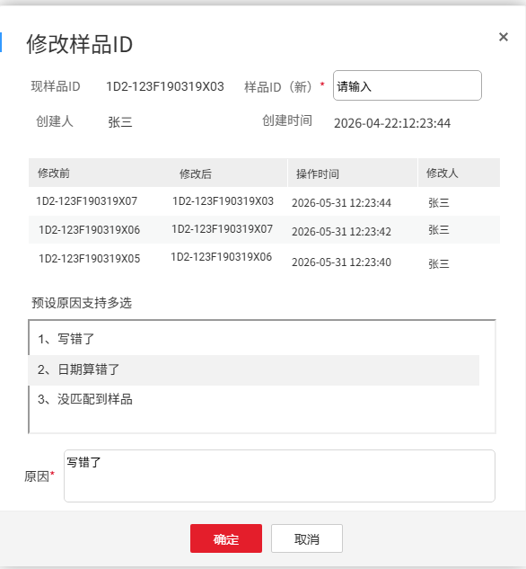

    1.  **现样品ID**：仅文本展示
    2.  **样品ID（新）**：填写新的样品ID，中间所有编辑修改记录都需要保存；
    3.  展示创建者、创建时间
    4.  按照修改时间从近至远顺序展示所有历史修改记录
    5.  **原因填写**：原因文本框为必填，支持通过作废原因（工艺管理－原因管理模块配置）快速勾选填入；原因可多选。
    6.  **确定按钮**：通过校验（发送需求时的样品ID合格校验）后才可保存信息。
18. 复制：
    1.  根据当前信息自动在左侧的需求队列往下（没有再往上找）找一个空闲通道填写一样的信息。需有符合以下条件的通道才能复制成功，否则提示不复制
        1.  状态为“空闲”
    2.  复制说明：
        1.  **中试**：所有字段保持一致。
        2.  **小试**：样品ID自动增1，其余字段保持一致
19. **上传**：点击手动将结果上传，状态变为“已上传”
20. **撤回上传**：点击撤回结果数据，变回“已检测”状态，仅限撤回本人样品，否则撤回失败，提示失败信息
21. **异常**：点击后将状态置为“异常”，仅限本人样品，否则标记异常失败，提示失败信息
22. **作废操作**：作废整条检测记录，点击【作废】，弹出作废原因填写窗口，作废原因文本框为必填，支持通过作废原因（工艺管理－原因管理模块配置）快速勾选填入；原因可多选。

    > **[图 image375.png | 章节：检测分析 / 检测列表区域（3.3） | 上下文：作废操作：作废整条检测记录，点击【作废】，弹出作废原因填写窗口，作废原因文本框为必填，支持通过作废原因（工艺管理－原因管理模块配置）快速勾选填入；原因可多选。]**
    > **OCR 文本：**
    > 作废样品
    > 作废样品请选择作废理由
    > 样品D | 检测温度 | 状态
    > 1TD2-123F190319X03 | 36.5 | 已上报
    > 1、BGA检测项错误1
    > 2、BGA检测项错误2 | 选择
    > 3、BGA检测项错误3 | 选择
    > BGA检测项错误1，BGA检测项错误2
    > 原因"
    > 确定 | 取消

    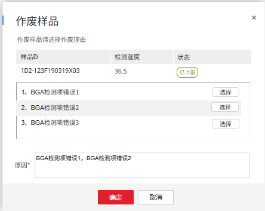

23. **取消作废操作**：对已作废的记录进行取消作废，操作后状态变为“已上传”或“已检测”（作废前是什么状态，取消作废就恢复到什么状态）

    > **[图 image376.png | 章节：检测分析 / 检测列表区域（3.3） | 上下文：取消作废操作：对已作废的记录进行取消作废，操作后状态变为“已上传”或“已检测”（作废前是什么状态，取消作废就恢复到什么状态）]**
    > **OCR 文本：**
    > 撤销作废
    > 作废样品请选择作废理由
    > 样品D | 检测温度 | 状态
    > 1D2-123F190319X03 | 36.5 | 样本作废
    > 1、BGA检测撤销原因1 | 选择
    > 2、BGA检测撤销原因2 | 选择
    > 3、BGA检测撤销原因3 | 选择
    > BGA检测项错误1，BGA检测项错误2
    > 原因”
    > 确定

    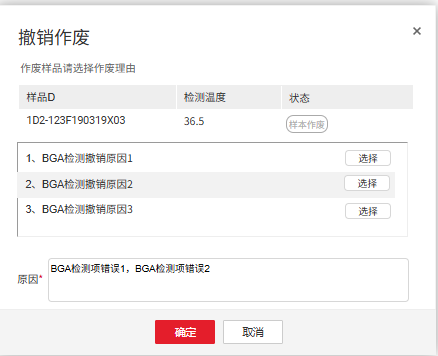

24. **打印**：打印固定模板（模板已通过代码提供）检测结果。当实验室设备管理中添加了打印机才显示，如果实验室设置了多台打印机，打印时弹出打印机选择，选择后变成默认打印机。
25. **查看详情**：点击展开查看检测结果信息，告警后红色字体展示，告警规则配置见章节离线告警设置

    > **[图 image377.png | 章节：检测分析 / 检测列表区域（3.3） | 上下文：查看详情：点击展开查看检测结果信息，告警后红色字体展示，告警规则配置见章节离线告警设置]**
    > **OCR 文本：**
    > 检测详情
    > 样品ID：9D23837737383 | 检测类型：BGA | 设备编号：BGA001 | 上传人：老王
    > 培养ID：837737383 | 天数：D2 | Second ID: 9D2 | 上传时间：2026-06-0723:23:23
    > 序号 | 检测名称 | 检测结果 | 单位 | 描述
    > PH | 6.800
    > pC02 | 32.8 | mmHg | XXXX
    > pO2 | 88.4 | mmHg
    > Na+ | 97 | mM/L
    > K+ | 7.50 | mM/L
    > ITEMP | 38.5 | XXXX
    > 关闭

    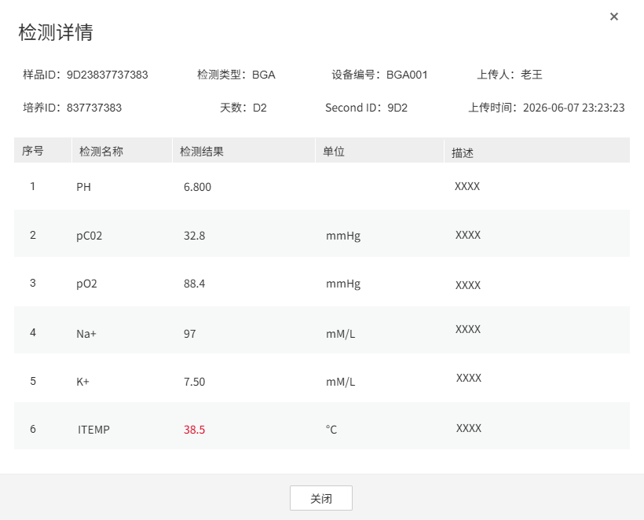

26. **PH校准操作**：仅小试实验室有PH校准操作功能，不在当前优先级内，后续详细补充
27. 删除操作：
    1.  仅“待检测”与“检测中”状态下，支持删除该样本ID
    2.  删除前需要二次确认，再次点击确认删除时才删除该记录
    3.  删除后的样本ID不在样本ID重复性校验的范围内，即被删除的样本ID可以再次使用一次。

### Vicell①

共分为设备筛选及记录查看区域、左侧需求队列区域和右侧检测列表区域

> **[图 image378.png | 章节：检测分析 / Vicell① | 上下文：共分为设备筛选及记录查看区域、左侧需求队列区域和右侧检测列表区域]**
> **OCR 文本：**
> 请选择设备 | 实验室A | Vi-cell-001 | 检测中1 | 待检测1 | 所有检测记录 | 转到检测记录
> 的检索页面
> 需求队列 | 发送 | 选择设备 | 选择状态 | 样品ID/用户/设备编码 | 细胞类型 | 2016/09/01 - 2016/09/20 | 检索
> 序号 | 状态 | 样品ID | 细胞类型 | 操作 | 样品ID | 细胞类型 | 稀释 | VC(*10^6) | Viabiliry(%) | 细胞直径(μm) | 状态 | 上样时间 | 检测完成时间 | 设备编号 | 模式 | 用户 | 操作
> 待检测 | 12-53636FX83773 | CHO | +1 | 1D2-123F1903 | WuXia RidG | (检测中) | 2026-06-08 12:21:12 | VC0003 | 张三
> 空闲 | CHO | +1 | 1D2-123F1904 | WuXia RidG | 0.310 | 98.9 | 13.7 | 已上传 | 2026-06-08 12:21:12 | 2026-06-08 12:21:12 | VC0003 | 张三
> CHO | +1 | 1D2-123F1905 | WuXia RidG | 0.310 | 98.9 | 13.7 | 样品作魔 | 2026-06-08 12:21:12 | 2026-06-08 12:21:12 | VC0003 | 张三
> 空闲 | CHO | +1 | 1D2-123F1906 | WuXia RidG | 0.310 | 98.9 | 13.7 | 已签名 | 2026-06-08 12:21:12 | 2026-06-08 12:21:12 | VC0003 | 张三
> 空闲 | CHO | +1 | 1D2-123F1907 | WuXia RidG | 0.310 | 98.9 | 13.7 | 已审核） | 2026-06-08 12:21:12 | 2026-06-08 12:21:12 | VC0003 | 张三
> 空闲 | CHO | +1 | 1D2-123F1908 | WuXia RidG | 待检测 | 2028-08-08 12:21:12 | VC0003
> 空闲 | CHO | +1 | 1D2-123F1909 | WuXia RidG | 0.310 | 98.9 | 13.7 | 已检测 | 2028-08-08 12:21:12 | 2026-08-08 12:21:12 | VC0003 | 张三
> 空闲 | CHO
> 空闲 | CHO | +1 | 制除
> 10 | 空闲 | CHO | +1
> 11 | 空闲 | CHO | +1
> 12 | 检测中 | 12-53636FX837311 | CHO | +1

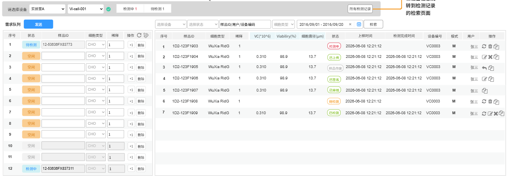

#### 设备筛选及记录查看区域

1.  设备筛选区域
    1.  **实验室/设备编号/通讯状态**：与BGA一致
    2.  **检测中/待检测数量**：统计当前设备检测中和待检测状态的记录数量
2.  记录查看区域
    1.  **所有检测记录**：同BGA

#### 需求队列区域（3.3）

1.  **序号**：可以填写下发检测需求的通道，数量由当前设备类型的设置功能控制（目前只有12个通道这一种设备）
2.  **状态**：包含表中共计11种状态，状态值为“空闲”时，当前通道才能填写/修改、发送操作
3.  按照位置从小到大轮巡（1，2，11,12,1,2,...,11,12）开始检测（检测轮巡列表），第1个为“检测中”，后续都为“待检测”，上一个由“检测中”变为“已检测”时，下一个自动变为“检测中”
4.  当前所有位置，没有“检测中”和“待检测”状态时，10-12位置置灰
5.  当前所有位置，有“检测中”或“待检测”状态时，“检测中”通道及其前两个通道，置灰不能编辑
6.  当前通道，状态变为“已检测”时，自动清空当前通道内容，状态置为空闲

    表 2-3 Vicell状态清单

    | 编号 | 状态 | 区域 | 说明 |
    | :---: | :--- | :--- | :--- |
    | 1 | 空闲 | 需求队列区域 | 最开始默认为空闲 删除/清空后置为“空闲” |
    | 2 | 待检测 | 需求队列区域和检测列表区域 | 排队列表中按照顺序，从第2个开始，置为“待检测” |
    | 3 | 检测中 | 需求队列区域和检测列表区 | 可排队&仅允许单个检测，排队列表中按照顺序，第1个置为“检测中” |
    | 4 | 已检测 | 需求队列区域和检测列表区 | 当前样品ID拿到任一检测项结果后置为“已检测” |
    | 5 | 已上传 | 需求队列区域和检测列表区 | 当前样品ID所有检测项结果均已获取后，查询该样本ID是否存在历史已创建培养ID，若有则置为“已上传” |
    | 6 | 已签名 | 需求队列区域和检测列表区 | 用户可选择“已上传”的结果进行签名操作后置为“已签名” |
    | 7 | 已审核 | 需求队列区域和检测列表区 | 用户可选择“已签名”的结果进行“审核”操作后置为“已签名” |
    | 8 | 超时 | 需求队列区域和检测列表区 | 当前样品ID“检测中”状态的停留时间超过XX为超时 |
    | 9 | 样本作废/单条作废 | 需求队列区域和检测列表区 | 用户可选择“已上传”结果进行【作废】操作置为“样本作废” |
    | 10 | 异常 | 需求队列区域和检测列表区 | 用户手动标记异常后置为“异常” |
    | 11 | 已取消 | 需求队列区域和检测列表区 | 实验操作员在设备上手动取消的检测，置为“已取消” |
    | 12 | 删除 | 需求队列区域和检测列表区 | 用户可选择状态为“待检测”或“检测中”的样本进行手动删除 删除后的样本不会被查询出展示在页面 删除的样本ID后续可以重复使用 |

    1.  **样品ID**：与BGA一致，注意同一批发送的样品ID也不能重复
    2.  **细胞类型**：下拉选项，单选，下拉数据来源数据字典配置
    3.  **稀释**：文本框，必填，一位小数，数值范围1.0至20.0
    4.  +1：
        1.  根据当前信息自动往下找一个符合条件的通道填写信息，其中样本ID需要自增1，其余保持一致。需符合的条件如下：
            1.  状态为“空闲”
            2.  该通道未被置灰（不属于被阻挡的区域）
        2.  复制说明：
            1.  **中试**：所有字段保持一致。
            2.  **小试**：样品ID自动增1，其余字段保持一致
    5.  **删除**：与BGA一致
    6.  **清空**：清空所有填写区域信息，并将所有通道状态置为“空闲”
        1.  **清空前的二次确认**：若当前通道存在检测中/待检测状态通道，需要提示，再次确认后清空信息
        2.  每天24点，自动清空所有通道
        3.  状态变为“已检测”时，自动清空该通道内容，状态置为空闲
    7.  **刷新**：重新获取状态
    8.  发送：
7.  置灰场景：
    1.  当前设备的检测中数量大于等于工作状态下可发送次数时置灰（从设备品牌/型号从设备管理中获取）
    2.  当前通道的状态不为“空闲”时，置灰
8.  支持填写一条/多条后统一发送到设备；所有空闲通道都未填写任何信息时，提示未填写检测需求，发送失败，提示失败信息
9.  已填写每条通道的样品ID、细胞类型和稀释非空校验：存在空则提示字段为空，发送失败，提示失败信息
10. **已填写每条通道的稀释合格校验**：不通过则发送失败，提示失败信息
11. 已填写每条通道的样本ID合格校验：
    1.  **样本ID长度校验**：未通过则暂存失败，提示失败信息
    2.  **样品ID唯一性校验**：当一个实验室的一个检测类型下在已发送的且未删除的记录中存在样品ID重复（包括原ID、修改后ID、本次同一批ID）时，提示失败信息

        > **[图 image369.png | 章节：检测分析 / 需求队列区域（3.3） | 上下文：样品ID唯一性校验：当一个实验室的一个检测类型下在已发送的且未删除的记录中存在样品ID重复（包括原ID、修改后ID、本次同一批ID）时，提示失败信息]**
        > **OCR 文本：**
        >  当前样品/D已发送至检测设备， 请勿重复操作×

        

12. **关联培养ID校验**：样本ID无法关联到历史已创建培养ID时，提示信息，并支持返回修改或确定以非培养类检测暂存检测需求

    > **[图 image370.png | 章节：检测分析 / 需求队列区域（3.3） | 上下文：关联培养ID校验：样本ID无法关联到历史已创建培养ID时，提示信息，并支持返回修改或确定以非培养类检测暂存检测需求]**
    > **OCR 文本：**
    > 此样品ID无法识别到培养
    > 您可以选择返回修改或点确定
    > 做非培养类检测
    > 返回 | 确定

    

13. **通讯状态校验**：发送需求时需验证当前检测设备的通讯状态，若断开，

    > **[图 image371.png | 章节：检测分析 / 需求队列区域（3.3） | 上下文：通讯状态校验：发送需求时需验证当前检测设备的通讯状态，若断开，]**
    > **OCR 文本：**
    >  当前设备已离线，请先检查设备连接状态×

    

14. **成功发送**：检测需求成功下发后，
    1.  按照队列顺序轮巡（1，2，11,12,1,2,...,11,12）开始检测（检测轮巡列表），第1个为“检测中”，后续都为“待检测”
    2.  上一个由“检测中”变为“已检测”时，下一个自动变为“检测中”
    3.  右侧检测列表自动新增对应数量记录，并提示成功信息

#### 检测列表区域（3.3）

1.  筛选条件：
2.  **设备**：用BGA
3.  **样品ID/用户/设备编号**：同BGA
4.  **细胞类型**：下拉单选，下拉选项来自数据字典配置
5.  **起止时间**：同BGA
6.  **状态**：当前检测所处状态信息，包含表中序号2-11共计10种状态
7.  序号/样品ID/上样时间/检测完成时间/设备编号/模式/用户：同BGA
8.  **细胞类型**：展示记录中的细胞类型
9.  **稀释**：展示记录中的稀释
10. **VCD(*10^6)**：检测项结果展示，告警后红色字体展示，告警规则由离线告警模块配置
11. **Viability（%）**：检测项结果展示，告警后红色字体展示，告警规则由离线告警模块配置
12. **细胞直径（㎛）**：检测项结果展示，告警后红色字体展示，告警规则由离线告警模块配置
13. **状态**：当下的检测状态
14. 复制：
15. 根据当前信息自动在左侧的需求队列往下（没有再往上找）找一个空闲通道填写一样的信息。左侧需有通道符合以下条件才能复制成功，否则提示不能复制：
    1.  状态为“空闲”的通道
    2.  通道未被置灰（不属于被遮挡的区域）
16. 复制说明：
    1.  **中试**：所有字段保持一致。
    2.  **小试**：样品ID自动增1，其余字段保持一致
17. 刷新/编辑/作废/取消作废/上传/撤回上传/异常/删除操作：同BGA

### OSMO-1 ①

共分为设备筛选及记录查看区域、左侧需求队列区域和右侧检测列表区域

> **[图 image379.png | 章节：检测分析 / OSMO-1 ① | 上下文：共分为设备筛选及记录查看区域、左侧需求队列区域和右侧检测列表区域]**
> **OCR 文本：**
> 请选择设备 | 实验室A | OSMO1 | 检测中1 | 所有检测记录
> 需求队列 | 选择设备 | 选择状态 | 样品ID/用户/设备编码 | 2016/09/01 -2016/09/20 | 检索
> 序号 | 暂存人 | 样品ID | 操作 | 序号 | 样品ID | 位置 | 结果mOsm/kg | 状态 | 上样时间 | 检测完成时间 | 设备编号 | 模式 | 用户 | 操作
> 张三 | 1D2123F190319X03 | +1 | 发送 | 1D2-123F1903 | （检测中 | 2026-06-08 12:21:12 | OSMO1 | 张三
> 张三 | 1D2123F190319X04 | -1 | 发送 | 制除 | 1D2-123F1904 | 307 | 已上传 | 2026-06-08 12:21:12 | 2026-06-08 12:21:12 | OSMO1 | 张三
> 张三 | 1D2123F190319X05 | +1 | 发送暂存 | 制除 | 1D2-123F1905 | 样品作废 | 2026-06-08 12:21:12 | 2026-06-08 12:21:12 | OSMO1 | 张三
> 空闲 | 1D2123F190319X07 | +1 | 发送暂存 | 删除 | 1D2-123F1906 | 409 | 已签名 | 2026-06-08 12:21:12 | 2026-06-08 12:21:12 | OSMO1 | 张三
> 空闲 | 样品ID | 暂存 | 删除 | 1D2-123F1907 | 313 | 已审核 | 2026-06-08 12:21:12 | 2026-06-08 12:21:12 | OSMO1 | 张三
> 空闲 | 样品ID | 删除
> 空闲 | 样品ID | +1 | 删除
> 空闲 | 样品ID | 删除
> 空闲 | 样品ID | +1
> 10 | 空闲 | 样品ID | 删除
> 11 | 空闲 | 样品ID | 删除

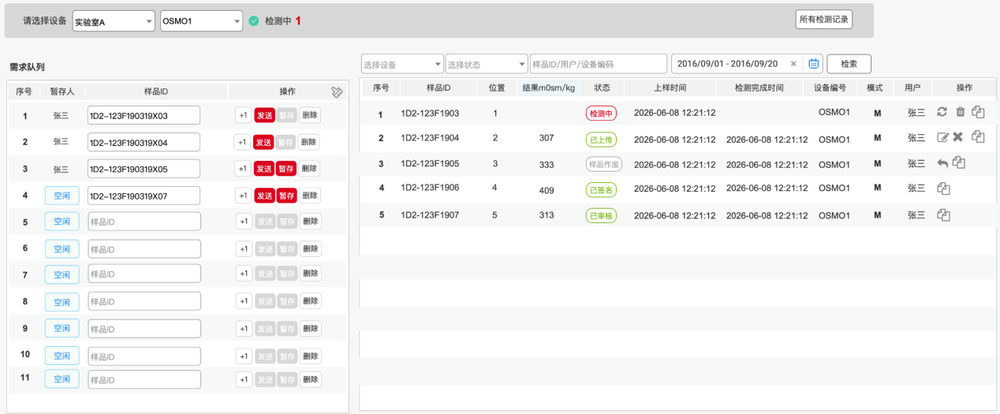

#### 设备筛选及记录查看区域

同BGA

#### 需求队列区域

同BGA，注意没有温度字段

#### 检测列表区域（3.3）

1.  **筛选条件**：同BGA
2.  序号/样品ID/状态/上样时间/检测完成时间/设备编号/模式/用户：同BGA
3.  **位置**：检测需求下发时对应的序号信息
4.  **结果（mOsm/kg）**：检测结果，告警时红色字体展示，告警规则由离线告警监控模块配置
5.  刷新/编辑/作废/取消作废/复制/上传/撤销上传/异常/删除操作：同BGA

### OSMO-2/OSMO-3①

共分为设备筛选及记录查看区域、左侧需求队列区域和右侧检测列表区域

> **[图 image380.png | 章节：检测分析 / OSMO-2/OSMO-3① | 上下文：共分为设备筛选及记录查看区域、左侧需求队列区域和右侧检测列表区域]**
> **OCR 文本：**
> 请选择设备 | 实验室A | OSMO1 | 检测中1 | 所有检测记累
> 需求队列 | 发送 | 选择设备 | 避择状态 | 样品ID/用户/设备编码 | 2016/09/01 - 2016/09/20 | 检索
> 序号 | 状态 | 样品ID | 操作 | 序号 | 样品ID | 位置 | 结果巢m0sm/kg | 上样附间 | 检测完减时间 | 设备编号 | 模式 | 用户 | 操作
> B上传 | 12-53636FX83773 | 1D2-123F1903 | 检测中) | 2026-06-08 12:21:12 | OSMO1 | 张三
> 空闲 | I+ | 型除 | 1D2-123F1904 | 307 | B上传 | 2026-06-08 12:21:12 | 2026-06-08 12:21:12 | OSMO1 | 张三
> 空闲 | 1D2-123F1905 | 333 | 2026-06-08 12:21:12 | 2026-06-08 12:21:12 | OSMO1 | 张三
> 空闲 | 1D2-123F1906 | 409 | 2026-06-08 12:21:12 | 2026-06-08 12:21:12 | OSMO1 | 张三
> 空闲 | 1D2-123F1907 | 313 | 已市校 | 2026-06-08 12:21:12 | 2026-06-08 12:21:12 | OSMO1 | 张三
> 空闲 | I+ | 1D2-123F1908 | 313 | 2026-06-08 12:21:12 | 2026-06-08 12:21:12 | OSMO1 | 张三
> 空闲
> 空闲 | I+
> 空闲
> 10 | B上传 | 12-53636FX837312
> 11 | B上传 | 12-53636FX837313
> 12 | B上传 | 12-53636FX837311

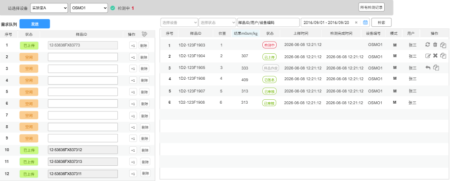

#### 设备筛选及记录查看区域

同Vicell

#### 需求队列区域（3.3）

1.  **序号**：同BGA
2.  **样品ID**：同BGA，注意同一批样品ID也不能重复
3.  **状态**：一共有11种状态，状态值为“空闲”时，当前通道才能填写/修改、点击开始等操作

    表 2-4 OSMO2需求状态清单

    | 编号 | 状态 | 区域 | 说明 |
    | :---: | :--- | :--- | :--- |
    | 1 | 空闲 | 需求队列区域 | 最开始默认为空闲 删除/清空后置为“空闲” |
    | 2 | 待检测 | 需求队列区域和检测列表区域 | 排队列表中按照顺序，从第2个开始，置为“待检测” |
    | 3 | 检测中 | 需求队列区域和检测列表区 | 可排队&仅允许单个检测，排队列表中按照顺序，第1个置为“检测中” |
    | 4 | 已检测 | 需求队列区域和检测列表区 | 当前样品ID拿到任一检测项结果后置为“已检测” |
    | 5 | 已上传 | 需求队列区域和检测列表区 | 当前样品ID所有检测项结果均已获取后，查询该样本ID是否存在历史已创建培养ID，若有则置为“已上传” |
    | 6 | 已签名 | 需求队列区域和检测列表区 | 用户可选择“已上传”的结果进行签名操作后置为“已签名” |
    | 7 | 已审核 | 需求队列区域和检测列表区 | 用户可选择“已签名”的结果进行“审核”操作后置为“已签名” |
    | 8 | 超时 | 需求队列区域和检测列表区 | 当前样品ID“检测中”状态的停留时间超过XX为超时 |
    | 9 | 样本作废/单条作废 | 需求队列区域和检测列表区 | 用户可选择“已上传”结果进行【作废】操作置为“样本作废” |
    | 10 | 异常 | 需求队列区域和检测列表区 | 用户手动标记异常后置为“异常” |
    | 11 | 已取消 | 需求队列区域和检测列表区 | 实验操作员在设备上手动取消的检测，置为“已取消” |
    | 12 | 删除 | 需求队列区域和检测列表区 | 用户可选择状态为“待检测”或“检测中”的样本进行手动删除 删除后的样本不会被查询出展示在页面 删除的样本ID后续可以重复使用 |

4.  **+1/删除操作**：同BGA
5.  **清空**：清空所有填写区域信息，并将所有通道状态置为“空闲”
    1.  **清空前的二次确认**：若当前通道存在检测中/待检测状态通道，需要提示，再次确认后清空信息
    2.  每天24点，自动清空所有通道
6.  发送：
7.  置灰场景
    1.  当前设备的检测中数量大于等于工作状态下可发送次数时置灰（从设备品牌/型号从设备管理中获取）
    2.  当前通道的状态不为“空闲”时，置灰
8.  支持填写一条/多条后统一发送到设备；所有空闲通道都未填写时，提示未填写检测需求，发送失败，提示失败信息
9.  已填写每条通道的样本ID合格校验：
    1.  **样本ID长度校验**：未通过则暂存失败，提示失败信息
    2.  **样品ID唯一性校验**：当一个实验室的一个检测类型下在已发送的且未删除的记录中存在样品ID重复（包括原ID、修改后ID、本次同一批ID）时，提示失败信息

        > **[图 image369.png | 章节：检测分析 / 需求队列区域（3.3） | 上下文：样品ID唯一性校验：当一个实验室的一个检测类型下在已发送的且未删除的记录中存在样品ID重复（包括原ID、修改后ID、本次同一批ID）时，提示失败信息]**
        > **OCR 文本：**
        >  当前样品/D已发送至检测设备， 请勿重复操作×

        

10. **关联培养ID校验**：样本ID无法关联到历史已创建培养ID时，提示信息，并支持返回修改或确定以非培养类检测暂存检测需求

    > **[图 image370.png | 章节：检测分析 / 需求队列区域（3.3） | 上下文：关联培养ID校验：样本ID无法关联到历史已创建培养ID时，提示信息，并支持返回修改或确定以非培养类检测暂存检测需求]**
    > **OCR 文本：**
    > 此样品ID无法识别到培养
    > 您可以选择返回修改或点确定
    > 做非培养类检测
    > 返回 | 确定

    

11. **通讯状态校验**：发送需求时需验证当前检测设备的通讯状态，若断开，

    > **[图 image371.png | 章节：检测分析 / 需求队列区域（3.3） | 上下文：通讯状态校验：发送需求时需验证当前检测设备的通讯状态，若断开，]**
    > **OCR 文本：**
    >  当前设备已离线，请先检查设备连接状态×

    

12. **成功发送**：检测需求成功下发后，
    1.  按照队列顺序轮巡（1，2，11,12,1,2,...,11,12）开始检测（检测轮巡列表），第1个为“检测中”，后续都为“待检测”
    2.  上一个由“检测中”变为“已检测”时，下一个自动变为“检测中”
    3.  右侧检测列表自动新增对应数量记录，并提示成功信息

#### 检测列表区域（3.3）

1.  **筛选条件**：状态筛选需要更新，其余与BGA保持一致
2.  **状态**：当前检测所处状态信息，包含表中序号2-11共计10种状态
3.  序号/样品ID/上样时间/检测完成时间/设备编号/模式/用户：同BGA
4.  **位置**：检测需求下发的位置信息
5.  **结果（mOsm/kg）**：检测结果，告警时红色字体展示，告警规则由offline告警监控模块配置
6.  **状态**：当前检测状态
7.  刷新/编辑/作废/取消作废/复制/上传/撤回上传/异常/删除操作：同BGA

### Cedex Bio①

共分为设备筛选及记录查看区域、左侧需求队列区域和右侧检测列表区域

> **[图 image381.png | 章节：检测分析 / Cedex Bio① | 上下文：共分为设备筛选及记录查看区域、左侧需求队列区域和右侧检测列表区域]**
> **OCR 文本：**
> 请选择设备 | 实验室A | Cedex Bio-1 | 检测中 1 | 待检测10 | 所有检测记录
> 需求队列 | 选择设备 | 选择状态 | 样品ID/用户/设备编码 | 2016/09/01 - 2016/09/20 | 检索
> 序号 | 状态 | 样品ID | 检测项设置 | 操作 | 序号 | 样品ID | 位置 | 状态 | 上样时间 | 检测完成时间 | 设备编号 | 模式 | 用户 | 操作
> 已上报 | 12-53636FX83773 | 检测项(5) | +1 | 发送 | 1D2-123F1903 | 检测中 | 2026-06-08 12:21:12 | CeDex3 | 张三
> 空闲 | 检测项 (0) | +1 | 发送 | 1D2-123F1904 | 已上传 | 2026-06-08 12:21:12 | 2026-06-08 12:21:12 | CeDex3 | 张三
> 空闲 | 检测项 (0) | 发送 | 1D2-123F1905 | 样品作废 | 2026-06-08 12:21:12 | 2026-06-08 12:21:12 | CeDex3 | 张三
> 空闲 | 检测项 (0) | 发送 | 1D2-123F1906 | 已签名 | 2026-06-08 12:21:12 | 2028-06-08 12:21:12 | CeDex3 | 张三
> 空闲 | 检测项 (0) | 发送 | 1D2-123F1907 | 已审楼 | 2026-06-08 12:21:12 | 2026-06-08 12:21:12 | CeDex3 | 张三
> 空闲 | 检测项 (0) | 发送
> 空闲 | 检测项 (0) | 发送
> 空闲 | 检测项 (0) | 发送
> 空闲 | 检测项 (0) | +1 | 发送
> 10 | 已上报 | 12-53636FX837312 | 检测项(5) | +1 | 发送
> 11 | 已上报 | 12-53636FX837313 | 检测项(5) | 发送
> 12 | 检测中 | 12-53636FX837311 | 检测项(5) | +1 | 发送

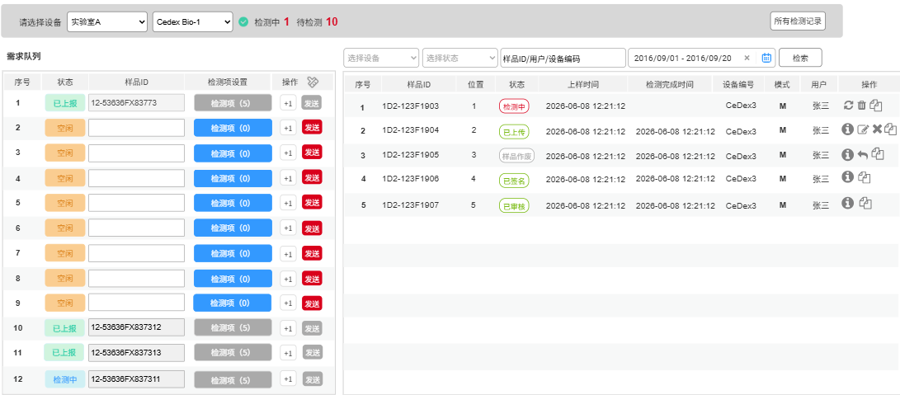

#### 设备筛选及记录查看区域

同Vicell

#### 需求队列区域（3.3）

1.  **序号**：可以填写下发检测需求的通道，数量由当前设备类型的设置功能控制
2.  **状态**：一共包含下表中共计10种状态，状态值为“空闲”时，当前通道才能填写/修改、发送等操作

    表 2-5 Cedex Bio需求状态清单

    | 编号 | 状态 | 区域 | 说明 |
    | :---: | :--- | :--- | :--- |
    | 1 | 空闲 | 需求队列区域 | 最开始默认为空闲 删除/清空后置为“空闲” |
    | 2 | 检测中 | 需求队列区域和检测列表区 | 可排队&允许多个同时检测时，排队列表中全部为“检测中” |
    | 3 | 已检测 | 需求队列区域和检测列表区 | 当前样品ID拿到任一检测项结果后置为“已检测” |
    | 4 | 已上传 | 需求队列区域和检测列表区 | 当前样品ID所有检测项结果均已获取后，查询该样本ID是否存在历史已创建培养ID，若有则置为“已上传” |
    | 5 | 已签名 | 需求队列区域和检测列表区 | 用户可选择“已上传”的结果进行签名操作后置为“已签名” |
    | 6 | 已审核 | 需求队列区域和检测列表区 | 用户可选择“已签名”的结果进行“审核”操作后置为“已签名” |
    | 7 | 超时 | 需求队列区域和检测列表区 | 当前样品ID“检测中”状态的停留时间超过XX为超时 |
    | 8 | 样本作废/单条作废 | 需求队列区域和检测列表区 | 用户可选择“已上传”结果进行【作废】操作置为“样本作废” |
    | 9 | 异常 | 需求队列区域和检测列表区 | 用户手动标记异常后置为“异常” |
    | 10 | 已取消 | 需求队列区域和检测列表区 | 实验操作员在设备上手动取消的检测，置为“已取消” |
    | 11 | 删除 | 需求队列区域和检测列表区 | 用户可选择状态为“待检测”或“检测中”的样本进行手动删除 删除后的样本不会被查询出展示在页面 删除的样本ID后续可以重复使用 |

3.  **样品ID**：与BGA一致，注意同一批发送的样品ID也不能重复
4.  **检测项设置**：按钮，
    1.  当前通道为空闲状态时，点击后弹窗选择检测项目，支持多选，支持按组全选（按照检测项的分组名字段分组，没有填写分组名的全部属于“未分组”这一组），选择后展示所选数量，可选的检测项目在资源管理－设备管理模块配置
        1.  **稀释倍数**：左侧数字默认为1，不可修改；当前设备勾选了支持修改稀释倍数时，右侧数字默认为1，支持修改，限制范围为1-100的整数。

            > **[图 image382.png | 章节：检测分析 / 需求队列区域（3.3） | 上下文：稀释倍数：左侧数字默认为1，不可修改；当前设备勾选了支持修改稀释倍数时，右侧数字默认为1，支持修改，限制范围为1-100的整数。]**
            > **OCR 文本：**
            > 检测项设置
            > 组名1：检测项1 | 稀释倍数
            > 口检测项2 | 稀释倍数
            > 检测项3 | 稀释倍数
            > 检测项4 | 稀释倍数
            > 口组名2：检测项5 | 稀释倍数
            > 检测项6 | 稀释倍数
            > 口检测项7 | 稀释倍数
            > 口检测项8 | 稀释倍数
            > 组名3：检测项9 | 稀释倍数
            > 口检测项10 | 稀释倍数
            > 检测项11 | 稀释倍数
            > 检测项12 | 稀释倍数
            > 确定 | 取消

            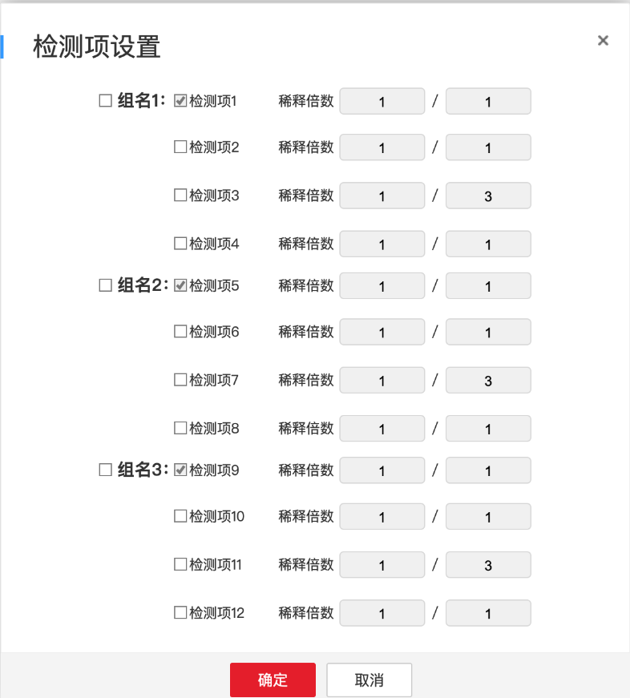

    2.  当前通道不为空闲时，点击查看发送需求时已选过的检测项，不允许修改。

        > **[图 image382.png | 章节：检测分析 / 需求队列区域（3.3） | 上下文：当前通道不为空闲时，点击查看发送需求时已选过的检测项，不允许修改。]**
        > **OCR 文本：**
        > 检测项设置
        > 组名1：检测项1 | 稀释倍数
        > 口检测项2 | 稀释倍数
        > 检测项3 | 稀释倍数
        > 检测项4 | 稀释倍数
        > 口组名2：检测项5 | 稀释倍数
        > 检测项6 | 稀释倍数
        > 口检测项7 | 稀释倍数
        > 口检测项8 | 稀释倍数
        > 组名3：检测项9 | 稀释倍数
        > 口检测项10 | 稀释倍数
        > 检测项11 | 稀释倍数
        > 检测项12 | 稀释倍数
        > 确定 | 取消

        

5.  **+1/清空操作**：同BGA
6.  **清空**：清空所有填写区域信息，并将所有通道状态置为“空闲”
    1.  **清空前的二次确认**：若当前通道存在检测中状态通道，需要提示，再次确认后清空信息
    2.  每天24点，自动清空所有通道
7.  发送：
8.  置灰不能点击场景包括：
    1.  当前设备的检测中数量大于等于工作状态下可发送次数时置灰（从设备品牌/型号从设备管理中获取）
    2.  当前通道的状态不为“空闲”时，置灰
9.  **样品ID非空校验**：存在空则提示字段为空，发送失败，提示失败信息
10. 样本ID合格校验：
    1.  **样本ID长度校验**：未通过则暂存失败，提示失败信息
    2.  **样品ID唯一性校验**：当一个实验室的一个检测类型下在已发送的且未删除的记录中存在样品ID重复（包括原ID和修改后ID）时，提示失败信息

        > **[图 image369.png | 章节：检测分析 / 需求队列区域（3.3） | 上下文：样品ID唯一性校验：当一个实验室的一个检测类型下在已发送的且未删除的记录中存在样品ID重复（包括原ID和修改后ID）时，提示失败信息]**
        > **OCR 文本：**
        >  当前样品/D已发送至检测设备， 请勿重复操作×

        

11. **关联培养ID校验**：样本ID无法关联到历史已创建培养ID时，提示信息，并支持返回修改或确定以非培养类检测暂存检测需求

    > **[图 image370.png | 章节：检测分析 / 需求队列区域（3.3） | 上下文：关联培养ID校验：样本ID无法关联到历史已创建培养ID时，提示信息，并支持返回修改或确定以非培养类检测暂存检测需求]**
    > **OCR 文本：**
    > 此样品ID无法识别到培养
    > 您可以选择返回修改或点确定
    > 做非培养类检测
    > 返回 | 确定

    

12. **通讯状态校验**：发送需求时需验证当前检测设备的通讯状态，若断开，

    > **[图 image371.png | 章节：检测分析 / 需求队列区域（3.3） | 上下文：通讯状态校验：发送需求时需验证当前检测设备的通讯状态，若断开，]**
    > **OCR 文本：**
    >  当前设备已离线，请先检查设备连接状态×

    

13. **成功发送**：检测需求成功下发后，该检测记录的状态为“待检测”（当前需排队检测）或“检测中”（当前不需排队检测），右侧检测列表自动新增一条记录，并提示成功信息

#### 检测列表区域（3.3）

1.  **筛选条件**：状态筛选需要更新，其余与BGA保持一致
2.  **状态**：当前检测所处状态信息，包含表中2-10共计10种状态
3.  序号/样品ID/上样时间/检测完成时间/设备编号/模式/用户：同BGA
4.  **位置**：样本检测的位置信息
5.  **状态**：当前检测状态
6.  刷新/编辑/作废/取消作废/复制/上传/撤回上传/异常/删除操作：同BGA
7.  **查看详情操作**：默认为折叠，点击展开查看检测结果信息，告警后红色字体展示，告警规则由离线告警模块配置

    > **[图 image383.png | 章节：检测分析 / 检测列表区域（3.3） | 上下文：查看详情操作：默认为折叠，点击展开查看检测结果信息，告警后红色字体展示，告警规则由离线告警模块配置]**
    > **OCR 文本：**
    > 检测详情
    > 样品ID：9D23837737383 | 检测类型：Cedex | 设备编号：Cedex001 | 上传人：老王
    > 培养ID:837737383 | 天数：D2 | Second ID: 9D2 | 上传时间：2026-06-0723:23:23
    > 序号 | 检测名称 | 检测结果 | 单位 | 描述 | 操作
    > XXX | XXX | XXX | XXX
    > XXX | 单项作废 | XXX | XXX
    > XXX | XXX | XXX | XXX
    > XXX | XXX | XXX | XXX
    > 关闭

    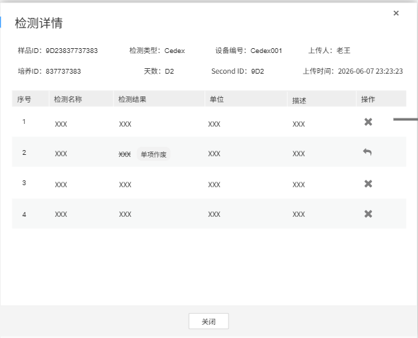

8.  **基础信息展示**：样品ID、检测类型、设备编号、上传人、培养ID、天数、Second ID、上传时间
9.  列表展示
    1.  **序号**：行号
    2.  检测名称
    3.  检测结果
    4.  单位
    5.  描述
    6.  **操作**：执行单条作废/单条撤销作废。（页面与整条作废一致，只是检测项只有一条）
        1.  **样品作废**：作废单条检测记录，点击【作废】，弹出作废原因填写窗口，上方作废原因文本框为必填，支持通过下方作废原因（工艺管理－原因管理模块配置）快速勾选填入；

            > **[图 image384.png | 章节：检测分析 / 检测列表区域（3.3） | 上下文：样品作废：作废单条检测记录，点击【作废】，弹出作废原因填写窗口，上方作废原因文本框为必填，支持通过下方作废原因（工艺管理－原因管理模块配置）快速勾选填入；]**
            > **OCR 文本：**
            > 样品作废
            > 作废样本请选择作废理由
            > 样品ID | 检测项 | 状态
            > 1D2-123F190319X03 | 10 | @上报
            > 作废检测项：
            > 检测项 | 结果 | 单位
            > Xx xx | xx xx | x xxx
            > XXXX | x xxx
            > 1、检测项错误1 | 选择
            > 2、 | 检测项错误2 | 选择
            > 3、检测项错误3 | 选择
            > 检测项错误1，检测项错误2
            > 原因
            > 确定 | 取消

            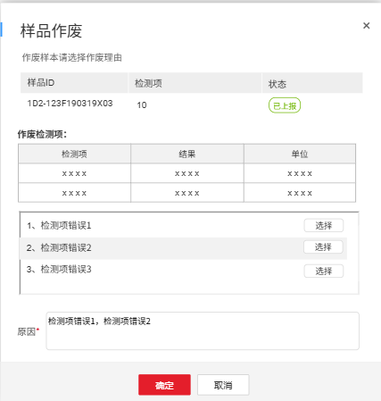

        2.  **取消作废**：单条取消作废

            > **[图 image384.png | 章节：检测分析 / 检测列表区域（3.3） | 上下文：取消作废：单条取消作废]**
            > **OCR 文本：**
            > 样品作废
            > 作废样本请选择作废理由
            > 样品ID | 检测项 | 状态
            > 1D2-123F190319X03 | 10 | @上报
            > 作废检测项：
            > 检测项 | 结果 | 单位
            > Xx xx | xx xx | x xxx
            > XXXX | x xxx
            > 1、检测项错误1 | 选择
            > 2、 | 检测项错误2 | 选择
            > 3、检测项错误3 | 选择
            > 检测项错误1，检测项错误2
            > 原因
            > 确定 | 取消

            

### Cedex Bio HT①

共分为设备筛选及记录查看区域、左侧需求队列区域和右侧检测列表区域

> **[图 image385.png | 章节：检测分析 / Cedex Bio HT① | 上下文：共分为设备筛选及记录查看区域、左侧需求队列区域和右侧检测列表区域]**
> **OCR 文本：**
> 请选择设备 | 实验室A | Cedex Bio-1 | 检测中1 | 待检测10 | 所有检测记录
> 需求队列 | 发送
> 选择设备 | 选择状态 | 样品ID/用户/设备编码 | 所有列 | 2016/09/01 - 2016/09/20 | 检索
> 序号 | 状态 | 样品ID | 检测项设置 | 操作 | 序号 | 样品ID | 位置 | 状态 | 上样时间 | 检测完成时间 | 设备编号 | 模式 | 用户 | 操作
> 检测中 | 12-53636FX83773 | 检测项(5) | +1 | 1D2-123F1903 | K1 | 检测中 | 2026-06-08 12:21:12 | CeDex3 | 张三
> 空闲 | 检测项 (0) | +1 | 1D2-123F1904 | M2 | 已上传 | 2026-06-08 12:21:12 | 2026-06-08 12:21:12 | CeDex3 | 张三
> 空闲 | 检测项(0) | 1D2-123F1905 | M3 | 样品作废 | 2026-06-08 12:21:12 | 2026-06-08 12:21:12 | CeDex3 | 张三
> 空闲 | 检测项(0) | +1 | 1D2-123F1906 | N5 | 已签名 | 2026-06-08 12:21:12 | 2026-06-08 12:21:12 | CeDex3 | 张三
> 空闲 | 检测项(0) | +1 | 1D2-123F1907 | L5 | 已审楼 | 2026-06-08 12:21:12 | 2026-06-08 12:21:12 | CeDex3 | 张三
> 空闲 | 检测项(0) | +1
> 空闲 | 检测项(0) | +1
> 空闲 | 检测项 (0) | +1
> 空闲 | 检测项(0) | +1
> 10 | 检测中 | 12-53636FX837312 | 检测项 (5) | +1
> 11 | 检测中 | 12-53636FX837313 | 检测项(5)
> 12 | 检测中 | 12-53636FX837311 | 检测项 (5) | +1

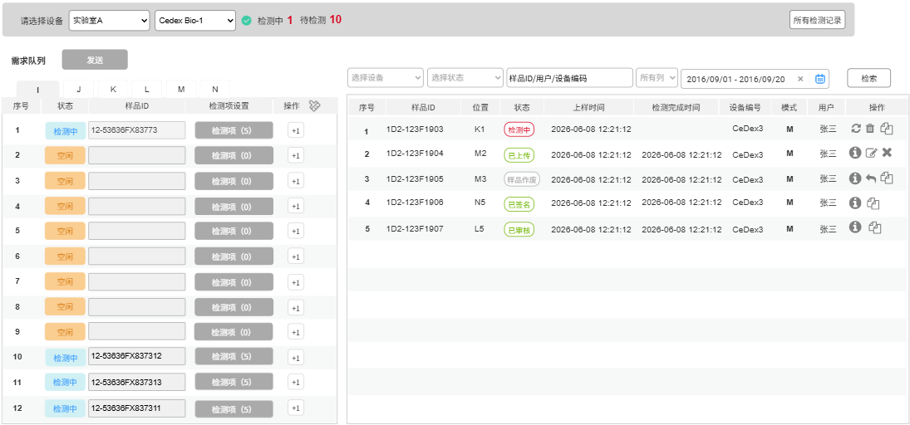

#### 设备筛选及记录查看区域

同Vicell

#### 需求队列区域（3.3）

1.  设备特性说明
2.  此设备类型为多列，列数以及每列的序号数由设备配置得到
3.  在一列中，填写一条或多条点击发送后，在全部检测完成前，此列对应的样品ID都置灰不允许任何操作，直到全部变为已检测才能再次发送检测需求。
    1.  每一列说明如下：
        1.  **序号**：可以填写下发检测需求的通道，数量由当前设备类型的设置功能控制
        2.  **状态**：一共有10种状态。

            表 2-6 Cedex Bio HT检测需求状态清单

            | 编号 | 状态 | 区域 | 说明 |
            | :---: | :--- | :--- | :--- |
            | 1 | 空闲 | 需求队列区域 | 最开始默认为空闲 删除/清空后置为“空闲” |
            | 2 | 检测中 | 需求队列区域和检测列表区 | 可排队&允许多个同时检测时，排队列表中全部为“检测中” |
            | 3 | 已检测 | 需求队列区域和检测列表区 | 当前样品ID拿到任一检测项结果后置为“已检测” |
            | 4 | 已上传 | 需求队列区域和检测列表区 | 当前样品ID所有检测项结果均已获取后，查询该样本ID是否存在历史已创建培养ID，若有则置为“已上传” |
            | 5 | 已签名 | 需求队列区域和检测列表区 | 用户可选择“已上传”的结果进行签名操作后置为“已签名” |
            | 6 | 已审核 | 需求队列区域和检测列表区 | 用户可选择“已签名”的结果进行“审核”操作后置为“已签名” |
            | 7 | 超时 | 需求队列区域和检测列表区 | 当前样品ID“检测中”状态的停留时间超过XX为超时 |
            | 8 | 样本作废/单条作废 | 需求队列区域和检测列表区 | 用户可选择“已上传”结果进行【作废】操作置为“样本作废” |
            | 9 | 异常 | 需求队列区域和检测列表区 | 用户手动标记异常后置为“异常” |
            | 10 | 已取消 | 需求队列区域和检测列表区 | 实验操作员在设备上手动取消的检测，置为“已取消” |
            | 11 | 删除 | 需求队列区域和检测列表区 | 用户可选择状态为“待检测”或“检测中”的样本进行手动删除 删除后的样本不会被查询出展示在页面 删除的样本ID后续可以重复使用 |

        3.  **样品ID**：与BGA一致，注意同一批发送的样品ID也不能重复；当前列已全部检测完成（当前列可发送）且状态为空闲时才能编辑。
        4.  **检测项设置**：按钮，
            1.  当前列未全部检测完成（当前列不可发送）且状态为空闲时，可点击弹窗查看检测项目，但不可成功勾选保存
            2.  当前列已全部检测完成（当前列可发送）且当前通道为空闲状态时，点击后弹窗选择检测项目，支持多选，支持按组全选，选择后展示所选数量，可选的检测项目在资源管理－设备管理模块配置

                > **[图 image386.png | 章节：检测分析 / 需求队列区域（3.3） | 上下文：当前列已全部检测完成（当前列可发送）且当前通道为空闲状态时，点击后弹窗选择检测项目，支持多选，支持按组全选，选择后展示所选数量，可选的检测项目在资源管理－设备管…]**
                > **OCR 文本：**
                > 检测项设置
                > 组名： | 冈检测项1 | 检测项2 | 检测项3 | 检测项4
                > 组名： | ?检测项5 | 检测项6 | 口检测项7
                > 口组名： | ■检测项9 | ■检测项10
                > 组名： | ■检测项13 | ■检测项14 | ■检测项15 | ■检测项16
                > 确定 | 取消

                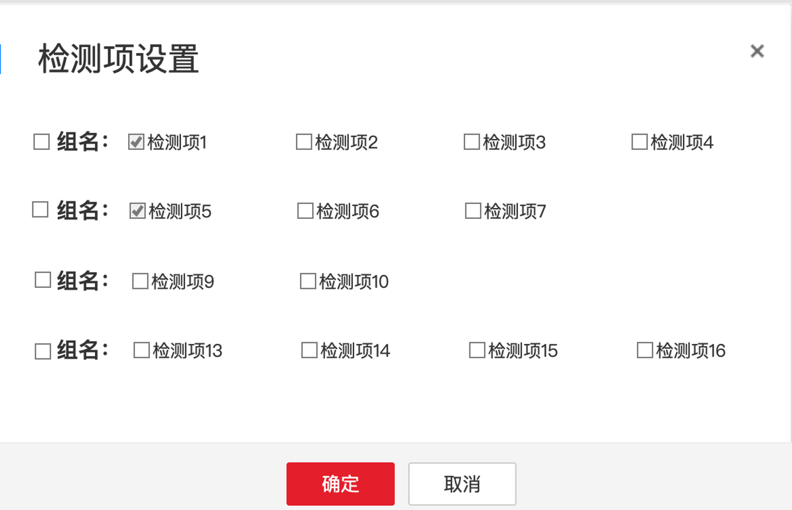

            3.  当前通道不为空闲时，点击查看发送需求时已选过的检测项

                > **[图 image386.png | 章节：检测分析 / 需求队列区域（3.3） | 上下文：当前通道不为空闲时，点击查看发送需求时已选过的检测项]**
                > **OCR 文本：**
                > 检测项设置
                > 组名： | 冈检测项1 | 检测项2 | 检测项3 | 检测项4
                > 组名： | ?检测项5 | 检测项6 | 口检测项7
                > 口组名： | ■检测项9 | ■检测项10
                > 组名： | ■检测项13 | ■检测项14 | ■检测项15 | ■检测项16
                > 确定 | 取消

                

        5.  **+1操作**：同BGA。注意在当前列未全部检测完成时，不允许操作。
        6.  **清空**：清空所有填写区域信息，并将所有通道状态置为“空闲”
            1.  **清空前的二次确认**：若当前通道存在检测中状态通道，需要提示，再次确认后清空信息
            2.  每天24点，自动清空所有通道
            3.  当前列为检测完成时，不允许清空
        7.  发送：
            1.  置灰不能点击场景包括：
                1.  当前列未全部检测完成时，置灰不能发送
            2.  支持填写一条/多条后统一发送到设备；所有“空闲”通道都未填写时，提示未填写检测需求，发送失败，提示失败信息
            3.  已填写每条通道样品ID、检测项设置非空校验：存在空则提示字段为空，发送失败，提示失败信息
            4.  已填写每条通道样本ID合格校验：
                1.  **样本ID长度校验**：未通过则暂存失败，提示失败信息
                2.  **样品ID唯一性校验**：当一个实验室的一个检测类型下在已发送的且未删除的记录中存在样品ID重复（包括原ID和修改后ID）时，提示失败信息

                    > **[图 image369.png | 章节：检测分析 / 需求队列区域（3.3） | 上下文：样品ID唯一性校验：当一个实验室的一个检测类型下在已发送的且未删除的记录中存在样品ID重复（包括原ID和修改后ID）时，提示失败信息]**
                    > **OCR 文本：**
                    >  当前样品/D已发送至检测设备， 请勿重复操作×

                    

            5.  **关联培养ID校验**：样本ID无法关联到历史已创建培养ID时，提示信息，并支持返回修改或确定以非培养类检测暂存检测需求

                > **[图 image370.png | 章节：检测分析 / 需求队列区域（3.3） | 上下文：关联培养ID校验：样本ID无法关联到历史已创建培养ID时，提示信息，并支持返回修改或确定以非培养类检测暂存检测需求]**
                > **OCR 文本：**
                > 此样品ID无法识别到培养
                > 您可以选择返回修改或点确定
                > 做非培养类检测
                > 返回 | 确定

                

            6.  **通讯状态校验**：发送需求时需验证当前检测设备的通讯状态，若断开，

                > **[图 image371.png | 章节：检测分析 / 需求队列区域（3.3） | 上下文：通讯状态校验：发送需求时需验证当前检测设备的通讯状态，若断开，]**
                > **OCR 文本：**
                >  当前设备已离线，请先检查设备连接状态×

                

            7.  **成功发送**：检测需求成功下发后，该检测记录的状态为“待检测”（当前需排队检测）或“检测中”（当前不需排队检测），右侧检测列表自动新增一条记录，并提示成功信息

#### (3)检测列表区域（3.3）

1.  筛选条件：
    1.  **设备**：同BGA
    2.  **样品ID/用户/设备编号**：同BGA
    3.  **列筛选**：下拉单选，选项内容根据当前设备配置的列带出，支持选择所有列
    4.  **状态**：当前检测所处状态信息，包含表中2-10共计9种状态
2.  序号/样品ID/上样时间/检测完成时间/设备编号/模式/用户：同BGA
3.  **位置**：样本检测的位置信息，在需求队列发送时对应的列+序号信息，比如K10。
4.  **状态**：当前检测状态
5.  复制：
    1.  根据当前信息自动在左侧的需求队列往下（没有再往上找）找一个空闲通道填写一样的信息。左侧需有通道符合以下条件才能复制成功，否则提示不能复制：
        1.  当前列已全部检测完成
        2.  状态为“空闲”的通道
    2.  复制说明：
        1.  **中试**：所有字段保持一致。
        2.  **小试**：样品ID自动增1，其余字段保持一致
6.  刷新/编辑/删除/作废/取消作废/上传/撤回上传/异常/删除操作：同BGA
7.  **查看详情操作**：默认为折叠，点击展开查看检测结果信息，告警后红色字体展示，告警规则由离线告警模块配置

    > **[图 image383.png | 章节：检测分析 / (3)检测列表区域（3.3） | 上下文：查看详情操作：默认为折叠，点击展开查看检测结果信息，告警后红色字体展示，告警规则由离线告警模块配置]**
    > **OCR 文本：**
    > 检测详情
    > 样品ID：9D23837737383 | 检测类型：Cedex | 设备编号：Cedex001 | 上传人：老王
    > 培养ID:837737383 | 天数：D2 | Second ID: 9D2 | 上传时间：2026-06-0723:23:23
    > 序号 | 检测名称 | 检测结果 | 单位 | 描述 | 操作
    > XXX | XXX | XXX | XXX
    > XXX | 单项作废 | XXX | XXX
    > XXX | XXX | XXX | XXX
    > XXX | XXX | XXX | XXX
    > 关闭

    

    1.  **基础信息展示**：样品ID、检测类型、设备编号、上传人、培养ID、天数、Second ID、上传时间
    2.  列表展示
        1.  **序号**：行号
        2.  检测名称
        3.  检测结果
        4.  单位
        5.  描述
        6.  **操作**：执行单条作废/单条撤销作废。（页面与整条作废一致，只是检测项只有一条）
            1.  **样品作废**：作废单条检测记录，点击【作废】，弹出作废原因填写窗口，上方作废原因文本框为必填，支持通过下方作废原因（工艺管理－原因管理模块配置）快速勾选填入；

                > **[图 image384.png | 章节：检测分析 / (3)检测列表区域（3.3） | 上下文：样品作废：作废单条检测记录，点击【作废】，弹出作废原因填写窗口，上方作废原因文本框为必填，支持通过下方作废原因（工艺管理－原因管理模块配置）快速勾选填入；]**
                > **OCR 文本：**
                > 样品作废
                > 作废样本请选择作废理由
                > 样品ID | 检测项 | 状态
                > 1D2-123F190319X03 | 10 | @上报
                > 作废检测项：
                > 检测项 | 结果 | 单位
                > Xx xx | xx xx | x xxx
                > XXXX | x xxx
                > 1、检测项错误1 | 选择
                > 2、 | 检测项错误2 | 选择
                > 3、检测项错误3 | 选择
                > 检测项错误1，检测项错误2
                > 原因
                > 确定 | 取消

                

            2.  **取消作废**：单条取消作废

                > **[图 image384.png | 章节：检测分析 / (3)检测列表区域（3.3） | 上下文：取消作废：单条取消作废]**
                > **OCR 文本：**
                > 样品作废
                > 作废样本请选择作废理由
                > 样品ID | 检测项 | 状态
                > 1D2-123F190319X03 | 10 | @上报
                > 作废检测项：
                > 检测项 | 结果 | 单位
                > Xx xx | xx xx | x xxx
                > XXXX | x xxx
                > 1、检测项错误1 | 选择
                > 2、 | 检测项错误2 | 选择
                > 3、检测项错误3 | 选择
                > 检测项错误1，检测项错误2
                > 原因
                > 确定 | 取消

                

### 检测记录①

分为筛选区域和结果展示区域，支持各种条件联合查询历史测记录

> **[图 image387.png | 章节：检测分析 / 检测记录① | 上下文：分为筛选区域和结果展示区域，支持各种条件联合查询历史测记录]**
> **OCR 文本：**
> 实验室 | 实验室A | 上传人 | 送检/检测时间 | 2016/09/01 - 2016/09/20
> 项目 | 项目编码 | 批次编码 | 培养ID | 样品ID | 项目标签
> 状态/类型 | 选择状态 | 选择检测类型 | 设备编号 | 设备编号
> 检索 | 清空
> ■仅查看非培养类检测
> 样品ID | 所属项目 | 项目标签 | 所属批次 | 关联培养ID | 检测类型 | 设备编号 | 上传人 | 上样时间 | 检测完成时间 | 状态 | 操作
> 1D2-123F190319X03 | 123F190 | （大客户 | 海外 | A9927 | 190319X03 | BGA | BGA-1 | 张三 | 2026-04-22 | 2026-04-22 | 12:23:44 | 已检测
> 12:23:44
> 1D2-123F190319X04 | TEST666 | （内部） | A9620 | 190319X04 | OSMO | OSMO-2 | 张三 | 2026-04-22 | 2026-04-22 | 已上报
> 12:23:44 | 12:23:44
> 1D2-123F190319X05 | 123F190 | 大客户 | 海外 | BB189 | 190319X05 | Vicell | Vicell-3 | 张三 | 2026-04-22 | 12:23:44 | 2026-04-22 | 12:23:44 | 【检测中
> TEST001 | 非培养类检测 | Vicell | Vicell-4 | 张三 | 2026-04-22 | 12:23:44 | 2026-04-22 | 12:23:44 | 已检测
> 上一页 | 34 | 下一页

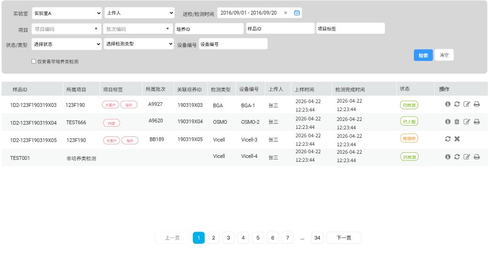

#### 筛选区域

本页面查询都在当前用户的可见数据范围内，以下条件联合查询：

1.  **实验室**：下拉框，单选，数据权限说明如下

    > **[图 image388.png | 章节：检测分析 / 筛选区域 | 上下文：实验室：下拉框，单选，数据权限说明如下]**
    > **OCR 文本：**
    > 回仅自己-当前用户记录中关联的实验室名称；
    > 回所属实验室-用户加入的实验室
    > 国所唐部门-用户所在部门关联的实验室
    > 参与项目-需要根据当前用户参与项目查询检测样本关联的所有实验室
    > 全部数据-所有实验室都可选

    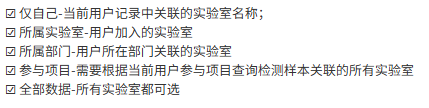

2.  **上传人**：发送检测需求的显示姓名，默认填入当前用户，数据权限说明如下

    > **[图 image389.png | 章节：检测分析 / 筛选区域 | 上下文：上传人：发送检测需求的显示姓名，默认填入当前用户，数据权限说明如下]**
    > **OCR 文本：**
    > 团仅自己只能选自己
    > 团所属实验室-所届实验室所有用户
    > 团所属部门-所在部门下的所有用户
    > 回参与项目当前用户参与项目关联的用户并集
    > 全部数据 | 全部用户名

    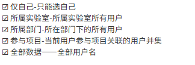

3.  **上样/检测完成时间**：按照上样和检测完成时间筛选，符合任一条件即可。
4.  **项目号**：下拉框，单选，支持模糊搜索选中。列表内容为当前用户权限内的所有项目号。
5.  **批次号**：下拉框，单选。用项目号关联联动查询获取所有批次号
6.  **培养ID**：文本框。支持模糊搜索。
7.  **样品ID**：文本框。支持模糊搜索
8.  **项目标签**：下拉单选，列表内容来源数据字典
9.  **状态**：下拉，列表内容为所有检测列表区域中的状态
10. **检测类型**：下拉单选，列表内容来源数据字典
11. **设备编号**：下拉框，单选，根据实验室联动选择当前实验室下的具体设备
12. **仅查看非培养类检索**：勾选后查看本人授权范围内（本人或本实验室）的关联到培养的检测

#### 结果展示区域

查询结果翻页展示，按上样时间倒排，最新的在最上面

1.  **展示字段**：样品ID、所属项目、项目标签、所属批次、关联培养ID、检测类型、设备编号、上传人、上样时间、检测完成时间、状态、各类操作
2.  为保持页面统一，检测项目及结果统一通过查看详情操作点击查看

    ---

### ✂️ 已剔除的删除线内容

> 以下内容在源 Word 中带有删除线（`<w:strike>`），根据约定不进入正文，统一汇总在此，避免遗漏核验。

- 段落片段：若从TTS可获取到则自动填入，否则必须手动填写

### 原图核对

以下原图对应正文中已转写的表格，保留用于核对字段、数值和布局。

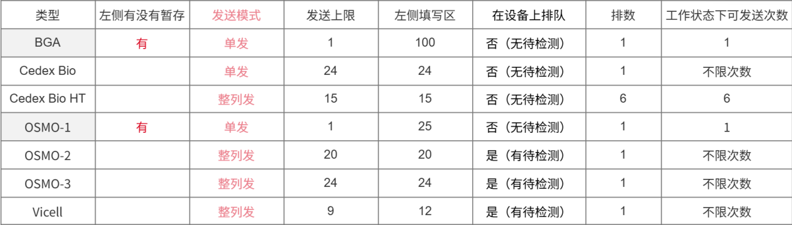
