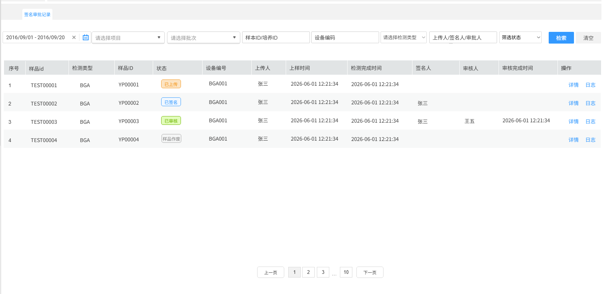
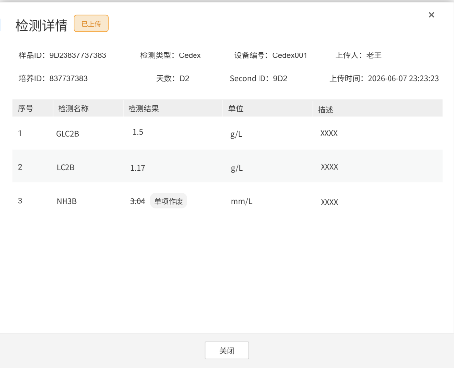
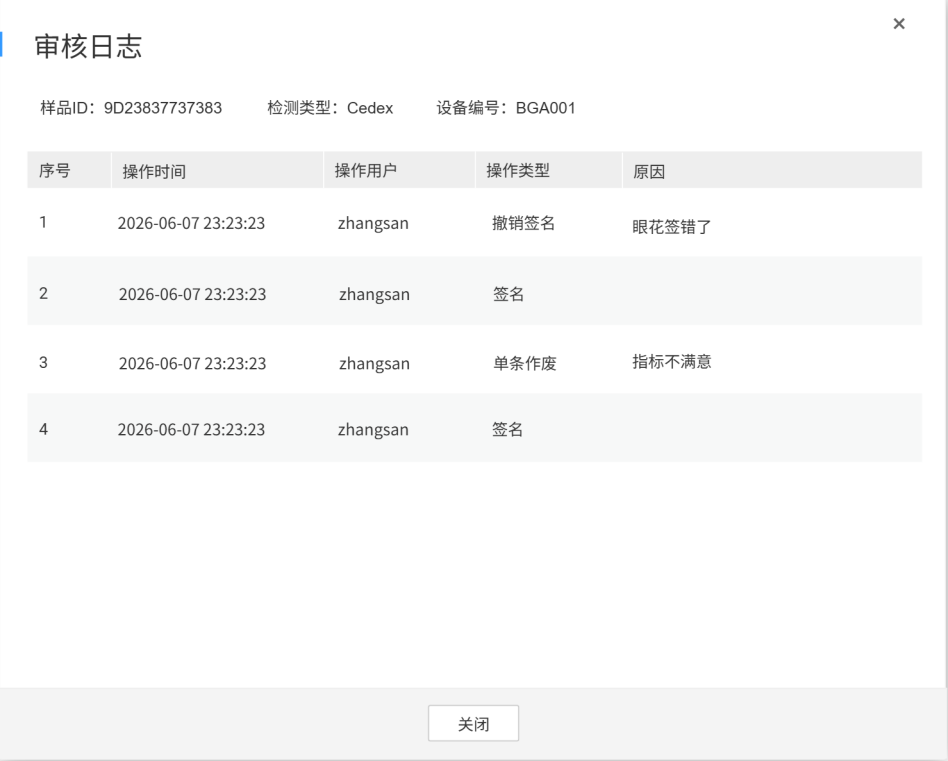

# 数据管理

## 签批记录①

查询所有对检测结果的详细记录，分页展示。

> **[图 image404.png | 章节：签批记录① | 上下文：查询所有对检测结果的详细记录，分页展示。]**
> **OCR 文本：**
> 签名审批记录
> 2016/09/01-2016/09/20 | 请选择项目 | 请选择批次 | 样本ID/培养ID | 设备编码 | 请选择检测类型 | 上传人/签名人/审批人 | 筛选状态 | 检索 | 清空
> 序号 | 样品id | 检测类型 | 样品ID | 状态 | 设备编号 | 上传人 | 上样时间 | 检测完成时间 | 签名人 | 审核人 | 审核完成时间 | 操作
> TEST00001 | BGA | YP00001 | 已上传 | BGA001 | 张三 | 2026-06-01 12:21:34 | 2026-06-01 12:21:34 | 详情 | 日志
> TEST00002 | BGA | YP00002 | 已签名 | BGA001 | 张三 | 2026-06-01 12:21:34 | 2026-06-01 12:21:34 | 张三 | 日志
> TEST00003 | BGA | YP00003 | 已审核 | BGA001 | 张三 | 2026-06-01 12:21:34 | 2026-06-01 12:21:34 | 张三 | 王五 | 2026-06-01 12:21:34 | 日志
> TEST00004 | BGA | YP00004 | [样品作废 | BGA001 | 张三 | 2026-06-01 12:21:34 | 2026-06-01 12:21:34 | 日志
> 上一页 | 10 | 下一页

1.  查询条件

    按照以下条件联合查询检测结果：

2.  **时间段**：必选，按照上样时间选择查询的开始和结束时间，默认当天往前15天。
3.  **项目**：下拉单选，必选，仅限当前用户授权的项目，按照参与时间倒排序，默认进入当前页面必须选择项目才查询展示结果
4.  **批次**：下拉单选，根据所选项目联动查询所属批次号
5.  **样品ID/培养ID**：文本框，支持共同模糊搜索
6.  **项目标签**：文本框，支持模糊搜索
7.  **签名人/审批人/上传人**：文本框，模糊搜索，默认筛选当前用户为上传人（发送检测需求的人）的记录
8.  **状态**：下拉框，单选。包括所有状态、已上传、已签名、已审核，默认所有状态
9.  结果展示
10. 序号
11. 样品ID
12. 检测类型
13. 状态
14. 设备编号
15. 上传人
16. 上样时间
17. 检测完成时间
18. 签名人
19. 审核人
20. 审核完成时间
21. 操作：
    1.  **详情**：查看该行的详细数据

        > **[图 image405.png | 章节：签批记录① | 上下文：详情：查看该行的详细数据]**
        > **OCR 文本：**
        > 检测详情 | 已上传
        > 样品ID：9D23837737383 | 检测类型：Cedex | 设备编号：Cedex001 | 上传人：老王
        > 培养ID：837737383 | 天数：D2 | Second ID:9D2 | 上传时间：2026-06-0723:23:23
        > 序号 | 检测名称 | 检测结果 | 单位 | 描述
        > GLC2B | 1.5 | g/L
        > LC2B | 1.17 | g/L
        > NH3B | 单项作废 | mm/L
        > 关闭

        

    2.  **日志**：查看该行的审核日志

        > **[图 image406.png | 章节：签批记录① | 上下文：日志：查看该行的审核日志]**
        > **OCR 文本：**
        > 审核日志
        > 样品ID：9D23837737383 | 检测类型：Cedex | 设备编号：BGA001
        > 序号 | 操作时间 | 操作用户 | 操作类型 | 原因
        > 2026-06-0723:23:23 | zhangsan | 撤销签名 | 眼花签错了
        > 2026-06-0723:23:23 | zhangsan | 签名
        > 2026-06-07 23:23:23 | zhangsan | 单条作废 | 指标不满意
        > 2026-06-0723:23:23 | zhangsan | 签名
        > 关闭

        
