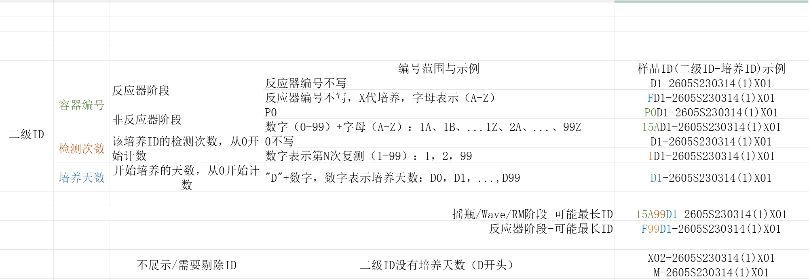
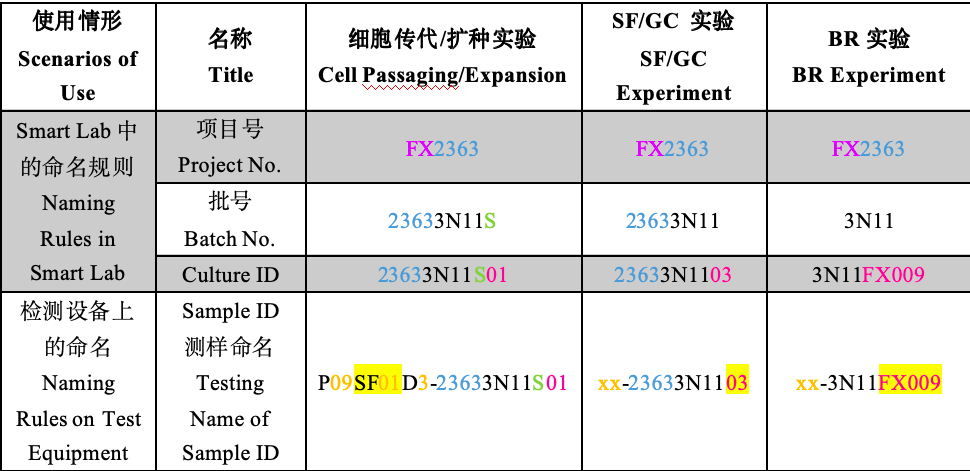
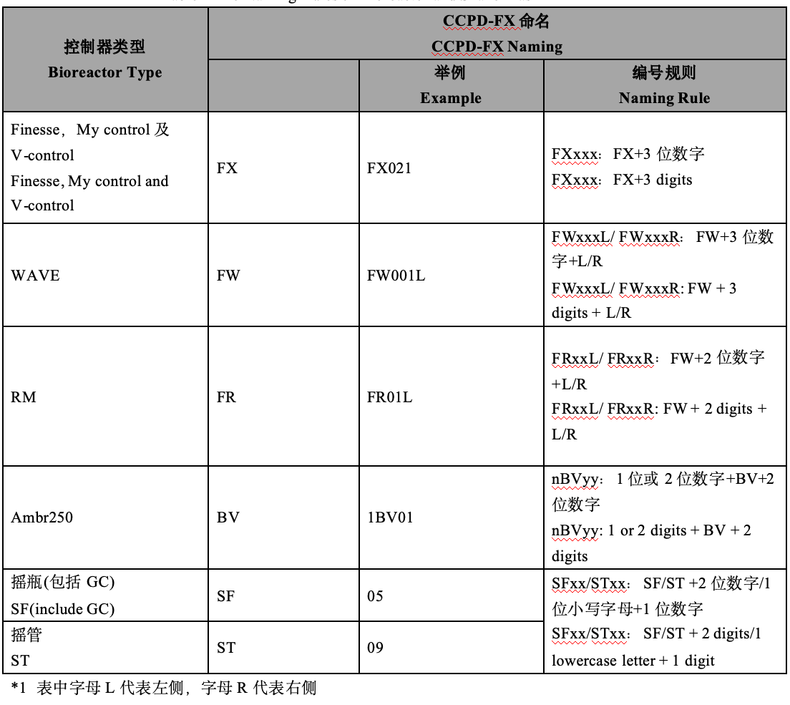
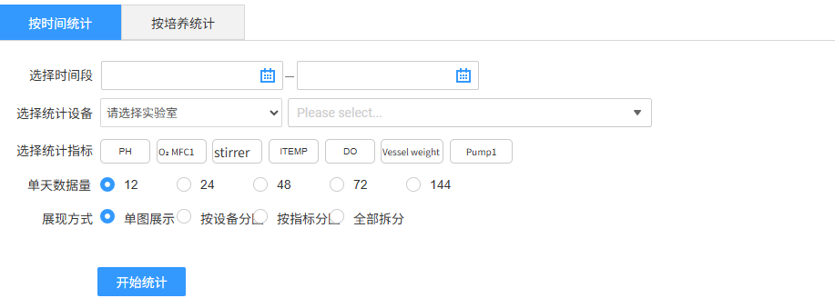
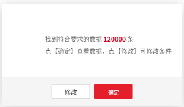
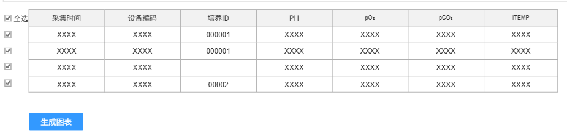
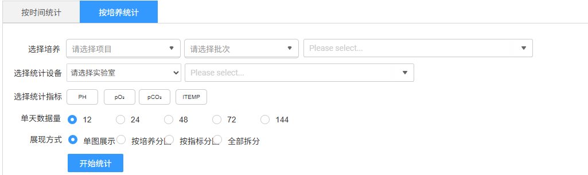
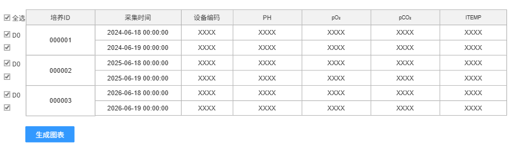

# 数据管理

## 在线数据②

支持用户对中试反应器和小试控制器采集的在线数据筛选出符合条件的数据进行统计分析，包含按时间统计和按培养统计两种模式。

首先，根据各类查询条件查询到所有数据；然后，针对已查询数据再次确认选择生成图表分析

1.  中试样本ID组成

    #### 样品ID（二级ID-培养ID）编号规则

    样品ID的格式是"**二级ID-培养ID**"，其中"二级ID"由三段拼接而成：**容器编号 + 检测次数 + 培养天数**。以下按这三段分别说明编号范围，并在示例列里用方括号标出对应片段。

    ##### 二级ID 分段规则

    | 分段 | 场景 | 编号范围 | 样品ID示例（方括号标出该段） |
    | --- | --- | --- | --- |
    | 容器编号 | 反应器阶段 | 反应器编号不写 | D1-2605S230314(1)X01 |
    | 容器编号 | 反应器阶段 | 反应器编号不写，X代培养，字母表示（A-Z） | [F]D1-2605S230314(1)X01 |
    | 容器编号 | 非反应器阶段 | P0 | [P0]D1-2605S230314(1)X01 |
    | 容器编号 | 非反应器阶段 | 数字（0-99）+字母（A-Z）：1A、1B、...1Z、2A、...、99Z | [15A]D1-2605S230314(1)X01 |
    | 检测次数 | 该培养ID的检测次数，从0开始计数 | 0不写 | D1-2605S230314(1)X01 |
    | 检测次数 | 该培养ID的检测次数，从0开始计数 | 数字表示第N次复测（1-99）：1，2，99 | [1]D1-2605S230314(1)X01 |
    | 培养天数 | 开始培养的天数，从0开始计数 | "D"+数字，数字表示培养天数：D0，D1，...，D99 | [D1]-2605S230314(1)X01 |

    ##### 最长ID示例

    | 场景 | 示例 |
    | --- | --- |
    | 摇瓶/Wave/RM阶段 - 可能最长ID | [15A][99]D1-2605S230314(1)X01（容器编号"15A" + 检测次数"99"） |
    | 反应器阶段 - 可能最长ID | [F][99]D1-2605S230314(1)X01（容器编号"F" + 检测次数"99"） |

    ##### 不展示/需要剔除的ID

    二级 ID 按上述组成规则解析后，如果没有“培养天数”段（该段为 `D+数字`），则不纳入此处按培养天数展示的数据。`D` 前可有容器编号、复测次数，例如 `FD1`、`P0D1`、`15AD1`、`15A99D1`；不要求整个 ID 以 D 开头，也不据此全局判定样品无效。来源：[数据签名-数据可视化0618.xlsx](../需求文档插入的附件/数据签名-数据可视化0618.xlsx)，“二级ID组成”工作表 E7:E14、D16。无培养天数段的示例：

    - `X02-2605S230314(1)X01`
    - `M-2605S230314(1)X01`

    

2.  小试样本ID组成

    ##### 命名规则对照表（项目号/批号/培养ID/测样命名）

    | 使用情形（Scenarios of Use） | 名称（Title） | 细胞传代/扩种实验（Cell Passaging/Expansion） | SF/GC 实验（SF/GC Experiment） | BR 实验（BR Experiment） |
    | --- | --- | --- | --- | --- |
    | Smart Lab 中的命名规则（Naming Rules in Smart Lab）| 项目号 Project No. | FX2363 | FX2363 | FX2363 |
    | Smart Lab 中的命名规则（Naming Rules in Smart Lab）| 批号 Batch No. | 23633N11S | 23633N11 | 3N11 |
    | Smart Lab 中的命名规则（Naming Rules in Smart Lab）| Culture ID | 23633N11S01 | 23633N1103 | 3N11FX009 |
    | 检测设备上的命名（Naming Rules on Test Equipment） | Sample ID 测样命名（Name of Sample ID） | P09SF01D3-23633N11S01 | xx-23633N1103 | xx-3N11FX009 |

    

    ##### CCPD-FX 命名规则（反应器/控制器编号）

    | 控制器类型 Bioreactor Type | 前缀 | 举例 Example | 编号规则 Naming Rule |
    | --- | --- | --- | --- |
    | Finesse，My control及V-control（Finesse, My control and V-control） | FX | FX021 | FXxxx：FX+3位数字（FXxxx: FX+3 digits） |
    | WAVE | FW | FW001L | FWxxxL/FWxxxR：FW+3位数字+L/R（FWxxxL/FWxxxR: FW + 3 digits + L/R） |
    | RM | FR | FR01L | FRxxL/FRxxR：FW+2位数字+L/R（FRxxL/FRxxR: FW + 2 digits + L/R） |
    | Ambr250 | BV | 1BV01 | nBVyy：1位或2位数字+BV+2位数字（nBVyy: 1 or 2 digits + BV + 2 digits） |
    | 摇瓶(包括GC) SF(include GC) | SF | 05 | SFxx/STxx：SF/ST+2位数字/1位小写字母+1位数字（SFxx/STxx: SF/ST + 2 digits/1 lowercase letter + 1 digit） |
    | 摇管 ST | ST | 09 |  SFxx/STxx：SF/ST+2位数字/1位小写字母+1位数字（SFxx/STxx: SF/ST + 2 digits/1 lowercase letter + 1 digit） |

    \*表中：字母 L 代表左侧，字母 R 代表右侧

    

### 按时间统计②

1.  查询统计

    > **[图 image410.png | 章节：在线数据② / 按时间统计② | 上下文：查询统计]**
    > **OCR 文本：**
    > 按时间统计 | 按培养统计
    > 选择时间段
    > 选择统计设备 | 请选实验室 | Please select..
    > 选择统计指标 | PH | O: MFC1 | stirrer | ITEMP | DO | Vessel weight | Pump1
    > 单天数据量 | 12 | 24 | 48 | 72 | 144
    > 展现方式 | 单图展示 | 按设备分 | 按指标分 | 全部拆分
    > 开始统计

    

    > **业务确认（2026-09-06）：**图中“单天数据量”的 72 选项改为 **96（每15分钟）**；原图及 OCR 保留来源原貌，需求以本确认及下方文字规则为准。

    1.  **选择时间段**：必填，填写其实和结束时间，最长限制3个月，可选择到时分秒维度
    2.  选择统计设备：
        1.  **实验室**：下拉单选，必选，当前用户有权限范围的实验室
        2.  **设备**：下拉选择，支持多选，必选，根据实验室联动获取，中试为反应器，小试为控制器。按时间统计以设备为统计对象，沿用统一的组合数量限制：设备数×指标数≤10。
    3.  **选择统计指标**：多选，列表内容待确定
    4.  **单天数据量**：因为设备一天中每个指标会采集多次，根据此选项控制展示的数据量，提供5种选项，按24小时制
        1.  **12**：每2个小时抽一条数据，采集时间点在00:00、2:00、4:00……只要采集时间的小时和分钟对应即可，不限秒
        2.  **24**：每1个小时抽一条数据，采集时间点00:00、1:00、2:00……只要采集时间的小时和分钟对应即可，不限秒
        3.  **48**：每半小时抽一条数据采集，时间在00:00、00:30、1:00……只要采集时间的小时和分钟对应即可，不限秒
        4.  **96**：每15分钟抽一条数据，按24小时制每天对应96个采样时点：00:00、00:15、00:30、00:45……23:45。只要采集时间的小时和分钟对应即可，不限秒（2026-09-06 业务确认）。
        5.  **144**：每10分钟抽一条数据采集，时间在00:10、00:20、00：30……只要采集时间的小时和分钟对应即可，不限秒
    5.  **展现方式**：单选，默认为单图展示
        1.  **单图展示**：所有数据在一张图绘制
        2.  **按设备分图**：需要按照一个设备为一张图分开多个图展示
        3.  **按指标分图**：需要按照一个指标为一张图分开多个图展示
        4.  **全部拆分**：需要按照一个设备&一个指标为一张图分开多个图展示
    6.  开始统计：

        > **[图 image411.png | 章节：在线数据② / 按时间统计② | 上下文：开始统计：]**
        > **OCR 文本：**
        > 找到符合要求的数据120000条
        > 点【确定】查着数据，点【修改】 | 可修改条件
        > 修改 | 确定

        

        > **[图 image412.png | 章节：在线数据② / 按时间统计② | 上下文：开始统计：]**
        > **OCR 文本：**
        > 团全选 | 采集时间 | 设备编码 | 培养ID | PH | pO: | pCO: | ITEMP
        > XXXX | XXXX | 000001 | xXXX | XXXX | XXXX | XXXX
        > XXXX | XXXX | 000001 | XXXX | XXXX | XXXX | xXXX
        > XXXX | XXXX | XXXX | XXXX | XXXX | XXXX
        > XXXX | XXXX | 00002 | XXXX | XXXX | XXXX | XXXX
        > 生成图表

        

        1.  点击开始统计，联合查询符合条件的数据，表格展示，表格内容包含采集时间、设备编号、培养ID、各参数名称、各参数数值
        2.  查询完成后先提示数据量信息，确认查看数据或修改条件（关闭弹窗）
        3.  查询并确认查看数据后，表格展示数据
            1.  数据表格展示不分页，直接滑动展示
            2.  数据表格按照时间正排序
            3.  支持单条勾选和全选。默认全部选中
            4.  **生成图表**：此按钮吸底固定，不随页面滚动。基于选中数据点击生成图表。注意，一条都不选时不支持生成图表。
2.  图表绘制
    1.  一个设备&一个参数为一个系列
    2.  Y轴为参数，X轴为采集时间，Y轴支持手动设定最大最小值
    3.  多个参数时，需要多个Y轴，每个Y轴默认根据数据量级自适应；支持手动设定Y轴的最大最小值，多个参数时每个Y轴都要可手动设定（需技术确认多Y轴是否能实现）
    4.  鼠标在样本点上悬浮展示信息包含培养ID、设备编号、参数名称、采集时间、参数数值
    5.  **样式美化**：先包括所有Echart可用控件

### 按培养统计②

1.  查询统计

    > **[图 image413.png | 章节：在线数据② / 按培养统计② | 上下文：查询统计]**
    > **OCR 文本：**
    > 按时间统计 | 按培养统计
    > 选择培养 | 请选择项目 | 请选择批次 | Please select..
    > 选择统计设备 | 请选择实验室 | Please select..
    > 选择统计指标 | PH | PO: | PCO: | ITEMP
    > 单天数据量 | 24 | 48 | 72 | 144
    > 展现方式 | 单图展示 | 按培养分 | 按指标分 | 全部拆分
    > 开始统计

    

    > **业务确认（2026-09-06）：**图中“单天数据量”的 72 选项改为 **96（每15分钟）**；原图及 OCR 保留来源原貌，需求以本确认及下方文字规则为准。

2.  **选择培养**：必填，选择的培养数×指标数≤10（2026-09-06 业务确认）。
    1.  **项目**：范围限本人相关
    2.  **批次**：范围限本人相关，根据项目联动
    3.  **培养**：范围限本人相关，根据项目联动
3.  **选择统计设备**：非必选，在选择的培养ID关联的容器再进一步过滤。
    1.  **实验室**：下拉单选，非必选，当前用户有权限范围的实验室
    2.  **设备**：下拉选择，支持多选，非必选，中试为反应器，小试为控制器。
4.  **选择统计指标**：多选，列表内容待确定
5.  **单天数据量**：同按照时间统计模式的规则
6.  **展现方式**：单选。默认单图展示
    1.  **单图展示**：所有数据在一张图绘制
    2.  **按培养分图**：需要按照一个培养为一张图分开多个图展示
    3.  **按指标分图**：需要按照一个指标为一张图分开多个图展示
    4.  **全部拆分**：需要按照一个设备&一个指标为一张图分开多个图展示
7.  开始统计：

    > **[图 image414.png | 章节：在线数据② / 按培养统计② | 上下文：开始统计：]**
    > **OCR 文本：**
    > 找到符合要求的数据120000条
    > 点【确定】 | 查看数据，点【修改】 | 可修改条件
    > 修改 | 确定

    

    > **[图 image415.png | 章节：在线数据② / 按培养统计② | 上下文：开始统计：]**
    > **OCR 文本：**
    > 国全选 | 培养ID | 采集时间 | 设备编码 | PH | pO: | pCO: | ITEMP
    > 图DO | 2024-06-18 00:00:00 | XXXX | XXXX | XXXX | XXXX | XXXX
    > 000001
    > 2024-06-19 00:00:00 | XXXX | XXXX | XXXX | XXXX | XXXX
    > 图DO | 2025-06-18 00:00:00 | XXXX | XXXX | XXXX | XXXX | XXXX
    > 000002
    > 2025-06-19 00:00:00 | XXXX | XXXX | XXXX | XXXX | XXXX
    > 图DO | 2026-06-18 00:00:00 | XXXX | XXXX | XXXX | XXXX | XXXX
    > 000003
    > 2026-06-19 00:00:00 | XXXX | XXXX | XXXX | XXXX | XXXX
    > 生成图表

    

    1.  联合查询符合条件的数据，表格展示，表格内容包含采集时间、设备编号、培养ID、各参数名称、各参数数值
    2.  查询完成后先提示数据量信息，确认查看数据或修改条件（关闭弹窗）
    3.  查询并确认查看数据后，表格展示：
        1.  数据表格展示不分页，直接滑动展示
        2.  支持单条勾选和全选。默认全部选中。
        3.  展示时按照每个培养ID分组，每组数据按照时间正排序
        4.  每个培养ID数据组，第一条默认为D0，若取消选择则D0顺延下一条
        5.  **生成图表**：此按钮吸底固定，不随页面滚动。基于选中数据点击生成图表。注意，一条都不选时不支持生成图表。
8.  图表绘制

    单个Chart中，说明如下

9.  在一个Chart 中，一个参数&一个培养为一个系列，Y轴为参数，横轴为采集时间
    1.  **Y轴**：多个参数时，需要多个Y轴，每个Y轴默认根据数据量级自适应；支持手动设定Y轴的最大最小值，多个参数时每个Y轴都要可手动设定（需要技术确认是否能实现）
    2.  **X轴**：支持在培养时间（比如，D0~D14）和自然时间两种方式切换，默认为培养时间模式。
        1.  **培养时间**：已D0为起始，计算每条记录所处培养天数，即横轴展示的是相对天数。（模拟数据画图见以下附件在线数据、在线数据－透视表、在线数据可视化3个sheet页）

            > **[嵌入附件图标 image416.emf | 章节：在线数据② / 按培养统计② | 上下文：培养时间：已D0为起始，计算每条记录所处培养天数，即横轴展示的是相对天数。（模拟数据画图见以下附件在线数据、在线数据－透视表、在线数据可视化3个sheet页）]**
            > **附件文件名：**`数据签名-数据可视化0618.xlsx`

            **在线/离线数据可视化与透视模板**（来源：[数据签名-数据可视化0618.xlsx](../需求文档插入的附件/数据签名-数据可视化0618.xlsx)，共 15 个 sheet（含隐藏表），演示"以 D0 为起始计算培养相对天数"的横轴画法）：

            **各 sheet 用途**（按工作簿顺序保留精确名称；行数为工作表已用区域最大行号）：

            | Sheet 原名 | 状态 | 行数 | 用途 |
            | :--- | :--- | :---: | :--- |
            | `二级ID组成` | 可见 | 17 | 二级 ID 组成及示例 |
            | `示例在线数据` | 可见 | 41 | 在线数据明细：time、横轴、培养相对时间、培养天数、设备编号、阶段、SecondId、培养ID、VCD、PH |
            | `示例在线数据-透视表` | 可见 | 27 | 在线数据的透视分组 |
            | `在线可视化结果` | 可见 | 72 | 在线数据可视化产出 |
            | `在线可视化` | 隐藏 | 74 | 在线图表配置：多 Y 轴；培养时间或自然时间切换；点大小/形状、线粗/颜色、实线虚线可改；可多选培养和参数，一个参数与一个培养组成一个系列 |
            | `示例在线透视表` | 隐藏 | 20 | 在线透视表示例 |
            | `示例离线数据 ` | 隐藏 | 71 | 离线数据明细；名称末尾有 1 个空格 |
            | `示例离线数据` | 可见 | 41 | 离线数据明细：time、培养天数、容器编号、阶段、SecondId、firstID、VCD、PH；名称末尾无空格 |
            | `示例离线数据 -透视表` | 可见 | 42 | 离线数据透视；连字符前有 1 个空格 |
            | `离线可视化结果` | 可见 | 83 | 离线可视化产出 |
            | `示例离线数据  (2)` | 隐藏 | 71 | 第二组离线数据明细；左括号前有 2 个空格 |
            | `离线可视化（2）` | 隐藏 | 86 | 离线图表配置：培养容器可选择，多选可对比或按批次参数分组；B2 为“培养 × 参数不超过 10”，已统一为培养数×指标数≤10 |
            | `离线透视表` | 隐藏 | 27 | 离线透视示例 |
            | `离线透视表2` | 隐藏 | 27 | 离线透视示例 2 |
            | `离线可视化` | 隐藏 | 75 | 离线可视化补充 |

            **关键设计字段**（横轴画法核心）：

            - **培养相对天数**：以 D0 为起始，`培养相对时间 = 采集时间 − 培养开始时间`，横轴取"培养天数"（D0/D1/…/D14）。
            - **firstID / SecondId / 培养ID / 阶段 / 设备编号**：用于区分系列与分组。
            - **指标**：VCD、PH 等（实际为各统计指标）。
            - **多 Y 轴**：多个参数各自一个 Y 轴，各轴按量级自适应，且**每个 Y 轴都可手动设最大/最小值**（与正文"多 Y 轴需技术确认"呼应）。
            - **X 轴双模式**：默认"培养时间"（相对天数），可切换"自然时间"（采集时间原值）。
            - **系列规则**：一个 Chart 内"一个参数 & 一个培养"为一个系列。
            - **数量约束（2026-09-06 业务确认）**：统一采用 **培养数×指标数≤10**，替代原正文的相加限制，与附件“离线可视化（2）”B2 的乘积规则一致。按培养统计时，一个培养与一个指标组成一个系列；4个培养×3个指标=12，不允许，2个培养×5个指标=10，允许。按时间统计以设备为统计对象，对应设备数×指标数≤10；离线数据同时选择在线、离线指标时，指标数为两类所选指标数之和。

            

        2.  **自然时间**：直接用采集时间的自然时间格式作为横轴
10. 鼠标在样本点上悬浮展示信息包含项目、批次、培养ID、设备编号、参数名称、采集时间、参数数值、
11. 样式美化：
    1.  把目前已有的控件先都加上
    2.  颜色配置3种配色方案
