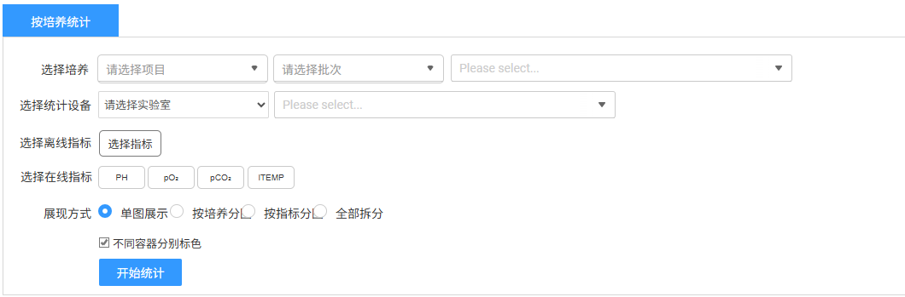
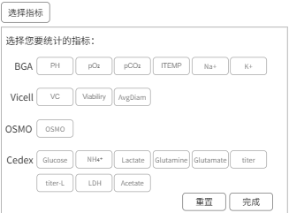
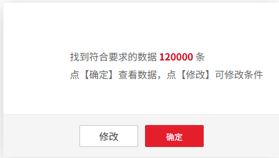
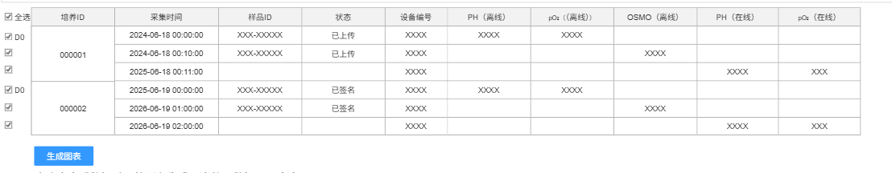

# 数据管理

## 离线数据②（3.2）

支持用户对离线数据筛选出符合条件的培养ID进行趋势观察和分析。

1.  查询统计

    > **[图 image417.png | 章节：离线数据②（3.2） | 上下文：查询统计]**
    > **OCR 文本：**
    > 按培养统计
    > 选择培养 | 请选择项目 | 请选择批次 | Please select..
    > 选择统计设备 | 请选实验室 | Please select..
    > 选择离线指标 | 选择指标
    > 选择在线指标 | PH | PCO: | ITEMP
    > 展现方式 | 单图展示 | 按培养分 | 按指标分 | 全部拆分
    > 因不同容器分别标色
    > 开始统计

    

2.  **选择培养**：必填，选择数量统一满足培养数×（离线指标数+在线指标数）≤10（2026-09-06 业务确认：培养数×指标数≤10，指标数包含所选在线和离线指标）。
    1.  **项目**：范围限本人相关
    2.  **批次**：范围限本人相关，根据项目联动
    3.  **培养**：范围限本人相关，根据批次联动
3.  **选择统计设备**：非必选，在选择的培养ID关联的容器再进一步过滤。
    1.  **实验室**：下拉单选，非必选，当前用户有权限范围的实验室
    2.  **设备**：下拉选择，支持多选，非必选，中试为反应器，小试为控制器。
4.  **选择离线指标**：点击选择指标，弹窗选择，支持多选，完整列表内容待统计

    > **[图 image418.png | 章节：离线数据②（3.2） | 上下文：选择离线指标：点击选择指标，弹窗选择，支持多选，完整列表内容待统计]**
    > **OCR 文本：**
    > 选择指标
    > 选择您要统计的指标：
    > BGA | PH | pO: | pCO: | ITEMP | Na+ | K+
    > Vicell | VC | Viabiliry | AvgDiam
    > OSMO | OSMO
    > Cedex | Glucose | NH4* | Lactate | Glutamine | Glutamate | titer
    > titer-L | LDH | Acetate
    > 重置 | 完成

    

5.  **选择在线指标**：支持多选，列表内容待统计。选择后，将在图中以虚线绘制。
6.  **展现方式**：单选。默认单图展示
    1.  **单图展示**：所有数据在一张图绘制
    2.  **按培养分图**：需要按照一个培养为一张图分开多个图展示
    3.  **按指标分图**：需要按照一个指标为一张图分开多个图展示
    4.  **全部拆分**：需要按照一个设备&一个指标为一张图分开多个图展示
7.  **不同容器区分颜色**：勾选框，默认选中，选中后一个培养ID的不同容器使用不同颜色区分，否则使用同一个颜色
8.  开始统计：

    > **[图 image419.png | 章节：离线数据②（3.2） | 上下文：开始统计：]**
    > **OCR 文本：**
    > 找到符合要求的数据120000条
    > 点【确定】 | 查看数据，点【修改】 | 可修改条件
    > 修改 | 确定

    

    > **[图 image420.png | 章节：离线数据②（3.2） | 上下文：开始统计：]**
    > **OCR 文本：**
    > 国全选 | 培养ID | 采集时间 | 样品ID | 状态 | 设备编号 | PH(离线) | pO:((需线)) | OSMO(离线) | PH (在线) | pO:(在线)
    > 图DO | 2024-06-18 00:00:00 | XXXXX-XXX | 已上传 | XXXX | XXXX | XXXX
    > 000001 | 2024-06-18 00:40:00 | XXXXX-XXX | 已上传 | XXXX | XXXX
    > 2025-06-18 00:11:00 | XXXX | XXXX | XXX
    > 图DO | 2025-06-19 00:00:00 | XXXXX-XXX | 已签名 | XXXX | XXX | XXXX
    > 000002 | 2026-06-19 01:00:00 | XXXXX-XXX | 已签名 | XXXX | XXXX
    > 2028-06-19 02:00:00 | XXXX | XXX
    > 生成图表

    

    1.  联合查询符合条件的数据，包含采集时间（离线指标为检测完成时间，在线指标为采集时间）、设备编号、培养ID、样品ID、状态、各离线指标名称、各离线指标数值、个在线指标名称、各在线指标数值。
    2.  其余筛选条件：
        1.  **状态**：此处离线数据仅查询状态为已上传、已签名、已审核的数据
        2.  **样本ID**：通过样本ID规则识别，剔除无培养周期的数据
    3.  查询完成后先提示数据量信息，确认查看数据或修改条件（关闭弹窗）
    4.  查询并确认查看数据后，表格展示：
        1.  数据表格展示不分页，直接滑动展示
        2.  支持单条勾选和全选。默认全部选中。
        3.  展示时按照每个培养ID分组，每组数据按照时间正排序
        4.  每个培养ID数据组，第一条默认为D0，若取消选择则D0顺延下一条
        5.  **生成图表**：此按钮吸底固定，不随页面滚动。基于选中数据点击生成图表。注意，一条都不选时不支持生成图表。
9.  图表绘制

    单个Chart中，说明如下

10. 在一个Chat 中，一个参数&一个培养&一个培养容器为一个系列（注意，不同容器是否使用不同颜色取决于筛选处是否选择根据不同容器区分勾选框）
11. **Y轴**：多个参数时，需要多个Y轴，每个Y轴默认根据数据量级自适应；支持手动设定Y轴的最大最小值，多个参数时每个Y轴都要可手动设定（需要技术确认是否能实现）
12. **X轴**：支持在培养时间（比如，D0~D14）和自然时间两种方式切换，默认为培养时间模式。
    1.  **培养时间**：以D0为起始，计算每条记录所处培养天数，即横轴展示的是相对天数。（模拟数据画图同样见上述附件中离线数据、离线数据透视表、离线数据可视化3个sheet页）
    2.  **自然时间**：直接用采集时间的自然时间格式作为横轴
13. **在线数据绘制**：展示所选在线数据趋势图，在线数据单天抽取数量默认按照最低抽取
14. 鼠标在样本点上悬浮展示信息包含项目、批次、培养ID、样品ID、设备编号、离线参数名称、采集时间、离线参数数值、在线参数名称、在线参数数值
15. 样式美化：
    1.  把目前已有的控件先都加上
    2.  颜色配置3种配色方案
