# 实验室工作台

## 反应器详情（3.1）

从实验室工作台点击具体卡片进入到反应器详情页，可查看当前反应器对应培养ID的培养详情、生产过程、任务队列、远程服务数据。

### 培养详情（3.1）

点击进入反应器，默认查看当前培养的培养详情，培养详情根据当前反应器的绑定状态包含不同的内容。

#### 已预约的反应器（3.1）

场景：该反应器已被成功预约，即该反应器已绑定培养ID，且已设置了培养开始时间和培养结束时间

包含设置与导出操作、基础信息、工艺设置、在线数据、离线数据5个部分。

> **[图 image421.png | 章节：反应器详情（3.1） / 已预约的反应器（3.1） | 上下文：包含设置与导出操作、基础信息、工艺设置、在线数据、离线数据5个部分。]**
> **OCR 文本：**
> 培养信息 | 生产过程 | 任务队列
> 预填充设置 | 监控设置 | 关闭报警器 | 导出数据
> 设备信息 | 操作→ | 培养基本信息 | 重量信息 | 残糖确认 | 操作－
> ·设备编号：FX003 | ·培养ID：7736653738 | ·初始培养体积：1000g | ·补料计算依据：初始重量 | 理论糖浓度 | Cedex确认值 | 乳酸确认 | 糖耗
> ·反应器型号：品牌-规格 | ：开始时间：2026-07-10 | ·细胞类型：- | ·补料时计算补料引起的糖浓度变化：是
> ·设备负责人：张三丰 | ·结束时间：2026-07-16 | ·今日补料体积：240g | ·补液前确认残糖浓度：否 | 6.5 | 7.3 | 2.1
> ·培养成员：张三、李四、王五 | ·培养周期：7 | ·取测减少总体积：40g | ·补糖计算模式：残糖+乳酸 | 2026-07-21 | 2026-07-20 | 2026-07-20
> 当前阶段：D5 | 12:21:13 | 16:20:44 | 16:20:44
> ·当前总体积：1200g（理论数据） | ·补液前残糖确认：综合
> ·培养模式：普通培养 | ·补糖适用公式补糖量=（目标残糖浓度-补糖前残糖浓度-补糖前乳酸浓度）*补糖前罐重
> 工艺设置 | 工作流程 | Config关联设置 | 灌注培养基 | 开始培养 | 取样 | 测样 | 补液 | 自动控制 | 澄清 | 结束培养 | 测样 | config关联设置 | 补料任务 | 未设置 | 未设置 | 已设置 | 澄清 | 灌注培养基 | 补糖规则 | 未设置 | 未设置 | 已设置 | 取样 | 结束策略 | 自动控制 | 未设置 | 未设置 | 未设置
> 在线数据 | 操作 | 离线信息 | 操作
> PH | PH | Temp | 指标 | BGA | Vicell
> 7.101 | 34°C | 当前数值
> 7.1-7.3 | 30.5.1-33°C | 上下限
> 0.8 | 0.8
> 指标 | 指标 | 指标
> 当前数值 | 当前数值 | 当前数值 | 0.6 | 0.6
> 上下限 | 上下限 | 上下限
> 0.4 | 0.4
> 指标 | 指标 | 指标 | 0.2 | 0.2
> 当前数值 | 当前数值 | 当前数值
> 上下限 | 上下限 | 上下限
> 11:40 | 12:00 | 12:30 | 13:00 | 13:30 | 14:00 | 11:40 | 12:00 | 12:30 | 13:00 | 13:30 | 14:00
> 指标 | 指标 | 指标
> 当前数值 | 当前数值 | 当前数值
> 上下限 | 上下限 | 上下限
> OSMO | Cedex
> 指标 | 指标 | 指标
> 当前数值 | 当前数值 | 当前数值
> 上下限 | 上下限 | 上下限
> 0.8 | 0.8
> 0.6 | 0.6
> 0.4 | 0.4
> 0.2 | 0.2
> 11:40 | 12:00 | 12:30 | 13:00 | 13:30 | 14:00 | 11:40 | 12:00 | 12:30 | 13:00 | 13:30 | 14:00

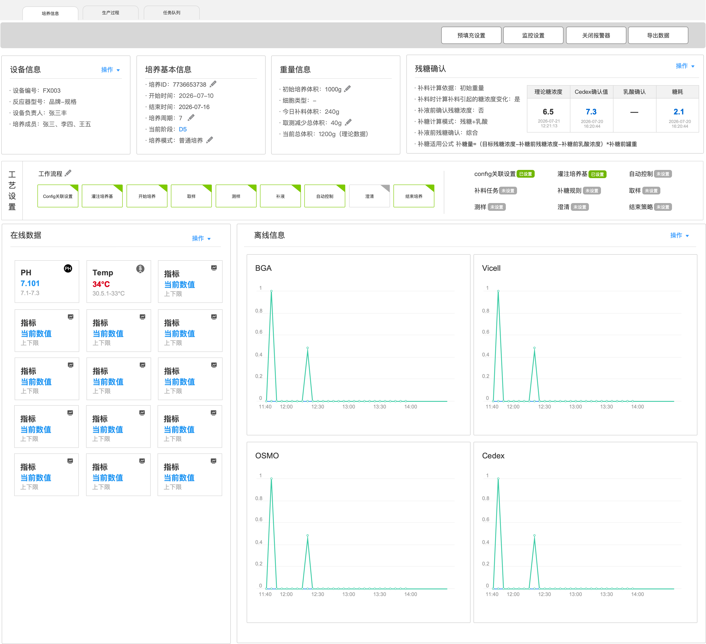

##### 设置与导出操作（3.1）（3.2）

1.  预填充设置

    此功能仅在小试实验室有，中试实验室没有。填写的数据会用于自动取测工作流。

    > **[图 image422.png | 章节：反应器详情（3.1） / 已预约的反应器（3.1） | 上下文：此功能仅在小试实验室有，中试实验室没有。填写的数据会用于自动取测工作流。]**
    > **OCR 文本：**
    > 预充设置
    > 批次 | PC83277633
    > 细胞类型 | CHO1
    > Fedbatch取样预填充
    > Fedbatch预填充速度 | g/min | 请选择速度代码
    > 保存 | 关闭

    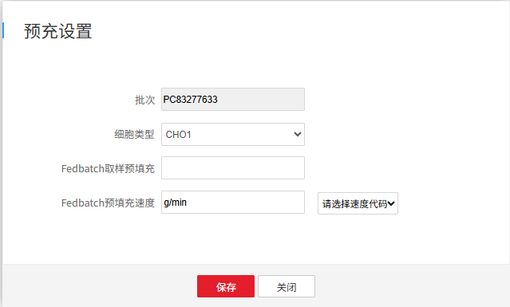

    1.  批次编号
    2.  **细胞类型**：下拉单选，必选，数据来源数据字典
    3.  **Fedbatch取样预填充**：文本框，限制为正整数
    4.  **Fedbatch取样预填充速度**：输入数字或者选择速度代码，从两种速度确认方式中二选一
        1.  **速度输入文本框**：单位g/min，只能填入数值。
        2.  **请选择速度代码**：选择此方式时，下拉必选，单选，下拉列表为Speed1至Speed10。
2.  监控设置

    > **[图 image423.png | 章节：反应器详情（3.1） / 已预约的反应器（3.1） | 上下文：监控设置]**
    > **OCR 文本：**
    > 监控设置
    > 设置模式（以下操作只针对“泵速异动”和台秤移动两项监控）
    > 监控中 | 临时关闭 | 长期关闭
    > 备注
    > 随便吧
    > 保存 | 关闭

    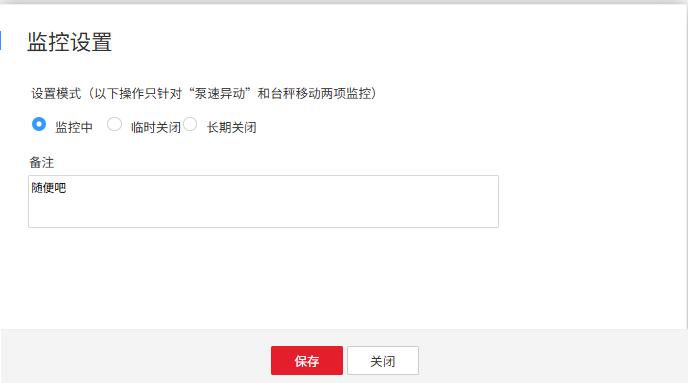

3.  **设置模式**：三种监控模式，只能三选一，点击保存则为必填
    1.  监控中
    2.  **临时关闭**：关闭后，每天下午4点若没有被开启，则需要发哦是那个通知提醒打开监控（相当于添加一条告警规则）
    3.  **长期关闭**：一直关闭监控程序，直到下次修改生效。
4.  **备注**：文本框，非必填
5.  关闭报警器

    当前反应器有配置声光报警器时才出现此按钮。点击此按钮，向声光报警器的指令服务器发送关闭指令。

6.  导出数据

    导出在培养期间的在线数据。

    1.  **提示信息**：文字提示“仅支持导出培养期间的在线数据”
    2.  **选择时间**：选择一个导出数据的开始时间和结束时间。日历控件直接限制导出时间范围在培养的开始日期和结束日期之间。导出模板如下：

        > **[嵌入附件图标 image424.emf | 章节：反应器详情（3.1） / 已预约的反应器（3.1） | 上下文：选择时间：选择一个导出数据的开始时间和结束时间。日历控件直接限制导出时间范围在培养的开始日期和结束日期之间。导出模板如下：]**
        > **附件文件名：**`OnLineDataExcel20260727105017.xlsx`

        **在线数据导出模板**（来源：`OnLineDataExcel20260727105017.xlsx`，单 sheet，**15107 行 × 21 列**，为培养期间的在线时序明细数据，按时间 + 培养/反应器筛选导出；此处仅列字段清单与样例，不含全量数据）：

        | # | 列名 | 含义 |
        | --- | --- | --- |
        | 1 | Batch No. | 批号 |
        | 2 | Bioreactor No. | 反应器编号 |
        | 3 | Equipment No. | 设备编号 |
        | 4 | Date | 日期 |
        | 5 | Time | 时间 |
        | 6 | pH | 酸碱度 |
        | 7 | DO | 溶解氧 |
        | 8 | Temp | 温度 |
        | 9 | Weight | 罐重（重量） |
        | 10 | Agitation | 搅拌/转速 |
        | 11 | Pressure | 压力 |
        | 12 | Air Sparger | 空气 sparger（通气） |
        | 13 | Air Overlay | 空气 overlay（覆盖气） |
        | 14 | O2 Flow Rate 1 | 氧气流量 1 |
        | 15 | O2 Flow Rate 2 | 氧气流量 2 |
        | 16 | O2 Flow Rate 3 | 氧气流量 3 |
        | 17 | CO2 Flow Rate | 二氧化碳流量 |
        | 18 | Pump1 | 泵 1 流量 |
        | 19 | Pump2 | 泵 2 流量 |
        | 20 | Pump3 | 泵 3 流量 |
        | 21 | Pump4 | 泵 4 流量 |

        - **样例行**（前 1 行，完整 21 列按上表顺序）：
          - `20007S260625(b)X05 | WGQS-NPP-SUB-V9 | FA021919 | 2026-07-16 | 22:22 | 7.198808 | 40.27373 | 37.04258 | 328165.9 | … | 1.474079 | 1.6 | 2 | 0 | …`
          - 含义：批号 `20007S260625(b)X05`、反应器 `WGQS-NPP-SUB-V9`、设备 `FA021919`、日期时间 `2026-07-16 22:22`，其后为 pH=7.198808、DO=40.27373、Temp=37.04258、Weight=328165.9 等指标数值；空单元格表示该时刻未采集/无值。

        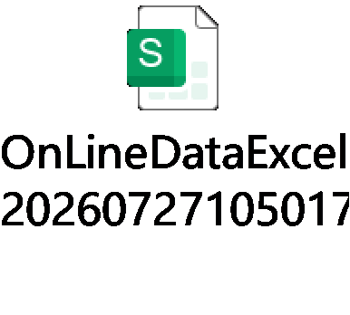

##### 设备信息（3.1）（3.2）（3.3）

1.  **展示信息**：仅展示信息，不可编辑
    1.  **设备编号**：中试为反应器设备编号，小试为控制器编号
    2.  **反应器型号**：中试为反应器设备型号，小试为品牌+类别拼接展示
    3.  **设备负责人**：没有则不展示。
    4.  **培养成员**：罗列所有该培养成员用户显示名称
2.  操作：
    1.  更换设备

        > **[图 image425.png | 章节：反应器详情（3.1） / 已预约的反应器（3.1） | 上下文：更换设备]**
        > **OCR 文本：**
        > 更换设备
        > 更换反应器后，泵的默认连接及补料方案将失效，需要重新设置，如修改后对培养ID和样品ID产生影响的话，请手工修改！
        > 当前设备 | FX033 | 15L
        > 更换为 | STR 50L | 50L
        > 原因*
        > 1、不合理 | 选择
        > 2、不允许改来改去 | 选择
        > 3、今天太晚了来不及改了 | 选择
        > 随便吧
        > 保存 | 关闭

        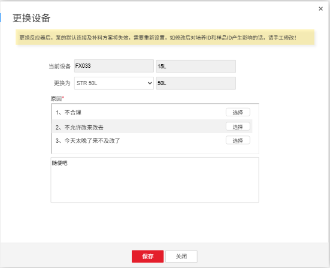

        1.  **提示信息**：文字提示“更换反应器后，泵的默认连接及补料方案将失效，需要重新设置，如修改后对培养ID和样品ID产生影响的话，请手工修改！”
        2.  **当前设备**：展示当前反应器/控制器编号及其规格，仅展示，不可修改
        3.  **更换为**：下拉列表，单选，列表内容同章节反应器/控制器：，筛选出当前空闲的设备。
        4.  **原因**：支持快速选择
        5.  保存：
        6.  若有修改需要保存，则原因为必填。
        7.  保存后，根据系统设定完成审核/不审核。若审核，必须在审核完成后此修改才能生效。审核过程中，再次点击进入，则所有字段都不允许编辑修改，顶部提示“正在审核中”，下方变为撤回按钮，撤回后再次支持修改。

            > **[图 image426.png | 章节：反应器详情（3.1） / 已预约的反应器（3.1） | 上下文：保存后，根据系统设定完成审核/不审核。若审核，必须在审核完成后此修改才能生效。审核过程中，再次点击进入，则所有字段都不允许编辑修改，顶部提示“正在审核中”，下方…]**
            > **OCR 文本：**
            > 更换设备
            > 正在审核中
            > 当前设备 | FX033 | 15L
            > 更换为 | STR 50L | 50L
            > 原因*
            > 随便吧
            > 撤回 | 关闭

            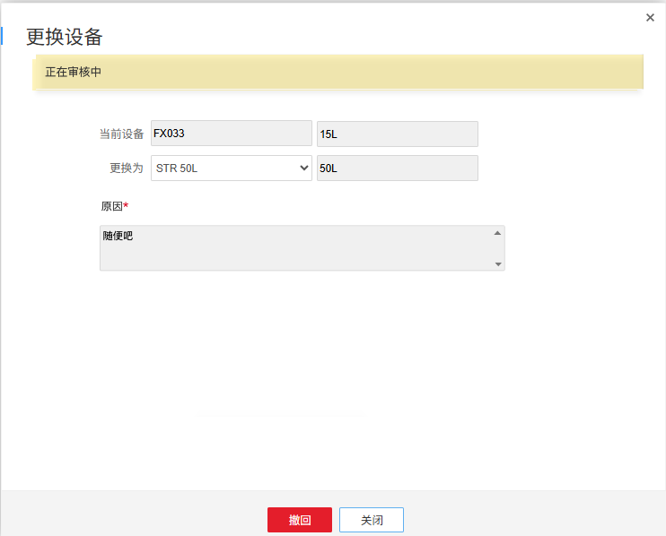

            1.  修改生效后，原设备变为空闲状态，同时和在原设备上的此培养ID的补液方案、在线告警设置都将被删除，相关任务的任务状态也需要更新：将待审核、待批准、待执行、执行出错待审核、执行中、暂停中状态自动更新为已取消，其余状态保持不变。
            2.  更换设备后，将原培养ID、批次编号、项目编号信息自动带入，但工艺方案和告警设置等需要重新设定。
    2.  默认连接

        > **[图 image427.png | 章节：反应器详情（3.1） / 已预约的反应器（3.1） | 上下文：默认连接]**
        > **OCR 文本：**
        > 默认连接
        > 泵名称 | 补料培养基 | 耗材* | 泵速策略* | 使用外置泵
        > PUMP1 | 请选择 | 请选择 | 泵速策略 | 请选择
        > PUMP2 | 请选择 | 请选择 | 泵速策略 | 请选择
        > PUMP3 | 请选择 | 请选择 | 泵速策略 | 请选择
        > PUMP4 | 请选择 | 请选择 | 泵速策略 | 请选择
        > PUMP5 | 请选择 | 请选择 | 泵速策略 | 请选择
        > PUMP6 | 请选择 | 请选择 | 泵速策略
        > PUMP7 | 请选择 | 请选择 | 泵速策略 | 请选择
        > PUMP8 | 请选择 | 请选择 | 泵速策路 | 请选择
        > 保存 | 关闭

        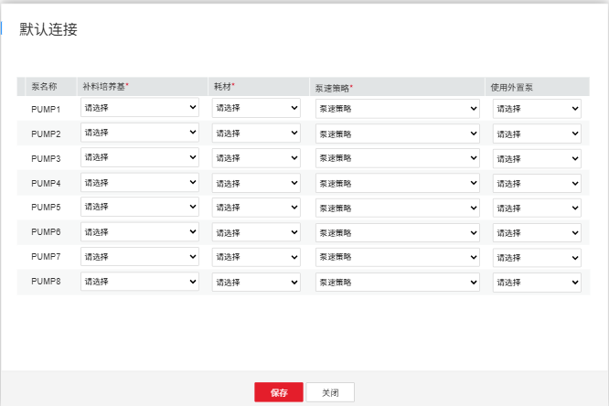

        1.  展示当前反应器的默认连接，若对应培养ID已设置了新的泵的连接，则展示最新的泵的连接数据。
        2.  补液培养基、耗材、泵速策略修改逻辑和原补液方案设置保持一致
        3.  **外置泵**：下拉选择，非必选，选择了外置泵后，调度程序会通过该外置泵完成补液操作。列表内容为当前实验室所有空闲状态的外置泵，数据来源为实验室设置－蠕动泵中维护的数据。外置泵的状态判断逻辑如下：
        4.  实验室配置外置泵的初始状态为空闲
        5.  某个培养在培养的过程中，对应反应器的默认连接中添加的外置泵变为工作中状态
        6.  该培养结束时，对应反应器的默认连接的外置泵全部置为空，即默认全部使用内置泵，之前配置的外置泵都重新变为空闲状态。
        7.  保存：
            1.  若有修改需要保存，则原因为必填。
            2.  保存后，根据系统设定完成审核/不审核。若审核，必须在审核完成后此修改才生效。审核过程中，再次点击进入，则所有字段都不允许编辑修改，顶部提示“正在审核中”，下方变为撤回按钮，撤回后再次支持修改。

##### 培养基本信息（3.1）（3.2）

1.  **培养ID**：展示最新的培养ID，点击编辑按钮弹窗修改培养ID

    > **[图 image428.png | 章节：反应器详情（3.1） / 已预约的反应器（3.1） | 上下文：培养ID：展示最新的培养ID，点击编辑按钮弹窗修改培养ID]**
    > **OCR 文本：**
    > 修改培养ID | ml
    > or
    > 培养ID修改后，可能会引起样品ID的编码规则改变
    > 现培养ID | 显示项目编号 | 显示批次编号 | 显示培养ID
    > 培养ID更改为
    > 原因*
    > 1、不合理 | 选择
    > 2、不允许改来改去 | 选择
    > 3、今天太晚了来不及改了 | 选择
    > 随便吧
    > 保存 | 关闭

    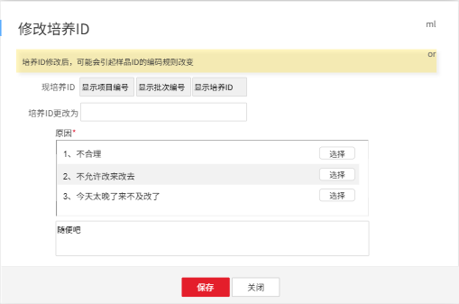

    1.  **提示信息**：文字提示“培养ID修改后，可能会引起样品ID的编码规则改变”
    2.  **现培养ID**：按顺序依次展示项目编号、批次编号、培养ID
    3.  **培养ID更改为**：文本框，可输入修改后的培养ID
    4.  **原因**：支持快速填入
    5.  保存：
        1.  若修改了培养ID，则修改后的培养ID和原因为必填
        2.  修改后的培养ID也要完成新增培养ID时一致的校验操作，比如唯一性。
        3.  保存后，根据系统设定完成审核/不审核。若审核，必须在审核完成后此修改才能生效，审核时需再次做一次培养ID的校验操作，如果不通过，则默认审核不通过。审核过程中，再次点击进入，则所有字段都不允许编辑修改，顶部提示“正在审核中”，下方变为撤回按钮，撤回后再次支持修改。
        4.  注意，修改培养ID不影响检测样品ID与培养ID的关联关系
2.  **开始时间**：和结束时间、培养周期联动编辑
3.  **结束时间**：和开始时间、培养周期联动编辑
4.  **培养周期**：和开始时间、结束时间联动编辑，点击编辑按钮弹窗修改培养时间

    > **[图 image429.png | 章节：反应器详情（3.1） / 已预约的反应器（3.1） | 上下文：培养周期：和开始时间、结束时间联动编辑，点击编辑按钮弹窗修改培养时间]**
    > **OCR 文本：**
    > 修改培养周期
    > 培养时间修改后可能会影响后续补液方案和任务
    > 现计划 | 2026-07-01 | 2026-07-07 | 7天
    > 更改为* | 2026-07-01 | 2026-07-08
    > 原因*
    > 1、不合理 | 选择
    > 2、不允许改来改去 | 选择
    > 3、今天太晚了来不及改了 | 选择
    > 选错了
    > 保存 | 关闭

    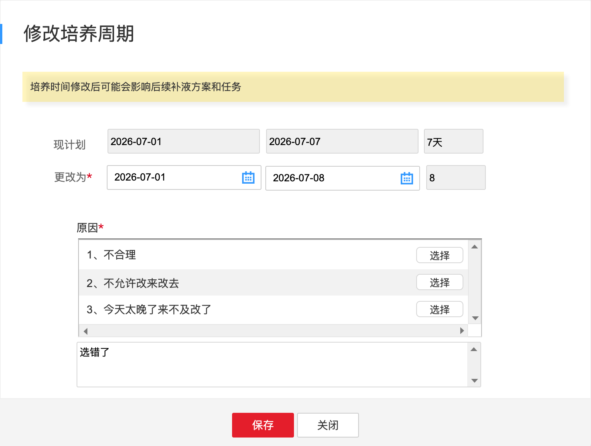

    1.  **提示信息**：文字提示“培养时间修改后可能会影响后续补液方案和任务”
    2.  **现计划**：仅展示开始时间和结束时间以及培养周期
    3.  **更改为**：开始时间、结束时间、培养周期联动修改，可根据其中任意两个自动得出第三个的值
    4.  **原因**：支持快速选择
    5.  保存：
        1.  若修改，则开始时间、结束时间、培养周期、原因为必填
        2.  保存后，根据系统设定完成审核/不审核。若审核，必须在审核完成后此修改才生效。审核过程中，再次点击进入，则所有字段都不允许编辑修改，下方变为撤回按钮，撤回后再次支持修改。
        3.  修改生效后，如果总天数变化，补料/补糖方案清空，未执行任务取消；如总天数不变化，只取消未执行任务。
5.  **当前阶段**：根据开始时间得到当前的培养周期，自动得出，仅展示，不可编辑
6.  **培养方式**：仅中试展示此字段，展示当前的培养方式，点击编辑按钮弹窗可修改培养方式

    > **[图 image430.png | 章节：反应器详情（3.1） / 已预约的反应器（3.1） | 上下文：培养方式：仅中试展示此字段，展示当前的培养方式，点击编辑按钮弹窗可修改培养方式]**
    > **OCR 文本：**
    > 修改培养类型
    > 培养类型 | 营通培养
    > 保存 | 关闭

    

    1.  **培养类型**：下拉单选，列表内容为普通培养和反应器培养
    2.  保存：
        1.  仅中试实验室支持修改培养类型
        2.  仅支持从普通培养修改为反应器培养
        3.  修改即时生效，不需要审核也不需要备注理由

##### 重量信息（3.1）（3.2）

重量信息只有完成任意一个工作流后才可编辑修改，否则只能查看，点击编辑按钮会提示无法修改。

> **[图 image431.png | 章节：反应器详情（3.1） / 已预约的反应器（3.1） | 上下文：重量信息只有完成任意一个工作流后才可编辑修改，否则只能查看，点击编辑按钮会提示无法修改。]**
> **OCR 文本：**
> 未开始的培养无法修改重量


1.  **初始培养体积**：展示当前初始体积，点击编辑按钮弹窗修改初始体积

    > **[图 image432.png | 章节：反应器详情（3.1） / 已预约的反应器（3.1） | 上下文：初始培养体积：展示当前初始体积，点击编辑按钮弹窗修改初始体积]**
    > **OCR 文本：**
    > 修改初始培养体积
    > 初始培养体积 | 1000
    > 更改为* | 1002
    > 原因*
    > 1、不合理 | 选择
    > 2、不允许改来改去 | 选择
    > 3、今天太晚了来不及改了 | 选择
    > 随便吧
    > 保存 | 关闭

    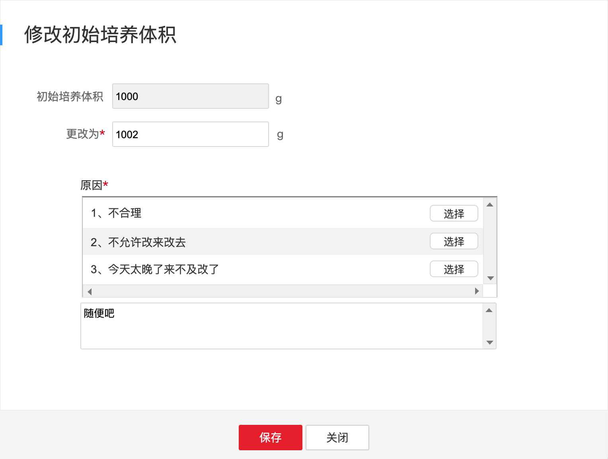

    1.  **初始培养体积**：展示当前初始培养体积，不可编辑
    2.  **更改为**：文本框，限制正整数
    3.  **原因**：支持快速选择填入
    4.  保存：
        1.  若有修改需要保存，则原因为必填。
        2.  保存后，根据系统设定完成审核/不审核。若审核，必须在审核完成后此修改才生效。审核过程中，再次点击进入，则所有字段都不允许编辑修改，顶部提示“正在审核中”，下方变为撤回按钮，撤回后再次支持修改。

            > **[图 image433.png | 章节：反应器详情（3.1） / 已预约的反应器（3.1） | 上下文：保存后，根据系统设定完成审核/不审核。若审核，必须在审核完成后此修改才生效。审核过程中，再次点击进入，则所有字段都不允许编辑修改，顶部提示“正在审核中”，下方变…]**
            > **OCR 文本：**
            > 修改接种体积
            > 接种体积 | 40 | 60
            > 更改为* | 50
            > 原因*
            > 1、不合理 | 选择
            > 2、不允许改来改去 | 选择
            > 3、今天太晚了来不及改了 | 选择
            > 随便吧
            > 保存 | 关闭

            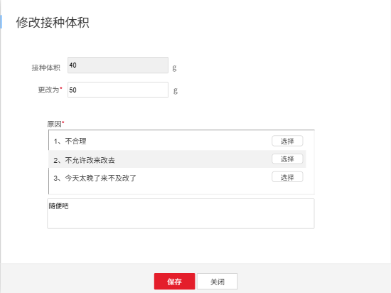

2.  细胞类型
3.  **今日补料总体积**：当天目前为止所有补液任务的补料体积的总和，不可编辑
4.  **取测减少总体积**：仅台式反应器有此字段。上次补料到本次补料前取测减少总体积，点击编辑按钮可追加取测数据或查看所有取测记录.

    注意：追加体积的单位为g，自动化任务取测体积的单位为μL，需要统一换算为g保存。1g=1000μL。

    > **[图 image434.png | 章节：反应器详情（3.1） / 已预约的反应器（3.1） | 上下文：注意：追加体积的单位为g，自动化任务取测体积的单位为μL，需要统一换算为g保存。1g=1000μL。]**
    > **OCR 文本：**
    > 取测数据
    > 追加 | 记录
    > 2026-08-25 10:23:34 | 10g | 张三
    > 2026-08-25 09:20:21 | 10g | 张三
    > 2026-08-25 08:20:21 | 10g | 自动任务002
    > 2026-08-25 10:23:34 | 10g | 张三
    > 2026-08-25 09:20:21 | 10g | 自动任务001
    > 上一页 | 10 | 下一页
    > 保存 | 关闭

    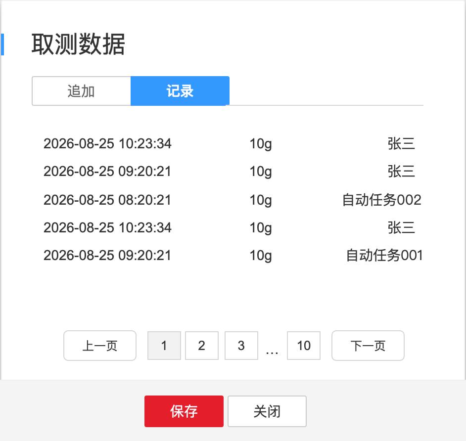

    1.  追加功能
        1.  **取测减少总体积**：展示最新的取测减少总体积，仅展示，不能编辑，可根据下方填入的补充取测减少量自动计算更新，比如弹窗刚打开时显示数值为100，此时下发的补充取测减少量填写了20，则显示120
        2.  **补充取测减少量**：文本框，限制正数，保留小数点后两位，单位为g
        3.  **保存**：不需要审核，直接保存更新数据
    2.  **查看记录**：翻页展示该反应器当前培养历史所有自动化取测任务及手动追加的记录，仅可查看，不可编辑，展示以下字段：
        1.  **时间**：自动化任务的执行时间或完成手动追加操作的时间点
        2.  取测体积
        3.  **操作人/任务ID**：显示手动追加操作的用户显示名或自动化任务的任务ID
5.  **当前总体积**：即当下的反应器重量

##### 残糖确认（3.1）

1.  信息展示与修改
    1.  补料计算依据
    2.  **补料时计算补料引起的糖浓度变化**：若勾选则为是，不勾选则为否
    3.  **补料前确认残糖浓度**：若勾选则为是，不勾选则为否
    4.  补糖计算方式
    5.  **补糖适用公式**：根据补糖计算方式不同展示不同的补糖量计算公式
    6.  **理论糖浓度**：展示最新的糖浓度结果和获取/补液后计算完成的时间
    7.  **Cedex确认值**：展示最近一次残糖确认时确认的糖浓度结果和确认的时间
        1.  Cedex确认值数字也可点击，点击后打开残糖确认操作界面，默认选中只看已确认选项，把每日确认的残糖数据显示在弹窗中
    8.  **乳酸确认**：如果补糖计算方式为残糖+乳酸，则展示最近一次残糖确认时确认的乳酸结果和确认的时间，否则展示符号“--”
    9.  **糖耗**：即日耗糖速率
        1.  每天残糖确认后，同步计算得到的前一天的日耗糖速率，为单位g/L

            日耗糖速率 = 昨天补液后计算的糖浓度-当天残糖确认的残糖浓度

        2.  糖耗数字可以点击，点击后显示弹窗，可查看过去培养期间的每日糖耗曲线，横轴为日期，纵轴为糖耗，如果未计算或无结果默认按照0显示

            > **[图 image435.png | 章节：反应器详情（3.1） / 已预约的反应器（3.1） | 上下文：糖耗数字可以点击，点击后显示弹窗，可查看过去培养期间的每日糖耗曲线，横轴为日期，纵轴为糖耗，如果未计算或无结果默认按照0显示]**
            > **OCR 文本：**
            > 糖耗变化
            > 糖耗：单位g/L
            > 0.8
            > 0.6
            > 0.4
            > 0.2
            > 07-01 | 07-02 | 07-03 | 07-04 | 07-05 | 07-06 | 20-20
            > 日期
            > 关闭

            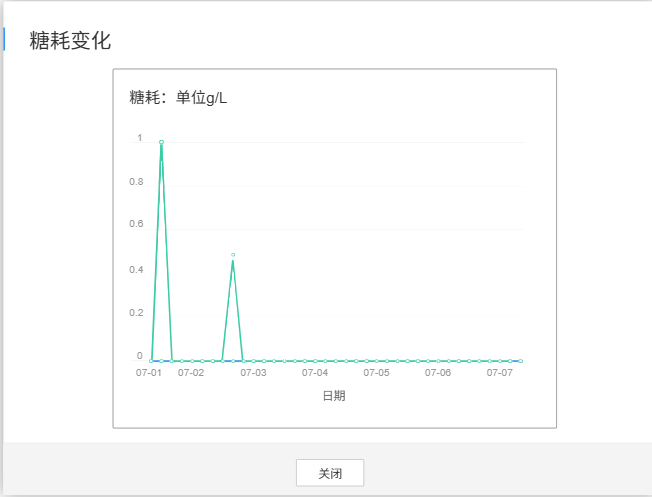

2.  操作
    1.  **修改规则**：点击修改规则，弹窗修改补液计算规则，修改逻辑和设置方案时的逻辑一致。

        > **[图 image436.png | 章节：反应器详情（3.1） / 已预约的反应器（3.1） | 上下文：修改规则：点击修改规则，弹窗修改补液计算规则，修改逻辑和设置方案时的逻辑一致。]**
        > **OCR 文本：**
        > 补液计算规则
        > 原因*
        > 1、不合理 | 选择
        > 补料计算依据* | 初始重量
        > 2、不允许改来改去 | 选择
        > 补糖计算模式* | 残糖 | 3、今天太晚了来不及改了 | 选择
        > 补料时计算补料引起的糖浓度变化*
        > 随便吧
        > 补液前确认残糖浓度*
        > 补液前残糖确认* | 不需要
        > 保存 | 关闭

        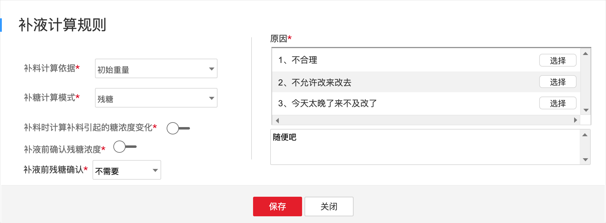

        1.  补料计算依据
        2.  补糖计算模式
        3.  补料时计算补料引起的糖浓度变化
        4.  补液前确认残糖浓度
        5.  补液前残糖确认
        6.  原因
        7.  保存：
            1.  若有修改需要保存，则原因为必填。
            2.  保存后，根据系统设定完成审核/不审核。若审核，必须在审核完成后此修改才生效。审核过程中，再次点击进入，则所有字段都不允许编辑修改，顶部提示“正在审核中”，下方变为撤回按钮，撤回后再次支持修改。
    2.  残糖确认

        查询展示Cedex检测结果，完成当天的残糖确认

        > **[图 image437.png | 章节：反应器详情（3.1） / 已预约的反应器（3.1） | 上下文：查询展示Cedex检测结果，完成当天的残糖确认]**
        > **OCR 文本：**
        > 残糖确认
        > 检测完成日期 | 口只看已碘认 | 新增
        > 序号 | 样品ID | 位置 | 状态 | 检测完成时间 | 设备编号 | 稀释倍数 | 检测项名称 | 检测结果 | 单位 | 确认
        > 1D2-123F1903 | 已上传 | 2026-06-08 12:21:12 | CeDex3 | GLC2B | xXX | g/L | 残糖确认
        > 1D2-123F1904 | 已签名 | 2026-06-08 12:21:12 | CeDex3 | 1.5 | GLC2D | xXX | g/L | 59S 取消
        > 1D2-123F1904 | 2026-06-08 12:21:12 | CeDex3 | 1.5 | LACXX | g/L | 已确认
        > 关闭

        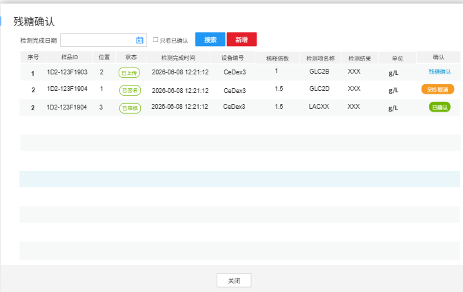

        1.  查询条件：
            1.  **检测完成日期**：默认选中当天
            2.  **只看已确认**：选择勾选或者不勾选，勾选则需筛选出已确认过的检测结果
        2.  **新增**：点击手动新增Cedex检测结果，此处新增的检测结果不进入离线检测结果记录，仅在此处供残糖确认使用，默认稀释倍数为1，状态为“已检测”

            > **[图 image438.png | 章节：反应器详情（3.1） / 已预约的反应器（3.1） | 上下文：新增：点击手动新增Cedex检测结果，此处新增的检测结果不进入离线检测结果记录，仅在此处供残糖确认使用，默认稀释倍数为1，状态为“已检测”]**
            > **OCR 文本：**
            > 新增Cedex结果
            > 样品ID* | 位置* | 检测完成时间*
            > 检测结果
            > 检测项目" | 检测项简称 | 单位 | 检测结果”
            > +1
            > 保存 | 关闭

            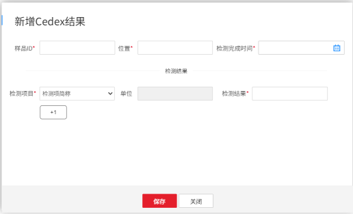

            1.  **样品ID**：文本框，必填，全局唯一，不能重复
            2.  **位置**：文本框，必填
            3.  **检测完成时间**：必填
            4.  **检测项目**：下拉单选，必选，列表内容为所有Cedex下检测项目的简称
            5.  **单位**：根据选择的检测项目自动带出单位，仅展示，不可修改
            6.  **检测结果**：文本框，必填
            7.  **+1**：点击增加一行检测项目－单位－检测结果的填写区域。
        3.  **列表展示**：列表的数据来自当前培养id的所有Cedex检测状态为已检测/已上传/已签名/已审核的检测结果。
            1.  当补糖计算方式选择残糖时，筛选出所有检测项目名开头为GLC的数据（残糖数据）；如果用户设置的 补糖计算方式是残糖+乳酸，则筛选出所有检测项目名开头为GLC的数据（残糖数据）以及LAC开头的数据（乳酸数据）。注意，一次检测可能会有多个指标，每个指标显示一行
            2.  列表按照时间倒排序，最新的在上面
            3.  展示内容包含：
                1.  序号
                2.  样品ID
                3.  位置
                4.  **状态**：检测结果当前的状态
                5.  检测完成时间
                6.  **设备编号**：检测的设备编号
                7.  稀释倍数
                8.  检测项简称
                9.  检测结果
                10. 单位
                11. **确认**：这一列会展示当前检测结果的确认状态，即是否已被残糖确认过或仍能完成残糖确认操作
                    -   **残糖确认**：当天目前为止所有的检测结果默认展示为残糖确认，可点击，点击后变为60S倒计时取消按钮，同时，当天其余残糖确认按钮置灰不允许点击

                        > **[图 image439.png | 章节：反应器详情（3.1） / 已预约的反应器（3.1） | 上下文：残糖确认：当天目前为止所有的检测结果默认展示为残糖确认，可点击，点击后变为60S倒计时取消按钮，同时，当天其余残糖确认按钮置灰不允许点击]**
                        > **OCR 文本：**
                        > 确认
                        > 残糖确认
                        > 残糖确认
                        > 残糖确认

                        

                        > **[图 image440.png | 章节：反应器详情（3.1） / 已预约的反应器（3.1） | 上下文：残糖确认：当天目前为止所有的检测结果默认展示为残糖确认，可点击，点击后变为60S倒计时取消按钮，同时，当天其余残糖确认按钮置灰不允许点击]**
                        > **OCR 文本：**
                        > 确认
                        > 59S | 取消
                        > 残糖确认
                        > 残糖确认

                        

                    -   **60S倒计时取消**：点击残糖确认后变为60S倒计时按钮效果（上边显示的时间会倒计时变化）。倒计时结束前可点击，点击后倒计时取消，状态变为残糖确认，同时当天其余残糖确认按钮变为可点击；倒计时顺利结束，状态变为已确认，当天其余残糖确认结果变为未确认

                        > **[图 image441.png | 章节：反应器详情（3.1） / 已预约的反应器（3.1） | 上下文：60S倒计时取消：点击残糖确认后变为60S倒计时按钮效果（上边显示的时间会倒计时变化）。倒计时结束前可点击，点击后倒计时取消，状态变为残糖确认，同时当天其余残糖…]**
                        > **OCR 文本：**
                        > 确认
                        > 已确认
                        > 未确认
                        > 未确认

                        

                    -   **未确认**：未被确认的检测结果（包含历史的和当天未被选中完成确认操作的），不可点击
                    -   **已确认**：已确认过的检测结果，不可点击
        4.  **关闭按钮**：点击关闭时，检测补糖计算方式，如果是残糖+乳酸，需要校验是否分别确认了残糖和乳酸，若未确认则弹窗提示未确认完成

            > **[图 image442.png | 章节：反应器详情（3.1） / 已预约的反应器（3.1） | 上下文：关闭按钮：点击关闭时，检测补糖计算方式，如果是残糖+乳酸，需要校验是否分别确认了残糖和乳酸，若未确认则弹窗提示未确认完成]**
            > **OCR 文本：**
            > 今日的残糖还未确认完
            > 需要分别确认残随和乳酸的数值
            > 稍后再确认

            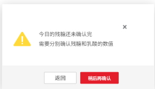

            1.  **返回按钮**：关闭当前提示弹窗，回到残糖确认弹窗
            2.  **稍后再确认**：关闭所有弹窗

##### 工艺设置（3.1）（3.2）

1.  工作流程
    1.  卡片形式展示所有工作流，当前培养已选中的工作流为绿色，其余为灰色。不支持编辑。
    2.  点击编辑按钮可弹窗修改工作流程

        > **[图 image443.png | 章节：反应器详情（3.1） / 已预约的反应器（3.1） | 上下文：点击编辑按钮可弹窗修改工作流程]**
        > **OCR 文本：**
        > 工作流
        > 仅支持对未开启的工作流节点进行增减
        > Conlig关联置 | 开始培养
        > 1、不合理 | 选择
        > 2、不允许改来改去 | 选择
        > 3、今天太晚了来不及改了 | 选择
        > 随便吧
        > 保存 | 关闭

        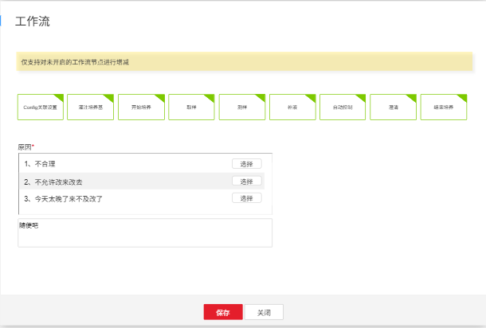

        1.  **提示信息**：文字提示“仅支持对未开启的工作流节点进行增减”
        2.  **工作流流程卡片**：展示所有工作流节点，通过颜色区分当前已选中或未选中。
            1.  弹窗上的矩形支持点击选择/取消
            2.  已经执行过的和正在执行中的工作流节点，不支持取消。比如现在已经到了补液流程，签名的关注培养基已经做完了，这时候就不能再取消了
    3.  **原因**：支持快速选中
    4.  **保存**：保存后若需要审批，则生成审批单，在审批单子中记录本次修改的内容，通过审核后，新的数据才可以覆盖之前的数据。审核过程中，再次点击进入，则所有字段都不允许编辑修改，顶部提示“正在审核中”，下方变为撤回按钮，撤回后再次支持修改。
2.  工艺方案：
    -   展示所有可设置的工艺方案，已选中节点的方案为绿色，未选中的为灰色。工作流节点与方案的对应关系如下：

        | 工作流节点 | 方案 |
        | :---: | :---: |
        | config关联设置 | config关联设置 |
        | 灌注培养基 | 灌注培养基方案 |
        | 自动控制 | 自动控制方案 |
        | 取样 | 取样方案 |
        | 测样 | 测样方案 |
        | 补液 | 补料任务 |
        | 补液 | 补糖规则 |
        | 澄清 | 澄清方案 |
        | 结束培养 | 结束策略 |

    -   已设置方案需标记已设置，未设置方案需标记为未设置。
    -   **点击可修改/设置方案**：先完成补料任务和补糖规则的说明，其余方案待后续补充
    4.  补料任务

        > **[图 image444.png | 章节：反应器详情（3.1） / 已预约的反应器（3.1） | 上下文：补料任务]**
        > **OCR 文本：**
        > 补料任务
        > 选择模版 | Please select...
        > PUMP1 | PUMP2 | PUMP3 | PUMP4 | PUMP5 | PUMP6 | PUMP7 | PUMP8
        > 新增 | 补料培养基：Glucose外置泵：PUMP-1009
        > 序号 | 天* | 补料计划时间* | 补料类型* | 补料体积（%/g) | 操作
        > 00 : 00 : 00 | 粘贴 | 百分比 | 粘贴 | 10 | 粘贴
        > 00 : 00 : 00 | 粘贴 | 百分比 | 粘贴 | 10 | 粘贴 | 删除
        > 原因*
        > 1、不合理 | 选择
        > 2、不允许改来改去 | 选择
        > 3、今天太晚了来不及改了 | 选择
        > 随便吧
        > 保存 | 取消

        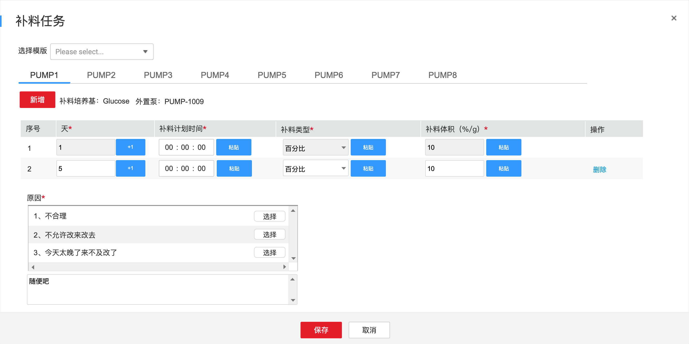

        1.  根据当前反应器对应培养ID的补液方案－补料任务将数据都自动带出。
        2.  **展示外置泵信息**：如果有使用外置泵，则需要将外置泵信息在补液培养基旁做展示
        3.  历史时间对应的计划不能修改和删除，只能调整未来计划
        4.  新增/调整未来计划时，此页面的模板、任务规则等的填写、校验逻辑与培养修改－初始化设置补料任务规则保持一致，详见章节补液模板③中的补料任务Tab页。
        5.  如果切换了选择模板，历史时间对应的计划仍然需要展示且不可修改和删除；同时，新增展示模板中其余天数的计划。比如说当前为培养的第3天，那么历史时间也就是第1、2天的计划需展示但不可修改和删除，如果第3天没有开始任何补液任务，那第3天的计划支持修改，否则第3天的也仅展示不可修改和删除，模板剩余天的计划需要展示，并支持修改/删除。
        6.  **原因**：修改补料任务后，原因为必填，支持快速选择
        7.  **保存**：如果设定为修改后需要审核，那么只有审核通过后当前修改才能生效，否则直接生效。审核过程中，再次点击进入，则所有字段都不允许编辑修改，顶部提示“正在审核中”，下方变为撤回按钮，撤回后再次支持修改。
    5.  补糖规则

        > **[图 image445.png | 章节：反应器详情（3.1） / 已预约的反应器（3.1） | 上下文：补糖规则]**
        > **OCR 文本：**
        > 补糖规则
        > 选择模版 | Please select...
        > 新增 | 糖耗： 2.1 g/L (2026-07-30 10:00) | 更多
        > 泵名称 | 培养天数 (开始) | 培养天数 (结束) | 计划方式* | 细则* | 操作
        > PUMP2 | 按规则 | 下限操作符* | 糖下限 (g/L)
        > 删除
        > 计算模式* | 残糖和乳酸 | 糖补料至 | (g/L)
        > PUMP2 | 按数值 | 每日执行时间* | 00 : 00 : 00 | 糖补料体积 | (g) | 删除
        > 原因*
        > 1、不合理 | 选择
        > 2、不允许改来改去 | 选择
        > 3、今天太晚了来不及改了 | 选择
        > 随便吧
        > 保存 | 取消

        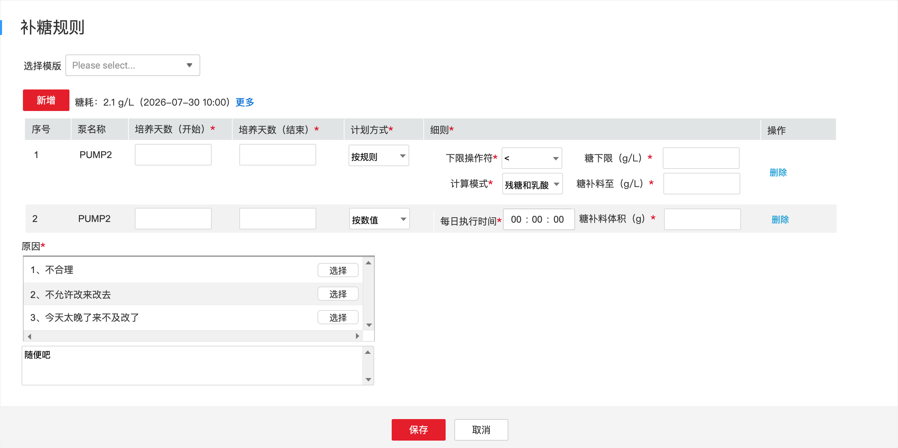

        1.  根据当前反应器对应培养ID的补液方案－补糖规则将数据都自动带出。
        2.  **展示糖耗信息**：默认展示最近一次计算出的糖耗和计算时间。点击更多按钮，弹窗展示当前培养ID历史日期所有的糖耗信息。

            > **[图 image446.png | 章节：反应器详情（3.1） / 已预约的反应器（3.1） | 上下文：展示糖耗信息：默认展示最近一次计算出的糖耗和计算时间。点击更多按钮，弹窗展示当前培养ID历史日期所有的糖耗信息。]**
            > **OCR 文本：**
            > 糖耗变化
            > 糖耗：单位g/L
            > 0.8
            > 0.6
            > 0.4
            > 0.2
            > 07-01 | 07-02 | 07-03 | 07-04 | 07-05 | 07-06 | 07-07
            > 日期
            > 关闭

            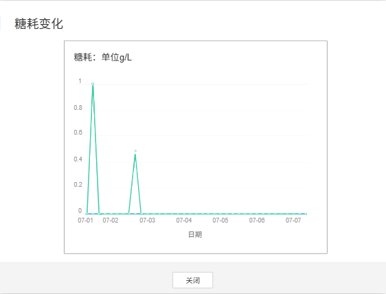

        3.  历史时间对应的计划不能修改和删除，只能调整未来计划
        4.  新增/调整未来计划时，此页面的模板、任务规则等的填写、校验逻辑与培养修改－初始化设置补糖规则保持一致，详见章节补液模板③中的补糖规则Tab页。
        5.  如果切换了选择模板，历史时间对应的计划仍然需要展示且不可修改和删除；同时，新增展示模板中其余天数的计划。比如说当前为培养的第3天，那么历史时间也就是第1、2天的计划需展示但不可修改和删除，如果第3天没有开始任何补液任务，那第3天的计划支持修改，否则第3天的也仅展示不可修改和删除，模板剩余天的计划需要展示，并支持修改/删除。
        6.  **原因**：修改补糖规则后，原因为必填，支持快速选择
        7.  **保存**：如果设定为修改后需要审核，那么只有审核通过后当前修改才能生效，否则直接生效。审核过程中，再次点击进入，则所有字段都不允许编辑修改，顶部提示“正在审核中”，下方变为撤回按钮，撤回后再次支持修改。

##### 在线数据（3.1）（3.2）

1.  单一指标可视化

    以每个指标一个卡片的形式展示该指标的当前数值和上下限等，包含以下内容

    1.  指标名称
    2.  **当前数值**：超过报警上下限时，颜色变为红色
    3.  指标的报警上下限
    4.  **趋势图**：可点击弹窗查看该指标不同时间长度的趋势。

        > **[图 image447.png | 章节：反应器详情（3.1） / 已预约的反应器（3.1） | 上下文：趋势图：可点击弹窗查看该指标不同时间长度的趋势。]**
        > **OCR 文本：**
        > 在线指标
        > 1H | 3H | 12H | 24H | 7D | 30D
        > PH
        > 0.8
        > 0.6
        > 0.4
        > 0.2
        > 11:40 | 12:00 | 12:30 | 13:00 | 13:30 | 14:00
        > 关闭

        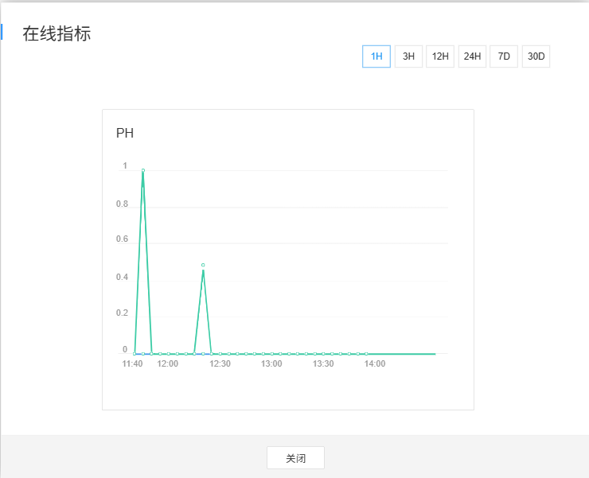

        1.  横轴为自然时间，纵轴为指标
        2.  进入当前页面默认查看最近1小时的数据，可以通过点击切换时间长度，时间长度仅可选择当前往前推1H、3H、12H、24H、7D、30D中的一个。更详细更丰富的趋势图可通过数据管理－在线数据模块查看。
        3.  根据用户选择的时间长度，可调整数据采集点的密度。X轴都以1分钟为一个单位展示。
2.  操作：
    1.  在线告警设置
        -   当前培养ID在当前反应器上从未设置过在线告警时，默认带出该反应器设备级别的告警设置（该反应器在空闲状态下，即完全空闲或已关联培养ID但未设置培养开始和结束时间时设置的告警设置），详见章节在线告警设置；若已经设置过，则自动带出最近一次保存的告警设置。
        -   支持修改报警设置，修改后生成一组新的数据与当前培养ID关联，即此修改仅对当前培养ID生效。
        -   支持单个指标打开或关闭报警状态；也支持一键打开或关闭报警状态
        -   列表展示与编辑

            > **[图 image448.png | 章节：反应器详情（3.1） / 已预约的反应器（3.1） | 上下文：列表展示与编辑]**
            > **OCR 文本：**
            > 在线告警
            > 序号 | 检项名称 | 单位 | 报警下限 | 报警上限 | 行动下限 | 行动上限 | 修改时间 | 修改人 | 报警状态
            > Hd | 7.3 | 6.6 | 2026-06-03 11:11:11 | 张三
            > ITEMP | 2026-06-03 11:11:11 | 张三
            > DO | 2026-06-03 11:11:11 | 张三
            > O2 MFC1 | L/min | 2026-06-03 11:11:11 | 张三
            > O2 MFC1 | L/min | 2026-06-03 11:11:11 | 张三
            > stirrer | RPM | 2026-06-03 11:11:11 | 张三
            > Vessel weight g | 2026-06-03 11:11:11 | 张三
            > Pump1 | g/min | 2026-06-03 11:11:11 | 张三
            > 10 | Pump2 | g/min | 2026-06-03 11:11:11 | 张三
            > Pump3 | g/min | 2026-06-03 11:11:11 | 张三
            > 重制 | 保存

            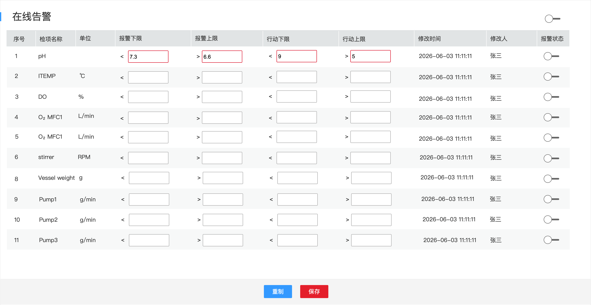

            > **[图 image449.png | 章节：反应器详情（3.1） / 已预约的反应器（3.1） | 上下文：列表展示与编辑]**
            > **OCR 文本：**
            > 在线告警
            > 序号 | 检项名称 | 单位 | 设定值 | 上下限百分比 | 报警下限值 | 报警上限值 | 呆滞限值 | 呆滞时长 | 上限延迟 (S) | 下限延迟 (S) | 循环间隔(秒) | 循环提醒 | 报警方式 | 报警状态
            > pH | 短信 | 电话
            > 口声光 | 口邮件
            > ITEMP | 短信 | 口电话
            > 声光 | 口邮件
            > DO | 短信 | ■电话
            > 声光 | 邮件
            > O2 MFC1 | L/min | 短信 | 电话
            > 声光 | 邮件
            > O2 MFC1 | L/min | 短信 | 电话
            > 声光 | 口邮件
            > stirrer | RPM | 短信 | 电话
            > 声光 | 邮件
            > Vessel weight g | 短信 | 口电话
            > 声光 | 口邮件
            > Pump1 | g/min | 短信 | 声光 | 邮件 | 电话
            > 10 | Pump2 | g/min | 短信 | 声光 | 电话 | 口邮件
            > Pump3 | g/min | 短信 | 口声光 | 口邮件 | 电话
            > 重制 | 保存

            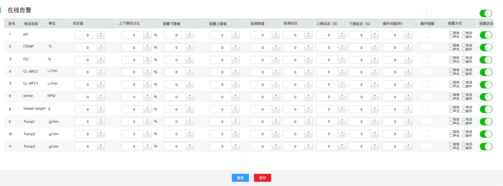

        5.  **序号**：行号，自增即可
        6.  **检项简称**：根据设备配置模块中不同检测类型配置的不同检测项目自动带出，每个检项为一行
        7.  **单位**：根据检测项目自动带出
        8.  **设定值**：支持手动输入，限制输入数值
        9.  **上下限百分比**：支持手动输入，限制输出正整数。结合设定值可计算出报警上限和报警下限，实际报警以报警上限和报警下限为标准。
        10. **报警下限**：根据设定值和上下限百分比自动计算，支持手动修改。超过报警下限时，在线指标可视化时文字颜色变红。
        11. **报警上限**：根据设定值和上下限百分比自动计算，支持手动修改。超过报警下限时，在线指标可视化时文字颜色变红。
        12. 呆滞限值
        13. 呆滞时长
        14. 上限延迟（S）
        15. 下限延迟（S）
        16. 循环间隔（S）：
        17. **循环提醒**：可选择开或关，表示是否要开启循环提醒的功能
        18. **报警方式**：复选框，支持多选，选择内容包括短信、电话、邮件、声光报警器共计4种
        19. **报警状态**：可打开或关闭告警通知。支持单个修改，也支持一键全部打开或关闭。
            -   注意，此处先完成数据填入与保存，具体告警逻辑后续药明技术会补充告警逻辑，可统一放到告警规则一期实现
    2.  更多数据

        点击跳转至数据管理－在线数据页面，自动代入当前反应器编号和培养ID。详情见章节在线数据②

##### 离线数据（3.1）

1.  单个检测类型的指标可视化

    以一个检测类型一个图的方式展示检测项目的结果

    1.  横轴为培养天数（D0,D1,...,Dn），纵轴为检测项目
    2.  同一个检测类型的所有检测项目呈现在同一个图，即会有多个Y轴
2.  操作
    1.  更多图表

        点击跳转至数据管理－离线数据页面，自动带入当前培养ID。详情见章节离线数据②

    2.  检测明细

        点击跳转至数据管理－检测分析－检测记录页面，自动带入培养ID。详情见章节检测记录①

    3.  离线告警设置
3.  此处的离线告警设置，仅对当前培养ID生效，超出则可能按照设定触发告警通知
4.  在检测分析模块中查看检测详情，如果检测结果超出告警范围，检测结果文字变成红色。

    > **[图 image450.png | 章节：反应器详情（3.1） / 已预约的反应器（3.1） | 上下文：在检测分析模块中查看检测详情，如果检测结果超出告警范围，检测结果文字变成红色。]**
    > **OCR 文本：**
    > 离线告警
    > BGA | Vicell | OSMO | Cedex
    > 序号 | 检项名称 | 单位 | 报警下限 | 报警上限 | 修改时间 | 修改人
    > pH | 7.3 | 6.6 | 2026-06-03 11:11:11 | 张三
    > PCO2 | mmHg | 2026-06-03 11:11:11 | 张三
    > pO2 | mmHg | 2026-06-03 11:11:11 | 张三
    > Na+ | mM/L | 2026-06-03 11:11:11 | 张三
    > K* | mM/L | 2026-06-03 11:11:11 | 张三
    > ITEMP | 2026-06-03 11:11:11 | 张三
    > 重制 | 保存

    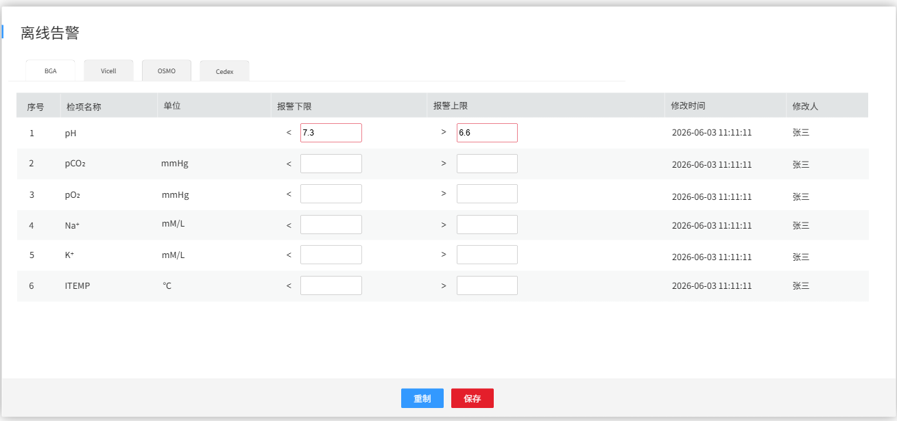

    页面内一共包含4个Tab页，对应4个检测类型，每个tab页都包含以下内容：

    1.  **序号**：行号，自增即可
    2.  **检项简称**：当前培养id所在的实验室中配置的此类设备的检测项目的合集。比如，培养ID，属于实验室A，实验室A中配置了BGA1 、BGA2两台设备BGA1可以检测 项目1 、项目2、 项目3，BGA2 可检测项目3 、项目4 和项目5，当前BGA里可以配置的指标包含 项目1 、项目 2 、项目3 、项目4 、项目5。
    3.  **单位**：根据检测项目自动带出
    4.  **报警下限**：选填，前端页面展示〈 ，默认使用〈判断。不填写默认不设告警限制，支持小数点后最多4位，允许填写0。下限值要小于上限值，否则文本框标红提示。
    5.  **报警上限**：选填，前端页面展示> ，默认使用>判断。不填写默认不设告警限制，支持小数点后最多4位，允许填写0。上限值要大于下限值，否则文本框标红提示。
    6.  修改人
    7.  修改时间
    8.  操作：
        1.  **重置**：清空所有输入内容
        2.  **保存**：保存时需校验同一指标的上限值必须大于下限值，如果填写错误红框提示错误。保存成功即直接应用（该实验室产生的相关检测项根据此规则产生通知告警）

#### 空闲的反应器（3.1）

场景：该反应器为空闲状态，即完全空闲或已被培养ID关联但所有培养均未设置培养开始时间和培养结束时间

包含设置操作、设备信息、在线数据、关联培养信息4个部分。关联培养信息部分根据反应器是否有被培养ID关联存在两种不同的信息展示方式。

> **[图 image451.png | 章节：反应器详情（3.1） / 空闲的反应器（3.1） | 上下文：包含设置操作、设备信息、在线数据、关联培养信息4个部分。关联培养信息部分根据反应器是否有被培养ID关联存在两种不同的信息展示方式。]**
> **OCR 文本：**
> 药明生物SMP系统 | 首页 | A实验室工作台 | B实验室工作台 | 数据管理 | 系统设置>
> FX055
> 培养信息 | 任务队列 | 远程服务
> 监控设置 | 关闭报警器
> 设备信息 | 操作、 | 在线数据 | 操作、
> 设备编号 | tesgggg-node-0
> 反应器型号 | 品牌-型号 | PH | Temp | 指标 | 指标 | 指标 | 指标 | 指标
> 设备管理员 | 张三 | 7.101 | 7.1-7.3 | 34°℃ | 当前数值 | 当前数值 | 当前数值 | 当前数值 | 当前数值 | 当前数值
> 30.5.1-33°C | 上下限 | 上下限 | 上下限 | 上下限 | 上下限 | 上下限
> 未确认培养日期 | 未确认培养日期
> 培养ID：7736653738 | ·培养ID：7736653738
> -项目：XXXX | ·项目：XXXX
> 批次：XXXX | ·批次：XXXX
> 成员：张三、李四、王五 | ·成员：张三、李四、王五

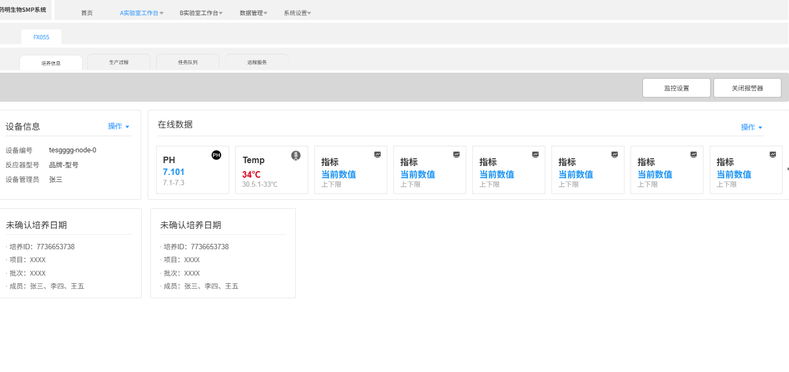

> **[图 image452.png | 章节：反应器详情（3.1） / 空闲的反应器（3.1） | 上下文：包含设置操作、设备信息、在线数据、关联培养信息4个部分。关联培养信息部分根据反应器是否有被培养ID关联存在两种不同的信息展示方式。]**
> **OCR 文本：**
> 药明生物SMP系统 | 首页 | A实验室工作台 | B实验室工作台 | 数据管理 | 系统设置
> FX055
> 培养信息 | 生产过程 | 任务限列 | 远程服务
> 监控设置 | 关闭报警器
> 设备信息 | 操作、 | 在线数据 | 操作、
> 设备编号 | tesgggg-node-0
> 反应器型号 | 品牌-型号 | PH | Temp | 指标 | 指标 | 指标 | 指标 | 指标 | 指标
> 设备管理员 | 张三 | 7.101 | 34°℃ | 当前数值 | 当前数值 | 当前数值 | 当前数值 | 当前数值 | 当前数值
> 7.1-7.3 | 30.5.1-33°C | 上下限 | 上下限 | 上下限 | 上下限 | 上下限 | 上下限
> 暂无培养预约或培养中

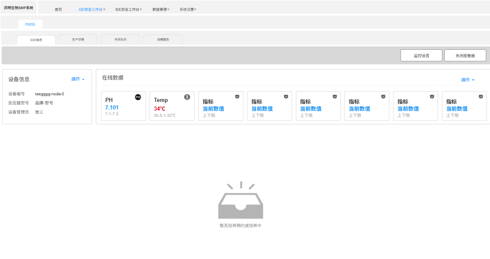

##### 设置操作（3.1）

1.  监控设置

    同上述章节监控设置

2.  关闭报警器

    同上述章节关闭报警器

##### 设备信息（3.1）

1.  展示信息
    1.  设备编号
    2.  反应器型号
    3.  设备负责人
2.  操作
    1.  **默认连接**：同上述已预约反应器中的章节默认连接

##### 在线数据（3.1）（3.2）

1.  单一指标可视化

    同上述章节单一指标可视化

2.  操作
    1.  在线告警设置
        -   默认带出最近一次反应器设备级别的告警设置（该反应器在空闲状态下，即完全空闲或已关联培养ID但未设置培养开始和结束时间时设置的告警设置）
        -   支持修改报警设置，修改后与当前反应器关联，即此修改为对当前反应器生效。
        -   支持单个指标打开或关闭报警状态；也支持一键打开或关闭报警状态
        -   列表展示与编辑

            逻辑同上述章节列表展示与编辑

    2.  更多数据

        同上述章节更多数据

##### 关联培养信息（3.1）

关联培养信息根据是否关联培养ID分为两种情况：

1.  已被培养ID关联，但均未设置培养开始时间和培养结束时间：显示已被关联的培养ID，一个卡片对应一个培养ID，每个卡片包含以下内容：

    > **[图 image453.png | 章节：反应器详情（3.1） / 空闲的反应器（3.1） | 上下文：已被培养ID关联，但均未设置培养开始时间和培养结束时间：显示已被关联的培养ID，一个卡片对应一个培养ID，每个卡片包含以下内容：]**
    > **OCR 文本：**
    > 未确认培养日期 | 未确认培养日期
    > -培养ID：7736653738 | -培养ID：7736653738
    > -项目：XXXX | -项目：XXXX
    > -批次：XXXX | -批次：XXXX
    > -成员：张三、李四、王五 | -成员：张三、李四、王五

    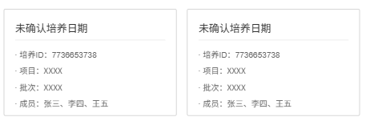

    1.  **提示信息**：文字提示“未确认培养日期”
    2.  培养ID
    3.  项目编号
    4.  批次编号
    5.  成员
2.  **完全空闲**：直接提示暂无培养预约或培养中

    > **[图 image454.png | 章节：反应器详情（3.1） / 空闲的反应器（3.1） | 上下文：完全空闲：直接提示暂无培养预约或培养中]**
    > **OCR 文本：**
    > 无培养预约或培养中

    

### 生产过程（3.1）

查看当前培养ID的生产信息。包含基本信息和生产工作流程两个部分

> **[图 image455.png | 章节：反应器详情（3.1） / 生产过程（3.1） | 上下文：查看当前培养ID的生产信息。包含基本信息和生产工作流程两个部分]**
> **OCR 文本：**
> 生产
> DO | D0.1 | D0.2 | D0.3
> 2026-07-01 | config关联设置 | 灌注培养基 | Cedex
> 设备logo
> D1 | D1.1 | D1.2 | D1.3
> 2026-07-02 | 连接补料单元 | 补料 | 补糖
> 培养基本信息
> ·培养ID：7736653738
> ·开始时间：2026-07-10
> ·结束时间：2026-07-16
> -培养天数：7
> ·当前阶段：D5
> ·培养模式：普通培养
> ·设备编号：FX0333
> ·培养成员：张三、李四、王五

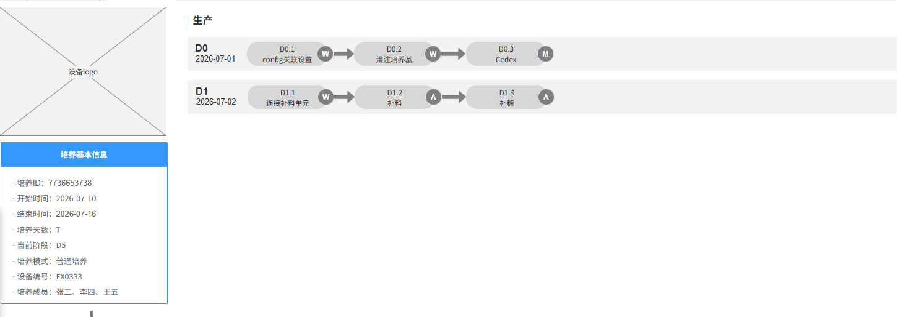

#### 基本信息（3.1）（3.2）

> **[图 image456.png | 章节：反应器详情（3.1） / 基本信息（3.1）（3.2） | 上下文：基本信息（3.1）（3.2）]**
> **OCR 文本：**
> 设备logo
> 培养基本信息
> 培养D：7736653738
> 开始时间：2026-07-10
> 结束时间：2026-07-16
> ·培养天数：7
> 当前阶段：D5
> ·培养模式：普通培养
> 设备编号：FX0333
> ·培养成员：张三、李四、王五

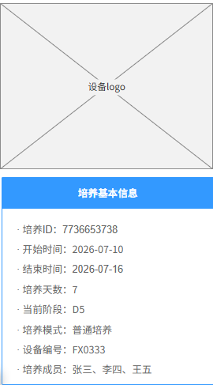

1.  **设备图片**：根据当前设备型号自动关联带出图片
2.  培养基本信息
    1.  培养ID
    2.  培养开始时间
    3.  培养结束时间
    4.  培养周期
    5.  当前阶段
    6.  培养模式
    7.  设备编号
    8.  培养成员

#### 生产工作流程（3.1）（3.2）

按天统一展示所有操作节点的执行顺序，点击节点可查看每个节点的操作详情

1.  顺序展示

    > **[图 image457.png | 章节：反应器详情（3.1） / 生产工作流程（3.1）（3.2） | 上下文：顺序展示]**
    > **OCR 文本：**（未识别到文字，请查看原图）

    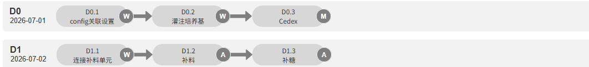

    -   纵向按照培养天数从上往下排序，每天一行
    -   **培养天数**：用D0,D1,...,Dn的格式表示开始培养后的第n天，从0开始计算。
    -   **日期**：展示自然日期
    -   横向为同一天，按照从早到晚的执行顺序从左至右展示，每个方块对应一个操作。
    -   包含的操作如下：
        1.  工作流二级节点
        2.  补料记录，仅展示状态为已执行、执行出错、执行出错已修复的
        3.  补糖记录，仅展示状态为已执行、执行出错、执行出错已修复的
        4.  检测记录，包括离线检测和自动检测
    -   每个操作显示以下内容：
        1.  **编号**：使用类似Dn.m格式，表示培养天数加一天内的执行顺序，比如D0.2，表示培养天数为D0这一天的第2个操作节点
        2.  操作的名称

            | 操作节点 | 显示名称 |
            | :---: | :---: |
            | 工作流二级节点 | 显示对应流程的名称 |
            | 补料记录 | “补料” |
            | 补糖记录 | “补糖” |
            | 检测记录 | 该检测记录对应的检测类型，比如BGA |

        3.  **操作标识符**：一共包含三个不同类型的节点，分别使用不同标识区分

            > **[图 image458.png | 章节：反应器详情（3.1） / 生产工作流程（3.1）（3.2） | 上下文：操作标识符：一共包含三个不同类型的节点，分别使用不同标识区分]**
            > **OCR 文本：**
            > 工作流节点
            > 补料 | 补料
            > BGA | OSMO

            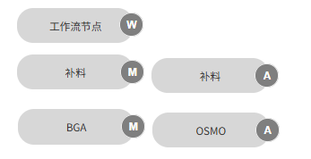

            1.  工作流二级节点使用W
            2.  补料/补糖/检测记录，如果是手动创建的任务则使用M
            3.  补料/补糖/检测记录，如果是自动生成的任务则使用A
2.  操作详情

    不同操作，点击后展示不同的操作详情。

    1.  **工作流二级节点**：每个工作流节点都包含通用信息和操作信息，操作信息会根据二级节点的不同展示不同信息。

        > **[图 image459.png | 章节：反应器详情（3.1） / 生产工作流程（3.1）（3.2） | 上下文：工作流二级节点：每个工作流节点都包含通用信息和操作信息，操作信息会根据二级节点的不同展示不同信息。]**
        > **OCR 文本：**
        > D0.2灌注培养基
        > 灌注培养基
        > 开始时间 | 2026-07-27 17:28:02
        > 结束时间 | 2026-07-27 17:28:56
        > 操作人 | 张三
        > 培养基类型 | XXX
        > 灌注量 | 1000g
        > 关闭

        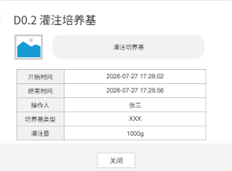

3.  通用信息
    1.  **标题**：编号加一级节点名称
    2.  **图标**：待后续完成工作流节点时补充完整
    3.  二级节点名称
    4.  **开始时间**：用户进入该工作流二级节点开始操作的时间
    5.  **结束时间**：用户完成该工作流二级节点的时间
    6.  **操作人**：展示用户的显示名称
4.  **操作信息**：待后续完成工作流节点时补充完整
    1.  补料记录

        > **[图 image460.png | 章节：反应器详情（3.1） / 生产工作流程（3.1）（3.2） | 上下文：补料记录]**
        > **OCR 文本：**
        > DO.3补料
        > 补料
        > 开始时间 | 2026-07-27 17:28:02
        > 结束时间 | 2026-07-27 17:28:56
        > 系号 | PUMP3
        > 补料培养基 | XXX
        > 实际补科量 | 1000g
        > 关闭

        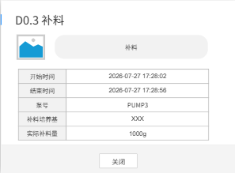

        1.  **标题**：编号加“补料”
        2.  图标
        3.  文字展示“补料”
        4.  **开始时间**：该任务的执行开始时间
        5.  **结束时间**：该任务的执行完成时间
        6.  **泵名称**：执行该任务的泵名称
        7.  **料液名称**：执行该任务的料液名称
        8.  **实际补料量**：任务执行完成后的实际补料量
    2.  补糖记录

        > **[图 image461.png | 章节：反应器详情（3.1） / 生产工作流程（3.1）（3.2） | 上下文：补糖记录]**
        > **OCR 文本：**
        > DO.4补糖
        > 补糖
        > 开始时间 | 2026-07-27 17:28:02
        > 结束时间 | 2026-07-27 17:28:56
        > 系号 | PUMP3
        > 补科培养基 | XX
        > 实际补料量 | 1000g
        > 补模萌摄浓度 | (g/L)
        > 补糖前糖浓度 | (g/L)
        > 关闭

        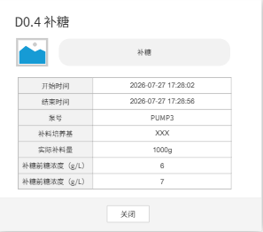

        1.  **标题**：编号加“补糖”
        2.  图标
        3.  文字展示“补糖”
        4.  **开始时间**：该任务的执行开始时间
        5.  **结束时间**：该任务的执行完成时间
        6.  **泵名称**：执行该任务的泵名称
        7.  **料液名称**：执行该任务的料液名称
        8.  **实际补料量**：任务执行完成后的实际补料量
        9.  补糖前糖浓度（g/L）：
        10. **补糖后糖浓度（g/L）**：补糖后计算出的糖浓度
    3.  检测记录

        > **[图 image462.png | 章节：反应器详情（3.1） / 生产工作流程（3.1）（3.2） | 上下文：检测记录]**
        > **OCR 文本：**
        > D0.5 BGA
        > BGA
        > 开始对间 | 2026-07-27 17:28:02
        > 结束对间 | 2026-07-27 17:28:56
        > 取样量 | 1ML
        > 祥品ID | XOX-XOOX X
        > 湿度 | 36.5 °C
        > B釜名
        > 关闭

        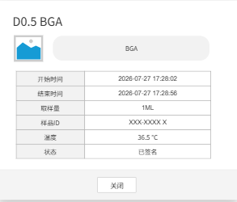

        1.  **标题**：编号加检测类型
        2.  图标
        3.  检测类型
        4.  **开始时间**：上样时间
        5.  **结束时间**：检测完成时间
        6.  **取样量**：取样体积，有则展示，没有则空或展示NA
        7.  样品ID
        8.  **温度**：BGA类型下展示
        9.  **细胞类型**：Vicell类型下展示
        10. **稀释倍数**：Vicell和Cedex类型下展示
        11. **检测项简称**：Cedex类型下展示该次检测的所有检测项简称
        12. **状态**：显示该次检测所处状态

### 任务队列（3.1）

#### 任务查询及展示操作（3.1）

在此页面可查询当前培养ID的各种不同任务的详情、日志和执行记录等。

> **[图 image463.png | 章节：反应器详情（3.1） / 任务查询及展示操作（3.1） | 上下文：在此页面可查询当前培养ID的各种不同任务的详情、日志和执行记录等。]**
> **OCR 文本：**
> FX055
> 培养信息 | 生产过程 | 任务队列 | 远程服务
> 请选择任务类型 | 状态 | 创建人/修改人 | 2016/09/01-2016/09/20 | 检索 | 新增
> 序号 | 实验室 | 任务类型 | 状态 | 培养ID | 反应器编码 | 任务计划时间 | 执行开始时间 | 执行结束时间 | 创建人 | 修改时间 | 修改人 | 操作
> 实验室1 | 补料 | 待执行 | PY00001 | ST-V1 | 2026-06-01 12:21:34 | 2026-06-01 12:21:34 | 2026-06-01 12:21:34 | 张三 | 2026-06-01 12:21:34 | 张三 | 详情刷新复制日志执行记录
> 实验室2 | 补糖 | 已执行 | PY00002 | ST-V2 | 2026-06-01 12:21:34 | 2026-06-01 12:21:34 | 2026-06-01 12:21:34 | 张三 | 2026-06-01 12:21:34 | 张三 | 详情刷新复制日志执行记录
> 实验室2 | 取样 | 待申核 | PY00004 | ST-V4 | 2026-06-01 12:21:34 | 2026-06-01 12:21:34 | 2026-06-01 12:21:34 | 张三 | 2026-06-01 12:21:34 | 张三 | 详情刷新制日志执行记录
> 实验室2 | 已取消 | PY00002 | ST-V2 | 2026-06-01 12:21:34 | 2026-06-01 12:21:34 | 2026-06-01 12:21:34 | 张三 | 2026-06-01 12:21:34 | 张三 | 详情刷新制日志执行记录
> 上一页 | 10 | 下一页

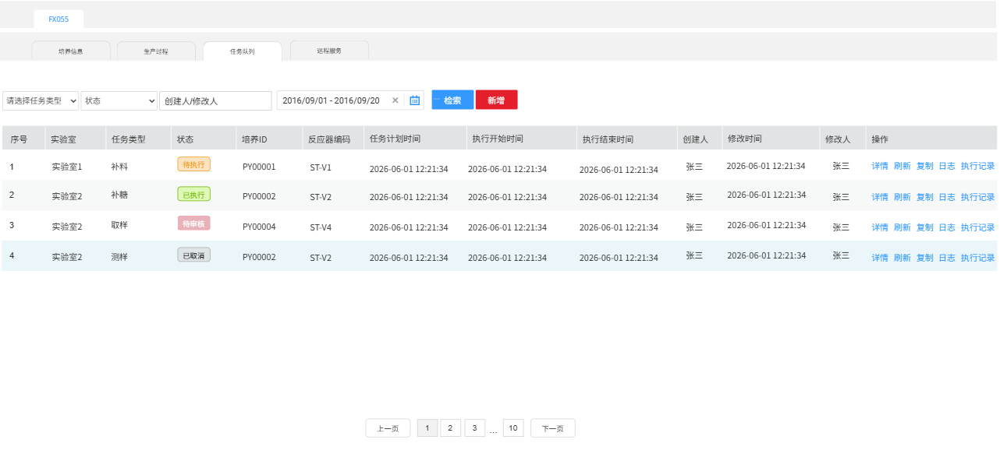

1.  **新增**：默认在当前反应器/控制器下新增任务，不同任务新增时需填写不同内容，具体设计分别见章节补液任务－新增（3.1）。（其余任务待后续补充）
2.  查询条件

    此处的任务队列首先筛选出当前培养ID的所有相关任务，再结合以下条件联合查询：

3.  **任务类型**：下拉单选，非必选，下拉列表为所有的任务类型，包括补料、补糖、PH校准、取样、测样（本阶段主要完成主体列表以及补液相关任务即补料和补糖的设计，PH校准、取样、测样的任务在后续相关工作流中进行补充，任务类型随着系统完善也可能随之增加）
4.  **状态**：下拉单选，非必选。状态全集为待审核、待批准、待执行、执行出错待审核、执行中、执行出错、执行出错已修复、已执行、已取消、跨天取消、暂停中。不同类型任务的状态可能对应其中的某几种，此处列表显示全集即可。不同类型任务对应的具体状态说明及其切换见不同任务对应的具体章节。
5.  修改人
6.  **起止时间**：任务计划时间、执行开始时间、执行结束时间 有任何一个时间符合都可查询出来。默认查询当前时间往前推20天，最长跨度支持20天。
7.  结果展示

    根据查询条件联合查询符合的记录并列表展示

    1.  列表顺序
        1.  属于以下状态时，优先按照以下排序展示，同一状态下按照任务计划时间正排序，也就是距离当前时间越近的越靠前
            1.  执行中
            2.  暂停
            3.  执行出错
            4.  待审核
            5.  待批准
            6.  执行出错待审核
            7.  待执行
        2.  其他状态不区分先后，全部按照任务计划时间正排序，也就是执行时间距离当前时间越近的越靠前
    2.  列表展示字段
        1.  序号
        2.  实验室
        3.  任务类型
        4.  状态
        5.  培养ID
        6.  反应器编码
        7.  任务计划时间
        8.  执行开始时间
        9.  执行结束时间
        10. 创建人
        11. 修改人
        12. 修改时间
8.  任务操作

    不同任务类型点击按钮后的弹窗内容不同，具体详见每种任务的具体章节。

#### 补液任务（3.1）

##### 补液任务生成与执行的业务说明（3.1）（3.2）

补料任务和补糖任务统称为补液任务，补液任务（包括补料和补糖）一定是在连接补料单元完成后才会产生，产生的途径有四种：

-   根据当前培养ID 的培养方案－补液方案（见章节培养方案修改③），在连接补料单元完成时后台自动生成相应所有的补液任务
    1.  根据补液方案中的补糖规则自动生成的任务，任务类型是补糖任务
    2.  根据补液任务方案中的补料任务自动生成的任务，任务类型是补料任务
-   修改了反应器详情－补液方案后，若已经完成了连接补料单元，后台自动生成新的补液任务，并把历史方案产生的未执行的任务自动取消；若未完成连接补料单元，则按照新的方案在连接补料单元完成时后台自动生成新的补液任务
    1.  根据补液方案中的补糖规则自动生成的任务，任务类型是补糖任务
    2.  根据补液任务方案中的补料任务自动生成的任务，任务类型是补料任务
-   在实验室工作台－任务队列－任务新增－补液任务新增模块，点击新增产生新的补液任务，根据选择的任务类型分别可生成补糖任务和补料任务
-   在实验室工作台－反应器详情－任务队列－补液任务－补液任务新增，添加新的补液任务，根据选择的任务类型分别可生成补糖任务和补料任务
-   补液任务执行过程中发生异常，用户在执行记录－异常处理tab页，选择采用自动模式额外补充，需要根据填写信息自动生成任务，新生成的任务类型与原任务类型一致

    所有补液任务都通过任务调度程序一一排队执行，从任务产生到执行完成一共涉及11种状态，每种状态下可对任务执行不同操作并记录相关信息。

1.  任务调度程序

    通过任务调度程序定期对任务队列进行轮巡完成任务的执行与监控，基本顺序如下：

    1.  判断当前任务是否到指定执行时间，且状态是待执行

        注意：	任务在到达计划执行时间，如果因为任何问题没有成功执行，下一轮还是会调度去执行，但是所有补液任务的顺序是不能更改的，只能按照原来的计划时间依次执行，如：任务1计划9:00执行任务2计划10:00，9点的时候任务1因为反应器报错无法执行，假设到10点这个错误还未解决，则任务2也会因为任务1没有成功执行而延后执行

    2.  当前任务今日按照时间排序是否还有未执行的待执行任务，每天必须按顺序执行，若存在未执行的则当前任务跳过不执行，直到前序任务全部执行完成。
    3.  该任务相关设备是否满足执行条件，包括：
        1.  反应器、反应器秤和补料秤出错，跳过不执行
        2.  泵正在执行其他任务中，跳过不执行
    4.  当前关联id对补液前是否要求确认残糖，如果要求确认，根据要求获取残糖值，如无法确认残糖则跳过。
    5.  符合以上条件时根据任务和泵速策略计算真实补料目标量、校准速度、高速速度、低速速度和理论超时时间
    6.  检查当前要使用的补料液体量是否够用，不够用则跳过不执行。
    7.  通过 IoT、OPCDA 或外置 Modbus 泵服务下发泵速。
    8.  通过地秤或反应器实时数据计算已补料量
    9.  记录补料过程明细、泵速下发记录、事件、异常（监控超时、超量、抖动、返水、堵塞、泵速为 0、通讯异常、泵错误码等）和任务状态。目前从已知的错误编码如下表所示：

        #### 补液任务异常错误码表

        | 错误码 | 说明 | 触发场景 |
        | --- | --- | --- |
        | NCS008 | 超时 | elapsedSeconds > TimeOutSeconds |
        | NCS009 | 超量 | 补料量超过 目标 × (1 + ExcessPercentage%) |
        | NCS023 | 地秤读取失败 | 连续失败次数达 error_count_limit |
        | NCS030 | 抖动异常 | 泵速与地秤增量不一致，且观察期后未恢复 |
        | NCS031 | 堵塞 | 理论增量大于阈值但实际增量极小 |
        | NCS032 | 返水 | 实际增量为负值 |
        | NCS033 | 少加 | 最终补料量低于 目标 × (100 - ExcessPercentage)% |
        | NCS035 | 启动前秤不稳定 | 连续30次监控未稳定 |
        | NCS061 | 补糖量低于最小阈值 | 自动补糖计算量过小，未创建任务 |

    10. 完成任务后停泵、更新任务和批次实时数据、释放设备占用。
-   注意：
    1.  以下附件为原系统调度程序的说明文档（包含调度业务流程图、与底层设备的交互说明等），请开发人员仔细研究。

        > **[嵌入附件图标 image465.emf | 章节：反应器详情（3.1） / 补液任务（3.1） | 上下文：以下附件为原系统调度程序的说明文档（包含调度业务流程图、与底层设备的交互说明等），请开发人员仔细研究。]**
        > **附件文件名：**`补料调度程序逻辑.md`

        **原系统补料调度程序（NPPScheduler）核心机制要点**（来源：`补料调度程序逻辑.md`，约 678 行。上文已列 NCS 错误码表与"完成任务后停泵、更新实时数据、释放设备占用"，此处补充其**未展开的调度机制**，供迁移参考。）

        **1. 程序构成**：`NPPScheduler.exe`，.NET 4.5 WinForms 应用。核心类：
        - `CoreService`：调度主循环（心跳与任务分发）
        - `FeedingTool`：补料执行（泵速/地秤/闭环）
        - `Cmmpt`：设备通讯（地秤、外置泵、OPC）
        - `EntityHelper`：数据库访问

        **2. 调度主循环**：`while Status == Running`，循环间隔 10s（配置项 `coreservice_interval_time`）。每轮扫描待执行任务 → 校验准入条件 → 下发执行 → 回收状态。

        **3. 任务准入条件**（15 条，节选关键）：任务状态为待执行、设备（泵/地秤）空闲且通讯正常、培养基/液袋余量充足、补料时段内、无更高优先级占用、地秤启动前监测平稳（见上文 NCS035）等。

        **4. 任务状态枚举**：`PendingReview(1) 待审核 / PendingCancel(2) / PendingApprove(3) 待批准 / PendingExecute(5) 待执行 / ErrorPendingApprove(6) / Executing(7) 执行中 / ExeError(9) 执行出错 / ErrorHandled(11) / Skiped(17) / Executed(19) 已完成 / Canceled(99) / AccrossDayCanceled(199) 跨天取消`。

        **5. 补料执行阶段（EnumFeedingStep）**：`Idle(0) → SlopeCal(5) 斜率校准 → SpeedUp(10) 提速 → SpeedKeep(15) 恒速 → SpeedDown(20) 减速 → LowSpeedKeep(30) 低速保持 → LowSpeedDown(35) 低速下降 → IsFinish(40) 完成 → IsScaleMonitor(50) 地秤监测`。

        **6. 真实补料量**：`GetTaskRealFeedVolume()` 按 3 种 `FeedingType` × `FeedingBasis`（固定值/百分比/残糖差值）计算本次实际补料体积。

        **7. 泵速策略（CDP_FeedingConfig）**：
        - 关键参数：`IsTwoStep`（是否二段式）、`CalibrateDuration`（斜率校准时长）、`HighSpeedPercent/LowSpeedPercent`（高/低速占比）、`IntervalTime`、`ExcessPercentage`（超量百分比）、`TimeOutSeconds`、`TerminalVolumePercent`（末段体积占比）、`Dither*`（抖动）、`Rebate*`（返水）、`Jam*`（堵塞）系数。
        - **二段式/三段式**：高泵速补大部分、低泵速补尾部，按理论时间分配；**三段式**额外做斜率校准（先低速找台秤响应斜率，再据此修正泵速），避免超量/少加。

        **8. 地秤读取**：支持 `OHAUS / Mettler / IoT-LDMS` 三类；启动前做"秤稳定监测"（连续 N 次波动在精度内才判定平稳）。

        **9. 泵速下发**：外置泵 `Modbus`、内置/环控 `OPCDA`、IoT 走 `MQTT`；下发后回读 SP（设定值）校验一致性（见上文 NCS 泵速下发失败/偏差）。

        **10. 执行闭环**：约 21 步（读取目标量 → 稳定监测 → 计算泵速 → 下发 → 回读校验 → 计时/计重 → 判完成/超时/超量 → 停泵 → 落库）。

        **11. 异常监控**：超时 `NCS008`、超量 `NCS009`、抖动 `NCS030`、堵塞 `NCS031`、返水 `NCS032`、泵速为 0 `NCS007`、地秤读取失败 `NCS023`、通讯异常 `NCS013/018/026/037`、兜底 `999`（完整 NCS 表见上文）。

        **12. 自动补糖**：`SetGlucoseInfoByCedex()` 依据 Cedex 残糖结果计算补糖量；计算模式考虑乳酸时，扣减乳酸对应重量（计算量低于最小阈值则不创建，见 NCS061）。来源：[补料调度程序逻辑.md，第 19 节“自动补糖逻辑”](../需求文档插入的附件/补料调度程序逻辑.md)。

        - **参考实现公式（残糖模式）**：`feedingGlucoseVolume = (currentVolume * FeedingTo / 1000 - currentGlucoseWeight) / glucoseConc * 1000`。
        - **参考实现公式（考虑乳酸）**：`feedingGlucoseVolume = (currentVolume * FeedingTo / 1000 - currentGlucoseWeight - lactateWeight) / glucoseConc * 1000`。
        - **来源边界**：以上保留参考资料中的变量、浓度分母及换算系数；该段没有完整给出各变量单位，不能将其简化为可直接执行的“浓度差”公式。新需求的字段与公式见[字段说明与计算公式](21-字段说明与计算公式（3.1）（3.2）.md)；两类来源的量纲映射仍需统一确认。

        **13. 主要数据库表（16 张 CDP_*）**：`CDP_Batch / CDP_PreCulture / CDP_Batch_FixedFeedingTask / CDP_FixedFeedingTask_ExecDetail / CDP_FixedFeedingTask_SpeedSet / CDP_FeedingConfig / CDP_EquReactor / CDP_EquScale / CDP_Events` 等。

        **14. 报警接口**：`/alarmService/api/open`（触发）、`/alarmService/api/flash`（声光）、`/alarmService/api/close`（解除）。

        

    2.  原系统调度系统的其他说明
        1.  小试一期

            原系统调度程序、系统界面、PLC程序等的关系如下图所示。小试1期的调度程序（包含补液任务的相关执行，包括根据给的泵速、补料量这些完成补液、补液过程中的异常监控、各种任务的线程）和PLC程序（包含控制机械臂、当前液瓶余量这些），这两部分程序是黑盒，只能调用或者直接读取数据库表。

            > **源图片对象缺失（2026-09-06 核对）：**原 Word 在本段后的同一图片段落中包含两个对象：`图片 102`（描述 `IMG_256`，关系 `rId479 → ../NULL`）缺少图片本体；后一个对象 `图片 103` 对应的关系图 `image467.png` 已保留于本章“原图核对”。缺失的是前一个对象，不能认定关系图整体丢失。当前文件及 Git 初始版本均未提供该对象的有效图片；详见[审阅报告第15项](../需求说明书V4.0-0904_审阅报告.md)。

            ```mermaid
            flowchart TB
                SLMS["C#<br/>SLMS (GUI)"]
                Sub["C#<br/>离线检测子系统<br/>(BGA、Osmo、Vicell、Cedex)"]
                DB[(DB)]
                Scheduler["C++<br/>调度"]

                subgraph PLC["PLC"]
                    Arm[机械臂]
                    Sampling[取样]
                    Pipetting[移液工作站]
                    Feeding[补料系统]
                    Other[离心机、直线电机等]
                end

                SLMS <--> Sub
                SLMS <--> Scheduler
                SLMS <--> DB
                Sub <--> DB
                Sub <--> Scheduler
                DB --> Scheduler

                Scheduler <--> Arm
                Scheduler <--> Sampling
                Scheduler <--> Pipetting
                Scheduler <--> Feeding
                Scheduler <--> Other
            ```

            备注：当前系统就是替换的SLMS (GUI)

        2.  中试和小试二期

            调度程序仅包含PLC程序（我们只能调用或读取数据库表），补液程序完成重新开发。

3.  补液任务状态

    补液任务共包含11种状态，状态间的操作及切换如下图&表总结：

    #### 业务流程

    ```mermaid
    flowchart TD
        Start((开始))
        EnterReview[进入审核流程]
        ReviewPass1{审核是否通过}
        Rollback[状态和内容回滚]
        EnterPending[进入待执行状态]
        CheckCondition[定时任务检查执行条件]
        ConditionMet{是否满足执行条件}
        IsNextDay{是否已隔天}
        NextDayCancel[隔天取消]
        End1((结束))

        EnterExecuting[进入执行中]
        MonitorMetrics[执行监控监控各种指标]
        HasError{执行中是否报错}
        ExecFailed[任务变成执行出错]
        HandleError[处理报错任务]
        ManualOrAuto{手动或自动处理}
        AutoFixNewTask[旧任务标记为执行出错已修复<br/>生成新任务为执行出错待审核]
        ManualFixed[任务标记为执行出错已修复]
        ExecDone[执行完成]

        TaskCancelled[任务为取消]
        ReviewPass2{审核是否通过}
        EnterReview2[进入审核]
        PauseResume[暂停/继续]
        Cancel[取消]
        End2((结束))

        Start -- 修改或创建新任务/取消 --> EnterReview
        EnterReview --> ReviewPass1

        ReviewPass1 -- 创建/修改审核通过 --> EnterPending
        ReviewPass1 -- 修改/取消任务被驳回 --> Rollback
        Rollback --> CheckCondition
        ReviewPass1 -- 取消任务审核通过 --> TaskCancelled
        ReviewPass1 -- 新创建任务被驳回 --> TaskCancelled
        TaskCancelled --> Start

        EnterPending --> CheckCondition
        CheckCondition --> ConditionMet
        ConditionMet -- 是 --> EnterExecuting
        ConditionMet -- 否 --> IsNextDay
        IsNextDay -- 否 --> CheckCondition
        IsNextDay -- 是 --> NextDayCancel
        NextDayCancel --> End1

        EnterExecuting --> MonitorMetrics
        EnterExecuting <--> PauseResume
        MonitorMetrics --> HasError
        HasError -- 否 --> ExecDone
        ExecDone --> End2
        HasError -- 是 --> ExecFailed
        ExecFailed --> HandleError
        HandleError --> ManualOrAuto
        ManualOrAuto -- 自动 --> AutoFixNewTask
        AutoFixNewTask --> ReviewPass1
        ManualOrAuto -- 手动 --> ManualFixed
        ManualFixed --> End2

        PauseResume --> Cancel
        Cancel --> EnterReview2
        EnterReview2 --> ReviewPass2
        ReviewPass2 -- 是 --> TaskCancelled
        ReviewPass2 -- 否 --> PauseResume
    ```

    #### 状态流转图

    ```mermaid
    flowchart TD
        Start((开始))
        PendingReview[待审核]
        PendingApproval[待批准]
        Rollback["新建任务被取消<br/>修改任务修改内容回滚"]
        PendingExec[待执行]
        Executing[执行中]
        Executed[已执行]
        ExecErrorPending[执行出错待修复]
        ExecErrorFixed[执行出错已修复]
        End((结束))

        Start -- 修改任务/手工创建任务 --> PendingReview

        PendingReview -- 驳回 --> Rollback
        PendingReview -- 用户主动撤回 --> Rollback
        PendingReview -- 通过，设定了二审 --> PendingApproval
        PendingReview -- 通过，没有设置二审 --> PendingExec

        Rollback -- 当天取消 --> End

        PendingApproval -- 驳回 --> Rollback
        PendingApproval -- 用户主动撤回 --> Rollback
        PendingApproval -- 批准 --> PendingExec

        PendingExec -- 满足执行条件 --> Executing

        Executing -- 出错 --> ExecErrorPending
        Executing -- 成功执行 --> Executed

        Executed --> End
        ExecErrorPending -- 处理错误 --> ExecErrorFixed
        ExecErrorFixed --> End
    ```

    | 任务状态 | 说明 | 针对当前任务可执行的操作 | 备注 |
    | :---: | :--- | :--- | :--- |
    | 待审核 | 根据用户设定，新增/修改/取消任务需要进入审核 | 审核、撤回、驳回、查看 | 审核根据流程设定指定的人可审，被触发的申请只能本人撤回 |
    | 待批准 | 要求进行双审批的任务，等待第二个人审批 | 批准、撤回、驳回、查看 | 审核根据流程设定指定的人可审，被触发的申请只能本人撤回 |
    | 待执行 | 系统自动生成任务或通过审核的任务等待到达执行时间时的状态 | 取消、查看 | 培养成员可操作 |
    | 执行出错待审核 | 执行出错后人工进行了修复并生成了新的自动任务，这个新的自动任务创建后默认为这个状态，旧任务标记为执行出错已修复 | 审核、撤回、驳回、查看 | 审核根据流程设定指定的人可审，被<br>人触发的申请只能本人撤回 |
    | 执行中 | 任务到达指定时间，且环境符合执行条件后进入执行中状态 | 暂停、查看 | 培养成员可操作 |
    | 执行出错 | 执行过程中出现错误代码时候变成此状态 | 提交异常处理信息（修复）、查看 | 培养成员可操作 |
    | 执行出错已修复 | 无论是通过手工修复还是自动修复，对执行出错的任务<br>处理后变成此状态 | 查看 |  |
    | 已执行 | 任务顺利执行成功后变成此状态 | 查看 |  |
    | 已取消 | 驳回后取消，或者主动取消后审核通过，或者修改后自动取消的任务 | 查看 |  |
    | 跨天取消 | 执行日期没能成功执行的任务，到第二天系统自动取消 | 查看 |  |
    | 暂停中 | 执行中的状态点击暂停操作时变为暂停中 | 取消、继续执行、查看 | 培养成员可操作 |

    1.  **待审核**：根据用户设定的审批功能，若需要审核，则对新增/修改/取消的任务置为待审核。对处于待审核状态的任务，在流程审批模块可进行审核（审核通过）、撤回（仅限创建人/修改人本人）、驳回（审核不通过）操作。
        1.  新增的任务撤回或被驳回，则该任务状态自动变为已取消，不支持再次修改提交。
        2.  修改的任务撤回或被驳回，则该修改的信息和任务状态需要回滚至修改提交审核前的内容
        3.  申请取消的任务撤回或被驳回，则该任务状态需要回滚至申请取消提交审核前的状态
        4.  新增/修改的任务审批通过后，任务状态变为待批准或待执行（取决于设定是否需要二次审批）
        5.  申请取消的任务审批通过后，任务状态变为待批准/已取消（取决于设定是否需要二次审批）
    2.  **待批准**：根据用户设定的审批功能，若需要进行双审批，则在审核完成等待第二个人审批时，状态变成待批准。对于待批准的任务，在流程审批模块可进行批准（批准通过）、撤回（仅限创建人/修改人本人）、驳回（批准不通过）操作。
        1.  新增的任务撤回或被驳回，则该任务状态自动变为已取消，不支持再次修改提交。
        2.  修改的任务撤回或被驳回，则该修改的信息和任务状态需要回滚至修改提交审核前的内容
        3.  申请取消的任务撤回或被驳回，则该任务状态需要回滚至申请取消提交审核前的状态
        4.  新增/修改的任务审批通过后，任务状态变为待执行
        5.  申请取消的任务审批通过后，任务状态变为已取消
    3.  **待执行**：根据用户设定的审批功能，自动生成但不需要审核的任务和已被审核/批准通过的任务，在排队等待执行的过程中变为待执行。对待执行的任务，对该培养有权限的用户可以主动取消该任务，在审核通过后状态变为已取消；若用户在反应器详情－补液方案中修改了补液任务并审核通过，则当前待执行的任务自动修改为已取消。
    4.  **执行出错待审核**：任务执行出错后，填写异常处理信息时，如果选择自动方式完成额外补充则会生成新的任务，此时，旧任务的状态变为执行出错已修复，新任务的状态为执行出错待审核。对处于执行出错待审核状态的任务，在流程审批模块可进行审核（审核通过）、撤回（仅限创建人/修改人/修复人本人）、驳回（审核不通过）操作。若该任务撤回或被驳回，则该任务状态自动变为已取消，不支持再次修改提交。
    5.  **执行中**：任务到达计划时间且符合所有条件正常开始执行，则变为执行中。对执行中的任务，对该培养有权限的人员可对其进行暂停操作。
    6.  **执行出错**：任务执行出错后，状态变为执行出错
    7.  **执行出错已修复**：任务执行出错后，提交异常处理信息后即变成执行出错已修复
    8.  **已执行**：任务顺利执行成功后，变为已执行。
    9.  **已取消**：新建/修改任务审核被驳回或者主动取消且被审核通过的任务或者修改方案自动取消相关任务，状态变为已取消
    10. **跨天取消**：计划执行时间的当天都没能成功开始执行，到第二天系统自动取消，状态变为跨天取消
    11. **暂停中**：对执行中的任务，对该培养有权限的人员可对其进行暂停操作，状态变为暂停中。点击暂停后，需要实际停止补液（注意，暂停后，实际下发泵速为0，此段时间不计入泵速生效时长，即判断补料是否超时时不把暂停的时间计入总时长）针对暂停中的任务，对该培养有权限的人员可点击重新继续执行或者取消。注意：暂停后继续执行时，液袋重量可能发生变化，需要以暂停后开始执行时的读数为基准计算补液量。比如，假设补液量50g，地秤起始重量为200g，暂停时的地秤重量为180g，暂停后再次开始执行时，需要重新读取秤的重量，假设为170g，那么按照补液量50g的目标，最终结束补液时地秤的重量应该为140g.

##### 补液任务－新增（3.1）

> **[图 image470.png | 章节：反应器详情（3.1） / 补液任务（3.1） | 上下文：补液任务－新增（3.1）]**
> **OCR 文本：**
> 新增
> 选择多泵多种补料，任务会拆分至最小单位，每个泵生成一个待审批任务。
> 培养ID | 6407FX033 | 任务类型 | 补料
> 时间规则 | 执行时间 | 反应器/控制器名称 | 培养基名称 | 补料类型* | 补料体积（%/g) | 泵速*
> 立即执行 | 2026-07-21 10:00:00 | FX033 6407FX033(D3) | PUMP1-FM020a | 百分比 | 10 | g/min | or | 小罐二段式
> 立即执行 | 2026-07-21 10:00:00 | FX033 6407FX033 (D3) | PUMP2-FM020b | 百分比 | 10 | 10 | or | 泵速策略
> 请选择 | FX033 6407FX033(D3) | PUMP3-FM020a | 数值 | g/min | or | 泵速策略
> 请选择 | FX033 6407FX033 (D3) | PUMP4-Glucose | 数值 | g/min | or | 泵速策略
> 原因*
> 1、不合理 | 选择
> 2、不允许改来改去 | 选择
> 3、今天太晚了来不及改了 | 选择
> 随便吧
> 保存 | 取消

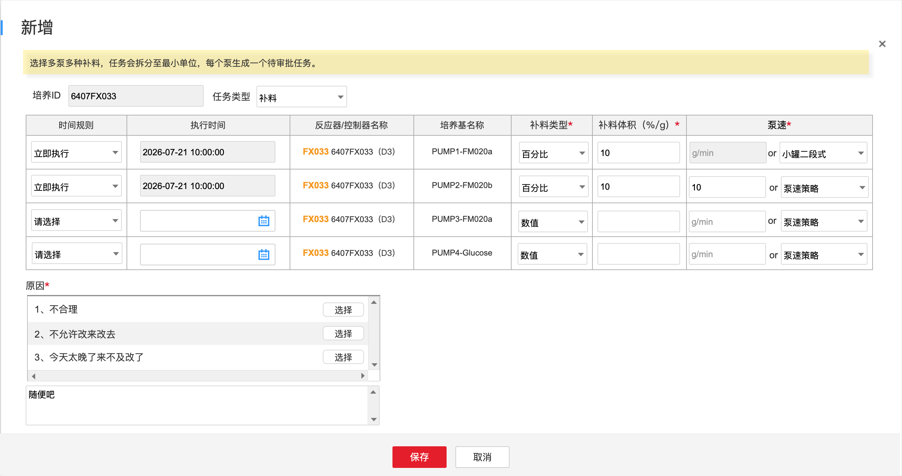

1.  选择任务类型：
    1.  **培养ID**：显示当前反应器正在培养的培养ID，仅展示，不支持修改
    2.  **任务类型**：下拉单选，必选，下拉列表本阶段目前只有补料，后续PH校准、取样、测样的任务在相关工作流中会陆续进行补充，任务类型随着系统完善也可能随之增加。
2.  任务设置

    根据当前选择的反应器、培养ID及补液这个任务类型，查询该培养的补液方案，在补液方案－固定泵中配置了信息的泵，才能新增任务，每个泵生成一个任务，每个任务按照设定进入或不进入审核，每个任务包含以下信息：

    1.  **时间规则**：下拉单选，列表包含立即执行、定时执行
    2.  **执行时间**：任务计划时间，根据所选的时间规则联动
        1.  **选择立即执行**：为当前时间
        2.  **选择定时执行**：可以选择某一个具体的时间执行
    3.  **反应器名称**：反应器名称、培养ID、培养天数拼接展示。
    4.  **培养基名称**：用泵名称－补液培养基拼接展示
    5.  **补料类型**：下拉单选，必选，逻辑同章节补料类型：补料的计算模式，下拉单选，必选，下拉列表包含数值和百分比。不同模式会影响补料的计算公式，此处选择保存即可，具体计算逻辑会在补液任务生成模块详细描述。
    6.  **补料体积**：逻辑同章节补料体积（%/g）：当前面补料类型为百分比的时候，这里的单位是%，输入大于0小于100的数字，支持小数点后3位；当前面的补料类型为数值时，这里的单位是g，可以写数字，支持正整数。
    7.  **泵速**：逻辑同章节泵速策略：根据选择的反应器类型有不同的填写方式：
    8.  **原因**：支持快速选择已在字典中维护的原因，也支持手动填写。所有任务都为同一原因。

##### 补液任务－详情（3.1）（3.2）

点击进入详情页面后，首先，根据补料任务和补糖任务的不同展示的任务信息不同；其次，根据任务状态的不同有不同按钮来执行不同操作。

| 任务状态 | 按钮/操作 |
| :---: | :---: |
| 待审核 | 撤回 |
| 待批准 | 撤回 |
| 待执行 | 取消、修改 |
| 执行出错待审核 | 撤回 |
| 执行中 | 暂停 |
| 执行出错 | 无 |
| 执行出错已修复 | 无 |
| 已执行 | 无 |
| 已取消 | 无 |
| 跨天取消 | 无 |
| 暂停中 | 继续执行、取消 |

1.  **待执行**：待执行状态下，详情页包含任务信息、取消任务按钮、修改按钮、关闭按钮四个部分。
    1.  任务信息

        默认进入为查看状态，所有任务信息仅展示，不可编辑。

        1.  补液方案－补糖规则－按规则生成的补糖任务

            > **[图 image471.png | 章节：反应器详情（3.1） / 补液任务（3.1） | 上下文：补液方案－补糖规则－按规则生成的补糖任务]**
            > **OCR 文本：**
            > 详情
            > 培养ID | 培养周期 | 当前培养天数 | 初始培养体积(g) | 当前重量 | (g) | 残糖确认
            > 8376363 | DO | 100 | 140 | GLC2B=2.95g/L, LACXX=0.41g/L
            > 2027-07-23 09:23:23
            > 时间规则 | 执行时间 | 反应器/控制器名称 | 培养基名称 | 下限操作符* | 糖下限* | 糖补料至 | （g/L）＊
            > 立即执行 | 2026-07-21 10:00:00 | FX033 | PUMP4-Glucose
            > 计算模式* | 当日补料前罐重 | (g) | 补糖前罐重 | (g) | 补糖前残糖量 | (g) | 补糖前残糖浓度(g/L) | 目标补糖量 | (g) | 泵速*
            > 残糖和乳酸 | Speed1 | or | 泵速方案
            > 补料糖浓度 | 补料体积  | (g) | 计算公式
            > 目标补糖量=（目标残糖浓度-补糖前残糖浓度）*补糖前罐重/糖补料浓度
            > 取消 | 修改 | 关闭

            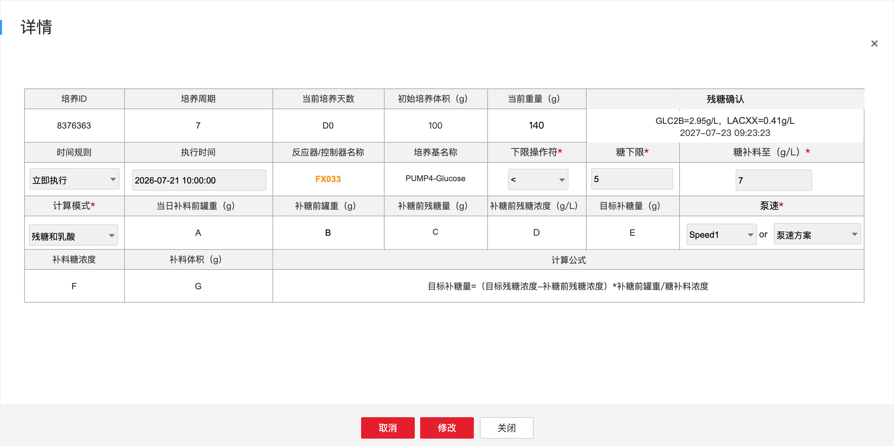

            1.  培养ID
            2.  培养周期
            3.  当前培养天数
            4.  初始培养体积（g）
            5.  **当前重量（g）**：任务执行开始时获取到的实时反应器重量。在任务执行前此处为空值，任务执行开始时获取到数值后在后续执行过程中不再更新数值。中试直接读取反应器重量，小试计算的理论数（计算公式：罐重= 初始培养体积+接种体积+当前的总补料量-当前的总取样量）（确认是需要SMP系统计算还是PLC程序计算写入数据库然后SMP读库，需要技术测沟通确认，药明方后续补充文档）
            6.  **残糖确认**：当天残糖确认操作时确认的检测指标及时间
            7.  时间规则
            8.  执行计划时间
            9.  反应器/控制器名称
            10. **培养基名称**：泵名称加补料培养基名称结合展示
            11. 下限操作符号
            12. 糖下限
            13. 糖补料至（g/L）
            14. 计算模式
            15. **当日补料前罐重（g）**：即当日所有补液任务开始前的反应器重量。每天过凌晨0点记录当前反应器重量。
            16. **补糖前罐重（g）**：即该次补糖任务前的反应器重量。任务开始执行的当下时刻记录的罐重。
            17. **补糖前残糖浓度（g/L）**：当天最近一次补液任务后计算得到的糖浓度，如果当天没有任何补液任务则是残糖确认功能确认的糖浓度
            18. **补糖前残糖量（g）**：补糖前罐重*补糖前残糖浓度
            19. **目标补糖量（g）**：自动算出，不可手动编辑

                | 计算模式 | 数据来源/计算公式 |
                | :--- | :--- |
                | 残糖+乳酸 | 目标补糖量=（目标残糖浓度-补糖前残糖浓度-补糖前乳酸浓度）*补糖前罐重 |
                | 残糖 | 目标补糖量=（目标残糖浓度-补糖前残糖浓度）*补糖前罐重 |

            20. 泵速策略
            21. **补料糖浓度**：从对应选择的补料培养基自动获取该液体的糖浓度。
            22. **补料体积（g）**：补料体积=（目标糖浓度-补糖前糖浓度）*补糖前体积/补料糖浓度
            23. **计算公式**：展示目标补糖量的计算公式
            24. **原因**：展示创建/最近一次修改时填写的原因
        2.  其余补液任务

            > **[图 image472.png | 章节：反应器详情（3.1） / 补液任务（3.1） | 上下文：其余补液任务]**
            > **OCR 文本：**
            > 详情
            > 培养ID | 培养周期 | 当前培养天数 | 初始培养体积（g) | 当前重量 | (g) | 残糖确认
            > 8376363 | DO | 100 | 140 | GLC2B=2.95g/L，LACXX=0.41g/L
            > 2027-07-23 09:23:23
            > 时间规则 | 执行时间 | 反应器/控制器名称 | 培养基名称 | 补料类型* | 补料体积（%/g) | 泵速*
            > 立即执行 | 2026-07-2110:00:00 | FX033 | PUMP1-FM020a | 百分比 | 10 | Speed1 | or | 泵速方案
            > 补料计算依据 | 目标补料量 | 计算公式 | 计算详情
            > 初始重量 | 14 | 目标补料量=（初始培养体积+接种体积）*补料体积（%） | 14= (100+40) *10%
            > 原因*
            > 新增的
            > 取消 | 修改 | 关闭

            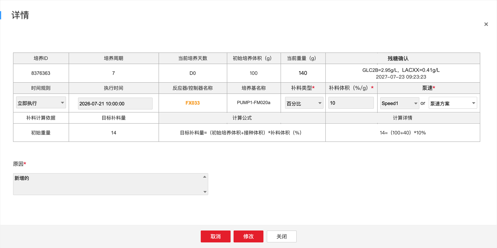

            1.  培养ID
            2.  培养周期
            3.  当前培养天数
            4.  初始培养体积（g）
            5.  接种体积（g）
            6.  **当前重量（g）**：任务执行开始时获取到的实时反应器重量。在任务执行前此处为空值，任务执行开始时获取到数值后在后续执行过程中不再更新数值。
            7.  **残糖确认**：当天残糖确认操作确认的检测项数值及时间
            8.  时间规则
            9.  执行计划时间
            10. 反应器/控制器名称
            11. **培养基名称**：泵名称加补料培养基名称结合展示
            12. **补料类型**：补料任务展示补料类型，补糖规则－按数值生成的补糖任务展示计划方式即按数值
            13. **补料体积**：输入的补料体积
            14. 泵速
            15. 补料计算依据
            16. **目标补料量**：自动算出，不可手动编辑。补料类型为百分比时，根据计算公式目标补料量=（初始培养体积+接种体积）*补料体积计算得到；补料类型为数值时，目标补料量=补料体积
            17. **计算公式**：补料类型为百分比时，仅展示计算公式，目标补料量=（初始培养体积+接种体积）*补料体积（%）
            18. **计算详情**：补料类型为百分比时，仅展示代入具体数值的计算公式和结果，比如14=（100+40）*10%
            19. **原因**：展示创建/最近一次修改时填写的原因，没有则展示空白
    2.  **修改按钮**：点击后，部分任务信息和原因支持修改并保存，修改成功后若设置为需要审核则变成待审核状态。
        1.  补液方案－补糖规则－按规则生成的补糖任务：会修改的内容如下，其余仅展示不可修改：

            > **[图 image473.png | 章节：反应器详情（3.1） / 补液任务（3.1） | 上下文：补液方案－补糖规则－按规则生成的补糖任务：会修改的内容如下，其余仅展示不可修改：]**
            > **OCR 文本：**
            > 修改
            > 培养ID | 培养天数 | 当前培养天数 | 初始培养体积(g) | 接种体积(g) | 当前重量(g) | 残糖确认
            > 8376363 | DO | 100 | 40 | 140 | GLC2B=2.95g/L, LACXX=0.41g/L
            > 2027-07-23 09:23:23
            > 时间规则 | 执行时间 | 反应器/控制器名称 | 培养基名称 | 下限操作符* | 糖下限* | 糖补料至（g/L）*
            > 立即执行 | 2026-07-21 10:00:00 | FX033 | PUMP4-Glucose
            > 计算模式* | 当日补料前键重(g) | 补糖前重 (g) | 补糖前残糖量(g) | 补糖前残糖浓度(g/L) | 目标补糖量(g) | 泵速
            > 残糖和乳酸 | Speed1 | or | 泵速方案
            > 补料糖浓度 | 补料体积(g) | 计算公式
            > 目标补糖量=（目标残糖浓度-补糖前残糖浓度） | *补糖前罐重/糖补料浓度
            > 1、十合理
            > 2、十充存改未改去
            > 1、天太要了来干及改了
            > 保存 | 关闭

            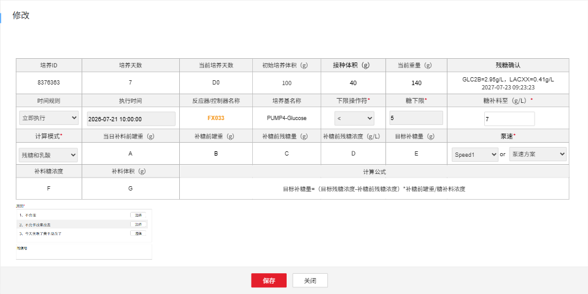

            1.  **时间规则**：同新增保持一致
            2.  **执行时间**：同新增保持一致
            3.  **下限操作符**：同新增保持一致
            4.  **糖下限**：同新增保持一致
            5.  **糖补料至（g/L）**：同新增保持一致
            6.  **泵速策略**：同新增保持一致
        2.  **其余补液任务**：会修改的内容如下，其余仅展示不可修改：

            > **[图 image474.png | 章节：反应器详情（3.1） / 补液任务（3.1） | 上下文：其余补液任务：会修改的内容如下，其余仅展示不可修改：]**
            > **OCR 文本：**
            > 修改
            > 修改的时候只能修改之前的两行
            > 不能追加其他泵
            > 培养ID | 培养天数 | 当前培养天数 | 初始培养体积（g) | 接种体积 | (g) | 现总重量 | (g) | 残糖确认 | 泵速从泵的固定配置带过来
            > GLC2B=2.95g/L | 在这里可以修改，但是不回写泵的固定配置
            > 8376363 | DO | 100 | 40 | 140 | 2027-07-23 09:23:23
            > 时间规则 | 执行时间 | 反应器/控制器名称 | 培养基名称 | 补料类型* | 补料体积 (%/g) | 泵速* | 如果当前任务所属培养id为
            > 中试实验室的培养
            > 立即执行 | 2026-07-21 10:00:00 | FX033 | PUMP1-FM020a | 百分比 | 10 | Speed1 | or | 泵速方案 | 则只有一个泵速的下拉
            > 原因*
            > 泵速方案
            > 1、不合理 | 选择
            > 2、不允许改来改去 | 选择
            > 3、今天太晚了来不及改了 | 选择
            > 随便吧
            > 保存 | 关闭

            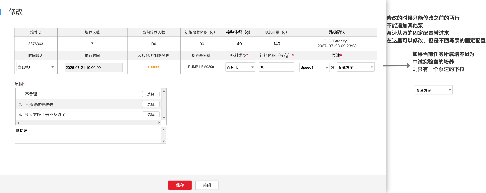

            1.  **时间规则**：同新增保持一致
            2.  **执行时间**：同新增保持一致
            3.  **补料类型**：同新增保持一致
            4.  **补料体积**：同新增保持一致
            5.  **泵速策略**：同新增保持一致
            6.  **目标补料量**：根据上述字段修改后的数值自动计算，不可手动编辑。
    3.  **取消任务按钮**：补料任务和补糖任务，取消都同样必须填写原因
        1.  点击后，需要二次确认，且必须填写取消原因

            > **[图 image475.png | 章节：反应器详情（3.1） / 补液任务（3.1） | 上下文：点击后，需要二次确认，且必须填写取消原因]**
            > **OCR 文本：**
            > 确定要取消此任务吗，取消操作不可撤销哦
            > 原因
            > 1、不合理 | 选择
            > 2、不允许改来改去 | 选择
            > 3、今天太晚了来不及改了 | 选择
            > 随便吧
            > 取消 | 确定

            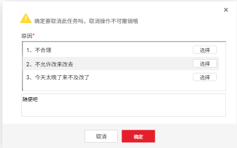

        2.  填写原因并确定取消后，提示进入审批流，该任务状态变为待审核，审核通过后该任务取消

            > **[图 image476.png | 章节：反应器详情（3.1） / 补液任务（3.1） | 上下文：填写原因并确定取消后，提示进入审批流，该任务状态变为待审核，审核通过后该任务取消]**
            > **OCR 文本：**
            > 已进入审批
            > 审核通过后任务变为取消
            > 关闭

            

    4.  **关闭按钮**：点击关闭当前弹窗，表示不保存任何修改或操作。
2.  执行出错/执行出错已修复/已执行/已取消/跨天取消：详情页包含审核备注、任务信息、关闭按钮三个部分。

    > **[图 image477.png | 章节：反应器详情（3.1） / 补液任务（3.1） | 上下文：执行出错/执行出错已修复/已执行/已取消/跨天取消：详情页包含审核备注、任务信息、关闭按钮三个部分。]**
    > **OCR 文本：**
    > 详情
    > 申核备注：我不允许你这么干
    > 培养ID | 培养天数 | 当前培养天数 | 初始培养体积(g) | 接种体积(g) | 当前重量 (g) | 残糖确认
    > 8376363 | DO | 100 | 40 | 140 | 2027-07-23 09:23:23 | GLC2B=2.05g/L
    > 时间规则 | 执行时间 | 反应器/控制器名称 | 培养基名称 | 补科类型* | 补科体积(%/g) | 泵速
    > 立即执行 | 2026-07-21 10:00:00 | FX033 | PUMP1-FM020a | 百分比 | 10 | Speed1 | or | 泵速方案
    > 补料计算依据 | 目标补料量 | 计算公式 | 计算详情
    > 初始重量 | 14 | 目标补料量=（初始培养体积+接种体积）*补料体积（%） | 14= (100+40) | *10%
    > 原因*
    > 随便吧
    > 关闭

    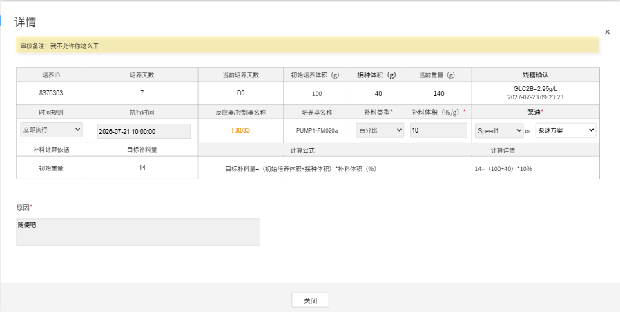

    > **[图 image478.png | 章节：反应器详情（3.1） / 补液任务（3.1） | 上下文：执行出错/执行出错已修复/已执行/已取消/跨天取消：详情页包含审核备注、任务信息、关闭按钮三个部分。]**
    > **OCR 文本：**
    > 详情
    > 申核备注：我不允许你这么干
    > 培养ID | 培养天数 | 当前培养天数 | 初始培养体积(g) | 接种体积（g) | 当前重量(g) | 残糖确认
    > 8376363 | DO | 100 | 40 | 140 | GLC2B=2.95g/L, LACXX=0.41g/L | 2027-07-23 09:23:23
    > 时间规则 | 执行时间 | 反应器/控制器名称 | 培养基名称 | 下限操作符* | 糖下限* | 糖补料至（g/L）*
    > 立即执行 | 2026-07-21 10:00:00 | FX033 | PUMP4-Glucose
    > 计算模式* | 当日补料前重(g) | 补糖前罐重(g) | 补糖前残糖量(g) | 补糖前残糖浓度(g/L) | 目标补糖量(g) | 泵速
    > 残糖和乳酸 | Speed1 | JO | 泵速方案
    > 补料糖浓度 | 补料体积(g) | 计算公式
    > 目标补糖量= | （目标残糖浓度-补糖前残糖浓度） | *补糖前罐重/糖补料浓度
    > 原因"
    > 随便吧
    > 关闭

    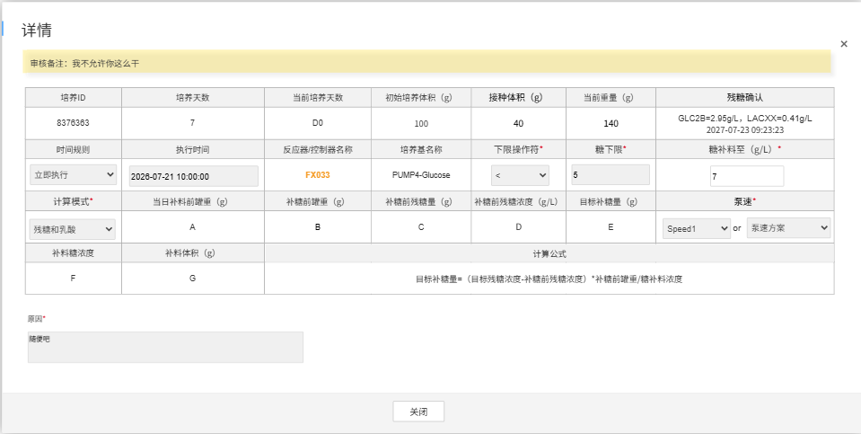

    1.  **审核备注**：如果是审核/批准不通过被驳回的任务，展示驳回原因，仅展示，不可修改
    2.  **任务信息**：同章节任务信息
    3.  **关闭按钮**：关闭弹窗
3.  **待审核/待批准/执行出错待审核**：详情页包含审核备注、任务信息、撤回按钮、关闭按钮四个部分。

    > **[图 image479.png | 章节：反应器详情（3.1） / 补液任务（3.1） | 上下文：待审核/待批准/执行出错待审核：详情页包含审核备注、任务信息、撤回按钮、关闭按钮四个部分。]**
    > **OCR 文本：**
    > 详情
    > 任务审核中
    > 培养ID | 培养天数 | 当前培养天数 | 初始培养体积(g) | 接种体积(g) | ()吾事牌乐 | 残糖确认
    > 8376363 | DO | 100 | 40 | 140 | 2027-07-23 09:23:23 | GLC2B=2.85g/L
    > 时间规则 | 执行时间 | 反应器/控制器名称 | 培养基名称 | 补料类型* | 补料体积（(%/g）*
    > 立即执行 | 2026-07-21 10:00:00 | FX033 | PUMP1-FM020a | 百分比 | 10 | Speed1 | or | 泵速方案
    > 补料计算依据 | 目标补料量 | 计算公式 | 计算详情
    > 初始重量 | 14 | 目标补料量=（初始培养体积+接种体积) | *补料体积(%) | 14= (100+40) | *10%
    > 原因*
    > 随便吧
    > 关闭

    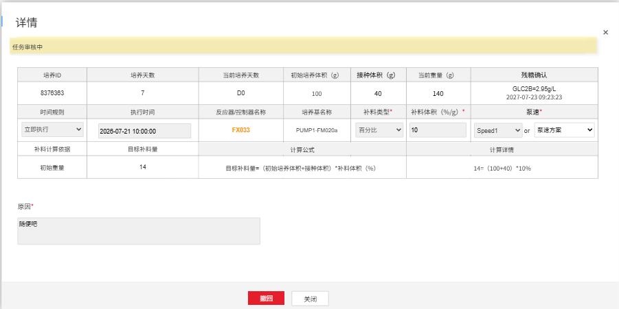

    > **[图 image480.png | 章节：反应器详情（3.1） / 补液任务（3.1） | 上下文：待审核/待批准/执行出错待审核：详情页包含审核备注、任务信息、撤回按钮、关闭按钮四个部分。]**
    > **OCR 文本：**
    > 详情
    > 任务中核中
    > 培养ID | 培养天数 | 当前培养天数 | 初始培养体积(g) | 接种体积(g) | 当前重量(g) | 残糖确认
    > 8376363 | DO | 100 | 40 | 140 | GLC2B=2.95g/L, LACXX=0.41g/L | 2027-07-23 09:23:23
    > 时间规则 | 执行时间 | 反应器/控制器名称 | 培养基名称 | 下限操作符* | 糖下限* | 糖补料至（g/L）*
    > 立即执行 | 2026-07-21 10:00:00 | FX033 | PUMP4-Glucose
    > 计算模式 | 当日补料前键重(g) | 补糖前键重 (g) | 补糖前残糖量(g) | 补糖前残糖浓度(g/L) | 目标补糖量 | (8) | 泵速
    > 残糖和乳酸 | Speed1 | or | 泵速方案
    > 补料糖浓度 | 补料体积(g) | 计算公式
    > 目标补糖量=（目标残糖浓度-补糖前残糖浓度) | *补糖前罐重/糖补料浓度
    > 随便吧
    > 撤回 | 关闭

    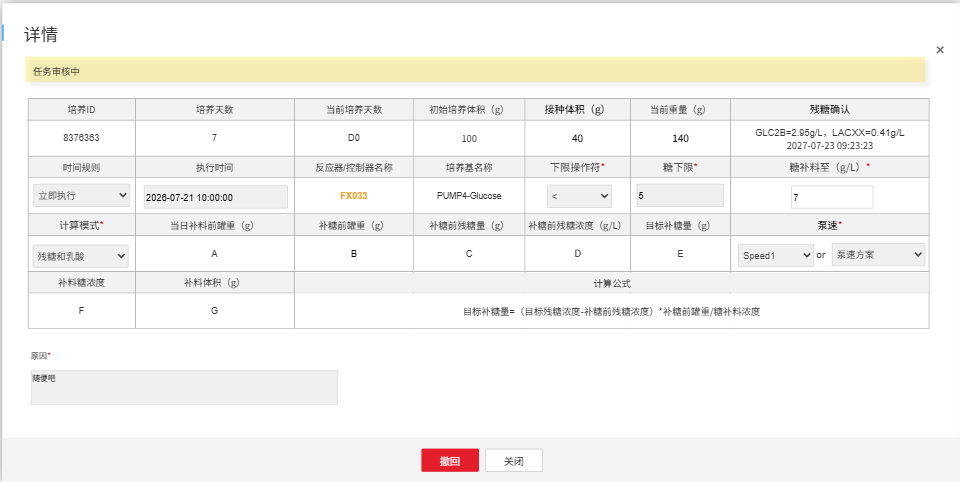

    1.  **审核备注**：显示文字“任务审核中”
    2.  **任务信息**：同章节任务信息
    3.  **撤回按钮**：点击撤回，当前任务状态变为已取消
    4.  **关闭按钮**：关闭弹窗
4.  **执行中**：详情页包含任务信息、暂停按钮、关闭按钮三个部分。

    > **[图 image481.png | 章节：反应器详情（3.1） / 补液任务（3.1） | 上下文：执行中：详情页包含任务信息、暂停按钮、关闭按钮三个部分。]**
    > **OCR 文本：**
    > 详情
    > 培养ID | 培养天数 | 当前培养天数 | 初始培养体积(g) | 接种体积(g) | 当的重量 | 残糖确认
    > 8376363 | DO | 100 | 40 | 140 | 2027-07-23 09:23:23 | GLC2B=2.85g/L
    > 时间规则 | 执行时间 | 反应器/控制器名称 | 培养基名称 | 补料类型* | 补料体积（%/g）* | 泵速
    > 立即执行 | 2026-07-21 10:00:00 | FX033 | PUMP1-FM020a | 百分比 | 10 | Speed1 | or | 泵速方案
    > 补料计算依据 | 目标补料量 | 计算公式 | 计算详情
    > 初始重量 | 14 | 目标补料量=(初始培养体积+接种体积） | *补料体积(%) | 14= (100+40) | *10%
    > 原因*
    > 随便吧
    > 暂停 | 关闭

    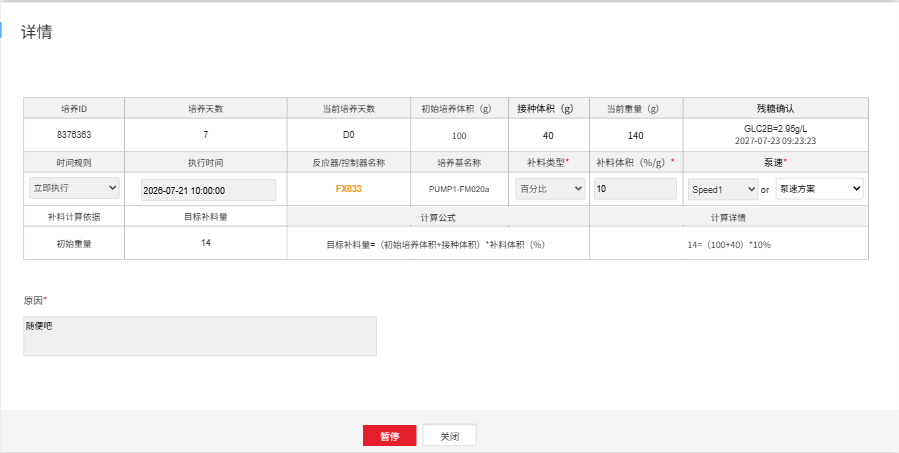

    > **[图 image482.png | 章节：反应器详情（3.1） / 补液任务（3.1） | 上下文：执行中：详情页包含任务信息、暂停按钮、关闭按钮三个部分。]**
    > **OCR 文本：**
    > 详情
    > 培养ID | 培养天数 | 当前培养天数 | 初始培养体积(g) | 接种体积(g) | 当前重量(g) | 残糖确认
    > 8376363 | DO | 100 | 40 | 140 | GLC2B=2.95g/L, LACXX=0.41g/L | 2027-07-23 09:23:23
    > 时间规则 | 执行时间 | 反应器/控制器名称 | 培养基名称 | 下限操作符* | 糖下限* | 糖补料至（g/L）*
    > 立即执行 | 2026-07-21 10:00:00 | FX033 | PUMP4-Glucose
    > 计算模式* | 当日补料前键重（g) | 补糖前键重(g) | 补糖前残糖量(g) | 补糖前残糖浓度(g/L) | 目标补糖量(g) | 泵速*
    > 残糖和乳酸 | Speed1 | or | 泵速方案
    > 补料糖浓度 | 补料体积(g) | 计算公式
    > 目标补糖量=（目标残糖浓度-补糖前残糖浓度） | *补糖前罐重/糖补料浓度
    > 原因"
    > 随便吧
    > 暂停 | 关闭

    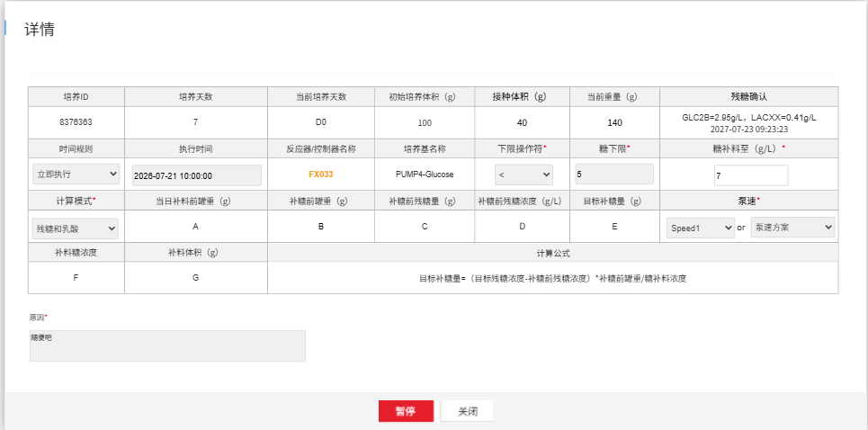

    1.  **任务信息**：同任务信息
    2.  暂停按钮：
        1.  点击后需要二次确认

            > **[图 image483.png | 章节：反应器详情（3.1） / 补液任务（3.1） | 上下文：点击后需要二次确认]**
            > **OCR 文本：**
            > 确定暂停任务吗
            > 确定后将会下发停泵指令
            > 取消

            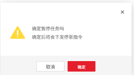

        2.  二次确认需要暂停后，当前任务状态变为已取消
    3.  **关闭按钮**：关闭弹窗
5.  **暂停中**：详情页包含任务详情、取消任务按钮、继续执行按钮、关闭按钮四个部分

    > **[图 image484.png | 章节：反应器详情（3.1） / 补液任务（3.1） | 上下文：暂停中：详情页包含任务详情、取消任务按钮、继续执行按钮、关闭按钮四个部分]**
    > **OCR 文本：**
    > 详情
    > 培养ID | 培养天数 | 当前培养天数 | 初始培养体积(g) | 接种体积(g) | 当前重量(g) | 残糖确认
    > 8376363 | DO | 100 | 40 | 140 | 2027-07-23 09:23:23 | GLC2B=2.95g/L
    > 时间规则 | 执行时间 | 反应器/控制器名称 | 培养基名称 | 补料类型* | 补料体积（(%/g）* | 系速*
    > 立即执行 | 2026-07-21 10:00:00 | FX033 | PUMP1-FM020a | 百分比 | 10 | Speed1 | or | 泵速方案
    > 补料计算依据 | 目标补料量 | 计算公式 | 计算详情
    > 初始重量 | 14 | 目标补料量=（初始培养体积+接种体积）*补料体积（%） | 14= (100+40) *10%
    > 原因*
    > 随便吧
    > 取消任务 | 继续执行 | 关闭

    

    > **[图 image485.png | 章节：反应器详情（3.1） / 补液任务（3.1） | 上下文：暂停中：详情页包含任务详情、取消任务按钮、继续执行按钮、关闭按钮四个部分]**
    > **OCR 文本：**
    > 详情
    > 培养ID | 培养天数 | 当前培养天数 | 初始培养体积(g) | 接种体积（g) | 当前重量(g) | 残糖确认
    > 8376363 | DO | 100 | 40 | 140 | GLC2B=2.85g/L, LACXX=0.41g/L | 2027-07-23 09:23:23
    > 时间规则 | 执行时间 | 反应器/控制器名称 | 培养基名称 | 下限操作符* | 糖下限* | 糖补料至（g/L）*
    > 立即执行 | 2026-07-21 10:00:00 | FX033 | PUMP4-Glucose
    > 计算模式* | 当日补料前重 | (g) | 补糖前重(g) | 补糖前残糖量(g) | 补糖前残糖浓度（g/L) | 目标补糖量(g) | 泵速*
    > 残糖和乳酸 | Speed1 | or | 泵速方案
    > 补料糖浓度 | 补料体积(g) | 计算公式
    > 目标补糖量=（目标残糖浓度-补糖前残糖浓度）*补糖前罐重/糖补料浓度
    > 随便吧
    > 取消任务 | 继续执行 | 关闭

    

    1.  **任务信息**：同章节任务信息
    2.  取消任务按钮：
    3.  点击后，需要二次确认，且必须填写取消原因

        > **[图 image475.png | 章节：反应器详情（3.1） / 补液任务（3.1） | 上下文：点击后，需要二次确认，且必须填写取消原因]**
        > **OCR 文本：**
        > 确定要取消此任务吗，取消操作不可撤销哦
        > 原因
        > 1、不合理 | 选择
        > 2、不允许改来改去 | 选择
        > 3、今天太晚了来不及改了 | 选择
        > 随便吧
        > 取消 | 确定

        

    4.  填写原因并确定取消后，提示进入审批流，该任务状态变为待审核，审核通过后变为已取消。

        > **[图 image476.png | 章节：反应器详情（3.1） / 补液任务（3.1） | 上下文：填写原因并确定取消后，提示进入审批流，该任务状态变为待审核，审核通过后变为已取消。]**
        > **OCR 文本：**
        > 已进入审批
        > 审核通过后任务变为取消
        > 关闭

        

    5.  **继续执行**：点击继续执行则必须填写之前暂停的原因。

        > **[图 image486.png | 章节：反应器详情（3.1） / 补液任务（3.1） | 上下文：继续执行：点击继续执行则必须填写之前暂停的原因。]**
        > **OCR 文本：**
        > 别才执行了暂停操作，继续执行请补充一下刚才的暂停原因。
        > 原因*
        > 1、不合理 | 选择
        > 2、不允许改来改去 | 选择
        > 3、今天太晚了来不及改了 | 选择
        > 随便吧
        > 取消 | 继续执行

        

##### 补液任务－刷新（3.1）

点击刷新，重新判断获取当前任务的任务状态。

##### 补液任务－复制（3.1）

点击复制按钮，把任务相关信息都自动填入，但执行时间规则必须重新填写，保存后即新增一个任务，任务状态根据是否需要审核变为待审核或待执行。

注意，因为任务都是一个泵生成一个任务，所以复制新增的弹窗内一定只有一行任务信息。

> **[图 image487.png | 章节：反应器详情（3.1） / 补液任务（3.1） | 上下文：注意，因为任务都是一个泵生成一个任务，所以复制新增的弹窗内一定只有一行任务信息。]**
> **OCR 文本：**
> 复制新增
> 培养ID | 培养周期 | 当前培养天数 | 初始培养体积(g) | 当前重量 | (g) | 残糖确认
> 8376363 | DO | 100 | 140 | GLC2B=2.95g/L，LACXX=0.41g/L
> 2027-07-2309:23:23
> 时间规则 | 执行时间 | 反应器/控制器名称 | 培养基名称 | 补料类型* | 补料体积(%/g) | 泵速*
> 定时执行 | 2026-08-4 16:00:00 | FX033 | PUMP1-FM020a | 百分比 | 10 | Speed1 | or | 泵速方案
> 补料计算依据 | 目标补料量 | 计算公式 | 计算详情
> 当前重量 | 目标补料量=当前重量*补料体积（%)
> 原因*
> 1、不合理 | 选择
> 2、不允许改来改去 | 选择
> 3、今天太晚了来不及改了 | 选择
> 随便吧
> 保存 | 关闭


##### 补液任务－日志（3.1）

查看当前任务的所有操作记录，根据操作时间倒序（距离现在时间由近到远）展示

> **[图 image488.png | 章节：反应器详情（3.1） / 补液任务（3.1） | 上下文：查看当前任务的所有操作记录，根据操作时间倒序（距离现在时间由近到远）展示]**
> **OCR 文本：**
> 日志
> 操作时间 | 操作人 | 操作类型 | 操作结果
> 2026-07-11 00:09:18 | 张三 | 创建 | 进入待审核 | 随便创建一个
> 2026-07-11 00:09:18 | 大老王 | 审核通过 | 待执行
> 2026-07-11 00:09:18 | 王五 | 暂停 | 暂停
> 2026-07-11 00:09:18 | 王五 | 继续执行 | 执行中 | 泵坏了
> 2026-07-11 00:09:18 | 系统 | 停泵 | 执行出错 | 抖动异常
> 关闭


1.  操作时间
2.  操作人
3.  **操作类型**：会导致任务状态切换的操作或事件，比如审核通过、驳回、暂停、针对执行中异常事件采取的动作等。
4.  **操作结果**：操作后的任务状态或操作的结果。
5.  **备注**：操作的特别说明，比如录入的原因、具体异常事件说明等，没有则显示空。

##### 补液任务－执行记录（3.1）（3.2）

执行出错待审核、执行中、执行出错、执行出错已修复、已执行和暂停种共计6种状态下可查看相应执行记录。

根据任务类型和任务执行状况的不同，可查看到包含不同tab页签的执行记录，补液任务（包含补料任务和补糖任务）的执行记录具体如下：

1.  **基本信息**：展示当前任务的基本信息，只要有执行记录按钮即可看到此Tab页。包含以下内容：
    1.  反应器编码
    2.  项目编码
    3.  批次编码
    4.  培养ID
    5.  培养开始时间
    6.  培养结束时间
    7.  **培养周期**：该培养一共需要的天数，结束时间－开始时间
    8.  **当前培养天数**：表示当前处于培养的第几天
    9.  泵名称
    10. 补液培养基
    11. 补料方式
    12. 补料体积（g/%）
    13. 初始培养体积
    14. **补料前秤重量（g）**：当前任务执行前读取补料秤的重量
    15. **补料后秤重量（g）**：当前任务执行完成后读取补料秤的重量
    16. **补料目标重量（g）**：当前任务的目标补料量
    17. **补料实际重量（g）**：根据补料后秤重量－补料前秤重量计算得到
    18. **补料完成度**：根据补料实际重量/补料目标重量计算得到
    19. 泵速策略
    20. 补料计算依据
    21. **补料前培养体积（g）**：当前任务开始执行时的反应器重量/反应器培养体积
    22. **补糖前残糖量（g）**：补糖任务开始执行前，利用当下的反应器重量和当天最近一次计算/确认得到的糖浓度计算得出，残糖量= 罐重*最近一次计算得到的残糖浓度
    23. **补糖后残糖量（g）**：补糖任务执行完成时，利用当下的反应器重量和目标补糖浓度计算得出，残糖量= 罐重*目标补糖浓度
    24. 执行状态
2.  **补糖信息**：只有补糖任务才能看到此tab页。包含以下内容：
    1.  Cedex样品ID
    2.  残糖检测项目
    3.  残糖检测值
    4.  单位
    5.  当日补料前罐重
    6.  补糖前罐重
    7.  补糖前残糖量
    8.  补糖前残糖浓度
    9.  计算模式
    10. 补糖浓度下限（g/L）
    11. 残糖浓度比较运算符
    12. 目标糖浓度（g/L）
    13. **目标补糖量计算公式**：根据计算模式不同展示不同计算公式，
    14. **补糖计算详情**：根据补糖量计算公式，显示将具体数值代入的完整计算过程及结果，比如目标补糖量（g）1456=（6.5-3.5346272517）*196.406/0.4
3.  **泵速下发**：补液任务在执行过程中下发的泵速的记录，只要有执行记录按钮即可看到此Tab页，包含以下信息：
    1.  **序号**：自增行号
    2.  **时间**：泵速下发时间
    3.  **阶段**：泵速下发时所处的阶段（校准/高速/低速）
    4.  **速度**：具体的泵速数值
4.  **数据图表**：执行任务时根据泵速策略的环控时间记录数据（这些数据在执行任务时，通过环控程序进行记录，都存在同一个表里），以折线图的形式展示，只要有执行记录按钮即可看到此Tab页。包含以下字段的可视化：
    1.  **ExecNumber（g）**：表示当前补了多少，根据执行前读数-补料秤当前度数计算得到
    2.  FeedingScaleweight（g）：补料秤读数（会随着时间变小）
    3.  **pumpSpeed（g/min）**：抓取的实时泵速
    4.  **下发泵速**：下发的泵速的数值（理论的速度，比如说在三段式泵速策略里面，会下发三次速度指令，校准阶段泵速、高速阶段泵速、低速阶段泵速，最后停泵速度为0）
5.  **异常处理**：任务执行过程中发生了异常事件后出现此tab页。
    1.  发生异常事件后，可填写异常处理信息，包含以下内容：

        > **[图 image489.png | 章节：反应器详情（3.1） / 补液任务（3.1） | 上下文：发生异常事件后，可填写异常处理信息，包含以下内容：]**
        > **OCR 文本：**
        > 执行记录
        > 基本信息 | 泵速下发 | 数据图表 | 异常处理
        > 异常事件 | XXXXXX， | 泵速异常堵塞，请检查泵
        > 补料目标重量 | 1456g
        > 异常后确认实际补料量* | 1398
        > 补料量误差7.98%
        > 异常原因描述* | 预设原因
        > 1、不合理 | 选择
        > 2、不允许改来改去 | 选择
        > 3、今天太晚了来不及改了 | 选择
        > 随便吧
        > 额外补充方式* | 自动 | 手动
        > 补料量* | 1398
        > 泵速策略* | g/min | or | 请选择
        > 保存 | 关闭

        

        误差大于百分之5

        > **[图 image490.png | 章节：反应器详情（3.1） / 补液任务（3.1） | 上下文：误差大于百分之5]**
        > **OCR 文本：**
        > 执行记录
        > 基本信息 | 泵速下发 | 数据图表 | 异常处理
        > 异常事件 | XXXXXX， | 泵速异常堵塞，请检查泵
        > 补料目标重量 | 1456g
        > 异常后确认实际补料量* | 1398
        > 补料量误差3.98%
        > 异常原因描述* | 预设原因
        > 1、不合理 | 选择
        > 2、不允许改来改去 | 选择
        > 3、今天太晚了来不及改了 | 选择
        > 随便吧
        > 保存 | 关闭

        

        小于等于5%时如上图

        1.  **异常事件**：仅展示，显示异常事件说明
        2.  **补料目标重量**：仅展示
        3.  **异常后实际补料量**：文本框，必填，默认值为根据补料异常停泵后补料秤重量－开始任务前补料秤重量，支持手动修改
        4.  **补料量误差**：仅展示，不可修改，单位为%，根据（补料目标重量－异常后实际补料量）/补料目标重量*100自动计算得到
        5.  **异常原因描述**：必填，支持快速选中
        6.  **额外补充方式**：当补料量误差大于5%时，出现额外补充方式字段，共有两种方式，只能二选一：
            1.  **自动**：选择自动补充并保存信息后，当前任务状态变为执行出错已修复，并生成一个新的补料任务，状态为执行出错待审核。根据填写的目标补料量和泵速自动生成新的任务（任务计划执行时间是原任务的任务计划执行时间）
                1.  **补料量**：默认值为补料目标重量－异常后确认实际补料量，允许用户修改
                2.  **泵速策略**：同章节泵速策略：
            2.  **手动**：选择手动补充并保存信息后，当前任务状态变为执行出错已修复。即意味着此任务执行已完成，因此需根据手动填写的补料量信息，和正常执行完成的任务一样计算所有相关指标并保存，比如糖浓度、残糖量等等。
                1.  **补料量**：默认值为补料目标重量－异常后确认实际补料量，允许用户修改。
    2.  填写异常信息并保存后，则只可查看相关信息，包含以下内容：

        > **[图 image491.png | 章节：反应器详情（3.1） / 补液任务（3.1） | 上下文：填写异常信息并保存后，则只可查看相关信息，包含以下内容：]**
        > **OCR 文本：**
        > 查看 | 查看
        > 基本信息 | 泵速下发 | 数据图表 | 异常处理 | 基本信息 | 泵速下发 | 数据图表 | 异常处理
        > 异常事件XXXXXX，泵速异常堵塞，请检查泵 | 异常事件XXXXXX，泵速异常堵塞，请检查泵
        > 补料目标重量 | 1456g | 补料目标重量1456g
        > 异常后确认实际补料量 | 1398g | 补料量误差3.98% | 异常后确认实际补料量 | 1398g | 补料量误差3.98%
        > 异常原因描述 | 外置泵坏了 | 异常原因描述外置泵坏了
        > 额外补充方式手动 | 额外补充方式自动
        > 补料量20g | 关联异常处理任务 | 查石
        > 异常登记人张三 | 异常登记人张三
        > 异常登记时间2026-07-2112:21:21 | 异常登记时间2026-07-2112:21:21
        > 关闭 | 关闭

        

        1.  **异常事件**：显示发生的异常事件的说明
        2.  补料目标重量
        3.  异常后确认实际补料量
        4.  补料量误差
        5.  异常原因描述
        6.  额外补充方式
        7.  **补料量**：仅手动补充时展示
        8.  **关联异常处理任务**：仅自动补充时，显示“查看”按钮，点击则可跳转查看自动生成的关联新任务的任务详情
        9.  **异常登记人**：提交异常处理信息的用户显示名
        10. **异常登记时间**：提交异常处理信息的时间

### 远程服务（3.1）（3.2）

显示当前反应器连接各程序/设备的连接状态和IP信息，一个IP对应一个卡片。

> **[图 image492.png | 章节：反应器详情（3.1） / 远程服务（3.1）（3.2） | 上下文：显示当前反应器连接各程序/设备的连接状态和IP信息，一个IP对应一个卡片。]**
> **OCR 文本：**
> 药明生物SMP系统 | 首页 | A实验室工作台 | B实验室工作台 | 数据管理 | 系统设置
> FX055
> 增养信息 | 生产过程 | 任务队列 | 远程服务
> 192.168.1.120 | 192.168.1.122 | 192.168.1.112
> ·OPC服务 | 补料地秤：ScaleOHAUS.V4 | ·报警器：A3
> 192.168.120:8085 | 192.168.122:8085 | 192.168.112:9095
> ·调度程序 | 蠕动泵：PUMP4 | ·继电：J6
> 192.168.1.120:8082 | 192.168.122:8086 | 重启 | 192.168.112:9094 | 重启


1.  显示IP地址、端口号、服务名称
2.  通讯正常时为绿色打勾符号，否则为红色打叉符号
    1.  通讯异常时，可点击重启按钮重启当前服务
3.  当前包含以下程序：
    1.  OPC程序
    2.  调度程序
    3.  补料地秤
    4.  声光报警器
    5.  继电器
    6.  外置泵

        ---

### ✂️ 已剔除的删除线内容

> 以下内容在源 Word 中带有删除线（`<w:strike>`），根据约定不进入正文，统一汇总在此，避免遗漏核验。

- 段落：接种体积：展示当前接种体积，点击编辑按钮弹窗修改接种体积
- 段落：接种体积：展示当前接种体积，不可编辑
- 段落：更改为：文本框，限制正整数
- 段落：原因：支持快速选择填入
- 段落：保存：
- 段落：若有修改需要保存，则原因为必填。
- 段落：保存后，根据系统设定完成审核/不审核。若审核，必须在审核完成后此修改才生效。审核过程中，再次点击进入，则所有字段都不允许编辑修改，顶部提示“正在审核中”，下方变为撤回按钮，撤回后再次支持修改。
- 段落片段：1H以内的数据X轴的以1分钟为一个单位；3H以内数据以10分钟为一个单位；7、30D的数据以天为一个单位；24H以内的数据以小时为单位
- 段落：接种体积（g）

### 原图核对

以下原图对应正文中已转写的表格，保留用于核对字段、数值和布局。


> **原文图片缺失：**准确位置为“补液任务生成与执行的业务说明 → 原系统调度系统的其他说明 → 小试一期”，紧接关系图说明文字后的 `图片 102 / IMG_256`，关系 `rId479 → ../NULL`。同段后一个对象的关系图 `image467.png` 完整保留于上方；缺失对象仍待原作者补图或确认是否为可删除的冗余对象。
