# 实验室工作台

## 工作流（3.2）

系统工作流一级&二级流程梳理如下：

| 一级流程名称 | 二级流程名称 | 适用于 | 是否可重复操作 | 前置环节 |
| :---: | :---: | :---: | :---: | :--- |
| Config关联设置 | Config关联设置 | 小试，中试 | 否 | 培养id已创建 Config方案完成 |
| 灌注培养基 | 灌注培养基 | 小试，中试 | 否 | Config关联设置完成 |
| 灌注培养基 | 培养基取样 | 小试，中试 | 是 | 灌注培养基完成 |
| 灌注培养基 | 培养基测样 | 小试，中试 | 是 | 灌注培养基完成 |
| 开始培养 | 开始细胞培养 | 小试 | 否 | 灌注培养基完成、工艺方案 |
| 开始培养 | 开始细胞培养 | 中试 | 否 | 培养id已完成初始设置（补料、补糖、泵速） 灌注培养基完成 |
| 取样 | 取样（手工） | 小试，中试 | 是 | 已开始培养 |
| 测样 | 测样（手工） | 小试，中试 | 是 | 已开始培养 |
| 补液 | 连接补料单元 | 小试 | 否 | 细胞培养已开始（工作流操作或已到达培养日期） |
| 补液 | 连接补料单元 | 中试 | 否 | 细胞培养已开始 |
| 补液 | 补料（其他） | 小试 | 是 |  |
| 补液 | 液体补充（取样单元） | 小试 | 是 |  |
| 补液 | 液体补充（补料单元） | 小试 | 是 | 补料单元已连接 |
| 补液 | 更换料液 | 中试 | 是 | 补料单元已连接 |
| 补液 | 废液清理 | 小试 | 是 | 补料单元已连接 |
| 自动控制 | 自动控制 | 小试，中试 | 否 | 已经开始培养 |
| 澄清 | 5个子节点 | 中试，小试 | 否 | 补料单元已连接 |
| 结束 | 结束细胞培养 | 小试 | 否 | 补料单元已连接 |
| 结束 | 结束细胞培养 | 中试 | 否 | 补料单元已连接 |

-   所有二级流程节点，在操作过程中都需要完整记录操作时间（即开启步骤1的时间到最后完成所有步骤的结束时间）、操作人以及涉及的相关信息
-   每个二级流程下会包含多个步骤，针对在工作流管理模块中上传了示意图的步骤，可点击步骤旁的说明符号弹出展示对应示意图。

    > **[图 image493.png | 章节：工作流（3.2） | 上下文：每个二级流程下会包含多个步骤，针对在工作流管理模块中上传了示意图的步骤，可点击步骤旁的说明符号弹出展示对应示意图。]**
    > **OCR 文本：**
    > 药明生物SMP系统 | 首页 | A实验室工作台 | B实验室工作台 | 数据管理 | 系统设置
    > 工作流
    > 连接补料单元 | 液体培养 (补料单元) | 上传了示意图的步骤， | 旁边增加说明符号，点击可弹出展示示意图
    > 这里显示一级流程图标
    > 步骤1开始 | 步骤2模式确认 | 步骤3手工连接补料管路和管路预填充
    > 一级流程标题 | 1.1选择连接补料单元的生物反应器 | 房间： | 所有 | J01 | J02 | J03 | 其他条件：0 | 所有 | 方案已设 | 与我相关
    > 这里显示一级流程图标 | 培养ID：6407FX033 | 3D4 | STR50-2 | 培养ID：6407FX034D1 | STR50-3 | 培养ID：6407FX035 | D2 | STR50-4
    > pH: 未知 | pH:未知 | pH:未知
    > 补液 | DO:未知 | DO:未知 | DO:未知
    > TEMP：未知 | TEMP：未知 | TEMP：未知
    > OzFlow Rate: 0.00L/min | OzFlow Rate: 0.00L/min | OzFlow Rate: 0.00L/min
    > VCD:未知 | VCD:未知 | VCD：未知
    > 这里显示一级流程图标 | Glucose: 未知 | Glucose: 未知 | Glucose: 未知
    > 图标 | 负责人：张三、李四 | 图标 | 负责人：张三、李四 | 图标 | 负责人：张三、李四
    > 未设置 | 已设置 | 已设置
    > 一级流程标题
    > 50L | 50L | 50L

    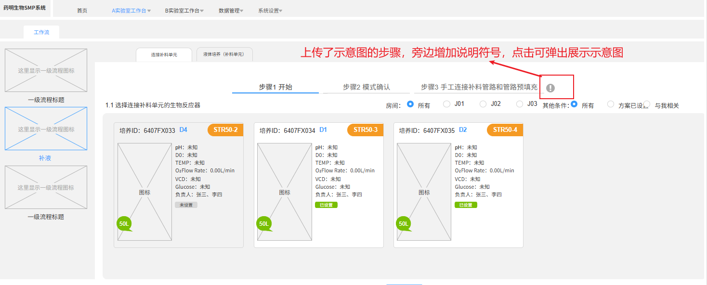

    当前只有补液工作流，其余节点后续补充

### 补液（3.1）

以下为反应器/控制器的筛选和选中逻辑，必须全部满足才可正常开启补液工作流下的二级流程及其步骤：

1.  筛选逻辑
    1.  补液工作流的入口是某一个实验室工作台，即默认自带一个所属实验室的属性，仅显示属于当前实验室的反应器/控制器
    2.  对于每个二级工作流，前置环节完成的反应器/控制器才可显示。
    3.  对于二级工作流，基于二级工作流隐藏字段【是否可重复操作】，对于不可重复的工作流，已完成该步骤操作的反应器/控制器不显示
    4.  完全空闲的反应器/控制器（非工作状态，且未绑定任何培养ID）不显示
    5.  工作流中未选择这个工作流环节的培养所在的反应器/控制器不显示
    6.  本人非成员的培养id关联的反应器/控制器不显示，即没有培养权限的不展示
2.  选中逻辑

    基于满足上述所有筛选逻辑的反应器/控制器，必须要在培养方案修改－补液方案模块（详见章节补液方案③）或反应器详情－培养详情－工艺设置模块（详见工艺设置（3.1））完成补液方案（固定泵、补料任务和补糖规则）的填写，即已设置过补液方案的反应器/控制器才能选中并成功开启补液工作流，否则，未设置方案的反应器被置灰，若点击选中则提示信息

    > **[图 image494.png | 章节：工作流（3.2） / 补液（3.1） | 上下文：基于满足上述所有筛选逻辑的反应器/控制器，必须要在培养方案修改－补液方案模块（详见章节补液方案③）或反应器详情－培养详情－工艺设置模块（详见工艺设置（3.1））…]**
    > **OCR 文本：**
    > 未进行方案预设，不可进行操作

    

#### 连接补料单元-中试（3.1）（3.2）

连接补料单元包含开始、模式确认、手工连接补料管路和管路预填充共计三个步骤。

连接补料单元的前置环节为完成开始细胞培养工作流

##### 步骤1－开始（3.1）

> **[图 image495.png | 章节：工作流（3.2） / 连接补料单元-中试（3.1）（3.2） | 上下文：步骤1－开始（3.1）]**
> **OCR 文本：**
> 工作流
> 连接补料单元 | 液体培养 (补料单元)
> 这里显示一级流程图标
> 步骤1开始 | 步骤2模式确认 | 步骤3手工连接补料管路和管路预填充
> 一级流程标题 | 1.1选择连接补料单元的生物反应器 | 房间： | 所有 | J01 | J02 | J03 | 其他条件： | 所有 | 方案已设 | 与我相关
> 这里显示一级流程图标 | 培养ID：6407FX033 | D4 | STR50-2 | 培养ID：6407FX034 | D1 | STR50-3 | 培养ID：6407FX035 | D2 | STR50-4
> pH：未知 | pH：未知 | pH：未知
> 补液 | DO:未知 | DO：未知 | DO：未知
> TEMP：未知 | TEMP：未知 | TEMP：未知
> OzFlow Rate: 0.00L/min | OzFlow Rate: 0.00L/min | OzFlow Rate: 0.00L/min
> VCD：未知 | VCD：未知 | VCD：未知
> 这里显示一级流程图标 | Glucose：未知 | Glucose:未知 | Glucose:未知
> 图标 | 负责人：张三、李四 | 图标 | 负责人：张三、李四 | 图标 | 负责人：张三、李四
> 未设置 | 已设置 | 已设置
> 一级流程标题
> 50L | 50L | 50L

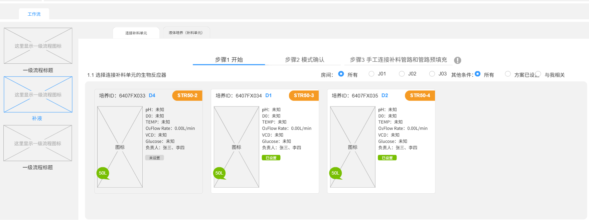

1.  步骤描述

    展示步骤1的简单描述信息，步骤描述内容在数据库初始化，后续可在模块系统设置－工艺设置－工作流管理（详见章节工作流管理②（调整））手动修改描述信息。所以此处直接从数据库表获取即可。

2.  筛选条件

    以下条件联合查询：

    1.  **房间**：展示同实验室的多个房间供选择（数据来源为集成反应器的场地字段），也可选择“所有”表示显示所有房间的反应器
    2.  其他条件

        可选择所有或方案已设置或与我相关，三选一

        1.  **所有**：默认选中此条件，所有是指满足章节筛选逻辑中的所有条件
        2.  **方案已设置**：满足章节筛选逻辑中所有条件的前提下，筛选出当前工作流相关的方案字段已经预设且审核通过的反应器
        3.  **与我相关**：满足章节筛选逻辑中所有条件的前提下，筛选出当前用户有过操作记录的反应器
3.  反应器卡片

    针对查询出符合条件的反应器，以每个反应器对应一个卡片的形式展示并支持选中（支持多选）开启操作

    1.  展示信息
        1.  培养ID
        2.  **当前阶段**：显示当前是培养的第几天
        3.  反应器编号
        4.  反应器图标
        5.  **反应器规格**：绿色小气泡样式展示该反应器规格
        6.  **在线指标名称及数值**：展示当前反应器有采集的所有在线指标及进入该页面时最新的实时数值
        7.  **负责人**：显示该培养的成员，若没有则展示批次成员，再没有展示项目成员
        8.  **是否设置补液方案标识**：若已配置补液方案则标记为已设置（绿色背景），否则为未设置（灰色背景）
    2.  选中进行下一步操作
        1.  已设置的反应器才能被选中，否则提示信息

            > **[图 image494.png | 章节：工作流（3.2） / 连接补料单元-中试（3.1）（3.2） | 上下文：已设置的反应器才能被选中，否则提示信息]**
            > **OCR 文本：**
            > 未进行方案预设，不可进行操作

            

        2.  支持选中多个反应器同时操作，但不允许一次操作超过10个反应器，否则提示信息

            > **[图 image496.png | 章节：工作流（3.2） / 连接补料单元-中试（3.1）（3.2） | 上下文：支持选中多个反应器同时操作，但不允许一次操作超过10个反应器，否则提示信息]**
            > **OCR 文本：**
            > 最多一次操作10个反应器哦

            

        3.  选中反应器后，点击“下一步”按钮，若选中单个反应器直接进入步骤2，否则提示并二次确定后进入步骤2。

            > **[图 image497.png | 章节：工作流（3.2） / 连接补料单元-中试（3.1）（3.2） | 上下文：选中反应器后，点击“下一步”按钮，若选中单个反应器直接进入步骤2，否则提示并二次确定后进入步骤2。]**
            > **OCR 文本：**
            > 确定选择2个反应器
            > 同时进行连接补料单元操作
            > 取消 | 确定

            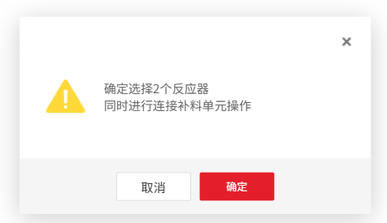

##### 步骤2－模式确认（3.1）（3.2）

> **[图 image498.png | 章节：工作流（3.2） / 连接补料单元-中试（3.1）（3.2） | 上下文：步骤2－模式确认（3.1）（3.2）]**
> **OCR 文本：**
> 药明生物SMP系统 | 首页 | A实验室工作台丶 | B实验室工作台√ | 数据管理 | 系统设置
> 工作流
> 初始连接补料单元 | 更换料液
> 这里显示一级流程图标
> 步骤1开始 | 步骤2 模式确认 | 步骤3手工连接补料管路和管路预填充
> 一级流程标题
> 2.1控制并确认使用泵模式
> 这里显示一级流程图标
> 培养基本信息 | STR50-3 | 补料泵 | 键变更模式 | 服务连接情况
> 补液
> ·培养ID：6407FX033D4 | STR 50L-3-PUMP1 （Na2C03）1L补料瓶皮重200g | 自动 | 台秤集采服务 | 重启
> ·培养周期：7天 | 192.168.1.1:1001
> STR 50L-3-PUMP2（FM020a）1L补料瓶皮重200g | 手动 | 空气泵服务 | 重启
> 这里显示一级流程图标 | ·培养方式：反应器培养 | 192.168.1.2:1002
> ·补糖计算依据：初始重量 | STR 50L-3-PUMP3（FM020b）1L补料瓶皮重200g | 自动 | 声光报警器 | 重启
> 192.168.1.3:1003
> 一级流程标题 | ·补料时计算补料引起的糖浓度变化：是 | STR 50L-3-PUMP4（Glucose）1L补料瓶皮重200g | 手动 | 调度服务 | 重启
> ·补液前确认残糖浓度：否 | 192.168.1.4:1004
> ·补糖计算模式：残糖+乳酸 | STR50L-3-PUMP5（FM020a）1L补料瓶皮重200g | 自动 | OPC服务 | 192.168.1.5:1005 | 重启
> 培养基本信息 | STR50-4 | 补料泵 | 一键变更模式 | 服务连接情况
> ·培养ID：6407FX034D4 | STR 50L-1-PUMP4（Na2C03）1L补料瓶皮重200g | 自动 | 台秤集采服务 | 重启
> ·培养周期：7天 | 192.168.1.1:1001
> STR 50L-1-PUMP4（FM020a）1L补料瓶皮重200g | 手动 | 空气泵服务 | 重启
> ·培养方式：反应器培养 | 192.168.1.2:1002
> ·补糖计算依据：初始重量 | STR 50L-1-PUMP4（FM020b）1L补料瓶皮重200g | 自动 | 声光报警器 | 重启
> 192.168.1.3:1003
> ·补料时计算补料引起的糖浓度变化：是 | STR 50L-1-PUMP5（Glucose）1L补料瓶皮重200g | 手动 | 调度服务 | 重启
> 补液前确认残糖浓度：否 | 192.168.1.4:1004
> ·补糖计算模式：残糖+乳酸 | STR 50L-1-PUMP6（FM020a）1L补料瓶皮重200g | 自动 | OPC服务 | 192.168.1.5:1005 | 重启
> 取消 | 下一步

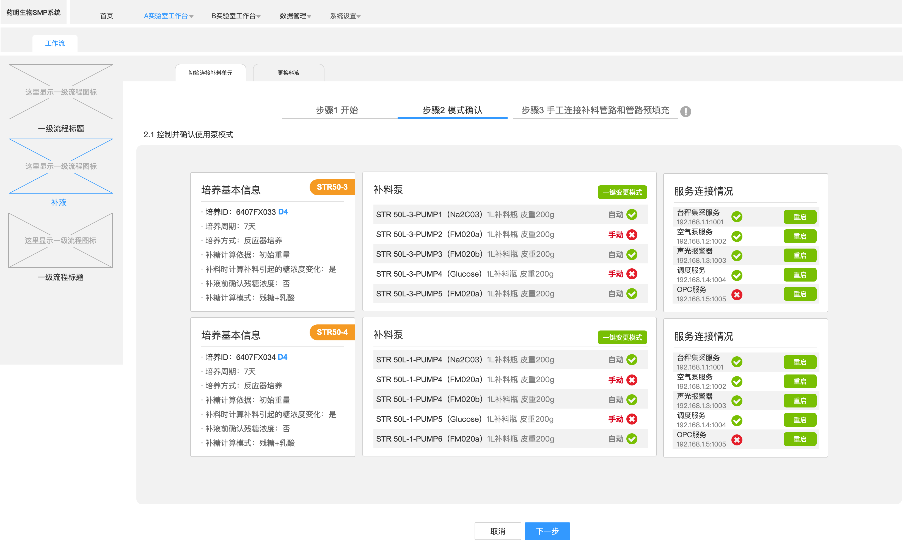

1.  **步骤描述**：同上述章节步骤描述
2.  相关信息

    基于步骤1选中的反应器，每个反应器一行展示以下三个部分信息

    1.  培养基本信息
        1.  反应器编号
        2.  培养ID
        3.  当前阶段
        4.  培养周期
        5.  培养方式
        6.  补料计算依据
        7.  补料时计算补料引起的糖浓度变化
        8.  补液前确认残糖浓度
        9.  补糖计算模式
    2.  补料泵
        1.  展示补液方案固定泵的连接信息，每个泵对应一行，包含以下信息
            1.  反应器编码
            2.  泵名称
            3.  **补液培养基**：该泵对应的补液培养基的名称
            4.  **液袋名称**：即补液方案中固定泵Tab页的耗材（中试来源于为液袋管理），展示该泵对应的液袋的描述字段
            5.  **皮重**：该泵对应液袋的皮重字段
            6.  **手动/自动**：表示当前补料泵的模式。手动使用红色打叉符号和文字“手动”标记，自动使用绿色打勾符号和文字“自动”标记
        2.  一键变更模式

            点击一键变更模式按钮，向设备发送切换泵的模式的指令，然后获取最新的当前模式

3.  服务连接情况

    根据当前反应器的配置情况展示所有服务的连接状况（整个系统会涉及的服务见章节远程服务（3.1））

4.  每个服务展示以下信息：
    1.  名称
    2.  IP
    3.  **连接是否正常**：不正常使用红色打叉符号标记，正常使用绿色打勾符号标记
5.  重启按钮

    连接不正常时，可点击重启按钮来重新启动服务

6.  操作
    1.  下一步操作
        1.  校验所有的泵是否都为自动模式且所有服务都连接正常，若是，则允许进入下一步，否则提示不允许进入下一步
    2.  取消操作

        点击取消，提示信息，点击确认取消后则不保存当前的任何数据，下次需要重新从步骤1开始操作。

        > **[图 image499.png | 章节：工作流（3.2） / 连接补料单元-中试（3.1）（3.2） | 上下文：点击取消，提示信息，点击确认取消后则不保存当前的任何数据，下次需要重新从步骤1开始操作。]**
        > **OCR 文本：**
        > 确定要取消吗？
        > 取消后信息不保存，下次需要重新从步
        > 骤一开始操作
        > 取消 | 确定

        

##### 步骤3－手工连接补料管路和管路预填充（3.1）

> **[图 image500.png | 章节：工作流（3.2） / 连接补料单元-中试（3.1）（3.2） | 上下文：步骤3－手工连接补料管路和管路预填充（3.1）]**
> **OCR 文本：**
> 工作流
> 初始连接补料单元 | 液体培养(补料单元）
> 这里显示一级流程图标
> 步骤1开始 | 步骤2模式确认 | 步骤3手工连接补料管路和管路预填充
> 一级流程标题
> 3.1反应器与补料管路逐一连接，完成所有补料液袋称重3.2补料培养基管路预填充（外置泵进行填充无需开始和停止)
> 这里显示一级流程图标
> 培养基本信息 | STR50-3 | 补料管路预填充
> 补液
> ·培养ID：6407FX033 | STR50L-3-PUMP1（Na2C03）1L补料瓶皮重200g | 净重* | 泵速* | g/min | 复制
> 这里显示一级流程图标 | ·培养天数：7天 | STR50L-3-PUMP2（FM020a）1L补料瓶皮重200g | 120 | 泵速* | 1000 | 复制
> 一级流程标题 | ·补料时计算补料引起的糖浓度变化：是 | ·培养方式：反应器培养 | ·补糖计算依据：初始重量 | ·补液前确认残糖浓度：否 | ·补糖计算模式：残糖+乳酸 | STR50-4 | STR50L-3-PUMP3（FM020b）1L补料瓶皮重200g | STR50L-3-PUMP4（Glucose）1L补料瓶皮重200g | STR50L-3-PUMP5（FM020a）1L补料瓶皮重200g | 泵速* | 泵速* | 泵速* | g/min | g/min | g/min | 复制 | 复制 | 复制 | 00000
> 培养基本信息 | 补料管路预填充
> ·培养ID：6407FX034 | STR50L-1-PUMP4（Na2C03）1L补料瓶皮重200g | 净重* | 泵速* | g/min | 复制
> ·培养天数：7天 | STR50L-1-PUMP4（FM020a）1L补料瓶皮重200g | 净重* | 120 | 泵速* | 1000 | 复制
> ·培养方式：反应器培养 | ·补糖计算依据：初始重量 | ·补料时计算补料引起的糖浓度变化：是 | ·补液前确认残糖浓度：否 | ·补糖计算模式：残糖+乳酸 | STR50L-1-PUMP4（FM020b）1L补料瓶皮重200g | STR50L-1-PUMP5（Glucose）1L补料瓶皮重200g | STR50L-1-PUMP6（FM020a）1L补料瓶皮重200g | 净重* | 泵速* | 泵速* | 泵速* | g/min | g/min  | g/min | 复制 | 复制 | 复制 | 00000
> 取消 | 完成 | 跳过并完成

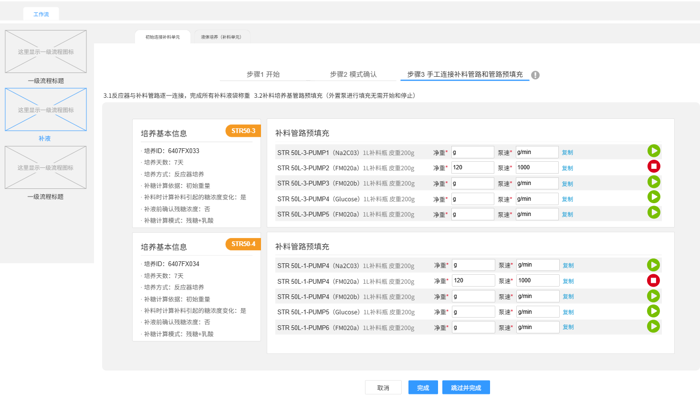

1.  **步骤描述**：同上述章节步骤描述
2.  相关信息
    1.  **培养基本信息**：同上述章节培养基本信息
    2.  补料管路预填充信息
        1.  反应器编码
        2.  泵名称
        3.  **补液培养基**：该泵对应的补液培养基的名称
        4.  **液袋**：中试的耗材来源于液袋管理的描述字段，此处展示该泵对应的液袋的描述字段
        5.  **皮重**：该泵对应液袋的皮重字段
        6.  **净重**：文本框，限制为数值，最大不超过100，单位g，
            1.  对应地秤的精度为整数时，则此处也只能为整数
            2.  对应地秤的精度为小数时，则此处也为小数，且小数位数与地秤精度保持一致
        7.  **泵速**：文本框，限制为正整数，最大不能超过当前泵的最大量程
        8.  **复制按钮**：将当前行的净重和泵速信息复制到属于同一个培养ID的其余泵
        9.  开始/停止按钮
            1.  点击开始则下发泵速和净重信息给设备开始预填充；点击结束则下发停泵指令。
            2.  可以多个泵同时开启预填充。
            3.  需要详细记录每次与预填充的操作人、操作时间（包括开始和结束时间）、页面上展示的相关信息、净重、泵速
3.  操作
    1.  **取消**：同上述章节取消操作
    2.  完成：
        1.  **有预填充操作**：点击完成提示当前步骤已完成，也意味着连接补料单元这个二级流程同时完成

            > **[图 image501.png | 章节：工作流（3.2） / 连接补料单元-中试（3.1）（3.2） | 上下文：有预填充操作：点击完成提示当前步骤已完成，也意味着连接补料单元这个二级流程同时完成]**
            > **OCR 文本：**
            > 操作成功！
            > 补料单元已成功连接
            > 关闭

            

        2.  无任何预填充操作：
            1.  点击完成时，若没有进行过任何预填充操作，则弹窗提示是否需要跳过本步骤并完成

                > **[图 image502.png | 章节：工作流（3.2） / 连接补料单元-中试（3.1）（3.2） | 上下文：点击完成时，若没有进行过任何预填充操作，则弹窗提示是否需要跳过本步骤并完成]**
                > **OCR 文本：**
                > 确定要跳过预填充操作吗
                > 跳过本步骤不影响工作流的完成
                > 取消 | 确定

                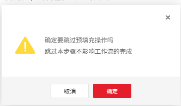

            2.  若二次确认则提示当前步骤已完成，也意味着连接补料单元这个二级流程同时完成

                > **[图 image503.png | 章节：工作流（3.2） / 连接补料单元-中试（3.1）（3.2） | 上下文：若二次确认则提示当前步骤已完成，也意味着连接补料单元这个二级流程同时完成]**
                > **OCR 文本：**
                > 跳过成功！
                > 补料单元已成功连接
                > 关闭

                

    3.  跳过并完成
        1.  点击后，弹窗提示是否需要跳过本步骤并完成

            > **[图 image502.png | 章节：工作流（3.2） / 连接补料单元-中试（3.1）（3.2） | 上下文：点击后，弹窗提示是否需要跳过本步骤并完成]**
            > **OCR 文本：**
            > 确定要跳过预填充操作吗
            > 跳过本步骤不影响工作流的完成
            > 取消 | 确定

            

        2.  若二次确认则提示当前步骤已完成，也意味着连接补料单元这个二级流程同时完成

            > **[图 image503.png | 章节：工作流（3.2） / 连接补料单元-中试（3.1）（3.2） | 上下文：若二次确认则提示当前步骤已完成，也意味着连接补料单元这个二级流程同时完成]**
            > **OCR 文本：**
            > 跳过成功！
            > 补料单元已成功连接
            > 关闭

            

#### 更换料液-中试（3.1）（3.2）

更换料液包括开始、更换液袋、补料管路填充共计三个步骤。

更换料液的前置环节为完成连接补料单元工作流。

##### 步骤1－开始（3.1）（3.2）

> **[图 image504.png | 章节：工作流（3.2） / 更换料液-中试（3.1）（3.2） | 上下文：步骤1－开始（3.1）（3.2）]**
> **OCR 文本：**
> 药明生物SMP系统 | 首页 | A实验室工作台 | B实验室工作台√ | 数据管理 | 系统设置
> 工作流
> 连接补料单元 | 更换料液
> 这里显示一级流程图标
> 步骤1 开始 | 步骤2更换液袋 | 步骤3补料管路预填充
> 一级流程标题 | 1.1选择补料单元1.2选择更换液袋 | 房间： | 所有 | J01 | J02 | J03 | 其他条件: | 所有 | 与我相关
> 这里显示一级流程图标
> 培养ID：6407FX033D4 | 培养ID：6407FX034D1 | 培养ID：6407FX034D3
> STR50-2 | STR50-3 | STR50-4
> 规格：50L重量：39383g | 规格：50L重量：39383g | 规格：50L重量：39383g
> 补液
> PUMP1: Na2C03 50/5000g (1%) | PUMP1: Na2C03 5000/5000g (100%) | PUMP1: Na2C03 5000/5000g (100%)
> 这里显示一级流程图标
> PUMP2: FM020a 998/1000g (99.8%) | PUMP2: FM020a 998/1000g (99.8%) | PUMP2: FM020a 998/1000g (99.8%)
> 一级流程标题 | PUMP3: FM020b 888g 998/1000g (99.8%) | PUMP3: FM020b 888g 998/1000g (99.8%) | PUMP3: FM020b 888g 998/1000g (99.8%)
> PUMP4: Glucose 100/5000g (2%) | PUMP4: Glucose 100/5000g (2%) | PUMP4: Gluc0se 5000/5000g (100%)
> 下一步

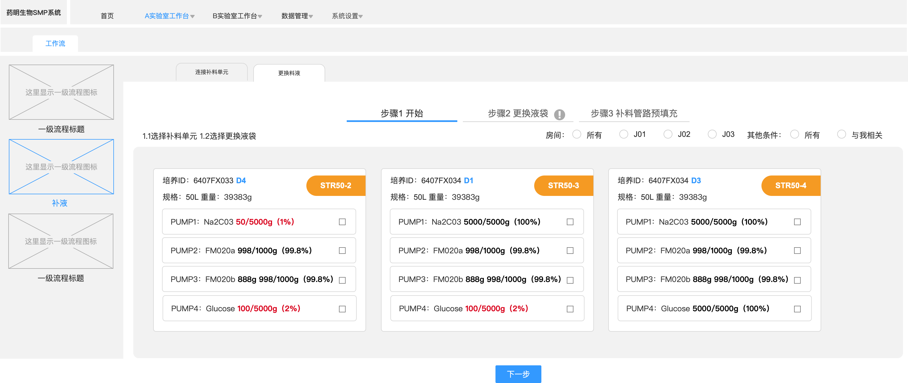

1.  **步骤描述**：同上述章节步骤描述
2.  **筛选条件**：同上述章节筛选条件
3.  反应器卡片

    针对查询出符合条件的反应器，以每个反应器对应一个卡片的形式展示并支持选中（支持多选）开启操作

    1.  基本信息
        1.  培养ID
        2.  当前阶段
        3.  控制器编码
        4.  规格
        5.  **重量**：获取反应器当前的实际重量
    2.  泵的连接信息
        1.  泵的名称
        2.  补液培养基
        3.  **液袋现重量**：即液袋余量，为计算出的理论值。液袋的余量=液袋容量-累积补液量。现重量小于该液袋的残余量时，将文字颜色标红告警。
        4.  **液袋容量**：根据当前泵配置的液袋自动获取容量
        5.  液袋现重量占液袋容量比例
    3.  选中进行下一步操作
        1.  每个反应器的泵可以独立选择
        2.  支持批量选中不同控制器的不同泵
        3.  批量选中时，不允许超过10个泵，否则提示信息

            > **[图 image505.png | 章节：工作流（3.2） / 更换料液-中试（3.1）（3.2） | 上下文：批量选中时，不允许超过10个泵，否则提示信息]**
            > **OCR 文本：**
            > 最多一次操作10个反应器哦

            

        4.  点击下一步按钮，进入步骤2

##### 步骤2－更换液袋（3.1）（3.2）

> **[图 image506.png | 章节：工作流（3.2） / 更换料液-中试（3.1）（3.2） | 上下文：步骤2－更换液袋（3.1）（3.2）]**
> **OCR 文本：**
> 药明生物SMP系统 | 首页 | A实验室工作台丶 | B实验室工作台√ | 数据管理√ | 系统设置
> 工作流
> 连接补料单元 | 更换料液
> 这里显示一级流程图标
> 步骤1 开始 | 步骤2 更换液袋 | 步骤3补料管路预填充
> 一级流程标题
> 操作提示
> 这里显示一级流程图标
> STR50-2 | 培养ID：6407FX033(D4) | 规格：50L重量：39383g
> 补液
> PUMP1: Na2C03 | PUMP1: Na2C03
> 这里显示一级流程图标 | 50LBag皮重0.2g | 50L Bag
> 图标 | 50/5000g (1%) | 图标 | 皮重0.2g
> 一级流程标题 | 补充净量* | 单位g
> 原始的 | 新鲜的
> PUMP4: Glucose | PUMP4: Glucose
> 50LBag皮重0.2g | 50L Bag
> 图标 | 50/5000g (1%) | 图标 | 皮重0.2g
> 新鲜的 | 补充净量* | 单位g
> 原始的
> STR50-3 | 培养ID： 6407FX034 (D1) | 规格：50L重量：39383g
> PUMP4: Glucose | PUMP4: Glucose (450g/L)
> 50LBag皮重0.2g | 50L Bag
> 图标 | 50/5000g (1%) | 图标 | 皮重0.2g
> 新鲜的 | 补充净量* | 单位g
> 原始的
> 取消 | 下一步

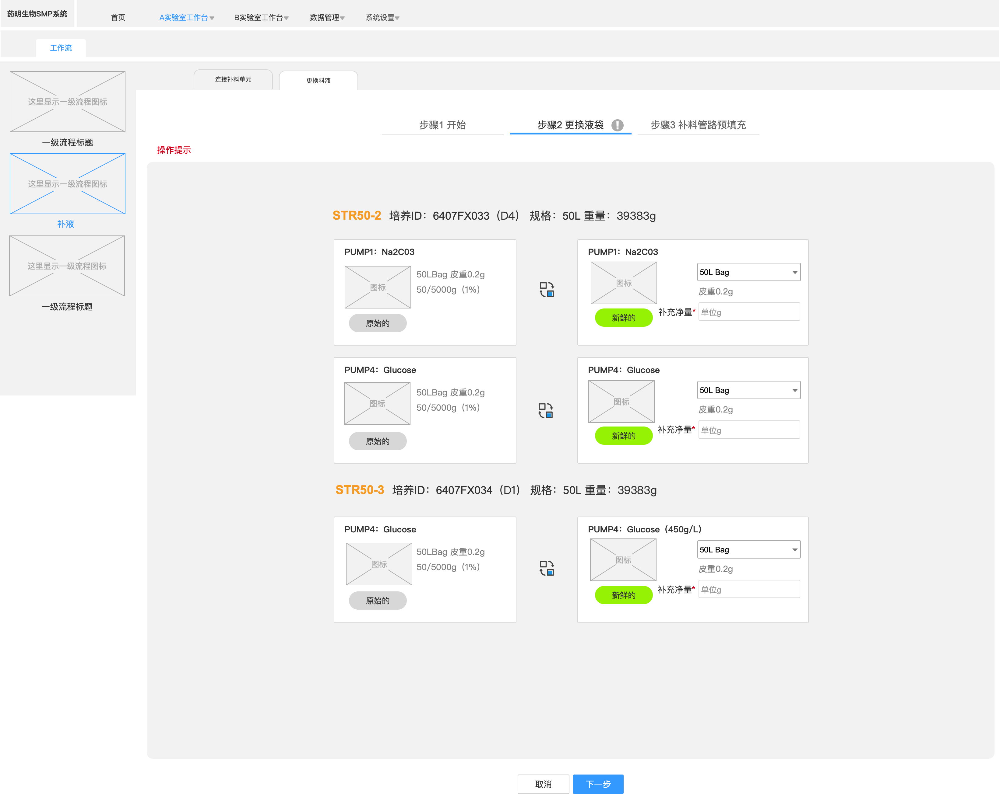

1.  **步骤描述**：同上述章节步骤描述
2.  相关信息

    基于步骤1选中的各个控制器的各个泵对应的液袋，每个液袋一行展示以下两个部分信息

3.  **基本信息**：同上述章节基本信息
4.  液袋更换信息对比

    左右两边分开展示液袋的现状和更换后的对比信息

    1.  左侧－“原始的”
        1.  泵的名称
        2.  料液名称
        3.  **液袋描述**：原来的液袋对应的图标
        4.  液袋图标
        5.  液袋皮重
        6.  液袋现重量
        7.  液袋容量
        8.  液袋现重量占液袋容量占比
        9.  标签“原始的”，灰色背景
    2.  右侧－“新鲜的”
        1.  泵的名称
        2.  料液名称
        3.  **液袋描述**：下拉单选，必选，数据来自液袋管理模块中维护的描述字段
        4.  **液袋图标**：根据液袋描述自动带出新的图标
        5.  **液袋皮重**：根据液袋描述自动带出
        6.  **补充净重**：文本框，限制正整数，单位g
        7.  标签“新鲜的”，绿色背景
5.  操作
    1.  下一步操作
        1.  校验所有的泵对应的液袋描述和净重是否都已填写，若是，则允许进入下一步，否则提示不允许进入下一步
        2.  **需要详细记录更换液袋的详细信息**：操作人、操作时间（包括开始和结束时间）、页面上展示的相关信息（液袋描述、净重、型号等）
        3.  更新每个泵对应的液袋相关信息
    2.  取消操作

        点击取消，提示信息，点击确认取消后则不保存当前的任何数据，下次需要重新从步骤1开始操作。

        > **[图 image499.png | 章节：工作流（3.2） / 更换料液-中试（3.1）（3.2） | 上下文：点击取消，提示信息，点击确认取消后则不保存当前的任何数据，下次需要重新从步骤1开始操作。]**
        > **OCR 文本：**
        > 确定要取消吗？
        > 取消后信息不保存，下次需要重新从步
        > 骤一开始操作
        > 取消 | 确定

        

##### 步骤3－补料管路填充（3.1）（3.2）

> **[图 image507.png | 章节：工作流（3.2） / 更换料液-中试（3.1）（3.2） | 上下文：步骤3－补料管路填充（3.1）（3.2）]**
> **OCR 文本：**
> 药明生物SMP系统 | 首页 | A实验室工作台 | B实验室工作台√ | 数据管理 | 系统设置
> 工作流
> 连接补料单元 | 液体培养 (补料单元）
> 这里显示一级流程图标
> 步骤1 开始 | 步骤2更换液袋 | 步骤3补料管路预填充
> 一级流程标题
> 操作提示
> 这里显示一级流程图标
> 补液 | 补料管路预填充
> STR50-2 | 培养ID：6407FX033 | (D4) | 规格：50L重量：39383g
> 这里显示一级流程图标
> PUMP1（(Na2C03）50LBag 皮重0.2g | 泵速* | g/min | 复制
> 一级流程标题 | PUMP4（Glucose）50LBag 皮重0.2g | 泵速* | g/min | 复制
> STR50-3 | 培养ID：6407FX034 | 4(D1) | 规格：50L重量：39383g
> PUMP4（Glucose）50LBag 皮重0.2g | 泵速* | 1000 | 复制
> 完成 | 跳过并完成

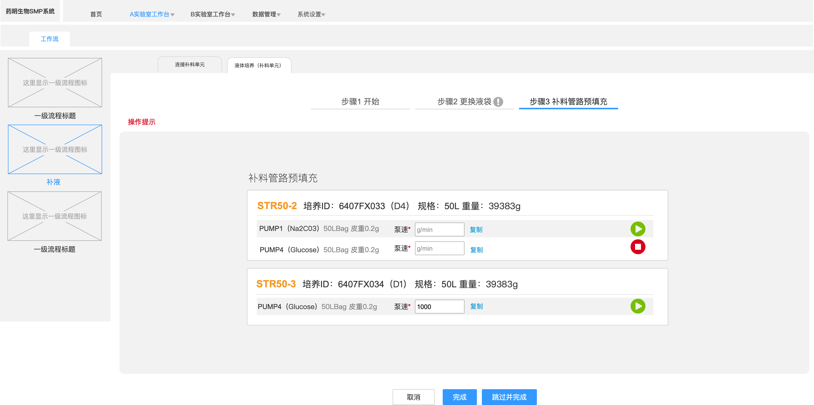

1.  **步骤描述**：同上述章节步骤描述
2.  相关信息
3.  **基本信息**：同上述章节基本信息
4.  **液袋信息**：基于更换后的液袋信息展示以下内容
    1.  泵的名称
    2.  料液名称
    3.  液袋描述
    4.  液袋皮重
    5.  **泵速**：文本框，限制为正整数，最大不能超过当前泵的最大量程
    6.  **复制按钮**：将当前行的净重和泵速信息复制到属于同一个培养ID的其余泵
    7.  开始/停止按钮
        1.  点击开始则下发泵速和净重信息给设备开始预填充；点击结束则下发停泵指令。
        2.  可以多个泵同时开启预填充。
        3.  需要详细记录每次预填充的操作人、操作时间（包括开始和结束时间）、页面上展示的相关信息、净重、泵速
5.  操作
    1.  **取消**：同上述章节取消操作
    2.  完成：
        1.  **有预填充操作**：点击完成提示当前步骤已完成，也意味着连接补料单元这个二级流程同时完成

            > **[图 image508.png | 章节：工作流（3.2） / 更换料液-中试（3.1）（3.2） | 上下文：有预填充操作：点击完成提示当前步骤已完成，也意味着连接补料单元这个二级流程同时完成]**
            > **OCR 文本：**
            > 操作成功！
            > 液袋更换成功
            > 关闭

            

        2.  无任何预填充操作：
            1.  点击完成时，若没有进行过任何预填充操作，则弹窗提示是否需要跳过本步骤并完成

                > **[图 image502.png | 章节：工作流（3.2） / 更换料液-中试（3.1）（3.2） | 上下文：点击完成时，若没有进行过任何预填充操作，则弹窗提示是否需要跳过本步骤并完成]**
                > **OCR 文本：**
                > 确定要跳过预填充操作吗
                > 跳过本步骤不影响工作流的完成
                > 取消 | 确定

                

            2.  若二次确认则提示当前步骤已完成，也意味着连接补料单元这个二级流程同时完成

                > **[图 image509.png | 章节：工作流（3.2） / 更换料液-中试（3.1）（3.2） | 上下文：若二次确认则提示当前步骤已完成，也意味着连接补料单元这个二级流程同时完成]**
                > **OCR 文本：**
                > 跳过成功！
                > 液袋更换成功
                > 关闭

                

    3.  跳过并完成
        1.  点击后，弹窗提示是否需要跳过本步骤并完成

            > **[图 image502.png | 章节：工作流（3.2） / 更换料液-中试（3.1）（3.2） | 上下文：点击后，弹窗提示是否需要跳过本步骤并完成]**
            > **OCR 文本：**
            > 确定要跳过预填充操作吗
            > 跳过本步骤不影响工作流的完成
            > 取消 | 确定

            

        2.  若二次确认则提示当前步骤已完成，也意味着连接补料单元这个二级流程同时完成

            > **[图 image509.png | 章节：工作流（3.2） / 更换料液-中试（3.1）（3.2） | 上下文：若二次确认则提示当前步骤已完成，也意味着连接补料单元这个二级流程同时完成]**
            > **OCR 文本：**
            > 跳过成功！
            > 液袋更换成功
            > 关闭

            

#### 连接补料单元-小试（3.1）

小试连接补料单元包括开始、连接补料单元、补料管路预填充共计三个步骤。

连接补料单元的前置环节为细胞培养开始（完成开始细胞培养工作流或到达培养开始时间，条件满足其一即可）

##### 步骤1－开始（3.1）

> **[图 image510.png | 章节：工作流（3.2） / 连接补料单元-小试（3.1） | 上下文：步骤1－开始（3.1）]**
> **OCR 文本：**
> 工作流
> 连接补料单元 | 补料 (其他) | 液体补充 (补料单元) | 液体补充(补料单元) | 废液清理 | 补料 (手工)
> 这里显示一级流程图标
> 步骤1开始 | 步骤2连接补料单元 | 步骤3补料管路预填充
> 一级流程标题 | 1.1选择连接补料单元的生物反应器 | 布局： | 所有 | ROW1 | ROW2 | ROW3 | 其他条件： | 所有 | 方案已设 | 与我相关
> 这里显示一级流程图标
> 培养ID:6407FX033 D4 | FX033 | 培养ID:6407FX034 D4 | FX034 | 培养ID：6407FX035D4 | FX035
> 补液 | PH：未知 | PH：未知 | PH：未知
> 图标 | 温度：未知 | 图标 | 温度：未知 | 图标 | 温度：未知
> 容量：1598.7 | 容量：1598.7 | 容量：1598.7
> VCD: 14.900 (E06) | VCD: 14.900 (E06) | VCD: 14.900 (E06)
> 这里显示一级流程图标 | 未设置 | 已设置 | 已设置
> 一级流程标题
> 下一步

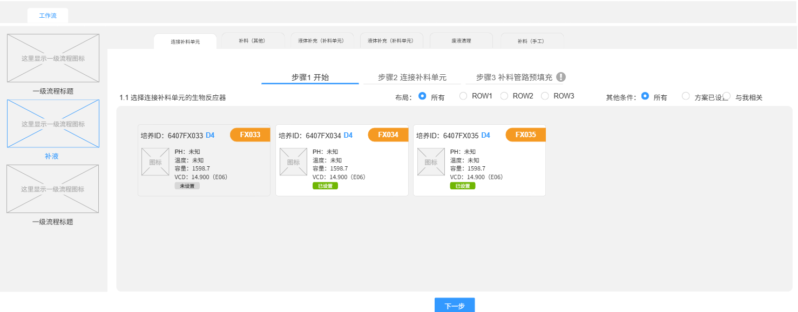

1.  **步骤描述**：同上述章节步骤描述
2.  筛选条件

    以下条件联合查询：

    1.  **Row**：展示同实验室的多个Row供选择（数据来源为控制器的对应的库表），也可选择“所有”表示显示所有房间的控制器
    2.  其他条件

        同上述章节其他条件

3.  控制器卡片

    针对查询出符合条件的控制器，以每个控制器对应一个卡片的形式展示并支持选中（不支持多选）开启操作

    1.  展示信息
        1.  培养ID
        2.  当前阶段
        3.  控制器编号
        4.  **图标**：显示当前控制器连接的台式反应器的图标
        5.  在线指标名称及其数值
        6.  是否设置补液方案标识
    2.  选中进行下一步操作
        1.  不允许批量选中操作，否则提示不支持批量操作
        2.  已设置的反应器才能被选中，否则提示信息

            > **[图 image494.png | 章节：工作流（3.2） / 连接补料单元-小试（3.1） | 上下文：已设置的反应器才能被选中，否则提示信息]**
            > **OCR 文本：**
            > 未进行方案预设，不可进行操作

            

        3.  选中单个控制器后，点击“下一步”按钮，提示是否需要开始连接补料单元，二次确定后进入步骤2。

            > **[图 image511.png | 章节：工作流（3.2） / 连接补料单元-小试（3.1） | 上下文：选中单个控制器后，点击“下一步”按钮，提示是否需要开始连接补料单元，二次确定后进入步骤2。]**
            > **OCR 文本：**
            > 确定开始连接补料单元吗
            > 取消 | 确定

            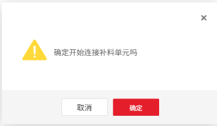

##### 步骤2－连接补料单元（3.1）（3.2）

> **[图 image512.png | 章节：工作流（3.2） / 连接补料单元-小试（3.1） | 上下文：步骤2－连接补料单元（3.1）（3.2）]**
> **OCR 文本：**
> 工作流
> 连接补料单元 | 补料 (其他) | 液体补充(补料单元） | 液体补充(补料单元) | 废液清理 | 补料 (手工)
> 这里显示一级流程图标
> 步骤1开始 | 步骤2连接补料单元 | 步骤3补料管路预填充
> 一级流程标题
> 2.1罐子接种管与种子容器管路连接2.2手工操作接种细胞2.3编辑细胞信息
> 这里显示一级流程图标
> 培养ID: 6407FX034 D4 | FX034
> 补液 | PH：未知
> 图标 | 温度：未知
> 容量：1598.7
> 这里显示一级流程图标 | VCD: 14.900 (E06)
> F33.1 (CB7a)
> 一级流程标题 | 图标 | 现量/容量* | 单位g | /1000g
> F33.2 (CB7b)
> 图标 | 现量/容量*单位g | /1000g
> F33.3 (Glucos)
> 图标 | 现量/容量* | 单位g | /1000g
> 取消 | 下一步

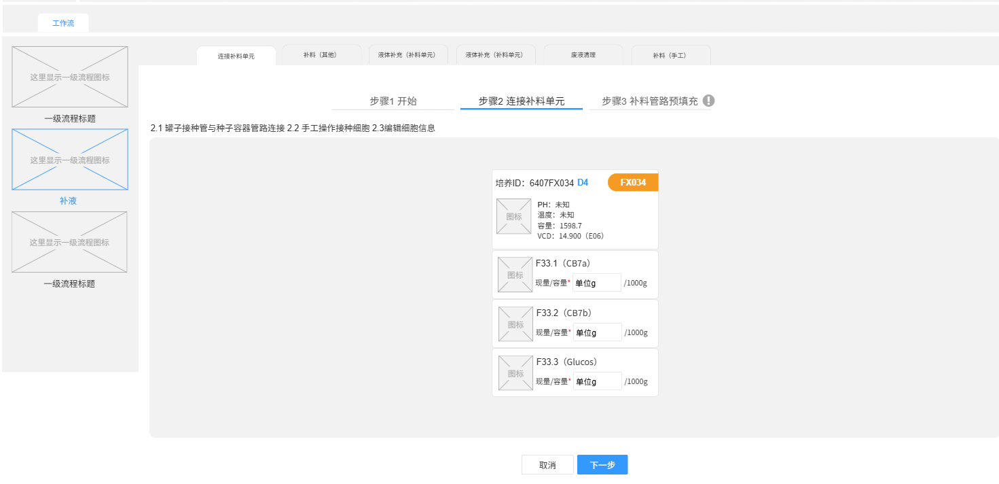

1.  **步骤描述**：同上述章节步骤描述
2.  相关信息

    基于步骤1选中的控制器，展示以下三个部分信息

3.  培养信息
    1.  培养ID
    2.  当前阶段
    3.  控制器编号
4.  控制器图标、在线指标名称及数值
5.  补料泵信息

    小试一期的补料泵信息来自液瓶设置，小试二期的补料泵信息来自泵的默认连接。

    1.  液瓶图标
    2.  补料单元通道编号
    3.  料液名称
    4.  **现量**：文本框，必填，默认读取数据库表中PLC写入的数值，若没有则必须手动填写，限制正整数，可修改，单位g
    5.  **容量**：根据补液培养基/补料容器自动带出容量字段，根据单位换算为ml。

        小试：1ml约等于1g

6.  操作
    1.  下一步操作
        1.  校验所有的现量字段是否都已填，若是，则允许进入下一步，否则提示不允许进入下一步
    2.  取消操作

        点击取消，提示信息，点击确认取消后则不保存当前的任何数据，下次需要重新从步骤1开始操作。

        > **[图 image499.png | 章节：工作流（3.2） / 连接补料单元-小试（3.1） | 上下文：点击取消，提示信息，点击确认取消后则不保存当前的任何数据，下次需要重新从步骤1开始操作。]**
        > **OCR 文本：**
        > 确定要取消吗？
        > 取消后信息不保存，下次需要重新从步
        > 骤一开始操作
        > 取消 | 确定

        

##### 步骤3－补料管路预填充（3.1）（3.2）

> **[图 image513.png | 章节：工作流（3.2） / 连接补料单元-小试（3.1） | 上下文：步骤3－补料管路预填充（3.1）（3.2）]**
> **OCR 文本：**
> 工作流
> 连接补料单元 | 补料 (其他) | 液体补充(补料单元) | 液体补充(补料单元) | 废液清理 | 补料 (手工)
> 这里显示一级流程图标
> 步骤1开始 | 步骤2连接补料单元 | 步骤3补料管路预填充
> 一级流程标题
> 3.1所有补料管路预填充
> 这里显示一级流程图标
> 培养ID：6407FX034D4 | F34.1 (CB7a) | 净重* | 泵速* | g/min | Speed1:1g/min
> 这里显示一级流程图标 | 补液 | FX034 | 图标 | 图标 | F34 | F33.3（Glucos）净重* | F34.1 (CB7b) | 净重* | 泵速* | 泵速* | g/min | g/min | Speed1:1g/min | Speed1:1g/min | 000
> 一级流程标题

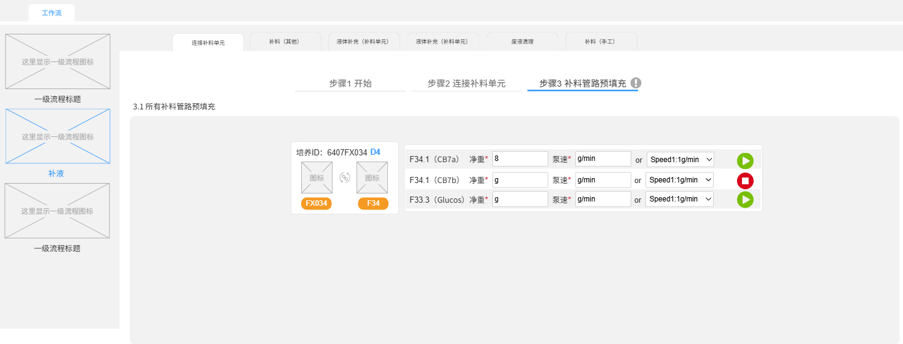

1.  **步骤描述**：同上述章节步骤描述
2.  相关信息
    1.  培养信息
        1.  培养ID
        2.  当前阶段
        3.  控制器编号及图标
        4.  补料单元编号及图标
    2.  补料泵信息
    3.  补料单元通道编号
    4.  料液名称
    5.  **净重**：净重：文本框，限制为正整数，最大不超过100，单位g
    6.  **泵速**：选择Speed1-10或输入固定泵速，二选一。输入固定泵速时，限制为正整数，最大不能超过当前泵的最大量程
    7.  开始/停止按钮
        1.  点击开始则下发泵速和净重信息给设备开始预填充；点击结束则下发停泵指令。
        2.  只能同时给一个泵进行预填充，只有当一个泵完成才能让另一个泵开始。
        3.  需要详细记录每次预填充的操作人、操作时间（包括开始和结束时间）、页面上展示的相关信息、净重、泵速
3.  操作
    1.  **取消**：同上述章节取消操作
    2.  完成：
        1.  **有预填充操作**：点击完成提示当前步骤已完成，也意味着连接补料单元这个二级流程同时完成

            > **[图 image501.png | 章节：工作流（3.2） / 连接补料单元-小试（3.1） | 上下文：有预填充操作：点击完成提示当前步骤已完成，也意味着连接补料单元这个二级流程同时完成]**
            > **OCR 文本：**
            > 操作成功！
            > 补料单元已成功连接
            > 关闭

            

        2.  无任何预填充操作：
            1.  点击完成时，若没有进行过任何预填充操作，则弹窗提示是否需要跳过本步骤并完成

                > **[图 image502.png | 章节：工作流（3.2） / 连接补料单元-小试（3.1） | 上下文：点击完成时，若没有进行过任何预填充操作，则弹窗提示是否需要跳过本步骤并完成]**
                > **OCR 文本：**
                > 确定要跳过预填充操作吗
                > 跳过本步骤不影响工作流的完成
                > 取消 | 确定

                

            2.  若二次确认则提示当前步骤已完成，也意味着连接补料单元这个二级流程同时完成

                > **[图 image503.png | 章节：工作流（3.2） / 连接补料单元-小试（3.1） | 上下文：若二次确认则提示当前步骤已完成，也意味着连接补料单元这个二级流程同时完成]**
                > **OCR 文本：**
                > 跳过成功！
                > 补料单元已成功连接
                > 关闭

                

    3.  跳过并完成
        1.  点击后，弹窗提示是否需要跳过本步骤并完成

            > **[图 image502.png | 章节：工作流（3.2） / 连接补料单元-小试（3.1） | 上下文：点击后，弹窗提示是否需要跳过本步骤并完成]**
            > **OCR 文本：**
            > 确定要跳过预填充操作吗
            > 跳过本步骤不影响工作流的完成
            > 取消 | 确定

            

        2.  若二次确认则提示当前步骤已完成，也意味着连接补料单元这个二级流程同时完成

            > **[图 image503.png | 章节：工作流（3.2） / 连接补料单元-小试（3.1） | 上下文：若二次确认则提示当前步骤已完成，也意味着连接补料单元这个二级流程同时完成]**
            > **OCR 文本：**
            > 跳过成功！
            > 补料单元已成功连接
            > 关闭

            

#### 补料（其他）-小试（3.1）

此流程仅适用与小试一期，小试补料泵共计4个，在此处固定为给第4个泵设置补料规则。

补料（其他）包含开始、连接补料单元、补料管路填充、补料共计4个步骤。

##### 步骤1－开始（3.1）

> **[图 image514.png | 章节：工作流（3.2） / 补料（其他）-小试（3.1） | 上下文：步骤1－开始（3.1）]**
> **OCR 文本：**
> 工作流
> 连接补料单元 | 补料 (其他) | 液体补充(补料单元) | 液体补充(取样单元) | 废液清理 | 补料 (手工)
> 这里显示一级流程图标
> 步骤1开始 | 步骤2连接补料单元0 | 步骤3补料管路预填充 | 步骤4补料
> 一级流程标题 | 1.1选择补料罐体 | 布局： | 所有 | ROW1 | ROW2 | ROW3 | 其他条件： | 所有 | 方案已设 | 与我相关
> 这里显示一级流程图标
> 培养ID：6407FX033D4 | FX033 | 培养ID：6407FX034D4 | FX034 | 培养ID：6407FX035D4 | FX035
> 补液 | PH：未知 | PH：未知 | PH:未知
> 图标 | 温度：未知 | 图标 | 温度：未知 | 图标 | 温度：未知
> 容量：1598.7 | 容量：1598.7 | 容量：1598.7
> VCD: 14.900 (E06) | VCD: 14.900 (E06) | VCD: 14.900 (E06)
> 这里显示一级流程图标
> 一级流程标题
> 下一步

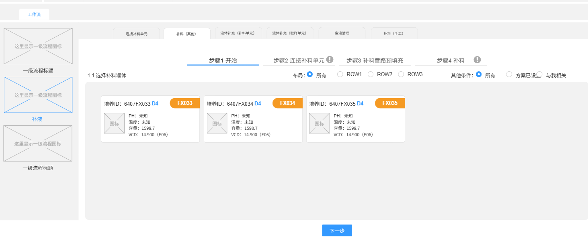

1.  **步骤描述**：同上述章节步骤描述
2.  筛选条件

    以下条件联合查询：

    1.  **Row**：展示同实验室的多个Row供选择（数据来源为控制器的对应的库表），也可选择“所有”表示显示所有房间的控制器
    2.  其他条件

        同上述章节其他条件

3.  控制器卡片

    针对查询出符合条件的控制器，以每个控制器对应一个卡片的形式展示并支持选中（不支持多选）开启操作

    1.  展示信息
        1.  培养ID
        2.  当前阶段
        3.  控制器编号
        4.  **图标**：显示当前控制器连接的台式反应器的图标
        5.  在线指标名称及其数值
    2.  选中进行下一步操作
        1.  不允许批量选中操作，否则提示不支持批量操作
        2.  选中单个反应器后，点击“下一步”按钮，进入步骤2

##### 步骤2－连接补料单元（3.1）

> **[图 image515.png | 章节：工作流（3.2） / 补料（其他）-小试（3.1） | 上下文：步骤2－连接补料单元（3.1）]**
> **OCR 文本：**
> 工作流
> 连接补料单元 | 补料 (其他) | 液体补充 (补料单元) | 液体补充 (取样单元) | 废液清理 | 补料 (手工)
> 这里显示一级流程图标
> 步骤1开始 | 步骤2连接补料单元 | 步骤3补料管路预填充 | 步骤4补料
> 一级流程标题
> 2.1生物反应器与补料单元其他补料管路连接
> 这里显示一级流程图标
> 补液 | 培养ID：6407FX033D4 | FX033
> pH：未知
> 图标 | 温度：未知
> 这里显示一级流程图标 | OzFlow Rate: 2.2L/min
> 容量：2000.0g
> VCD: 9.500 (E06)
> Lac: 0.134g/L
> 一级流程标题
> 取消

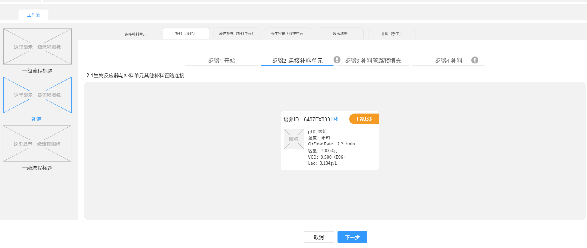

1.  **步骤描述**：同上述章节步骤描述
2.  控制器卡片

    针对步骤1选中的控制器，以卡片的形式展示信息

3.  培养ID
4.  当前阶段
5.  控制器编号
6.  **图标**：显示当前控制器连接的台式反应器的图标
7.  在线指标名称及其数值
8.  操作
    1.  **下一步操作**：点击进入步骤3（此步骤未在系统上进行任何操作，仅起到让用户线下操作的提醒作用）
    2.  取消操作

        点击取消，提示信息，点击确认取消后则不保存当前的任何数据，下次需要重新从步骤1开始操作。

        > **[图 image499.png | 章节：工作流（3.2） / 补料（其他）-小试（3.1） | 上下文：点击取消，提示信息，点击确认取消后则不保存当前的任何数据，下次需要重新从步骤1开始操作。]**
        > **OCR 文本：**
        > 确定要取消吗？
        > 取消后信息不保存，下次需要重新从步
        > 骤一开始操作
        > 取消 | 确定

        

##### 步骤3－补料管路填充（3.1）

> **[图 image516.png | 章节：工作流（3.2） / 补料（其他）-小试（3.1） | 上下文：步骤3－补料管路填充（3.1）]**
> **OCR 文本：**
> 工作流
> 连接补料单元 | 补料 (其他) | 液体补充 (补料单元) | 液体补充(取样单元) | 废液清理 | 补料 (手工)
> 这里显示一级流程图标
> 步骤1开始 | 步骤2连接补料单元 | 步骤3补料管路预填充 | 步骤4补料0
> 级流程标题
> 3.1其他补料液体管路预填充
> 这里显示一级流程图标
> 补料管路预填充
> 补液 | 培养ID：6407FX034D4
> 液体名称* | CB7a
> 图标 | 图标
> 这里显示一级流程图标 | 净重*
> FX034 | F34 | 泵速* | Speed1
> 一级流程标题
> 取消 | 跳过 | 下一步
> 跳过前请选择补料培养基

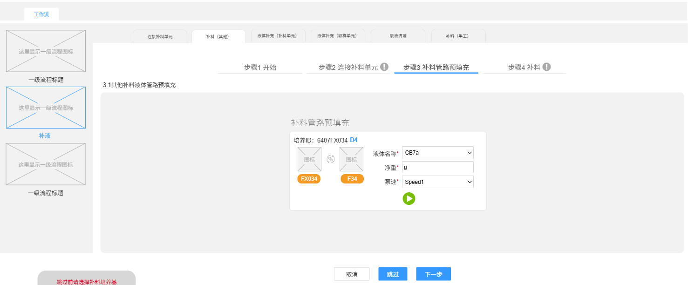

1.  **步骤描述**：同上述章节步骤描述
2.  相关信息
    1.  培养信息
        1.  培养ID
        2.  当前阶段
        3.  控制器编号及其对应台式反应器图标
        4.  补料单元编号及图标
    2.  补料泵信息
    3.  **液体名称**：下拉单选，必选，数据来源于补液培养基
    4.  **净重**：净重：文本框，限制为正整数，最大不超过100，单位g
    5.  **泵速**：下拉单选，必选，列表为Speed1-10
    6.  开始/停止按钮
        1.  点击开始则下发泵速和净重信息给设备开始预填充；点击结束则下发停泵指令。
        2.  需要详细记录每次预填充的操作人、操作时间（包括开始和结束时间）、页面上展示的相关信息、净重、泵速
3.  操作
    1.  **取消**：同上述章节取消操作
    2.  **跳过**：跳过是指可以不进行预填充，但也必须选择一个液体。跳过后进入步骤4。
    3.  下一步
        1.  点击进入步骤4
        2.  需要详细记录每次预填充的操作人、操作时间（包括开始和结束时间）、页面上展示的相关信息、净重、泵速

##### 步骤4－补料（3.1）（3.2）

> **[图 image517.png | 章节：工作流（3.2） / 补料（其他）-小试（3.1） | 上下文：步骤4－补料（3.1）（3.2）]**
> **OCR 文本：**
> 药明生物SMP系统 | 首页 | A实验室工作台 | B实验室工作台 | 数据管理 | 系统设置
> 工作流
> 连按补科单元 | 补科 (其他) | 激体补充(补科单元) | 凌体补充(取样单元) | 废液清理 | 补科 (于工)
> 这里显示一级流程图标
> 步骤1开始 | 步骤2连接补料单元0 | 步骤3补料管路预填充 | 步骤4补料0
> 一级流程标题
> 4.1编辑补科信息，开始补料4.2补料完成拆除补料单元管路与液桶
> 这里显示一级流程图标
> 补液 | 培养ID:6407FX034 D4
> 液体名称* | CB7a
> 图标 | 图标
> 这里显示一级流程图标
> FX034 | F34 | 泵速* | Speed1
> 一级流程标题
> 取消 | 完成

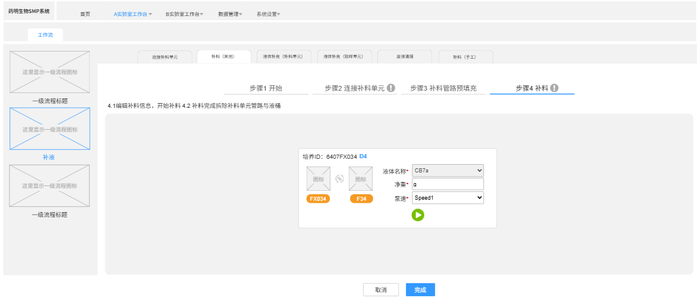

1.  **步骤描述**：同上述章节步骤描述
2.  相关信息
    1.  培养信息
        1.  培养ID
        2.  当前阶段
        3.  控制器编号及其对应台式反应器图标
        4.  补料单元编号及图标
    2.  补料泵信息
        1.  **液体名称**：从步骤3填写的液体名称带过来，不可修改
        2.  **净重**：补料重量，文本框，限制为正整数，单位g
        3.  **泵速**：下拉单选，必选，列表为Speed1-10
3.  操作
    1.  取消
        1.  如果已经在步骤4进行了补料，则不可点击取消，提示信息

            > **[图 image518.png | 章节：工作流（3.2） / 补料（其他）-小试（3.1） | 上下文：如果已经在步骤4进行了补料，则不可点击取消，提示信息]**
            > **OCR 文本：**
            > 您已经进行了补料操作，流程不可取
            > 消，请点击完成退出流程

            

        2.  如果没有执行任何补料，则弹窗二次确认后取消，不保存任何信息

            > **[图 image519.png | 章节：工作流（3.2） / 补料（其他）-小试（3.1） | 上下文：如果没有执行任何补料，则弹窗二次确认后取消，不保存任何信息]**
            > **OCR 文本：**
            > 确定要取消吗？
            > 取消后信息不保存，下次需要重新从步
            > 骤一开始操作
            > 取消 | 确定

            

    2.  完成
        1.  点击完成步骤4－补料，同时表示补料（其他）这个二级流程也已完成

            > **[图 image520.png | 章节：工作流（3.2） / 补料（其他）-小试（3.1） | 上下文：点击完成步骤4－补料，同时表示补料（其他）这个二级流程也已完成]**
            > **OCR 文本：**
            > 操作成功！
            > 补料已完成
            > 关闭

            

        2.  需要详细记录每次补料的操作人、操作时间（包括开始和结束时间）、页面上展示的相关信息、净重、泵速
        3.  补料完成后需和补料任务一样计算并记录完整的信息，包括：补料时间、培养ID、设备编码、泵名称、料液名称、补料量、补料前后的罐重、补料前后的糖量和糖浓度

#### 补料（手工）-小试（3.1）

补料（手工）工作流主要是用来记录用户手工进行补料的数据，也就是用户通过其他方式对反应器进行了补料，为了保证系统数据完整性，通过此流程单纯进行数据记录。

补料（手工）包括开始、手工补料共计两个步骤

-   注意
    1.  这个工作流不驱动任何设备也不实际对反应器进行任何操作
    2.  这里记录的数据需要更新反应器的重量，并根据补液规则设置，如果用户选择补料后要重新计算残糖的话，则需要本次补料液的重量和糖浓度重新计算当前罐子的残糖

##### 步骤1－开始（3.1）

> **[图 image521.png | 章节：工作流（3.2） / 补料（手工）-小试（3.1） | 上下文：步骤1－开始（3.1）]**
> **OCR 文本：**
> 药明生物SMP系统 | 首页 | A实验室工作台 | B实验室工作台 | 数据管理 | 系统设置
> 工作流
> 连接补科单元 | 补科 (其他) | 液体补充(取样单元) | 液体补充(补料单元) | 度液消理 | 补料 (手工)
> 这里显示一级流程图标
> 步骤1开始 | 步骤2手工补料
> 一级流程标题
> 1.1选择补料罐体 | 布局： | 所有 | ROW1 | ROW2 | ROW3 | 其他条件： | 所有 | 与我相关
> 这里显示一级流程图标
> 培养ID： | 6407FX033 D4 | FX033 | 培养ID：6407FX034 D4 | FX034 | 培养ID：6407FX035D4 | FX035
> 补液 | PH:未知 | PH:未知 | PH:未知
> 图标 | 温度：未知 | 图标 | 温度：未知 | 图标 | 温度：未知
> 容量：1598.7 | 容量：1598.7 | 容量：1598.7
> VCD: 14.900 (E06) | VCD: 14.900 (E06) | VCD: 14.900 (E06)
> 这里显示一级流程图标
> 一级流程标题
> 取消 | 完成

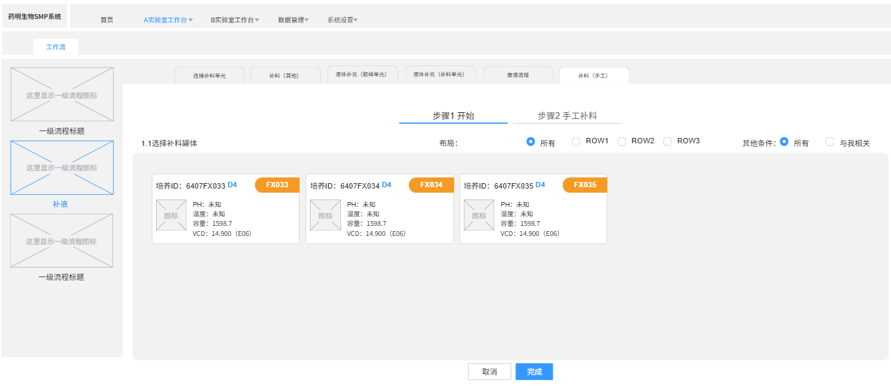

1.  **步骤描述**：同上述章节步骤描述
2.  筛选条件

    以下条件联合查询：

    1.  **Row**：展示同实验室的多个Row供选择（数据来源为控制器的对应的库表），也可选择“所有”表示显示所有房间的控制器
    2.  其他条件

        同上述章节其他条件

3.  控制器卡片

    针对查询出符合条件的控制器，以每个控制器对应一个卡片的形式展示并支持选中（支持多选）开启操作

    1.  展示信息
        1.  培养ID
        2.  当前阶段
        3.  控制器编号
        4.  **图标**：显示当前控制器连接的台式反应器的图标
        5.  在线指标名称及其数值
    2.  选中进行下一步操作
        1.  支持选中多个控制器同时操作，但不允许一次操作超过10个控制器，否则提示信息

            > **[图 image496.png | 章节：工作流（3.2） / 补料（手工）-小试（3.1） | 上下文：支持选中多个控制器同时操作，但不允许一次操作超过10个控制器，否则提示信息]**
            > **OCR 文本：**
            > 最多一次操作10个反应器哦

            

        2.  选中后，点击“下一步”按钮，进入步骤2

##### 步骤2-手工补料（3.1）（3.2）

> **[图 image522.png | 章节：工作流（3.2） / 补料（手工）-小试（3.1） | 上下文：步骤2-手工补料（3.1）（3.2）]**
> **OCR 文本：**
> 药明生物SMP系统 | 首页 | A实验室工作台 | B实验室工作台 | 数据管理 | 系统设置
> 工作流
> 连接补科单元 | 补科 (其他) | 液体补充(取样单元） | 液体补充(补料单元) | 废液清理 | 补料 (手工)
> 这里显示一级流程图标
> 步骤1开始 | 步骤2手工补料
> 一级流程标题 | 2.1完成手工补料操作
> 这里显示一级流程图标
> 培养ID：6407FX033D4 | FX033 | 培养ID：6407FX035D4 | FX034 | 培养ID：6407FX035D4 | FX035
> 补液 | pH:未知 | pH:未知 | pH:未知
> 图标 | 温度：未知 | 图标 | 温度：未知 | 图标 | 温度：未知
> OzFlow Rate: 2.2L/min | OzFlow Rate: 2.2L/min | O:Flow Rate: 2.2L/min
> 容量：2000.0g | 容量：2000.0g | 容量：2000.0g
> 这里显示一级流程图标 | VCD: 9.500 (E06) | VCD: 9.500 (E06) | VCD: 9.500 (E06)
> Lac: 0.134g/L | Lac: 0.134g/L | Lac: 0.134g/L
> 一级流程标题 | 液体名称* | CB7a | 液体名称* | CB7b | 液体名称* | CB7a
> 补料体积* | 40 | 补料体积* | 1000 | 补料体积*
> 取消 | 完成

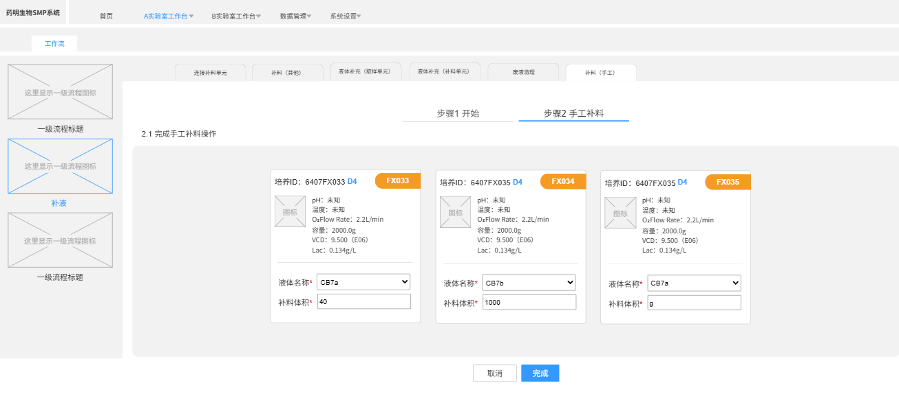

1.  **步骤描述**：同上述章节步骤描述
2.  相关信息

    针对步骤1选中的控制器，以每个控制器对应一个卡片的形式展示并支持选中（支持多选）开启操作

    1.  展示信息
        1.  培养ID
        2.  当前阶段
        3.  控制器编号
        4.  **图标**：显示当前控制器连接的台式反应器的图标
        5.  在线指标名称及其数值
    2.  补料信息
        1.  **液体名称**：下拉单选，必选，数值为泵的连接方案里对应泵的补液培养基，不可修改
        2.  **补料体积**：文本框，限制正整数，单位g
3.  操作
    1.  取消
        1.  点击取消，弹窗二次确认后取消，不保存任何信息

            > **[图 image519.png | 章节：工作流（3.2） / 补料（手工）-小试（3.1） | 上下文：点击取消，弹窗二次确认后取消，不保存任何信息]**
            > **OCR 文本：**
            > 确定要取消吗？
            > 取消后信息不保存，下次需要重新从步
            > 骤一开始操作
            > 取消 | 确定

            

    2.  完成
        1.  点击完成步骤2－手工补料，同时表示补料（手工）这个二级流程也已完成

            > **[图 image520.png | 章节：工作流（3.2） / 补料（手工）-小试（3.1） | 上下文：点击完成步骤2－手工补料，同时表示补料（手工）这个二级流程也已完成]**
            > **OCR 文本：**
            > 操作成功！
            > 补料已完成
            > 关闭

            

        2.  需要详细记录每次补料的操作人、操作时间（包括开始和结束时间）、页面上展示的相关信息
        3.  补料完成后需和补料任务一样计算并记录完整的信息，包括：补料时间、培养ID、设备编码、泵名称、料液名称、补料量、补料前后的罐重、补料前后的糖量和糖浓度

#### 液体补充（取样单元）-小试（3.1）

液体补充（取样单元）工作流用来记录手工更换取样单元的除废液瓶之外（水和酒精）两个瓶子的结果，更换之后，需要重新记录液瓶的液体重量。每次更换，液瓶的现重量都默认被重置为满瓶，即液瓶容量。

液体补充（取样单元）包含开始、更换液瓶共计两个步骤。

##### 步骤1－开始（3.1）

> **[图 image523.png | 章节：工作流（3.2） / 液体补充（取样单元）-小试（3.1） | 上下文：步骤1－开始（3.1）]**
> **OCR 文本：**
> 药明生物SMP系统 | A实验室工作台 | B实验室工作台 | 数据管理+ | 系统设置
> 工作流
> 连接补料单元 | 补料 (其他) | 凌体补充(补料单元) | 液体补亮(职样单元） | 腹液清理 | 补料 (手工)
> 这里显示一级流程图标
> 步粟1开始 | 步骤2更换液瓶
> 一级流程标题 | 1.1选择取样单元1.2选择更换的液瓶 | 布局： | 所有 | ROW1 | ROW2 | ROW3 | 其他条件： | 所有 | 方案已设 | 与我相关
> 这里显示一级流程图标
> 533 | $34 | $35
> 补液 | $33.1 | $33.2 | $34.1 | $34.2 | $35.1 | $35.2
> 1000ML Bucket | 1000ML Bucket | 1000ML Bucket | 1000ML Bucket | 1000ML Bucket | 1000ML Bucket
> 这里显示一级流程图标 | Water | 75% Ethyl alcohol | Water | 75% Ethyl alcohol | Water | 75% Ethyl alcohol
> 一级流程标题
> 1000/1000g | 991/1000g | 1000/1000g | 991/1000g | 1000/1000g | 991/1000g
> 100% | 99.1% | 100% | 99.1% | 100% | 99.1%
> 达择

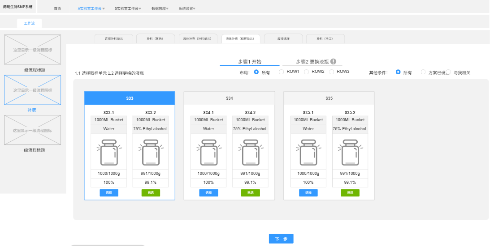

1.  **步骤描述**：同上述章节步骤描述
2.  筛选条件

    以下条件联合查询：

    1.  **Row**：展示同实验室的多个Row供选择（数据来源为控制器的对应的库表），也可选择“所有”表示显示所有房间的控制器对应的取样单元
    2.  其他条件

        同上述章节其他条件

3.  取样单元卡片

    针对查询出符合条件的控制器对应的取样单元，以每个取样单元对应一个卡片的形式展示并支持选中（支持多选）开启操作

    1.  展示信息
        1.  取样单元编号
        2.  取样单元通道编号
        3.  液瓶名称（同液瓶配置取样单元的卡片）
        4.  液体类型（同液瓶配置取样单元的卡片）
        5.  液瓶类型的图标
        6.  **液瓶当前的液体量**：直接读取数据库即可，药明底层PLC程序会将最新数据写入数据库。
        7.  液瓶容量
        8.  液瓶当前的液体量占液瓶容量占比
    2.  选中下一步操作
        1.  支持同一取样单元的不同通道分开独立选择
        2.  支持批量多选，支持选中不同取样单元的多个通道
        3.  不允许一次选中超过10个通道，否则，提示信息

            > **[图 image524.png | 章节：工作流（3.2） / 液体补充（取样单元）-小试（3.1） | 上下文：不允许一次选中超过10个通道，否则，提示信息]**
            > **OCR 文本：**
            > 最多一次操作10个液瓶哦

            

        4.  选中后，点击下一步进入步骤2

##### 步骤2－更换液瓶（3.1）

> **[图 image525.png | 章节：工作流（3.2） / 液体补充（取样单元）-小试（3.1） | 上下文：步骤2－更换液瓶（3.1）]**
> **OCR 文本：**
> 药明生物SMP系统 | 首页 | A实验室工作台 | B实验室工作台 | 数据管理 | 系统设置
> 工作流
> 连接补科单元 | 补料 (其他) | 液体补充(补科单元) | 液体补充(取样单元) | 废液清理 | 补料 (手工)
> 这里显示一级流程图标
> 步骤1开始 | 步骤2更换液瓶0
> 一级流程标题 | 2.1卸下原液桶2.2新鲜液桶管路连接
> 这里显示一级流程图标 | $33.2 | $33.2 | $34.2 | $34.2 | $35.2 | $35.2
> 1000ML Bucket | 1000ML Bucket | 1000ML Bucket | 1000ML Bucket | 1000ML Bucket | 1000ML Bucket
> 补液 | 75% Ethyl alcohol | 75% Ethyl alcohol | 75% Ethyl alcohol | 75% Ethyl alcohol | 75% Ethyl alcohol | 75% Ethyl alcohol
> 这里显示一级流程图标 | 原始的 | 新鲜的 | 原始的 | 新鲜的 | 原始的
> 一级流程标题 | 991/1000g | 1000/1000g | 991/1000g | 1000/1000g | 991/1000g | 1000/1000g
> 99.1% | 100% | 99.1% | 100% | 99.1% | 100%
> 取消 | 完成

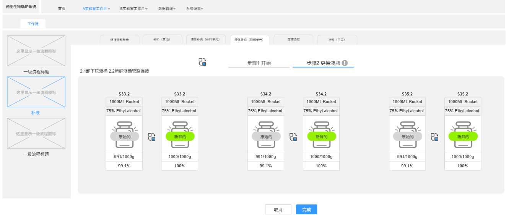

1.  **步骤描述**：同上述章节步骤描述
2.  相关信息

    基于步骤1选中的所有通道，每个通道都展示“原始的”和“新鲜的”这两个分别表示更换前后的对比信息

    1.  **原始的**：与步骤1中的展示信息一致
        1.  取样单元编号
        2.  取样单元通道编号
        3.  液瓶名称（同液瓶配置取样单元的卡片）
        4.  液体类型（同液瓶配置取样单元的卡片）
        5.  液瓶类型的图标
        6.  **液瓶当前的液体量**：直接读取数据库即可，药明底层PLC程序会将最新数据写入数据库。
        7.  液瓶容量
        8.  液瓶当前的液体量占液瓶总容量占比
    2.  新鲜的
        1.  取样单元编号
        2.  取样单元通道编号
        3.  液瓶名称（同液瓶配置取样单元的卡片）
        4.  液体类型（同液瓶配置取样单元的卡片）
        5.  液瓶类型的图标
        6.  **液瓶当前的液体量**：更换后的当前液体量默认等于液瓶总容量
        7.  液瓶容量
        8.  **液瓶当前的液体量占液瓶总容量占比**：即100%
3.  操作
    1.  取消

        点击取消，弹窗二次确认后取消，不保存任何信息

        > **[图 image519.png | 章节：工作流（3.2） / 液体补充（取样单元）-小试（3.1） | 上下文：点击取消，弹窗二次确认后取消，不保存任何信息]**
        > **OCR 文本：**
        > 确定要取消吗？
        > 取消后信息不保存，下次需要重新从步
        > 骤一开始操作
        > 取消 | 确定

        

    2.  完成
        1.  点击完成步骤2－更换液瓶，同时表示液体补充（取样单元）这个二级流程也已完成

            > **[图 image526.png | 章节：工作流（3.2） / 液体补充（取样单元）-小试（3.1） | 上下文：点击完成步骤2－更换液瓶，同时表示液体补充（取样单元）这个二级流程也已完成]**
            > **OCR 文本：**
            > 操作成功！
            > 液瓶信息已更新
            > 关闭

            

        2.  需要详细记录每次更换的操作人、操作时间（包括开始和结束时间）、培养ID、控制器编号以及页面上展示的更换后的相关信息
        3.  完成后，需要更新液瓶设置模块的相关信息

#### 液体补充（补料单元）-小试（3.1）

液体补充（补料单元）工作流用来记录手工更换补料单元液瓶的结果，更换之后，需要重新记录液瓶的液体重量即需要更新补料液体的初始重量。

液体补充（补料单元）包含开始、更换液瓶、补料管路预填充共计三个步骤。

##### 步骤1－开始（3.1）

> **[图 image527.png | 章节：工作流（3.2） / 液体补充（补料单元）-小试（3.1） | 上下文：步骤1－开始（3.1）]**
> **OCR 文本：**
> 药明生物SMP系统 | 首页 | A实验室工作台 | B实验室工作台 | 数据管理 | 系统设置
> 工作流
> 废衣清理 | 禁科 (手工)
> 这里显示一级流程图标
> 步骤1开始 | 步骤2更换液瓶0 | 步骤3补料管路预填充
> 一级流程标题 | 1.1选择补料单元1.2选择更换的液瓶 | 布局： | 所有 | ROW1 | ROW2 | O ROW3 | 其他条件： | ○所有 | O方案已设○与我相关
> 这里显示一级流程图标
> F33 | F34
> 补液
> F33.1 | F33.2 | F33.3 | F33.4 | F34.1 | F34.2 | F34.3 | F34.4
> 这里显示一级流程图标 | 2000mL Bucket | 2000mL Bucket | 2000mL Bucket  | 200mL Bucket  | 2000mL Bucket  | 2000mL Bucket  | 2000mL Bucket  | 2000mL Bucket
> Na2C03 | FM020a | FM020b | Glucose | Na2C03 | FM020a | FM020b | Glucose
> 一级流程标题
> 2000/2000g | 100/2000g | 1970.8/2000g | 200/2000g | 2000/2000g | 100/2000g | 1970.8/2000g | 200/2000g
> 100% | 5% | 99% | 10% | 100% | 5% | 99% | 10%
> F35
> F35.1 | F35.2 | F35.3 | F35.4
> 2000mL Bucket | 2000mL Bucket | 2000mL Bucket  | 2000mL Bucket v
> Na2C03 | FM020a | FM020b | Glucose
> 2000/2000g | 100/2000g | 1970.8/2000g | 200/2000g
> 100% | 5% | 99% | 10%
> 下一步

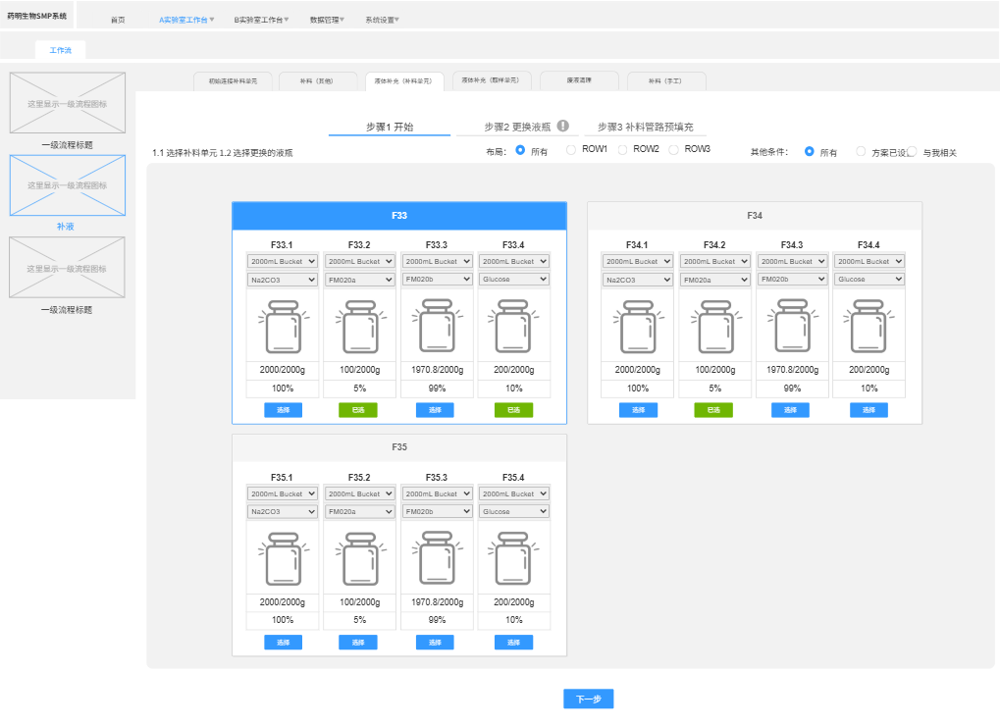

1.  **步骤描述**：同上述章节步骤描述
2.  筛选条件

    以下条件联合查询：

    1.  **Row**：展示同实验室的多个Row供选择（数据来源为控制器的对应的库表），也可选择“所有”表示显示所有房间的控制器对应的补料单元
    2.  其他条件

        同上述章节其他条件

3.  补料单元卡片

    针对查询出符合条件的控制器对应的补料单元，以每个补料单元对应一个卡片的形式展示并支持选中（支持多选）开启操作

    1.  展示信息
        1.  补料单元编号
        2.  补料单元通道编号
        3.  液瓶名称（同液瓶配置补料单元的卡片）
        4.  液体类型（同液瓶配置补料单元的卡片）
        5.  液瓶类型的图标
        6.  **液瓶当前的液体量**：直接读取数据库即可，药明底层PLC程序会将最新数据写入数据库。
        7.  液瓶容量
        8.  液瓶当前的液体量占液瓶容量占比
    2.  选中下一步操作
        1.  支持同一补料单元的不同通道分开独立选择
        2.  支持批量多选，支持选中不同补料单元的多个通道
        3.  不允许一次选中超过10个通道，否则，提示信息

            > **[图 image524.png | 章节：工作流（3.2） / 液体补充（补料单元）-小试（3.1） | 上下文：不允许一次选中超过10个通道，否则，提示信息]**
            > **OCR 文本：**
            > 最多一次操作10个液瓶哦

            

        4.  选中后，点击下一步进入步骤2

##### 步骤2－更换液瓶（3.1）

> **[图 image528.png | 章节：工作流（3.2） / 液体补充（补料单元）-小试（3.1） | 上下文：步骤2－更换液瓶（3.1）]**
> **OCR 文本：**
> 药明生物SMP系统 | 首页 | A实验室工作台 | B实验室工作 | 数据管理 | 系统设置
> 工作潢
> (工)
> 这里显示一级流程图标
> 步骤1开始 | 步骤2更换液瓶0 | 梦骤3补料管路预填充
> 一级流程标题
> 2.1卸下原液桶2.2新鲜液橘管路连接
> 这里显示一级流程图标
> F33.2 | F33.2 | F33.4 | F33.4 | F34.2 | F34.2
> 2000mL Bucket | 2000mL Bucket | 2000mL Bucket | 2000mL Bucket | 2000mL Bucket | 2000mL Bucket
> FM020a | FM020a | Glucose | Glucose | FM020a | FM020a
> 这里显示一级流程图标
> 一级流程标题 | 原始的 | 新鲜的 | 原始的 | 原始的
> 100/2000g | /2000g | 100/2000g | /2000g | 100/2000g | /2000g
> 5% | 5% | 5%
> 下一步

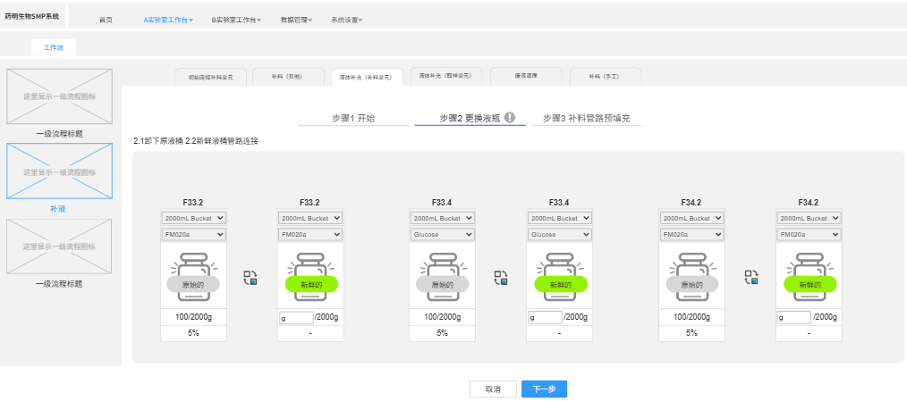

1.  **步骤描述**：同上述章节步骤描述
2.  相关信息

    基于步骤1选中的所有通道，每个通道都展示“原始的”和“新鲜的”这两个分别表示更换前后的对比信息

    1.  **原始的**：与步骤1中的展示信息一致
        1.  补料单元编号
        2.  补料单元通道编号
        3.  液瓶名称（同液瓶配置补料单元的卡片）
        4.  补料类型（同液瓶配置补料单元的卡片）
        5.  液瓶类型的图标
        6.  **液瓶当前的液体量**：直接读取数据库即可，药明底层PLC程序会将最新数据写入数据库。
        7.  液瓶容量
        8.  液瓶当前的液体量占液瓶总容量占比
    2.  新鲜的
        1.  补料单元编号
        2.  补料单元通道编号
        3.  液瓶名称（同液瓶配置补料单元的卡片）
        4.  补料类型（同液瓶配置补料单元的卡片）
        5.  液瓶类型的图标
        6.  **液瓶当前的液体量**：更换后的补料液体的重量。文本框，必填，限制正整数，单位g，必须小于等于液瓶容量
        7.  液瓶容量
        8.  **液瓶当前的液体量占液瓶总容量占比**：即100%
3.  操作
    1.  取消

        点击取消，弹窗二次确认后取消，不保存任何信息

        > **[图 image519.png | 章节：工作流（3.2） / 液体补充（补料单元）-小试（3.1） | 上下文：点击取消，弹窗二次确认后取消，不保存任何信息]**
        > **OCR 文本：**
        > 确定要取消吗？
        > 取消后信息不保存，下次需要重新从步
        > 骤一开始操作
        > 取消 | 确定

        

    2.  下一步
        1.  点击完成步骤2－更换液瓶，进入步骤3
        2.  需要详细记录每次更换的操作人、操作时间（包括开始和结束时间）、培养ID、控制器编号、补料单元通道编号以及页面上展示的更换后的相关信息

##### 补料管路预填充（3.1）

> **[图 image529.png | 章节：工作流（3.2） / 液体补充（补料单元）-小试（3.1） | 上下文：补料管路预填充（3.1）]**
> **OCR 文本：**
> 药明生物SMP系统 | 首页 | A实验室工作台 | B实验室工作台 | 数据管理 | 系统设置
> 工作流
> 初始连接补科单元 | 补料 (其他) | 激体补充(补科单元) | 激体补充(取群单元） | 皮激清理 | 补科 (于工)
> 这里显示一级流程图标
> 步骤1开始 | 步骤2更换液瓶 | 步骤3补料管路预填充
> 一级流程标题
> 3.1管路预填充
> 这里显示一级流程图标
> 补料管路预填充
> 补液 | FX033 | 培养ID：6407FX033D1规格：20L重量：15007g
> F33.2 (FM020a) 2000/2000g | 泵速 | Speed1:1g/min | g/min | 开始时间/结束时间
> 这里显示一级流程图标
> F33.4 (Glucose) 2000/2000g | 泵速 | 选择Speed | g/min | 10:09:12/结束时间
> 一级流程标题
> FX034 | 培养ID：6407FX034D1规格：20L重量：19383g
> PUMP4 (FM020a) 2000/2000g | 50 | 泵速 | 选择Speed | g/min | 10:09:12/10:09:30
> 完成 | 跳过井完成

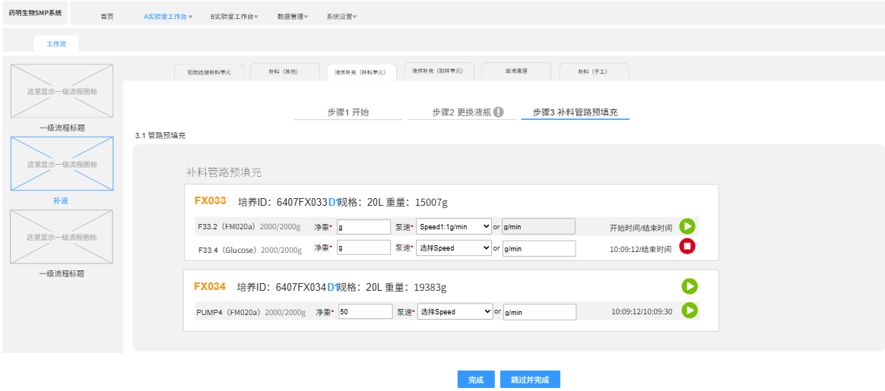

1.  **步骤描述**：同上述章节步骤描述
2.  相关信息

    根据步骤2中的补料单元通道，按照控制器分类，每个通道一行展示相关信息

    1.  培养信息
        1.  控制器编号
        2.  培养ID
        3.  当前阶段
        4.  规格
        5.  **重量**：获取当前反应器重量
    2.  补料单元信息
        1.  补料单元通道编码
        2.  补料类型
        3.  步骤2更换后的液瓶当前重量/液瓶容量
        4.  **净重**：净重：文本框，限制为正整数，最大不超过100，单位g
        5.  **泵速**：选择Speed1-10或输入固定泵速，二选一。输入固定泵速时，限制为正整数，最大不能超过当前泵的最大量程
        6.  开始/停止按钮
            1.  点击开始则下发泵速和净重信息给设备开始预填充；点击结束则下发停泵指令。
            2.  只能同时给一个泵进行预填充，只有当一个泵完成才能让另一个泵开始。
            3.  需要详细记录每次预填充的操作人、操作时间（包括开始和结束时间）、页面上展示的相关信息、净重、泵速
        7.  开始/停止时间
3.  操作
    1.  **取消**：同上述章节取消操作
    2.  完成：
        1.  **有预填充操作**：点击完成提示当前步骤已完成，也意味着液体补充（补料单元）这个二级流程同时完成

            > **[图 image530.png | 章节：工作流（3.2） / 液体补充（补料单元）-小试（3.1） | 上下文：有预填充操作：点击完成提示当前步骤已完成，也意味着液体补充（补料单元）这个二级流程同时完成]**
            > **OCR 文本：**
            > 操作成功！
            > 液瓶信总已更新
            > 关闭

            

        2.  无任何预填充操作：
            1.  点击完成时，若没有进行过任何预填充操作，则弹窗提示是否需要跳过本步骤并完成

                > **[图 image502.png | 章节：工作流（3.2） / 液体补充（补料单元）-小试（3.1） | 上下文：点击完成时，若没有进行过任何预填充操作，则弹窗提示是否需要跳过本步骤并完成]**
                > **OCR 文本：**
                > 确定要跳过预填充操作吗
                > 跳过本步骤不影响工作流的完成
                > 取消 | 确定

                

            2.  若二次确认则提示当前步骤已完成，也意味着液体补充（补料单元）这个二级流程同时完成

                > **[图 image530.png | 章节：工作流（3.2） / 液体补充（补料单元）-小试（3.1） | 上下文：若二次确认则提示当前步骤已完成，也意味着液体补充（补料单元）这个二级流程同时完成]**
                > **OCR 文本：**
                > 操作成功！
                > 液瓶信总已更新
                > 关闭

                

    3.  跳过并完成
        1.  点击后，弹窗提示是否需要跳过本步骤并完成

            > **[图 image502.png | 章节：工作流（3.2） / 液体补充（补料单元）-小试（3.1） | 上下文：点击后，弹窗提示是否需要跳过本步骤并完成]**
            > **OCR 文本：**
            > 确定要跳过预填充操作吗
            > 跳过本步骤不影响工作流的完成
            > 取消 | 确定

            

        2.  若二次确认则提示当前步骤已完成，也意味着液体补充（补料单元）这个二级流程同时完成

            > **[图 image530.png | 章节：工作流（3.2） / 液体补充（补料单元）-小试（3.1） | 上下文：若二次确认则提示当前步骤已完成，也意味着液体补充（补料单元）这个二级流程同时完成]**
            > **OCR 文本：**
            > 操作成功！
            > 液瓶信总已更新
            > 关闭

            

#### 废液清理-小试（3.1）

废液清理工作流用来记录手工更换取样单元－废液瓶的工作，废液瓶为用户在线下手工更换，此工作流用来记录这一个工作日志的过程。更换之后，需要重新记录液瓶的现液体重量。每次更换，废液瓶的现重量都默认被重置为0。

废液清理包括开始、更换液瓶共计两个步骤

##### 步骤1－开始（3.1）

> **[图 image531.png | 章节：工作流（3.2） / 废液清理-小试（3.1） | 上下文：步骤1－开始（3.1）]**
> **OCR 文本：**
> 药明生物SMP系统 | 首页 | A实验室工作台 | B实验室工作台 | 数据管理 | 系统设置
> 工作流
> 连接补科单元 | 补料 (其他) | 液体补充(取样单元） | 液体补充(补料单元) | 废液清理 | 补料 (于工)
> 这里显示一级流程图标
> 步骤1开始 | 步骤2更换液瓶0
> 一级流程标题
> 1.1选择取样单元1.2选择废液瓶 | 布局： | 所有 | ROW1 | ROW2 | ROW3 | 其他条件： | 所有 | 与我相关
> 这里显示一级流程图标
> $34 | $35
> 补液
> $33.3 | $34.3 | $35.3
> 1000ML Bucket | 1000ML Bucket | 1000ML Bucket
> 这里显示一级流程图标 | Waste | Waste | Waste
> 一级流程标题
> 0/1000g | 990/1000g | 1000/1000g
> 0% | %66 | 100%
> 选择 | 已选

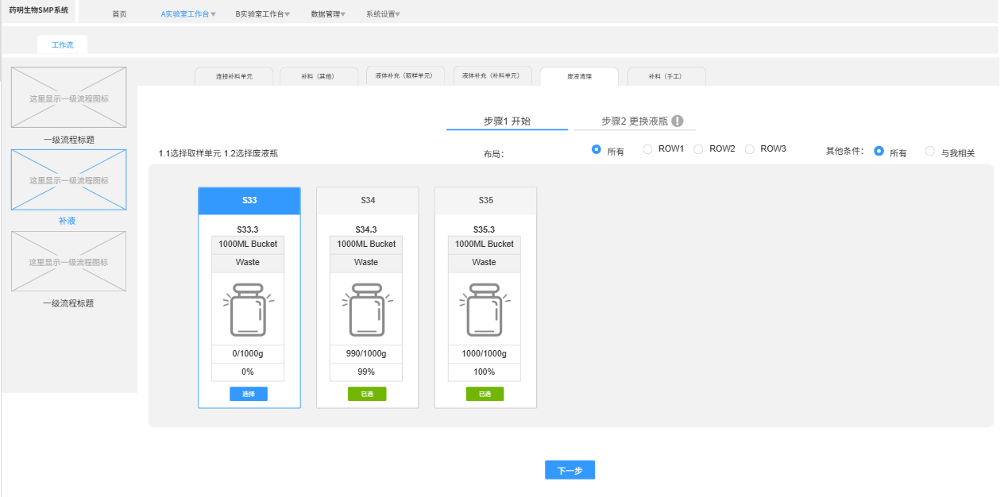

1.  **步骤描述**：同上述章节步骤描述
2.  筛选条件

    以下条件联合查询：

    1.  **Row**：展示同实验室的多个Row供选择（数据来源为控制器的对应的库表），也可选择“所有”表示显示所有房间的控制器对应的取样单元的废液瓶
    2.  其他条件

        同上述章节其他条件

3.  取样单元卡片

    针对查询出符合条件的控制器对应的取样单元，以每个取样单元－废液瓶对应一个卡片的形式展示并支持选中（支持多选）开启操作

    1.  展示信息
        1.  取样单元编号
        2.  取样单元通道编号
        3.  液瓶名称（同液瓶配置取样单元的卡片）
        4.  液体类型（同液瓶配置取样单元的卡片）
        5.  液瓶类型的图标
        6.  **液瓶当前的液体量**：直接读取数据库即可，药明底层PLC程序会将最新数据写入数据库。
        7.  液瓶容量
        8.  液瓶当前的液体量占液瓶容量占比
    2.  选中下一步操作
        1.  支持批量多选
        2.  不允许一次选中超过10个通道，否则，提示信息

            > **[图 image524.png | 章节：工作流（3.2） / 废液清理-小试（3.1） | 上下文：不允许一次选中超过10个通道，否则，提示信息]**
            > **OCR 文本：**
            > 最多一次操作10个液瓶哦

            

        3.  选中后，点击下一步进入步骤2

##### 步骤2－更换液瓶（3.1）

> **[图 image532.png | 章节：工作流（3.2） / 废液清理-小试（3.1） | 上下文：步骤2－更换液瓶（3.1）]**
> **OCR 文本：**
> 药明生物SMP系统 | 首页 | A实验室工作台 | B实验室工作台 | 数据管理 | 系统设置
> 工作流
> 连接补料单元 | 补料 (其他) | 液体补充(取样单元) | 液体补充（(补科单元） | 度液清理 | 补料 (手工)
> 这里显示一级流程图标
> 步骤1开始 | 步骤2更换液瓶
> 一级流程标题 | 2.1卸下原液桶2.2新鲜液桶管路连接
> 这里显示一级流程图标
> $34.3 | $34.3 | $35.3 | $35.3
> 1000ML Bucket | 1000ML Bucket | 1000ML Bucket | 1000ML Bucket
> 补液 | Waste | Waste | Waste | Waste
> 这里显示一级流程图标
> 原始的 | 新鲜的 | 原始的 | 新鲜的
> 一级流程标题
> 991/1000g | 0/1000g | 991/1000g | 0/1000g
> 99.1% | 0% | 99.1% | 0%
> 取消 | 完成

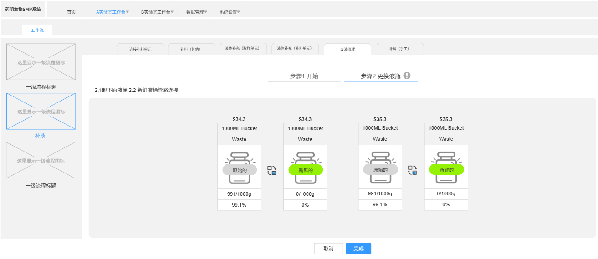

1.  **步骤描述**：同上述章节步骤描述
2.  相关信息

    基于步骤1选中的所有取样单元－废液瓶，每个都展示“原始的”和“新鲜的”这两个分别表示更换前后的对比信息

    1.  **原始的**：与步骤1中的展示信息一致
        1.  取样单元编号
        2.  取样单元通道编号
        3.  液瓶名称（同液瓶配置取样单元的卡片）
        4.  液体类型（同液瓶配置取样单元的卡片）
        5.  液瓶类型的图标
        6.  **液瓶当前的液体量**：直接读取数据库即可，药明底层PLC程序会将最新数据写入数据库。
        7.  液瓶容量
        8.  液瓶当前的液体量占液瓶总容量占比
    2.  新鲜的
        1.  取样单元编号
        2.  取样单元通道编号
        3.  液瓶名称（同液瓶配置取样单元的卡片）
        4.  液体类型（同液瓶配置取样单元的卡片）
        5.  液瓶类型的图标
        6.  **液瓶当前的液体量**：更换后的默认数值为0，不允许修改
        7.  液瓶容量
        8.  **液瓶当前的液体量占液瓶总容量占比**：即0%
3.  操作
    1.  取消

        点击取消，弹窗二次确认后取消，不保存任何信息

        > **[图 image519.png | 章节：工作流（3.2） / 废液清理-小试（3.1） | 上下文：点击取消，弹窗二次确认后取消，不保存任何信息]**
        > **OCR 文本：**
        > 确定要取消吗？
        > 取消后信息不保存，下次需要重新从步
        > 骤一开始操作
        > 取消 | 确定

        

    2.  完成
        1.  点击完成步骤2－更换液瓶，同时表示废液清理这个二级流程也已完成

            > **[图 image533.png | 章节：工作流（3.2） / 废液清理-小试（3.1） | 上下文：点击完成步骤2－更换液瓶，同时表示废液清理这个二级流程也已完成]**
            > **OCR 文本：**
            > 操作成功！
            > 废液瓶信息已更新
            > 关闭

            

        2.  需要详细记录每次更换的操作人、操作时间（包括开始和结束时间）、培养ID、控制器编号以及页面上展示的更换后的相关信息
        3.  完成后，需要更新液瓶设置模块的相关信息

            ---

### ✂️ 已剔除的删除线内容

> 以下内容在源 Word 中带有删除线（`<w:strike>`），根据约定不进入正文，统一汇总在此，避免遗漏核验。

- 段落片段：（完成开始细胞培养工作流或到达培养开始时间，条件满足其一即可）
- 段落：糖浓度
- 段落：糖浓度
- 段落：净重：文本框，限制为正整数，最大不超过100，单位g
- 段落：开始/停止按钮
- 段落：点击开始则下发泵速和净重信息给设备开始补料；点击结束则下发停泵指令。
- 段落：需要详细记录每次预填充的操作人、操作时间（包括开始和结束时间）、页面上展示的相关信息、净重、泵速
