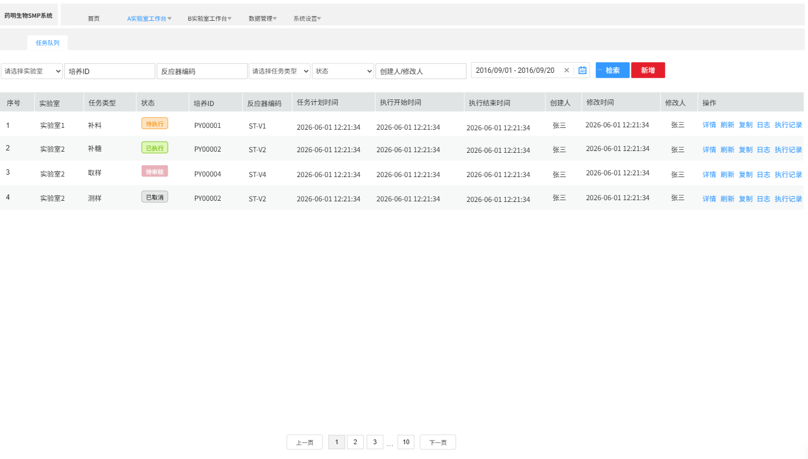
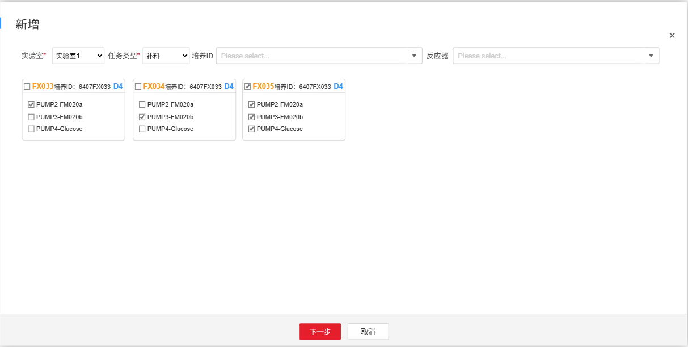
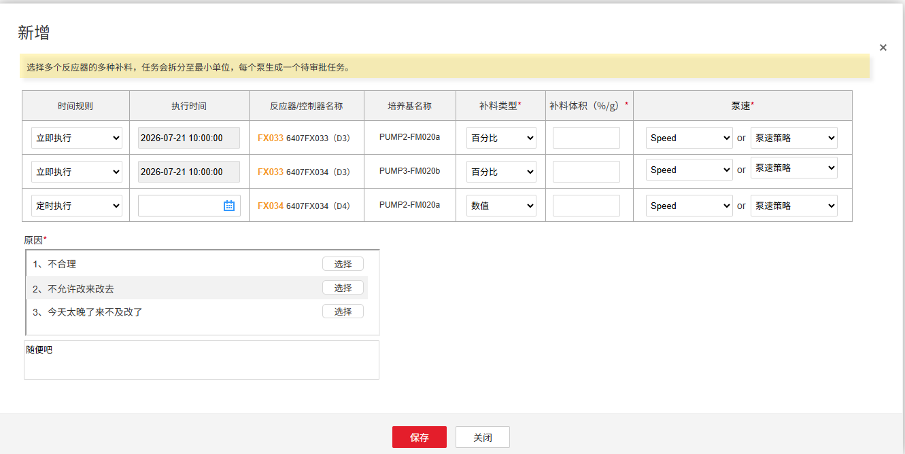

# 实验室工作台

## 任务队列（3.1）

### 任务查询及展示操作（3.1）

在此页面可查询所有任务的详情、日志和执行记录等。

此处任务列表展示、任务列表的操作与反应器详情中任务队列的任务查询及展示（3.1）完全一致，区别点是：

1.  此处可以查看到所有反应器、所有培养ID的所有任务。
2.  新增任务时，需要多一个确认反应器及培养ID的步骤，用于指定新增的任务所属的反应器及培养ID

    > **[图 image534.png | 章节：任务队列（3.1） / 任务查询及展示操作（3.1） | 上下文：新增任务时，需要多一个确认反应器及培养ID的步骤，用于指定新增的任务所属的反应器及培养ID]**
    > **OCR 文本：**
    > 药明生物SMP系统 | 首页 | A实验室工作台 | B实验室工作台 | 数据管理 | 系统设置
    > 任务队列
    > 请选择实验室 | 培养ID | 反应器编码 | 请选择任务类型 | 状态 | 创建人/修改人 | 2016/09/01-2016/09/20 | 检索 | 新增
    > 序号 | 实验室 | 任务类型 | 状态 | 培养ID | 反应器编码 | 任务计划时间 | 执行开始时间 | 执行结束时间 | 创建人 | 修改时间 | 修改人 | 操作
    > 实验室1 | 补料 | 待执行 | PY00001 | ST-V1 | 2026-06-01 12:21:34 | 2026-06-0112:21:34 | 2026-06-01 12:21:34 | 张三 | 2026-06-01 12:21:34 | 张三 | 详情刷新复制日志执行记录
    > 实验室2 | 补糖 | 已执行 | PY00002 | ST-V2 | 2026-06-01 12:21:34 | 2026-06-01 12:21:34 | 2026-06-01 12:21:34 | 张三 | 2026-06-01 12:21:34 | 张三 | 详情刷新复制日志执行记录
    > 实验室2 | 取样 | 【待审核 | PY00004 | ST-V4 | 2026-06-01 12:21:34 | 2026-06-01 12:21:34 | 2026-06-01 12:21:34 | 张三 | 2026-06-01 12:21:34 | 张三 | 详情刷新复制日志执行记录
    > 实验室2 | 测样 | 已取消 | PY00002 | ST-V2 | 2026-06-01 12:21:34 | 2026-06-01 12:21:34 | 2026-06-0112:21:34 | 张三 | 2026-06-01 12:21:34 | 张三 | 详情刷新复制日志执行记录
    > 10 | 下一页

    

3.  新增

    不同类型任务新增时需填写不同内容，具体设计见章节任务新增（3.1）。（目前只有章节补液任务－新增（3.1），其余任务新增后续补充完整）

4.  查询条件

    以下条件联合查询：

    1.  **实验室**：当前用户有授权的实验室，下拉单选，非必选
    2.  **培养ID**：文本框，支持模糊搜索
    3.  **反应器编码**：文本框，支持模糊搜索
    4.  **任务类型/状态/修改人/起止时间**：与反应器详情－任务查询及展示操作中的章节查询条件保持一致
5.  **结果展示**：与反应器详情－任务查询及展示操作中的章节结果展示保持一致
6.  **任务操作**：与反应器详情－任务查询及展示操作中的章节任务操作保持一致

### 任务新增（3.1）

#### 补液任务－新增（3.1）（3.2）

点击新增后，任务可按照以下两个步骤完成新增：

1.  选择任务类型和反应器

    > **[图 image535.png | 章节：任务队列（3.1） / 补液任务－新增（3.1）（3.2） | 上下文：选择任务类型和反应器]**
    > **OCR 文本：**
    > 新增
    > 实验室* | 实验室1 | 任务类型* | 补料 | 培养ID | Please select.. | 反应器 | Please select..
    > FX033培养ID：6407FX033D4 | FX034培养ID:6407FX033D4 | 团FX035培养ID：6407FX033D4
    > PUMP2-FM020a | PUMP2-FM020a | PUMP2-FM020a
    > PUMP3-FM020b |  PUMP3-FM020b |  PUMP3-FM020b
    > PUMP4-Glucose | PUMP4-Glucose |  PUMP4-Glucose
    > 下一步 | 取消

    

    1.  **实验室**：下拉单选，必选
    2.  **任务类型**：下拉单选，必选，下拉列表本阶段目前只有补料，后续PH校准、取样、测样的任务在相关工作流中会陆续进行补充，任务类型随着系统完善也可能随之增加
    3.  **培养ID**：下拉多选，非必选，筛选出已完成“连接补料单元”工作流且培养状态为“进行中”或“已逾期”的培养ID
    4.  **反应器**：下拉多选，非必选，筛选出已完成“连接补料单元”工作流且培养状态为“进行中”或“已逾期”的反应器（中试为集成反应器，小试为控制器）
    5.  **反应器详情展示与选择**：根据前4个查询条件查询出符合条件的反应器，
        1.  以每个反应器一个卡片的形式展示以下信息：
            1.  反应器名称
            2.  培养ID
            3.  **培养周期**：根据当前时间－培养开始时间计算得到培养周期
            4.  **泵－补液培养基信息**：在该培养的补液方案－固定泵中配置了信息的泵，用泵名称－补液培养基拼接展示
        2.  在选中的反应器和泵下才能对应创建补料任务：
            1.  支持单个反应器全选，全选即选中该反应器下所有泵
            2.  支持仅选中某个反应器的某些泵
            3.  支持选中多个反应器
2.  任务设置

    完成第1步选择任务类型和反应器后，完成每个泵具体任务的新增，与章节任务设置保持一致。

    > **[图 image536.png | 章节：任务队列（3.1） / 补液任务－新增（3.1）（3.2） | 上下文：完成第1步选择任务类型和反应器后，完成每个泵具体任务的新增，与章节任务设置保持一致。]**
    > **OCR 文本：**
    > 新增
    > 选择多个反应器的多种补料，任务会拆分至最小单位，每个泵生成一个待审批任务。
    > 时间规则 | 执行时间 | 反应器/控制器名称 | 培养基名称 | 补料类型* | 补料体积（%/g）* | 泵速*
    > 立即执行 | 2026-07-21 10:00:00 | FX033 6407FX033 (D3) | PUMP2-FM020a | 百分比 | Speed | 泵速策略
    > 立即执行 | 2026-07-21 10:00:00 | FX033 6407FX034 (D3) | PUMP3-FM020b | 百分比 | Speed | 泵速策略
    > 定时执行 | FX034 6407FX034 (D4) | PUMP2-FM020a | 数值 | Speed | 泵速策略
    > 原因*
    > 1、不合理 | 选择
    > 2、不允许改来改去 | 选择
    > 3、今天太晚了来不及改了 | 选择
    > 随便吧
    > 保存 | 关闭

    
