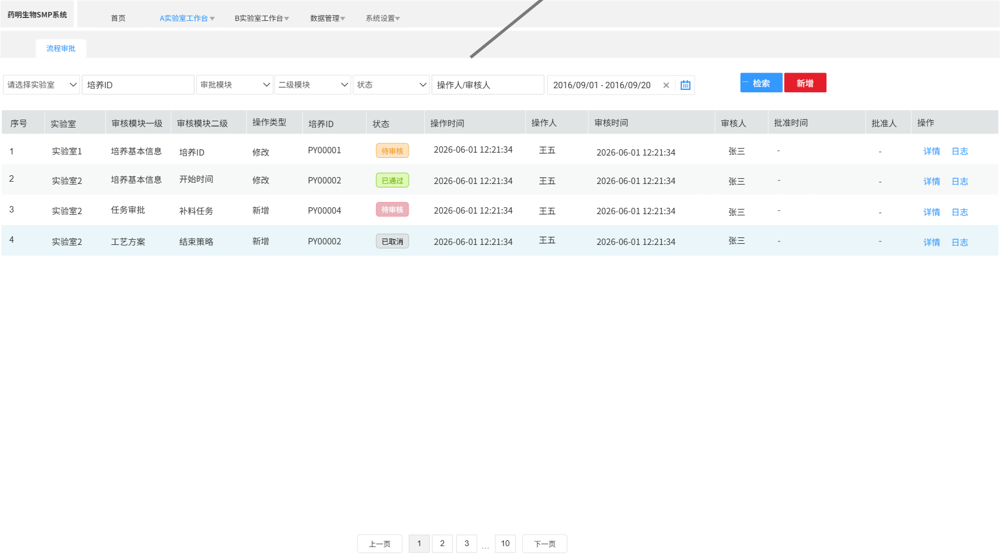
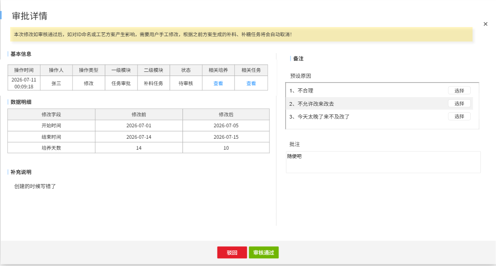
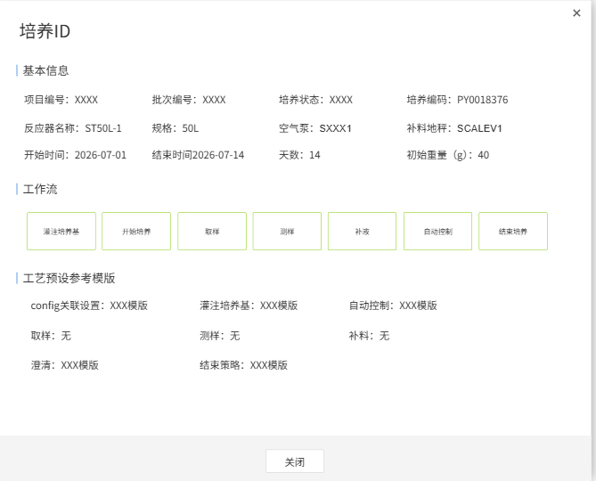
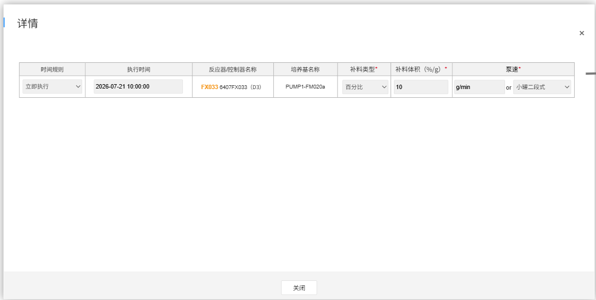
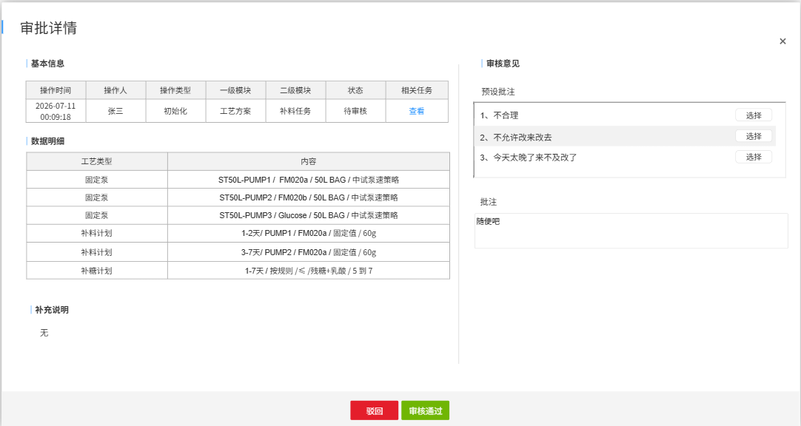
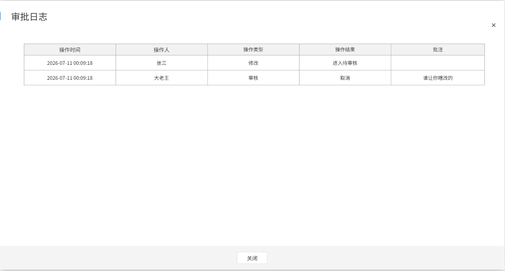
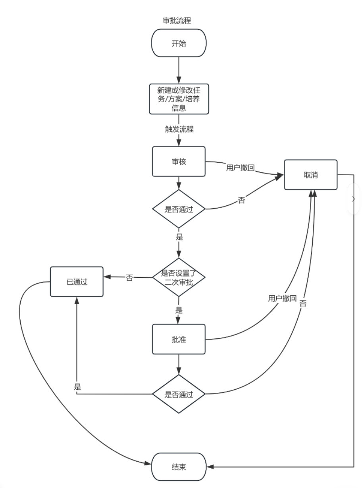
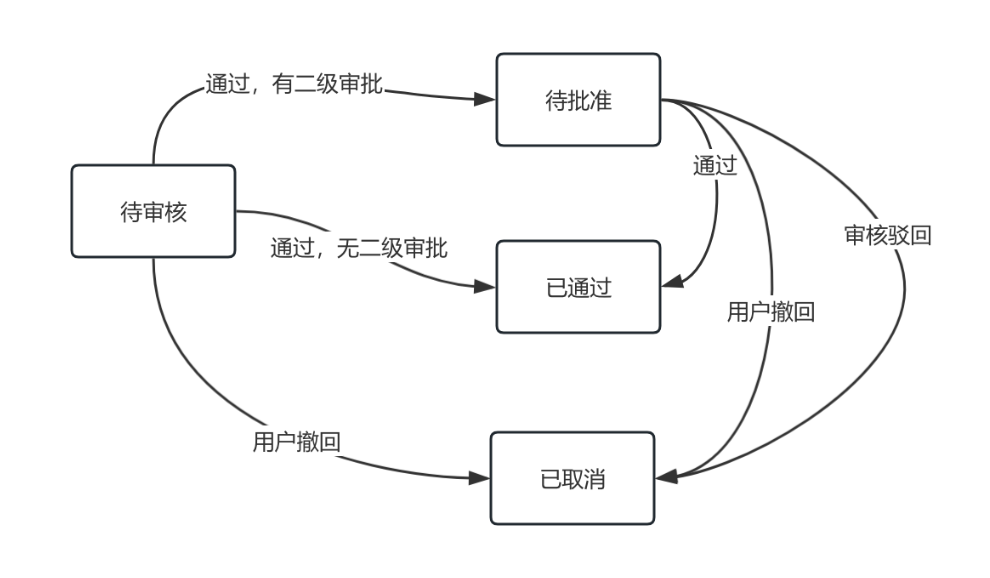

# 实验室工作台

## 流程审批（3.1）

### 业务说明（3.1）

1.  审批单来源

    根据当前用户的数据权限查询、展示、操作审批单，系统内操作根据审批设置确定是否需要产生审批单，目前审批单涉及以下三大类：

    1.  **任务审批**：所有在任务队列对任务进行的创建、修改和取消，每一个任务都单独关联一个审批单
    2.  **培养执行操作**：开启培养后，在反应器详情页面对各类信息和方案等的修改（每一个字段/操作的修改都单独关联一个审批单）以及在工作流触发的审批。
    3.  **工艺初始化**：工艺流程及其对应工艺方案在创建培养时预先填写完成，每一个培养ID的每一个方案都单独关联一个审批单。
2.  审批单梳理

    每个审批单会包含两级模块信息和具体操作类型，用于描述审批单的产生来源和基本信息，目前已有的审批单梳理如下附件（后续随着需求梳理会持续增加）。

    > **[嵌入附件图标 image537.emf | 章节：流程审批（3.1） / 业务说明（3.1） | 上下文：每个审批单会包含两级模块信息和具体操作类型，用于描述审批单的产生来源和基本信息，目前已有的审批单梳理如下附件（后续随着需求梳理会持续增加）。]**
    > **附件文件名：**`审批场景初统计0812.xlsx`

    **审批场景清单**（来源：`审批场景初统计0812.xlsx`，工作表 `Sheet1 (2)`（[原始附件](../需求文档插入的附件/审批场景初统计0812.xlsx)，表头 F1:K2、初始化勾选 F21/K21），59 行 × 11 列，共 **47 条审批场景**（r3-r49），后续随需求梳理持续增加）：

    - **表头**（两层）：`审批单来源 | 内容〔审批一级模块·审批二级模块·操作·说明〕 | 小试要求（待业务补充）〔可直接操作不写原因不审核 · 直接操作但需记录原因 · 需审核〕 | 中试要求（待业务补充）〔同左三档〕`。
    - **小试/中试要求**：原表绝大多数行为空（待业务补充），仅“补液方案初始化”一项有明确勾选：小试可直接操作、不写原因不审核；中试需审核、不写原因。依据原表 F2/F21 与 K2/K21 的列含义转写，下表保留这一差异。

    | 审批单来源 | 一级模块 | 二级模块 | 操作 | 说明 | 小试要求 | 中试要求 |
    | --- | --- | --- | --- | --- | --- | --- |
    | 任务审批 | 任务审批 | 补料任务 | 修改 | 对已生成的补料任务进行修改 | 待补充 | 待补充 |
    | 任务审批 | 任务审批 | 补料任务 | 手工新增 | 在任务队列手工新增补料任务 | 待补充 | 待补充 |
    | 任务审批 | 任务审批 | 补料任务 | 系统新增 | 根据预设的补液方案-补料任务自动生成的任务 | 待补充 | 待补充 |
    | 任务审批 | 任务审批 | 补糖任务 | 系统新增 | 根据预设的补液方案-补糖规则自动生成的任务 | 待补充 | 待补充 |
    | 任务审批 | 任务审批 | 补糖任务 | 修改 | 对已生成的补糖任务进行修改 | 待补充 | 待补充 |
    | 任务审批 | 任务审批 | 补糖任务 | 手工新增 | 在任务队列手工新增补糖任务 | 待补充 | 待补充 |
    | 任务审批 | 任务审批 | 补料任务 | 取消 | 对已有的补料任务申请取消 | 待补充 | 待补充 |
    | 任务审批 | 任务审批 | 补糖任务 | 取消 | 对已有的补糖任务申请取消 | 待补充 | 待补充 |
    | 任务审批 | 任务审批 | 执行出错修复 | 新增 | 执行出错修复后根据修复信息自动新增的任务 | 待补充 | 待补充 |
    | 任务审批 | 任务审批 | PH校准 | 新增 | — | 待补充 | 待补充 |
    | 任务审批 | 任务审批 | PH校准 | 修改 | — | 待补充 | 待补充 |
    | 任务审批 | 任务审批 | PH校准 | 取消 | — | 待补充 | 待补充 |
    | 任务审批 | 任务审批 | 取样检测 | 新增 | — | 待补充 | 待补充 |
    | 任务审批 | 任务审批 | 取样检测 | 修改 | — | 待补充 | 待补充 |
    | 任务审批 | 任务审批 | 取样检测 | 取消 | — | 待补充 | 待补充 |
    | 工艺初始化 | 工艺方案初始化 | 培养执行的工作流 | 初始化 | — | 待补充 | 待补充 |
    | 工艺初始化 | 工艺方案初始化 | config关联设置方案 | 初始化 | — | 待补充 | 待补充 |
    | 工艺初始化 | 工艺方案初始化 | 灌注培养基方案 | 初始化 | — | 待补充 | 待补充 |
    | 工艺初始化 | 工艺方案初始化 | 补液方案 | 初始化 | 完整的补液方案（补液计算规则、固定泵、补料任务、补糖规则） | 可直接操作，不写原因、不审核 | 需审核，不写原因 |
    | 工艺初始化 | 工艺方案初始化 | 自动控制方案 | 初始化 | — | 待补充 | 待补充 |
    | 工艺初始化 | 工艺方案初始化 | 取样方案 | 初始化 | — | 待补充 | 待补充 |
    | 工艺初始化 | 工艺方案初始化 | 测样方案 | 初始化 | — | 待补充 | 待补充 |
    | 工艺初始化 | 工艺方案初始化 | 澄清方案 | 初始化 | — | 待补充 | 待补充 |
    | 工艺初始化 | 工艺方案初始化 | 结束策略 | 初始化 | — | 待补充 | 待补充 |
    | 培养执行操作 | 设备信息 | 更换设备 | 修改 | — | 待补充 | 待补充 |
    | 培养执行操作 | 设备信息 | 默认连接 | 修改 | — | 待补充 | 待补充 |
    | 培养执行操作 | 培养基本信息 | 培养ID | 修改 | — | 待补充 | 待补充 |
    | 培养执行操作 | 培养基本信息 | 培养时间（开始时间/结束时间/培养天数） | 修改 | — | 待补充 | 待补充 |
    | 培养执行操作 | 培养基本信息 | 培养模式 | 修改 | — | 待补充 | 待补充 |
    | 培养执行操作 | 重量信息 | 初始体积 | 修改 | — | 待补充 | 待补充 |
    | 培养执行操作 | 重量信息 | 接种体积 | 修改 | — | 待补充 | 待补充 |
    | 培养执行操作 | 重量信息 | 取测减少总体积 | 修改 | — | 待补充 | 待补充 |
    | 培养执行操作 | 残糖确认 | 补液计算规则 | 修改 | — | 待补充 | 待补充 |
    | 培养执行操作 | 残糖确认 | 残糖确认 | 修改 | — | 待补充 | 待补充 |
    | 培养执行操作 | 工艺设置 | 培养执行的工作流 | 修改 | — | 待补充 | 待补充 |
    | 培养执行操作 | 工艺设置 | config关联设置方案 | 修改 | — | 待补充 | 待补充 |
    | 培养执行操作 | 工艺设置 | 灌注培养基方案 | 修改 | — | 待补充 | 待补充 |
    | 培养执行操作 | 工艺设置 | 补料任务 | 修改 | — | 待补充 | 待补充 |
    | 培养执行操作 | 工艺设置 | 补糖规则 | 修改 | — | 待补充 | 待补充 |
    | 培养执行操作 | 工艺设置 | 自动控制方案 | 修改 | — | 待补充 | 待补充 |
    | 培养执行操作 | 工艺设置 | 取样方案 | 修改 | — | 待补充 | 待补充 |
    | 培养执行操作 | 工艺设置 | 测样方案 | 修改 | — | 待补充 | 待补充 |
    | 培养执行操作 | 工艺设置 | 澄清方案 | 修改 | — | 待补充 | 待补充 |
    | 培养执行操作 | 工艺设置 | 结束策略 | 修改 | — | 待补充 | 待补充 |
    | 培养执行操作 | 在线数据 | 在线告警设置 | 修改 | — | 待补充 | 待补充 |
    | 培养执行操作 | 离线数据 | 离线告警设置 | 修改 | — | 待补充 | 待补充 |
    | 培养执行操作 | 结束培养 | 取消培养 | 取消 | — | 待补充 | 待补充 |

    > 说明：`小试要求/中试要求`三档为〔可直接操作不写原因不审核 / 直接操作但需记录原因 / 需审核〕，除"补液方案初始化"外其余均**待业务补充**；"—"表示原表该行无说明文字。

    

3.  审批单状态
    1.  审批流程及状态切换如下图所示：

        #### 审批流程

        ```mermaid
        flowchart TD
            Start((开始))
            CreateOrModify[新建或修改任务/方案/培养信息]
            Review[审核]
            Pass1{是否通过}
            Cancel[取消]
            HasSecondApproval{是否设置了二次审批}
            Approved[已通过]
            Approve[批准]
            Pass2{是否通过}
            End((结束))

            Start --> CreateOrModify
            CreateOrModify -- 触发流程 --> Review

            Review -- 用户撤回 --> Cancel
            Review --> Pass1

            Pass1 -- 否 --> Cancel
            Pass1 -- 是 --> HasSecondApproval

            HasSecondApproval -- 否 --> Approved
            HasSecondApproval -- 是 --> Approve

            Approve -- 用户撤回 --> Cancel
            Approve --> Pass2

            Pass2 -- 否 --> Cancel
            Pass2 -- 是 --> Approved

            Approved --> End
            Cancel --> End
        ```

        #### 状态图

        ```mermaid
        flowchart LR
            PendingReview[待审核]
            PendingApproval[待批准]
            Approved[已通过]
            Cancelled[已取消]

            PendingReview -- 通过，有二级审批 --> PendingApproval
            PendingReview -- 通过，无二级审批 --> Approved
            PendingReview -- 用户撤回 --> Cancelled

            PendingApproval -- 通过 --> Approved
            PendingApproval -- 用户撤回 --> Cancelled
            PendingApproval -- 审核驳回 --> Cancelled
        ```

    2.  各状态间的切换及支持的操作说明如下表所示：

        | 状态名称 | 说明 | 可执行操作 |
        | :---: | :--- | :--- |
        | 待审核 | 用户创建/系统生成新数据/用户修改等动作触发数据生成和变化后触发 | 审核通过、撤回 |
        | 待批准 | 如果设置了二道审核的话第一道审核通过后进入待批准状态 | 批准通过、撤回 |
        | 已通过 | 只有一道审核的情况下，待审核状态下批准就叫已通过 如果有两道审核的情况下必须已批准之后才叫已通过 | 无 |
        | 已取消 | 用户主动撤回变成取消 审核被驳回变成取消。 注意，此处的取消是指本次新增/修改不生效 | 无 |

### 流程审批（3.1）（3.2）

> **[图 image540.png | 章节：流程审批（3.1） / 流程审批（3.1）（3.2） | 上下文：流程审批（3.1）（3.2）]**
> **OCR 文本：**
> 药明生物SMP系统 | 首页 | A实验室工作台√ | B实验室工作台√ | 数据管理√ | 系统设置
> 流程审批
> 请选择实验室 | 培养ID | 审批模块 | 二级模块 | 状态 | 操作人/审核人 | 2016/09/01-2016/09/20 | 检索 | 新增
> 序号 | 实验室 | 审核模块一级 | 审核模块二级 | 操作类型 | 培养ID | 状态 | 操作时间 | 操作人 | 审核时间 | 审核人 | 批准时间 | 批准人 | 操作
> 实验室1 | 培养基本信息 | 培养ID | 修改 | PY00001 | 待审核 | 2026-06-01 12:21:34 | 王五 | 2026-06-0112:21:34 | 张三 | 详情 | 日志
> 实验室2 | 培养基本信息 | 开始时间 | 修改 | PY00002 | 2026-06-01 12:21:34 | 王五 | 2026-06-0112:21:34 | 张三 | 详情 | 日志
> 实验室2 | 任务审批 | 补料任务 | 新增 | PY00004 | 待审核 | 2026-06-0112:21:34 | 王五 | 2026-06-0112:21:34 | 张三 | 详情 | 日志
> 实验室2 | 工艺方案 | 结束策略 | 新增 | PY00002 | 已取消 | 2026-06-0112:21:34 | 王五 | 2026-06-0112:21:34 | 张三 | 详情 | 日志
> 上一页 | 10 | 下一页



1.  查询条件
    1.  **实验室**：下拉单选，必选，列表为当前用户有授权的所有实验室，默认为当前用户登录系统所在实验室
    2.  **培养ID**：支持模糊检索
    3.  **审批一级模块**：下拉单选，非必选
    4.  **审批二级模块**：下拉单选，非必选，二级要与一级联动
    5.  **状态**：审核状态 ，下拉单选，列表包含待审核、待批准、已通过、已取消
    6.  **操作人/审核人/批准人**：支持操作人/审核人/批准人的显示名和用户名模糊检索
    7.  **起止时间**：支持操作时间/审核时间/批准时间的搜索，只要一个时间在输入的时间条件内均可搜索出
2.  列表展示

    查询结果翻页展示，按提交时间倒排，最新的在最上面，包含以下字段：

    1.  序号
    2.  实验室
    3.  审核一级模块
    4.  审核二级模块
    5.  **操作类型**：说明是初始化、修改还是新增操作引起的审核单
    6.  培养ID
    7.  状态
    8.  **操作时间**：最近一次修改/新增/撤回该审批单的时间
    9.  **操作人**：最近一次修改/新增/撤回该审批单的用户显示名称
    10. 审核时间
    11. 审核人
    12. 批准时间
    13. 批准人
3.  操作－查看详情
    1.  根据不同审批单的来源展示不同的详情弹窗
        -   任务审批/工艺修改

            > **[图 image541.png | 章节：流程审批（3.1） / 流程审批（3.1）（3.2） | 上下文：任务审批/工艺修改]**
            > **OCR 文本：**
            > 审批详情
            > 本次修改如审核通过后，如对ID命名或工艺方案产生影响，需要用户手工修改，根据之前方案生成的补料，补糖任务将会自动取消！
            > 基本信息 | I备注
            > 操作时间 | 操作人 | 操作类型 | 一级模块 | 二级模块 | 状态 | 相关培养 | 相关任务
            > 2026-07-11 | 预设原因
            > 00:09:18 | 张三 | 修改 | 任务审批 | 补料任务 | 待审核 | 查看
            > 1、不合理 | 选择
            > 数据明细 | 2、不允许改来改去
            > 修改字段 | 修改前 | 修改后 | 3、今天太晚了来不及改了
            > 开始时间 | 2026-07-01 | 2026-07-05
            > 结束时间 | 2026-07-14 | 2026-07-15
            > 培养天数 | 14 | 10 | 批注
            > 随使吧
            > 1补充说明
            > 创建的时候写错了
            > 驳回 | 审核通过

            

        2.  **提示信息**：如果是对任务/工艺进行了修改操作，提示“本次修改如审核通过后，如对ID命名或工艺方案产生影响，需要用户手动修改，根据之前方案生成的补料、补糖任务将会自动取消”
        3.  基本信息
            1.  操作时间
            2.  操作人
            3.  操作类型
            4.  审批一级模块
            5.  审批二级模块
            6.  状态
            7.  **相关培养**：点击“查看”按钮，弹窗查看培养信息，仅可查看，不可编辑修改

                > **[图 image542.png | 章节：流程审批（3.1） / 流程审批（3.1）（3.2） | 上下文：相关培养：点击“查看”按钮，弹窗查看培养信息，仅可查看，不可编辑修改]**
                > **OCR 文本：**
                > 培养ID
                > |基本信息
                > 项目编号：XXXX | 批次编号：XXXX | 培养状态：XXXX | 培养编码：PY0018376
                > 反应器名称：ST50L-1 | 规格：50L | 空气泵：SXXX1 | 补料地秤：SCALEV1
                > 开始时间：2026-07-01 | 结束时间2026-07-14 | 天数：14 | 初始重量（ | (g) : 40
                > |工作流
                > 灌注培养基 | 开始培养 | 取样 | 测样 | 补液 | 自动控制 | 结束培养
                > 丨工艺预设参考模版
                > config关联设置：Xxx模版 | 灌注培养基：XXX模版 | 自动控制：XXX模版
                > 取样：无 | 测样：无 | 补料：无
                > 澄清：XXX模版 | 结束策路：XXX模版
                > 关闭

                

                1.  **基本信息**：包含项目编号、批次编号、培养状态、培养ID、反应器名称、规格、空气泵、补料地秤、培养开始时间、培养结束时间、培养周期、初始重量（g）。注意，此处的基本信息均展示修改前的数据。
                2.  **工作流**：展示当前培养的工作流
                3.  **工艺预设参考模板**：展示所有方案名称及其使用的模板名称。注意，此处方案不显示具体明细，如果在设置的时候有参考模板，则需要额外显示它参考关联的模板名称，若没有则不展示。
            8.  **相关任务**：如果任务审批产生的审批才有此字段。点击“查看”按钮，弹窗查看任务详情（即与任务队列中对应任务的查看详情弹窗一样），只可查看不可编辑修改。注意，如果是修改产生的审批，此处展示的是修改前的数据。

                > **[图 image543.png | 章节：流程审批（3.1） / 流程审批（3.1）（3.2） | 上下文：相关任务：如果任务审批产生的审批才有此字段。点击“查看”按钮，弹窗查看任务详情（即与任务队列中对应任务的查看详情弹窗一样），只可查看不可编辑修改。注意，如果是修…]**
                > **OCR 文本：**
                > 详情
                > 时间规则 | 执行时间 | 反应器/控制器名称 | 培养基名称 | 补料类型* | 补料体积(%/g) | 聚速*
                > 立即执行 | 2026-07-21 10:00:00 | FX033 6407FX033 (D3) | PUMP1-FM020a | 百分比 | 10 | g/min | or | 小罐二段式
                > 关闭

                

        4.  **数据明细**：列举本次修改内容的修改前和修改后的全部字段；如果是新增，则修改前数据默认为NaN或 - 表示
            -   **注意**：若修改了培养ID的场景下，系统需要额外做一个唯一性校验，即校验修改后的新id是否出现重复的情况，如果出现重复，进行提醒，且审核通过按钮不可点击，即只可驳回该审批单。

                > **[图 image544.png | 章节：流程审批（3.1） / 流程审批（3.1）（3.2） | 上下文：注意：若修改了培养ID的场景下，系统需要额外做一个唯一性校验，即校验修改后的新id是否出现重复的情况，如果出现重复，进行提醒，且审核通过按钮不可点击，即只可驳回…]**
                > **OCR 文本：**
                > 修改后的培养ID不唯一

                

        5.  补充说明

            展示发生新增/修改/撤回时填写的原因，若没有则空白

        6.  原因

            支持快速选择填入。如果选择驳回或取消，则该原因为必填，否则提示信息

            > **[图 image545.png | 章节：流程审批（3.1） / 流程审批（3.1）（3.2） | 上下文：支持快速选择填入。如果选择驳回或取消，则该原因为必填，否则提示信息]**
            > **OCR 文本：**
            > 驳回请填写批注

            

        -   工艺初始化

            > **[图 image546.png | 章节：流程审批（3.1） / 流程审批（3.1）（3.2） | 上下文：工艺初始化]**
            > **OCR 文本：**
            > 审批详情
            > 基本信息 | 审核意见
            > 操作时间 | 操作人 | 操作类型 | 一级模块 | 二级模块 | 状态 | 相关任务 | 预设批注
            > 2026-07-11 | 00:09:18 | 张三 | 初始化 | 工艺方案 | 补料任务 | 待审核 | 查看 | 1、 | 不合理
            > 数据明细 | 2、不允许改来改去
            > 工艺类型 | 内容 | 3、 | 今天太晚了来不及改了 | 选择
            > 固定泵 | ST50L-PUMP1/FM020a/50LBAG/中试泵速策略
            > 固定泵 | ST50L-PUMP2/FM020b/50LBAG/中试泵速策路 | 批注
            > 固定泵 | ST50L-PUMP3/Glucose/50LBAG/中试泵速策路 | 随使吧
            > 补料计划 | 1-2天/PUMP1/FM020a/圈定值/60g
            > 补料计划 | 3-7天/PUMP2/FM020a/圈定值/60g
            > 补糖计划 | 1-7天/按规则/≤/残糖+乳酸/5到7
            > 1补充说明
            > 驳回 | 申核通过

            

        8.  **基本信息**：同上述章节基本信息
        9.  **数据明细**：将用户设置的计划的每一行展示清楚。比如，补液方案就要展示所有固定泵、补料任务、补糖规则的全部填写内容。
        10. **补充说明**：同上述章节补充说明
        11. **原因**：同上述章节原因
    2.  不同状态下的审批单可执行的审批操作不同。注意，有审核权限的用户才可在此进行审批操作，否则只能查看，比如操作人就只可查看。
        1.  **待审核**：下方的操作按钮出现审核通过和驳回。通过后状态变为待批准或已通过；驳回则变为已取消

            > **[图 image547.png | 章节：流程审批（3.1） / 流程审批（3.1）（3.2） | 上下文：待审核：下方的操作按钮出现审核通过和驳回。通过后状态变为待批准或已通过；驳回则变为已取消]**
            > **OCR 文本：**
            > 驳回 | 审核通过

            

        2.  **待批准**：下方的操作按钮出现审核通过和驳回。通过后状态变为已通过；驳回则变为已取消

            > **[图 image547.png | 章节：流程审批（3.1） / 流程审批（3.1）（3.2） | 上下文：待批准：下方的操作按钮出现审核通过和驳回。通过后状态变为已通过；驳回则变为已取消]**
            > **OCR 文本：**
            > 驳回 | 审核通过

            

        3.  **已通过**：下方只有关闭按钮，点击关闭弹窗
        4.  **已取消**：下方只有关闭按钮，点击关闭弹窗
4.  操作－查看日志
    1.  查看当前这条审核记录的操作日志，从操作人产生此审批，到每个环节的审核人的操作时间、动作、结果以及填写批注的原因全部展示
        1.  操作时间
        2.  操作人
        3.  操作类型
        4.  操作结果
        5.  **批注**：展示原因
    2.  默认按照时间正排序，从上到下，从最早到最新，不需要翻页，弹窗查看后只能关闭。

        > **[图 image548.png | 章节：流程审批（3.1） / 流程审批（3.1）（3.2） | 上下文：默认按照时间正排序，从上到下，从最早到最新，不需要翻页，弹窗查看后只能关闭。]**
        > **OCR 文本：**
        > 审批日志
        > 操作时间 | 操作人 | 操作类型 | 操作结果 | 批注
        > 2026-07-11 00:09:18 | 张三 | 修改 | 进入待审核
        > 2026-07-11 00:09:18 | 大老王 | 审核 | 取消 | 谁让你跨改的
        > 关闭

        

### 原图核对

以下原图对应正文中已转写的表格，保留用于核对字段、数值和布局。




