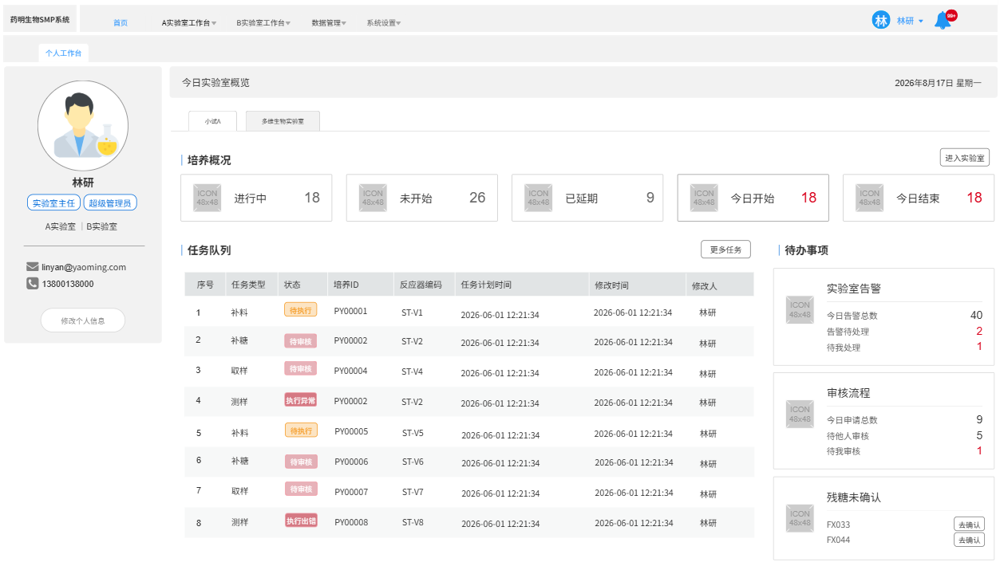

# 首页（4.0）

系统页面分为上下两栏，上方为顶部导航栏，下方为具体内容展示区域，用户登录成功后进入首页-个人工作台页面。

> **[图 image549.png | 章节：首页（4.0） | 上下文：系统页面分为上下两栏，上方为顶部导航栏，下方为具体内容展示区域，用户登录成功后进入首页-个人工作台页面。]**
> **OCR 文本：**
> 药明生物SMP系统 | 首页 | A实验室工作台 | B实验室工作台 | 数据管理> | 系统设置 | 林研
> 个人工作台
> 今日实验室概览 | 2026年8月17日星期一
> 小试A | 多维生物实验室
> 培养概况 | 进入实验室
> 实验室主任 | 林研 | 超级管理员 | ICON | 48x48 | 进行中 | 18 | ICON | 48x48 | 未开始 | 26 | ICON | 48x48 | 已延期 | 48x48 | ICON | 今日开始 | 18 | ICON | 48x48 | 今日结束 | 18
> A实验室 | IB实验室
> 任务队列 | 更多任务 | |待办事项
> linyan@yaoming.com
> 13800138000 | 序号 | 任务类型 | 状态 | 培养ID | 反应器编码 | 任务计划时间 | 修改时间 | 修改人 | 实验室告警
> 修改个人信息 | 【待执行 | PY00001 | ST-V1 | 2026-06-01 12:21:34 | 2026-06-01 12:21:34 | 林研 | ICON | 48x48 | 今日告警总数 | 40
> 补糖 | 待审核 | PY00002 | ST-V2 | 2026-06-01 12:21:34 | 2026-06-01 12:21:34 | 林研 | 告警待处理 | 待我处理
> 取样 | 待审核 | PY00004 | ST-V4 | 2026-06-01 12:21:34 | 2026-06-01 12:21:34 | 林研
> 测样 | 执行异常带 | PY00002 | ST-V2 | 2026-06-01 12:21:34 | 2026-06-01 12:21:34 | 林研 | ICON | 审核流程
> 48x48 | 今日申请总数
> 补料 | 【待执行 | PY00005 | ST-V5 | 2026-06-01 12:21:34 | 2026-06-01 12:21:34 | 林研 | 待他人审核
> 待我审核
> 补糖 | 待申核 | PY00006 | ST-V6 | 2026-06-01 12:21:34 | 2026-06-01 12:21:34 | 林研
> 取样 | 待审核 | PY00007 | ST-V7 | 2026-06-01 12:21:34 | 2026-06-01 12:21:34 | 林研 | 残糖未确认
> 测样 | 执行出铝 | PY00008 | ST-V8 | 2026-06-01 12:21:34 | 2026-06-01 12:21:34 | 林研 | 48x48 | ICON | FX033 | 去确认
> FX044 | 去确认

