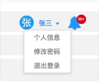
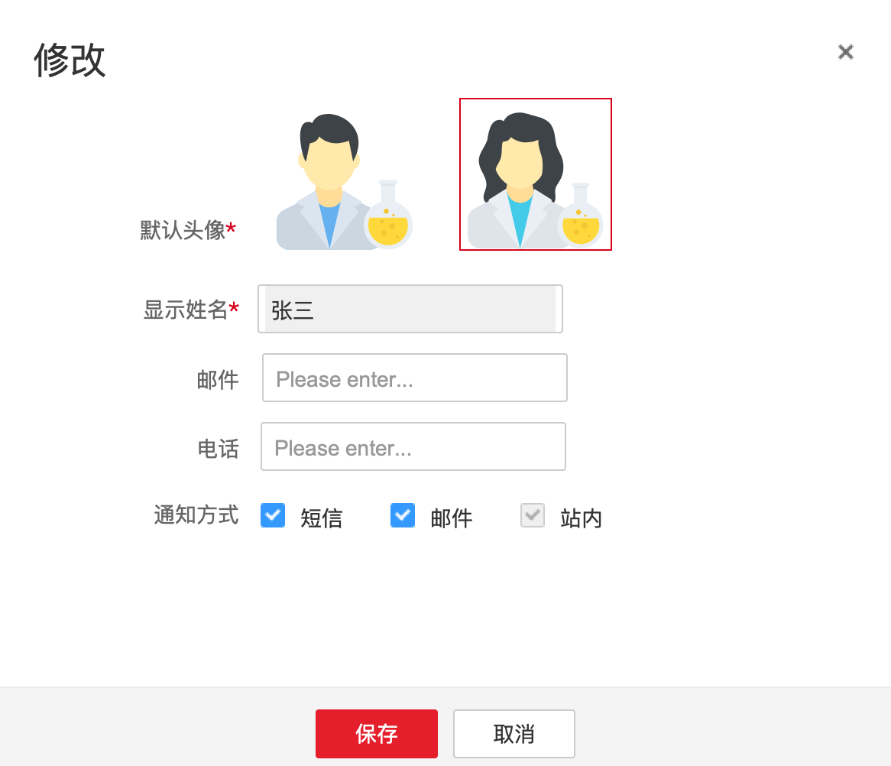
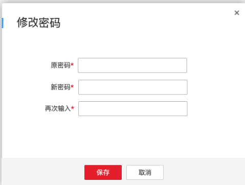
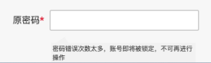
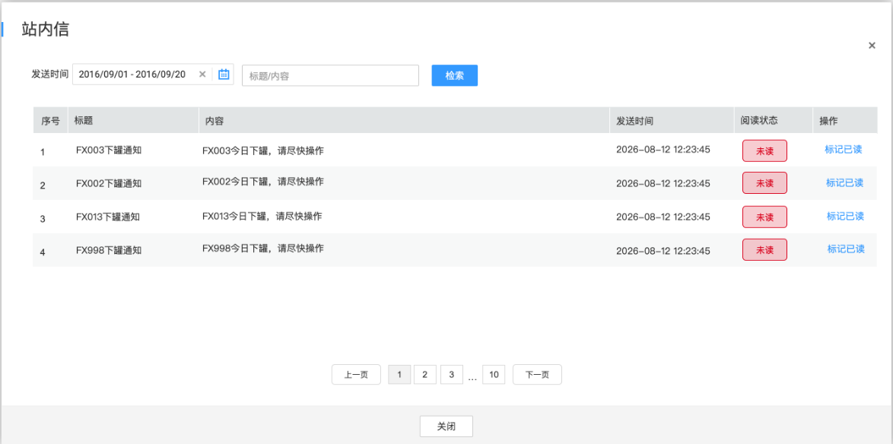

# 首页（4.0）

## 顶部导航栏（4.0）

### 菜单栏（4.0）

展示系统logo以及一级菜单模块（首页、各个实验室工作台、数据管理、系统设置）。

### 用户工具栏（4.0）

包含用户菜单和私信两个部分。

1.  点击用户名下拉展示用户菜单
2.  **私信**：需展示未读消息数量，数量多于99时显示99+ ，低于99显示具体数量。

    > **[图 image550.png | 章节：顶部导航栏（4.0） / 用户工具栏（4.0） | 上下文：私信：需展示未读消息数量，数量多于99时显示99+ ，低于99显示具体数量。]**
    > **OCR 文本：**
    > 张三
    > 个人信息
    > 修改密码
    > 退出登录

    

#### 用户菜单（4.0）

1.  个人信息

    > **[图 image551.png | 章节：顶部导航栏（4.0） / 用户菜单（4.0） | 上下文：个人信息]**
    > **OCR 文本：**
    > 修改
    > 默认头像*
    > 显示姓名＊ | 张三
    > 邮件 | Please enter...
    > 电话 | Please enter...
    > 通知方式 | 短信 | 邮件 | 站内
    > 保存 | 取消

    

    1.  **默认头像**：男/女头像二选一，必选
    2.  **显示姓名**：展示当前用户的显示名称，仅展示，不可修改
    3.  **邮件**：文本框，非必填，必须含@
    4.  **电话**：文本框，非必填，11位纯数字格式
    5.  **通知方式**：包含短信、邮件、站内三种方式，可多选，站内为必选
2.  修改密码

    > **[图 image552.png | 章节：顶部导航栏（4.0） / 用户菜单（4.0） | 上下文：修改密码]**
    > **OCR 文本：**
    > 修改密码
    > 原密码*
    > 新密码*
    > 再次输入*
    > 保存 | 取消

    

    1.  **原密码**：文本框
    2.  **新密码**：文本框
    3.  **再次输入**：文本框，必须与新密码保持一致
    4.  **保存**：必须满足以下条件才可保存成功
        1.  原密码必须输入正确，若15分钟内错误超过5次则锁定账号，且不可再继续修改，提示账号被锁定30分钟后自动解锁

            > **[图 image553.png | 章节：顶部导航栏（4.0） / 用户菜单（4.0） | 上下文：原密码必须输入正确，若15分钟内错误超过5次则锁定账号，且不可再继续修改，提示账号被锁定30分钟后自动解锁]**
            > **OCR 文本：**
            > 原密码*
            > 密码错误次数太多，账号即将被锁定，不可再进行
            > 操作

            

        2.  **新密码校验规则**：同章节用户重置密码校验要求
3.  退出登录

    点击退出登录。

#### 私信（4.0）

点击弹窗查看当前用户的所有站内信。

> **[图 image554.png | 章节：顶部导航栏（4.0） / 私信（4.0） | 上下文：点击弹窗查看当前用户的所有站内信。]**
> **OCR 文本：**
> 站内信
> 发送时间 | 2016/09/01-2016/09/20 | 标题/内容 | 检索
> 序号 | 标题 | 内容 | 发送时间 | 阅读状态 | 操作
> FX003下罐通知 | FX003今日下罐，请尽快操作 | 2026081212:23:45 | 未读 | 标记已读
> FX002下罐通知 | FX002今日下罐，请尽快操作 | 2026081212:23:45 | 未读 | 标记已读
> FX013下罐通知 | FX013今日下罐，请尽快操作 | 2026081212:23:45 | 未读 | 标记已读
> FX998下罐通知 | FX998今日下罐，请尽快操作 | 2026-08-1212:23:45 | 未读 | 标记已读
> 上一页 | 10 | 下一页
> 关闭

1.  查询条件

    以下条件联合查询：

    1.  发送时间
    2.  标题/内容
2.  结果展示与操作

    查询结果翻页展示，未读状态的在最上面，同状态下按发送时间倒排，最新的在最上面，包含以下字段：

    1.  序号
    2.  标题
    3.  内容
    4.  发送时间
    5.  阅读状态
    6.  操作
        1.  **标记已读**：未读状态的记录有标记已读按钮，可点击将该条记录变为已读。
