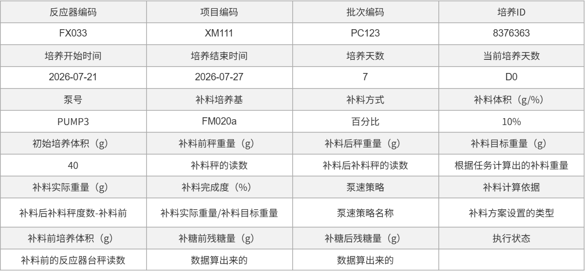

# 补液任务相关总结（3.1）

## 补料任务的记录信息（3.1）

| 字段 | 字段 | 字段 | 字段 |
| --- | --- | --- | --- |
| 反应器编码 | 项目编码 | 批次编码 | 培养ID |
| FX033 | XM111 | PC123 | 8376363 |
| 培养开始时间 | 培养结束时间 | 培养天数 | 当前培养天数 |
| 2026-07-21 | 2026-07-27 | 7 | D0 |
| 泵号 | 补料培养基 | 补料方式 | 补料体积（g/%） |
| PUMP3 | FM020a | 百分比 | 10% |
| 初始培养体积（g） | 补料前秤重量（g） | 补料后秤重量（g） | 补料目标重量（g） |
| 40 | 补料秤的读数 | 补料后补料秤的读数 | 根据任务计算出的补料重量 |
| 补料实际重量（g） | 补料完成度（%） | 泵速策略 | 补料计算依据 |
| 补料后秤度数-补料前 | 补料实际重量/补料目标重量 | 泵速策略名称 | 补料方案设置的类型 |
| 补料前培养体积（g） | 补糖前残糖量（g） | 补糖后残糖量（g） | 执行状态 |
| 补料前的反应器台秤读数 | 数据算出来的 | 数据算出来的 | |

### 原图核对

以下原图对应正文中已转写的表格，保留用于核对字段、数值和布局。

