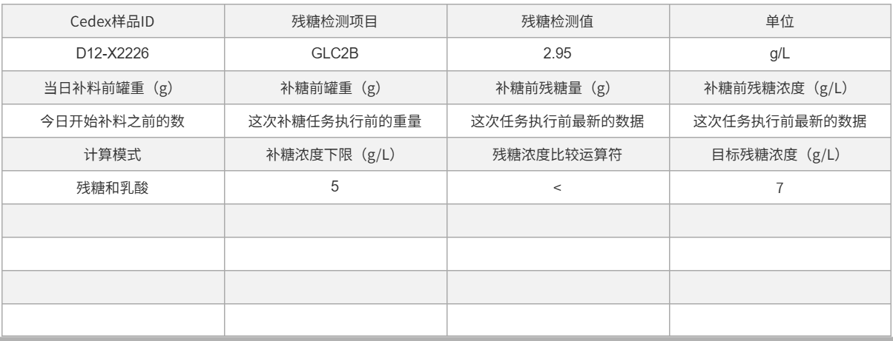

# 补液任务相关总结（3.1）

## 补糖任务的记录信息（3.1）

| 字段 | 字段 | 字段 | 字段 |
| --- | --- | --- | --- |
| Cedex样品ID | 残糖检测项目 | 残糖检测值 | 单位 |
| D12-X2226 | GLC2B | 2.95 | g/L |
| 当日补料前罐重(g) | 补糖前罐重(g) | 补糖前残糖量(g) | 补糖前残糖浓度(g/L) |
| 今日开始补料之前的数 | 这次补糖任务执行前的重量 | 这次任务执行前最新的数据 | 这次任务执行前最新的数据 |
| 计算模式 | 补糖浓度下限(g/L) | 残糖浓度比较运算符 | 目标残糖浓度(g/L) |
| 残糖和乳酸 | 5 | < | 7 |

### 原图核对

以下原图对应正文中已转写的表格，保留用于核对字段、数值和布局。

