# 系统设置

## 实验室设置

### 实验室管理①（3.1）（3.3）

创建和配置实验室。用户创建、修改、删除等操作记录日志，记录操作对象。

> **[图 image61.png | 章节：实验室设置 / 实验室管理①（3.1）（3.3） | 上下文：创建和配置实验室。用户创建、修改、删除等操作记录日志，记录操作对象。]**
> **OCR 文本：**
> 实验室设置
> 实验室名称/编码 | 起止时间 | 检索 | 新增
> 实验室管理
> 设备配置 | 序号 | 实验室名称 | 编码 | 类型 | 负责人 | 修改人 | 修改时间 | 操作
> 其他设备 | 上海小试实验室 | 小试上游 | 王主任 | 张三 | 2026-06-0111:11:11 | 修改禁用授权用户工作流审批流
> 消耗设置
> 上海中试实验室 | 中试上游 | 张主任 | 张三 | 2026-06-0111:11:11 | 修改禁用授权用户工作流审批流
> 离线警告配置
> 上海多维检测实验室 | 中试下游 | 大主任 | 张三 | 2026-06-0111:11:11 | 修改禁用授权用户工作流审批流
> 在线警告配置
> 液瓶配置 | 无锡小试实验室 | 小试上游 | 小主任，副主任 | 张三 | 2026-06-0111:11:11 | 修改启用授权用户工作流审批流
> 状态告警

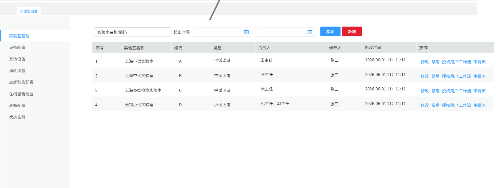
1.  新增
新增实验室信息

> **[图 image62.png | 章节：实验室设置 / 实验室管理①（3.1）（3.3） | 上下文：新增实验室信息]**
> **OCR 文本：**
> 新增
> 实验室名称* | Please enter..
> 编码* | Please enter...
> 实验室类型* | 请选择类型
> 实验室负责人 | Please select...
> 场地* | Please select...
> 部门* | Please select...
> 中转服务IP* | 192 | - 168 | · 192
> 端口 | Please enter...
> 状态 | 启用 | 禁用
> 保存 | 取消

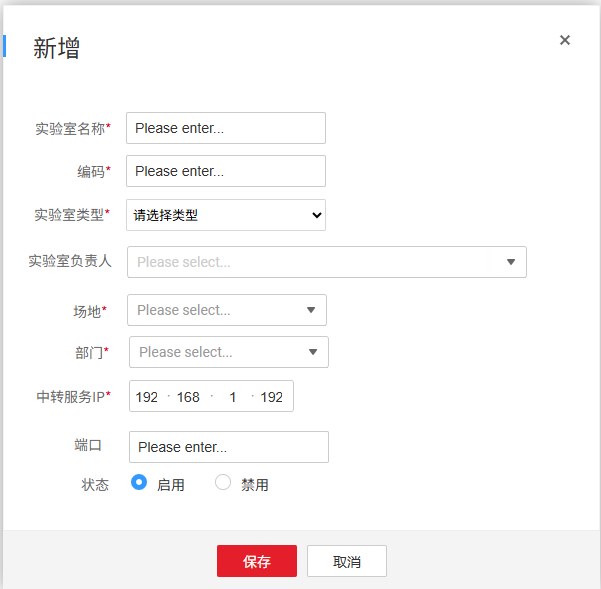
    1.  实验室名称：文本框，不能重复，字符在20个汉字以内
    2.  实验室编码：文本框，唯一，不能重复，支持英文字母，数字和下划线，长度50个字符以内
    3.  实验室类型：下拉单选，必选，目前包含小试上游、小试下游、中试上游、中试下游，其中小试下游类型为保留类型，本期不涉及
    4.  实验室负责人：支持多选，树形结构展示到具体人员信息
    5.  场地：必选，单选，该实验室物理所在的场地
    6.  部门：必选，单选，该实验室挂靠的部门
    7.  中转服务IP：必填，保存实验室的中转服务器的地址，格式为XXX.XXX.XXX.XXX，X为1-3位的纯数字
    8.  端口：选填，纯数字
    9.  状态：启用/禁用，默认为启用，单选
    10.  保存：保存前需完成非空、唯一、长度校验
1.  查询条件
以下条件联合查询

    1.  实验室名称/编码：支持实验室名称/编码共同模糊搜索
    2.  起止时间：
1.  结果展示与操作
查询结果翻页展示，按创建时间倒排，最新的在最上面，包含以下字段：

    1.  序号
    2.  实验室名称
    3.  编码
    4.  类型
    5.  负责人
    6.  修改人：同(3)⑤
    7.  修改时间：(3)⑥
    8.  操作
        1.  修改：
> **[图 image63.png | 章节：实验室设置 / 实验室管理①（3.1）（3.3） | 上下文：1. 修改：]**
> **OCR 文本：**
> 修改
> 实验室名称* | Please enter...
> 编码* | Please enter...
> 实验室类型* | 请选择类型
> 实验室负责人 | Please select...
> 场地* | Please select...
> 部门* | Please select...
> 中转服务IP* | 192 · 168  | · 192
> 端口 | Please enter..
> 状态 | 启用 | 禁用
> 保存 | 取消

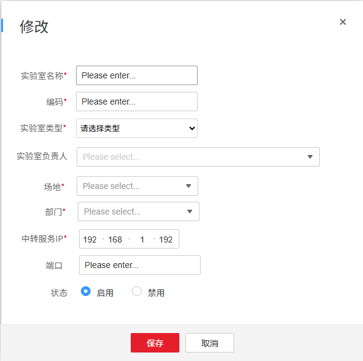
            1.  需完成与新增功能一致的校验；
            2.  将状态从启用修改为禁用时，需校验当前实验室是否存在关联用户或存在未结束的项目/批次/培养，若存在则不能修改，且提示“当前实验室存在关联用户或未结束业务，无法修改未禁用状态”
        1.  启用/禁用：根据该实验室当前状态区分展示（已启用则为禁用操作，已禁用则为启用操作）
            1.  修改为禁用时，需二次确认，提示信息
> **[图 image64.png | 章节：实验室设置 / 实验室管理①（3.1）（3.3） | 上下文：1. 修改为禁用时，需二次确认，提示信息]**
> **OCR 文本：**
> 确定要禁用吗
> 禁用签需移除实验室关联用户
> 并且需要
> 取消 | 确定

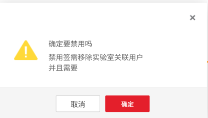
            1.  确认修改为禁用时，提示信息，需同步修改菜单，即该实验室不可见
> **[图 image65.png | 章节：实验室设置 / 实验室管理①（3.1）（3.3） | 上下文：1. 确认修改为禁用时，提示信息，需同步修改菜单，即该实验室不可见]**
> **OCR 文本：**
> 操作成功！
> 实验室已禁用
> 关闭

            1.  修改为启用时，需二次确认，提示信息
> **[图 image66.png | 章节：实验室设置 / 实验室管理①（3.1）（3.3） | 上下文：1. 修改为启用时，需二次确认，提示信息]**
> **OCR 文本：**
> 确定要启用吗
> 启用后可以重新配置用户和设备
> 取消 | 确定

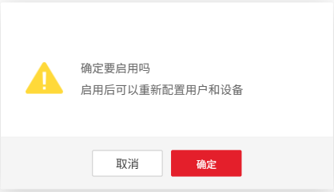
            1.  确认修改为启用时，提示信息，需同步修改菜单状态（该实验室可见）
> **[图 image67.png | 章节：实验室设置 / 实验室管理①（3.1）（3.3） | 上下文：1. 确认修改为启用时，提示信息，需同步修改菜单状态（该实验室可见）]**
> **OCR 文本：**
> 操作成功！
> 实验室已启用
> 关闭

        1.  授权用户：翻页展示当前实验室已关联的用户列表（创建用户时勾选了该实验室），默认按照关联时间倒排
            1.  序号
            2.  显示名称
            3.  用户名
            4.  部门
            5.  角色
            6.  上次登录时间
            7.  状态：当前的系统状态，离线/在线
> **[图 image68.png | 章节：实验室设置 / 实验室管理①（3.1）（3.3） | 上下文：7. 状态：当前的系统状态，离线/在线]**
> **OCR 文本：**
> 查看授权用户
> 实验室名称：上海小试实验室
> 序号 | 显示名称 | 用户名 | 部门 | 角色 | 上次登录时间 | 状态
> 张三 | zhangsan | CCPD | 实验员 | 2026-09-2112:12:34
> 李四 | lisi | CCPD | 实习生 | 2026-09-2112:12:34
> 王五 | wangwu | CCPD | 实验员，QA组长 | 2026-09-2112:12:34
> 赵六 | zhaoliu | CCPD | 实习生 | 2026-09-21 12:12:34
> 赵赵 | zhaozhao | CCPD | 设备管理员 | 2026-09-2112:12:34
> 上一页 | 10 | 下一页
> 关闭

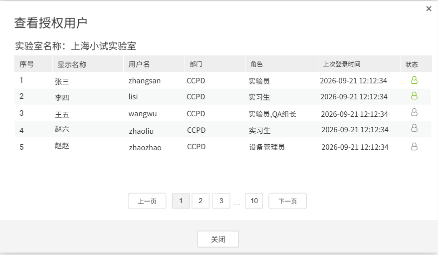
        1.  工作流：表格展示，根据实验室类型筛选出该类型对应的工作流，数据来源于工艺设置－工作流管理模块。通过勾选，选择当前实验室所需的工作流。
> **[图 image69.png | 章节：实验室设置 / 实验室管理①（3.1）（3.3） | 上下文：1. 工作流：表格展示，根据实验室类型筛选出该类型对应的工作流，数据来源于工艺设置－工作流管理模块。通过勾选，选择当前实验室所需的工作流。]**
> **OCR 文本：**
> 工作流
> 一级流程名称 | 二级流程数量 | 说明
> 口开始细胞培养 | 自动程序
> 口灌注培养基 | 手动完成
> 口补液体
> 口自动控制
> 口取样
> 口测样
> 结束培养
> 保存 | 取消

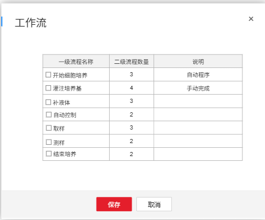
            1.  一级流程名称：至少勾选一个，选择一级流程则表示二级流程全部选择。
注意：当该实验室存在使用该一级流程的培养时，不允许取消勾选

> **[图 image70.png | 章节：实验室设置 / 实验室管理①（3.1）（3.3） | 上下文：注意：当该实验室存在使用该一级流程的培养时，不允许取消勾选]**
> **OCR 文本：**
> 目前还有进行中的培养需要使用XXX流程
> 不能取消哦

            1.  二级流程数量：统计该一级流程下二级流程的数量
            2.  说明
            3.  保存：保存勾选结果
        1.  审批流（3.1）
点击弹窗可进行审批设置

> **[图 image71.png | 章节：实验室设置 / 实验室管理①（3.1）（3.3） | 上下文：点击弹窗可进行审批设置]**
> **OCR 文本：**
> 审批设置
> 审核模块一级 | 审核模块二级 | 操作类型 | 审核 | 批准
> 任务审批 | 补料任务 | 新增 | 不审批不记录 | 不审批
> 任务审批 | 补糖任务 | 系统新增 | 不审批需记录原因 | 不审批
> 培养基本信息 | 取消培养 | 取消 | 批次成员审批 | 批次成员审批
> 培养基本信息 | 取消培养 | 取消 | 项目成员审批 | 不审批
> 保存 | 取消

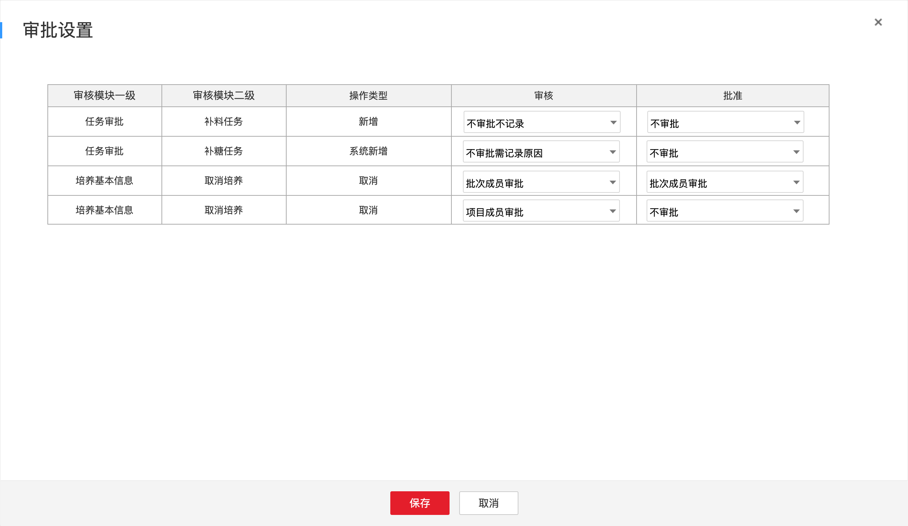
            1.  此弹窗需要配置功能权限，同一个操作的审批流程，不同实验室可以设置不同审批的流程，有此弹窗权限的用户才可进行修改，对这个弹窗的内容修改操作需要记录用户的操作日志。
            2.  首先需将现有需要审批的模块，在数据库里进行配置。详细的审批模块见章节流程审批（3.1）中的附件《审批场景统计》
            3.  在当前“审批设置”弹窗，主要是可以设置是否需要审批，以及需要一次审批还是两次审批以及审批人
            4.  审核：下拉单选，必选。审核下拉选项一共有以下四种：
                1.  不审批不记录：本类型操作不需要任何审核，修改即生效，不触发审批流程，也不需要填写提交操作原因。
                2.  不审批需记录原因：本类型操作不需要任何审核，修改即生效，不触发审批流程；但需要填写提交操作原因。
                3.  批次成员审批：需要该培养所属批次的批次成员进行审核，如果没有批次成员则向上找项目成员审核
                4.  项目成员审批：需要该培养所属项目的项目成员进行审核或批准
            5.  批准：下拉单选，必选。共包含不审批、批次成员审批、项目成员审批三个选项。
                1.  如果【审核】环节选择了“不审批不记录”或“不审批需记录原因”，则默认【批准】锁定为“不审批”，即不需要批准操作。
                2.  如果【审核】环节选择了“批次成员审批”或“项目成员审批”，则【批准】下拉框可选择“不审批”或“批次成员审批”或“项目成员审批”。
-   不审批：不需要批准操作。
-   批次成员审批：需要该培养所属批次的批次成员进行审核，如果没有批次成员则向上找项目成员审核
-   项目成员审批：需要该培养所属项目的项目成员进行审核或批准
### 设备配置①

#### 台式反应器设置①

##### 台式反应器罐设置①（4.2调整）

添加/修改/删除具体的台式反应器，维护所属实验室、编码、泵的默认连接等相关信息。

> **[图 image72.png | 章节：实验室设置 / 设备配置① / 台式反应器设置① / 台式反应器罐设置①（4.2调整） | 上下文：添加/修改/删除具体的台式反应器，维护所属实验室、编码、泵的默认连接等相关信息。]**
> **OCR 文本：**
> 台式反应器 | 蜗动泵 | 空气泵 | 检测设备 | 集成反应器 | 培养容器 | 地秤
> 请选择实验室 | 请选择 | 资产编码/罐体编码 | 2016/09/01 -2016/09/20 | 检索 | 新增 | 泵的默认连接
> 序号 | 实验室 | 图标 | 罐体编码 | 资产编码 | 品牌 | 类别 | 最大容量 | 容量单位 | 描述 | 状态 | 修改时间 | 修改人 | 操作
> 实验室1 | H15-13 | H15-13 | Broadley James | 15L | 15L | 15L Bio-reactor | 空闲 | 2026-06-03 11:11:11 | 张三 | 修改 | 删除
> 实验室1 | H15-14 | H15-14 | Broadley James | 15L | 12L | 15L Bio-reactor | 使用中 | 2026-06-03 11:11:11 | 张三 | 修改 | 删除
> 实验室2 | H15-15 | H15-15 | Broadley James | 15L | 12L | 15L Bio-reactor | 使用中 | 2026-06-03 11:11:11 | 张三 | 修改 | 删除
> 实验室2 | H15-16 | H15-16 | Broadley James | 3L | 2L | 3L Bio-reactor | 空闲 | 2026-06-03 11:11:11 | 张三 | 修改 | 删除
> 实验室2 | H15-17 | H15-17 | Broadley James | 3L | 2L | 3L Bio-reactor | 空闲 | 2026-06-03 11:11:11 | 张三 | 修改 | 删除
> 实验室3 | H15-18 | H15-18 | Broadley James | 3L | 2L | 3L Bio-reactor | 空闲 | 2026-06-03 11:11:11 | 张三 | 修改 | 删除
> 上一页 | 10 | 下一页

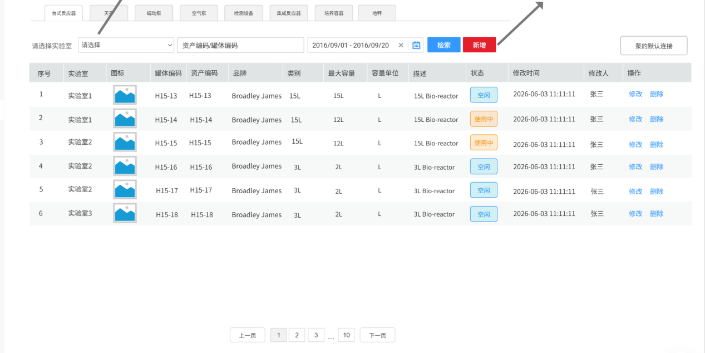
1.  新增
新增一个反应器，并维护相关信息：

> **[图 image73.png | 章节：实验室设置 / 设备配置① / 台式反应器设置① / 台式反应器罐设置①（4.2调整） | 上下文：新增一个反应器，并维护相关信息：]**
> **OCR 文本：**
> 新增
> 实验室* | 实验室1 | 资产编号* | Pleaseenter...
> 罐体编号* | Pleaseenter... | 控制器编号* | Please enter...
> 最大容量* | Pleaseenter... | 品牌型号* | BroadleyJames(15L)
> 描述：15LBio-reactor单位：L
> 保存 | 取消

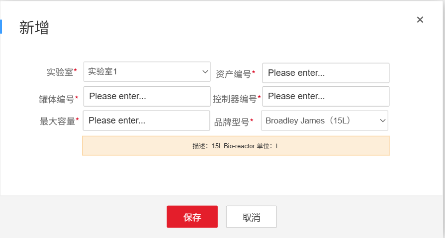
    1.  实验室：下拉单选，只能在当前用户授权范围之内选择实验室
    2.  资产编号：字符串，必填，全局唯一
    3.  罐体编号：字符串，必填，在同一个实验室内不能重复
    4.  控制器编码：字符串，必填，在同一个实验室内唯一
    5.  品牌型号：下拉单选，列表内容是从设备库-台式反应器模块里返回的数据，通过品牌+类别拼接显示
    6.  最大容量：必填，数字，正整数
    7.  其余信息展示：橙色的框内显示当前选择设备的描述和单位
    8.  通讯信息：小试的反应器是需要绑定到某个控制器上使用的，所以反应器不需要配置通讯方式，而是通过配置文件/数据库配置控制器通讯方式，注意：修改配置文件/数据库后需要支持热更新
1.  查询条件
以下条件联合查询：

    1.  实验室：下拉单选，只能在当前用户授权范围之内选择实验室，不选显示所有项目相关信息
    2.  资产编码/罐体编码：文本框，资产编码/罐体编码共同模糊搜索
    3.  起止时间：支持创建时间和修改时间搜索
1.  结果展示与操作
查询结果翻页展示，按修改时间倒排，最新的在最上面，包含以下字段：

    1.  序号
    2.  实验室
    3.  图标：根据新增时选择的品牌+类别，从设备库-台式反应器模块匹配得到
    4.  罐体编码
    5.  资产编码
    6.  品牌
    7.  类别
    8.  最大容量
    9.  容量单位：根据新增时选择的品牌+类别，从设备库-台式反应器模块匹配得到
    10.  描述：根据新增时选择的品牌+类别，从设备库-台式反应器模块匹配得到
    11.  状态：当前反应器处于空闲或使用中状态
    12.  修改人
    13.  修改时间
    14.  操作
        1.  修改：保持新增时的完整校验规则
> **[图 image74.png | 章节：实验室设置 / 设备配置① / 台式反应器设置① / 台式反应器罐设置①（4.2调整） | 上下文：1. 修改：保持新增时的完整校验规则]**
> **OCR 文本：**
> 修改
> 实验室* | 实验室1 | 资产编号* | Please enter...
> 罐体编号* | Please enter... | 控制器编号* | Please enter...
> 最大容量* | Please enter... | 品牌型号* | Broadley James (15L)
> 描述：15LBio-reactor单位：L
> 保存 | 取消

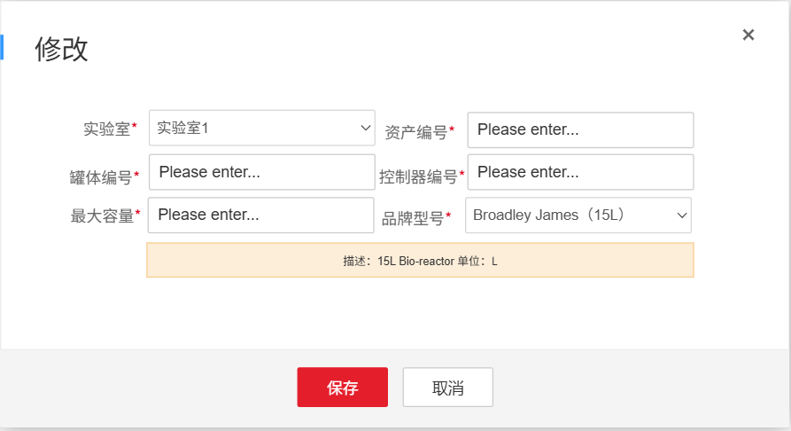
        1.  删除
            1.  需二次确认才能删除，提示信息
> **[图 image75.png | 章节：实验室设置 / 设备配置① / 台式反应器设置① / 台式反应器罐设置①（4.2调整） | 上下文：1. 需二次确认才能删除，提示信息]**
> **OCR 文本：**
> 确定要删除吗
> 请确认当前反应器没有被使用或预约
> 取消 | 确定

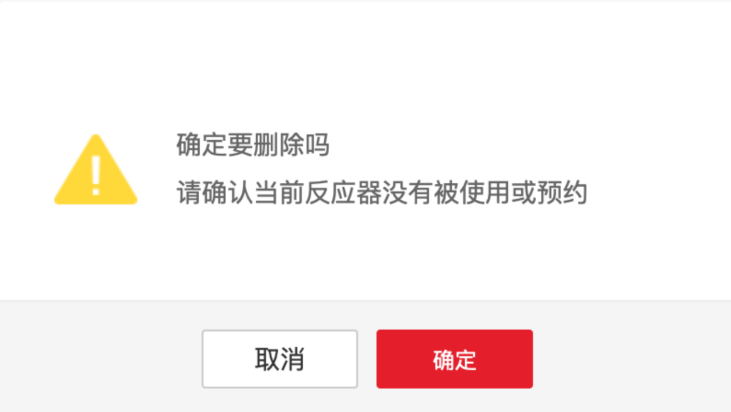
            1.  确认删除时，需校验当前反应器的使用状况，若正在使用或已被预约则不能删除，提示信息
> **[图 image76.png | 章节：实验室设置 / 设备配置① / 台式反应器设置① / 台式反应器罐设置①（4.2调整） | 上下文：1. 确认删除时，需校验当前反应器的使用状况，若正在使用或已被预约则不能删除，提示信息]**
> **OCR 文本：**
> 删除失败！
> 当前反应器有培养正在进行，或有
> 新创建的培养预约了此反应器！
> 确认

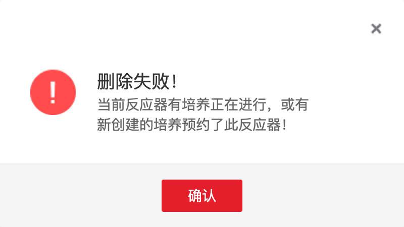
            1.  确认删除成功，提示信息
> **[图 image77.png | 章节：实验室设置 / 设备配置① / 台式反应器设置① / 台式反应器罐设置①（4.2调整） | 上下文：1. 确认删除成功，提示信息]**
> **OCR 文本：**
> 操作成功！
> 反应器已删除
> 关闭

##### 泵的默认连接①

维护各反应器的泵的连接方案。

> **[图 image78.png | 章节：实验室设置 / 设备配置① / 台式反应器设置① / 泵的默认连接① | 上下文：维护各反应器的泵的连接方案。]**
> **OCR 文本：**
> 支持按实验室/控制器编号/
> 台式反应器 | 泵的默认连接 | 描述和描述模糊检索
> 请选择实验室 | 实验室1 | 控制器编号/描述 | 检索
> 序号 | 控制器编号 | 天平编号 | 通道编号 | 补料液体 | 补料容器 | 泵速策略 | 备注 | 修改时间 | 修改人 | 操作
> PUMP1 | Na2C03 | 2000mL Bucket | 三段式
> PUMP2 | FM020a | 2000mL Bucket | 三段式
> FX003 | BAL-068 | PUMP3 | FM020b | 2000mL Bucket | 三段式 | remark | 2026-06-03 11:11:11 | 张三 | 修改
> PUMP4 | Glucose | 2000mL Bucket | 三段式
> PUMP5 | Basal | 2000mL Bucket | 三段式
> PUMP6 | Harvest | 2000mL Bucket | 三段式
> PUMP1 | Na2C03 | 2000mL Bucket | 三段式
> PUMP2 | FM020a | 2000mL Bucket | 三段式
> FX005 | BAL-077 | PUMP3 | FM020b | 2000mL Bucket | 三段式 | remark | 2026-06-03 11:11:11 | 张三 | 修改
> PUMP4 | Glucose | 2000mL Bucket | 三段式
> PUMP5 | Basal | 2000mL Bucket | 三段式
> PUMP6 | Harvest | 2000mL Bucket | 三段式
> 10 | 下一页

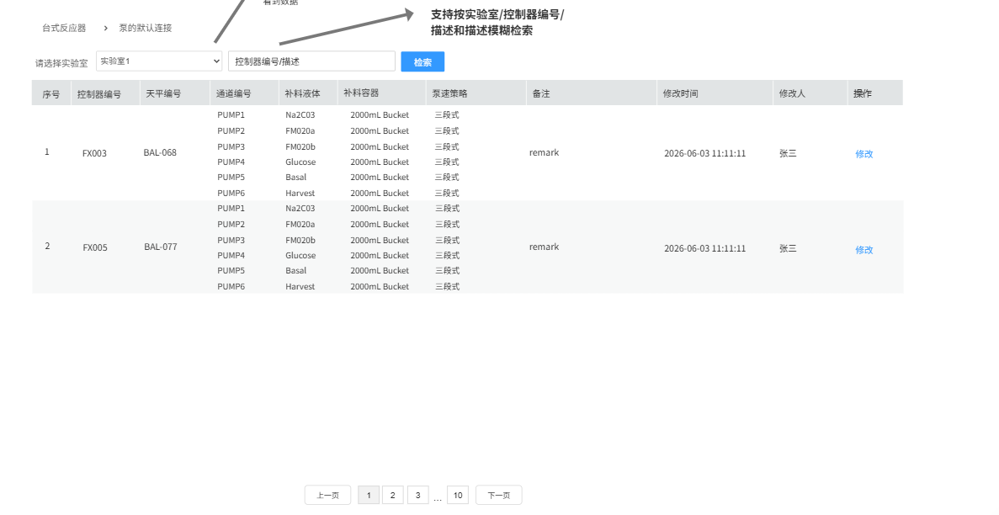
1.  查询条件
以下条件联合查询：

    1.  实验室：下拉单选，必选，可选范围限当前用户授权实验室，不选择默认为当前网络所在实验室
    2.  控制器编号/描述：文本框，支持控制器编号/描述共同模糊搜索
1.  结果展示与操作
查询结果翻页展示，按修改时间倒排，最新的在最上面，包含以下字段：

    1.  序号
    2.  实验室
    3.  控制器编号
    4.  天平编号
    5.  通道编号
    6.  补料液体
    7.  补料容器
    8.  泵速策略
    9.  备注
    10.  修改人
    11.  修改时间
    12.  操作
        1.  修改：
> **[图 image79.png | 章节：实验室设置 / 设备配置① / 台式反应器设置① / 泵的默认连接① | 上下文：1. 修改：]**
> **OCR 文本：**
> 默认连接
> 控制器编号 | FX003 | 地秤编号” | BAL-088
> 序号 | 通道编码 | 默认速度 | 最高速度 | 补料液体 | 补料容器 | 泵速策略
> PUMP1 | g/min | g/min | Item1 | Item1 | Item1
> PUMP2 | g/min | g/min | Item1 | Item1 | Item1
> PUMP3 | g/min | g/min | Item1 | Item1 | Item1
> PUMP4 | g/min | g/min | Item1 | Item1 | Item1
> PUMP5 | g/min | g/min | Item1 | Item1 | Item1
> PUMP6 | g/min | g/min | Item1 | Item1 | Item1
> 保存 | 取消

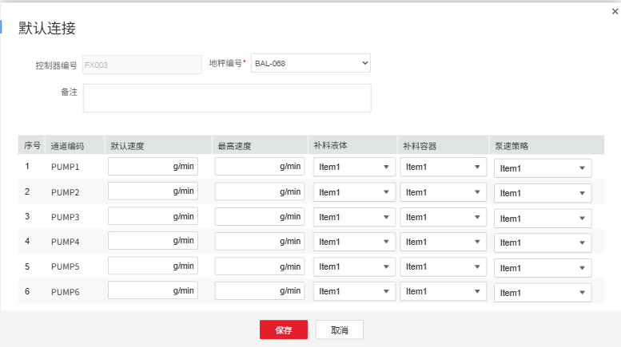
            1.  控制器编号：仅展示，不支持修改
            2.  地秤编号：下拉单选，必选
            3.  备注：文本框
            4.  序号
            5.  通道编码：仅文本展示
            6.  默认速度：正整数
            7.  最高速度：正整数
            8.  补料液体：下拉单选。列表内容来自数据字典
            9.  补料容器：下拉单选。列表内容来自数据字典
            10.  泵速策略：下拉单选。列表内容来自工艺管理－泵速策略中维护的数据（需求见「06-工艺设置」泵速策略③）。
#### 天平设置①

添加/修改/删除具体的天平，维护所属实验室、编码等相关信息

> **[图 image80.png | 章节：实验室设置 / 设备配置① / 天平设置① | 上下文：添加/修改/删除具体的天平，维护所属实验室、编码等相关信息]**
> **OCR 文本：**
> 实验室设置 | 下拉可选范围限当前用户授权实验
> 室，不选择默认显示他授权的所有实
> 验室的相关信息
> 实验室管理 | 台式反应器 | 天平 | 空气票 | 检测设备 | 集成反应器 | 培养容器 | 下游设备
> 支持设备编号和资产编号的
> 设备配置 | 模糊检索，和创建时间修己
> 其他设备 | 请选择实验室 | 请选择 | 设备编号/资产编号 | 2016/09/01 - 2016/09/20 | 检素 | 新增 | 时间的检索
> 工作流配置 | 序号 | 实验室 | 设备编号 | 资产编号 | 品牌-型号 | 规格 | 负责人 | 修改时间 | 修改人 | 操作
> 消耗设置 | 实验室1 | BAL-001 | BAL-001 | 张三 | 2026-06-03 11:11:11 | 张三 | 修改 | 通讯 | 制除
> 离线告警 | 实验室1 | BAL-002 | BAL-002 | 张三 | 2026-06-03 11:11:11 | 张三 | 修改 | 通讯 | 删除
> 在线告警
> 状态告警 | 实验室1 | BAL-003 | BAL-003 | 张三 | 2026-06-03 11:11:11 | 张三 | 修改 | 通讯 | 删除
> 液瓶配置 | 实验室2 | BAL-004 | BAL-004 | 张三 | 2026-06-03 11:11:11 | 张三 | 修改 | 通讯 | 删除
> 实验室2 | BAL-005 | BAL-005 | 张三 | 2026-06-03 11:11:11 | 张三 | 修改 | 通讯
> 实验室2 | BAL-006 | BAL-006 | 张三 | 2026-06-03 11:11:11 | 张三 | 修改 | 通讯 | 删除
> 上一页 | 10 | 下一页

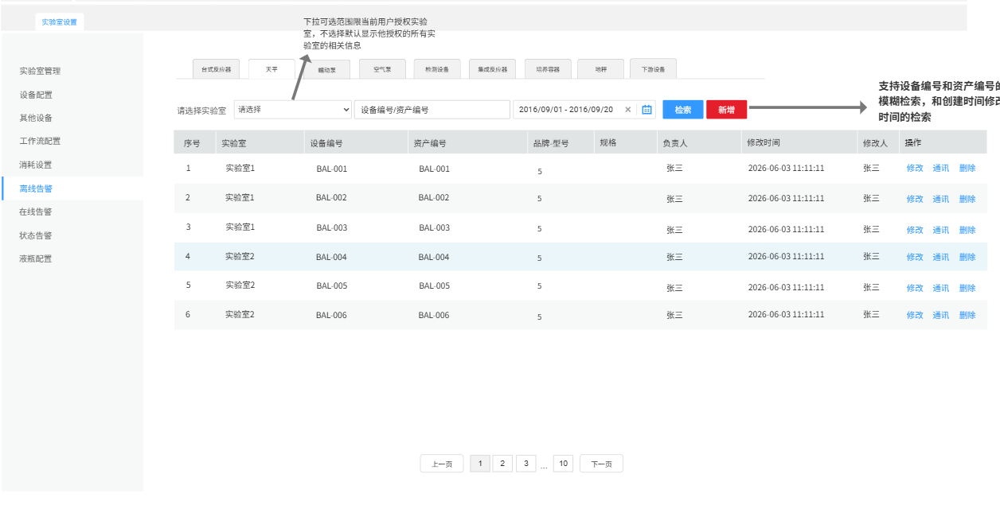
1.  新增
新增一台天平，填写以下相关信息：

> **[图 image81.png | 章节：实验室设置 / 设备配置① / 天平设置① | 上下文：新增一台天平，填写以下相关信息：]**
> **OCR 文本：**
> 新增
> 实验室” | 实验室1 | 资产编号 | Please enter..
> 设备编号* | Please enter... | 品牌 | Please select...
> 型号* | Please select... | 量程 | Please enter...
> 负责人 | Please select... | 维护
> 保存 | 取消

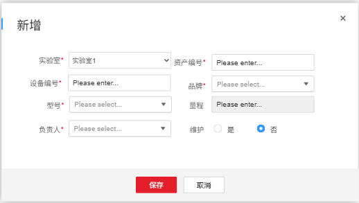
    1.  实验室：下拉单选，只能在当前用户授权范围之内选择实验室
    2.  设备编号：字符串，必填，在同一个实验室内不允许重复
    3.  资产编号：字符串，必填，全局唯一
    4.  品牌：下拉单选，列表内容来自设备库-称重设备
    5.  型号：下拉单选，列表内容来自设备库－称重设备（表格展示时，品牌－型号拼接展示）
    6.  量程：自动填写，从设备库－称重设备的量程带过来的
    7.  负责人：单选，必选，从用户列表里检索 显示姓名/用户名
    8.  维护：必选，确认是否将当前设备设置为维护状态，默认值为否。选择是时，该设备不允许预约使用
    9.  保存：保存前完成的校验包括必填字段非空、字段长度、指定字段唯一性
1.  查询条件
以下条件联合查询：

    1.  实验室：下拉单选，只能在当前用户授权范围之内选择实验室，不选显示所有项目相关信息
    2.  设备编号/资产编号：文本框，设备编号/资产编号共同模糊搜索
    3.  起止时间：支持创建时间和修改时间搜索
1.  结果展示与操作
查询结果翻页展示，按修改时间倒排，最新的在最上面，包含以下字段：

    1.  序号
    2.  实验室
    3.  设备编号
    4.  资产编号
    5.  模型
    6.  规格
    7.  负责人
    8.  修改人
    9.  修改时间
    10.  操作
        1.  修改
> **[图 image82.png | 章节：实验室设置 / 设备配置① / 天平设置① | 上下文：1. 修改]**
> **OCR 文本：**
> 修改
> 实验室* | 实验室1
> 资产编号* | Please enter... | 设备编号* | Please enter...
> 模型* | Please enter... | 规格 | Please enter...
> IP | Please enter... | 端口号 | Please enter...
> 负责人* | Please select... | 维护
> 保存 | 取消

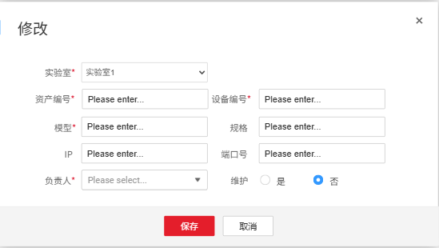
            1.  将维护状态从“是”改为“否”时，弹出二次确认框
> **[图 image83.png | 章节：实验室设置 / 设备配置① / 天平设置① | 上下文：1. 将维护状态从“是”改为“否”时，弹出二次确认框]**
> **OCR 文本：**
> 确定要改为维护吗
> 改为维护状态后，控制模块将失去
> 与此设备的通讯
> 取消 | 确定

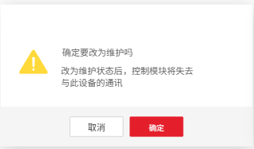
            1.  确认将维护状态从“是”改为“否”，操作成功
> **[图 image84.png | 章节：实验室设置 / 设备配置① / 天平设置① | 上下文：1. 确认将维护状态从“是”改为“否”，操作成功]**
> **OCR 文本：**
> 操作成功！
> 已变秤维护状态
> 关闭

            1.  保存前完成与新增时一致的校验规则
        1.  通讯方式
> **[图 image85.png | 章节：实验室设置 / 设备配置① / 天平设置① | 上下文：1. 通讯方式]**
> **OCR 文本：**
> 通讯设置 | 通讯设置
> 通讯方式 | 网口
> 通讯方式*
> 接口地址* | http或https | 子系统设备编号*
> 接口账号 | root | 子设备MAC* | MAC-MAC
> 接口密钥 | 子系统IP* | 192 | · 168 | · 192
> 设备编码 | 83786736 | 设备IP* | 192 | 168 | 192
> 设备密钥 | 端口号*
> 保存 | 取消 | 保存 | 取消
> 通讯设置 | 通讯设置
> 通讯方式 | 文件 | 通讯方式* | 串口
> 子系统设备编号 | 设备编码 | Please enter... | 设备型号 | Please enter...
> 子设备MAC* | MAC-MAC | 子系统IP* | 192 | 168 | 192 | 串口号 | Please select..
> 子系统设备编号 | BGA001 | 波特率 | Please enter...
> 子系统IP* | 192 | - 168 | 192
> 校验位 | Please select.. | 数据位 | Please select..
> EXCEL路径
> 流控 | Please select.. | 停止位 | Please select..
> 保存 | 取消 | 保存 | 取消

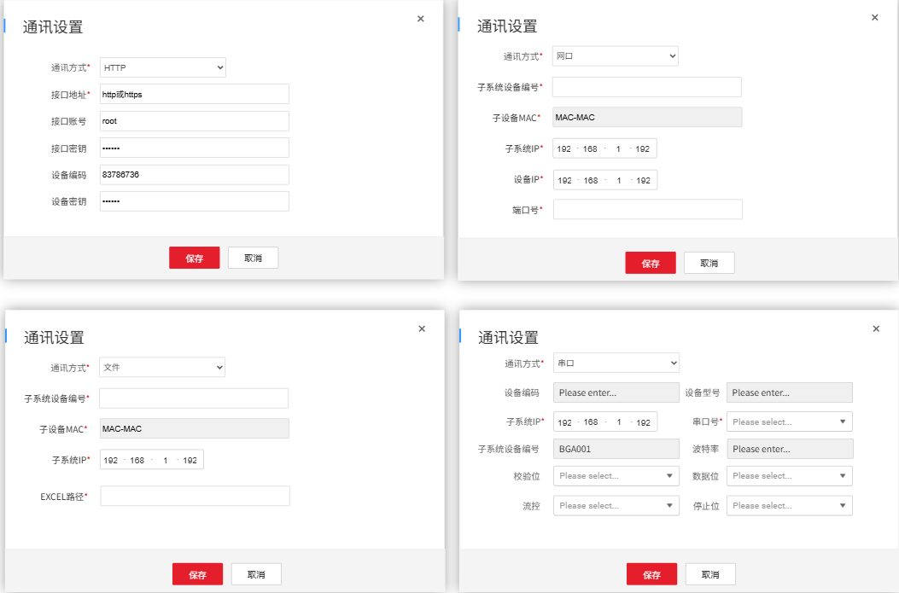
> **[图 image86.png | 章节：实验室设置 / 设备配置① / 天平设置① | 上下文：1. 通讯方式]**
> **OCR 文本：**
> 设备类型 | 通讯方式 | 需要填写的设备参数
> 接口地址：字符串，校验开头为http://https://
> 账号：非必填，字符串格式
> 密钥：非必填，隐藏格式显示，字符串
> HTTP | 设备编码：非必填，字符串，设备上的物理编
> 设备密钥：非必填，隐藏格式显示
> 子系统设备编号：必填，字符串
> 子系统MAC：通过设备编码，自动获取仅展
> 示，不可修改
> 网口
> 子系统ip：必填，xxx.xxx.xxx.xxx格式
> 设备ip：必填，xXX.xxX.xxX.xxx格式
> 端口号：必填，纯数字
> 子系统设备编号：必填，字符串
> 设备通讯方式 | 子系统MAC：通过设备编码，自动获取仅展
> 文件 | 示，不可修改
> 子系统ip：xxx.xxx.xxx.xxx格式
> Excel导出路径：必填，字符串
> 设备编码：选填，字符串
> 设备型号：选填，字符串
> 子系统ip：必填，xxx.xXX.xxx.xxx格式
> 子系统设备编号：选填，字符串
> 串口 | 串口号：选填，下拉数据来自字典
> 波特率：选填，输入，纯数字
> 数据位：选填，下拉数据来自字典
> 校验位：选填，下拉数据来自字典
> 停止位：选填，下拉数据来自字典
> 流控类型：选填，数据来自字典

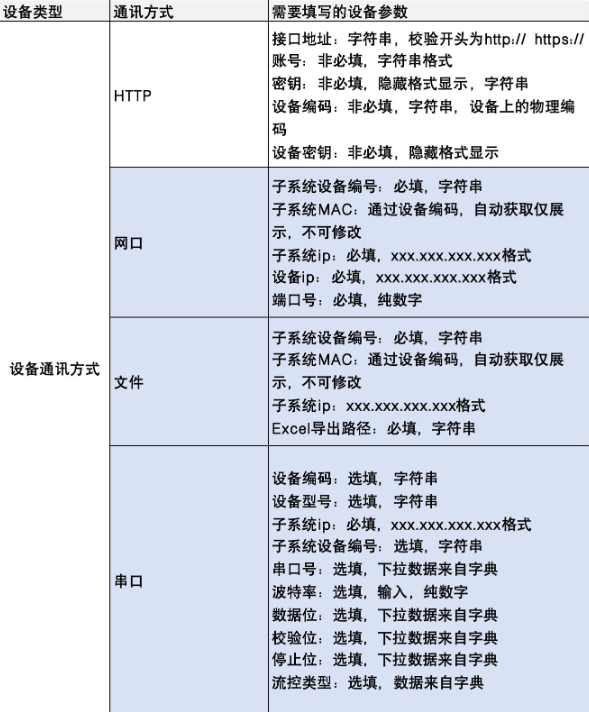
        1.  删除
            1.  需二次确认才能删除，提示信息
> **[图 image87.png | 章节：实验室设置 / 设备配置① / 天平设置① | 上下文：1. 需二次确认才能删除，提示信息]**
> **OCR 文本：**
> 确定要帅除吗
> 耐除之前请先与控制器解绑
> 取消 | 确定

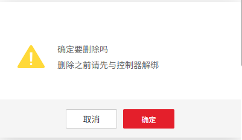
            1.  确认删除时，需校验当前天平的使用状况，若已被关联在台式控制器－泵的连接里，则不能删除，提示信息
> **[图 image88.png | 章节：实验室设置 / 设备配置① / 天平设置① | 上下文：1. 确认删除时，需校验当前天平的使用状况，若已被关联在台式控制器－泵的连接里，则不能删除，提示信息]**
> **OCR 文本：**
> 删除失败！
> 耐除之前请先接触控制器的连接
> 确认

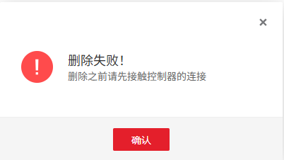
            1.  确认删除成功，提示信息
> **[图 image89.png | 章节：实验室设置 / 设备配置① / 天平设置① | 上下文：1. 确认删除成功，提示信息]**
> **OCR 文本：**
> 操作成功！
> 天平已删除
> 关闭

#### 蠕动泵①

添加/修改/删除具体的蠕动泵，维护所属实验室、编码等相关信息

> **[图 image90.png | 章节：实验室设置 / 设备配置① / 蠕动泵① | 上下文：添加/修改/删除具体的蠕动泵，维护所属实验室、编码等相关信息]**
> **OCR 文本：**
> 实验室设置 | 下拉可选范国限当前用户授权实验
> 室，不选择默认显示他授权的所有实
> 验室的相关信息
> 实验室管理 | 台式反应器 | 天平 | 端动系 | 空气票 | 检测设备 | 集成反应器 | 培养容器 | 下游设备
> 支持设备型号/设备编号/
> 设备配置
> 其他设备 | 请选择实验室 | 请选择 | 品牌/型号/设备编号/规格 | 2016/09/01 - 2016/09/20 | 检素 | 新增 | 格的模糊检索，和创建时 | 修改时间的检索
> 工作流配置 | 序号 | 实验室 | 设备编号 | 资产编号 | 品牌型号 | 规格 | 泵速(g/min) | 设备负责人 | 修改时间 | 修改人 | 操作
> 消耗设置 | 实验室1 | STR200-1-Vitual3 | STR200-1-V3 | X牌-Pump 530 | 100S.YZ15 | 250 | 张三 | 2026-06-03 11:11:11 | 张三 | 修改 | 通讯 | 删除
> 离线告警
> 实验室1 | STR200-1-Vitual4 | STR200-1-V4 | X牌-Pump 530 | 100S.YZ15 | 250 | 张三 | 2026-06-03 11:11:11 | 张三 | 修改 | 通讯 | 删除
> 在线告警
> 状态告警 | 实验室2 | STR200-1-Vitual5 | STR200-1-V5 | X牌-Pump 530 | 100S.YZ15 | 250 | 张三 | 2026-06-03 11:11:11 | 张三 | 修改 | 通讯
> 液瓶配置 | 实验室2 | STR200-1-Vitual6 | STR200-1-V6 | X牌-Pump 530 | 100S.YZ15 | 250 | 张三 | 2026-06-03 11:11:11 | 张三 | 修改 | 通讯 | 删除
> 实验室3 | STR200-1-Vitual7 | STR200-1-V7 | x牌-Pump 530 | 100S.YZ15 | 250 | 张三 | 2026-06-03 11:11:11 | 张三 | 修改 | 通讯 | 删除
> 实验室3 | STR200-1-Vitual8 | STR200-1-V8 | X牌-Pump 530 | 100S.YZ15 | 250 | 张三 | 2026-06-03 11:11:11 | 张三 | 修改 | 通讯

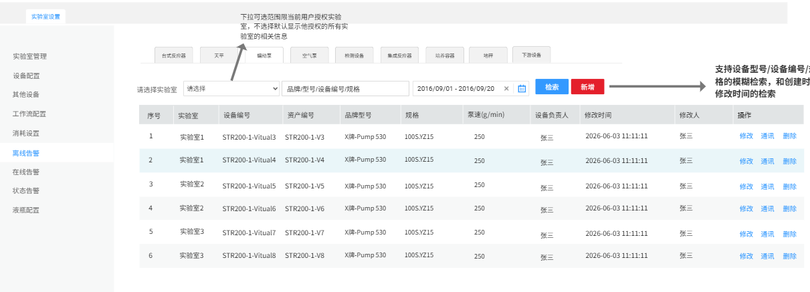
1.  新增
新增一台泵，填写以下相关信息：

> **[图 image91.png | 章节：实验室设置 / 设备配置① / 蠕动泵① | 上下文：新增一台泵，填写以下相关信息：]**
> **OCR 文本：**
> 新增
> 实验室* | 实验室1
> 资产编号* | Please enter... | 设备编号* | Please enter...
> 品牌型号* | X品牌 | Pump 530 | 规格 | Please enter...
> 泵速(g/min)* | Please enter... | 超时(s)* | Please enter...
> 泵速系数* | Please enter... | 泵速策路 | Please select..
> 负责人* | Please select... | 维护
> 保存 | 取消

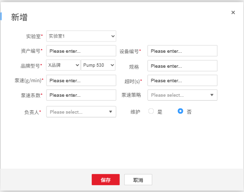
    1.  实验室：下拉单选，只能在当前用户授权范围之内选择实验室
    2.  设备编号：字符串，必填，在同一个实验室内不允许重复
    3.  资产编号：字符串，必填，全局唯一
    4.  设备型号：包括品牌下拉框和型号下拉框，均为单选必选，列表内容来自字典
    5.  规格：选填，字符串
    6.  泵速 (g/min）：必填，正整数或小数（保留 2 位）
    7.  超时 (s）：必填，正整数，取值范围：1~3600
    8.  泵速系数 ：必填，正小数（保留 4 位）0 < 泵速系数 ≤ 10
    9.  泵速策略：下拉单选，选填（需求见「06-工艺设置」泵速策略③）
    10.  负责人：单选，必选，从用户列表里检索 显示姓名/用户名
    11.  维护：确认是否将当前设备设置为维护状态，默认值为否。选择是时，该设备不允许预约使用
    12.  保存：保存前完成的校验包括必填字段非空、字段长度、指定字段的唯一性
1.  查询条件
以下条件联合查询：

    1.  实验室：下拉单选，只能在当前用户授权范围之内选择实验室，不选显示所有项目相关信息
    2.  设备编号/资产编号/规格：文本框，设备编号/资产编号/规格共同模糊搜索
    3.  起止时间：支持创建时间和修改时间搜索
1.  结果展示与操作
查询结果翻页展示，按修改时间倒排，最新的在最上面，包含以下字段：

    1.  序号
    2.  实验室
    3.  设备编号
    4.  资产编号
    5.  设备型号
    6.  规格
    7.  泵速 (g/min)
    8.  设备负责人
    9.  修改人
    10.  修改时间
    11.  操作
        1.  修改：
> **[图 image92.png | 章节：实验室设置 / 设备配置① / 蠕动泵① | 上下文：1. 修改：]**
> **OCR 文本：**
> 修改
> 实验室* | 实验室1
> 资产编号* | Please enter... | 设备编号* | Please enter...
> 品牌型号* | X品牌 | Pump 530 | 规格 | Please enter...
> 泵速(g/min)* | Please enter... | 超时(s)* | Please enter...
> 泵速系数* | Please enter... | 泵速策路 | Please enter...
> Ip+ | Please enter.. | 端口号* | Please enter...
> 负责人* | Please select... | 维护
> 保存 | 取消

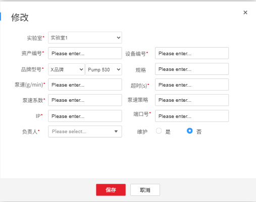
            1.  将维护状态从“是”改为“否”时，弹出二次确认框
> **[图 image83.png | 章节：实验室设置 / 设备配置① / 蠕动泵① | 上下文：1. 将维护状态从“是”改为“否”时，弹出二次确认框]**
> **OCR 文本：**
> 确定要改为维护吗
> 改为维护状态后，控制模块将失去
> 与此设备的通讯
> 取消 | 确定

            1.  确认将维护状态从“是”改为“否”，操作成功
> **[图 image84.png | 章节：实验室设置 / 设备配置① / 蠕动泵① | 上下文：1. 确认将维护状态从“是”改为“否”，操作成功]**
> **OCR 文本：**
> 操作成功！
> 已变秤维护状态
> 关闭

            1.  保存前完成与新增时一致的校验规则
        1.  通讯设置
> **[图 image93.png | 章节：实验室设置 / 设备配置① / 蠕动泵① | 上下文：1. 通讯设置]**
> **OCR 文本：**
> 通讯设置 | 通讯设置
> 通讯方式* | 网口
> 通讯方式
> 接口地址* | http或https | 子系统设备编号*
> 接口账号 | root | 子设备MAC* | MAC-MAC
> 接口密钥 | 子系统IP* | 192 | - 188 | 192
> 设备编码 | 83786736 | 设备IP* | 192 | 168 | 192
> 设备密钥 | 端口号·
> 保存 | 取消 | 保存 | 取消
> 通讯设置 | 通讯设置
> 通讯方式* | 文件 | 通讯方式* | 串口
> 子系统设备编号 | 设备编码 | Please enter... | 设备型号 | Please enter...
> 子设备MAC* | MAC-MAC | 子系统IP* | 192 | - 168 | 192 | 串口号* | Please select..
> 子系统设备编号 | BGA001 | 波特率 | Please enter...
> 子系统IP* | 192 | ·168 | 192
> 校验位 | Please select. | 数据位 | Please select.
> EXCEL路径*
> 流控 | Please select.. | 停止位 | Please select.
> 保存 | 取消 | 保存 | 取消

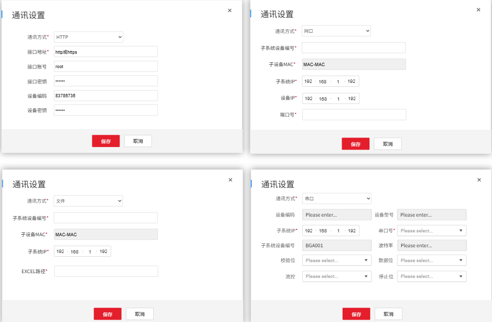
        1.  删除
            1.  需二次确认才能删除，提示信息
> **[图 image94.png | 章节：实验室设置 / 设备配置① / 蠕动泵① | 上下文：1. 需二次确认才能删除，提示信息]**
> **OCR 文本：**
> 确定要删除吗
> 帅除之前应该移除与反应器的连接
> 取消 | 确定

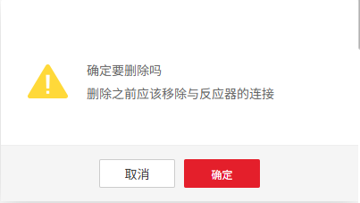
            1.  确认删除时，需校验当前泵的使用状况，若已被关联在台式控制器－泵的连接里，则不能删除，提示信息
> **[图 image95.png | 章节：实验室设置 / 设备配置① / 蠕动泵① | 上下文：1. 确认删除时，需校验当前泵的使用状况，若已被关联在台式控制器－泵的连接里，则不能删除，提示信息]**
> **OCR 文本：**
> 删除失败！
> 有反应器与此设备关联，请先移除连接
> 确认

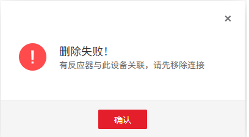
            1.  确认删除成功，提示信息
> **[图 image96.png | 章节：实验室设置 / 设备配置① / 蠕动泵① | 上下文：1. 确认删除成功，提示信息]**
> **OCR 文本：**
> 操作成功！
> 端动泵已删除
> 关闭

#### 空气泵①

添加/修改/删除具体的空气泵，维护所属实验室、编码等相关信息

> **[图 image97.png | 章节：实验室设置 / 设备配置① / 空气泵① | 上下文：添加/修改/删除具体的空气泵，维护所属实验室、编码等相关信息]**
> **OCR 文本：**
> 实验室设置 | 下拉可选范围限当前用户授权实验
> 室，不选择默认显示他授权的所有实
> 验室的相关信息
> 实验室管理 | 台式反应器 | 天平 | 缩动泵 | 空气泵 | 检测设备 | 集成反应器 | 培养容器 | 地秤 | 下游设备
> 支持设备号和规格的模糊检
> 设备配置 | 索，和创建时间修改时间的
> 其他设备 | 请选择实验室 | 请选择 | 品牌/型号/设备编号 | 2016/09/01-2016/09/20 | 检索 | 新增 | 检索
> 工作流配置 | 序号 | 实验室 | 设备编号 | 资产编号 | 品牌型号 | 工作泵速(g/min) | 负责人 | 修改时间 | 修改人 | 操作
> 消耗设置 | 实验室1 | STR50-2-空气泵 | FA3211000038 | X牌Pump530 | 250 | 张三 | 2026-06-0311:11:11 | 张三 | 修改 | 通讯 | 删除
> 离线告警
> 实验室1 | STR50-1-空气泵 | FA3211000039 | X牌Pump530 | 250 | 张三 | 2026-06-03 11:11:11 | 张三 | 修改 | 通讯
> 在线告警
> 状态告警 | 实验室1 | STR200-2-空气泵 | FA3211000040 | X牌Pump530 | 250 | 张三 | 2026-06-03 11:11:11 | 张三 | 修改 | 通讯 | 删除
> 液瓶配置 | 实验室1 | STR200-2-空气泵 | FA3211000044 | X牌Pump530 | 250 | 张三 | 2026-06-03 11:11:11 | 张三 | 修改 | 通讯 | 删除

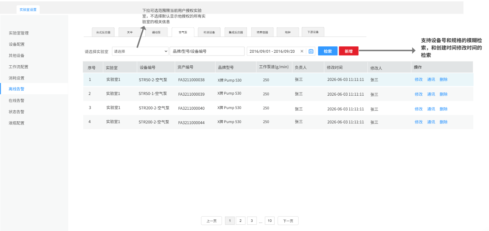
1.  新增
新增一台泵，填写以下相关信息：

> **[图 image98.png | 章节：实验室设置 / 设备配置① / 空气泵① | 上下文：新增一台泵，填写以下相关信息：]**
> **OCR 文本：**
> 新增
> 实验室* | 实验室1
> 资产编号* | Please enter... | 设备编号* | Please enter...
> 品牌型号* | Pump 530 | 时长(s)* | Please enter...
> 工作泵速(g/min)* | Please enter... | 泵速系数* | Please enter...
> 负责人* | Please select... | 维护
> 保存 | 取消

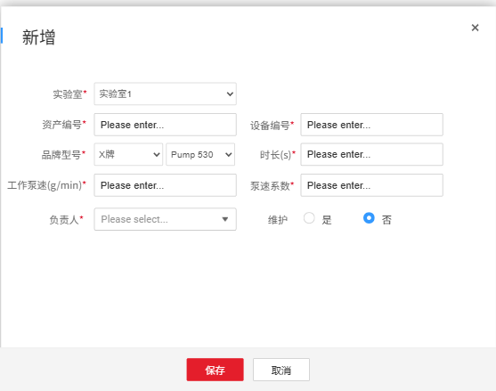
    1.  实验室：下拉单选，只能在当前用户授权范围之内选择实验室
    2.  设备编号：字符串，必填，在同一个实验室内不允许重复
    3.  资产编号：字符串，必填，全局唯一
    4.  设备型号：下拉，数据来自字典
    5.  工作泵速 (g/min）：必填，正整数或小数（保留 2 位）
    6.  时长（s）：必填，正整数，取值范围：1~3600
    7.  泵速系数 ：必填，正小数（保留 4 位）0 < 泵速系数 ≤ 10泵速系数 ：必填，正小数（保留 4 位）0 < 泵速系数 ≤ 10
    8.  负责人：单选，必填，从用户列表里检索 显示姓名/用户名
    9.  维护：确认是否将当前设备设置为维护状态，默认值为否。选择是时，该设备不允许预约使用
    10.  保存：保存前完成的校验包括必填字段非空、字段长度、指定字段的唯一性
1.  查询条件
以下条件联合查询：

    1.  实验室：下拉单选，只能在当前用户授权范围之内选择实验室，不选显示所有项目相关信息
    2.  设备编号/资产编号：文本框，设备编号/资产编号共同模糊搜索
    3.  起止时间：支持创建时间和修改时间搜索
1.  结果展示与操作
查询结果翻页展示，按修改时间倒排，最新的在最上面，包含以下字段：

    1.  序号
    2.  实验室
    3.  设备编号
    4.  资产编号
    5.  设备型号
    6.  工作泵速 (g/min)
    7.  设备负责人
    8.  修改人
    9.  修改时间
    10.  操作
        1.  修改：
> **[图 image99.png | 章节：实验室设置 / 设备配置① / 空气泵① | 上下文：1. 修改：]**
> **OCR 文本：**
> 修改
> 实验室* | 实验室1
> 资产编号* | Please enter... | 设备编号* | Please enter...
> 品牌型号* | Pump 530 | 时长* | Please enter...
> 工作泵速(g/min)* | Please enter... | 泵速系数* | Please enter...
> 负责人* | Please select.. | 维护
> 保存 | 取消

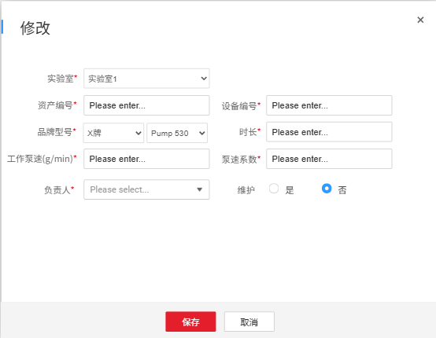
            1.  将维护状态从“是”改为“否”时，弹出二次确认框
> **[图 image83.png | 章节：实验室设置 / 设备配置① / 空气泵① | 上下文：1. 将维护状态从“是”改为“否”时，弹出二次确认框]**
> **OCR 文本：**
> 确定要改为维护吗
> 改为维护状态后，控制模块将失去
> 与此设备的通讯
> 取消 | 确定

            1.  确认将维护状态从“是”改为“否”，操作成功
> **[图 image84.png | 章节：实验室设置 / 设备配置① / 空气泵① | 上下文：1. 确认将维护状态从“是”改为“否”，操作成功]**
> **OCR 文本：**
> 操作成功！
> 已变秤维护状态
> 关闭

            1.  保存前完成与新增时一致的校验规则
        1.  通讯设置：设置通讯方式
> **[图 image100.png | 章节：实验室设置 / 设备配置① / 空气泵① | 上下文：1. 通讯设置：设置通讯方式]**
> **OCR 文本：**
> 通讯设置 | 通讯设置
> 通讯方式* | 网口
> 通讯方式*
> 接口地址* | http或https | 子系统设备编号*
> 接口账号 | 子设备MAC* | MAC-MAC
> 接口密钥 | 子系统IP* | 192 | ·168 | · 192
> 设备编码 | 83786736 | 设备IP* | 192 | 168 | 192
> 设备密钥 | 端口号*
> 保存 | 取消 | 保存 | 取消
> 通讯设置 | 通讯设置
> 通讯方式* | 文件 | 通讯方式* | 串口
> 子系统设备编号* | 设备编码 | Please enter... | 设备型号 | Please enter...
> 子设备MAC* | MAC-MAC | 子系统IP* | 192 | ·168 | 192 | 串口号* | Please select...
> 子系统IP* | 192 | ·168 | 192 | 子系统设备编号 | BGA001 | 波特率 | Please enter...
> 校验位 | Please select.. | 数据位 | Please select..
> EXCEL路径*
> 流控 | Please select.. | 停止位 | Please select.
> 保存 | 取消 | 保存 | 取消

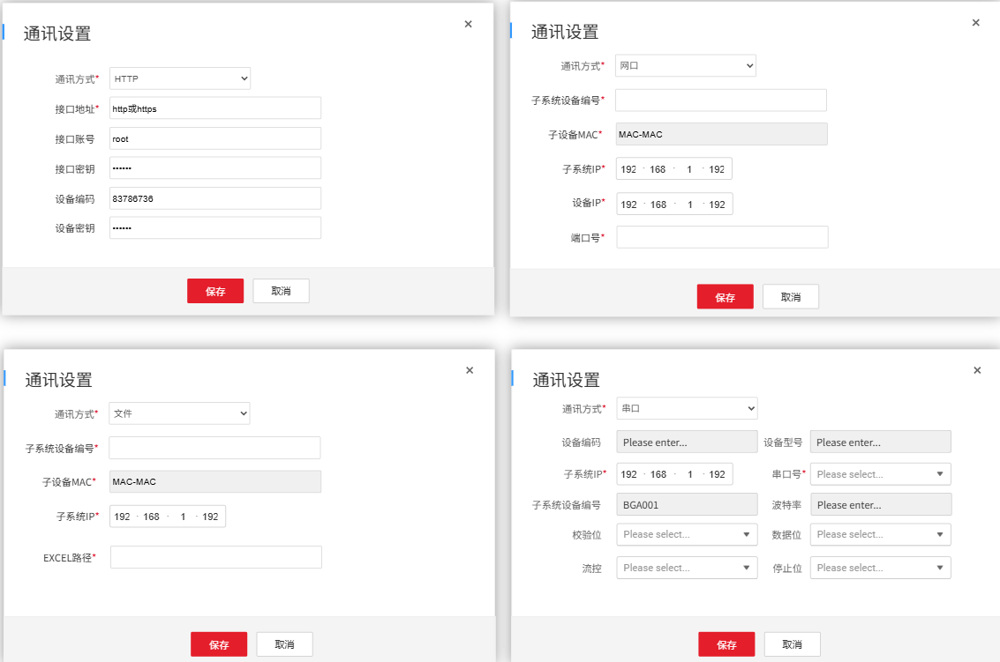
        1.  删除
            1.  需二次确认才能删除，提示信息
> **[图 image94.png | 章节：实验室设置 / 设备配置① / 空气泵① | 上下文：1. 需二次确认才能删除，提示信息]**
> **OCR 文本：**
> 确定要删除吗
> 帅除之前应该移除与反应器的连接
> 取消 | 确定

            1.  确认删除时，需校验当前泵的使用状况，若已被关联在台式控制器－泵的连接里，则不能删除，提示信息
> **[图 image95.png | 章节：实验室设置 / 设备配置① / 空气泵① | 上下文：1. 确认删除时，需校验当前泵的使用状况，若已被关联在台式控制器－泵的连接里，则不能删除，提示信息]**
> **OCR 文本：**
> 删除失败！
> 有反应器与此设备关联，请先移除连接
> 确认

            1.  确认删除成功，提示信息
> **[图 image101.png | 章节：实验室设置 / 设备配置① / 空气泵① | 上下文：1. 确认删除成功，提示信息]**
> **OCR 文本：**
> 操作成功！
> 空气泵已刷除
> 关闭

#### 检测设备①

添加/修改/删除具体的检测设备，维护所属实验室、编码等相关信息

> **[图 image102.jpeg | 章节：实验室设置 / 设备配置① / 检测设备① | 上下文：添加/修改/删除具体的检测设备，维护所属实验室、编码等相关信息]**
> **OCR 文本：**
> 请选择实验室 | 请选择 | 设备类型 | 设备型号 | 资产编号/设备编号/描述 | 2016/09/01-2016/09/20 | 检索 | 新增
> 序号 | 实验室 | 类型 | 设备编号 | 资产编号 | 设备型号 | 描述 | 计数 | 负责人 | 修改时间 | 修改人 | 操作
> 实验室1 | BGA | BGA001 | BGA001 | RAPIDLAB348EX | 血气分析仪 | 6666 | 张三 | 2026-06-0311:11:11 | 张三 | 修改检测项通讯删除
> 实验室1 | Vicell | Vicell001 | Vicell001 | Vi-cell XR | 细胞计数仪 | 6666 | 张三 | 2026-06-0311:11:11 | 张三 | 修改检测项通讯删除
> 实验室2 | OSMO | OSMO001 | OSMO001 | OSMO Pro | 冰点渗透压仪 | 6666 | 张三 | 2026-06-03 11:11:11 | 张三 | 修改检测项通讯删除
> 实验室2 | OSMO | OSMO002 | OSMO002 | OSMO6060 | 冰点渗透压仪 | 6666 | 张三 | 2026-06-0311:11:11 | 张三 | 修改检测项通讯删除
> 实验室2 | Cedex | Cedex001 | Cedex001 | Cedex Bio HT | 生化分析仪 | 6666 | 张三 | 2026-06-0311:11:11 | 张三 | 修改检测项通讯删除
> 实验室2 | Cedex | Cedex002 | Cedex002 | Cedex Bio | 生化分析仪 | 6666 | 张三 | 2026-06-03 11:11:11 | 张三 | 修改检测项通讯删除

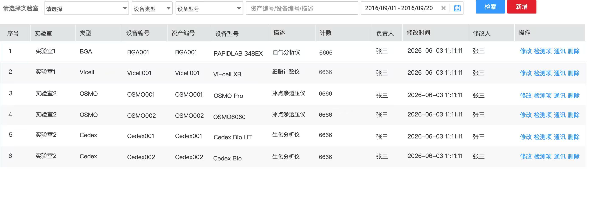
1.  新增
新增一台检测设备，填写以下相关信息：

> **[图 image103.png | 章节：实验室设置 / 设备配置① / 检测设备① | 上下文：新增一台检测设备，填写以下相关信息：]**
> **OCR 文本：**
> 新增
> 实验室* | 实验室1 | 场地 | J207
> 类型* | 设备类型 | 设备型号* | 请选择
> 设备编号* | Please enter... | 资产编号* | Please enter...
> 描述* | Please enter...
> 负责人* | Please select...
> 保存 | 取消

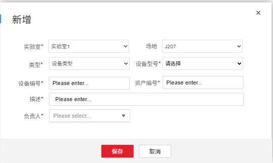
    1.  实验室：下拉单选，只能在当前用户授权范围之内选择实验室
    2.  场地：单选，非必选，如果选择了场地，后续在看板上需要展示的时候可以区分场地来展示
    3.  检测类型：必选，单选，在【设备库－检测设备】里维护过的检测类型/数据字典里的
    4.  设备型号：必选，单选，在【设备库－检测设备】中维护过的设备型号，
    5.  描述：选择设备型号后自动获取描述，不允许修改
    6.  资产编号：字符串，必填，理论上是全局唯一，
    7.  设备编号：字符串，必填，理论上是全局唯一，
    8.  负责人：单选，必填，从用户列表里检索 显示姓名/用户名
    9.  保存：保存前完成的校验包括必填字段非空、字段长度、指定字段的唯一性
1.  查询条件
以下条件联合查询：

    1.  实验室：单选，只能在当前用户授权范围之内选择实验室，不选显示所有项目相关信息
    2.  检测类型：下拉单选，列表内容为在【设备库－检测设备】里维护过的类型
    3.  设备型号：下拉单选，根据检测类型联动，按照列表内容在【设备库－检测设备】里维护过的型号
    4.  资产编号/设备编号/描述：文本框，资产编号/设备编号/描述共同模糊搜索
    5.  起止时间：支持创建时间和修改时间搜索
1.  结果展示与操作
查询结果翻页展示，按修改时间倒排，最新的在最上面，包含以下字段：

    1.  序号
    2.  实验室
    3.  类型
    4.  设备编号
    5.  资产编号
    6.  设备型号
    7.  描述
    8.  计数：当前设备的检测总次数（发送后有经历到检测中状态的次数，也就是只要样本放到检测设备上做了检测就算，不管检测后是否成功上传或是否签名审批等）
    9.  设备负责人
    10.  修改人
    11.  修改时间
    12.  操作
        1.  修改：保存前完成与新增时一致的校验规则
> **[图 image104.png | 章节：实验室设置 / 设备配置① / 检测设备① | 上下文：1. 修改：保存前完成与新增时一致的校验规则]**
> **OCR 文本：**
> 修改
> 实验室* | 实验室1 | 场地 | J207
> 类型* | 设备类型 | 设备型号* | 请选择
> 设备编号* | Please enter... | 资产编号* | Please enter...
> 描述* | Please enter...
> 负责人* | Please select...
> 保存 | 取消

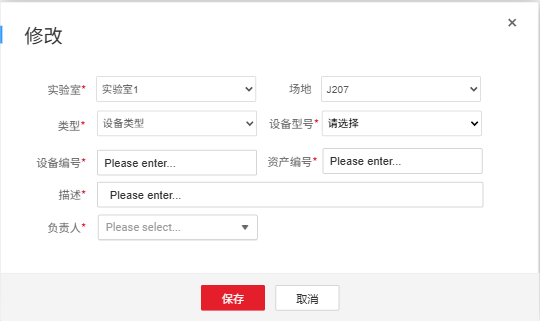
        1.  配置：配置通讯方式
> **[图 image105.png | 章节：实验室设置 / 设备配置① / 检测设备① | 上下文：1. 配置：配置通讯方式]**
> **OCR 文本：**
> 通讯设置 | 通讯设置
> 通讯方式* | HTTP | 通讯方式* | 网口
> 接口地址* | 子系统设备编号*
> 接口账号 | root | 子设备MAC* | MAC-MAC
> 接口密钥 | 子系统IP* | 192 | · 168 | ·192
> 设备编码 | 83786736 | 设备IP* | 192 | 168 | 192
> 设备密钥 | 端口号*
> 保存 | 取消 | 保存 | 取消
> 通讯设置 | 通讯设置
> 通讯方式* | 文件 | 通讯方式* | 串口
> 子系统设备编号* | 设备编码 | Please ente.. | 设备型号 | Please enter...
> 子设备MAC* | MAC-MAC | 子系统IP* | 192 | 168 | 192 | 串口号* | Please select...
> 子系统设备编号 | BGA001 | 波特率 | Please enter...
> 子系统IP* | 192 | 2·168 | · 192
> 校验位 | Please select.. | 数据位 | Please select..
> EXCEL路径*
> 流控 | Please select.. | 停止位 | Please select..
> 保存 | 取消 | 保存 | 取消

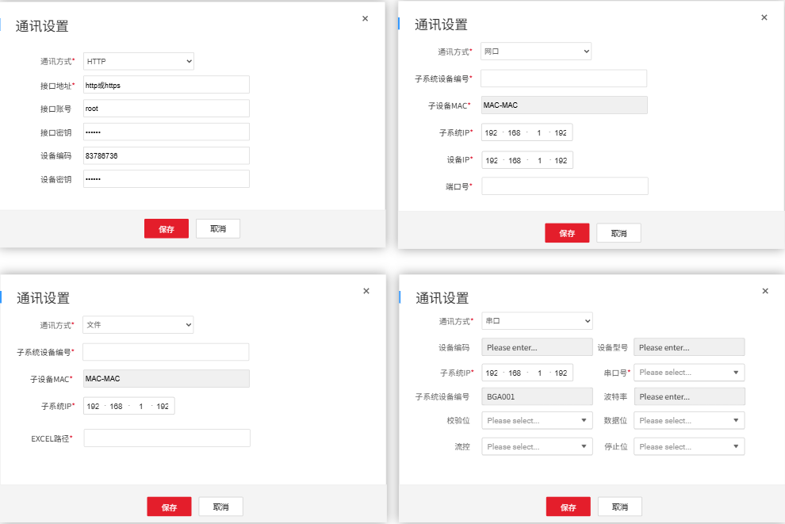
        1.  检测项配置：控制启用或者禁用，根据当前实验室的实际需求情况进行配置，初始化默认是打开的
> **[图 image106.png | 章节：实验室设置 / 设备配置① / 检测设备① | 上下文：1. 检测项配置：控制启用或者禁用，根据当前实验室的实际需求情况进行配置，初始化默认是打开的]**
> **OCR 文本：**
> 检测项配置
> 检测项简称 | 检测项编号 | 单位 | 描述
> pH
> pCO2 | mmHg / kPa | XXX型号设备专属
> pO2 | mmHg / kPa | XXX型号设备专属
> Na* | mmol/L | XXX型号设备专属
> 保存 | 取消

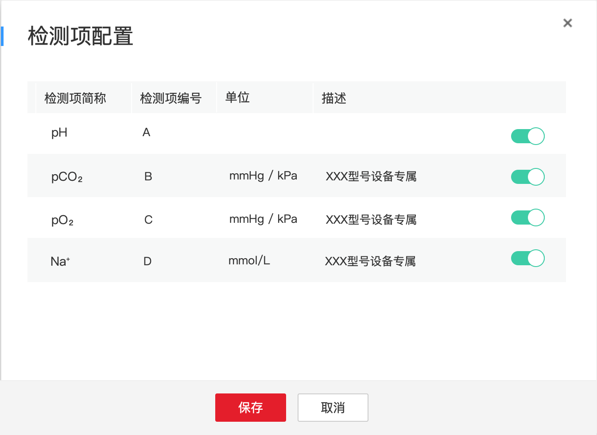
        1.  检测项简称
        2.  检测项编号
        3.  单位
        4.  描述
        5.  选中按钮：选中即表示需要将该检测项添加到对应设备
        1.  删除
            1.  需二次确认才能删除，提示信息
> **[图 image107.png | 章节：实验室设置 / 设备配置① / 检测设备① | 上下文：1. 需二次确认才能删除，提示信息]**
> **OCR 文本：**
> 确定要制除吗
> 删除前请确认当前设备没有执行中的
> 检测任务
> 取消 | 确定

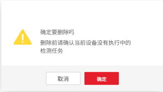
            1.  确认删除时，需校验当前设备是否有检测中或待检测的样品，若有则不允许删除，提示信息
> **[图 image108.png | 章节：实验室设置 / 设备配置① / 检测设备① | 上下文：1. 确认删除时，需校验当前设备是否有检测中或待检测的样品，若有则不允许删除，提示信息]**
> **OCR 文本：**
> 删除失败！
> 当设备正在执行检测任务
> 确认

            1.  确认删除成功，提示信息
> **[图 image109.png | 章节：实验室设置 / 设备配置① / 检测设备① | 上下文：1. 确认删除成功，提示信息]**
> **OCR 文本：**
> 操作成功！
> 当前设备已制除
> 关闭

#### 集成反应器①

添加/修改/删除具体的集成反应器，维护所属实验室、编码等相关信息

> **[图 image110.png | 章节：实验室设置 / 设备配置① / 集成反应器① | 上下文：添加/修改/删除具体的集成反应器，维护所属实验室、编码等相关信息]**
> **OCR 文本：**
> 实验室设置 | 下拉可选范围限当前用户授权实验
> 室，不选择默认显示他授权的所有实
> 验室的相关信息 | 支持按场地检索
> 实验室管理 | 台式反应器 | 天平 | 空气票 | 检测设备 | 集成反应器 | 培养容器 | 地秤 | 下渐设备 | 支持按设备型号/设备编号
> 糊检索
> 设备配置 | 支持按创建时间修改时间
> 请选择实验室 | 请选择 | 请选择场地 | 设备型号/编号/规格 | 2016/09/01-2016/09/20 | 检索 | 新增
> 其他设备
> 工作流配置 | 序号 | 实验室 | 场地 | 设备编号 | 资产编号 | 型号 | 规格 | 容量(g) | 负责人 | 修改时间 | 修改人 | 操作
> 消耗设置 | 实验室1 | J207 | WGQS-NPP-STR-50-1 | 764713 (50L) | STR 50L | 50L | 50000 | 张三 | 2026-06-03 11:11:11 | 张三 | 修改 | 通讯 | 删除
> 离线告警
> 实验室1 | J207 | WGQS-NPP-STR-50-2 | 764714 (50L) | STR 50L | 50L | 50000 | 张三 | 2026-06-03 11:11:11 | 张三 | 修改 | 通讯 | 删除
> 在线告警
> 状态告警 | 实验室1 | J207 | WGQSNPPSUB V6 | 833205 | SUB500L | 500L | 500000 | 张三 | 2026-06-03 11:11:11 | 张三 | 修改 | 通讯 | 删除
> 液瓶配置 | 实验室1 | J208 | WGQSNPPSUB V7 | 833206 | SUB500L | 500L | 500000 | 张三 | 2026-06-03 11:11:11 | 张三 | 修改 | 通讯 | 删除
> 实验室1 | J208 | WGQS-NPP-STR200-3 | 833208 | STR 200L | 200L | 200000 | 张三 | 2026-06-03 11:11:11 | 张三 | 修改 | 通讯 | 删除
> 实验室2 | 3149 | WGQS-NPP-STR200-4 | 833209 | STR 200L | 200L | 200000 | 张三 | 2026-06-03 11:11:11 | 张三 | 修改 | 通讯 | 删除
> 10

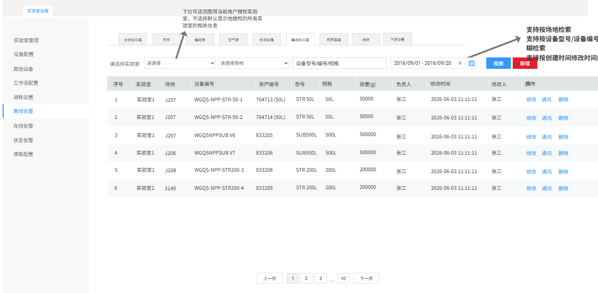
1.  新增
新增一台反应器，填写以下相关信息：

> **[图 image111.png | 章节：实验室设置 / 设备配置① / 集成反应器① | 上下文：新增一台反应器，填写以下相关信息：]**
> **OCR 文本：**
> 新增
> 实验室* | 实验室1 | 场地 | 资产编号* | Please enter...
> 设备型号* | 请选择 | 设备编号* | Please enter.. | 容量 | Please enter...
> 规格 | Please enter... | 压力单位* | Please enter.. | 反应器名称* | Please enter..
> 负责人* | Please select.. | 维护
> 地秤
> 反应器地种* | 请选择 | 报警下限值(g)* | Please enter.. | 报警上限值(g)* | Please enter..
> 补科地秤* | 请选择
> 螺动泵
> 第1泵量程* | g/min | 策路 | Item1 | 第2泵量程* | g/min | 策路 | Item1
> 第3系量程* | g/min | 策路 | Item1 | 第4泵量程* | g/min | 策路 | Item1
> 第5泵量程* | g/min | 策路 | Item1 | 第6泵量程* | g/min | 策路 | Item1
> 第7泵量程* | g/min | 策路 | Item1 | 第8泵量程* | g/min | 策路 | Item1
> 其他
> 空气泵 | 请选择
> 继电器 | 请选择 | 声光报警器 | 请选择 | 状态 | 是否需要外置泵
> 保存 | 取消

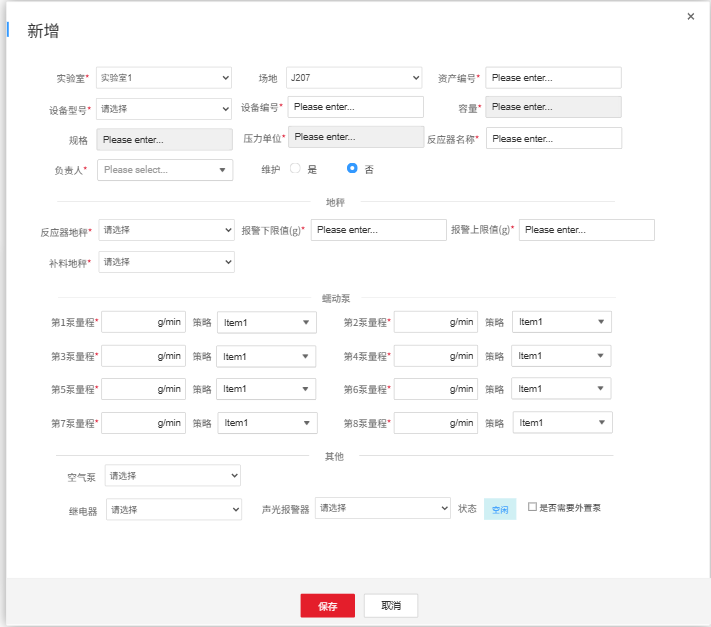
    1.  实验室：下拉单选，只能在当前用户授权范围之内选择实验室
    2.  场地：单选，选填，如果选择了场地，后续在看板上需要展示的时候可以区分场地来展示
    3.  资产编码：必填，字符串，全局唯一
    4.  设备型号：单选，必须拿，在【设备库－集成反应器】中维护过的设备型号，选择后自动获取容量、规格、压力单位，不允许修改仅显示
    5.  设备编号：必填，字符串，唯一（理论上应该是全局唯一）
    6.  反应器名称：必填，字符串，在同一个实验室内不允许重复
    7.  负责人：必选，单选，从用户列表里检索 显示姓名/用户名
    8.  维护：必选，确认是否将当前设备设置为维护状态，默认值为否。选择是时，该设备不允许预约使用
    9.  反应器地秤：单选，必选，列表内容为在当前实验室内选择已经添加的地秤中的非补料地秤
    10.  报警上/下限值：从选择的地秤里面带出这个数值，可修改
    11.  补料地秤：单选，必选，在当前实验室内选择已经添加的地秤中的补料地秤
    12.  量程：必填量程，为非负小数，小数点后两位
    13.  策略：下拉单选，选填，支持检索，下拉列表内容来源于章节泵速策略③中添加的策略。
        1.  注意，每个泵都对应一个量程和一个策略，泵的数量取决于设备型号，在资源管理中对应设备型号设置了几个泵，这里就是几个泵。
    1.  空气泵：下拉单选，非必填，当前实验室已经添加的设备里选择
    14.  继电器：单选，非必填，当前实验室已经添加的设备里选择
    15.  声光报警器：单选，非必填，在当前实验室已经添加的设备里选择
    16.  状态：反应器当前状态，空闲/使用中，仅显示
    17.  保存：保存前完成的校验包括必填字段非空、字段长度、指定字段的唯一性
1.  查询条件
以下条件联合查询：

    1.  实验室：下拉单选，只能在当前用户授权范围之内选择实验室，不选显示所有项目相关信息
    2.  场地：下拉单选
    3.  设备型号/编号/规格：文本框，设备型号/编号/规格共同模糊搜索
    4.  起止时间：支持创建时间和修改时间搜索
1.  结果展示与操作
查询结果翻页展示，按修改时间倒排，最新的在最上面，包含以下字段：

    1.  序号
    2.  实验室
    3.  场地
    4.  设备编号
    5.  资产编号
    6.  设备型号
    7.  规格
    8.  容量（g）
    9.  设备负责人
    10.  修改人
    11.  修改时间
    12.  操作
        1.  修改：
> **[图 image112.png | 章节：实验室设置 / 设备配置① / 集成反应器① | 上下文：1. 修改：]**
> **OCR 文本：**
> 修改
> 实验室* | 实验室1 | 场地 | J207 | 资产编号* | Please enter...
> 设备型号* | 请选择 | 设备编号* | Please enter... | 容量* | Please ente..
> 规格 | Please enter.. | 压力单位* | Please enter... | 反应器名称* | Please enter...
> 负责人* | Please select... | 维护
> 地秤
> 反应器地秤* | 请选择 | 报警下限值(g)* | Please enter.. | 报警上限值(g)* | Please ente..
> 补料地秤* | 请选择
> 第1泵量程* | g/min | Please select. | 第2泵量程* | g/min | 策略 | Please select..
> 第3泵量程* | g/min | 策略 | Please select.. | 第4泵量程* | g/min | 策略 | Please select..
> 第5泵量程* | g/min | 策略 | Please select.. | 第6泵量程* | g/min | 策略 | Please select.
> 第7泵量程* | g/min | 策略 | Please select.. | 第8泵量程* | g/min | 策略 | Please select..
> 其他
> 继电器 | 请选择 | 声光报警器 | 请选择 | 状态 | 空阀 | 口是否需要外置泵
> 保存 | 取消

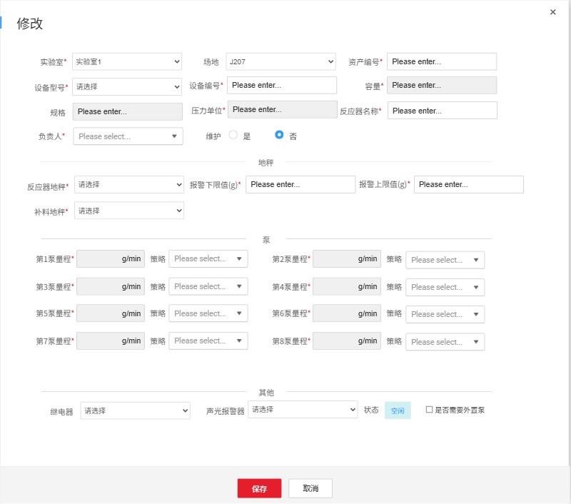
            1.  将维护状态从“是”改为“否”时，弹出二次确认框
> **[图 image83.png | 章节：实验室设置 / 设备配置① / 集成反应器① | 上下文：1. 将维护状态从“是”改为“否”时，弹出二次确认框]**
> **OCR 文本：**
> 确定要改为维护吗
> 改为维护状态后，控制模块将失去
> 与此设备的通讯
> 取消 | 确定

            1.  确认将维护状态从“是”改为“否”，操作成功
> **[图 image84.png | 章节：实验室设置 / 设备配置① / 集成反应器① | 上下文：1. 确认将维护状态从“是”改为“否”，操作成功]**
> **OCR 文本：**
> 操作成功！
> 已变秤维护状态
> 关闭

            1.  保存前完成与新增时一致的校验规则
        1.  通讯设置：目前支持4种通讯方式，不同方式对应填写不同的字段
> **[图 image113.png | 章节：实验室设置 / 设备配置① / 集成反应器① | 上下文：1. 通讯设置：目前支持4种通讯方式，不同方式对应填写不同的字段]**
> **OCR 文本：**
> 通讯设置 | 通讯设置
> 通讯方式*
> 通讯方式*
> 接口地址* | http或https | 子系统设备编号*
> 接口账号 | 子设备MAC* | MAC-MAC
> 接口密钥 | 子系统IP* | 192 | - 168 | ·192
> 设备编码 | 83786736 | 设备IP* | 192 | 168 | 192
> 设备密钥 | 端口号*
> 保存 | 取消 | 保存 | 取消
> 通讯设置 | 通讯设置
> 通讯方式* | 文件 | 通讯方式* | 串口
> 子系统设备编号* | 设备编码 | Please enter... | 设备型号 | Please enter...
> 子设备MAC* | MAC-MAC | 子系统IP* | 192 | 168 | 192 | 串口号* | Please select..
> 子系统设备编号 | BGA001 | 波特率 | Please enter...
> 子系统IP* | 192 | - 168 | · 192
> 校验位 | Please select.. | 数据位 | Please select..
> EXCEL路径*
> 流控 | Please select.. | 停止位 | Please select..
> 保存 | 取消 | 保存 | 取消

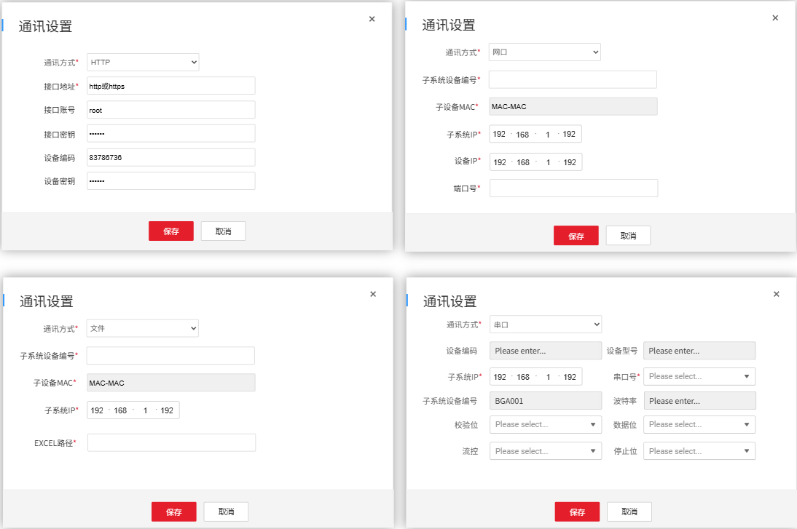
        1.  删除
            1.  需二次确认才能删除，提示信息
> **[图 image114.png | 章节：实验室设置 / 设备配置① / 集成反应器① | 上下文：1. 需二次确认才能删除，提示信息]**
> **OCR 文本：**
> 确定要删除吗
> 确定要删除此反应器吗，删除之前请确认
> 所有培养已结束
> 取消 | 确定

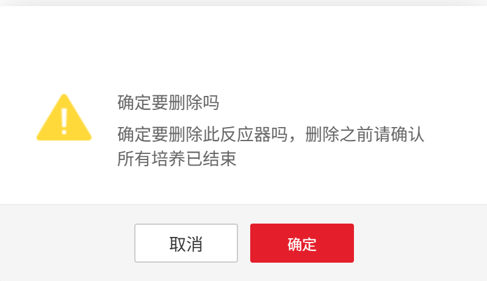
            1.  确认删除时，需校验当前设备是否有状态为“已开始”或“已取消”的培养，若有则不能删除，提示信息
> **[图 image115.png | 章节：实验室设置 / 设备配置① / 集成反应器① | 上下文：1. 确认删除时，需校验当前设备是否有状态为“已开始”或“已取消”的培养，若有则不能删除，提示信息]**
> **OCR 文本：**
> 删除失败！
> 此反应器还有没结束的培养
> 确认

            1.  确认删除成功，提示信息
> **[图 image116.png | 章节：实验室设置 / 设备配置① / 集成反应器① | 上下文：1. 确认删除成功，提示信息]**
> **OCR 文本：**
> 操作成功！
> 反应器已删除
> 关闭

#### 培养容器①

添加/修改/删除具体的培养容器，维护所属实验室、编码等相关信息

> **[图 image117.png | 章节：实验室设置 / 设备配置① / 培养容器① | 上下文：添加/修改/删除具体的培养容器，维护所属实验室、编码等相关信息]**
> **OCR 文本：**
> 台式反应器 | 天平 | 蝶动泵 | 空气 | 检测设备 | 集成反应器 | 培养容器 | 地秤
> 请选择实验室 | 请选择 | 请选择场地 | 容器类型/容器名称 | 2016/09/01-2016/09/20 | 检索 | 新增
> 序号 | 实验室 | 场地 | 容器类型 | 规格 | 容器名称 | 修改时间 | 修改人 | 操作
> 实验室1 | J207 | WAVE | 200L | WAVE-1 | 2026-06-0311:11:11 | 张三 | 修改 | 删除
> 实验室1 | J207 | WAVE | 500L | WAVE-2 | 2026-06-0311:11:11 | 修改
> 实验室1 | J207 | RM | 200L | RM-1 | 2026-06-03 11:11:11 | 张三 | 修改 | 删除
> 实验室1 | J208 | Pre-warm Container | 5L | RC-1 | 2026-06-03 11:11:11 | 张三 | 修改 | 删除
> 实验室1 | J208 | Mixing Container | 100L | MC-1 | 2026-06-03 11:11:11 | 修改 | 删除
> 实验室2 | 3149 | SF | 10L | SF-1 | 2026-06-03 11:11:11 | 修改 | 删除

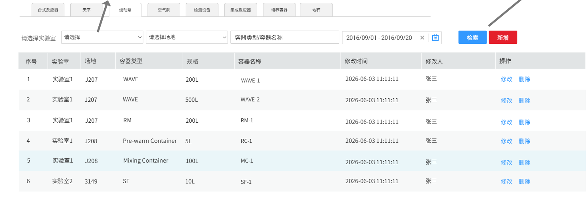
1.  新增
新增一台培养容器，填写以下相关信息：

> **[图 image118.png | 章节：实验室设置 / 设备配置① / 培养容器① | 上下文：新增一台培养容器，填写以下相关信息：]**
> **OCR 文本：**
> 新增
> 实验室* | 实验室1 | 场地 | J207
> 容器类型* | 请选择 | 规格* | 请选择
> 容器名称* | Please enter... | 备注 | Please enter...
> 保存 | 取消

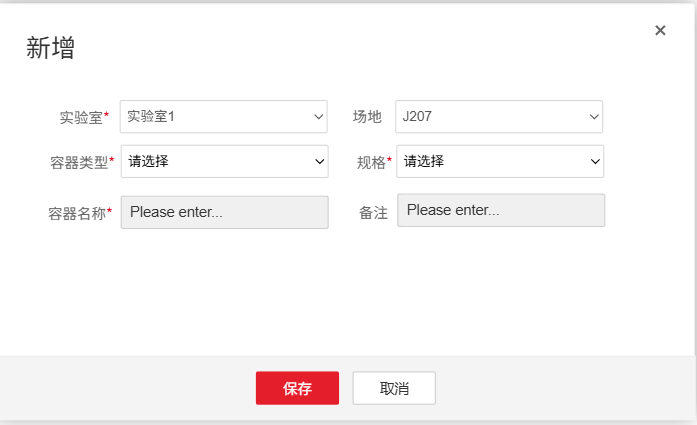
    1.  实验室：下拉单选，只能在当前用户授权范围之内选择实验室
    2.  场地：下拉单选，选填，如果选择了场地，后续在看板上需要展示的时候可以区分场地来展示
    3.  容器类型：单选必选，5类，包括WAVE、RM、Pre-warm Container、Mixing Container、SF五类，来源于数据字典
    4.  规格：单选必选，用户选择类型后，关联出当前类型下【设备库－培养容器】中的相关规格，让用户选择
    5.  容器名称：必填，在同一实验室不允许重复。用户选择了容器类型和规格后，自动拼接出 容器类型－规格这样的格式，比如 WAVE-100L
    6.  备注：100字符，选填
    7.  保存：保存前完成的校验包括必填字段非空、字段长度、指定字段的唯一性
1.  查询条件
以下条件联合查询：

    1.  实验室：下拉单选，只能在当前用户授权范围之内选择实验室，不选显示所有项目相关信息
    2.  场地：下拉单选，
    3.  容器类型/容器名称：文本框，容器类型/容器名称共同模糊搜索
    4.  起止时间：支持创建时间和修改时间搜索
1.  结果展示与操作
查询结果翻页展示，按修改时间倒排，最新的在最上面，包含以下字段：

    1.  序号
    2.  实验室
    3.  场地
    4.  容器类型
    5.  规格
    6.  容器名称
    7.  修改人
    8.  修改时间
    9.  操作
        1.  修改：保存前完成与新增时一致的校验规则
> **[图 image119.png | 章节：实验室设置 / 设备配置① / 培养容器① | 上下文：1. 修改：保存前完成与新增时一致的校验规则]**
> **OCR 文本：**
> 修改
> 实验室* | 实验室1 | 场地 | J207
> 容器类型* | 请选择 | 规格* | 请选择
> 容器名称* | Please enter.. | 备注 | Please enter..
> 保存 | 取消

        1.  删除
            1.  需二次确认才能删除，提示信息
> **[图 image120.png | 章节：实验室设置 / 设备配置① / 培养容器① | 上下文：1. 需二次确认才能删除，提示信息]**
> **OCR 文本：**
> 确定要删除吗
> 删除后的数据不可恢复哦
> 取消 | 确定

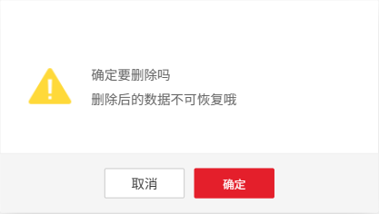
            1.  确认删除时，需校验当前设备是否有已开始未结束或未开始的培养，若有则不能删除，提示信息
> **[图 image115.png | 章节：实验室设置 / 设备配置① / 培养容器① | 上下文：1. 确认删除时，需校验当前设备是否有已开始未结束或未开始的培养，若有则不能删除，提示信息]**
> **OCR 文本：**
> 删除失败！
> 此反应器还有没结束的培养
> 确认

            1.  确认删除成功，提示信息
> **[图 image121.png | 章节：实验室设置 / 设备配置① / 培养容器① | 上下文：1. 确认删除成功，提示信息]**
> **OCR 文本：**
> 操作成功！
> 培养容器已删除
> 关闭

#### 地秤①

添加/修改/删除具体的地秤，维护所属实验室、编码等相关信息

> **[图 image122.png | 章节：实验室设置 / 设备配置① / 地秤① | 上下文：添加/修改/删除具体的地秤，维护所属实验室、编码等相关信息]**
> **OCR 文本：**
> 个选择款认显示他授权的所有实 | 支持按场地检索
> 验室的相关信息 | 支持按设备编号/设备型号/
> 台式反应器 | 天平 | 螺动泵 | 空气泵 | 检测设备 | 集成反应器 | 培养容器 | 地秤 | 规格的模糊检索，和创建时
> 间修改时间的检索
> 请选择实验室 | 请选择 | 请选择场地 | 设备型号/设备编号/规格 | 2016/09/01-2016/09/20 | 检索 | 新增
> 序号 | 实验室 | 场地 | 设备编号 | 资产编号 | 设备型号 | 设备型号 | 报警下限值(g) | 负责人 | 修改时间 | 修改人 | 操作
> 实验室1 | J207 | Scele.OHAUS.STRS0-1 | FA2110001446 | OHAUS | 35KG | 张三 | 2026-06-03 11:11:11 | 张三 | 修改 | 通讯设置
> 实验室1 | J207 | Scele.OHAUS.STRS0-2 | FA2110001447 | OHAUS | 100KG | 张三 | 2026-06-03 11:11:11 | 张三 | 修改 | 通讯设置 | 删除
> 实验室1 | J207 | Scele.OHAUS.STRS0-3 | FA2110001448 | OHAUS | 50KG | 100 | 张三 | 2026-06-03 11:11:11 | 张三 | 修改 | 通讯设置 | 删除
> 实验室1 | J208 | Scele.OHAUS.STRS0-4 | FA2110001449 | OHAUS | 35KG | 10 | 张三 | 2026-06-03 11:11:11 | 张三 | 修改 | 通讯设置 | 删除
> 实验室1 | J208 | Scele.OHAUS.STRS0-5 | FA21100014400 | OHAUS | 35KG | 1000 | 张三 | 2026-06-03 11:11:11 | 张三 | 修改 | 通讯设置 | 删除
> 实验室2 | 3149 | BRTWTSTR501 | FA2110001487 | OHAUS | 35KG | 1000 | 张三 | 2026-06-03 11:11:11 | 张三 | 修改 | 通讯设置 | 删除
> 上一页 | 10

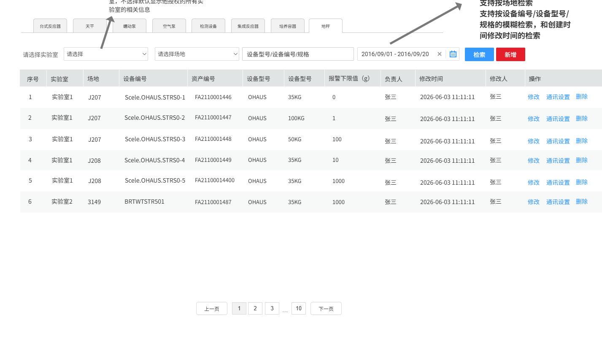
1.  新增
新增一台地秤，此处地秤通讯方式固定，仅开放相关字段填写信息。填写以下相关信息：

> **[图 image123.png | 章节：实验室设置 / 设备配置① / 地秤① | 上下文：新增一台地秤，此处地秤通讯方式固定，仅开放相关字段填写信息。填写以下相关信息：]**
> **OCR 文本：**
> 新增
> 实验室* | 实验室1 | 场地 | J207
> 资产编号* | Please enter... | 设备编号* | Please enter...
> 品牌* | OHAUS | 型号* | OHAUS (35KG)
> 报警下限值(g)* | Please enter... | 量程 | Please enter...
> 精度 | (g) | Please enter... | 负责人* | Please select...
> 是否补料地秤 | 维护
> 保存 | 取消

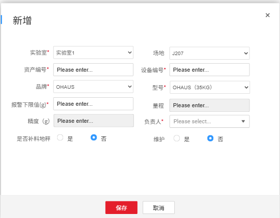
    1.  实验室：下拉单选，只能在当前用户授权范围之内选择实验室
    2.  场地：单选，选填，如果选择了场地，后续在看板上需要展示的时候可以区分场地来展示
    3.  资产编号：必填，全局唯一
    4.  品牌：下拉单选，必选，从【设备库－称重设备】获取
    5.  设备型号：从【设备库－地秤】获取到值以 [设备型号（规格）]的形式返回
    6.  量程：选择型号后从设备库里获取到规格关联显示，不可修改
    7.  精度：从设备库里获取精度关联显示，不可修改
    8.  报警下限值：数值型（浮点），支持小数点最多2位置，不能是负数
    9.  负责人：单选，必选，从用户列表里检索 显示姓名/用户名
    10.  维护：确认是否将当前设备设置为维护状态，默认值为否。选择是时，该设备不允许预约使用
    11.  是否补料地秤：必选，单选，默认否，可切换
    12.  保存：保存前完成的校验包括必填字段非空、字段长度、指定字段的唯一性
1.  查询条件
以下条件联合查询：

    1.  实验室：下拉单选，只能在当前用户授权范围之内选择实验室，不选显示所有项目相关信息
    2.  场地：下拉单选
    3.  设备型号/设备编号/规格：文本框，设备型号/设备编号/规格共同模糊搜索
    4.  起止时间：支持创建时间和修改时间搜索
1.  结果展示与操作
查询结果翻页展示，按修改时间倒排，最新的在最上面，包含以下字段：

    1.  序号
    2.  实验室
    3.  场地
    4.  设备编号
    5.  资产编号
    6.  设备型号
    7.  报警下限值（g）
    8.  负责人
    9.  修改人
    10.  修改时间
    11.  操作
        1.  修改：保持新增时的校验规则
> **[图 image124.png | 章节：实验室设置 / 设备配置① / 地秤① | 上下文：1. 修改：保持新增时的校验规则]**
> **OCR 文本：**
> 修改
> 实验室* | 实验室1 | 场地 | J207
> 资产编号* | Please enter... | 设备编号* | Please enter...
> 品牌* | OHAUS | 型号* | OHAUS (35KG)
> 报警下限值(g)* | Please enter... | 量程 | Please enter...
> 精度(g) | Please enter... | 负责人* | Please select...
> 是否补料地秤 | 维护
> 保存 | 取消

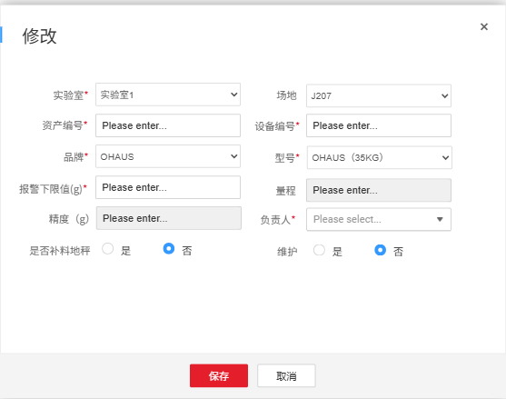
            1.  将维护状态从“是”改为“否”时，弹出二次确认框
> **[图 image83.png | 章节：实验室设置 / 设备配置① / 地秤① | 上下文：1. 将维护状态从“是”改为“否”时，弹出二次确认框]**
> **OCR 文本：**
> 确定要改为维护吗
> 改为维护状态后，控制模块将失去
> 与此设备的通讯
> 取消 | 确定

            1.  确认将维护状态从“是”改为“否”，操作成功
> **[图 image84.png | 章节：实验室设置 / 设备配置① / 地秤① | 上下文：1. 确认将维护状态从“是”改为“否”，操作成功]**
> **OCR 文本：**
> 操作成功！
> 已变秤维护状态
> 关闭

            1.  保存前完成与新增时一致的校验规则
        1.  通讯设置：配置地秤的IP信息
> **[图 image125.png | 章节：实验室设置 / 设备配置① / 地秤① | 上下文：1. 通讯设置：配置地秤的IP信息]**
> **OCR 文本：**
> 通讯设置
> 设备IP地址* | Please enter...
> 设备端口* | Please enter...
> 保存 | 取消

            1.  设备IP地址，必填，格式为x.x.x.x格式，x为1-3位数字
            2.  端口号纯数字，必填，位数不限制
        1.  删除
            1.  需二次确认才能删除，提示信息
> **[图 image126.png | 章节：实验室设置 / 设备配置① / 地秤① | 上下文：1. 需二次确认才能删除，提示信息]**
> **OCR 文本：**
> 确定要删除吗
> 删除之前请先从反应器上解除此设备的关联
> 取消 | 确定

            1.  确认删除时，需校验当前设备是否已经关联到反应器上，若已关联则不能删除，提示信息
> **[图 image127.png | 章节：实验室设置 / 设备配置① / 地秤① | 上下文：1. 确认删除时，需校验当前设备是否已经关联到反应器上，若已关联则不能删除，提示信息]**
> **OCR 文本：**
> 操作成功！
> 地秤已删除
> 关闭

            1.  确认删除成功，提示信息
> **[图 image128.png | 章节：实验室设置 / 设备配置① / 地秤① | 上下文：1. 确认删除成功，提示信息]**
> **OCR 文本：**
> 操作成功！
> 地秤已删除
> 关闭

### 其他设备

#### 声光报警器①

添加/修改/删除具体的声光报警器，维护所属实验室、编码等相关信息

> **[图 image122.png | 章节：实验室设置 / 其他设备 / 声光报警器① | 上下文：添加/修改/删除具体的声光报警器，维护所属实验室、编码等相关信息]**
> **OCR 文本：**
> 个选择款认显示他授权的所有实 | 支持按场地检索
> 验室的相关信息 | 支持按设备编号/设备型号/
> 台式反应器 | 天平 | 螺动泵 | 空气泵 | 检测设备 | 集成反应器 | 培养容器 | 地秤 | 规格的模糊检索，和创建时
> 间修改时间的检索
> 请选择实验室 | 请选择 | 请选择场地 | 设备型号/设备编号/规格 | 2016/09/01-2016/09/20 | 检索 | 新增
> 序号 | 实验室 | 场地 | 设备编号 | 资产编号 | 设备型号 | 设备型号 | 报警下限值(g) | 负责人 | 修改时间 | 修改人 | 操作
> 实验室1 | J207 | Scele.OHAUS.STRS0-1 | FA2110001446 | OHAUS | 35KG | 张三 | 2026-06-03 11:11:11 | 张三 | 修改 | 通讯设置
> 实验室1 | J207 | Scele.OHAUS.STRS0-2 | FA2110001447 | OHAUS | 100KG | 张三 | 2026-06-03 11:11:11 | 张三 | 修改 | 通讯设置 | 删除
> 实验室1 | J207 | Scele.OHAUS.STRS0-3 | FA2110001448 | OHAUS | 50KG | 100 | 张三 | 2026-06-03 11:11:11 | 张三 | 修改 | 通讯设置 | 删除
> 实验室1 | J208 | Scele.OHAUS.STRS0-4 | FA2110001449 | OHAUS | 35KG | 10 | 张三 | 2026-06-03 11:11:11 | 张三 | 修改 | 通讯设置 | 删除
> 实验室1 | J208 | Scele.OHAUS.STRS0-5 | FA21100014400 | OHAUS | 35KG | 1000 | 张三 | 2026-06-03 11:11:11 | 张三 | 修改 | 通讯设置 | 删除
> 实验室2 | 3149 | BRTWTSTR501 | FA2110001487 | OHAUS | 35KG | 1000 | 张三 | 2026-06-03 11:11:11 | 张三 | 修改 | 通讯设置 | 删除
> 上一页 | 10

1.  新增
新增一台声光报警器，填写以下相关信息：

> **[图 image129.png | 章节：实验室设置 / 其他设备 / 声光报警器① | 上下文：新增一台声光报警器，填写以下相关信息：]**
> **OCR 文本：**
> 新增
> 实验室* | 实验室1
> 设备编号* | Please enter...
> 资产编号* | Please enter...
> 描述 | Please enter
> 0/1000
> 保存 | 取消

    1.  实验室：下拉单选，只能在当前用户授权范围之内选择实验室
    2.  设备编号：文本框，字符串，必填，同一实验室内不允许重复
    3.  资产编号：文本框，必填，全局唯一
    4.  描述，非必填，字符串100字符以内
    5.  保存：保存前完成的校验包括必填字段非空、字段长度、指定字段的唯一性
1.  查询条件
以下条件联合查询：

    1.  实验室：下拉单选，只能在当前用户授权范围之内选择实验室，不选显示所有项目相关信息
    2.  设备编号/资产编号/描述：文本框，设备编号/资产编号/描述共同模糊搜索
    3.  起止时间：支持创建时间和修改时间搜索
1.  结果展示与操作
查询结果翻页展示，按修改时间倒排，最新的在最上面，包含以下字段：

    1.  序号
    2.  实验室
    3.  设备编号
    4.  资产编号
    5.  描述
    6.  设备IP地址
    7.  设备端口号
    8.  修改人
    9.  修改时间
    10.  操作
        1.  修改：保存前完成与新增时一致的校验规则
> **[图 image130.png | 章节：实验室设置 / 其他设备 / 声光报警器① | 上下文：1. 修改：保存前完成与新增时一致的校验规则]**
> **OCR 文本：**
> 修改
> 实验室* | 实验室1
> 设备编号* | A9
> 资产编号* | A9
> 描述 | Please enter
> 0/1000
> 保存 | 取消

        1.  通讯设置：
> **[图 image131.png | 章节：实验室设置 / 其他设备 / 声光报警器① | 上下文：1. 通讯设置：]**
> **OCR 文本：**
> 通讯设置 | 通讯设置
> 通讯方式* | 网口
> 通讯方式*
> 接口地址* | http或https | 子系统设备编号*
> 接口账号 | root | 子设备MAC* | MAC-MAC
> 接口密钥 | 子系统IP* | 192-168 | · 192
> 设备编码 | 83786736 | 设备IP* | 192 | 168 | 192
> 设备密钥 | 端口号*
> 保存 | 取消 | 保存 | 取消
> 通讯设置 | 通讯设置
> 通讯方式* | 文件 | 通讯方式* | 串口
> 子系统设备编号* | 设备编码 | Please ente.. | 设备型号 | Please enter..
> 子设备MAC* | MAC-MAC | 子系统IP* | 192 | 168 | ·192 | 串口号* | Please select..
> 子系统设备编号 | BGA001 | 波特率 | Please enter...
> 子系统IP* | 192 | 168 | ·192
> 校验位 | Please select.. | 数据位 | Please selec..
> EXCEL路径*
> 流控 | Please select... | 停止位 | Please select..
> 保存 | 取消 | 保存 | 取消

        1.  删除
            1.  需二次确认才能删除，提示信息
> **[图 image132.png | 章节：实验室设置 / 其他设备 / 声光报警器① | 上下文：1. 需二次确认才能删除，提示信息]**
> **OCR 文本：**
> 确定要删除吗
> 请确定使用此报警器的相关设备
> 已将移除！
> 取消 | 确定

            1.  确认删除时，需校验当前设备是否已经关联到其余设备上，若已关联则不能删除，提示信息
> **[图 image133.png | 章节：实验室设置 / 其他设备 / 声光报警器① | 上下文：1. 确认删除时，需校验当前设备是否已经关联到其余设备上，若已关联则不能删除，提示信息]**
> **OCR 文本：**
> 删除失败！
> 还有设备与此报警器关联，请先进行解绑！
> 确认

            1.  确认删除成功，提示信息
> **[图 image134.png | 章节：实验室设置 / 其他设备 / 声光报警器① | 上下文：1. 确认删除成功，提示信息]**
> **OCR 文本：**
> 操作成功！
> 声光报警器已删除
> 关闭

#### 打印机①

添加/修改/删除具体的打印机，维护所属实验室、编码等相关信息

> **[图 image135.png | 章节：实验室设置 / 其他设备 / 打印机① | 上下文：添加/修改/删除具体的打印机，维护所属实验室、编码等相关信息]**
> **OCR 文本：**
> 下拉可选范围限当前用户授权实验
> 室，不选择默认显示他授权的所有实
> 验室的相关信息
> 声光报警器 | 打印机
> 支持设备编号/资产编号的模
> 糊检索，和创建时间修改时
> 请选择实验室 | 请选择 | 设备编号/资产编号 | 2016/09/01 - 2016/09/20 | 检索 | 新增 | 间的检索
> 序号 | 实验室 | 设备编号 | 资产编号 | 子系统ip/端口号 | 修改时间 | 修改人 | 操作
> 实验室1 | GK888t | GK888t | 192.168.1.68:9100 | 2026-06-03 11:11:11 | 张三 | 修改 | 排版设置 通讯删除

1.  新增
新增一台打印机，填写以下相关信息：

> **[图 image136.png | 章节：实验室设置 / 其他设备 / 打印机① | 上下文：新增一台打印机，填写以下相关信息：]**
> **OCR 文本：**
> 新增
> 实验室" | 实验室1
> 设备编号 | Please enter...
> 资产编号 | Please enter...
> 打印数量： | Please enter...
> 保存 | 取消

    1.  实验室：下拉单选，只能在当前用户授权范围之内选择实验室
    2.  设备编号：文本框，字符串，必填，同一实验室内不允许重复
    3.  资产编号：文本框，必填，全局唯一
    4.  打印数量：必填，纯数字，正整数，npp必须有这个字段，小试不限制建议填写一个极大数比如9999999
    5.  保存：保存前完成的校验包括必填字段非空、字段长度、指定字段的唯一性
1.  查询条件
以下条件联合查询：

    1.  实验室：下拉单选，只能在当前用户授权范围之内选择实验室，不选显示所有项目相关信息
    2.  设备编号/资产编号：文本框，设备编号/资产编号共同模糊搜索
    3.  起止时间：支持创建时间和修改时间搜索
1.  结果展示与操作
查询结果翻页展示，按修改时间倒排，最新的在最上面，包含以下字段：

    1.  序号
    2.  实验室
    3.  设备编号
    4.  资产编号
    5.  子系统IP/端口号
    6.  修改人
    7.  修改时间
    8.  操作
        1.  修改：保存前完成与新增时一致的校验规则
> **[图 image137.png | 章节：实验室设置 / 其他设备 / 打印机① | 上下文：1. 修改：保存前完成与新增时一致的校验规则]**
> **OCR 文本：**
> 修改
> 实验室” | 实验室1
> 设备编号： | Please enter...
> 资产编号： | Please enter...
> 打印数量* | Please enter...
> 保存 | 取消

        1.  打印设置：每行都只能填写正整数，每次进入都默认展示上次填写过的数值
> **[图 image138.png | 章节：实验室设置 / 其他设备 / 打印机① | 上下文：1. 打印设置：每行都只能填写正整数，每次进入都默认展示上次填写过的数值]**
> **OCR 文本：**
> 打印设置
> 第一行* | 字体大小
> 第二行* | 字体大小
> 第三行* | 字体大小
> 第四行* | 字体大小
> 保存 | 取消

        1.  通讯设置
> **[图 image139.png | 章节：实验室设置 / 其他设备 / 打印机① | 上下文：1. 通讯设置]**
> **OCR 文本：**
> 通讯设置 | 通讯设置
> 通讯方式" | 网口
> 通讯方式
> 接口地址" | http或https | 子系统设备编号"
> 接口账号 | 子设备MAC* | MAC-MAC
> 接口密钥 | 子系统IP* | 192 | 168 | 192
> 设备编码 | 83786736 | 设备IP* | 192 | 168 | 192
> 设备密钥 | 端口号
> 保存 | 取消 | 保存
> 通讯设置 | 通讯设置
> 通讯方式 | 文件 | 通讯方式* | 串口
> 子系统设备编号" | 设备编码 | Please enter... | 设备型号 | Please enter...
> 子设备MAC* | MAC-MAC | 子系统IP | 192 | 168 | 192 | 串口号" | Please select..
> 子系统IP | 192 | -168 | - 192 | 子系统设备编号 | BGA001 | 波特率 | Please enter....
> 校验位 | Please select... | 数据位 | Please select..
> EXCEL路径" | 流控 | Please select.. | 停止位 | Please select..
> 保存 | 取消 | 保存 | 取消

        1.  删除
            1.  需二次确认才能删除，提示信息
> **[图 image140.png | 章节：实验室设置 / 其他设备 / 打印机① | 上下文：1. 需二次确认才能删除，提示信息]**
> **OCR 文本：**
> 确定要删除吗
> 删除后相关实验室的打印功能将失效
> 取消 | 确定

            1.  确认删除时，需校验当前设备是否正在使用（需确认技术上能否捕捉），若是，则不能删除，提示信息
> **[图 image133.png | 章节：实验室设置 / 其他设备 / 打印机① | 上下文：1. 确认删除时，需校验当前设备是否正在使用（需确认技术上能否捕捉），若是，则不能删除，提示信息]**
> **OCR 文本：**
> 删除失败！
> 还有设备与此报警器关联，请先进行解绑！
> 确认

            1.  确认删除成功，提示信息
> **[图 image141.png | 章节：实验室设置 / 其他设备 / 打印机① | 上下文：1. 确认删除成功，提示信息]**
> **OCR 文本：**
> 操作成功！
> 打印机删除成功
> 关闭

#### 继电器①

添加/修改/删除具体的继电器，维护所属实验室、编码等相关信息

> **[图 image142.png | 章节：实验室设置 / 其他设备 / 继电器① | 上下文：添加/修改/删除具体的继电器，维护所属实验室、编码等相关信息]**
> **OCR 文本：**
> 请选择实验室 | 请选择 | 设备编号/资产编号 | 2016/09/01-2016/09/20 | 检索 | 新增
> 序号 | 实验室 | 设备编号 | 资产编号 | 修改时间 | 修改人 | 操作
> 实验室1 | Device5 | Device-5 | 2026-06-03 11:11:11 | 张三 | 修改 | 开启 | 关闭 | 通讯 | 删除
> 实验室1 | Device4 | Device-4 | 2026-06-03 11:11:11 | 张三 | 修改 | 开启 | 关闭 | 通讯 | 删除
> 实验室1 | Device3 | Device-3 | 2026-06-03 11:11:11 | 张三 | 修改 | 开启 | 关闭 | 通讯 | 删除
> 实验室1 | Device2 | Device-2 | 2026-06-03 11:11:11 | 张三 | 修改 | 开启 | 关闭 | 通讯 | 删除
> 实验室1 | Device1 | Device-1 | 2026-06-03 11:11:11 | 张三 | 修改•开启•关闭•通讯 | 删除
> 实验室1 | Deviceo | Device-0 | 2026-06-03 11:11:11 | 张三 | 修改　开启　关闭　通讯　丹 | 删除
> 上一页 | 10 | 下一页

1.  新增
新增一台继电器，填写以下相关信息：

> **[图 image143.png | 章节：实验室设置 / 其他设备 / 继电器① | 上下文：新增一台继电器，填写以下相关信息：]**
> **OCR 文本：**
> 新增
> 实验室* | 实验室1
> 设备编号* | Please enter...
> 资产编号* | Please enter...
> 保存

    1.  实验室：下拉单选，只能在当前用户授权范围之内选择实验室
    2.  设备编号：文本框，字符串，必填，同一实验室内不允许重复
    3.  资产编号：文本框，必填，全局唯一
    4.  保存：保存前完成的校验包括必填字段非空、字段长度、指定字段的唯一性
1.  查询条件
以下条件联合查询：

    1.  实验室：只能在当前用户授权范围之内选择实验室，不选显示所有项目相关信息
    2.  设备编号/资产编号：文本框，设备编号/资产编号共同模糊搜索
    3.  起止时间：支持创建时间和修改时间搜索
1.  结果展示与操作
查询结果翻页展示，按修改时间倒排，最新的在最上面，包含以下字段：

    1.  序号
    2.  实验室
    3.  设备编号
    4.  资产编号
    5.  修改人
    6.  修改时间
    7.  操作
        1.  修改：保存前完成与新增时一致的校验规则。增加展示创建人和创建时间信息
> **[图 image144.png | 章节：实验室设置 / 其他设备 / 继电器① | 上下文：1. 修改：保存前完成与新增时一致的校验规则。增加展示创建人和创建时间信息]**
> **OCR 文本：**
> 修改
> 实验室* | 实验室1
> 设备编号* | Please enter...
> 资产编号* | Please enter...
> 创建人张三 | 创建时间2026-06-0112:12:23
> 保存 | 取消

        1.  开启/关闭：选择打开或关闭该设备
        2.  通讯设置
> **[图 image145.png | 章节：实验室设置 / 其他设备 / 继电器① | 上下文：2. 通讯设置]**
> **OCR 文本：**
> 通讯设置 | 通讯设置
> 通讯方式* | 网口
> 通讯方式*
> 接口地址* | http或https | 子系统设备编号*
> 接口账号 | root | 子设备MAC* | MAC-MAC
> 接口密钥 | 子系统IP* | 192 | 168 | 192
> 设备编码 | 83786736 | 设备IP* | 192 | 168 | 192
> 设备密钥 | 端口号*
> 保存 | 取消 | 保存 | 取消
> 通讯设置 | 通讯设置
> 通讯方式* | 文件 | 通讯方式* | 串口
> 子系统设备编号* | 设备编码 | Please enter... | 设备型号 | Please enter...
> 子设备MAC* | MAC-MAC | 子系统IP* | 192 | 168 | 192 | 串口号* | Please select..
> 子系统设备编号 | BGA001 | 波特率 | Please enter...
> 子系统IP* | 192 | 168 | ·192
> 校验位 | Please select... | 数据位 | Please select..
> EXCEL路径*
> 流控 | Please select.. | 停止位 | Please select..
> 保存 | 取消 | 保存 | 取消

        1.  删除
            1.  需二次确认才能删除，提示信息
> **[图 image146.png | 章节：实验室设置 / 其他设备 / 继电器① | 上下文：1. 需二次确认才能删除，提示信息]**
> **OCR 文本：**
> 确定要删除吗
> 删除之前请确定相关设备已移除绑定关系
> 取消 | 确定

            1.  确认删除时，需校验当前设备是否正在使用若是，则不能删除，提示信息
> **[图 image147.png | 章节：实验室设置 / 其他设备 / 继电器① | 上下文：1. 确认删除时，需校验当前设备是否正在使用若是，则不能删除，提示信息]**
> **OCR 文本：**
> 删除失败！
> 有实验室还在使用此设备，无法删除
> 请先在实验室进行删除操作
> 确认

        1.  确认删除成功，提示信息
> **[图 image148.png | 章节：实验室设置 / 其他设备 / 继电器① | 上下文：1. 确认删除成功，提示信息]**
> **OCR 文本：**
> 删除失败！
> 有实验室还在使用此设备，无法删除
> 请先在实验室进行删除操作
> 确认

### 离线告警设置①（搁置）（在反应器详情页面实现）

在实验室级别，配置各检测类型检测项目的离线告警阈值，当检测项数值超阈值时，系统产生通知告警。

> **[图 image149.png | 章节：实验室设置 / 离线告警设置①（搁置）（在反应器详情页面实现） | 上下文：在实验室级别，配置各检测类型检测项目的离线告警阈值，当检测项数值超阈值时，系统产生通知告警。]**
> **OCR 文本：**
> 下拉可选范困
> 实验室设置 | 限当前用户授
> 权实验室
> 实验室管理 | 请选择实验室 | 实验室3
> 设备配置 | BGA | Vicell | OSMO | Cedex
> 其他设备
> 消耗设置 | 序号 | 检项名称 | 单位 | 报警下限 | 报警上限 | 修改时间 | 修改人
> 离线告警 | PH | 7.3 | 8.6 | 2026-06-03 11:11:11 | 张三
> 在线告警 | pCO: | mmHg | 2026-06-03 11:11:11 | 张三
> 状态告警 | pO2 | mmHg | 2026-06-03 11:11:11 | 张三
> 液瓶配置
> Na* | mM/L | 2026-06-03 11:11:11 | 张三
> K+ | mM/L | 2026-06-03 11:11:11 | 张三
> ITEMP | 2026-06-03 11:11:11 | 张三
> 重制 | 保存

1.  查询条件
以下条件联合查询，未选择时显示缺省空白页，如图1-1缺省图所示

1.  实验室：下拉单选，只能在当前用户授权范围之内选择实验室
> **[图 image150.png | 章节：实验室设置 / 离线告警设置①（搁置）（在反应器详情页面实现） | 上下文：1. 实验室：下拉单选，只能在当前用户授权范围之内选择实验室]**
> **OCR 文本：**
> 请选选择实验室和模式

*图1-1缺省图*

1.  结果展示操作
    1.  序号
    2.  检项名称/单位：根据设备配置模块中不同检测类型配置的不同检测项目自动带出，每个检项为一行
    3.  报警下限：选填，前端页面展示〈 ，默认使用〈判断。不填写默认不设告警限制，支持小数点后最多4位，允许填写0。下限值要小于上限值。
    4.  报警上限：选填，前端页面展示> ，默认使用>判断。不填写默认不设告警限制，支持小数点后最多4位，允许填写0。上限值要大于下限值。
    5.  修改人
    6.  修改时间
    7.  操作：
        1.  保存：保存时需校验同一指标的上限值必须大于下限值，如果填写错误红框提示错误。保存成功即直接应用（该实验室产生的相关检测项根据此规则产生通知告警）
        2.  清空：清空当前所有已填写内容
        3.  应用到我授权的所有实验室：将当前信息一键复制保存到所有当前有授权的实验室并直接应用
### 消耗设置②

此模块用于配置自动化任务中耗材的单次使用数量。此处设置的数量，会在自动化取样和补料的时候，对耗材的使用数量进行消耗计数，以及对当前剩余可用数量进行计算，后续在耗材告警，以及在下发自动化任务的时候，如果无可用数量会告警报错，以及具体用量后续也会产生使用数量的统计。

1.  Tab页：分为补料批次、柱后、样本三个页签。每个页签包含多个表格区域，默认为展示已填写信息。
1.  补料批次：自动化取样测样消耗的数量
2.  柱后：灌流模式消耗的数量
3.  样本：LoadSample消耗的数量
> **[图 image151.png | 章节：实验室设置 / 消耗设置② | 上下文：3. 样本：LoadSample消耗的数量]**
> **OCR 文本：**
> 前的那个实验室
> 请选择实验室 | 请选择
> 补科批次 | 柱后 | 样本 | 编辑
> BGA | Vicell | 稀释 | 未稀释
> 序号 | 类型 | 项目 | 数量 | 序号 | 类型 | 项目 | 数量
> 耗材 | EP Tube | 耗材 | 1mI Tip
> 耗材 | Vicell-Tube
> 共享 | BGA-1 | NA
> OSMO | Cedex
> 序号 | 类型 | 项目 | 数量 | 序号 | 类型 | 项目 | 数量
> 耗材 | 1ml Tip | 耗材 | Cedex Tube
> 耗材 | EP Tube | 共享 | OSMO-1 | NA
> 耗材 | OSMO Tube | 共享 | OSMO-2 | NA
> 留样
> 序号 | 类型 | 项目 | 数量
> 耗材 | 50mL Centrifuge Tube

1.  展示内容：
    1.  不同Tab页包含不同展示内容，具体如下：
> **[图 image152.png | 章节：实验室设置 / 消耗设置② | 上下文：1. 不同Tab页包含不同展示内容，具体如下：]**
> **OCR 文本：**
> 补料批次 | 柱后 | 样本
> BGA | BGA-柱后 | BGA
> Vicell | 1（稀释/未稀释） | Vicell（稀释/未稀释）
> OSMO | OSMO-柱后 | OSMO
> Cedex | Cedex-柱后 | Cedex
> 留样 | 留样-柱后

    1.  每个表格可填写内容一致
        1.  编辑：点击编辑按钮后，内容可编辑
> **[图 image153.png | 章节：实验室设置 / 消耗设置② | 上下文：1. 编辑：点击编辑按钮后，内容可编辑]**
> **OCR 文本：**
> 请选择实验室 | 请选择 | 默认显示当前用户授权实验室中id靠
> 前的那个实验室
> 补科批次 | 桂后 | 样本 | 保存
> BGA | Vicell | 稀释 | 未稀释
> 序号 | 类型 | 项目 | 数量 | 序号 | 类型 | 项目 | 数量
> Please select.. | 耗材 | Please select...
> Please select.. | 耗材 | Please select..
> 耗材 | Please select.. | 耗材 | Please selec..
> 共享 | Please select.. | 共享 | Please select..
> OSMO | Cedex
> 序号 | 类型 | 项目 | 数量 | 序号 | 类型 | 项目 | 数量
> Please select.. | 耗材 | Please select..
> Please select.. | 耗材 | Please select...
> Please select.. | 耗材 | Please select..
> 共享 | Please select.. | 共享 | Please select..
> 留样
> 序号 | 类型 | 项目 | 数量
> 耗材 | Please select..
> 耗材 | Please select..
> 耗材 | Please select...
> 共享 | Please select..

        1.  内容说明：
            1.  名称：仅展示，不可修改
            2.  +：未填写时默认只有一行填写区域，点击+添加一行填写区域
            3.  稀释/未稀释：仅Vicell有，可切换填写不同的规则。
            4.  序号：按照数值+1自增
            5.  类型：下拉单选，包含耗材、共享两类
            6.  项目：下拉单选，根据类型联动不同选项
                1.  选择耗材：从耗材表里选择，默认显示耗材的描述
                2.  选择共享：可以选择当前页面其他卡片已经保存好的数据进行复用，下拉显示名称－序号。示例：补料tab下Vicell第3行选择与BGA-1共享，则表示使用BGA里序号1行的同样的配置，配置后，如果用户同时下发Vicell和BGA的任务则vicell和BGA对于EP Tube的消耗共用一个1，如果只下发了Vicell任务，则对EP Tube的消耗采取BGA的设定值 为1
            7.  数量：不填写显示NA，填写的时候需要输入正整数
            8.  删除按钮：删除当前行
### 液瓶配置②

1.  整体布局说明：
    1.  小试实验室的【控制器】数据、【取样瓶】和【补料瓶】三者的映射关系为通过数据库进行初始化
    2.  可按照实验室的布局设置，通过“Row1”/“Row2”进行摆放关联操作，实现快速切换查看修改
    3.  此页面取样单元、补料单元中具体液瓶的相关参数，比如编码、数量、液体等通过数据库维护
2.  筛选条件
    1.  实验室：下拉单选，必选，列表内容为当前用户授权的实验室，默认选中ID所在的实验室
#### 取样单元②

> **[图 image154.png | 章节：实验室设置 / 液瓶配置② / 取样单元② | 上下文：#### 取样单元②]**
> **OCR 文本：**
> 请选择实验室 | 请选择
> 胶样单元 | 补科单元
> Row1 | Row2 | Row3
> $33 | $34
> $33.1 | $33.2 | $33.3 | $34.1 | $34.2 | $34.3
> 1000ML Bucket | 1000ML Bucket | 1000ML Bucket | 1000ML Bucket | 1000ML Bucket | 1000ML Bucket
> Water | 75% Ethyl alcohol | Waste | Water | 75% Ethyl alcohol | Waste
> 1000/1000g | 991/1000g | 0/1000g | 1000/1000g | 991/1000g | 0/1000g
> 100% | 100% | 0% | 100% | 100% | 0%
> $35 | $36
> $35.1 | $35.2 | $35.3 | $36.1 | $36.2 | $36.3
> 1000ML Bucket | 1000ML Bucket | 1000ML Bucket | 1000ML Bucket | 1000ML Bucket | 1000ML Bucket
> Water | 75% Ethyl alcohol | Waste | Water | 75% Ethyl alcoholv | Waste
> 1000/1000g | 991/1000g | 0/1000g | 1000/1000g | 0/1000g
> 100% | 100% | 0% | 100% | 0%
> 保存

1.  取样单元编号：仅展示，不支持修改，示例S33
2.  取样单元通道编号：仅展示，不支持修改，示例S33-1
3.  液瓶名称：
    1.  不可修改时，展示保存信息
    2.  可修改保存时，为下拉单选，列表内容为耗材模块中的描述字段，但需满足描述字段包含“Bucket”，且类型字段=CITEM
4.  液体类型：
    1.  不可修改时，展示保存信息
    2.  可修改状态下为下拉单选，列表内容来自数据字典，
        1.  默认按照1#water、2#75% Ethyl alcoho、 3# Waste，
        2.  通道编码为3的液体类型固定为Waste不可修改
5.  液瓶图片：已连接和未连接差异化展示
6.  当前实际使用容量/液瓶标准容量：此处不可修改，当前实际容量会在培养过程中因为自动取测或补液发生变化，直接从PLC程序中对应的数据库表中获取数据即可，不需要系统计算。
7.  比例：百分比展示，根据当前实际使用容量/液瓶标准容量100%计算
8.  保存：
    1.  一个取样单元下的三个通道的状态保持一致，都可修改或都不可修改
    2.  当前取样单元对应控制器为空闲状态时（未在工作流中开启培养）才可修改保存。
#### 补料单元②

> **[图 image155.png | 章节：实验室设置 / 液瓶配置② / 补料单元② | 上下文：#### 补料单元②]**
> **OCR 文本：**
> 取样单元 | 补科单元
> Row1 | Row2 | Row3
> F33 | F34
> F33.1 | F33.2 | F33.3 | F33.4 | F33.5 | F33.6 | F34.1 | F34.2 | F34.3 | F34.4 | F34.5 | F34.6
> 2000mL Bucket v | 2000mL Bucket | 2000mL Bucket | 2000mL Bucket | 2000mL Bucket | 2000mL Bucket | 2000mL Bucket | 2000mL Bucket | 2000mL Bucket | 2000mL Bucket | 2000mL Bucket | 2000mL Bucket
> Na2C03 | FM020a | FM020b | Glucose | Basal | Harvest | Na2C03 | FM020a | FM020b | Glucose | Basal | Harvest
> 2000/2000g | 1800/2000g | 1970.8/2000g | 2000/2000g | 1800/2000g | 1970.8/2000g
> 100% | 90% | 99% | 100% | 90% | 99%
> 保存 | 保存 | 保存 | 保存 | 保荐 | 保存
> F35 | F36
> F35.1 | F35.2 | F35.3 | F35.4 | F35.5 | F35.6 | F36.1 | F36.2 | F36.3 | F36.4 | F36.5 | F36.6
> 2000mL Bucket | 2000mL Bucket | 2000mL Bucket | 2000mL Bucket | 2000mL Bucket | 2000mL Bucket  | 2000mL Bucket | 2000mL Bucket | 2000mL Bucket | 2000mL Bucket | 2000mL Bucket | 2000mL Bucket
> Na2C03 | FM020a | FM020b | Glucose | Basal | Harvest | Na2C03 | FM020a | FM020b | Glucose | Basal | Harvest
> 2000/2000g | 1800/2000g | 1970.8/2000g | 2000/2000g | 1800/2000g | 1970.8/2000g
> 100% | 90% | %66 | 100% | 90% | %66
> 保存 | 保存 | 保存 | 保存

1.  补料单元编号：仅展示，不支持修改，示例F33
2.  补料单元通道编号：仅展示，不支持修改，示例F33.1
3.  液瓶名称：
    1.  不可修改时，展示保存信息
    2.  可修改保存时，为下拉单选，列表内容为耗材模块中的描述字段，但需满足描述字段包含“Bucket”，且类型字段=CITEM
4.  补料类型：
    1.  不可修改时，展示保存信息
    2.  可修改状态下为下拉单选，列表内容为已维护的补液培养基，不用做重复校验，可随意勾选
5.  液瓶图片：已连接和未连接差异化展示
6.  当前实际使用容量/液瓶标准容量：此处不可修改，当前实际容量会在培养过程中因为自动取测或补液发生变化，直接从PLC程序中对应的数据库表中获取数据即可，不需要系统计算。
7.  比例：百分比展示，根据当前实际使用容量/液瓶容量100%计算
8.  保存：
    1.  一个补料单元下的每个通道的状态独立
    2.  当前补料单元的通道，若其对应控制器在工作流的连接补料单元中设置为连接使用后不支持修改保存，其余通道依然支持修改保存。
### 状态告警②

#### 耗材②

> **[图 image156.png | 章节：实验室设置 / 状态告警② / 耗材② | 上下文：#### 耗材②]**
> **OCR 文本：**
> 下拉可选范围限当前用户授权实验室
> 实验室设置 | 默认显示当前用户授权实验室中id靠
> 前的那个实验室(限小试类型)
> 这个列表里的数据
> 请选择实验室 | 请选择 | 包括项目、单位、默认数量和默认报警数 | 来自于一个初始化好的表格 | 数字支持正整数和0
> 实验室管理 | 量，这里只需要修改报警数量 | 数字不能大于默认数量
> 设备配置 | 液体 | 取样单元 | 补科单元 | 数值，参考右上角表 | 每个实验室保存一组对这些报警项目的报警
> 其他设备 | 如果当前数量已经低于报警数，要标红
> 消耗设置 | 序号 | 耗材 | 单位 | 默认数量 | 默认报警数量 | 当前数量 | 报警数量 | 修改时间 | 修改人
> 离线警告配置 | EP Tube | UNIT | 192 | 96 | 224 | 20 | 2026-06-03 11:11:11 | 张三
> 在线警告配置 | 1ml Tip | UNIT | 192 | 96 | 261 | 10 | 2026-06-03 11:11:11 | 张三
> 液瓶配置 | OSMO Tube | UNIT | 32 | 16 | 2026-06-03 11:11:11 | 张三
> 状态告警
> 50mL Centrifuge Tube | UNIT | 192 | 96 | 70 | 2026-06-03 11:11:11 | 张三
> 300μL Tip | UNIT | 192 | 96 | 2026-06-03 11:11:11 | 张三
> Vicell Tube | UNIT | 192 | 96 | 98 | 10 | 2026-06-03 11:11:11 | 张三
> 清空 | 保存

1.  查询条件
    1.  实验室：下拉单选，可选范围限当前用户授权实验室，默认显示当前用户登录网络所在的实验室（比如，用户登录的是部署在奉贤中试实验室的系统，则默认选中奉贤中试实验室），仅限小试实验室
2.  结果展示与操作：当前查询结果展示不分页。
    1.  此处数据来自一个初始化的数据库表，筛选类型为耗材的数据，每个实验室保存一组，包含以下字段
        1.  序号
        2.  耗材
        3.  单位
        4.  默认数量
        5.  默认报警数量
    2.  当前数量：从数据库（后续需求中需计算此指标并存库）中读取数值，报警时需标红展示
    3.  报警数量：选填，报警逻辑写死为〈，数量可编辑，支持0或正整数，0或空表示不报警，不能大于默认数量
    4.  修改人
    5.  修改时间
    6.  清空：清空已填写的报警数量
    7.  保存：保存当前内容
#### 液体②

> **[图 image157.png | 章节：实验室设置 / 状态告警② / 液体② | 上下文：#### 液体②]**
> **OCR 文本：**
> 下拉可选范围限当前用户授权实验室
> 默认显示当前用户授权实验室中id靠
> 前的那个实验室
> 请选择实验室 | 请选择
> 液体 | 取样单元 | 补料单元
> 序号 | 项目 | 单位 | 默认数量 | 默认报警数量 | 当前数量 | 报警数量 | 修改时间 | 修改人
> DBPS | ml | 1000 | 10 | 438.54 | 10 | 2026-06-03 11:11:11 | 张三
> 清空 | 保存

1.  查询条件
    1.  实验室：下拉单选，可选范围限当前用户授权实验室，默认显示当前用户登录网络所在的实验室（比如，用户登录的是部署在奉贤中试实验室的系统，则默认选中奉贤中试实验室），限小试
2.  结果展示与操作：当前查询结果展示不分页。
    1.  此处数据来自一个初始化的数据库表，筛选类型为液体的数据，每个实验室保存一组，包含以下字段
        1.  序号
        2.  液体
        3.  单位
        4.  默认数量
        5.  默认报警数量
    1.  当前数量：从数据库（后续需求中需计算此指标并存库）中读取数值，报警时需标红展示
    2.  报警数量：选填，报警逻辑写死为〈，数量可编辑，支持0或正整数，0或空表示不报警，不能大于默认数量
    3.  修改人
    4.  修改时间
    5.  清空：清空已填写的报警数量
    6.  保存：保存当前内容
#### 取样单元②

> **[图 image158.png | 章节：实验室设置 / 状态告警② / 取样单元② | 上下文：#### 取样单元②]**
> **OCR 文本：**
> 里面设置的【液体类型】 | 液体量，如果真实数量已经低于设定
> 请选择实验室 | 请选择 | 默认数量是根据配置的瓶子的容量获 | 要求，这里既要标红
> 得液瓶标准容量
> 耗材 | 液体 | 取样单元 | 补科单元 | 点击后在同实验室，同样液体类型的
> 空白格自动复制粘贴左边input里的
> 取样单元 | 液体类型 | 数据
> 序号 | 项目 | 单位 | 默认数量 | 默认报警数量 | 当前数量 | 报警数量 | 修改时间 | 修改人
> S33#1 [water] | mL | 1000 | 1000 | 1000 | 100 | 粘贴到所有同类型 | 2026-06-03 11:11:11 | 张三
> S33 #2 [75% Ethyl alcohol] | mL | 500 | 50 | 12 | 50 | 粘贴到所有同类型 | 2026-06-03 11:11:11 | 张三
> S33#3 [Waste] | mL | 500 | 50 | 400 | 粘贴到所有同类型 | 2026-06-03 11:11:11 | 张三
> S34#1 [water] | mL | 1000 | 1000 | 1000 | 粘贴到所有同类型 | 2026-06-03 11:11:11 | 张三
> S34 # 2 [75% Ethyl alcohol] | mL | 500 | 50 | 499 | 粘贴到所有同类型 | 2026-06-03 11:11:11 | 张三
> S34#3 [Waste] | mL | 500 | 50 | 粘贴到所有同类型 | 2026-06-03 11:11:11 | 张三
> S35#1 [water] | mL | 1000 | 1000 | 1000 | 粘贴到所有同类型 | 2026-06-03 11:11:11 | 张三
> S35 # 2 [75% Ethyl alcohol] | mL | 500 | 50 | 499 | 粘贴到所有同类型 | 2026-06-03 11:11:11 | 张三
> S35#3 [Waste] | mL | 500 | 50 | 粘贴到所有同类型 | 2026-06-03 11:11:11 | 张三
> 清空 | 保存

1.  查询条件
    1.  实验室：下拉单选，可选范围限当前用户授权实验室，默认显示当前用户登录网络所在的实验室（比如，用户登录的是部署在奉贤中试实验室的系统，则默认选中奉贤中试实验室），限小试
    2.  取样单元：数据库表中维护的所有取样单元编号
    3.  液体类型：数据来源于数据字典
2.  结果展示与操作
数据来源为液瓶配置模块中取样单元已维护的数据，当前查询结果展示不分页。

    1.  序号
    2.  取样单元：多个字段拼接展示，连接泵的名称+【液体名称】
    3.  单位：写死为ml
    4.  默认数量：液瓶配置里设置的标准容量
    5.  默认报警数量：按照不同液体名称设置
    6.  Water：默认值为瓶子体积的10%，低于10%时预警
    7.  75% Ethyl alcoho：默认值为瓶子体积的10%，低于10%时预警
    8.  Waste：默认值为瓶子体积的90%，超过90%时预警
    9.  当前数量：读取数据库（液瓶设置及工作流中都会编辑保存）
    10.  报警数量：选填，报警逻辑写死为〈，数量可编辑，支持0或正整数，0或空表示不报警，不能大于默认数量
    11.  粘贴到所有同类型：点击后在同一实验室，同样液体类型的空白格自动复制粘贴左边报警数量
    12.  修改人
    13.  修改时间
    14.  保存：保存当前内容
#### 补料单元②

> **[图 image159.png | 章节：实验室设置 / 状态告警② / 补料单元② | 上下文：#### 补料单元②]**
> **OCR 文本：**
> Bas
> 请选择实验室 | 请选择 | 跟选择的实验室从实验室的补料配置 | Harvest
> 表里获知所有泵头的名称和液瓶管理 | 里面设置的【液体类型】 | 液体类型
> 液体 | 取样单元 | 其中不包含Basal和Harvest类型
> 粘贴到所有，点击后复制左侧格子量
> 补料单元 | 液体类型 | 的内容自动填充到所有其他空白格子
> 序号 | 项目 | 单位 | 默认数量 | 默认报警数量 | 当前数量 | 报警数量 | 修改时间 | 修改人
> F33#1 [Na2CO3] | mL | 1000 | 100 | 1772.6 | 50 | 粘贴到所有 | 2026-06-03 11:11:11 | 张三
> F33 #2 [FM020a] | mL | 1000 | 100 | 50 | 粘贴到所有 | 2026-06-03 11:11:11 | 张三
> F33#3 [FM020b] | mL | 1000 | 100 | 100 | 粘贴到所有 | 2026-06-03 11:11:11 | 张三
> F33 # 4 [Glucose] | mL | 1000 | 100 | 1000 | 100 | 粘贴到所有 | 2026-06-03 11:11:11 | 张三
> F34#1 [Na2C03] | mL | 1000 | 100 | 789.2 | 50 | 粘贴到所有 | 2026-06-03 11:11:11 | 张三
> F34#2[FM020a] | mL | 1000 | 100 | 50 | 粘贴到所有 | 2026-06-03 11:11:11 | 张三
> F34 #3 [FM020b] | mL | 1000 | 100 | 1000 | 100 | 粘贴到所有 | 2026-06-03 11:11:11
> F34 # 4 [Glucose] | mL | 1000 | 100 | 499 | 100 | 粘贴到所有 | 202606-03 11:11:11 | 张三
> F35#1 [Na2CO3] | mL | 2000 | 200 | 1967.9 | 200 | 粘贴到所有 | 20260603 11:11:11
> 数字可填写0或正整数
> 如果填写了0或者留空表示不需要告警
> 清空 | 保存 | 当前数量为通过设备监控到实际的液体量
> 如果当前达到设置的报警数量就标红

1.  查询条件
    1.  实验室：下拉单选，可选范围限当前用户授权实验室，默认显示当前用户登录系统所在的实验室（比如，用户登录的是部署在奉贤中试实验室的系统，则默认选中奉贤中试实验室），仅限小试
    2.  补料单元：数据库表中维护的所有补料单元编号
    3.  液体类型：数据来源于数据字典
2.  结果展示与操作：当前查询结果展示不分页。
数据来源为液瓶配置模块中补料单元已维护的数据，当前查询结果展示不分页。

    1.  序号
    2.  控制器编号：多个字段拼接展示，连接泵的名称+【液体名称】
    3.  单位：写死为ml
    4.  默认数量：液瓶配置里设置的标准容量
    5.  默认报警数量：默认为液瓶体积的10%，低于10%预警
    6.  当前数量：读取数据库（液瓶设置及工作流中都会编辑保存）
    7.  报警数量：选填，报警逻辑写死为〈，数量可编辑，支持0或正整数，0或空表示不报警，不能大于默认数量，若填写，则按照此数量预警
    8.  粘贴到所有：点击后在同实验室，所有空白格自动复制粘贴左边报警数量
    9.  修改人
    10.  修改时间
    11.  保存：保存当前内容
### 告警查询②

#### 告警规则梳理②

系统包含各类告警规则需后端程序一一开发实现。

1.  告警需记录的关键字段
    1.  通用字段
        1.  告警时间
        2.  告警类型：在线告警、离线告警、项目告警、任务告警等，具体见下方梳理完成后附件中包含的类型
        3.  告警模块：每个类型下有不同的模块分类，具体见下方梳理完成后附件中包含的类型
        4.  关联设备：描述该告警对应的设备信息，但并不是每个告警都会关联到设备
        5.  关联项目：如果为在培养中发生的告警，则需要记录项目、批次、培养、样品 等信息
        6.  状态：未处理、已处理。刚生成的记录默认为未处理状态， 处理完成后第一期需人工点击后进行完成标记，后续可以整理出自动完成，或者通过短信或邮件方式完成处理标记的规则，本期默认先通过点击标记
        7.  详情描述：可以和通知文案共用，需要设计通知模板
        8.  通知用户：用户list
        9.  关联系统：如服务器报警或系统错误报警，记录服务器/系统相关信息（比如IP、服务器名称等）
        10.  跳转链接：部分告警可快速跳转到相应页面查看或处理
    2.  其余字段：实际告警发生及处理后，还需记录相关字段，包括：
        1.  告警内容：使用梳理的【站内信－邮件标题模板】
        2.  告警实验室
        3.  处理时间
        4.  处理人
2.  系统告警梳理：根据上述字段，梳理系统内所有告警规则见以下附件
> 附件: Workbook1.xlsx（docx 内嵌 OLE 对象，未内联；原文件请在 需求说明书V5.1-1030.docx 中查看）
#### 告警查询页面②

查看系统所有的告警记录，可查看详情、处理告警等。

> **[图 image161.png | 章节：实验室设置 / 告警查询② / 告警查询页面② | 上下文：查看系统所有的告警记录，可查看详情、处理告警等。]**
> **OCR 文本：**
> 实验室设置
> 实验室管理 | 2016/09/01 - 2016/09/20 | 请选择告警类型 | 状态 | 请选择实验室 | 详情 | 通知人/处理人 | 检索 | 清空
> 设备配置
> 序号 | 告警时间 | 告警类型 | 状态 | 告警实验室 | 告警模块 | 告警内容 | 处理时间 | 处理人 | 操作
> 其他设备
> 工作流配置 | 2026-06-01 12:21:34 | 在线告警 | 未处理 | 实验室1 | 在线告警 | FX033pump1告警 | 详情
> 液瓶配置 | 2026-06-01 12:21:34 | 离线告警 | 【已处理 | 实验室2 | 离线告警 | BGA检测异常 | 2026-06-01 12:21:34 | 张三 | 详情
> 消耗设置 | 2026-06-01 12:21:34 | 状态告警 | 已处理 | 实验室2 | 耗材 | EPTube数量低于下限 | 2026-06-01 12:21:34 | 张三 | 详情
> 离线告警
> 2026-06-01 12:21:34 | 系统告警 | 已处理 | 实验室2 | 中转服务器 | 中转服务连接失败 | 2026-06-01 12:21:34 | 张三 | 详情
> 状态告警
> 告警设置
> 告警查询
> 上一页 | 34

1.  查询条件
查询结果由于用户权限不同有所差异，需根据关联项目、关联实验室、本人是否在通知范围内筛选，然后结合以下查询条件联合查询

    1.  起止时间：根据告警时间检索
    2.  告警类型：下拉单选
    3.  状态：下拉单选
    4.  告警实验室：下拉单选
    5.  详情描述：支持模糊搜索
    6.  通知人/处理人
1.  结果展示与操作
查询结果翻页展示，按告警时间倒排，最新的在最上面，包含以下字段：

    1.  序号
    2.  告警时间
    3.  告警类型
    4.  状态：
    5.  告警实验室
    6.  告警模块
    7.  告警内容
    8.  处理时间
    9.  处理人
    10.  查看详情
        1.  未处理告警
> **[图 image162.png | 章节：实验室设置 / 告警查询② / 告警查询页面② | 上下文：1. 未处理告警]**
> **OCR 文本：**
> 详情
> 实验室1在线告警详情
> 请尽快处理并标记状态
> 相关项 | 内容
> 设备 | 反应器 | FX033
> 项目/批次/培养/样品
> 检测项 | pH
> 通知内容：【在线告警】反应器FX033PH低于告警下限制7
> 以下为通知相关用户
> 用户显示名 | 用户登录名 | 角色
> 张三 | zhangsan | 实习实验员
> 跳转 | 处理

            1.  图标：未处理为黄色警示图标
            2.  标题：根据不同告警类型使用站内信模板的标题
            3.  提示文案：文字提示信息，“请尽快处理并标记状态”
            4.  相关项：显示记录的关联设备、关联项目信息，
            5.  通知内容：直接使用【站内信&邮件正文模板】
            6.  通知用户：多个用户展示list不翻页，显示名、登录名、系统角色
            7.  跳转按钮：未处理的告警， 如果当前记录带了快速跳转链接，点击跳转按钮可以新增一个tab打开相应的页面，如果当前告警类型没有记录下一步跳转链接，则隐藏按钮
            8.  处理按钮：点击后标记为已处理状态，
                1.  仅限制此告警被通知人可进行处理操作，如果处理人为空则所有可见数据的用户可进行处理标记
                2.  记录当前操作人和操作时间
            9.  取消按钮：点击关闭窗口
        1.  已处理告警
> **[图 image163.png | 章节：实验室设置 / 告警查询② / 告警查询页面② | 上下文：1. 已处理告警]**
> **OCR 文本：**
> 详情
> 实验室1在线告警详情
> 已处理
> 相关项 | 内容
> 设备 | 反应器 | FX033
> 项目/批次/培养/样品
> 项目 | PH
> 通知内容：【在线告警】反应器FX033PH低于告警下限制7
> 以下为通知相关用户
> 用户显示名 | 用户登录名 | 角色
> 张三 | zhangsan | 实习实验员
> 关闭

            1.  图标：已处理为绿色图标
            2.  标题：根据不同告警类型使用站内信模板的标题
            3.  提示文案：文字提示信息，“已处理”
            4.  相关项：显示记录的关联设备、关联项目信息，
            5.  通知内容：直接使用【站内信&邮件正文模板】
            6.  通知用户：多个用户展示list不翻页，显示名、登录名、系统角色
            7.  关闭按钮：点击关闭窗口
### 告警设置②（4.1调整）

在此模块设置各告警模块的通知方式、频率等。

> **[图 image164.png | 章节：实验室设置 / 告警设置②（4.1调整） | 上下文：在此模块设置各告警模块的通知方式、频率等。]**
> （新增图片：V4.0 副本无同图，未做 OCR，请核对图片文件）

1.  实验室选择：下拉单选，必选，列表为当前用户有权限的实验室
2.  发件设置：设置发件信息
> **[图 image165.png | 章节：实验室设置 / 告警设置②（4.1调整） | 上下文：2. 发件设置：设置发件信息]**
> **OCR 文本：**
> 发件设置
> 发件人邮箱” | Please enter...
> 发件人账号” | Please enter...
> 发件人密码”
> 发件平台名”
> 发件服务器名称” | Please enter..
> 发件服务器端口 | Please enter..
> 短信服务器接口地址* | Please enter...
> 密钥 | Please enter..
> 保存 | 取消

    1.  发件人邮箱：必填，字符串，校验邮箱格式必须有@
    2.  发件人账号：必填，字符串
    3.  发件人密码：必填，字符串，密码格式隐藏显示
    4.  发件平台名称：必填，字符串
    5.  发件服务器名称：必填，字符串
    6.  发件服务器端口：必填，纯数字
    7.  短信服务器接口地址/密钥：此处为短信发送功能需要配置的信息，需技术根据实际情况调整
1.  告警设置：此列表内容来源于告警查询模块梳理的Excel文件。
    1.  通知规则编码：技术确认采用的规则即可
    2.  告警模块；对应告警记录中的告警模块
    3.  是否通知：单选，必选
        1.  不通知：通知人和通知方式置灰，表示仅生成记录，无需通知
        2.  24h：表示无时间限制，只要告警就记录并通知
        3.  指定时间段：指定时间段内发生的告警记录并通知，不指定时间段内的告警仅生成记录
    4.  通知方式：非必选，支持多选。可选站内、邮件、短信、电话、声光报警。
        1.  选择不通知时，则不设置通知方式，否则必须设置通知方式
        2.  有默认的初始设置，针对具体用户，需要校验用户的接收方式，如果用户设置了不接收短信，或者没留手机号，则短信不发送
    5.  通知频率及上限：不通知时，置灰不填，否则为必填
        1.  通知上限：填写上限次数，正整数，大于0小于99
        2.  每次间隔时间：填写每次间隔时间，单位为分钟，正整数，大于0小于1440
    6.  接收人：非必选
        1.  选择不通知时，则不设置通知人
        2.  选择通知且通知方式为声光报警时，可不设置接收人
        3.  选择通知且通知方式不为声光报警，必须设置接收人
        4.  接收人支持多选，
            1.  通知培养相关用户：表示当前告警关联到的培养id在项目管理的成员模块圈定的用户，培养上无关联，则找上级批次用户，批次上无关联直接扩大到所有项目成员
            2.  通知相关设备负责人：表示告警设备在设备设置里指定的设备负责人
            3.  指定角色：下拉可以选择多种角色，可以将此类告警发给某一个系统角色关联的用户
