# 系统设置

## 项目设置①

### 项目管理①

在此模块创建项目并配置相关信息，此模块仅开放给创建人、项目负责人和被授权查看全部的人

> **[图 image208.png | 章节：项目设置① / 项目管理① | 上下文：在此模块创建项目并配置相关信息，此模块仅开放给创建人、项目负责人和被授权查看全部的人]**
> **OCR 文本：**
> 项目设置
> 项目管理 | 项目编号/标签/备注 | 起止时间 | 2016/09/01-2016/09/20 | 检索 | 新增
> 批次管理 | 序号 | 项目编号 | 项目部门 | 负责人 | 标签 | 修改人 | 修改时间 | 操作
> 培养管理 | TEST00001 | NPP | 张三，王菲 | [大客户 | 2026 | 张三 | 2026-06-01 11: 11:11 | 查看修改成员分享删除
> TEST00002 | NPP | 老王，张三 | 2026 | 测试 | 张三 | 2026-06-01 11: 11:11 | 查看修改成员分享删除
> TEST00003 | CCPD | 张飞 | 测试 | 张三 | 2026-06-01 11: 11:11 | 查看修改成员分享删除
> TEST00004 | NPP | 吴一 | 测试 | 张三 | 2026-06-01 11: 11:11 | 查看修改成员分享删除
> 上一页 | 10 | 下一页

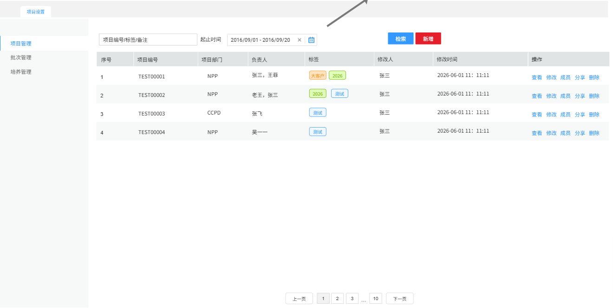
1.  新增
新增一个项目并配置相关信息：

> **[图 image209.png | 章节：项目设置① / 项目管理① | 上下文：新增一个项目并配置相关信息：]**
> **OCR 文本：**
> 新增
> 项目编号* | Please enter...
> 项目部门* | Please select...
> 负责人* | Please select...
> 参与实验室* | Please select...
> 标签 | Please select...
> 备注 | Please enter...
> 保存 | 取消

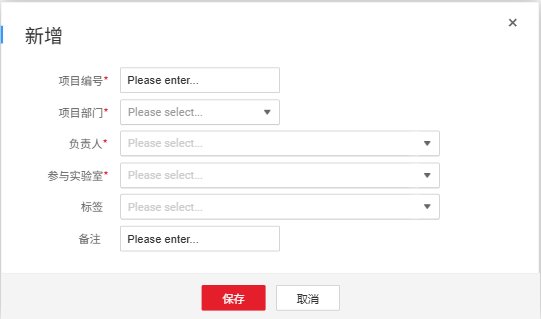
    1.  项目编号：必填，字符串格式，不能重复
    2.  项目部门：单选，必选，树形结构展示部门层级
    3.  负责人：必选，支持多选，按照部门树形结构展示人员信息，下拉支持用户显示姓名和用户名检索，该负责人可以在该项目下创建批次
    4.  参与实验室：必选，支持多选，按照所选项目部门关联得到的实验室自动填入，可以再修改
    5.  标签：选填，可以选择多个标签，标签在数据字典中维护
    6.  备注：选填，文本框，100字符，为方便后续检索
    7.  保存：保存前完成的校验包括必填字段非空、字段长度、项目编号的唯一性
1.  查询条件
以下条件联合查询：

    1.  项目编号/标签/描述：支持项目编号/标签/描述共同模糊搜索
    2.  起止时间：支持按照创建和修改时间检索
1.  结果展示与操作
查询结果翻页展示，按创建时间倒排，最新的在最上面，包含以下字段：

    1.  序号
    2.  项目编号
    3.  项目部门
    4.  负责人：多个负责人时，逗号分隔
    5.  标签
    6.  修改人
    7.  修改时间
    8.  操作
        1.  查看：没有操作权限用户可分配查看权限，查看项目相关信息
> **[图 image210.png | 章节：项目设置① / 项目管理① | 上下文：1. 查看：没有操作权限用户可分配查看权限，查看项目相关信息]**
> **OCR 文本：**
> 查看
> 项目编号 | TEST00001 | 项目部门 | NPP
> 负责人 | 张三，王菲 | 参与实验室 | 实验室1，实验室2
> 标签 | 新人炼手 | 包含批次 | 10
> 备注 | 模拟项目，用于新人培训
> 参与人 | 赵伟，张长，王毛毛
> 分享给 | 暂未分享
> 关闭

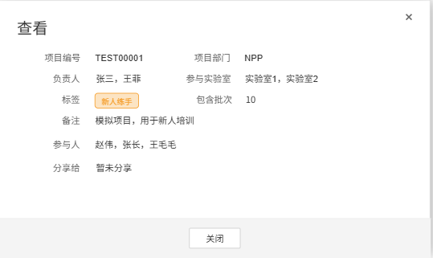
        1.  修改：保持新增时的完整校验规则。仅限创建人和项目负责人操作。
> **[图 image211.png | 章节：项目设置① / 项目管理① | 上下文：1. 修改：保持新增时的完整校验规则。仅限创建人和项目负责人操作。]**
> **OCR 文本：**
> 修改
> 项目编号* | Please enter...
> 项目部门* | Please select...
> 负责人* | Please select...
> 参与实验室* | Please select...
> 标笠 | Please select...
> 备注 | Please enter...
> 保存 | 取消

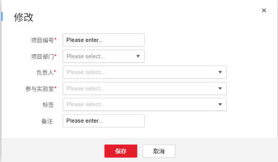
        1.  成员：可添加/移除项目人员/分配权限期限，仅限创建人和项目负责人操作。
> **[图 image212.png | 章节：项目设置① / 项目管理① | 上下文：1. 成员：可添加/移除项目人员/分配权限期限，仅限创建人和项目负责人操作。]**
> **OCR 文本：**
> 成员
> 在项目下授权的用户，将有权看到本项目下的所有批次和培养信息
> 按部门选择 | 按实验组选择
> 项目编码 | TEST00001
> 全选 | 序号 | 姓名 | 部门名称 | 角色 | 期限口应用到全部 | 操作
> 项目部门 | NPp | Search | 张三 | NPP-DEPT1 | 实验员 | 移除
> 负责人 | 张三，王菲 | + Item | 李四 | NPP-DEPT1 | 主任 | 移除
> 标签 | 大客户 | 2026 | + Item | 王五 | NPP-DEPT1 | 测试员 | 移除
> Item
> Item | 赵六 | OPS | 设备管理 | 移除
> Item
> 创建人 | 张三
> Item
> 创建时间 | 2026-06-01 00:00:00 | Item
> Item
> 修改人 | 张三
> 修改时间 | 2026-06-01 00:00:00
> 保存 | 取消

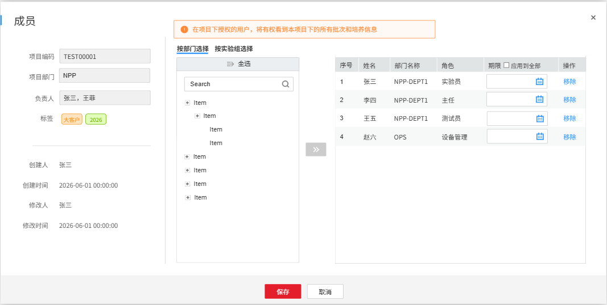
> **[图 image213.png | 章节：项目设置① / 项目管理① | 上下文：1. 成员：可添加/移除项目人员/分配权限期限，仅限创建人和项目负责人操作。]**
> **OCR 文本：**
> 成员
> 在项目下授权的用户，将有权看到本项目下的所有批次和培养信息
> 按部门选择 | 按实验组选择
> 项目编码 | TEST00001
> 序号 | 姓名 | 部门名称 | 角色 | 期限应用到全部 | 操作
> 项目部门 | NPP | Search | 张三 | NPP-DEPT1 | 实验员 | 移除
> 负责人 | 张三，王菲 | 李四 | NPP-DEPT1 | 主任 | 移除
> 实验组A(16人) | 展开
> 标签 | 大客户 | 2026 | 王五 | NPP-DEPT1 | 测试员 | 移除
> 实验组B（12人） | 展开
> 赵六 | OPS | 设备管理 | 移除
> 口实验组C(5人） | 展开
> 创建人 | 张三 | 口实验组D(2人） | 收起
> 创建时间 | 2026060100:00:00 | 口张三(zhangsan)
> 里斯(lisi)
> 修改人 | 张三
> 修改时间 | 2026060100:00:00
> 保存 | 取消
> 这个是通过实验组添加成员的界面，可以按照名称搜索实验组，然后点击实验组名称后，将整组的人添
> 加进去

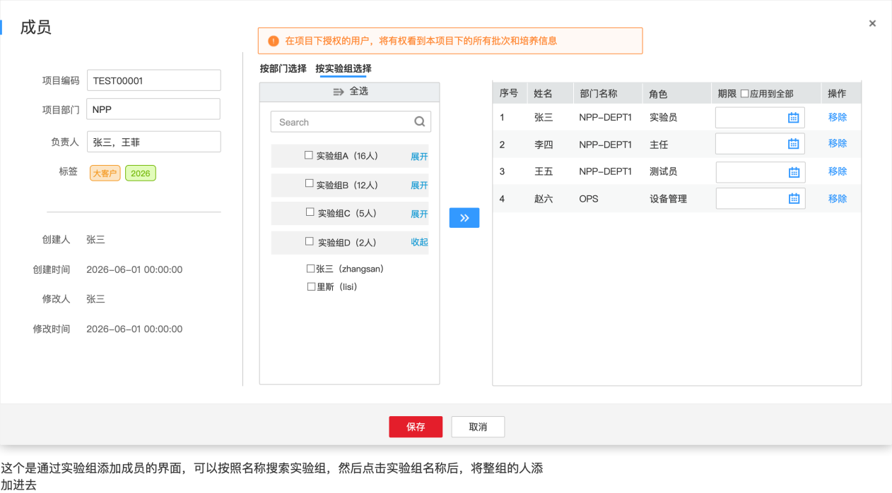
            1.  基本信息展示：展示项目编号、项目部门、负责人、标签、创建人、创建时间、修改人、修改时间字段信息，仅展示不支持修改
            2.  成员选择：
                1.  按部门：树形结构展示所有人员的部门层级信息，支持全选、部门全选以及单个用户选中加入右边分配权限；支持模糊搜索；
                2.  按实验组：支持按照实验组快速选中整租人员；支持选中单个用户；支持跨实验组选中；支持模糊搜索
            3.  期限设置：支持选择某个日期作为截止日期来限制用户的权限期限；不填写认为不限制有效期；支持一键复制到加入的所有人
            4.  移除：已加入的项目成员支持再次移除
        1.  分享：页面展示及操作与成员页面一致，只是仅支持将项目分享给指定用户，使其拥有对该项目的历史培养、历史检测数据、历史数据签名三个列表的查看、打印、导出权限。仅限项目负责人操作。
> **[图 image214.png | 章节：项目设置① / 项目管理① | 上下文：1. 分享：页面展示及操作与成员页面一致，只是仅支持将项目分享给指定用户，使其拥有对该项目的历史培养、历史检测数据、历史数据签名三个列表的查看、打印、导出权限。仅限项目负责人操作。]**
> **OCR 文本：**
> 分享
> 在项目下进行分享，被邀请用户将有权看到本项目下的所有批次和培养历史数据
> 按部门选择 | 按实验组选择
> 项目编码 | TEST00001
> 全选 | 序号 | 姓名 | 部门名称 | 角色 | 期限口应用到全部 | 操作
> 项目部门 | NPP | Search | 张三 | NPP-DEPT1 | 实验员 | 移除
> 负责人 | 张三，王菲 | Item | 李四 | NPP-DEPT1 | 主任 | 移除
> 标签 | 大客户 | 2026 |  Item | 王五 | NPP-DEPT1 | 测试员 | 移除
> Item
> Item | 赵六 | OPS | 设备管理 | 移除
> Item
> 创建人 | 张三 | ± Item
> 创建时间 | 2026-06-01 00:00:00 | Item
>  Item
> 修改人 | 张三
> 修改时间 | 2026-06-01 00:00:00
> 保存 | 取消

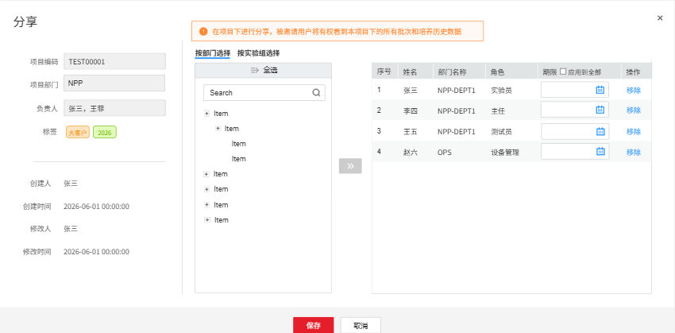
> **[图 image215.png | 章节：项目设置① / 项目管理① | 上下文：1. 分享：页面展示及操作与成员页面一致，只是仅支持将项目分享给指定用户，使其拥有对该项目的历史培养、历史检测数据、历史数据签名三个列表的查看、打印、导出权限。仅限项目负责人操作。]**
> **OCR 文本：**
> 分享 | 在项目下进行分享，被邀请用户将有权看到本项目下的所有批次和培养历史数据
> 按部门选择 | 按实验组选择
> 项目编码 | TEST00001
> 全选 | 序号 | 姓名 | 部门名称 | 角色 | 期限口应用到全部 | 操作
> 项目部门 | NPp | Search | 张三 | NPP-DEPT1 | 实验员 | 移除
> 负责人 | 张三，王 | 李四 | NPP-DEPT1 | 主任 | 移除
> 实验组A(16人) | 展开
> 标签 | 大客户 | 2026 | 王五 | NPP-DEPT1 | 测试员 | 移除
> 实验组B(12人) | 展开
> 赵六 | OPS | 设备管理 | 移除
> 实验组C(5人) | 展开
> 创建人 | 张三 | 实验组D(2人) | 收起
> 创建时间 | 2026-06-01 00:00:00 |  张三 (zhangsan)
> 里斯 (tisi)
> 修改人 | 张三
> 修改时间 | 2026-06-01 00:00:00
> 保存 | 取消

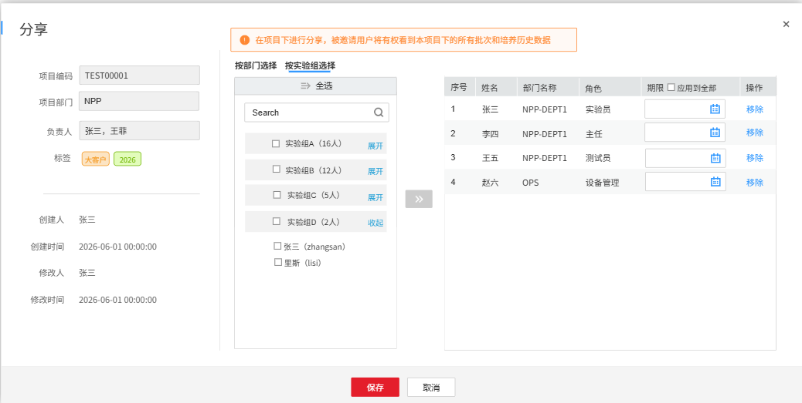
        1.  删除：
            1.  需二次确认才能删除项目
> **[图 image216.png | 章节：项目设置① / 项目管理① | 上下文：1. 需二次确认才能删除项目]**
> **OCR 文本：**
> 确定要删除吗
> 仅支持删除空项目
> 取消 | 确定

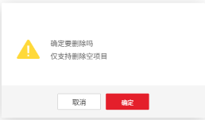
            1.  确认删除后，校验该项目是否为空项目（即该项目下未建立任何培养），若不是，则不允许删除，提示信息
> **[图 image217.png | 章节：项目设置① / 项目管理① | 上下文：1. 确认删除后，校验该项目是否为空项目（即该项目下未建立任何培养），若不是，则不允许删除，提示信息]**
> **OCR 文本：**
> 删除失败！
> 当前项目下已经建立了培养，不允许删除！
> 确认

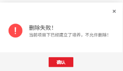
            1.  删除成功，提示信息
> **[图 image218.png | 章节：项目设置① / 项目管理① | 上下文：1. 删除成功，提示信息]**
> **OCR 文本：**
> 操作成功！
> 项目删除成功
> 关闭

        1.  退出
            1.  需二次确认才能推出
> **[图 image219.png | 章节：项目设置① / 项目管理① | 上下文：1. 需二次确认才能推出]**
> **OCR 文本：**
> 确定要退出吗
> 退出后将对项目数据不可见
> 再加入只能通过负责人进行
> 操作
> 取消 | 确定

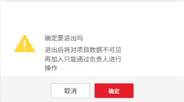
            1.  确认后，需校验当前用户是否是项目成员，若不是则退出失败，提示失败信息
> **[图 image220.png | 章节：项目设置① / 项目管理① | 上下文：1. 确认后，需校验当前用户是否是项目成员，若不是则退出失败，提示失败信息]**
> **OCR 文本：**
> 退出失败！
> 你不是项目成员无需退出
> 确认

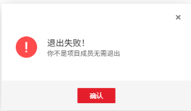
            1.  退出成功，提示信息
> **[图 image221.png | 章节：项目设置① / 项目管理① | 上下文：1. 退出成功，提示信息]**
> **OCR 文本：**
> 操作成功！
> 已从项目中退出
> 关闭

### 批次管理①（3.2）（4.1调整）（4.2调整）

在此模块创建批次并配置相关信息，此模块仅开放给创建人、授权的批次负责人和被授权查看全部的人。

> **[图 image222.png | 章节：项目设置① / 批次管理①（3.2）（4.1调整）（4.2调整） | 上下文：在此模块创建批次并配置相关信息，此模块仅开放给创建人、授权的批次负责人和被授权查看全部的人。]**
> **OCR 文本：**
> 批次编号/标签/别名 | 请选择项目 | 请选择实验室 | 起止时间 | 2016/09/01-2016/09/20 | 检索 | 新增
> 序号 | 批次编号 | 别名 | 项目编号 | 项目标签 | 培养数量 | 实验室 | 修改人 | 修改时间 | 操作
> PC000001 | PC000001 | TEST00001 | 大客户 | 2026 | 10 | 实验室1 | 张三 | 2026-06-01 11: 11:11 | 查看 | 修改成员分享删除退出
> PC000002 | PC000002 | TEST00001 | 2026 | 测试 | 实验室2 | 张三 | 2026-06-0111:11:11 | 查看 | 修改成员分享删除退出
> PC000003 | PC000003 | TEST00001 | 实验室1 | 张三 | 2026-06-0111:11:11 | 查看 | 修改成员分享删除退出
> PC000004 | PC000004 | TEST00001 | 测试 | 实验室1 | 张三 | 2026-06-0111:11:11 | 查看　修改成员分享删除退出
> 10

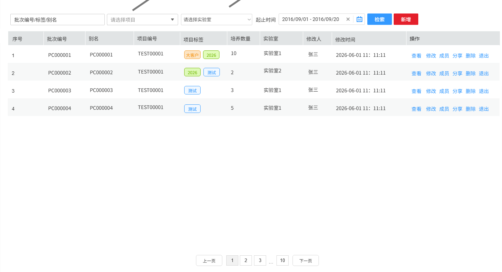
1.  新增
新增一个批次并配置相关信息，包含中试下游实验室、中试上游&小试上游&小试下游实验室两种不同创建的场景：

-   中试上游&小试上游&小试下游实验室
> **[图 image223.png | 章节：项目设置① / 批次管理①（3.2）（4.1调整）（4.2调整） | 上下文：- 中试上游&小试上游&小试下游实验室]**
> （新增图片：V4.0 副本无同图，未做 OCR，请核对图片文件）

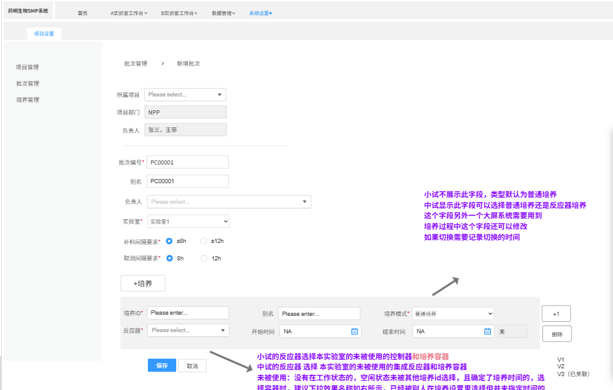
    1.  所属项目：下拉单选，该用户授权范围内的项目
    2.  项目部门：所选项目的所属部门，联动展示
    3.  负责人：所选项目联动展示，所选项目的项目负责人，多个时逗号分隔
    4.  实验室：下拉单选，必选，用于指定完成该批次培养的实验室，只能在当前用户授权范围内选择。默认值为当前用户授权所在的实验室
    5.  批次编号：文本框，必填，同项目下不允许重复，即项目+批次为全局唯一，当批次编号重复时，当下提示信息
> **[图 image224.png | 章节：项目设置① / 批次管理①（3.2）（4.1调整）（4.2调整） | 上下文：5. 批次编号：文本框，必填，同项目下不允许重复，即项目+批次为全局唯一，当批次编号重复时，当下提示信息]**
> **OCR 文本：**
> 批次编号 | PC00001
> 项目下存在相同的批次，创建人张三

    1.  别名：文本框，选填，
    2.  负责人：选填，支持多选。此处的批次负责人后续可在该项目下创建培养
    3.  补料间隔要求：包含±8h和±12h两个选项，必选，二选一。用于后续报警规则。
    4.  取测间隔要求：包含8h和12h两个选项，必选，二选一。用于后续报警规则。
    5.  +培养：点击后支持录入/删除培养信息
        1.  培养ID：文本框，必填，不允许重复（已删除和已取消状态的培养ID可以重复使用），全局唯一
            1.  培养ID重复时，提示信息
> **[图 image225.png | 章节：项目设置① / 批次管理①（3.2）（4.1调整）（4.2调整） | 上下文：1. 培养ID重复时，提示信息]**
> **OCR 文本：**
> 培养ID | PC00001
> 项目 | XXX | 批次XXXX下存在相同培养，创建人张三

> **[图 image226.png | 章节：项目设置① / 批次管理①（3.2）（4.1调整）（4.2调整） | 上下文：1. 培养ID重复时，提示信息]**
> **OCR 文本：**
> 此培养ID已经被人使用
> 批次：XXXXX创建人：张三
> 返回

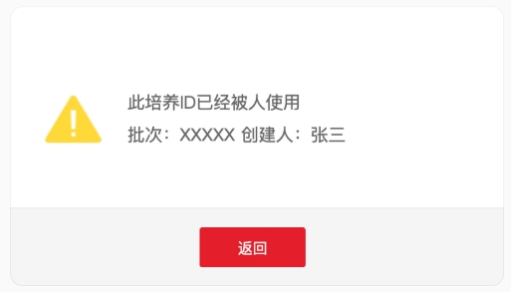
        1.  别名：文本框，选填
        2.  培养模式：
            1.  实验室类型为中试时，下拉单选，必选，列表包含普通培养和反应器培养。该字段在培养过程中可能发生切换，若修改需要记录切换时间。
            2.  实验室类型为小试时，页面不展示此字段，默认为普通培养
        3.  反应器/控制器/培养容器：
            1.  根据实验室联动对应设备库列表。中试包括集成反应器和培养容器，必选，单选，支持名称检索，支持所在房间检索；小试包括台式反应器罐和培养容器，非必选，默认不选。
            2.  针对培养容器，允许重复选择同一培养容器。
            3.  针对反应器和控制器，只有未被使用的设备才能显示在下拉列表中被选中，未被使用的设备需同时满足以下两个条件
                1.  不在工作状态（一个反应器/控制器在开启任何工作流后、结束培养前都为工作状态）
                2.  未被任何培养ID绑定 or （被其他培养ID绑定，但没有指定开始时间和结束时间） or 或者 （被其他培养ID绑定，但该培养已过期）
            4.  若某个反应器/控制器不在工作状态且被其他培养ID绑定，但没有指定开始时间和结束时间的或者已过期，在展示时，需要用“已关联”字样提示
> **[图 image227.png | 章节：项目设置① / 批次管理①（3.2）（4.1调整）（4.2调整） | 上下文：4. 若某个反应器/控制器不在工作状态且被其他培养ID绑定，但没有指定开始时间和结束时间的或者已过期，在展示时，需要用“已关联”字样提示]**
> **OCR 文本：**
> 反应器* | Please select...
> Search
> V1
> V2
> V3 (已关联)

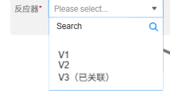
        1.  反应器容量：当前为小试实验室并选中的是台式反应器罐时，才有此字段。下拉单选，列表内容为实验室设置-设备配置-台式反应器罐设置中获取的类别字段
        2.  开始时间：培养开始时间，非必填。默认值为NA，表示不指定开始时间。培养开始时间在后续培养详情和操作工作流时可进行修改，修改后此处需要同步更新。
        3.  结束时间：培养结束时间，默认值为NA，表示不指定开始时间。培养结束时间在后续培养详情和操作工作流时可进行修改，修改后此处需要同步更新。
            1.  开始时间和结束时间只能都是NA，或者都选择某个具体日期
            2.  开始时间和结束时间都是NA时，表示当前反应器不被占用，保存时需提示信息
> **[图 image228.png | 章节：项目设置① / 批次管理①（3.2）（4.1调整）（4.2调整） | 上下文：2. 开始时间和结束时间都是NA时，表示当前反应器不被占用，保存时需提示信息]**
> **OCR 文本：**
> 细胞培养时间已经确定了吗？
> 开始时间和结束时间后反应器将被占用
> 其他用户在你结束培养之前其他人不可使用
> 时间未确定可以先用缺省值NA暂代
> 未确定 | 确定

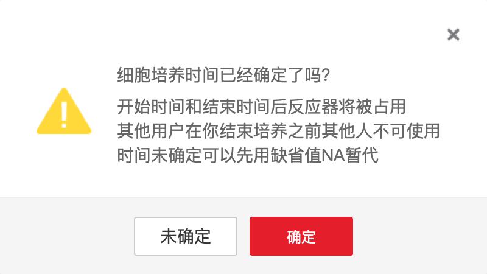
        4.  培养周期：需要培养的天数，非必填，纯数字，大于0的整数
            1.  此处开始时间、结束时间、培养周期，填写其中两个可自动带出第三个。
            2.  开始时间和结束时间未填写时，该反应器不被占用，也无法开启工作流
            3.  开始时间和结束时间都已填写时，从提交此刻开始，该反应器开始被占用。
        5.  +1操作：点击按钮后新增一条培养信息，其中，培养id末尾+1，但反应器不选中，其余保持一致。
        6.  删除：删除当前培养ID信息
    1.  保存：保存前完成的校验包括必填字段非空、字段长度、批次编号、培养ID的唯一性
-   中试下游实验室
> **[图 image229.png | 章节：项目设置① / 批次管理①（3.2）（4.1调整）（4.2调整） | 上下文：- 中试下游实验室]**
> （新增图片：V4.0 副本无同图，未做 OCR，请核对图片文件）

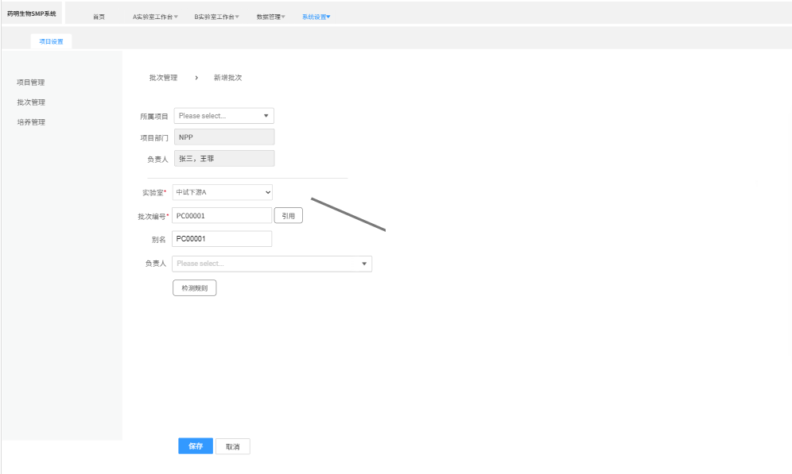
    1.  所属项目：下拉单选，该用户授权范围内的项目
    2.  项目部门：所选项目的所属部门，联动展示
    3.  负责人：所选项目联动展示，所选项目的项目负责人，多个时逗号分隔
    4.  实验室：下拉单选，必选，用于指定完成该批次培养的实验室，只能在当前用户授权范围内选择。默认值为当前用户授权所在的实验室
    5.  批次编号&引用：实验室为中试下游时，可直接引用同项目下上游实验室的批次号并修改
        1.  引用按钮：点击弹窗展示同项目号下的所有批次信息，包含以下信息：
-   列表展示创建时间倒排序展示，可选中单个批次后点击引用按钮，自动填写值批次编号文本框内。
            1.  批次编号
            2.  批次下培养状态：当前批次下所有培养已结束则为已结束，否则为进行中。
            3.  创建人
            4.  创见时间
        2.  批次编号文本框：如果点击引用按钮选择了某个批次则自动带出展示。必填，可修改，同项目下不允许重复，即项目+批次为全局唯一，当批次编号重复时，当下提示信息
> **[图 image224.png | 章节：项目设置① / 批次管理①（3.2）（4.1调整）（4.2调整） | 上下文：2. 批次编号文本框：如果点击引用按钮选择了某个批次则自动带出展示。必填，可修改，同项目下不允许重复，即项目+批次为全局唯一，当批次编号重复时，当下提示信息]**
> **OCR 文本：**
> 批次编号 | PC00001
> 项目下存在相同的批次，创建人张三

    1.  别名：文本框，选填，
    2.  负责人：选填，支持多选。此处的批次负责人后续可在该项目下创建培养
> **[图 image230.png | 章节：项目设置① / 批次管理①（3.2）（4.1调整）（4.2调整） | 上下文：2. 负责人：选填，支持多选。此处的批次负责人后续可在该项目下创建培养]**
> （新增图片：V4.0 副本无同图，未做 OCR，请核对图片文件）

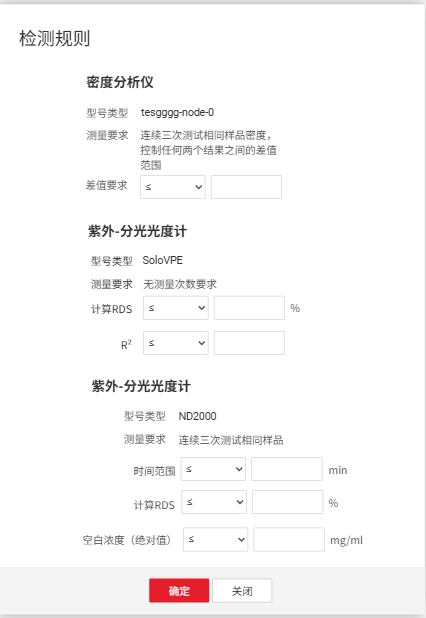
1.  查询条件
以下条件联合查询：

    1.  批次编号/标签/别名：支持批次编号/标签/别名共同模糊搜索
    2.  项目：下拉单选，列表为在当前用户权限内的所有项目号
    3.  实验室：下拉单选，列表为在当前用户权限内的实验室
    4.  起止时间：支持按照创建和修改时间检索
1.  结果展示与操作
查询结果翻页展示，按修改时间倒排，最新的在最上面，包含以下字段：

    1.  序号
    2.  批次编号
    3.  别名
    4.  项目编号
    5.  项目标签
    6.  培养数量：统计该批次下创建的培养ID数量（不包含已删除）
    7.  实验室
    8.  修改人
    9.  修改时间
    10.  操作
        1.  修改：页面与新增页面一致，保持新增时的完整校验规则。仅限拥有批次权限用户可修改。
> **[图 image231.png | 章节：项目设置① / 批次管理①（3.2）（4.1调整）（4.2调整） | 上下文：1. 修改：页面与新增页面一致，保持新增时的完整校验规则。仅限拥有批次权限用户可修改。]**
> **OCR 文本：**
> 批次管理 | 新增批次
> 所属项目 | Please select...
> 项目部门 | NPP
> 负责人 | 张三，王菲
> 批次编号* | PC00001
> 别名 | PC00001
> 负责人 | Item
> 实验室* | 实验室1
> +培养
> 培养ID* | Please enter.. | 别名 | Please enter.. | 培养模式* | 普通培养 | +1
> 反应器* | Please select... | 开始时间 | NA | 结束时间 | NA | 删除
> 保存 | 取消

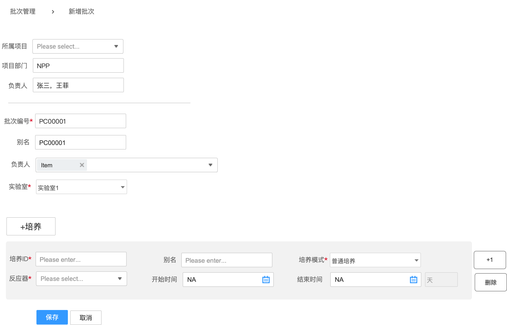
反应器和培养模式规则如下：

> **[图 image232.png | 章节：项目设置① / 批次管理①（3.2）（4.1调整）（4.2调整） | 上下文：反应器和培养模式规则如下：]**
> **OCR 文本：**
> 小试不展示此字段， | 类型默认为普通培养
> 中试显示此字段可以选择普通培养还是反应器培养
> 这个字段另外一个大屏系统需要用到
> 培养过程中这个字段还可以修改
> 如果切换需要记录切换的时间
> 培养ID* | Please enter... | 别名 | Please enter... | 培养模式* | 普通培养 | +1
> 反应器* | Please select... | 开始时间 | NA | 结束时间 | NA | 删除
> 小试的反应器选择本实验室的未被使用的控制器
> 保存 | 中试的反应器 | 选择本实验室的未被使用的集成反应器和培养容器
> 未被使用： | 没有在工作状态的，空闲状态未被其他培养id选择，且确定了培养时间的，选
> 择容器时, | 建议下拉效果名称如右所示， | 已经被别人在培养设置里选择但并未指定时间的
> 容器, | 允许重复选择， | 但是需要在 | 里进行标注

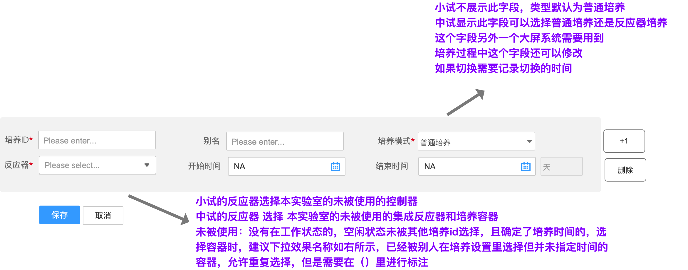
        1.  成员：根据当前用户权限，可添加/移除批次人员/分配权限期限。仅限拥有项目权限的用户可操作
> **[图 image233.png | 章节：项目设置① / 批次管理①（3.2）（4.1调整）（4.2调整） | 上下文：1. 成员：根据当前用户权限，可添加/移除批次人员/分配权限期限。仅限拥有项目权限的用户可操作]**
> **OCR 文本：**
> 成员
> 在批次下授权的用户，将有权看到本批次下的所有培养信息
> 批次编号 | PC00001 | 按部门选择 | 按实验组选择
> 别名 | PC00001 | 全选 | 序号 | 姓名 | 部门名称 | 角色 | 期限应用到全部 | 操作
> Search | 张三 | NPP-DEPT1 | 实验员 | 2026-07-07 | 项目授权
> 项目 | TEST00001
>  Item | 李四 | NPP-DEPT1 | 主任 | 2026-07-07 | 项目授权
> 负责人 | 张三，王菲 | + Item | 王五 | NPP-DEPT1 | 测试员 | 2026-07-07 | 项目授权
> Item
> 赵六 | OPS | 设备管理 | 2026-07-07 | 项目授权
> 创建人 | 张三 | Item
> 创建时间 | 2026-06-01 00:00:00 | Item | NPP-DEPT1 | 测试员 | 移除
> 修改人 | 张三 | Item | 宋二 | OPS | 设备管理 | 移除
> 修改时间 | 2026-06-0100:00:00 | Item
> Item
> 保存 | 取消

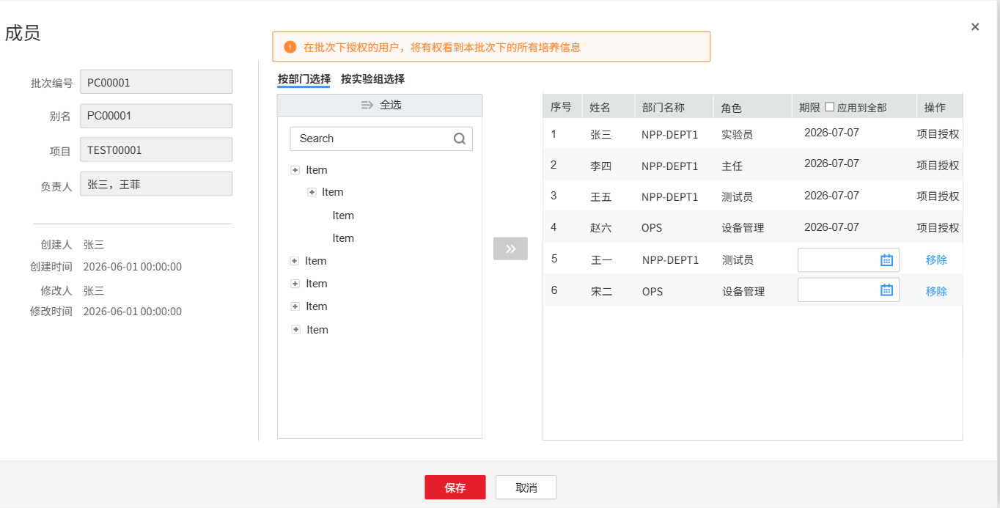
> **[图 image234.png | 章节：项目设置① / 批次管理①（3.2）（4.1调整）（4.2调整） | 上下文：1. 成员：根据当前用户权限，可添加/移除批次人员/分配权限期限。仅限拥有项目权限的用户可操作]**
> **OCR 文本：**
> 成员
> 在批次下授权的用户，将有权看到本批次下的所有培养信息
> 批次编号 | PC00001 | 按部门选择 | 按实验组选择
> 别名 | PC00001 | 全选 | 序号 | 姓名 | 部门名称 | 角色 | 期限口应用到全部 | 操作
> Search | 张三 | NPP-DEPT1 | 2026-07-07 | 项目分享
> 项目 | TEST00001
> 李四 | NPP-DEPT1 | 2026-07-07 | 项目分享
> 负责人 | 张三，王菲 | 实验组A（16人)
> 王五 | NPP-DEPT1 | 测试员 | 移除
> 实验组B（12人）
> 赵六 | OPS | 设备管理 | 移除
> 创建人 | 张三 | 实验组C（5人）
> 创建时间 | 2026-06-0100:00:00
> 实验组D(2人)
> 修改人 | 张三
> 修改时间 | 2026-06-0100:00:00
> 保存 | 取消

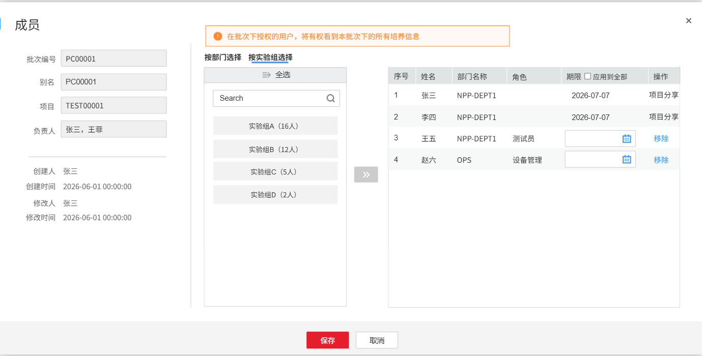
            1.  基本信息展示：展示批次编号、别名、项目、负责人、标签、创建人、创建时间、修改人、修改时间字段信息，仅展示不支持修改
            2.  成员选择：同⑧3)b
            3.  期限设置：同⑧3)c
            4.  移除：通过项目授权获得权限的用户，不支持在此处移除。其余添加用户可移除出该批次
        1.  分享：页面展示及操作与成员页面一致，仅限项目负责人、批次负责人操作
            1.  支持将批次分享给指定用户，使其拥有对该批次的历史培养、历史检测数据、历史数据签名三个列表的查看、打印、导出权限
            2.  通过项目分享获得权限的用户，此处不允许移除
> **[图 image235.png | 章节：项目设置① / 批次管理①（3.2）（4.1调整）（4.2调整） | 上下文：2. 通过项目分享获得权限的用户，此处不允许移除]**
> **OCR 文本：**
> 分享
> 在批次下进行分享，被邀请用户将有权看到本项目下的所有培养的历史数据
> 批次编号 | PC00001 | 按部门选择 | 按实验组选择
> 别名 | PC00001 | 全选 | 序号 | 姓名 | 部门名称 | 角色 | 期限口应用到全部 | 操作
> Search | 张三 | NPP-DEPT1 | 实验员 | 2026-07-07 | 项目分享
> 项目 | TEST00001
> + Item | 李四 | NPP-DEPT1 | 主任 | 2026-07-07 | 项目分享
> 负责人 | 张三，王菲 | + Item | 王五 | NPP-DEPT1 | 测试员 | 2026-07-07 | 项目分享
> Item
> 赵六 | OPS | 设备管理 | 2026-07-07 | 项目分享
> 创建人 | 张三 | Item
> 创建时间 | 2026-06-0100:00:00 | Item | 王一 | NPP-DEPT1 | 测试员 | 移除
> 修改人 | 张三 | Item | 宋二 | OPS | 设备管理 | 移除
> 修改时间 | 2026-06-0100:00:00 | Item
> + Item
> 保存 | 取消

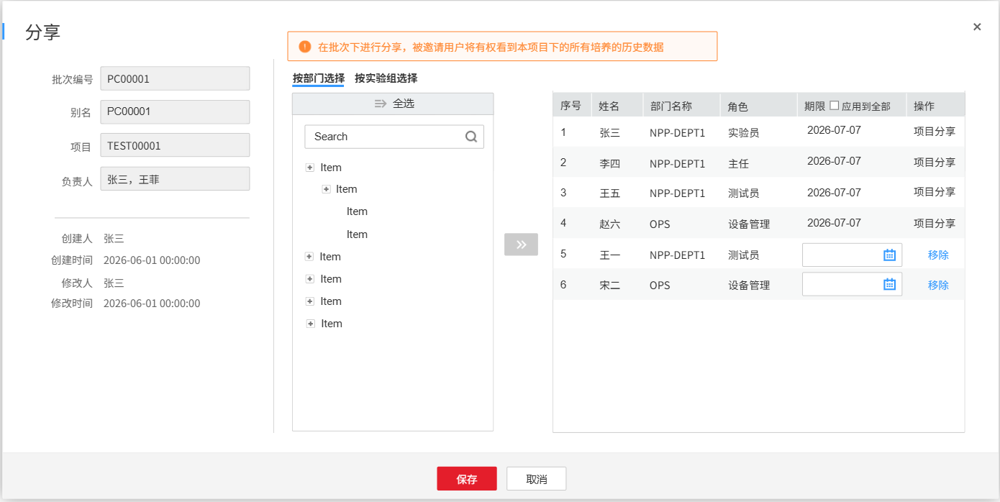
> **[图 image236.png | 章节：项目设置① / 批次管理①（3.2）（4.1调整）（4.2调整） | 上下文：2. 通过项目分享获得权限的用户，此处不允许移除]**
> **OCR 文本：**
> 分享
> 在批次下进行分享，被邀请用户将有权看到本项目下的所有培养的历史数据
> 批次编号 | PC00001 | 按部门选择 | 按实验组选择
> 别名 | PC00001 | 全选 | 序号 | 姓名 | 部门名称 | 角色 | 期限应用到全部 | 操作
> Search | 张三 | NPP-DEPT1 | 实验员 | 2026-07-07 | 项目分享
> 项目 | TEST00001
> 李四 | NPP-DEPT1 | 主任 | 2026-07-07 | 项目分享
> 负责人 | 张三，王菲 | 实验组A（16人）
> 王五 | NPP-DEPT1 | 测试员 | 2026-07-07 | 项目分享
> 实验组B（12人）
> 赵六 | OPS | 设备管理 | 2026-07-07 | 项目分享
> 创建人 | 张三 | 实验组C(5人)
> 创建时间 | 2026-06-0100:00:00 | NPP-DEPT1 | 测试员 | 移除
> 实验组D(2人)
> 修改人 | 张三 | 宋二 | OPS | 设备管理 | 移除
> 修改时间 | 2026-06-0100:00:00
> 保存 | 取消

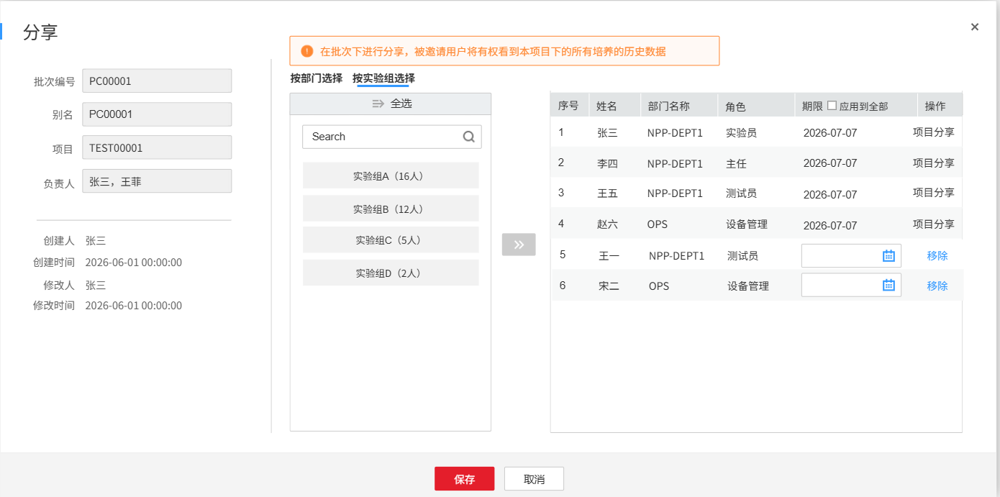
        1.  删除：
            1.  需二次确认才能删除批次
> **[图 image237.png | 章节：项目设置① / 批次管理①（3.2）（4.1调整）（4.2调整） | 上下文：1. 需二次确认才能删除批次]**
> **OCR 文本：**
> 确定要删除吗
> 仅支持删除空批次
> 取消 | 确定

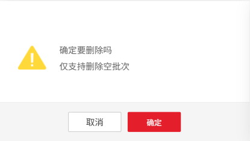
            1.  确认删除后，校验该项目是否为空批次（即该批次下未建立任何培养），若不是，则不允许删除，提示信息
> **[图 image238.png | 章节：项目设置① / 批次管理①（3.2）（4.1调整）（4.2调整） | 上下文：1. 确认删除后，校验该项目是否为空批次（即该批次下未建立任何培养），若不是，则不允许删除，提示信息]**
> **OCR 文本：**
> 删除失败！
> 当前批次下已经建立了培养，不允许删除！
> 确认

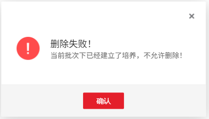
            1.  删除成功，提示信息
> **[图 image239.png | 章节：项目设置① / 批次管理①（3.2）（4.1调整）（4.2调整） | 上下文：1. 删除成功，提示信息]**
> **OCR 文本：**
> 操作成功！
> 批次删除成功
> 关闭

        1.  查看
> **[图 image240.png | 章节：项目设置① / 批次管理①（3.2）（4.1调整）（4.2调整） | 上下文：1. 查看]**
> **OCR 文本：**
> 查看
> 项目编号XM001 批次编号 PC00001别名PC00001 实验室实验室1负责人张三
> 培养ID | 类型 | 容器名 | 开始时间 | 结束时间 | 修改人 | 修改时间
> PY001 | 普通培养 | SF01 | 2026-06-07 | 2026-06-07 | 张三 | 2026-06-01 12:12:12 | N阶段
> PY002 | 普通培养 | SF02 | 2026-06-07 | 2026-06-07 | 张三 | 2026-06-01 12:12:12 | N阶段
> PY003 | 普通培养 | SF03 | 2026-06-07 | 2026-06-07 | 张三 | 2026-06-01 12:12:12 | N阶段
> PY004 | N阶段 | 普通培养 | SF04 | 2026-06-07 | 2026-06-07 | 张三 | 2026-06-01 12:12:12 | N阶段
> 创建人‧张三 | 创建时间 2026-06-01 12:12:12 | 修改人‧张三 | 修改时间2026-06-0112:12:12
> 关闭

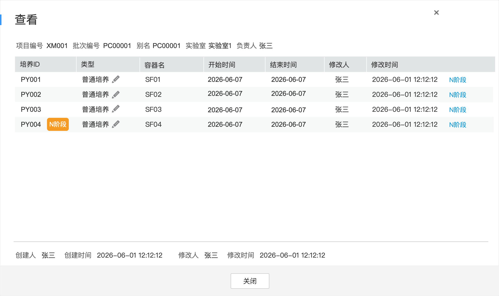
            1.  基础信息展示：项目编号、批次编号、批次别名、负责人、创建人、创建时间、修改人（批次信息最近一次修改）、修改时间（批次信息最近一次修改）
            2.  列表展示与操作：分页展示该批次下的所有培养信息
                1.  培养ID：若被标记为N阶段的培养ID，在培养ID后显示“N阶段”标识
                2.  培养类型：显示当前的培养类型。若为普通培养则可以切换为反应器培养；若为反应器培养，则不支持切换。注意切换后直接保存，并记录切换时间
                3.  容器名
                4.  开始时间
                5.  结束时间
                6.  修改人
                7.  修改时间。
                8.  标记/取消标记N阶段：操作按钮，点击后该培养ID即被标记/取消标记为“N阶段”培养，注意保存标记/取消标记结果。
> **[图 image241.png | 章节：项目设置① / 批次管理①（3.2）（4.1调整）（4.2调整） | 上下文：8. 标记/取消标记N阶段：操作按钮，点击后该培养ID即被标记/取消标记为“N阶段”培养，注意保存标记/取消标记结果。]**
> （新增图片：V4.0 副本无同图，未做 OCR，请核对图片文件）

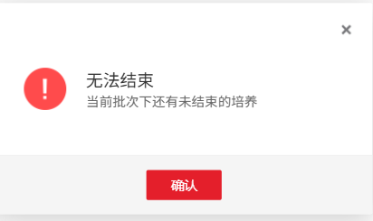
> **[图 image242.png | 章节：项目设置① / 批次管理①（3.2）（4.1调整）（4.2调整） | 上下文：8. 标记/取消标记N阶段：操作按钮，点击后该培养ID即被标记/取消标记为“N阶段”培养，注意保存标记/取消标记结果。]**
> （新增图片：V4.0 副本无同图，未做 OCR，请核对图片文件）

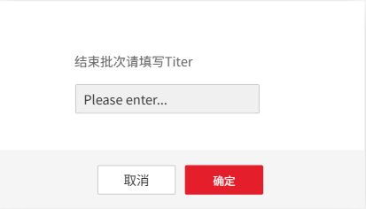
> **[图 image243.png | 章节：项目设置① / 批次管理①（3.2）（4.1调整）（4.2调整） | 上下文：8. 标记/取消标记N阶段：操作按钮，点击后该培养ID即被标记/取消标记为“N阶段”培养，注意保存标记/取消标记结果。]**
> （新增图片：V4.0 副本无同图，未做 OCR，请核对图片文件）

> **[图 image244.png | 章节：项目设置① / 批次管理①（3.2）（4.1调整）（4.2调整） | 上下文：8. 标记/取消标记N阶段：操作按钮，点击后该培养ID即被标记/取消标记为“N阶段”培养，注意保存标记/取消标记结果。]**
> （新增图片：V4.0 副本无同图，未做 OCR，请核对图片文件）

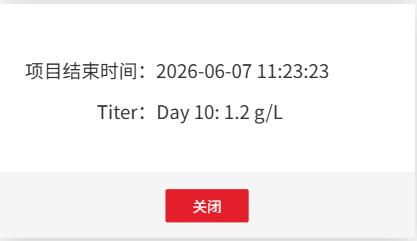
        1.  退出
            1.  需二次确认才能推出
> **[图 image245.png | 章节：项目设置① / 批次管理①（3.2）（4.1调整）（4.2调整） | 上下文：1. 需二次确认才能推出]**
> **OCR 文本：**
> 确定要退出吗
> 退出后将对批次数据不可见
> 再加入只能通过负责人进行
> 操作
> 取消 | 确定

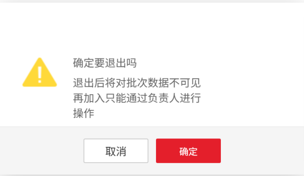
            1.  确认后，需校验当前用户是不是批次成员，若不是则退出失败，提示失败信息
> **[图 image246.png | 章节：项目设置① / 批次管理①（3.2）（4.1调整）（4.2调整） | 上下文：1. 确认后，需校验当前用户是不是批次成员，若不是则退出失败，提示失败信息]**
> **OCR 文本：**
> 退出失败！
> 你不是批次成员无需退出
> 确认

            1.  退出成功，提示信息
> **[图 image247.png | 章节：项目设置① / 批次管理①（3.2）（4.1调整）（4.2调整） | 上下文：1. 退出成功，提示信息]**
> **OCR 文本：**
> 操作成功！
> 已从批次中退出
> 关闭

### 培养管理①③

#### 培养基础管理①（3.2）（3.3）（5.0调整）

在此模块创建培养并配置相关信息，此模块仅开放给创建人、授权的培养负责人和被授权查看全部的人

> **[图 image248.png | 章节：项目设置① / 培养管理①③ / 培养基础管理①（3.2）（3.3）（5.0调整） | 上下文：在此模块创建培养并配置相关信息，此模块仅开放给创建人、授权的培养负责人和被授权查看全部的人]**
> **OCR 文本：**
> 批次编号/标签/别名 | 请选择项目 | 请选择批次 | 请选择实验室 | 起止时间 | 2016/09/01 - 2016/09/20 | 检索
> 设置成员 | 分享 | 修改培养
> 序号 | 培养ID | 批次 | 项目 | 培养模式 | 容器 | 状态 | 开始时间 | 结束时间 | 修改人 | 修改时间 | 操作
> PY000001 | PC001 | XM001 | 普通培养 | SF01 | 未开始 | 2026-06-01 | 2026-06-07 | 张三 | 2026-06-01 11: 11:11 | 修改‧成员‧分享　删除 退出
> PY000002 | PC001 | XM001 | 普通培养 | SF02 | 已结束 | 2026-06-01 | 2026-06-07 | 张三 | 2026-06-01 11: 11:11 | 修改 成员 分享‧删除 退出
> PY000003 | PC001 | XM001 | 普通培养 | SF03 | 已过期 | 2026-06-01 | 2026-06-07 | 张三 | 2026-06-01 11: 11:11 | 修改 成员 分享 删除　 退出
> PY000004 | PC001 | XM001 | 反应器培养 | SF04 | 进行中 | 2026-06-01 | 2026-06-07 | 张三 | 2026-06-01 11: 11:11 | 修改　 成员‧分享‧删除　退出
> 上一页 | 10 | 下一页

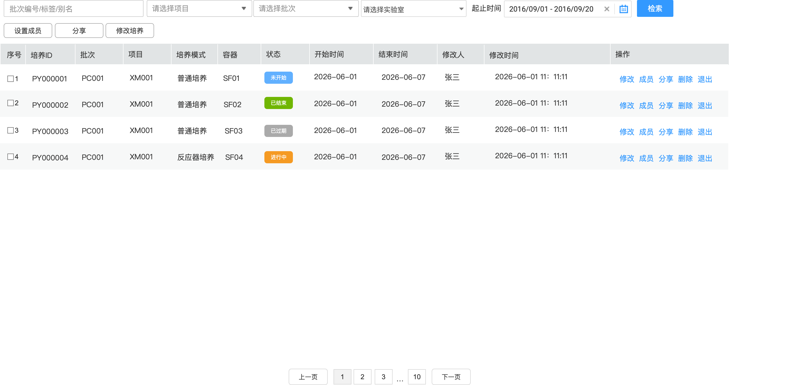
1.  查询条件
以下条件联合查询：

    1.  批次编号/标签/别名：支持批次编号/标签/别名共同模糊搜索
    2.  项目：下拉单选，列表为在当前用户权限内的所有项目号
    3.  批次：下拉单选，根据项目联动，且在当前用户权限范围内的批次号
    4.  实验室：下拉单选，列表为在当前用户权限内的实验室
    5.  起止时间：支持按照创建和修改时间检索
> **[图 image249.png | 章节：项目设置① / 培养管理①③ / 培养基础管理①（3.2）（3.3）（5.0调整） | 上下文：5. 起止时间：支持按照创建和修改时间检索]**
> （新增图片：V4.0 副本无同图，未做 OCR，请核对图片文件）

> **[图 image250.png | 章节：项目设置① / 培养管理①③ / 培养基础管理①（3.2）（3.3）（5.0调整） | 上下文：5. 起止时间：支持按照创建和修改时间检索]**
> **OCR 文本：**
> 分享和成员添加，可以通过列表页勾选多个培养id进行批量操作
> 可批量操作的前提是，被勾选培养还没有进行过成员设置，如果已经出 | 上边这些人，为当前勾选的培养ID查询到的上
> 现过成员设置，批量操作可能会引发成员数据混乱，因此页面会出现轻 | 级批次或项目里授权过的用户，一个并集
> 量级的提醒
> 您选择的培养已经设定过成员，无法进行批量操作
> 成员
> 培养ID | PY001 | PY002 | 按部门选择 | 按实验组选择
> PY003 | 全选 | 序号 | 姓名 | 部门名称 | 角色 | 期限应用到全部 | 操作
> Search | 张三 | NPP-DEPT1 | 实验员 | 2026-07-07 | 项目授权
> 别名 | PY00001 |  Item | 李四 | NPP-DEPT1 | 主任 | 2026-07-07 | 项目授权
> 批次编号 | PC00001 |  Item | 王五 | NPP-DEPT1 | 测试员 | 2026-07-07 | 批次授权
> 负责人 | 张三，王菲 | Item | 赵六 | OPS | 设备管理 | 2026-07-07 | 批次授权
> Item
>  Item | NPP-DEPT1 | 测试员 | 移除
> 创建人 | 张三 |  Item | 宋二 | OPS | 设备管理 | 移除
> 创建时间 | 2026-06-01 00:00:00 | ? Item
> 修改人 | 张三 |  Item
> 修改时间 | 2026-06-01 00:00:00
> 保存 | 取消

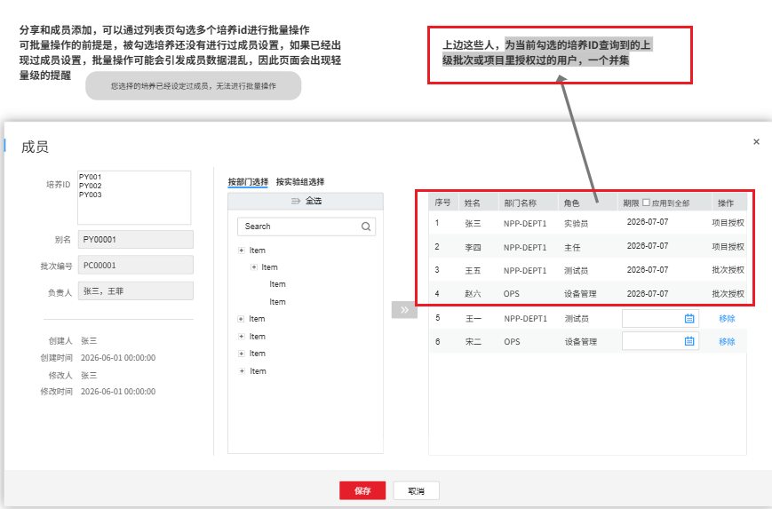
1.  分享：批量选择培养ID进行分享操作（具体见下方的分享操作，与其保持一致）
    1.  批量选择培养ID进行分享时，需将所有培养ID的上级批次和项目授权过的用户的并集全部展示
> **[图 image251.png | 章节：项目设置① / 培养管理①③ / 培养基础管理①（3.2）（3.3）（5.0调整） | 上下文：1. 批量选择培养ID进行分享时，需将所有培养ID的上级批次和项目授权过的用户的并集全部展示]**
> **OCR 文本：**
> 分享
> PY001 | 按部门选择 | 按实验组选择
> 培养ID | PY002 | PY003 | 全选
> Search | 张三 | NPP-DEPT1 | 实验员 | 2026-07-07 | 项目分享
> 别名 | PY00001 | 李四 | NPP-DEPT1 | 主任 | 2026-07-07 | 项目分享
> 实验组A(16人) | 展开
> 批次编号 | PC00001 | 王五 | NPP-DEPT1 | 测试员 | 2026-07-07 | 批次分享
> 口实验组B(12人) | 展开
> 负责人 | 张三，王菲 | 赵六 | OPS | 设备管理 | 2026-07-07 | 批次分享
> 口实验组C(5人) | 展开
> NPP-DEPT1 | 测试员 | 移除
> 口实验组D(2人) | 收起
> 创建人 | 张三 | 宋二 | OPS | 设备管理 | 移除
> 张三 (zhangsan)
> 创建时间 | 2026-06-01 00:00:00 | 口里斯 (lisi)
> 修改人 | 张三
> 修改时间 | 2026-06-01 00:00:00
> 保存 | 取消

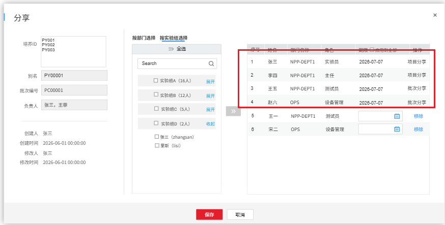
1.  修改培养：批量选择培养ID进行修改操作（具体可修改内容见章节培养方案修改③，与其保持一致）。必须满足以下条件才能进行批量修改，否则提示不能批量修改
        1.  所有培养ID都属于同一项目的同一批次且状态都为未开始，否则不允许操作并提示信息
> **[图 image252.png | 章节：项目设置① / 培养管理①③ / 培养基础管理①（3.2）（3.3）（5.0调整） | 上下文：1. 所有培养ID都属于同一项目的同一批次且状态都为未开始，否则不允许操作并提示信息]**
> **OCR 文本：**
> 仅支持同一个批次下相同状态的培养进行批量修改

        1.  所有培养ID都未进行过工艺方案的设置，否则不允许操作并提示信息
> **[图 image253.png | 章节：项目设置① / 培养管理①③ / 培养基础管理①（3.2）（3.3）（5.0调整） | 上下文：1. 所有培养ID都未进行过工艺方案的设置，否则不允许操作并提示信息]**
> **OCR 文本：**
> 您选择的多条数据中，包 | 包含已设置过工艺的培养

        1.  所有培养ID的反应器支持泵的数量不一致时（小试的泵数来自控制器表，注意表中需要维护控制器品牌和泵数信息）不允许继续操作，并提示信息
> **[图 image254.png | 章节：项目设置① / 培养管理①③ / 培养基础管理①（3.2）（3.3）（5.0调整） | 上下文：1. 所有培养ID的反应器支持泵的数量不一致时（小试的泵数来自控制器表，注意表中需要维护控制器品牌和泵数信息）不允许继续操作，并提示信息]**
> **OCR 文本：**
> 当前反应器支持泵数量不一致无法一起设置方案

1.  结果展示与操作
查询结果翻页展示，按修改时间倒排，最新的在最上面，包含以下字段：

    1.  序号
    2.  培养ID
    3.  批次编号
    4.  项目编号
    5.  培养模式
    6.  容器
    7.  状态：包含未开始、进行中、已取消、已结束、已过期、已逾期6种状态如下图。
> **[图 image255.png | 章节：项目设置① / 培养管理①③ / 培养基础管理①（3.2）（3.3）（5.0调整） | 上下文：7. 状态：包含未开始、进行中、已取消、已结束、已过期、已逾期6种状态如下图。]**
> （新增图片：V4.0 副本无同图，未做 OCR，请核对图片文件）

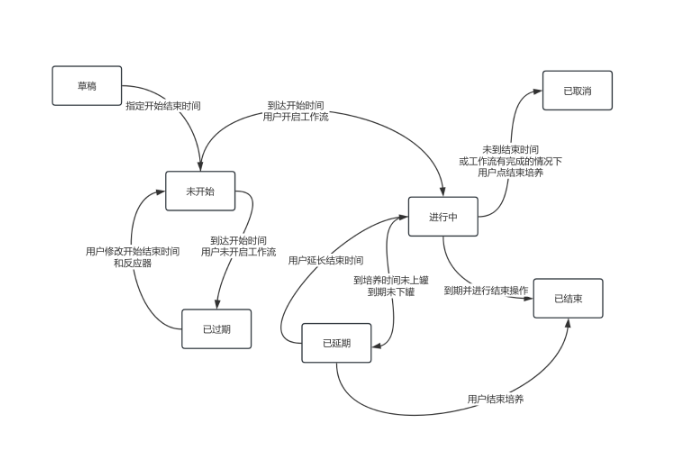
        1.  草稿：未指定培养开始和培养结束时间的为草稿状态。
        2.  未开始：未开启任何工作流且未到培养开始时间。支持修改和删除该培养ID，根据审批设定确定是否需要审批。
        3.  已过期：未开启任何工作流，且当前已到培养开始时间。
            1.  此时当前培养ID对应的培养容器被释放，即可以被别的培养ID预约使用。
            2.  支持修改和删除该培养ID，根据审批设定确定是否需要审批
            3.  当前培养无法开启任何工作流，必须在此处重新配置可用的反应器并修改开始和结束时间后才可正常开启工作流，注意修改后需更新改培养ID的状态
        4.  进行中：开启任意工作流后变为进行中
            1.  进行中的培养ID在此处不支持修改和删除
            2.  进行中的培养ID的任何修改，都需要去工作流中修改，且需要审批
        5.  已取消：在结束培养工作流时会确认是否为异常结束（具体逻辑见工作流－结束培养章节），若是则为已取消。
            1.  已取消的培养，在此处不支持修改和删除
            2.  已取消培养ID可以重复使用，即培养ID的唯一性校验不包含此状态。
        6.  已逾期：包含两种场景，满足其中任意一种则变为已逾期。第1种，有开启任意工作流，已到培养开始时间但未完成开始培养工作流；第2种，有开启任意工作流，培养结束时间已到但未完成结束培养工作流。
            1.  已逾期的培养：不支持修改和删除
            2.  逾期会触发告警，通知用户（具体通知人员参考章节告警设置②）
        7.  已结束：在结束培养工作流已正常模式结束培养。已结束的培养，不支持修改和删除
    1.  开始时间
    2.  结束时间
    3.  修改人
    4.  修改时间
    5.  操作：不同状态下支持的操作不同，见下表。
| **状态** | **修改** | **删除** |
|---|---|---|
| 未开始 | √ | √ |
| 已过期 | √ | √ |
| 进行中 | × | × |
| 已取消 | × | × |
| 已逾期 | × | × |
| 已结束 | × | × |

        1.  修改：修改对应的培养方案，具体内容见章节培养方案修改③
> **[图 image256.png | 章节：项目设置① / 培养管理①③ / 培养基础管理①（3.2）（3.3）（5.0调整） | 上下文：1. 修改：修改对应的培养方案，具体内容见章节培养方案修改③]**
> （新增图片：V4.0 副本无同图，未做 OCR，请核对图片文件）

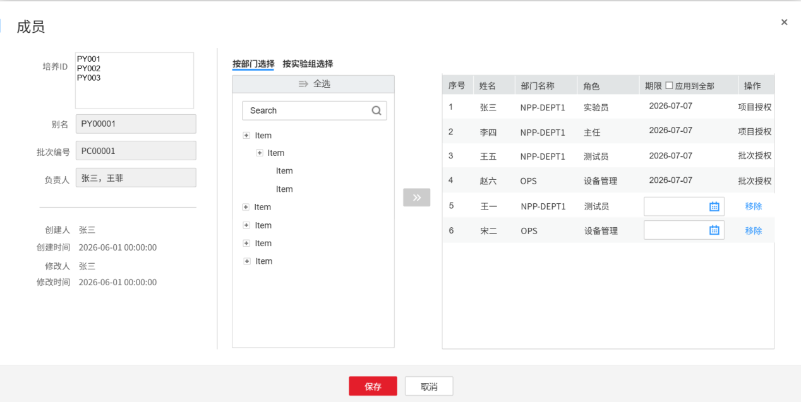
> **[图 image257.png | 章节：项目设置① / 培养管理①③ / 培养基础管理①（3.2）（3.3）（5.0调整） | 上下文：1. 修改：修改对应的培养方案，具体内容见章节培养方案修改③]**
> **OCR 文本：**
> 成员
> 按部门选择 | 按实验组选择
> PY001
> 培养ID | PY003 | PY002 | 全选 | 序号 | 姓名 | 部门名称 | 角色 | 期限应用到全部 | 操作
> Search | 张三 | NPP-DEPT1 | 2026-07-07 | 项目分享
> 别名 | PY00001 | 李四 | NPP-DEPT1 | 2026-07-07 | 项目分享
> 实验组A（16人）
> 王五 | NPP-DEPT1 | 测试员 | 移除
> 批次编号 | PC00001 | 实验组B（12人）
> 赵六 | OPS | 设备管理 | 移除
> 负责人 | 张三，王菲 | 实验组C（5人）
> 实验组D(2人)
> 创建人 | 张三
> 创建时间 | 2026-06-01 00:00:00
> 修改人 | 张三
> 修改时间 | 2026-06-0100:00:00
> 保存 | 取消

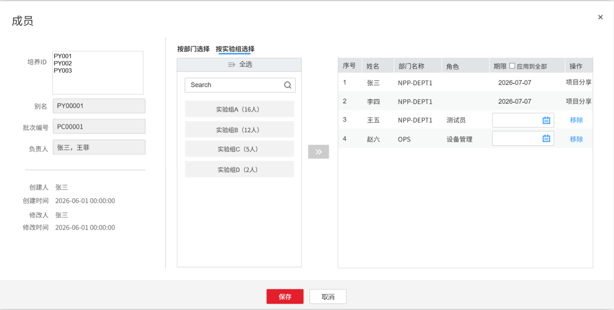
        1.  分享：页面展示及操作与成员页面一致，仅限项目负责人/批次负责人
            1.  支持将培养分享给指定用户，使其拥有对该培养的历史培养、历史检测数据、历史数据签名三个列表的查看、打印、导出权限
            2.  通过项目分享和批次分享获得权限的用户，此处不允许移除
> **[图 image258.png | 章节：项目设置① / 培养管理①③ / 培养基础管理①（3.2）（3.3）（5.0调整） | 上下文：2. 通过项目分享和批次分享获得权限的用户，此处不允许移除]**
> **OCR 文本：**
> 分享
> PY001 | 按部门选择 | 按实验组选择
> 培养ID | PY003 | PY002 | 全选 | 序号 | 姓名 | 部门名称 | 角色 | 期限口应用到全部 | 操作
> Search | 张三 | NPP-DEPT1 | 实验员 | 2026-07-07 | 项目分享
> 别名 | PY00001 | + Item | 李四 | NPP-DEPT1 | 主任 | 2026-07-07 | 项目分享
> 批次编号 | PC00001 | + Item | 王五 | NPP-DEPT1 | 测试员 | 2026-07-07 | 批次分享
> Item
> 赵六 | OPS | 设备管理 | 2026-07-07 | 批次分享
> 负责人 | 张三，王菲 | Item
> Item | NPP-DEPT1 | 测试员 | 移除
> Item | 宋二 | OPS | 设备管理 | 移除
> 创建人 | 张三 | Item
> 创建时间 | 2026-06-0100:00:00 | Item
> 修改人 | 张三
> 修改时间 | 2026-06-0100:00:00
> 保存 | 取消

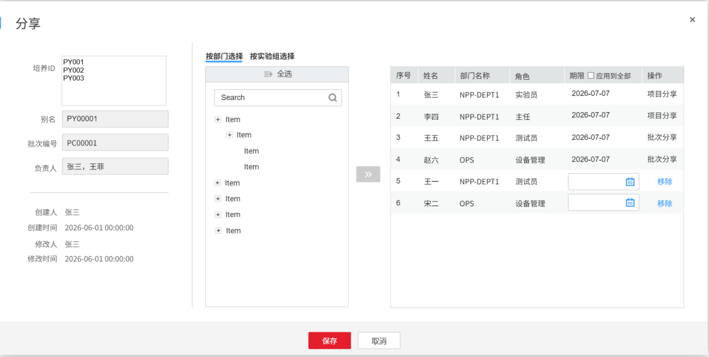
> **[图 image259.png | 章节：项目设置① / 培养管理①③ / 培养基础管理①（3.2）（3.3）（5.0调整） | 上下文：2. 通过项目分享和批次分享获得权限的用户，此处不允许移除]**
> **OCR 文本：**
> 分享
> PY001 | 按部门选择 | 按实验组选择
> 培养ID | PY002 | PY003 | 全选 | 序号 | 姓名 | 部门名称 | 角色 | 期限应用到全部 | 操作
> Search | 张三 | NPP-DEPT1 | 实验员 | 2026-07-07 | 项目分享
> 别名 | PY00001 | 李四 | NPP-DEPT1 | 主任 | 2026-07-07 | 项目分享
> 实验组A（16人）
> 批次编号 | PC00001 | 王五 | NPP-DEPT1 | 测试员 | 2026-07-07 | 批次分享
> 实验组B（12人）
> 负责人 | 张三，王菲 | 赵六 | OPS | 设备管理 | 2026-07-07 | 批次分享
> 实验组C(5人）
> 王一 | NPP-DEPT1 | 测试员 | 移除
> 实验组D(2人)
> 创建人 | 张三 | 宋二 | OPS | 设备管理 | 移除
> 创建时间 | 2026-06-01 00:00:00
> 修改人 | 张三
> 修改时间 | 2026-06-01 00:00:00
> 保存 | 取消

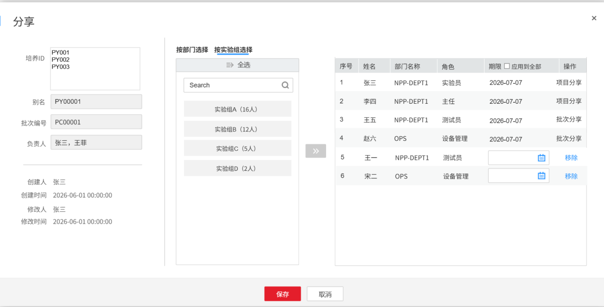
        1.  删除：
            1.  需二次确认才能删除培养，提示只有未开始和已过期状态下的培养才允许删除
> **[图 image260.png | 章节：项目设置① / 培养管理①③ / 培养基础管理①（3.2）（3.3）（5.0调整） | 上下文：1. 需二次确认才能删除培养，提示只有未开始和已过期状态下的培养才允许删除]**
> **OCR 文本：**
> 确定要删除吗
> 仅支持删除未开始培养
> 取消 | 确定

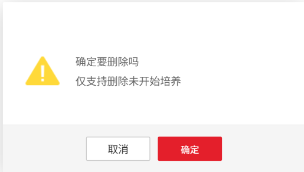
            1.  确认删除后，根据培养状态判断是否允许删除，若不允许则提示删除失败
> **[图 image261.png | 章节：项目设置① / 培养管理①③ / 培养基础管理①（3.2）（3.3）（5.0调整） | 上下文：1. 确认删除后，根据培养状态判断是否允许删除，若不允许则提示删除失败]**
> **OCR 文本：**
> 删除失败！
> 当前培养已开始无法删除
> 确认

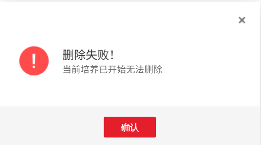
            1.  确认删除后，根据培养状态判断是否允许删除，若允许则删除成功，提示信息
> **[图 image262.png | 章节：项目设置① / 培养管理①③ / 培养基础管理①（3.2）（3.3）（5.0调整） | 上下文：1. 确认删除后，根据培养状态判断是否允许删除，若允许则删除成功，提示信息]**
> **OCR 文本：**
> 操作成功！
> 培养删除成功
> 关闭

        1.  退出
            1.  需二次确认才能推出
> **[图 image263.png | 章节：项目设置① / 培养管理①③ / 培养基础管理①（3.2）（3.3）（5.0调整） | 上下文：1. 需二次确认才能推出]**
> **OCR 文本：**
> 确定要退出吗
> 退出后将对培养数据不可见
> 再加入只能通过负责人进行
> 操作
> 确定

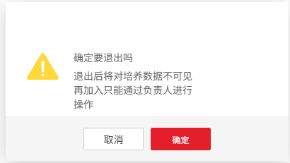
            1.  确认后，需校验当前用户是不是批次成员，若不是则退出失败，提示失败信息
> **[图 image264.png | 章节：项目设置① / 培养管理①③ / 培养基础管理①（3.2）（3.3）（5.0调整） | 上下文：1. 确认后，需校验当前用户是不是批次成员，若不是则退出失败，提示失败信息]**
> **OCR 文本：**
> 退出失败！
> 你不是培养成员无需退出
> 确认

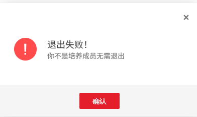
            1.  退出成功，提示信息
> **[图 image265.png | 章节：项目设置① / 培养管理①③ / 培养基础管理①（3.2）（3.3）（5.0调整） | 上下文：1. 退出成功，提示信息]**
> **OCR 文本：**
> 操作成功！
> 已从培养中退出
> 关闭

#### 培养方案修改③（3.2）（4.1调整）（4.1）

创建培养ID后，从培养管理页面选择某个培养ID，点击修改按钮，维护该培养的工艺方案和工作流等

> **[图 image266.png | 章节：项目设置① / 培养管理①③ / 培养方案修改③（3.2）（4.1调整）（4.1） | 上下文：创建培养ID后，从培养管理页面选择某个培养ID，点击修改按钮，维护该培养的工艺方案和工作流等]**
> （新增图片：V4.0 副本无同图，未做 OCR，请核对图片文件）

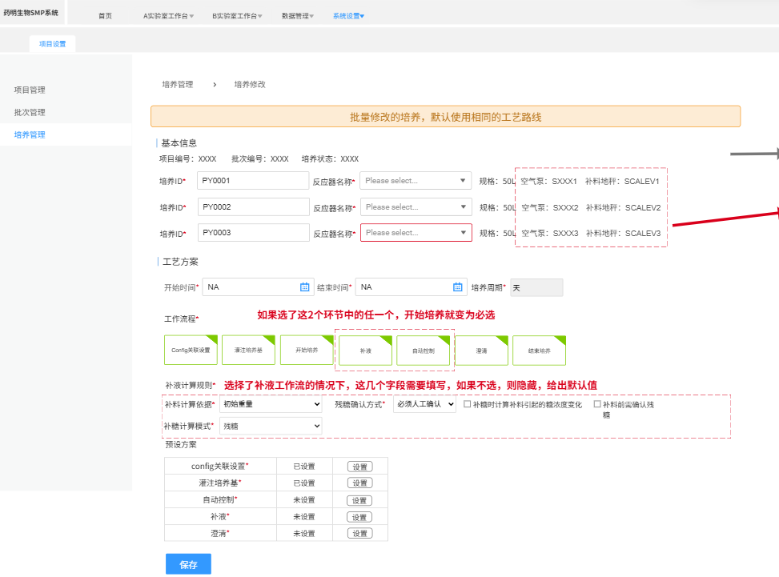
1.  基本信息
    1.  项目编号：自动带出信息，仅展示
    2.  批次编号：自动带出信息，仅展示
    3.  培养状态：自动带出信息，仅展示
    4.  培养信息：根据可以选择一条或者多条配置以下字段
        1.  培养ID：文本框，自动带出ID，可修改，修改后的培养ID需要满足创建时的校验规则
        2.  反应器/控制器/培养容器名称：
            1.  下拉列表为可预约的清单，具体见章节1.4.2中反应器/控制器/培养容器：下拉框的详细说明
            2.  当选择的反应器/控制的泵数和其余反应器的泵数不一致时，不允许选择，并提示信息
> **[图 image254.png | 章节：项目设置① / 培养管理①③ / 培养方案修改③（3.2）（4.1调整）（4.1） | 上下文：2. 当选择的反应器/控制的泵数和其余反应器的泵数不一致时，不允许选择，并提示信息]**
> **OCR 文本：**
> 当前反应器支持泵数量不一致无法一起设置方案

        1.  规格：只有选择了中试的集成反应器才展示此信息，根据容量字段计算得到规格
        2.  空气泵：只有选择了中试的集成反应器才展示此信息，数据来源于实验室设置模块的配置信息
        3.  补料地秤：只有选择了中试的集成反应器才能展示此信息，数据来源于实验室设置模块的配置信息
        4.  反应器容量：实验室设置-设备配置-台式反应器罐设置中获取的类别字段
        5.  天平编号：实验室设置-设备配置-泵的默认连接中获取天平编号
1.  工艺方案－培养起始数据
    1.  开始时间：培养开始时间，年月日维度的时间控件，必填，必须大于等于当天。如果输入了结束时间和天数，可自动计算出开始时间。默认值为NA，表示不确定开始时间。
    2.  结束时间：培养结束时间，年月日维度的时间控件，必填，必须大于等于培养开始时间。如果输入了开始时间和天数，可自动计算出结束时间。默认值为NA，表示不确定结束时间。
        1.  开始时间和结束时间只能都是NA，或者都选择某个具体日期
        2.  开始时间和结束时间都是NA时，表示当前反应器不被占用，保存时需提示信息
> **[图 image228.png | 章节：项目设置① / 培养管理①③ / 培养方案修改③（3.2）（4.1调整）（4.1） | 上下文：2. 开始时间和结束时间都是NA时，表示当前反应器不被占用，保存时需提示信息]**
> **OCR 文本：**
> 细胞培养时间已经确定了吗？
> 开始时间和结束时间后反应器将被占用
> 其他用户在你结束培养之前其他人不可使用
> 时间未确定可以先用缺省值NA暂代
> 未确定 | 确定

    3.  培养周期：文本框，可填写，可根据开始和结束时间自动计算。
    4.  初始培养重量（g）：文本框，非必填，限制输入正整数。
2.  工艺方案-工作流程
确认当前选择的培养ID需要的工作流，下方预设方案模块根据此处所选工作流联动来设置方案。

    1.  显示当前实验室设置的所有一级流程，默认全部被选中
    2.  可以通过点击相应的区域取消或者选中某些流程，选择只做部分流程
    3.  结束培养为必选，剩余流程至少选择一个
    4.  补液、自动控制中有选中任一工作流时，开始培养则变为必选。
    5.  工作流中补液被选中时，必须配置以下内容：
        1.  补料计算依据：下拉单选，必选，下拉列表包含初始重量和当前重量。默认值为当前重量
            1.  初始培养重量
            2.  当前重量 ：
                1.  集成反应器根据获取反应器地秤数据的值为准
                2.  台式控制器则以罐子的当前理论重量作为当前重量。
理论重量计算=培养基重量+接种重量-取样总重量+补料总重量

                1.  罐重/反应器重量的单位根据反应器的规格确定，前端展示时，需根据所选反应器的规格联动变化。规格小于等于15L时，单位为g；规格大于15L时，单位为kg
    1.  补液前的残糖确认：下拉单选，列表内容为不需要、必须人工确认和综合策略。默认值为必须人工确认。
        1.  必须人工确认：每日残糖的数值必须人工点击确认
        2.  不需要：不需要确认残糖来作为前置条件。
        3.  综合策略：系统自行查询，如果cedex有且仅有1个糖结果则自动确认，如果有多个需要等人工确认。
    2.  补糖时计算补料引起的糖浓度变化：勾选框，可选。默认选中。
        1.  选中：计算补糖任务时，需要在cedex残糖确认的数字结合补料结果进行补糖计算
        2.  不选中：使用用户残糖确认操作中，Cedex的检测结果中的指标项作为计算依据
    3.  补糖前需确认残糖：勾选框，可选。若选中，表示需要在反应器详情页面里需要进行确认。默认选中。
    4.  补糖计算方式：下拉单选，列表内容为残糖、残糖和乳酸共两个选项。默认值为残糖
1.  工艺方案－预设方案
    1.  根据选择的工作流程联动展示相应的方案
    2.  可点击设置按钮对每个方案进行预设
    3.  预设完成的方案，状态变为变为已设置
预设方案与上方工作流程对应关系如下表所示：

| 工作流程 | 预设方案 |
|---|---|
| config关联设置 | config关联设置方案 |
| 灌注培养基 | 灌注培养基方案 |
| 自动控制 | 自动控制方案 |
| 补液 | 补液方案 |
| 澄清 | 澄清方案 |

##### Config关联设置（4.1）

> **[图 image267.png | 章节：项目设置① / 培养管理①③ / 培养方案修改③（3.2）（4.1调整）（4.1） / Config关联设置（4.1） | 上下文：##### Config关联设置（4.1）]**
> （新增图片：V4.0 副本无同图，未做 OCR，请核对图片文件）

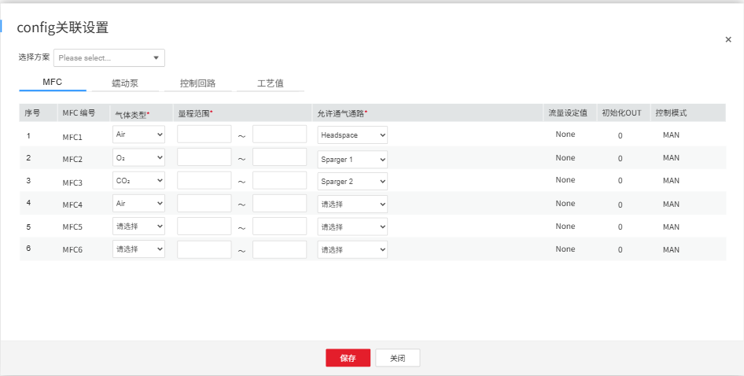
1.  选择模板：下拉单选，需要从所有的Config模板中按照以下条件联合筛选出符合要求的：
1.  属于当前培养ID绑定反应器的反应器型号
2.  状态为非禁用的模板
2.  方案内容：包含MFC、蠕动泵、控制回路、工艺值4个tab页
    1.  页面上剩余所有字段，根据选择的方案自动带出，可修改，修改后的校验规则与创建方案时保持一致，创建方案见章节Config关联设置方案（4.0）
        1.  蠕动泵tab页中，如果当前已经设备了补液方案，补液方案中的固定泵位置与当前选择模板中的泵对应的功能名称冲突
            1.  提示用户当前存在冲突
> **[图 image268.png | 章节：项目设置① / 培养管理①③ / 培养方案修改③（3.2）（4.1调整）（4.1） / Config关联设置（4.1） | 上下文：1. 提示用户当前存在冲突]**
> （新增图片：V4.0 副本无同图，未做 OCR，请核对图片文件）

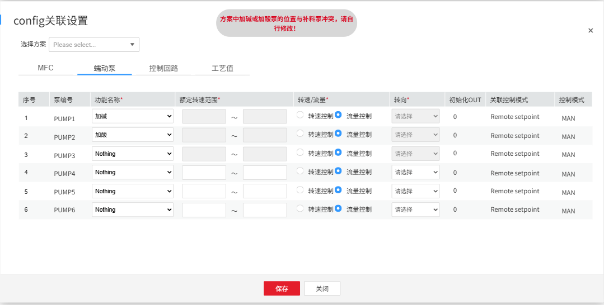
            2.  当前以补液方案中的固定泵设置为准，即当前泵置灰，功能名称为Nothing且不可修改。比如：pump3在补液的固定泵位置配置了补葡萄糖，方案模版中pump3的位置设置了加碱，这时候按照哪个先设置，哪个先占位的原则，方案中pump3加碱的信息这里被清除掉，并且把补料方案中已占用的位置灰掉，不允许用户使用
        2.  控制回路tab页中，如果在蠕动泵tab页中存在冲突导致泵的设置信息发生修改
> **[图 image269.png | 章节：项目设置① / 培养管理①③ / 培养方案修改③（3.2）（4.1调整）（4.1） / Config关联设置（4.1） | 上下文：2. 控制回路tab页中，如果在蠕动泵tab页中存在冲突导致泵的设置信息发生修改]**
> （新增图片：V4.0 副本无同图，未做 OCR，请核对图片文件）

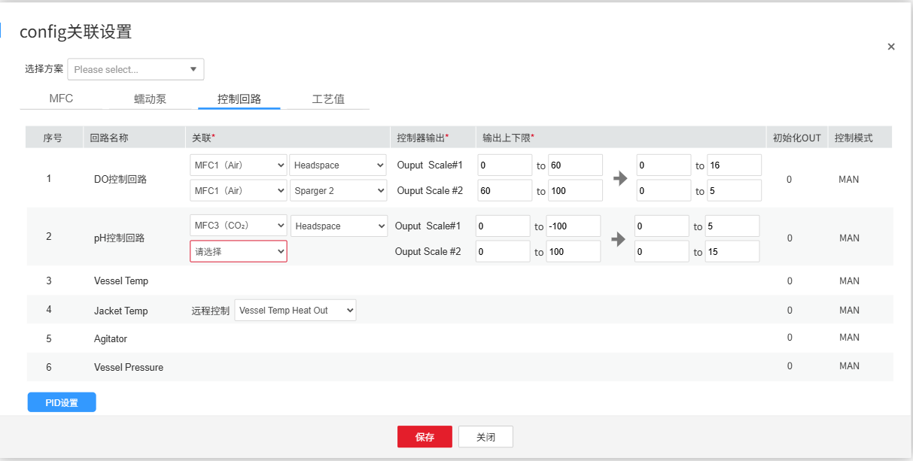
            1.  PH控制回路-关联里PUMP的下拉选项必须选择，下拉列表更新为蠕动泵tab页最新填写的信息（设置了功能名称的所有泵）
            2.  PH控制回路的其余信息依然根据模板自动带出，可修改
    2.  当前页面的数据，根据实际填写存入对应培养的具体工艺方案中。
##### 灌注培养基方案（4.1）

> **[图 image270.png | 章节：项目设置① / 培养管理①③ / 培养方案修改③（3.2）（4.1调整）（4.1） / 灌注培养基方案（4.1） | 上下文：##### 灌注培养基方案（4.1）]**
> （新增图片：V4.0 副本无同图，未做 OCR，请核对图片文件）

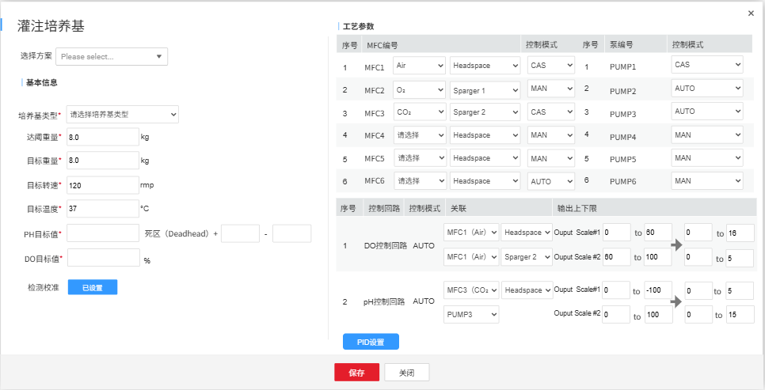
1.  选择模板：需要从所有的灌注培养基模板中按照以下条件联合筛选出符合要求的：
1.  属于当前培养ID绑定反应器的反应器型号
2.  状态为非禁用的模板
2.  方案内容：
    1.  页面上剩余所有字段，根据选择的方案自动带出，可修改，修改后的校验规则与创建方案时保持一致，创建方案见章节灌注培养基方案模板（4.0）
    2.  当前页面的数据，根据实际填写存入对应培养的具体工艺方案中。
##### 自动控制方案（4.1）

1.  选择模板：需要从所有的自动控制模板中按照以下条件联合筛选出符合要求的：
1.  属于当前培养ID绑定反应器的反应器型号
2.  模板中的培养周期和当前培养ID的培养周期一致的
3.  状态为非禁用的模板
2.  方案内容：
    1.  页面上剩余所有字段，根据选择的方案自动带出，可修改，修改后的校验规则与创建方案时保持一致，创建方案见章节自动控制方案模板（4.0）
        1.  针对MFC页签，如果前面对Config或灌注培养基方案完成预设，则此页签不显示，否则按照选择的方案自动带出
    2.  当前页面的数据，根据实际填写存入对应培养的具体工艺方案中。
##### 补液方案③（3.2）（4.2调整）

说明：现在仅包含选择模板这一种方式，从EBR系统获取相关规则的方式待后续补充

1.  选择模板：需要从所有的补液模板中按照以下条件联合筛选出符合要求的：
1.  属于当前培养ID绑定反应器的反应器型号
2.  模板中的培养周期和当前培养ID的培养周期一致的
3.  状态为非禁用的模板
4.  模板中的泵的数量和当前培养ID绑定反应器的泵的数量一致
5.  模板中的规格和当前培养ID绑定反应器的规格一致
2.  方案内容（3个tab页）：
    1.  页面上剩余所有字段，根据选择的方案自动带出，可修改，修改后的校验规则与创建补液方案时保持一致，创建补液方案见章节1.6.2补液方案
    2.  当前页面的数据，根据实际填写存入对应培养的具体工艺方案中。
> **[图 image271.png | 章节：项目设置① / 培养管理①③ / 培养方案修改③（3.2）（4.1调整）（4.1） / 补液方案③（3.2）（4.2调整） | 上下文：2. 当前页面的数据，根据实际填写存入对应培养的具体工艺方案中。]**
> **OCR 文本：**
> 补液
> 选择方案 | Please select...
> 固定泵 | 补料任务 | 补糖规则
> 序号 | 泵名称 | 量程 (g/min) | 补料培养基* | 糖浓度 | 耗材* | 下限体积 | 泵速策略*
> ST50L-PUMP1 | 88 | Nothing | 400 | Nothing | 0.2 | 泵速策略
> ST50L-PUMP2 | 96 | 请选择 | NA | 请选择 | 未知 | 泵速策略
> ST50L-PUMP3 | 360 | 请选择 | NA | 请选择 | 未知 | 泵速策略
> ST50L-PUMP4 | 300 | 请选择 | NA | 请选择 | 未知 | 泵速策略
> ST50L-PUMP5 | 100 | 请选择 | NA | 请选择 | 未知 | 泵速策略
> ST50L-PUMP6 | 100 | 请选择 | NA | 请选择 | 未知 | 泵速策略
> ST50L-PUMP7 | 100 | 请选择 | NA | 请选择 | 未知 | 泵速策略
> ST50L-PUMP8 | 100 | 请选择 | NA | 请选择 | 未知 | 泵速策略
> 保存 | 取消

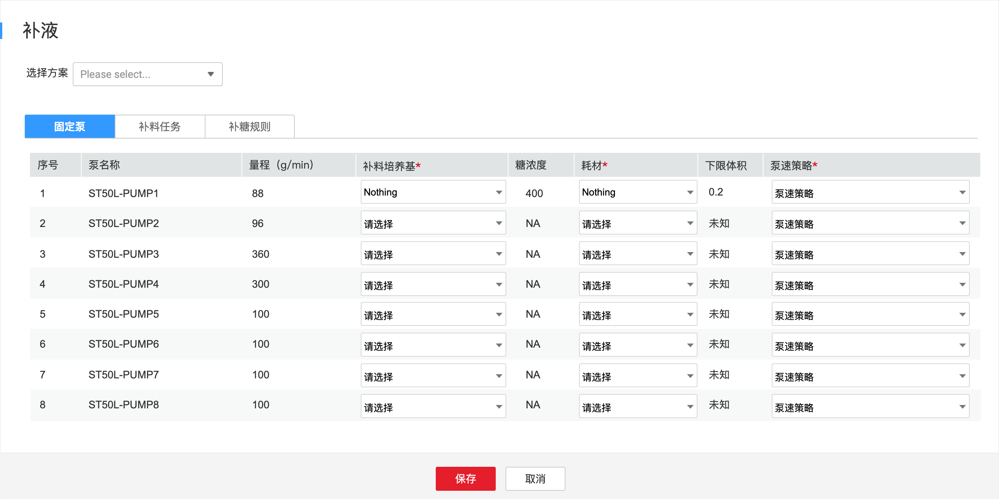
> **[图 image272.png | 章节：项目设置① / 培养管理①③ / 培养方案修改③（3.2）（4.1调整）（4.1） / 补液方案③（3.2）（4.2调整） | 上下文：2. 当前页面的数据，根据实际填写存入对应培养的具体工艺方案中。]**
> **OCR 文本：**
> 补液
> 选择方案 | Please select...
> 固定泵 | 补料任务 | 补糖规则
> PUMP1 | PUMP2 | PUMP3 | PUMP4 | PUMP5 | PUMP6 | PUMP7 | PUMP8
> 新增 | 补料培养基：Glucose
> 序号 | 天* | 补料计划时间* | 补料类型* | 补料体积（%/g）＊ | 操作
> 00 : 00 : 00 | 粘贴 | 百分比 | 粘贴 | 粘贴 | 删除
> 00 : 00 : 00 | 粘贴 | 百分比 | 粘贴 | 粘贴 | 删除
> 保存 | 取消

> **[图 image273.png | 章节：项目设置① / 培养管理①③ / 培养方案修改③（3.2）（4.1调整）（4.1） / 补液方案③（3.2）（4.2调整） | 上下文：2. 当前页面的数据，根据实际填写存入对应培养的具体工艺方案中。]**
> **OCR 文本：**
> 补液
> 模版名称*
> 固定泵 | 补料任务 | 补糖规则
> 新增 | 糖耗：2.1g/L(2026-07-3010:00) | 更多
> 序号 | 泵名称 | 培养天数（开始） | 培养天数(结束） | 计划方式* | 细则 | 操作
> PUMP2 | 按规则 | 下限操作符* | 糖下限（g/L）
> 剧除
> 计算模式 | 残糖和乳酸√ | 糖补料至（g/L）·
> PUMP2 | 按数值 | 每日执行时间 | 00 : 00 : 00 | 糖补料体积(g） | 剧除
> 保存 | 取消

