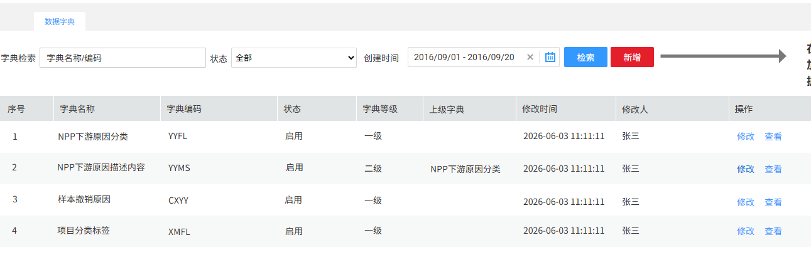
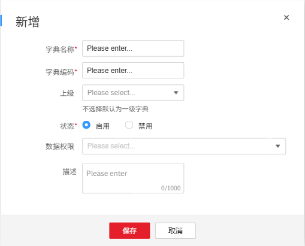
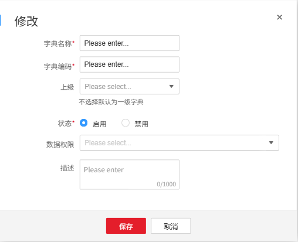
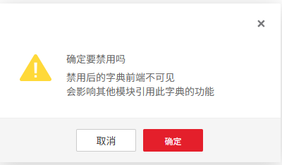
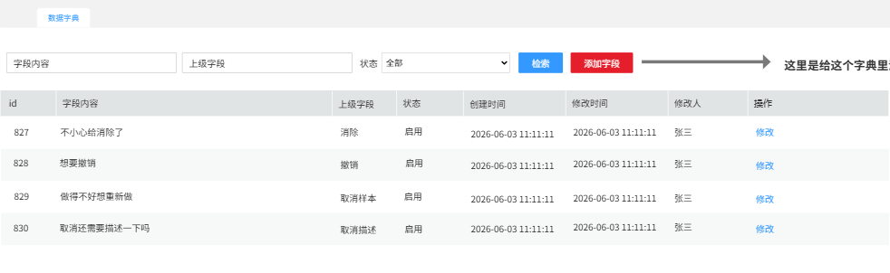
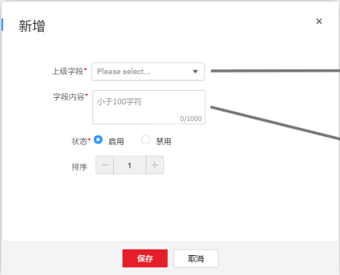
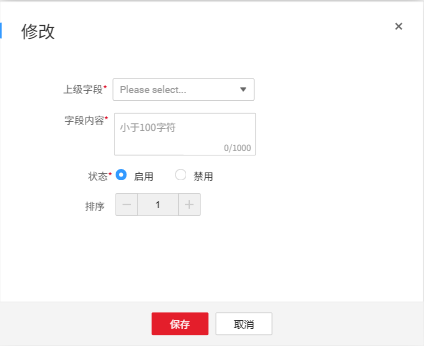
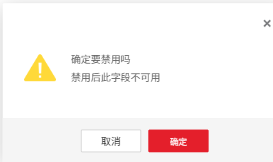

# 系统设置

## 数据字典

数据字典管理整合小试、中试中各种原因、描述、项目标签等字典信息

> **[图 image274.png | 章节：数据字典 | 上下文：数据字典管理整合小试、中试中各种原因、描述、项目标签等字典信息]**
> **OCR 文本：**
> 数据字典
> 字典检索 | 字典名称/编码 | 状态 | 全部 | 创建时间 | 2016/09/01 -2016/09/20 | 检索 | 新增
> 序号 | 字典名称 | 字典编码 | 状态 | 字典等级 | 上级字典 | 修改时间 | 修改人 | 操作
> NPP下游原因分类 | YYFL | 启用 | 一级 | 2026-06-03 11:11:11 | 张三 | 修改 | 查看
> NPP下游原因描述内容 | YYMS | 启用 | 二级 | NPP下游原因分类 | 2026-06-03 11:11:11 | 张三 | 修改 | 查看
> 样本撤销原因 | CXYY | 启用 | 一级 | 2026-06-03 11:11:11 | 张三 | 修改 | 查看
> 项目分类标签 | XMFL | 启用 | 一级 | 2026-06-0311:11:11 | 张三 | 修改 | 查看

### 维护字典信息①（4.1调整）

此处仅维护一级/二级字典信息，字典内具体数据项在新增后点击查看按钮进行增删改查。

1.  新增
新增一个字典信息，字典内具体数据项在新增后点击查看按钮进行增删改查。

> **[图 image275.png | 章节：数据字典 / 维护字典信息①（4.1调整） | 上下文：新增一个字典信息，字典内具体数据项在新增后点击查看按钮进行增删改查。]**
> （新增图片：V4.0 副本无同图，未做 OCR，请核对图片文件）

    1.  字典名称：文本框，长度最多20个汉字，不允许重复
    2.  字典编码：这个看技术觉得是用系统生成的id方便还是自己编码方便，不允许重复
    3.  上级：如果是二级字典关联上级字典id，不选则为一级
    4.  状态：启用/禁用，单选，默认启用
    5.  描述：非必填，支持100个汉字的描述
    6.  数据权限：下拉多选，非必选。下拉列表为实验室类型（小试上游、小试下游、中试上游、中试下游）
        1.  选择后表示为某类型实验室专属字典，仅限admin用户和有此类型实验室数据权限的用户可见
        2.  如为空，表示为系统字典，仅限admin用户可见
    7.  保存：保存前完成的校验包括必填字段非空、字段长度、指定字段唯一性
1.  查询条件
以下条件联合查询：

1.  字典名称/编码：支持字典名称/编码共同模糊搜索
2.  状态：下拉单选，全部/启用/禁用
3.  起止时间：支持按照创建和修改时间检索
1.  结果展示与操作
查询结果翻页展示，按修改时间倒排，最新的在最上面，包含以下字段：

1.  序号
2.  字典名称
3.  字典编码
4.  状态
5.  字典等级
6.  上级字典
7.  修改人
8.  修改时间
9.  操作
1.  修改：
> **[图 image276.png | 章节：数据字典 / 维护字典信息①（4.1调整） | 上下文：1. 修改：]**
> （新增图片：V4.0 副本无同图，未做 OCR，请核对图片文件）

    1.  将状态从启用修改为禁用时，需二次提示信息
> **[图 image277.png | 章节：数据字典 / 维护字典信息①（4.1调整） | 上下文：1. 将状态从启用修改为禁用时，需二次提示信息]**
> **OCR 文本：**
> 确定要禁用吗
> 禁用后的字典前端不可见
> 会影响其他模块引用此学典的功能
> 取消 | 确定

    2.  成功将状态修改为禁用
> **[图 image278.png | 章节：数据字典 / 维护字典信息①（4.1调整） | 上下文：2. 成功将状态修改为禁用]**
> **OCR 文本：**
> 操作成功！
> 字典已禁用
> 关闭

1.  查看：见后一节添加字典数据项
### 添加字典数据项①

维护字典内各数据项的相关信息

> **[图 image279.png | 章节：数据字典 / 添加字典数据项① | 上下文：维护字典内各数据项的相关信息]**
> **OCR 文本：**
> 数据宇典
> 字段内容 | 上级字段 | 状态 | 全部 | 检索 | 添加字段 | 这里是给这个字典里
> id | 字段内容 | 上级字段 | 状态 | 创建时间 | 修改时间 | 修改人 | 操作
> 827 | 不小心给消除了 | 消除 | 启用 | 2026-06-03 11:11:11 | 2026-06-03 11:11:11 | 修改
> 828 | 想要撤销 | 撤销 | 启用 | 2026-06-03 11:11:11 | 2026-06-03 11:11:11 | 修改
> 829 | 做得不好想重新做 | 取消样本 | 启用 | 2026-06-03 11:11:11 | 2026-06-03 11:11:11 | 张三 | 修改
> 830 | 取消还需要描述一下吗 | 取消描述 | 启用 | 2026-06-03 11:11:11 | 2026-06-03 11:11:11 | 修改

1.  添加字段
给对应字典添加字段

> **[图 image280.png | 章节：数据字典 / 添加字典数据项① | 上下文：给对应字典添加字段]**
> **OCR 文本：**
> 新增
> 上级字段* | Please select...
> 字段内容* | 小于100字符
> 0/1000
> 状态* | 启用 | 禁用
> 排序
> 保存 | 取消

1.  上级字段：下拉单选，仅当当前为二级字典时，必须下拉选择上级字段，否则不展示该选项框
2.  字段内容：必填，前端控制最大100个字符
3.  状态：默认为启用
4.  排序：默认数字1，在前端展示时，数字越小越靠前，排序数字一样，按照添加时间，最早越靠前。
5.  保存：保存前完成的校验包括必填字段非空、字段长度、指定字段唯一性
1.  查询条件
以下条件联合查询：

1.  字段内容：根据字段内容模糊搜索
2.  上级字段：根据上级字段模糊搜索
3.  状态：全部/启用/禁用
1.  结果展示与操作
查询结果翻页展示，按创建时间倒排，最新的在最上面，包含以下字段：

1.  序号：行号
2.  字段内容
3.  上级字段
4.  状态
5.  创建时间
6.  修改人
7.  修改时间
8.  操作
1.  修改：与新增一致
> **[图 image281.png | 章节：数据字典 / 添加字典数据项① | 上下文：1. 修改：与新增一致]**
> **OCR 文本：**
> 修改
> 上级字段* | Please select...
> 字段内容* | 小于100字符
> 0/1000
> 状态* | 启用 | 禁用
> 排序
> 保存 | 取消

            1.  将状态从启用修改为禁用时，需二次提示信息
> **[图 image282.png | 章节：数据字典 / 添加字典数据项① | 上下文：1. 将状态从启用修改为禁用时，需二次提示信息]**
> **OCR 文本：**
> 确定要禁用吗
> 禁用后此字段不可用
> 取消 | 确定

            1.  成功将状态修改为禁用
> **[图 image283.png | 章节：数据字典 / 添加字典数据项① | 上下文：1. 成功将状态修改为禁用]**
> **OCR 文本：**
> 操作成功！
> 字段已禁用
> 关闭

