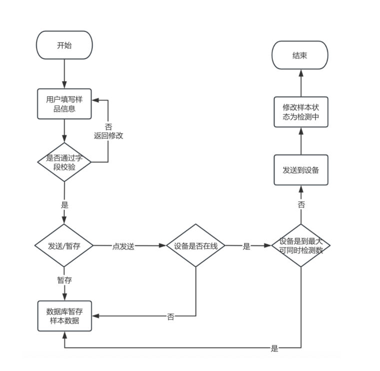
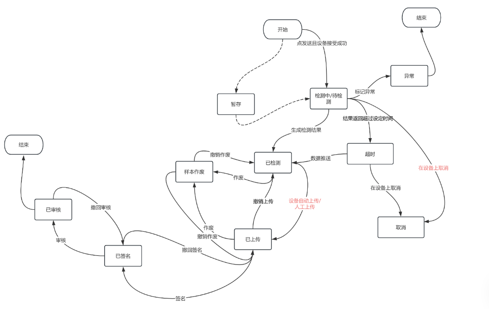

# 数据管理

数据管理模块包含检测分析、数据签名操作台、签批记录、在线数据、离线数据模块。

1.  检测分析：包含样品检测需求的编辑、暂存和发送以及相关检测结果的查询展示。检测分析详细分类如表2-1检测分析详细分类所示
*表2-1检测分析详细分类*

| **序号** | **取样** | **测样** | **习惯叫法/现功能模块** | **试验室** |
|---|---|---|---|---|
| 1 | 手动取样 | 手动测样 | 离线检测（BGA,Vicell,OSMO，Cedex） | 中试、小试 |
| 2 | 手动取样 | 自动测样 | Load sample | 小试 |
| 3 | 自动取样 | 手动测样 | 取样 | 小试 |
| 4 | 自动取样 | 自动测样 | 自动化任务 | 小试 |

2.  数据签名操作台：包含检测结果的基础查看分析、签名、撤销签名、审核、撤销审核、操作记录查询等。
> **[图 image351.png | 章节：数据管理 | 上下文：2. 数据签名操作台：包含检测结果的基础查看分析、签名、撤销签名、审核、撤销审核、操作记录查询等。]**
> （新增图片：V4.0 副本无同图，未做 OCR，请核对图片文件）

*图2-1检测需求发送操作流程*

> **[图 image352.png | 章节：数据管理 | 上下文：图2-1检测需求发送操作流程]**
> （新增图片：V4.0 副本无同图，未做 OCR，请核对图片文件）

*图2-2样品检测及签名流程*

1.  签批记录：所有记录查询展示
2.  在线数据：在线数据的查询、可视化及导出
3.  离线数据：在线数据的查询、可视化及导出
