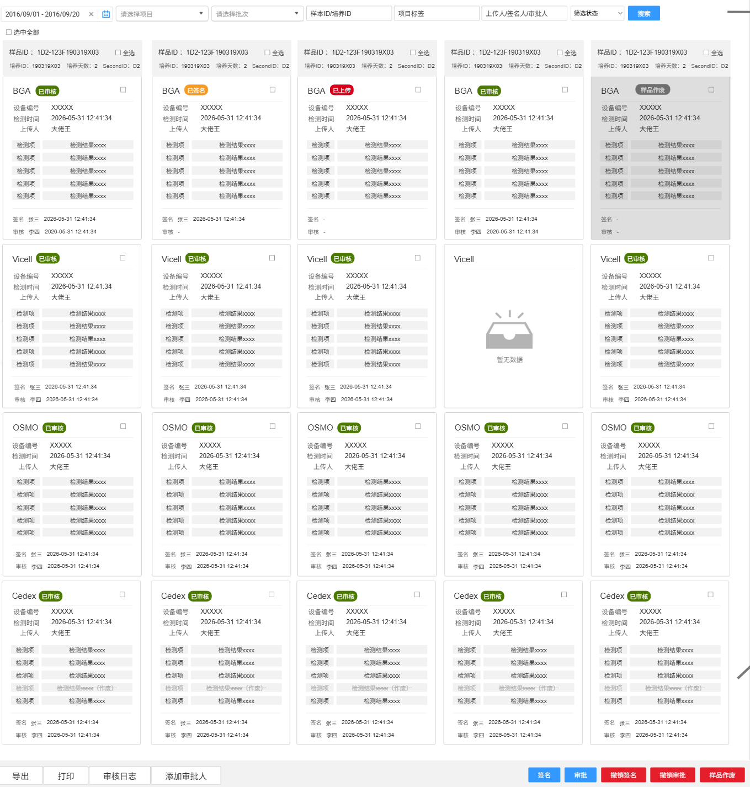
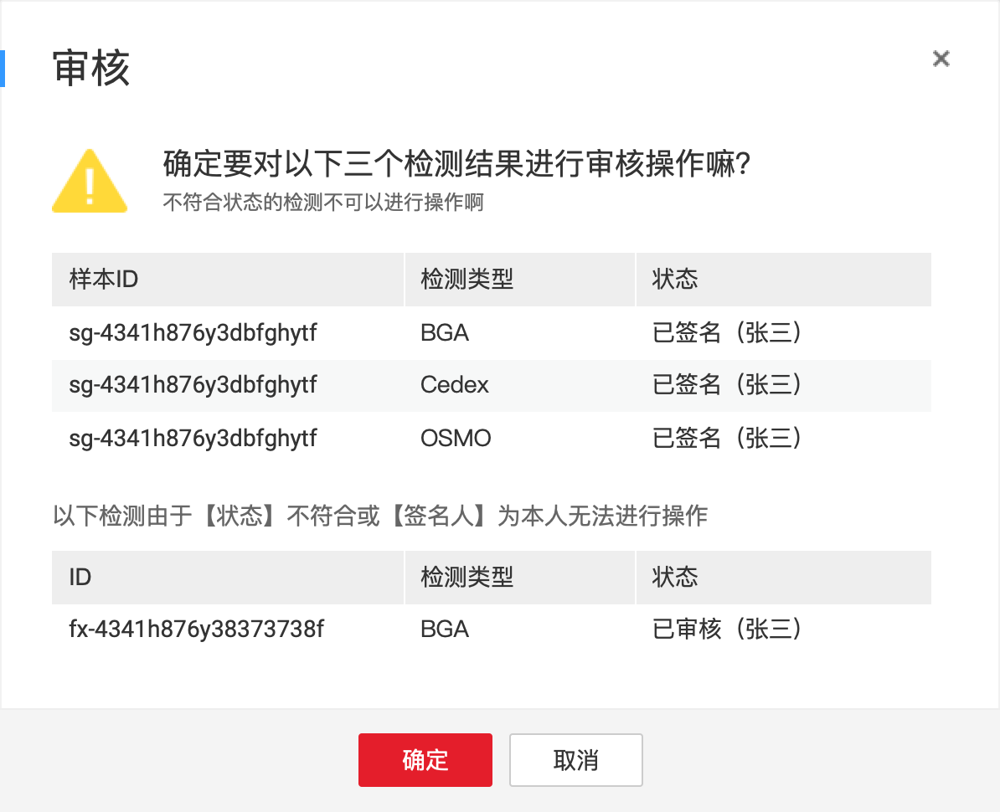
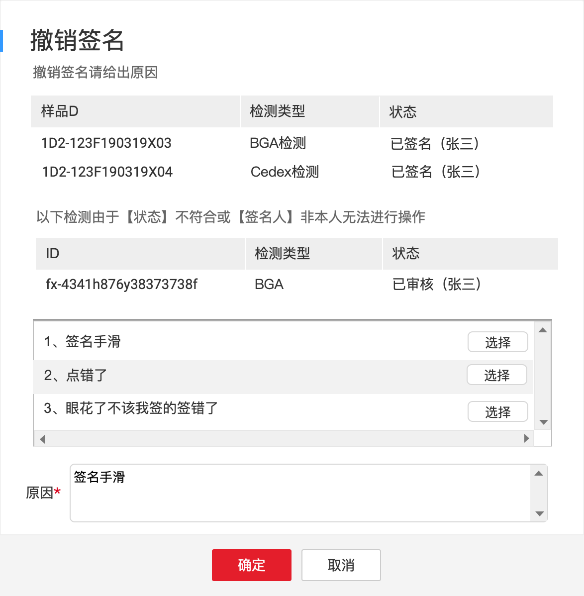
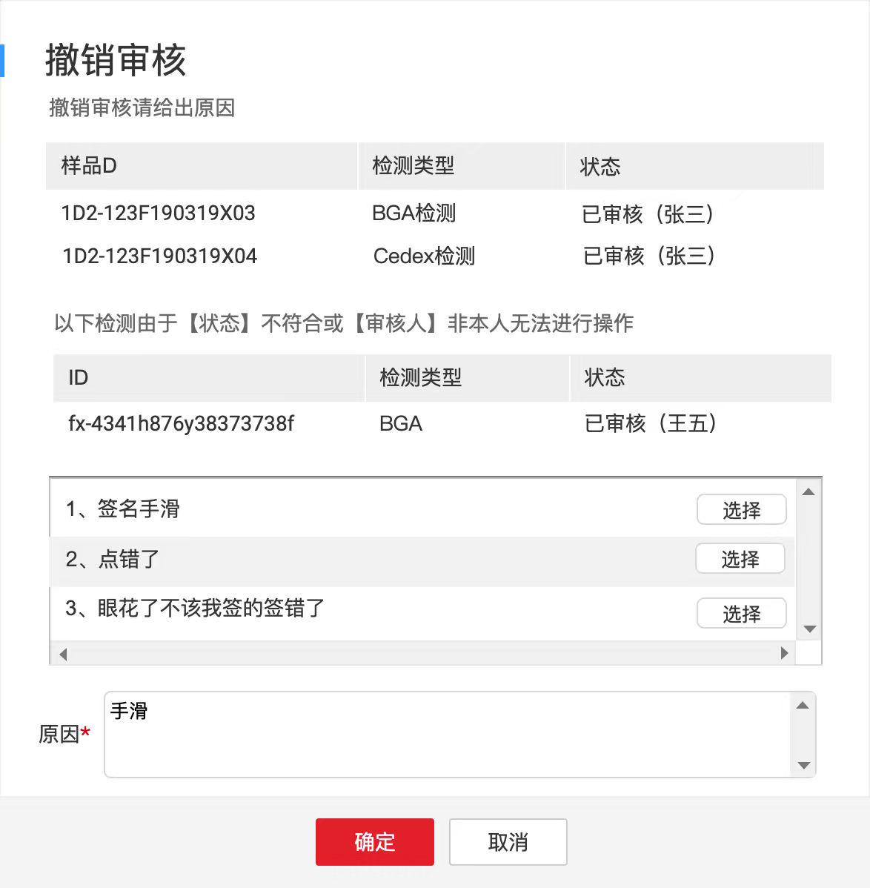
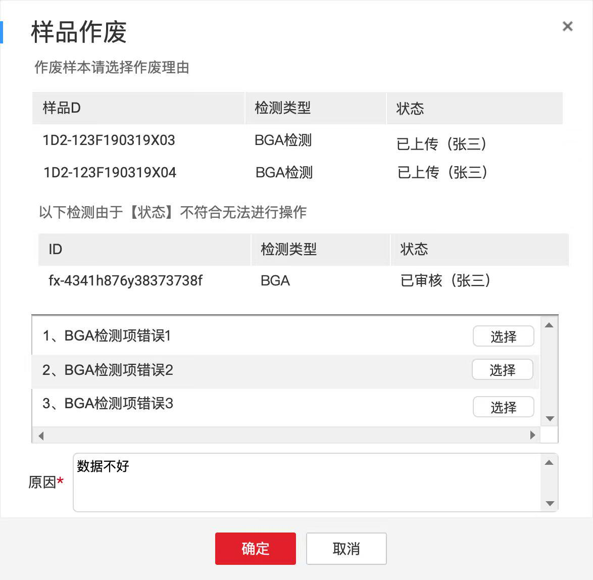
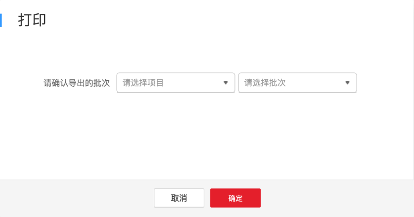
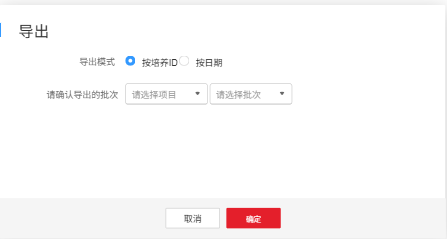
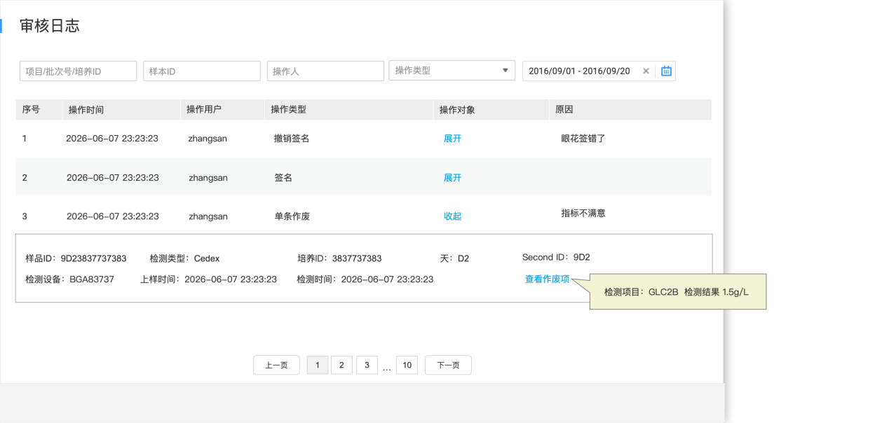
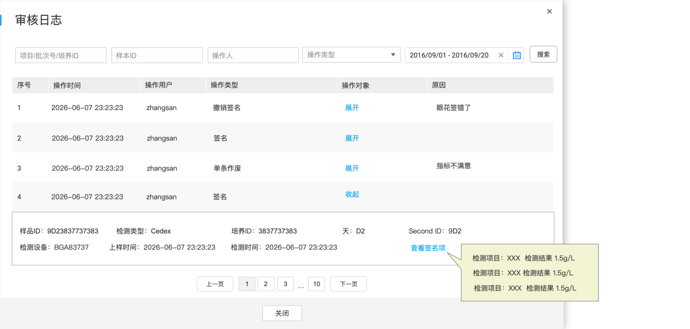
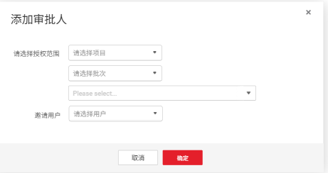

# 数据管理

## 数据签名操作台①（5.0调整）

页面分为查询条件、检测结果展示、检测结果签批、数据导出、数据打印、审核日志以及添加审批人。

> **[图 image377.png | 章节：数据签名操作台①（5.0调整） | 上下文：页面分为查询条件、检测结果展示、检测结果签批、数据导出、数据打印、审核日志以及添加审批人。]**
> **OCR 文本：**
> 2016/09/01-2016/09/20 | 请选择项目 | 请选择批次 | 样本ID/培养ID | 项目标签 | 上传人/签名人/审批人 | 筛选状态 | 搜索
> 口选中全部
> 样品ID：1D2-123F190319X03 | 全选 | 样品ID：1D2-123F190319X03 | 口全选 | 样品ID：1D2-123F190319X03 | 口全选 | 样品ID：1D2-123F190319X03 | 口全选 | 样品ID：1D2-123F190319X03 | 口全选
> 培养ID：190319X03 | 培养天数：2 | SecondID: D2 | 培养ID：190319X03 | 培养天数：2 | SecondID: D2 | 培养ID：190319X03 | 培养天数：2 | SecondID: D2 | 培养ID：190319X03 | 培养天数：2 | SecondID: D2 | 培养ID：190319X03 | 培养天数：2 | SecondID: D2
> BGA | 已审核 | BGA | 已签名 | BGA | B上传 | BGA | 已审核 | BGA | 样品作废
> 设备编号 | XXXXX | 设备编号 | 设备编号 | 设备编号 | 设备编号
> 检测时间 | 2026-05-31 12:41:34 | 检测时间 | 2026-05-31 12:41:34 | 检测时间 | 2026-05-31 12:41:34 | 检测时间 | 2026-05-31 12:41:34 | 检测时间 | 2026-05-31 12:41:34
> 上传人 | 大佬王 | 上传人 | 大佬王 | 上传人 | 大佬王 | 上传人 | 大佬王 | 上传人 | 大佬王
> 检测项 | 检测结果xX | 检测项 | 检测结果xXXX | 检测项 | 检测结果XxX | 检测项 | 检测结果xxXX | 检测项 | 检测结果xXX
> 检测项 | 检测结果xX | 检测项 | 检测结果xXX | 检测项 | 检测结果XX | 检测项 | 检测结果xXX | 检测项 | 检测结果XXXX
> 检测项 | 检测结果xXX | 检测项 | 检测结果xXX | 检测项 | 检测结果XxX | 检测项 | 检测结果xXXX | 检测项 | 检测结果xXXX
> 检测项 | 检测结果xXX | 检测项 | 检测结果xXXX | 检测项 | 检测结果XX | 检测项 | 检测结果xXX | 检测项 | 检测结果xXXX
> 检测项 | 检测结果xXXX | 检测项 | 检测结果xxXx | 检测项 | 检测结果xXX | 检测项 | 检测结果xXXX | 检测项 | 检测结果xXXX
> 签名张三 | 2026-05-31 12:41:34 | 签名张三 | 2026-05-31 12:41:34 | 签名 | 签名张三 | 2026-05-31 12:41:34 | 签名-
> 审核 | 李四 | 2026-05-31 12:41:34 | 审核 | 审核 | 审核 | 李四 | 2026-05-31 12:41:34 | 审核-
> Vicell | 已审核 | Vicell | 已审核 | Vicell | 已审核 | Vicell | Vicell | 已审核
> 设备编号 | XXXXX | 设备编号 | Xxxxx | 设备编号 | xxxxx | 设备编号
> 检测时间 | 2026-05-31 12:41:34 | 检测时间 | 2026-05-31 12:41:34 | 检测时间 | 2026-05-31 12:41:34 | 检测时间 | 2026-05-31 12:41:34
> 上传人 | 大佬王 | 上传人 | 大佬王 | 上传人 | 大佬王 | 上传人 | 大佬王
> 检测项 | 检测结果xXX | 检测项 | 检测结果xxX | 检测项 | 检测结果xxX | 检测项 | 检测结果XOXX
> 检测项 | 检测结果XXX | 检测项 | 检测结果xX | 检测项 | 检测结果XXX | 检测项 | 检测结果XXX
> 检测项 | 检测结果XXX | 检测项 | 检测结果xX | 检测项 | 检测结果xXX | 检测项 | 检测结果XXX
> 检测项 | 检测结果XX | 检测项 | 检测结果xX | 检测项 | 检测结果XXX | 检测项 | 检测结果XX
> 检测项 | 检测结果xXX | 检测项 | 检测结果X0X | 检测项 | 检测结果xxXx | 暂无数据 | 检测项 | 检测结果xXX
> 签名张三2026-05-3112:41:34 | 签名张三 | 2026-05-31 12:41:34 | 签名张三 | 2026-05-31 12:41:34 | 签名张三 | 2026-05-31 12:41:34
> 审核李四2026-05-3112:41:34 | 审核李四 | 2026-05-31 12:41:34 | 审核李四 | 2026-05-31 12:41:34 | 审核李四 | 2026-05-31 12:41:34
> OSMO | 已审核 | OSMO | 已审核 | OSMO | 已审核 | OSMO | 已审核 | OSMO | 已审核
> 设备编号 | 设备编号 | XXXXX | 设备编号 | xxxxx | 设备编号 | 设备编号
> 检测时间 | 2026-05-31 12:41:34 | 检测时间 | 2026-05-31 12:41:34 | 检测时间 | 2026-05-31 12:41:34 | 检测时间 | 2026-05-31 12:41:34 | 检测时间 | 2026-05-31 12:41:34
> 上传人 | 大佬王 | 上传人 | 大佬王 | 上传人 | 大佬王 | 上传人 | 大佬王 | 上传人 | 大佬王
> 检测项 | 检测结果xxXX | 检测项 | 检测结果xxXX | 检测项 | 检测结果xxX | 检测项 | 检测结果xXXX | 检测项 | 检测结果xxXX
> 检测项 | 检测结果xX | 检测项 | 检测结果xXX | 检测项 | 检测结果XxX | 检测项 | 检测结果xxXX | 检测项 | 检测结果xXX
> 检测项 | 检测结果xXX | 检测项 | 检测结果xXX | 检测项 | 检测结果XxX | 检测项 | 检测结果xxXX | 检测项 | 检测结果xXX
> 检测项 | 检测结果xXX | 检测项 | 检测结果xXX | 检测项 | 检测结果XxX | 检测项 | 检测结果xXXX | 检测项 | 检测结果xXX
> 检测项 | 检测结果xXXX | 检测项 | 检测结果XXXX | 检测项 | 检测结果XXX | 检测项 | 检测结果xXX | 检测项 | 检测结果xXX
> 签名张三 | 2026-05-31 12:41:34 | 签名张三 | 2026-05-31 12:41:34 | 签名张三 | 2026-05-31 12:41:34 | 签名张三 | 2026-05-31 12:41:34 | 签名张三 | 2026-05-31 12:41:34
> 审核李四 | 2026-05-31 12:41:34 | 审核李四 | 2026-05-31 12:41:34 | 审核李四 | 2026-05-31 12:41:34 | 审核 | 李四 | 2026-05-31 12:41:34 | 审核李四 | 2026-05-31 12:41:34
> Cedex | 已审核 | Cedex | 已审核 | Cedex | 已审核 | Cedex( | 已审核 | Cedex( | 已审核
> 设备编号 | XXXXX | 设备编号 | Xxxxx | 设备编号 | 设备编号 | 设备编号 | XXXXX
> 检测时间 | 2026-05-31 12:41:34 | 检测时间 | 2026-05-31 12:41:34 | 检测时间 | 2026-05-31 12:41:34 | 检测时间 | 2026-05-31 12:41:34 | 检测时间 | 2026-05-31 12:41:34
> 上传人 | 大佬王 | 上传人 | 大佬王 | 上传人 | 大佬王 | 上传人 | 大佬王 | 上传人 | 大佬王
> 检测项 | 检测结果XXX | 检测项 | 检测结果xXX | 检测项 | 检测结果XXXX | 检测项 | 检测结果xXX | 检测项 | 检测结果xxX
> 检测项 | 检测结果XX | 检测项 | 检测结果xxX | 检测项 | 检测结果XXX | 检测项 | 检测结果xXX | 检测项 | 检测结果xX
> 检测项 | 检测结果XX | 检测项 | 检测结果xxX | 检测项 | 检测结果XXX | 检测项 | 检测结果xXX | 检测项 | 检测结果XxX
> 检测项 | 检测结果80%（作废） | 检测项 | 检测结果:8%（作废） | 检测项 | 检测结果8(作废) | 检测项 | 检测结果80（作废) | 检测项 | 检测结果000（作废）
> 检测项 | 检测结果XXX | 检测项 | 检测结果xXX | 检测项 | 检测结果xXX | 检测项 | 检测结果xXX | 检测项 | 检测结果XXX
> 签名张三 | 2026-05-31 12:41:34 | 签名张三 | 2026-05-31 12:41:34 | 签名张三 | 2026-05-31 12:41:34 | 签名张三 | 2026-05-31 12:41:34 | 签名张三 | 2026-05-31 12:41:34
> 审核 | 李四 | 2026-05-31 12:41:34 | 审核李四 | 2026-05-31 12:41:34 | 审核 | 李四 | 2026-05-31 12:41:34 | 审核 | 李四 | 2026-05-31 12:41:34 | 审核 | 李四 | 2026-05-31 12:41:34
> 导出 | 打印 | 审核日志 | 添加审批人 | 签名 | 审批 | 撤销签名 | 撤销审批 | 样品作废

### 查询条件①

按照以下条件联合查询检测结果，默认进入页面不出数据。查询最小粒度为一个样品ID（即只要一个样品ID下的任意一个检测类型的结果符合查询条件，则该样品ID所有检测结果均需展示）：

1.  时间段：必选，按照上样时间选择查询的开始和结束时间，最多支持查询30天，默认值为当天
2.  项目：下拉单选，必选，仅限当前用户授权的项目，按照参与时间倒排序，默认进入当前页面必须选择项目才查询展示结果
3.  批次：下拉单选，根据所选项目联动查询所属批次号
4.  样品ID/培养ID：文本框，支持共同模糊搜索
5.  项目标签：文本框，支持模糊搜索
6.  签名人/审批人/上传人：文本框，模糊搜索，默认筛选当前用户为上传人（发送检测需求的人）的记录
7.  状态：下拉框，单选。包括所有状态、已上传、已签名、已审核、已作废，默认所有状态
### 检测结果展示①（3.2）

展示所有符合查询条件的检测结果：

1.  选中全部选中框：一键全选整个页面所有卡片完成签名、审批等操作
2.  纵向（一列）：为一个样本ID的完整检测结果，上方为样品ID等基础信息，下方4个卡片固定按照BGA、Vicell、OSMO、Cedex顺序展示4个检测类型的检测结果
3.  基础信息：
    1.  样品ID
    2.  培养ID
    3.  培养周期
    4.  Second ID
    5.  选中“全选”，支持一键选中下方所有卡片完成签名、审批等操作
4.  卡片信息：每个检测类型为一个卡片，支持单独选中一个卡片完成签名、审批等操作，卡片内展示信息如下：
    1.  检测类型
    2.  当前状态：不同状态用不同颜色表示，当前卡片为已作废时，卡片整体置灰
    3.  选中框：支持选中单个卡片进行签名、审批等操作。注意，当前卡片为已作废时，没有选中框（随即不支持签名、审核等操作）
    4.  设备编号
    5.  上样时间
    6.  上传人：发送检测需求的用户
    7.  分行展示该次检测完成的各检项名称、结果、区间、单位
    8.  签名：展示签名人和签名时间，未签名时留空。
    9.  审核：展示审核人和审核时间，未审核时留空。
5.  横向：按照上样时间（每个样品ID即每列中所有上样时间的最小值）从早到晚排序展示；左右滑动展示。
### 可执行操作①

选中卡片后，支持以下操作：

1.  签名：选中对应检测结果，点击【签名】按钮，将“已上传”状态结果置为“已签名”状态。
    1.  支持批量选中操作
    2.  选中后需二次确认：针对选中的所有卡片，对“已上传”卡片提示可签名、对“已签名”和“已审核”卡片提示已签名/已审核无法再次签名。点击确定后才能操作成功。
> **[图 image378.png | 章节：数据签名操作台①（5.0调整） / 可执行操作① | 上下文：2. 选中后需二次确认：针对选中的所有卡片，对“已上传”卡片提示可签名、对“已签名”和“已审核”卡片提示已签名/已审核无法再次签名。点击确定后才能操作成功。]**
> **OCR 文本：**
> 签名
> 确定要对以下三个检测结果进行签名操作嘛？
> 不符合状态的检测不可以进行操作啊
> 样本ID | 检测类型 | 状态
> sg-4341h876y3dbfghytf | BGA | 已上传 (张三)
> sg-4341h876y3dbfghytf | Cedex | 已上传 (张三)
> sg-4341h876y3dbfghytf | OSMO | 已上传 (张三)
> 以下检测由于【状态】不符合无法进行操作
> ID | 检测类型 | 状态
> fx-4341h876y38373738f | BGA | 已审核 (张三)
> 确定 | 取消

1.  审核：选中对应检测结果，点击【审核】按钮，将“已签名”状态结果置为“已审核”状态。
    1.  支持批量选中操作：
    2.  选中后需二次确认：针对选中的所有卡片，对“已签名”卡片提示可审核、对“已上传”卡片提示未签名不能审核、对“已审核”卡片提示已审核无法再次审核。点击确定后才能操作成功
    3.  审核人和签名人不能是同一个，若是同一个则不让审核，提示信息
> **[图 image379.png | 章节：数据签名操作台①（5.0调整） / 可执行操作① | 上下文：3. 审核人和签名人不能是同一个，若是同一个则不让审核，提示信息]**
> **OCR 文本：**
> 审核
> 确定要对以下三个检测结果进行审核操作嘛？
> 不符合状态的检测不可以进行操作啊
> 样本ID | 检测类型 | 状态
> sg-4341h876y3dbfghytf | BGA | 已签名 (张三)
> sg-4341h876y3dbfghytf | Cedex | 已签名 (张三)
> sg-4341h876y3dbfghytf | OSMO | 已签名 (张三)
> 以下检测由于【状态】不符合或【签名人】为本人无法进行操作
> ID | 检测类型 | 状态
> fx-4341h876y38373738f | BGA | 已审核 (张三)
> 确定 | 取消

1.  撤销签名：
    1.  支持批量选中操作
    2.  选中后需二次确认：
> **[图 image380.png | 章节：数据签名操作台①（5.0调整） / 可执行操作① | 上下文：2. 选中后需二次确认：]**
> **OCR 文本：**
> 撤销签名
> 撤销签名请给出原因
> 样品D | 检测类型 | 状态
> 1D2-123F190319X03 | BGA检测 | 已签名 |  (张三)
> 1D2-123F190319X04 | Cedex检测 | 已签名 (张三)
> 以下检测由于【状态】不符合或【签名人】非本人无法进行操作
> ID | 检测类型 | 状态
> fx-4341h876y38373738f | BGA | 已审核 (张三)
> 1、签名手滑 | 选择
> 2、点错了 | 选择
> 3、眼花了不该我签的签错了 | 选择
> 签名手滑
> 原因*
> 确定 | 取消

        1.  判断所选检测结果所处状态是否为“已签名”状态，若不是，则提示不让撤销签名
        2.  判断所选检测结果的签名人是否为当前操作用户，若不是，则提示不让撤销签名
        3.  必须选择撤销原因：支持从数据字典获取已配置的字典信息快速选中填入，支持手动填入，批量选择时则表示都是同一个撤销原因
        4.  确认撤销后将状态由“已签名”置为“已上传”
1.  撤销审核：
    1.  支持批量选中操作
    2.  选中后二次确认（页面设计同撤销签名功能）
> **[图 image381.jpeg | 章节：数据签名操作台①（5.0调整） / 可执行操作① | 上下文：2. 选中后二次确认（页面设计同撤销签名功能）]**
> **OCR 文本：**
> 撤销审核
> 撤销审核请给出原因
> 样品D | 检测类型 | 状态
> 1D2-123F190319X03 | BGA检测 | 已审核 (张三)
> 1D2-123F190319X04 | Cedex检测 | 已审核 (张三)
> 以下检测由于【状态】不符合或【审核人】非本人无法进行操作
> ID | 检测类型 | 状态
> fx-4341h876y38373738f | BGA | 已审核 (王五)
> 1、签名手滑 | 选择
> 2、点错了 | 选择
> 3、眼花了不该我签的签错了 | 选择
> 手滑
> 原因*
> 确定 | 取消

        1.  判断所选检测结果所处状态是否为“已审核”状态，若不是，则提示不让撤销审核
        2.  判断所选检测结果的审核人是否为当前操作用户，若不是，则提示不让撤销审核
        3.  必须选择撤销原因：支持从数据字典获取已配置的字典信息快速选中填入，支持手动填入，批量选择时则表示都是同一个撤销原因
        4.  确认撤销后将状态由“已审核”置为“已签名”
1.  样品作废
    1.  支持批量选中操作
    2.  选中后二次确认
> **[图 image382.jpeg | 章节：数据签名操作台①（5.0调整） / 可执行操作① | 上下文：2. 选中后二次确认]**
> **OCR 文本：**
> 样品作废
> 作废样本请选择作废理由
> 样品D | 检测类型 | 状态
> 1D2-123F190319X03 | BGA检测 | 已上传 (张三)
> 1D2-123F190319X04 | BGA检测 | 已上传 (张三)
> 以下检测由于【状态】不符合无法进行操作
> ID | 检测类型 | 状态
> fx-4341h876y38373738f | BGA | 已审核 (张三)
> 1、BGA检测项错误1 | 选择
> 2、BGA检测项错误2 | 选择
> 3、BGA检测项错误3 | 选择
> 数据不好
> 原因*
> 确定 | 取消

        1.  判断所选检测结果所处状态是否为“已上传”状态，若不是，则提示不能作废
        2.  必须选择撤销原因：支持从数据字典获取已配置的字典信息快速选中填入，支持手动填入，批量选择时则表示都是同一个撤销原因
        3.  作废后根据设置进入或不进入审批流程，审批通过后作废成功
        4.  作废后的审批过程中时，卡片置灰不允许操作
        5.  确认作废后将状态由“已上传”置为“作废”状态
### 数据打印①

导出检测结果和操作记录的PDF文件：

> **[图 image383.png | 章节：数据签名操作台①（5.0调整） / 数据打印① | 上下文：导出检测结果和操作记录的PDF文件：]**
> **OCR 文本：**
> 打印
> 请确认导出的批次 | 请选择项目 | 请选择批次
> 取消 | 确定

1.  范围确认：
    1.  项目：选择当前用户授权范围内的项目
    2.  批次：根据项目号联动批次号，仅能获取当前用户授权范围内的项目
2.  文件内容：该选择批次下，任一检测类型结果状态为“已上传”或“已签名”或“已审核”的样品ID的所有检测类型的检测结果及其操作记录
3.  文件模板：
> 附件: oleObject1.bin（docx 内嵌 OLE 对象，未内联；原文件请在 需求说明书V5.1-1030.docx 中查看）
### 数据导出①

以Excel文件导出检测结果：

> **[图 image385.png | 章节：数据签名操作台①（5.0调整） / 数据导出① | 上下文：以Excel文件导出检测结果：]**
> **OCR 文本：**
> 导出模式 | 按培养ID | 按日期
> 请确认导出的批次 | 请选择项目 | 请选择批次
> 取消 | 确定

1.  范围确认：
    1.  项目：下拉单选，选择当前用户授权范围内的项目
    2.  批次：下拉单选，根据项目号联动批次号，支持搜索，导出数据维度至少选到批次，也可以具体到某一个培养id
2.  文件内容：该选择批次下，所有日期，任一检测类型结果状态为“已上传”或“已签名”或“已审核”的样品ID的所有检测类型的检测结果
3.  导出模式：
    1.  按培养ID导出：模板如下
> 附件: Workbook2.xlsx（docx 内嵌 OLE 对象，未内联；原文件请在 需求说明书V5.1-1030.docx 中查看）
    1.  按日期导出：模板如下
> 附件: Workbook3.xlsx（docx 内嵌 OLE 对象，未内联；原文件请在 需求说明书V5.1-1030.docx 中查看）
### 审核日志①

筛选查看检测分析和数据签名页面的操作日志。

> **[图 image388.png | 章节：数据签名操作台①（5.0调整） / 审核日志① | 上下文：筛选查看检测分析和数据签名页面的操作日志。]**
> **OCR 文本：**
> 审核日志
> 项目/批次号/培养ID | 样本ID | 操作人 | 操作类型 | 2016/09/01-2016/09/20
> 序号 | 操作时间 | 操作用户 | 操作类型 | 操作对象 | 原因
> 202606-07 23:23:23 | zhangsan | 撤销签名 | 展开 | 眼花签错了
> 2026-06-0723:23:23 | zhangsan | 签名 | 展开
> 202606-07 23:23:23 | zhangsan | 单条作废 | 收起 | 指标不满意
> 样品ID：9D23837737383 | 检测类型：Cedex | 培养ID：3837737383 | 天：D2 | Second ID:9D2
> 检测设备：BGA83737 | 上样时间：2026-06-0723:23:23 | 检测时间：2026-06-0723:23:23 | 查看作废项
> 检测项目：GLC2B检测结果1.5g/L
> 上一页 | 10 | 下一页

> **[图 image389.png | 章节：数据签名操作台①（5.0调整） / 审核日志① | 上下文：筛选查看检测分析和数据签名页面的操作日志。]**
> **OCR 文本：**
> 审核日志
> 项目/批次号/培养ID | 样本ID | 操作人 | 操作类型 | 2016/09/01-2016/09/20 | 搜索
> 序号 | 操作时间 | 操作用户 | 操作类型 | 操作对象 | 原因
> 202606-07 23:23:23 | zhangsan | 撤销签名 | 展开 | 眼花签错了
> 2026-06-0723:23:23 | zhangsan | 签名 | 展开
> 2026-06-07 23:23:23 | zhangsan | 单条作废 | 展开 | 指标不满意
> 2026-06-0723:23:23 | zhangsan | 签名 | 收起
> 样品ID：9D23837737383 | 检测类型：Cedex | 培养ID：3837737383 | 天：D2 | Second ID: 9D2
> 检测设备：BGA83737 | 上样时间：2026-06-0723:23:23 | 检测时间：2026-06-0723:23:23 | 查看签名项
> 检测项目：XXX检测结果1.5g/L
> 检测项目：XXX检测结果1.5g/L
> 上一页 | 10 | 下一页 | 检测项目：XXX检测结果1.5g/L
> 关闭

1.  查询条件：以下条件联合查询
    1.  项目/批次号/培养ID：支持项目/批次号/培养ID模糊搜索
    2.  样本ID：支持模糊搜索
    3.  操作人
    4.  操作类型：共包含系统上传、撤销上传、样本作废、单条作废、签名、审核、异常、撤销作废、撤销单条作废、撤销签名、撤销审核、编辑
    5.  起止时间：按照操作时间筛选
2.  结果展示：查询结果翻页展示，按创建时间倒排，最新的在最上面，包含以下字段
    1.  序号
    2.  操作时间
    3.  操作用户
    4.  操作类型
    5.  操作对象：可展开查看详情或收起。展开显示样品ID、检测类型、培养ID、天、SecondID、检测设备、上样时间、检测时间、签名项/作废项名称及结果
    6.  原因
> **[图 image390.png | 章节：数据签名操作台①（5.0调整） / 审核日志① | 上下文：6. 原因]**
> （新增图片：V4.0 副本无同图，未做 OCR，请核对图片文件）

