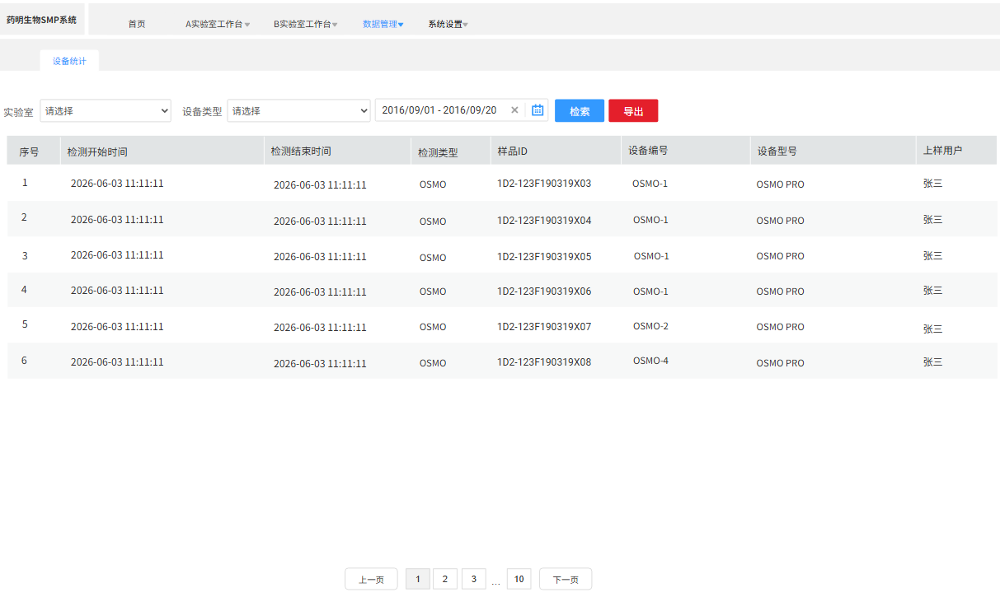

# 数据管理

## 设备统计（5.0）

支持按照实验室、设备类型等查询所有检测状况

> **[图 image394.png | 章节：设备统计（5.0） | 上下文：支持按照实验室、设备类型等查询所有检测状况]**
> （新增图片：V4.0 副本无同图，未做 OCR，请核对图片文件）

1.  查询条件
-   此页面查询范围为成功发送检测需求的所有样品ID（不限制发送后的所处状态），然后结合以下条件联合查询
1.  实验室：下拉单选，列表内容当前用户有权限的实验室
2.  设备类型
3.  起止时间：支持根据开始和结束时间搜索
2.  结果展示与操作
-   查询结果翻页展示，按开始时间倒排，最新的在最上面，包含以下字段：
1.  序号
2.  检测开始时间：上样时间
3.  检测结束时间：检测完成时间
4.  设备类型
5.  样品ID
6.  设备型号
7.  设备编码
8.  上样用户
3.  导出操作：根据当前查询出的所有结果，直接excel格式导出即可
