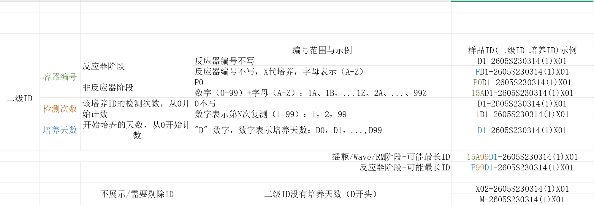
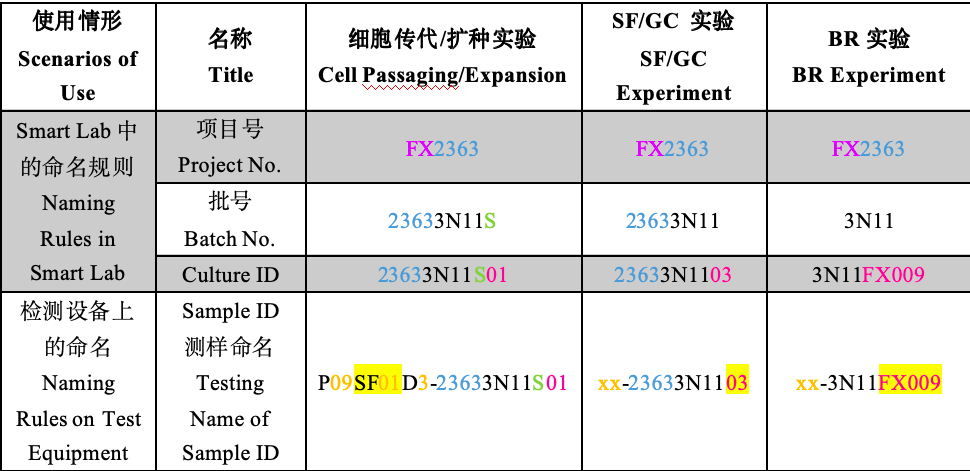
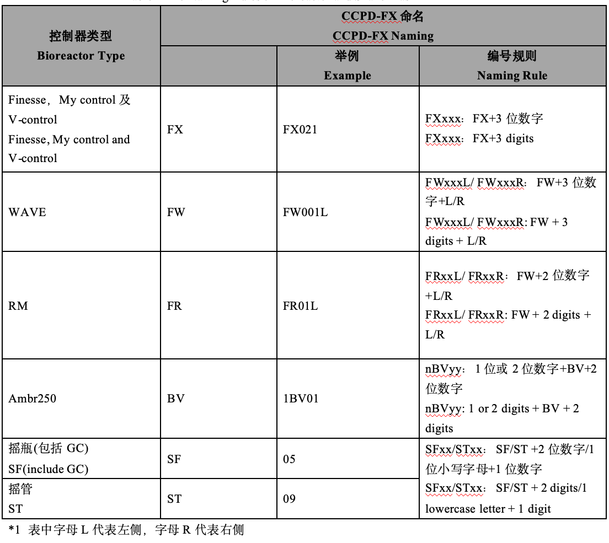
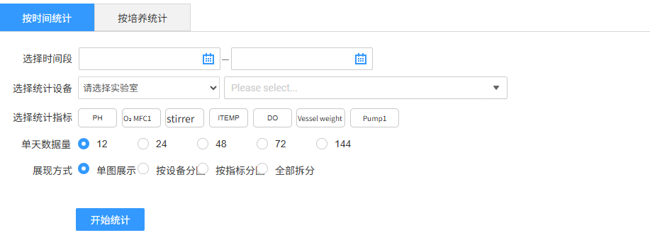
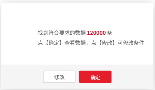
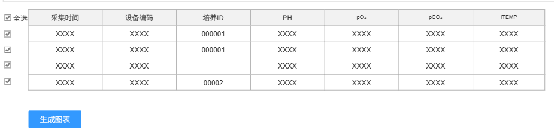
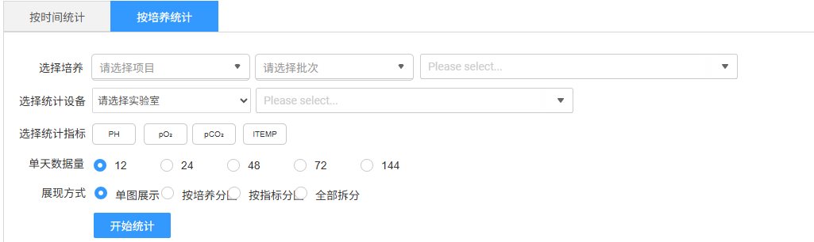
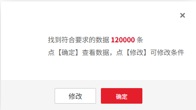
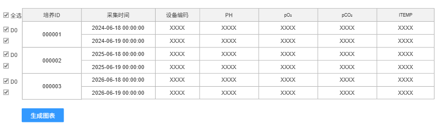

# 数据管理

## 在线数据②

支持用户对中试反应器和小试控制器采集的在线数据筛选出符合条件的数据进行统计分析，包含按时间统计和按培养统计两种模式。

首先，根据各类查询条件查询到所有数据；然后，针对已查询数据再次确认选择生成图表分析

1.  中试样本ID组成
> **[图 image395.png | 章节：在线数据② | 上下文：1. 中试样本ID组成]**
> （新增图片：V4.0 副本无同图，未做 OCR，请核对图片文件）

1.  小试样本ID组成
> **[图 image396.png | 章节：在线数据② | 上下文：1. 小试样本ID组成]**
> （新增图片：V4.0 副本无同图，未做 OCR，请核对图片文件）

> **[图 image397.png | 章节：在线数据② | 上下文：1. 小试样本ID组成]**
> （新增图片：V4.0 副本无同图，未做 OCR，请核对图片文件）

### 按时间统计②

1.  查询统计
> **[图 image398.png | 章节：在线数据② / 按时间统计② | 上下文：1. 查询统计]**
> **OCR 文本：**
> 按时间统计 | 按培养统计
> 选择时间段
> 选择统计设备 | 请选实验室 | Please select..
> 选择统计指标 | PH | O: MFC1 | stirrer | ITEMP | DO | Vessel weight | Pump1
> 单天数据量 | 12 | 24 | 48 | 72 | 144
> 展现方式 | 单图展示 | 按设备分 | 按指标分 | 全部拆分
> 开始统计

    1.  选择时间段：必填，填写其实和结束时间，最长限制3个月，可选择到时分秒维度
    2.  选择统计设备：
        1.  实验室：下拉单选，必选，当前用户有权限范围的实验室
        2.  设备：下拉选择，支持多选，必选，根据实验室联动获取，中试为反应器，小试为控制器。设备数+指标数不超过10个
    3.  选择统计指标：多选，列表内容待确定
    4.  单天数据量：因为设备一天中每个指标会采集多次，根据此选项控制展示的数据量，提供5种选项，按24小时制
        1.  12:每2个小时抽一条数据，采集时间点在00:00、2:00、4:00……只要采集时间的小时和分钟对应即可，不限秒
        2.  24：每1个小时抽一条数据，采集时间点00:00、1:00、2:00……只要采集时间的小时和分钟对应即可，不限秒
        3.  48：每半小时抽一条数据采集，时间在00:00、00:30、1:00……只要采集时间的小时和分钟对应即可，不限秒
        4.  72：每15分钟抽一条数据采集，时间在00:15、00:30、00：45……只要采集时间的小时和分钟对应即可，不限秒
        5.  144：每10分钟抽一条数据采集，时间在00:10、00:20、00：30……只要采集时间的小时和分钟对应即可，不限秒
    5.  展现方式：单选，默认为单图展示
        1.  单图展示：所有数据在一张图绘制
        2.  按设备分图：需要按照一个设备为一张图分开多个图展示
        3.  按指标分图：需要按照一个指标为一张图分开多个图展示
        4.  全部拆分：需要按照一个设备&一个指标为一张图分开多个图展示
    6.  开始统计：
> **[图 image399.png | 章节：在线数据② / 按时间统计② | 上下文：6. 开始统计：]**
> **OCR 文本：**
> 找到符合要求的数据120000条
> 点【确定】查着数据，点【修改】 | 可修改条件
> 修改 | 确定

> **[图 image400.png | 章节：在线数据② / 按时间统计② | 上下文：6. 开始统计：]**
> **OCR 文本：**
> 团全选 | 采集时间 | 设备编码 | 培养ID | PH | pO: | pCO: | ITEMP
> XXXX | XXXX | 000001 | xXXX | XXXX | XXXX | XXXX
> XXXX | XXXX | 000001 | XXXX | XXXX | XXXX | xXXX
> XXXX | XXXX | XXXX | XXXX | XXXX | XXXX
> XXXX | XXXX | 00002 | XXXX | XXXX | XXXX | XXXX
> 生成图表

        1.  点击开始统计，联合查询符合条件的数据，表格展示，表格内容包含采集时间、设备编号、培养ID、各参数名称、各参数数值
        2.  查询完成后先提示数据量信息，确认查看数据或修改条件（关闭弹窗）
        3.  查询并确认查看数据后，表格展示数据
            1.  数据表格展示不分页，直接滑动展示
            2.  数据表格按照时间正排序
            3.  支持单条勾选和全选。默认全部选中
            4.  生成图表：此按钮吸底固定，不随页面滚动。基于选中数据点击生成图表。注意，一条都不选时不支持生成图表。
1.  图表绘制
    1.  一个设备&一个参数为一个系列
    2.  Y轴为参数，X轴为采集时间，Y轴支持手动设定最大最小值
    3.  多个参数时，需要多个Y轴，每个Y轴默认根据数据量级自适应；支持手动设定Y轴的最大最小值，多个参数时每个Y轴都要可手动设定（需技术确认多Y轴是否能实现）
    4.  鼠标在样本点上悬浮展示信息包含培养ID、设备编号、参数名称、采集时间、参数数值
    5.  样式美化：先包括所有Echart可用控件
### 按培养统计②

1.  查询统计
> **[图 image401.png | 章节：在线数据② / 按培养统计② | 上下文：1. 查询统计]**
> **OCR 文本：**
> 按时间统计 | 按培养统计
> 选择培养 | 请选择项目 | 请选择批次 | Please select..
> 选择统计设备 | 请选择实验室 | Please select..
> 选择统计指标 | PH | PO: | PCO: | ITEMP
> 单天数据量 | 24 | 48 | 72 | 144
> 展现方式 | 单图展示 | 按培养分 | 按指标分 | 全部拆分
> 开始统计

1.  选择培养：必填，注意选择的指标数+培养数不超过10
    1.  项目：范围限本人相关
    2.  批次：范围限本人相关，根据项目联动
    3.  培养：范围限本人相关，根据项目联动
2.  选择统计设备：非必选，在选择的培养ID关联的容器再进一步过滤。
        1.  实验室：下拉单选，非必选，当前用户有权限范围的实验室
        2.  设备：下拉选择，支持多选，非必选，中试为反应器，小试为控制器。
3.  选择统计指标：多选，列表内容待确定
4.  单天数据量：同按照时间统计模式的规则
5.  展现方式：单选。默认单图展示
        1.  单图展示：所有数据在一张图绘制
        2.  按培养分图：需要按照一个培养为一张图分开多个图展示
        3.  按指标分图：需要按照一个指标为一张图分开多个图展示
        4.  全部拆分：需要按照一个设备&一个指标为一张图分开多个图展示
6.  开始统计：
> **[图 image402.png | 章节：在线数据② / 按培养统计② | 上下文：6. 开始统计：]**
> **OCR 文本：**
> 找到符合要求的数据120000条
> 点【确定】 | 查看数据，点【修改】 | 可修改条件
> 修改 | 确定

> **[图 image403.png | 章节：在线数据② / 按培养统计② | 上下文：6. 开始统计：]**
> **OCR 文本：**
> 国全选 | 培养ID | 采集时间 | 设备编码 | PH | pO: | pCO: | ITEMP
> 图DO | 2024-06-18 00:00:00 | XXXX | XXXX | XXXX | XXXX | XXXX
> 000001
> 2024-06-19 00:00:00 | XXXX | XXXX | XXXX | XXXX | XXXX
> 图DO | 2025-06-18 00:00:00 | XXXX | XXXX | XXXX | XXXX | XXXX
> 000002
> 2025-06-19 00:00:00 | XXXX | XXXX | XXXX | XXXX | XXXX
> 图DO | 2026-06-18 00:00:00 | XXXX | XXXX | XXXX | XXXX | XXXX
> 000003
> 2026-06-19 00:00:00 | XXXX | XXXX | XXXX | XXXX | XXXX
> 生成图表

        1.  联合查询符合条件的数据，表格展示，表格内容包含采集时间、设备编号、培养ID、各参数名称、各参数数值
        2.  查询完成后先提示数据量信息，确认查看数据或修改条件（关闭弹窗）
        3.  查询并确认查看数据后，表格展示：
            1.  数据表格展示不分页，直接滑动展示
            2.  支持单条勾选和全选。默认全部选中。
            3.  展示时按照每个培养ID分组，每组数据按照时间正排序
            4.  每个培养ID数据组，第一条默认为D0，若取消选择则D0顺延下一条
            5.  生成图表：此按钮吸底固定，不随页面滚动。基于选中数据点击生成图表。注意，一条都不选时不支持生成图表。
1.  图表绘制
单个Chart中，说明如下

1.  在一个Chart 中，一个参数&一个培养为一个系列，Y轴为参数，横轴为采集时间
    1.  Y轴：多个参数时，需要多个Y轴，每个Y轴默认根据数据量级自适应；支持手动设定Y轴的最大最小值，多个参数时每个Y轴都要可手动设定（需要技术确认是否能实现）
    2.  X轴：支持在培养时间（比如，D0~D14）和自然时间两种方式切换，默认为培养时间模式。
        1.  培养时间：已D0为起始，计算每条记录所处培养天数，即横轴展示的是相对天数。（模拟数据画图见以下附件在线数据、在线数据－透视表、在线数据可视化3个sheet页）
> 附件: Workbook4.xlsx（docx 内嵌 OLE 对象，未内联；原文件请在 需求说明书V5.1-1030.docx 中查看）
        1.  自然时间：直接用采集时间的自然时间格式作为横轴
1.  鼠标在样本点上悬浮展示信息包含项目、批次、培养ID、设备编号、参数名称、采集时间、参数数值、
2.  样式美化：
    1.  把目前已有的控件先都加上
    2.  颜色配置3种配色方案
