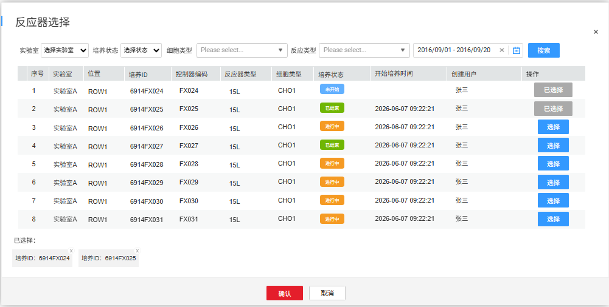

# 数据管理

## 批次对比（4.2）

整体页面查询、筛选操作逻辑基本与实验室工作台-批次对比章节保持一致，唯一区别点是

1.  能进行批次对比的培养ID可以跨实验室选择，在反应器选择弹窗中增加了实验室选择。
    1.  实验室：下拉单选，列表内容为当前用户有权限的实验室
> **[图 image409.png | 章节：批次对比（4.2） | 上下文：1. 实验室：下拉单选，列表内容为当前用户有权限的实验室]**
> （新增图片：V4.0 副本无同图，未做 OCR，请核对图片文件）

