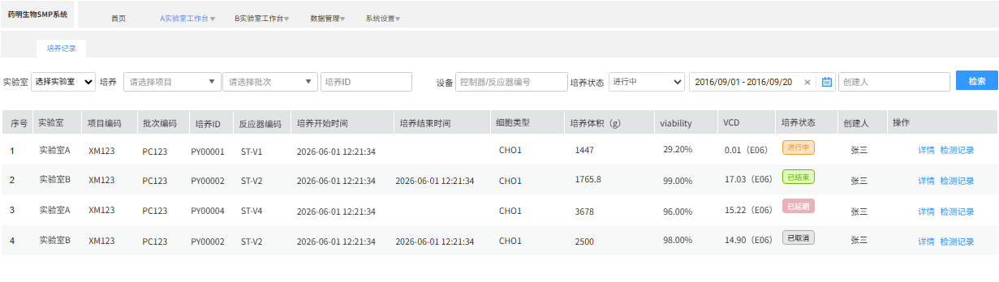

# 数据管理

## 历史培养（4.2）

整体页面查询、筛选操作逻辑基本与实验室工作台-培养记录章节保持一致，唯一区别点是

1.  当前页面可以查询到所有实验室崩刃有权限的记录，在查询条件中增加了实验室选择
    1.  实验室：下拉单选，列表内容为当前用户有权限的实验室
> **[图 image410.png | 章节：历史培养（4.2） | 上下文：1. 实验室：下拉单选，列表内容为当前用户有权限的实验室]**
> （新增图片：V4.0 副本无同图，未做 OCR，请核对图片文件）

