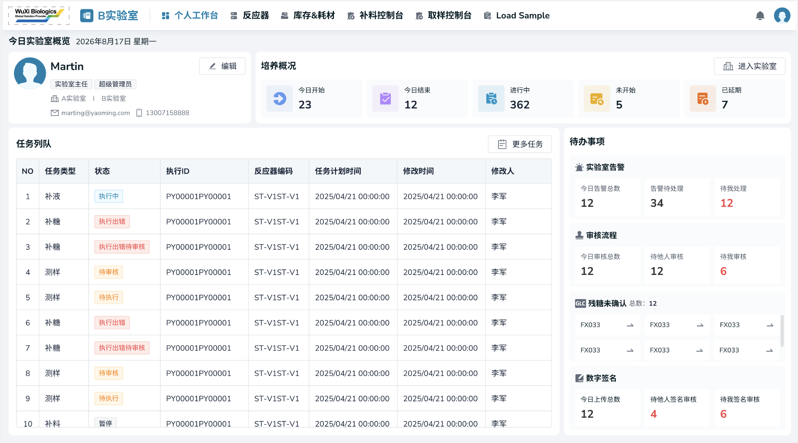

# 实验室工作台（5.0调整）（5.1调整）

## 个人工作台（4.0）

包含个人信息展示和今日实验室概览两个部分。

> **[图 image411.png | 章节：个人工作台（4.0） | 上下文：包含个人信息展示和今日实验室概览两个部分。]**
> （新增图片：V4.0 副本无同图，未做 OCR，请核对图片文件）

### 个人信息展示（4.0）

展示当前登录用户的个人信息，包括：

1.  头像
2.  用户显示名称
3.  当前用户所属的所有角色
4.  有授权的所有实验室名称
5.  邮件
6.  电话
7.  修改个人信息按钮：点击弹窗可修改个人信息，与章节个人信息一致。
### 今日实验室概览（4.0）

基于当前用户有授权的所有实验室，每个实验室一个Tab页展示该实验室概览。默认展示当前网络所在实验室的tab页。

每个实验室概览信息包含培养概况、任务队列、待办事项三个字模块，所有查询展示都需在当前实验室范围内。

#### 培养概况（4.0）

1.  点击【进入实验室】按钮，跳转至当前实验室的实验室工作台页面
2.  统计不同状态下培养ID的数量，点击跳转不同页面完成相应操作：
1.  进行中
1.  在当前实验室所有当前用户参与的培养中（若该培养所属批次没有设置批次成员，就去项目成员匹配），统计当前状态为进行中的培养数量
2.  点击后跳转至当前实验室的实验室工作台，自动带出进行中状态+当前用户参与的筛选条件查询展示
2.  未开始
1.  在当前实验室所有当前用户参与的培养中，统计当前状态为未开始的培养数量
2.  点击跳转至项目设置-培养ID页面，自动带出当前实验室+未开始状态的筛选条件查询展示。
3.  已逾期
1.  在当前实验室所有当前用户参与的培养中，统计当前状态为已逾期的培养数量
2.  点击跳转至项目设置-培养ID页面，自动带出当前实验室+未开始状态的筛选条件查询展示。
4.  今日开始
1.  在当前实验室所有当前用户参与的培养中，统计培养开始时间（培养方案中设定的培养开始时间）为今日的培养数量
2.  点击跳转至开始培养工作流，自动带出当前实验室+培养开始时间为今日的筛选条件查询
5.  今日结束
1.  在当前实验室所有当前用户参与的培养中，统计培养结束时间（培养方案中设定的培养结束时间）为今日的培养数量
2.  点击跳转至结束培养工作流，自动带出当前实验室+培养结束时间为今日的筛选条件查询
#### 任务队列（4.0）

1.  默认的查询条件
-   实验室概览页面，基于以下条件联合查询出符合的任务列表：
1.  当前实验室
2.  当前用户创建或修改的
3.  计划执行时间为今日
4.  任务状态为待执行、待审核、执行出错、执行出错待审核、执行中、暂停状态
2.  结果展示与操作
-   查询结果翻页展示，按计划执行时间倒排，最新的在最上面，包含以下字段：
1.  序号
2.  任务类型
3.  状态
4.  培养ID
5.  反应器编码
6.  计划执行时间
7.  修改时间
8.  修改人
9.  编号
3.  更多任务按钮
-   点击后跳转至当前实验室的实验室工作台-任务队列页面，可对所有任务进行查看等操作。
#### 待办事项（4.0）

1.  实验室告警
1.  今日告警总数：在当前实验室，统计今日到目前为止所有的告警，不限状态，不限是否本人参与
2.  告警待处理：在当前实验室，统计状态为未处理的告警数量，不限产生时间，不限是否本人参与
3.  待我处理：在当前实验室，统计状态为未处理且通知人包含当前用户的告警数量
2.  审核流程
1.  今日申请总数：在当前实验室，当前用户今日相关操作导致的审批单的总数。
2.  待他人审核：在当前实验室，当前用户相关操作导致的且状态为待审核或待批准的审批单的数量，不限制审批单的创建时间。
3.  待我审核：在当前实验室，当前用户参与的培养，由其它成员操作导致的且状态为待审核或待批准的审批单数量，不限制审批单的创建时间
3.  残糖未确认
1.  首先筛选满足以下条件的反应器：
1.  当前实验室
2.  反应器的当前关联培养，是当前用户参与的
3.  当天有补液任务
4.  反应器的当前关联培养，今日需要进行残糖确认（必须人工确认或者综合策略下存在多个检测结果）但未完成确认（计算模式是残糖+乳酸时，任何一项没确认的也视为未确认）
2.  展示符合筛选条件的反应器列表，包含以下内容：
1.  反应器名称
2.  去确认按钮：点击按钮跳转至该反应器详情-残糖确认弹窗，见章节残糖确认
4.  数据签名
1.  今日上传总数：在当前实验室，统计当前用户发送检测需求且上样时间为今日且状态为已上传或已签名或已审核的样本的数量
2.  待他人签名审核：在当前实验室，统计当前用户发送检测需求且状态为已上传或已签名的样本的数量，不限制上样时间
3.  待我签名审核：在当前实验室，是当前用户参与的培养，统计发送检测需求非当前用户且状态为已上传或已签名的样本的数量，不限制上样时间。
