# 实验室工作台（5.0调整）（5.1调整）

## 反应器

### 反应器看板（5.0）

> **[图 image412.png | 章节：反应器 / 反应器看板（5.0） | 上下文：### 反应器看板（5.0）]**
> （新增图片：V4.0 副本无同图，未做 OCR，请核对图片文件）

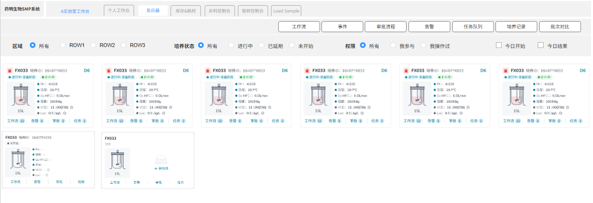
> **[图 image413.png | 章节：反应器 / 反应器看板（5.0） | 上下文：### 反应器看板（5.0）]**
> （新增图片：V4.0 副本无同图，未做 OCR，请核对图片文件）

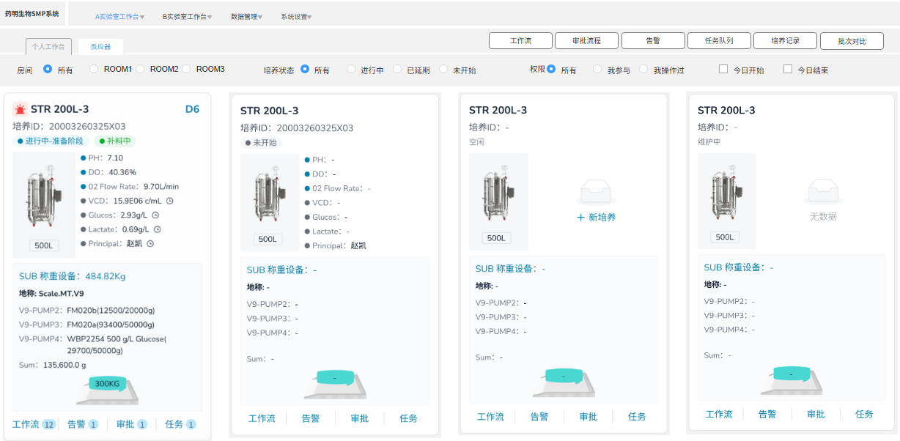
#### 顶部操作栏（5.0）

顶部包含工作流、任务队列、流程审批、批次对比、事件（仅小试有）、培养记录、告警共计7个按钮，点击后展示对应页签内容。

#### 反应器布局与操作（5.0）（5.1调整）

默认进入展示当前实验室所有反应器的布局、状态等信息。

1.  筛选条件
> **[图 image414.png | 章节：反应器 / 反应器看板（5.0） / 反应器布局与操作（5.0）（5.1调整） | 上下文：1. 筛选条件]**
> （新增图片：V4.0 副本无同图，未做 OCR，请核对图片文件）

1.  区域：默认展示所有
    1.  中试/小试二期为筛选场地：展示同实验室的多个场地供选择（数据来源为集成反应器的场地字段），也可选择“所有”表示显示所有场地的反应器
    2.  小试一期为筛选Row：展示同实验室的多个Row供选择（数据来源为控制器的对应的库表），也可选择“所有”表示显示所有房间的控制器
2.  培养状态：可根据培养状态选择。包括进行中、已逾期、未开始和所有。默认展示所有
3.  权限：包括我参与（本人有培养权限的）和所有。
4.  今日开始：勾选后，筛选培养开始时间为今日的反应器
5.  今日结束：勾选后，筛选培养结束时间为今日的反应器
2.  反应器布局与操作：筛选满足条件的反应器一一展示
1.  设备告警状态：工作流/告警/审批/任务中存在告警时，则红灯提示。否则为灰色。
2.  反应器编号
3.  培养ID
4.  当前阶段
5.  培养状态：当前培养的培养状态+当前培养所处工作流阶段拼接展示
    1.  当前培养所处工作流阶段：开始培养前为准备阶段，开始培养后为培养阶段
6.  补料状态：当前反应器正在执行补液任务时，显示补液中
7.  反应器图片
    1.  通过图标区分罐子大小
    2.  按照当前反应器的实际重量/总重量的百分比显示不同高度
8.  在线指标名称即数值：展示最新数值
9.  离线指标名称即数值：展示最近一次有效的（未被作废）检测结果；点击时间图标悬浮展示检测时间
10.  地秤信息：根据当前反应器绑定的补料地秤展示相关信息
    1.  重量：当前重量
    2.  设备编号
    3.  泵的连接信息：
        1.  泵名称
        2.  补液培养基名称
        3.  当前重量/容量
    4.  累积重量：所有泵对应培养基的当前重量的和
    5.  地秤量程
11.  工作流模块通知数量：展示当前反应器&当前培养ID的工作流模块通知数量，点击进入工作流页面（带着当前反应器&当前培养ID信息）
    1.  工作状态下：
        1.  有通知：出现异常，点击自动跳转至异常发生的工作流-步骤
        2.  无通知：未出现异常，点击自动跳转至正在执行或下一步即将执行的工作流
    2.  空闲状态下：提示无可执行工作流
> **[图 image415.png | 章节：反应器 / 反应器看板（5.0） / 反应器布局与操作（5.0）（5.1调整） | 上下文：2. 空闲状态下：提示无可执行工作流]**
> （新增图片：V4.0 副本无同图，未做 OCR，请核对图片文件）

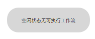
    3.  维护状态下：提示无可执行工作流
> **[图 image416.png | 章节：反应器 / 反应器看板（5.0） / 反应器布局与操作（5.0）（5.1调整） | 上下文：3. 维护状态下：提示无可执行工作流]**
> （新增图片：V4.0 副本无同图，未做 OCR，请核对图片文件）

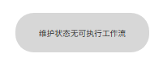
12.  告警模块通知数量：展示当前反应器&当前培养ID的告警模块的通知数量，点击进入实验室工作台-实验室告警页面（带着当前实验室信息）
13.  审批模块通知数量：展示审批模块通知数量，点击进入实验室工作台-流程审批页面（带着当前实验室信息）
14.  任务模块通知数量：展示任务模块通知数量，点击进入当前反应器详情-任务队列页面（带着当前反应器&当前培养ID信息）
15.  卡片点击：点击查看反应器详情
### 反应器详情（3.1）

从反应器看板点击具体卡片进入到反应器详情页，可查看当前反应器对应培养ID的培养详情、生产过程、任务队列、远程服务数据。

#### 培养详情（3.1）

点击进入反应器，默认查看当前培养的培养详情，培养详情根据当前反应器的绑定状态包含不同的内容。

##### 已预约的反应器（3.1）

场景：该反应器已被成功预约，即该反应器已绑定培养ID，且已设置了培养开始时间和培养结束时间

包含设置与导出操作、基础信息、工艺设置、在线数据、离线数据5个部分。

> **[图 image417.png | 章节：反应器 / 反应器详情（3.1） / 培养详情（3.1） / 已预约的反应器（3.1） | 上下文：包含设置与导出操作、基础信息、工艺设置、在线数据、离线数据5个部分。]**
> **OCR 文本：**
> 培养信息 | 生产过程 | 任务队列
> 预填充设置 | 监控设置 | 关闭报警器 | 导出数据
> 设备信息 | 操作→ | 培养基本信息 | 重量信息 | 残糖确认 | 操作－
> ·设备编号：FX003 | ·培养ID：7736653738 | ·初始培养体积：1000g | ·补料计算依据：初始重量 | 理论糖浓度 | Cedex确认值 | 乳酸确认 | 糖耗
> ·反应器型号：品牌-规格 | ：开始时间：2026-07-10 | ·细胞类型：- | ·补料时计算补料引起的糖浓度变化：是
> ·设备负责人：张三丰 | ·结束时间：2026-07-16 | ·今日补料体积：240g | ·补液前确认残糖浓度：否 | 6.5 | 7.3 | 2.1
> ·培养成员：张三、李四、王五 | ·培养周期：7 | ·取测减少总体积：40g | ·补糖计算模式：残糖+乳酸 | 2026-07-21 | 2026-07-20 | 2026-07-20
> 当前阶段：D5 | 12:21:13 | 16:20:44 | 16:20:44
> ·当前总体积：1200g（理论数据） | ·补液前残糖确认：综合
> ·培养模式：普通培养 | ·补糖适用公式补糖量=（目标残糖浓度-补糖前残糖浓度-补糖前乳酸浓度）*补糖前罐重
> 工艺设置 | 工作流程 | Config关联设置 | 灌注培养基 | 开始培养 | 取样 | 测样 | 补液 | 自动控制 | 澄清 | 结束培养 | 测样 | config关联设置 | 补料任务 | 未设置 | 未设置 | 已设置 | 澄清 | 灌注培养基 | 补糖规则 | 未设置 | 未设置 | 已设置 | 取样 | 结束策略 | 自动控制 | 未设置 | 未设置 | 未设置
> 在线数据 | 操作 | 离线信息 | 操作
> PH | PH | Temp | 指标 | BGA | Vicell
> 7.101 | 34°C | 当前数值
> 7.1-7.3 | 30.5.1-33°C | 上下限
> 0.8 | 0.8
> 指标 | 指标 | 指标
> 当前数值 | 当前数值 | 当前数值 | 0.6 | 0.6
> 上下限 | 上下限 | 上下限
> 0.4 | 0.4
> 指标 | 指标 | 指标 | 0.2 | 0.2
> 当前数值 | 当前数值 | 当前数值
> 上下限 | 上下限 | 上下限
> 11:40 | 12:00 | 12:30 | 13:00 | 13:30 | 14:00 | 11:40 | 12:00 | 12:30 | 13:00 | 13:30 | 14:00
> 指标 | 指标 | 指标
> 当前数值 | 当前数值 | 当前数值
> 上下限 | 上下限 | 上下限
> OSMO | Cedex
> 指标 | 指标 | 指标
> 当前数值 | 当前数值 | 当前数值
> 上下限 | 上下限 | 上下限
> 0.8 | 0.8
> 0.6 | 0.6
> 0.4 | 0.4
> 0.2 | 0.2
> 11:40 | 12:00 | 12:30 | 13:00 | 13:30 | 14:00 | 11:40 | 12:00 | 12:30 | 13:00 | 13:30 | 14:00

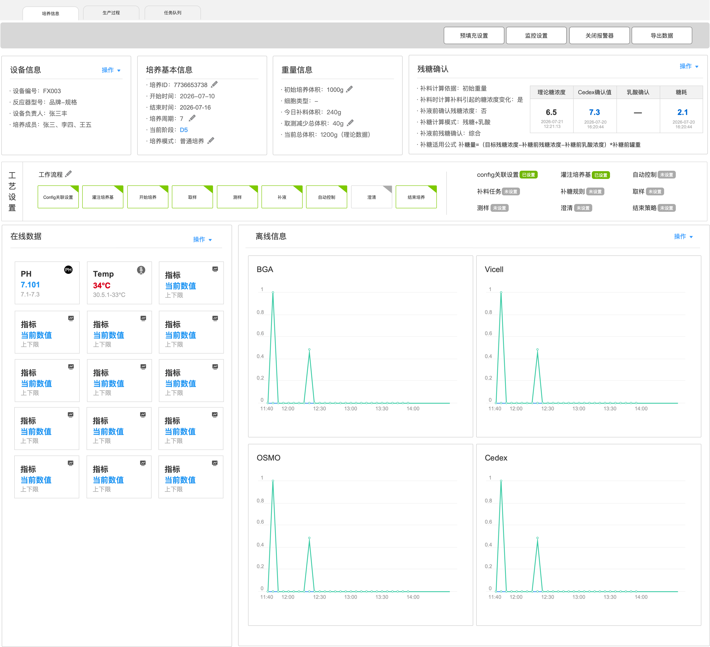
###### 设置与导出操作（3.1）（3.2）

1.  预填充设置
此功能仅在小试实验室有，中试实验室没有。填写的数据会用于自动取测工作流。

> **[图 image418.png | 章节：反应器 / 反应器详情（3.1） / 培养详情（3.1） / 已预约的反应器（3.1） / 设置与导出操作（3.1）（3.2） | 上下文：此功能仅在小试实验室有，中试实验室没有。填写的数据会用于自动取测工作流。]**
> **OCR 文本：**
> 预充设置
> 批次 | PC83277633
> 细胞类型 | CHO1
> Fedbatch取样预填充
> Fedbatch预填充速度 | g/min | 请选择速度代码
> 保存 | 关闭

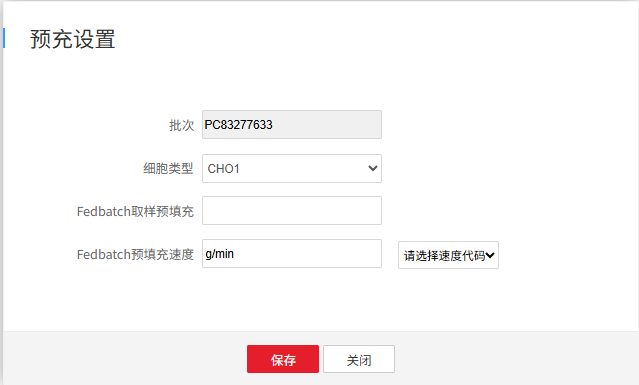
    1.  批次编号
    2.  细胞类型：下拉单选，必选，数据来源数据字典
    3.  Fedbatch取样预填充：文本框，限制为正整数
    4.  Fedbatch取样预填充速度：输入数字或者选择速度代码，从两种速度确认方式中二选一
        1.  速度输入文本框：单位g/min，只能填入数值。
        2.  请选择速度代码：选择此方式时，下拉必选，单选，下拉列表为Speed1至Speed10。
1.  监控设置
> **[图 image419.png | 章节：反应器 / 反应器详情（3.1） / 培养详情（3.1） / 已预约的反应器（3.1） / 设置与导出操作（3.1）（3.2） | 上下文：1. 监控设置]**
> **OCR 文本：**
> 监控设置
> 设置模式（以下操作只针对“泵速异动”和台秤移动两项监控）
> 监控中 | 临时关闭 | 长期关闭
> 备注
> 随便吧
> 保存 | 关闭

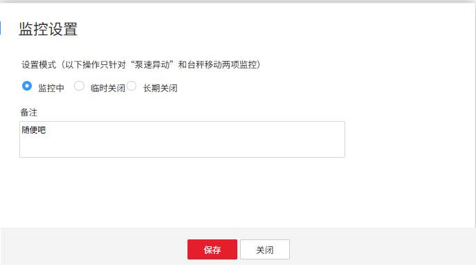
1.  设置模式：三种监控模式，只能三选一，点击保存则为必填
    1.  监控中
    2.  临时关闭：关闭后，每天下午4点若没有被开启，则需要发哦是那个通知提醒打开监控（相当于添加一条告警规则）
    3.  长期关闭：一直关闭监控程序，直到下次修改生效。
2.  备注：文本框，非必填
3.  关闭报警器
当前反应器有配置声光报警器时才出现此按钮。点击此按钮，向声光报警器的指令服务器发送关闭指令。

1.  导出数据
导出在培养期间的在线数据。

    1.  提示信息：文字提示“仅支持导出培养期间的在线数据”
    2.  选择时间：选择一个导出数据的开始时间和结束时间。日历控件直接限制导出时间范围在培养的开始日期和结束日期之间。导出模板如下：
> 附件: Workbook5.xlsx（docx 内嵌 OLE 对象，未内联；原文件请在 需求说明书V5.1-1030.docx 中查看）
###### 设备信息（3.1）（3.2）（3.3）

1.  展示信息：仅展示信息，不可编辑
    1.  设备编号：中试为反应器设备编号，小试为控制器编号
    2.  反应器型号：中试为反应器设备型号，小试为品牌+类别拼接展示
    3.  设备负责人：没有则不展示。
    4.  培养成员：罗列所有该培养成员用户显示名称
2.  操作：
    1.  更换设备
> **[图 image421.png | 章节：反应器 / 反应器详情（3.1） / 培养详情（3.1） / 已预约的反应器（3.1） / 设备信息（3.1）（3.2）（3.3） | 上下文：1. 更换设备]**
> **OCR 文本：**
> 更换设备
> 更换反应器后，泵的默认连接及补料方案将失效，需要重新设置，如修改后对培养ID和样品ID产生影响的话，请手工修改！
> 当前设备 | FX033 | 15L
> 更换为 | STR 50L | 50L
> 原因*
> 1、不合理 | 选择
> 2、不允许改来改去 | 选择
> 3、今天太晚了来不及改了 | 选择
> 随便吧
> 保存 | 关闭

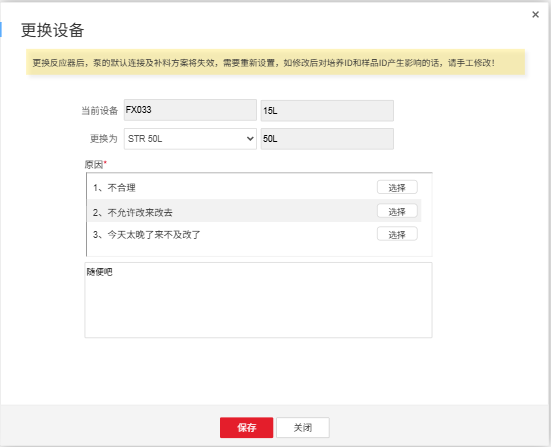
1.  提示信息：文字提示“更换反应器后，泵的默认连接及补料方案将失效，需要重新设置，如修改后对培养ID和样品ID产生影响的话，请手工修改！”
2.  当前设备：展示当前反应器/控制器编号及其规格，仅展示，不可修改
3.  更换为：下拉列表，单选，列表内容同章节反应器/控制器：，筛选出当前空闲的设备。
4.  原因：支持快速选择
5.  保存：
6.  若有修改需要保存，则原因为必填。
7.  保存后，根据系统设定完成审核/不审核。若审核，必须在审核完成后此修改才能生效。审核过程中，再次点击进入，则所有字段都不允许编辑修改，顶部提示“正在审核中”，下方变为撤回按钮，撤回后再次支持修改。
> **[图 image422.png | 章节：反应器 / 反应器详情（3.1） / 培养详情（3.1） / 已预约的反应器（3.1） / 设备信息（3.1）（3.2）（3.3） | 上下文：7. 保存后，根据系统设定完成审核/不审核。若审核，必须在审核完成后此修改才能生效。审核过程中，再次点击进入，则所有字段都不允许编辑修改，顶部提示“正在审核中”，下方变为撤回按钮，撤回后再次支持修改。]**
> **OCR 文本：**
> 更换设备
> 正在审核中
> 当前设备 | FX033 | 15L
> 更换为 | STR 50L | 50L
> 原因*
> 随便吧
> 撤回 | 关闭

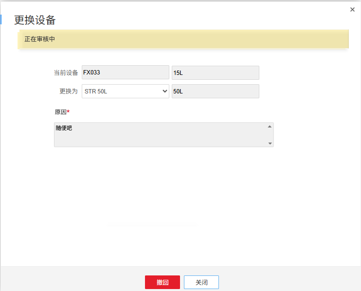
                1.  修改生效后，原设备变为空闲状态，同时和在原设备上的此培养ID的补液方案、在线告警设置都将被删除，相关任务的任务状态也需要更新：将待审核、待批准、待执行、执行出错待审核、执行中、暂停中状态自动更新为已取消，其余状态保持不变。
                2.  更换设备后，将原培养ID、批次编号、项目编号信息自动带入，但工艺方案和告警设置等需要重新设定。
    1.  默认连接
> **[图 image423.png | 章节：反应器 / 反应器详情（3.1） / 培养详情（3.1） / 已预约的反应器（3.1） / 设备信息（3.1）（3.2）（3.3） | 上下文：1. 默认连接]**
> **OCR 文本：**
> 默认连接
> 泵名称 | 补料培养基 | 耗材* | 泵速策略* | 使用外置泵
> PUMP1 | 请选择 | 请选择 | 泵速策略 | 请选择
> PUMP2 | 请选择 | 请选择 | 泵速策略 | 请选择
> PUMP3 | 请选择 | 请选择 | 泵速策略 | 请选择
> PUMP4 | 请选择 | 请选择 | 泵速策略 | 请选择
> PUMP5 | 请选择 | 请选择 | 泵速策略 | 请选择
> PUMP6 | 请选择 | 请选择 | 泵速策略
> PUMP7 | 请选择 | 请选择 | 泵速策略 | 请选择
> PUMP8 | 请选择 | 请选择 | 泵速策路 | 请选择
> 保存 | 关闭

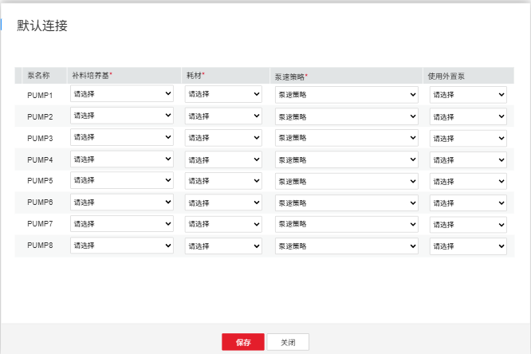
1.  展示当前反应器的默认连接，若对应培养ID已设置了新的泵的连接，则展示最新的泵的连接数据。
2.  补液培养基、耗材、泵速策略修改逻辑和原补液方案设置保持一致
3.  外置泵：下拉选择，非必选，选择了外置泵后，调度程序会通过该外置泵完成补液操作。列表内容为当前实验室所有空闲状态的外置泵，数据来源为实验室设置－蠕动泵中维护的数据。外置泵的状态判断逻辑如下：
4.  实验室配置外置泵的初始状态为空闲
5.  某个培养在培养的过程中，对应反应器的默认连接中添加的外置泵变为工作中状态
6.  该培养结束时，对应反应器的默认连接的外置泵全部置为空，即默认全部使用内置泵，之前配置的外置泵都重新变为空闲状态。
7.  保存：
    1.  若有修改需要保存，则原因为必填。
    2.  保存后，根据系统设定完成审核/不审核。若审核，必须在审核完成后此修改才生效。审核过程中，再次点击进入，则所有字段都不允许编辑修改，顶部提示“正在审核中”，下方变为撤回按钮，撤回后再次支持修改。
###### 培养基本信息（3.1）（3.2）

1.  培养ID：展示最新的培养ID，点击编辑按钮弹窗修改培养ID
> **[图 image424.png | 章节：反应器 / 反应器详情（3.1） / 培养详情（3.1） / 已预约的反应器（3.1） / 培养基本信息（3.1）（3.2） | 上下文：1. 培养ID：展示最新的培养ID，点击编辑按钮弹窗修改培养ID]**
> **OCR 文本：**
> 修改培养ID | ml
> or
> 培养ID修改后，可能会引起样品ID的编码规则改变
> 现培养ID | 显示项目编号 | 显示批次编号 | 显示培养ID
> 培养ID更改为
> 原因*
> 1、不合理 | 选择
> 2、不允许改来改去 | 选择
> 3、今天太晚了来不及改了 | 选择
> 随便吧
> 保存 | 关闭

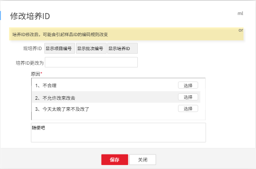
1.  提示信息：文字提示“培养ID修改后，可能会引起样品ID的编码规则改变”
2.  现培养ID：按顺序依次展示项目编号、批次编号、培养ID
3.  培养ID更改为：文本框，可输入修改后的培养ID
4.  原因：支持快速填入
5.  保存：
    1.  若修改了培养ID，则修改后的培养ID和原因为必填
    2.  修改后的培养ID也要完成新增培养ID时一致的校验操作，比如唯一性。
    3.  保存后，根据系统设定完成审核/不审核。若审核，必须在审核完成后此修改才能生效，审核时需再次做一次培养ID的校验操作，如果不通过，则默认审核不通过。审核过程中，再次点击进入，则所有字段都不允许编辑修改，顶部提示“正在审核中”，下方变为撤回按钮，撤回后再次支持修改。
    4.  注意，修改培养ID不影响检测样品ID与培养ID的关联关系
1.  开始时间：和结束时间、培养周期联动编辑
2.  结束时间：和开始时间、培养周期联动编辑
3.  培养周期：和开始时间、结束时间联动编辑，点击编辑按钮弹窗修改培养时间
> **[图 image425.png | 章节：反应器 / 反应器详情（3.1） / 培养详情（3.1） / 已预约的反应器（3.1） / 培养基本信息（3.1）（3.2） | 上下文：3. 培养周期：和开始时间、结束时间联动编辑，点击编辑按钮弹窗修改培养时间]**
> **OCR 文本：**
> 修改培养周期
> 培养时间修改后可能会影响后续补液方案和任务
> 现计划 | 2026-07-01 | 2026-07-07 | 7天
> 更改为* | 2026-07-01 | 2026-07-08
> 原因*
> 1、不合理 | 选择
> 2、不允许改来改去 | 选择
> 3、今天太晚了来不及改了 | 选择
> 选错了
> 保存 | 关闭

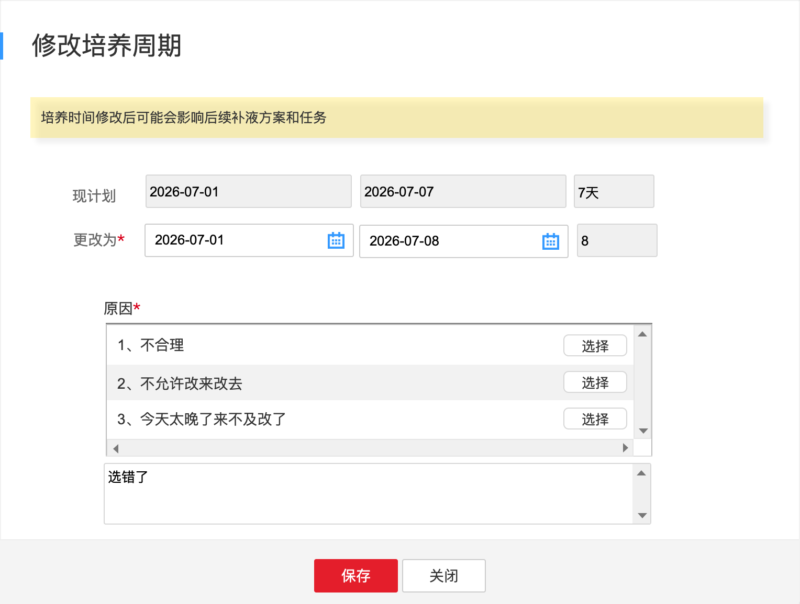
1.  提示信息：文字提示“培养时间修改后可能会影响后续补液方案和任务”
2.  现计划：仅展示开始时间和结束时间以及培养周期
3.  更改为：开始时间、结束时间、培养周期联动修改，可根据其中任意两个自动得出第三个的值
4.  原因：支持快速选择
5.  保存：
    1.  若修改，则开始时间、结束时间、培养周期、原因为必填
    2.  保存后，根据系统设定完成审核/不审核。若审核，必须在审核完成后此修改才生效。审核过程中，再次点击进入，则所有字段都不允许编辑修改，下方变为撤回按钮，撤回后再次支持修改。
    3.  修改生效后，如果总天数变化，补料/补糖方案清空，未执行任务取消；如总天数不变化，只取消未执行任务。
1.  当前阶段：根据开始时间得到当前的培养周期，自动得出，仅展示，不可编辑
2.  培养方式：仅中试展示此字段，展示当前的培养方式，点击编辑按钮弹窗可修改培养方式
> **[图 image426.png | 章节：反应器 / 反应器详情（3.1） / 培养详情（3.1） / 已预约的反应器（3.1） / 培养基本信息（3.1）（3.2） | 上下文：2. 培养方式：仅中试展示此字段，展示当前的培养方式，点击编辑按钮弹窗可修改培养方式]**
> **OCR 文本：**
> 修改培养类型
> 培养类型 | 营通培养
> 保存 | 关闭

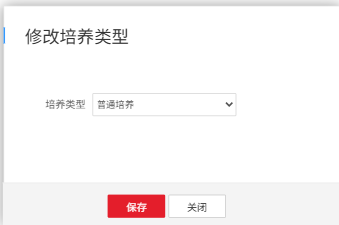
1.  培养类型：下拉单选，列表内容为普通培养和反应器培养
2.  保存：
    1.  仅中试实验室支持修改培养类型
    2.  仅支持从普通培养修改为反应器培养
    3.  修改即时生效，不需要审核也不需要备注理由
###### 重量信息（3.1）（3.2）

重量信息只有完成任意一个工作流后才可编辑修改，否则只能查看，点击编辑按钮会提示无法修改。

> **[图 image427.png | 章节：反应器 / 反应器详情（3.1） / 培养详情（3.1） / 已预约的反应器（3.1） / 重量信息（3.1）（3.2） | 上下文：重量信息只有完成任意一个工作流后才可编辑修改，否则只能查看，点击编辑按钮会提示无法修改。]**
> **OCR 文本：**
> 未开始的培养无法修改重量

1.  初始培养体积：展示当前初始体积，点击编辑按钮弹窗修改初始体积
> **[图 image428.png | 章节：反应器 / 反应器详情（3.1） / 培养详情（3.1） / 已预约的反应器（3.1） / 重量信息（3.1）（3.2） | 上下文：1. 初始培养体积：展示当前初始体积，点击编辑按钮弹窗修改初始体积]**
> **OCR 文本：**
> 修改初始培养体积
> 初始培养体积 | 1000
> 更改为* | 1002
> 原因*
> 1、不合理 | 选择
> 2、不允许改来改去 | 选择
> 3、今天太晚了来不及改了 | 选择
> 随便吧
> 保存 | 关闭

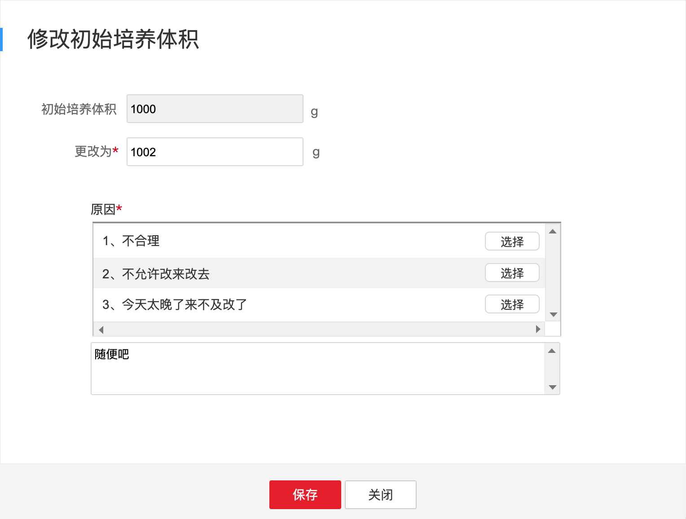
1.  初始培养体积：展示当前初始培养体积，不可编辑
2.  更改为：文本框，限制正整数
3.  原因：支持快速选择填入
4.  保存：
        1.  若有修改需要保存，则原因为必填。
        2.  保存后，根据系统设定完成审核/不审核。若审核，必须在审核完成后此修改才生效。审核过程中，再次点击进入，则所有字段都不允许编辑修改，顶部提示“正在审核中”，下方变为撤回按钮，撤回后再次支持修改。
> **[图 image429.png | 章节：反应器 / 反应器详情（3.1） / 培养详情（3.1） / 已预约的反应器（3.1） / 重量信息（3.1）（3.2） | 上下文：2. 保存后，根据系统设定完成审核/不审核。若审核，必须在审核完成后此修改才生效。审核过程中，再次点击进入，则所有字段都不允许编辑修改，顶部提示“正在审核中”，下方变为撤回按钮，撤回后再次支持修改。]**
> **OCR 文本：**
> 修改接种体积
> 接种体积 | 40 | 60
> 更改为* | 50
> 原因*
> 1、不合理 | 选择
> 2、不允许改来改去 | 选择
> 3、今天太晚了来不及改了 | 选择
> 随便吧
> 保存 | 关闭

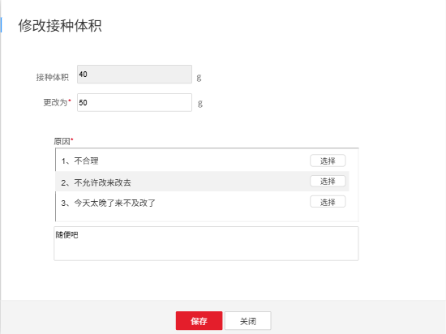
1.  细胞类型
2.  今日补料总体积：当天目前为止所有补液任务的补料体积的总和，不可编辑
3.  取测减少总体积：仅台式反应器有此字段。上次补料到本次补料前取测减少总体积，点击编辑按钮可追加取测数据或查看所有取测记录.
-   注意：追加体积的单位为g，自动化任务取测体积的单位为μL，需要统一换算为g保存。1g=1000μL。
> **[图 image430.png | 章节：反应器 / 反应器详情（3.1） / 培养详情（3.1） / 已预约的反应器（3.1） / 重量信息（3.1）（3.2） | 上下文：- 注意：追加体积的单位为g，自动化任务取测体积的单位为μL，需要统一换算为g保存。1g=1000μL。]**
> **OCR 文本：**
> 取测数据
> 追加 | 记录
> 2026-08-25 10:23:34 | 10g | 张三
> 2026-08-25 09:20:21 | 10g | 张三
> 2026-08-25 08:20:21 | 10g | 自动任务002
> 2026-08-25 10:23:34 | 10g | 张三
> 2026-08-25 09:20:21 | 10g | 自动任务001
> 上一页 | 10 | 下一页
> 保存 | 关闭

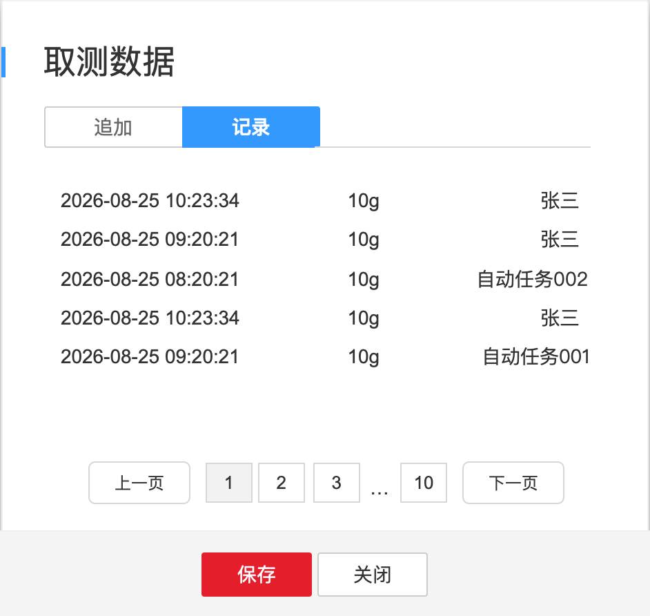
    1.  追加功能
        1.  取测减少总体积：展示最新的取测减少总体积，仅展示，不能编辑，可根据下方填入的补充取测减少量自动计算更新，比如弹窗刚打开时显示数值为100，此时下发的补充取测减少量填写了20，则显示120
        2.  补充取测减少量：文本框，限制正数，保留小数点后两位，单位为g
        3.  保存：不需要审核，直接保存更新数据
    2.  查看记录：翻页展示该反应器当前培养历史所有自动化取测任务及手动追加的记录，仅可查看，不可编辑，展示以下字段：
        1.  时间：自动化任务的执行时间或完成手动追加操作的时间点
        2.  取测体积
        3.  操作人/任务ID：显示手动追加操作的用户显示名或自动化任务的任务ID
4.  当前总体积：即当下的反应器重量
###### 残糖确认（3.1）

1.  信息展示与修改
    1.  补料计算依据
    2.  补料时计算补料引起的糖浓度变化：若勾选则为是，不勾选则为否
    3.  补料前确认残糖浓度：若勾选则为是，不勾选则为否
    4.  补糖计算方式
    5.  补糖适用公式：根据补糖计算方式不同展示不同的补糖量计算公式
    6.  理论糖浓度：展示最新的糖浓度结果和获取/补液后计算完成的时间
    7.  Cedex确认值：展示最近一次残糖确认时确认的糖浓度结果和确认的时间
        1.  Cedex确认值数字也可点击，点击后打开残糖确认操作界面，默认选中只看已确认选项，把每日确认的残糖数据显示在弹窗中
    8.  乳酸确认：如果补糖计算方式为残糖+乳酸，则展示最近一次残糖确认时确认的乳酸结果和确认的时间，否则展示符号“--”
    9.  糖耗：即日耗糖速率
        1.  每天残糖确认后，同步计算得到的前一天的日耗糖速率，为单位g/L
日耗糖速率 = 昨天补液后计算的糖浓度-当天残糖确认的残糖浓度

        1.  糖耗数字可以点击，点击后显示弹窗，可查看过去培养期间的每日糖耗曲线，横轴为日期，纵轴为糖耗，如果未计算或无结果默认按照0显示
> **[图 image431.png | 章节：反应器 / 反应器详情（3.1） / 培养详情（3.1） / 已预约的反应器（3.1） / 残糖确认（3.1） | 上下文：1. 糖耗数字可以点击，点击后显示弹窗，可查看过去培养期间的每日糖耗曲线，横轴为日期，纵轴为糖耗，如果未计算或无结果默认按照0显示]**
> **OCR 文本：**
> 糖耗变化
> 糖耗：单位g/L
> 0.8
> 0.6
> 0.4
> 0.2
> 07-01 | 07-02 | 07-03 | 07-04 | 07-05 | 07-06 | 20-20
> 日期
> 关闭

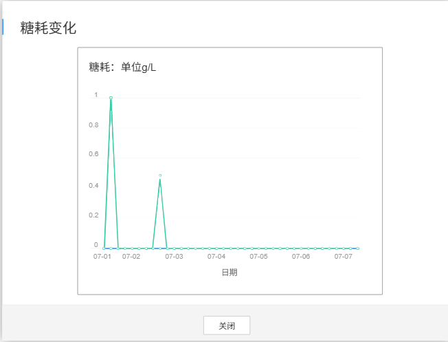
1.  操作
    1.  修改规则：点击修改规则，弹窗修改补液计算规则，修改逻辑和设置方案时的逻辑一致。
> **[图 image432.png | 章节：反应器 / 反应器详情（3.1） / 培养详情（3.1） / 已预约的反应器（3.1） / 残糖确认（3.1） | 上下文：1. 修改规则：点击修改规则，弹窗修改补液计算规则，修改逻辑和设置方案时的逻辑一致。]**
> **OCR 文本：**
> 补液计算规则
> 原因*
> 1、不合理 | 选择
> 补料计算依据* | 初始重量
> 2、不允许改来改去 | 选择
> 补糖计算模式* | 残糖 | 3、今天太晚了来不及改了 | 选择
> 补料时计算补料引起的糖浓度变化*
> 随便吧
> 补液前确认残糖浓度*
> 补液前残糖确认* | 不需要
> 保存 | 关闭

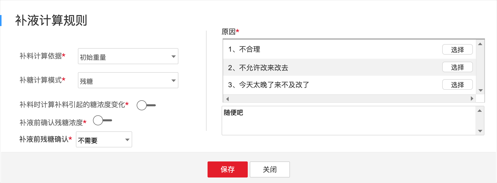
        1.  补料计算依据
        2.  补糖计算模式
        3.  补料时计算补料引起的糖浓度变化
        4.  补液前确认残糖浓度
        5.  补液前残糖确认
        6.  原因
        7.  保存：
            1.  若有修改需要保存，则原因为必填。
            2.  保存后，根据系统设定完成审核/不审核。若审核，必须在审核完成后此修改才生效。审核过程中，再次点击进入，则所有字段都不允许编辑修改，顶部提示“正在审核中”，下方变为撤回按钮，撤回后再次支持修改。
    1.  残糖确认
查询展示Cedex检测结果，完成当天的残糖确认

> **[图 image433.png | 章节：反应器 / 反应器详情（3.1） / 培养详情（3.1） / 已预约的反应器（3.1） / 残糖确认（3.1） | 上下文：查询展示Cedex检测结果，完成当天的残糖确认]**
> **OCR 文本：**
> 残糖确认
> 检测完成日期 | 口只看已碘认 | 新增
> 序号 | 样品ID | 位置 | 状态 | 检测完成时间 | 设备编号 | 稀释倍数 | 检测项名称 | 检测结果 | 单位 | 确认
> 1D2-123F1903 | 已上传 | 2026-06-08 12:21:12 | CeDex3 | GLC2B | xXX | g/L | 残糖确认
> 1D2-123F1904 | 已签名 | 2026-06-08 12:21:12 | CeDex3 | 1.5 | GLC2D | xXX | g/L | 59S 取消
> 1D2-123F1904 | 2026-06-08 12:21:12 | CeDex3 | 1.5 | LACXX | g/L | 已确认
> 关闭

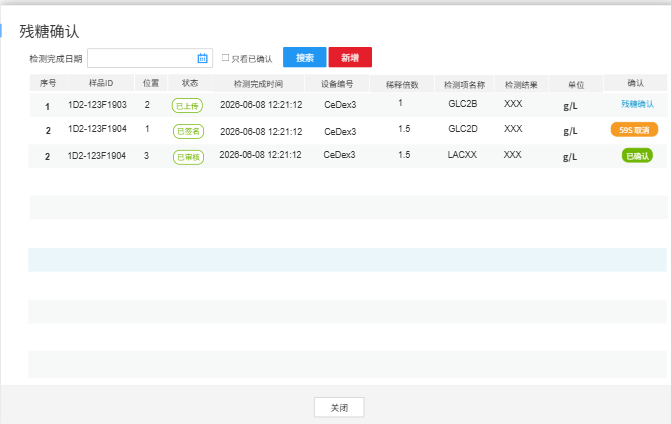
        1.  查询条件：
            1.  检测完成日期：默认选中当天
            2.  只看已确认：选择勾选或者不勾选，勾选则需筛选出已确认过的检测结果
        2.  新增：点击手动新增Cedex检测结果，此处新增的检测结果不进入离线检测结果记录，仅在此处供残糖确认使用，默认稀释倍数为1，状态为“已检测”
> **[图 image434.png | 章节：反应器 / 反应器详情（3.1） / 培养详情（3.1） / 已预约的反应器（3.1） / 残糖确认（3.1） | 上下文：2. 新增：点击手动新增Cedex检测结果，此处新增的检测结果不进入离线检测结果记录，仅在此处供残糖确认使用，默认稀释倍数为1，状态为“已检测”]**
> **OCR 文本：**
> 新增Cedex结果
> 样品ID* | 位置* | 检测完成时间*
> 检测结果
> 检测项目" | 检测项简称 | 单位 | 检测结果”
> +1
> 保存 | 关闭

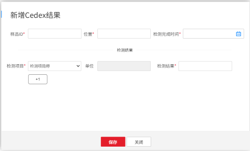
            1.  样品ID：文本框，必填，全局唯一，不能重复
            2.  位置：文本框，必填
            3.  检测完成时间：必填
            4.  检测项目：下拉单选，必选，列表内容为所有Cedex下检测项目的简称
            5.  单位：根据选择的检测项目自动带出单位，仅展示，不可修改
            6.  检测结果：文本框，必填
            7.  +1：点击增加一行检测项目－单位－检测结果的填写区域。
        1.  列表展示：列表的数据来自当前培养id的所有Cedex检测状态为已检测/已上传/已签名/已审核的检测结果。
            1.  当补糖计算方式选择残糖时，筛选出所有检测项目名开头为GLC的数据（残糖数据）；如果用户设置的 补糖计算方式是残糖+乳酸，则筛选出所有检测项目名开头为GLC的数据（残糖数据）以及LAC开头的数据（乳酸数据）。注意，一次检测可能会有多个指标，每个指标显示一行
            2.  列表按照时间倒排序，最新的在上面
            3.  展示内容包含：
                1.  序号
                2.  样品ID
                3.  位置
                4.  状态：检测结果当前的状态
                5.  检测完成时间
                6.  设备编号：检测的设备编号
                7.  稀释倍数
                8.  检测项简称
                9.  检测结果
                10.  单位
                11.  确认：这一列会展示当前检测结果的确认状态，即是否已被残糖确认过或仍能完成残糖确认操作
                    -   残糖确认：当天目前为止所有的检测结果默认展示为残糖确认，可点击，点击后变为60S倒计时取消按钮，同时，当天其余残糖确认按钮置灰不允许点击
> **[图 image435.png | 章节：反应器 / 反应器详情（3.1） / 培养详情（3.1） / 已预约的反应器（3.1） / 残糖确认（3.1） | 上下文：- 残糖确认：当天目前为止所有的检测结果默认展示为残糖确认，可点击，点击后变为60S倒计时取消按钮，同时，当天其余残糖确认按钮置灰不允许点击]**
> **OCR 文本：**
> 确认
> 残糖确认
> 残糖确认
> 残糖确认

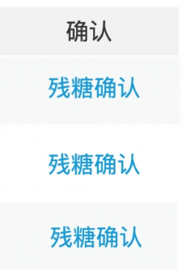

> **[图 image436.png | 章节：反应器 / 反应器详情（3.1） / 培养详情（3.1） / 已预约的反应器（3.1） / 残糖确认（3.1） | 上下文：- 残糖确认：当天目前为止所有的检测结果默认展示为残糖确认，可点击，点击后变为60S倒计时取消按钮，同时，当天其余残糖确认按钮置灰不允许点击]**
> **OCR 文本：**
> 确认
> 59S | 取消
> 残糖确认
> 残糖确认

                    -   60S倒计时取消：点击残糖确认后变为60S倒计时按钮效果（上边显示的时间会倒计时变化）。倒计时结束前可点击，点击后倒计时取消，状态变为残糖确认，同时当天其余残糖确认按钮变为可点击；倒计时顺利结束，状态变为已确认，当天其余残糖确认结果变为未确认
> **[图 image437.png | 章节：反应器 / 反应器详情（3.1） / 培养详情（3.1） / 已预约的反应器（3.1） / 残糖确认（3.1） | 上下文：- 60S倒计时取消：点击残糖确认后变为60S倒计时按钮效果（上边显示的时间会倒计时变化）。倒计时结束前可点击，点击后倒计时取消，状态变为残糖确认，同时当天其余残糖确认按钮变为可点击；倒计时顺利结束，状态变为已确认，当天其余残糖确认结果变为未确认]**
> **OCR 文本：**
> 确认
> 已确认
> 未确认
> 未确认

                    -   未确认：未被确认的检测结果（包含历史的和当天未被选中完成确认操作的），不可点击
                    -   已确认：已确认过的检测结果，不可点击
        1.  关闭按钮：点击关闭时，检测补糖计算方式，如果是残糖+乳酸，需要校验是否分别确认了残糖和乳酸，若未确认则弹窗提示未确认完成
> **[图 image438.png | 章节：反应器 / 反应器详情（3.1） / 培养详情（3.1） / 已预约的反应器（3.1） / 残糖确认（3.1） | 上下文：1. 关闭按钮：点击关闭时，检测补糖计算方式，如果是残糖+乳酸，需要校验是否分别确认了残糖和乳酸，若未确认则弹窗提示未确认完成]**
> **OCR 文本：**
> 今日的残糖还未确认完
> 需要分别确认残随和乳酸的数值
> 稍后再确认

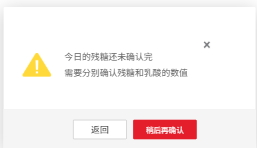
            1.  返回按钮：关闭当前提示弹窗，回到残糖确认弹窗
            2.  稍后再确认：关闭所有弹窗
###### 在线数据（3.1）（3.2）

1.  单一指标可视化
以每个指标一个卡片的形式展示该指标的当前数值和上下限等，包含以下内容

    1.  指标名称
    2.  当前数值：超过报警上下限时，颜色变为红色
    3.  指标的报警上下限
    4.  趋势图：可点击弹窗查看该指标不同时间长度的趋势。
> **[图 image439.png | 章节：反应器 / 反应器详情（3.1） / 培养详情（3.1） / 已预约的反应器（3.1） / 在线数据（3.1）（3.2） | 上下文：4. 趋势图：可点击弹窗查看该指标不同时间长度的趋势。]**
> **OCR 文本：**
> 在线指标
> 1H | 3H | 12H | 24H | 7D | 30D
> PH
> 0.8
> 0.6
> 0.4
> 0.2
> 11:40 | 12:00 | 12:30 | 13:00 | 13:30 | 14:00
> 关闭

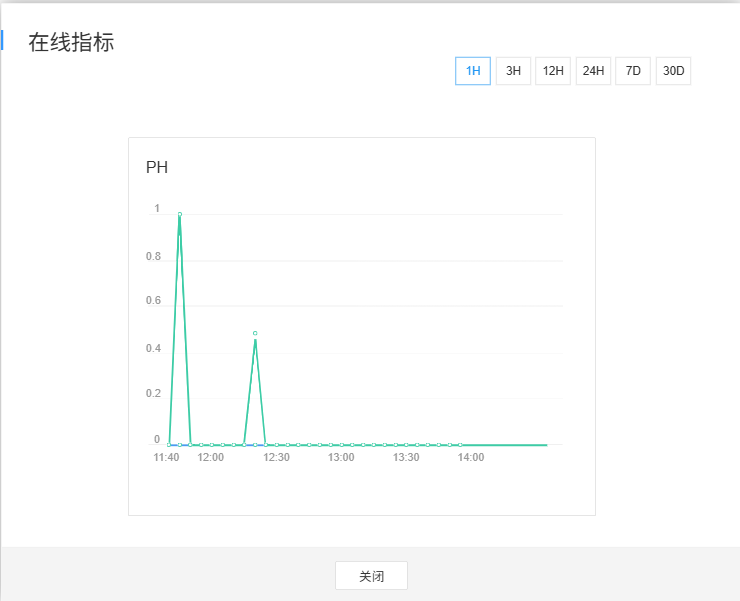
        1.  横轴为自然时间，纵轴为指标
        2.  进入当前页面默认查看最近1小时的数据，可以通过点击切换时间长度，时间长度仅可选择当前往前推1H、3H、12H、24H、7D、30D中的一个。更详细更丰富的趋势图可通过数据管理－在线数据模块查看。
        3.  根据用户选择的时间长度，可调整数据采集点的密度。X轴都以1分钟为一个单位展示。
1.  操作：
    1.  在线告警设置
-   当前培养ID在当前反应器上从未设置过在线告警时，默认带出该反应器设备级别的告警设置（该反应器在空闲状态下，即完全空闲或已关联培养ID但未设置培养开始和结束时间时设置的告警设置），详见章节在线告警设置；若已经设置过，则自动带出最近一次保存的告警设置。
-   支持修改报警设置，修改后生成一组新的数据与当前培养ID关联，即此修改仅对当前培养ID生效。
-   支持单个指标打开或关闭报警状态；也支持一键打开或关闭报警状态
-   列表展示与编辑
> **[图 image440.png | 章节：反应器 / 反应器详情（3.1） / 培养详情（3.1） / 已预约的反应器（3.1） / 在线数据（3.1）（3.2） | 上下文：- 列表展示与编辑]**
> **OCR 文本：**
> 在线告警
> 序号 | 检项名称 | 单位 | 设定值 | 上下限百分比 | 报警下限值 | 报警上限值 | 呆滞限值 | 呆滞时长 | 上限延迟 (S) | 下限延迟 (S) | 循环间隔(秒) | 循环提醒 | 报警方式 | 报警状态
> pH | 短信 | 电话
> 口声光 | 口邮件
> ITEMP | 短信 | 口电话
> 声光 | 口邮件
> DO | 短信 | ■电话
> 声光 | 邮件
> O2 MFC1 | L/min | 短信 | 电话
> 声光 | 邮件
> O2 MFC1 | L/min | 短信 | 电话
> 声光 | 口邮件
> stirrer | RPM | 短信 | 电话
> 声光 | 邮件
> Vessel weight g | 短信 | 口电话
> 声光 | 口邮件
> Pump1 | g/min | 短信 | 声光 | 邮件 | 电话
> 10 | Pump2 | g/min | 短信 | 声光 | 电话 | 口邮件
> Pump3 | g/min | 短信 | 口声光 | 口邮件 | 电话
> 重制 | 保存

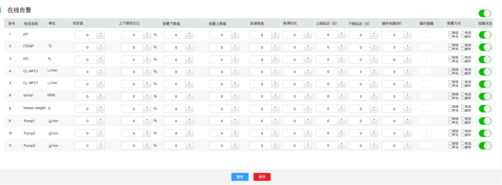
        1.  序号：行号，自增即可
        2.  检项简称：根据设备配置模块中不同检测类型配置的不同检测项目自动带出，每个检项为一行
        3.  单位：根据检测项目自动带出
        4.  设定值：支持手动输入，限制输入数值
        5.  上下限百分比：支持手动输入，限制输出正整数。结合设定值可计算出报警上限和报警下限，实际报警以报警上限和报警下限为标准。
        6.  报警下限：根据设定值和上下限百分比自动计算，支持手动修改。超过报警下限时，在线指标可视化时文字颜色变红。
        7.  报警上限：根据设定值和上下限百分比自动计算，支持手动修改。超过报警下限时，在线指标可视化时文字颜色变红。
        8.  呆滞限值
        9.  呆滞时长
        10.  上限延迟（S）
        11.  下限延迟（S）
        12.  循环间隔（S）：
        13.  循环提醒：可选择开或关，表示是否要开启循环提醒的功能
        14.  报警方式：复选框，支持多选，选择内容包括短信、电话、邮件、声光报警器共计4种
        15.  报警状态：可打开或关闭告警通知。支持单个修改，也支持一键全部打开或关闭。
-   注意，此处先完成数据填入与保存，具体告警逻辑后续药明技术会补充告警逻辑，可统一放到告警规则一期实现
    1.  更多数据
点击跳转至数据管理－在线数据页面，自动代入当前反应器编号和培养ID。详情见章节在线数据②

###### 离线数据（3.1）（4.1调整）

1.  单个检测类型的指标可视化
以一个检测类型一个图的方式展示检测项目的结果

    1.  横轴为培养天数（D0,D1,...,Dn），纵轴为检测项目
    2.  同一个检测类型的所有检测项目呈现在同一个图，即会有多个Y轴
1.  操作
    1.  更多图表
点击跳转至数据管理－离线数据页面，自动带入当前培养ID。详情见章节离线数据②

    1.  检测明细
点击跳转至数据管理－检测分析－检测记录页面，自动带入培养ID。详情见章节检测记录①

    1.  离线告警设置
1.  此处的离线告警设置，仅对当前培养ID生效，超出则可能按照设定触发告警通知
2.  在检测分析模块中查看检测详情，如果检测结果超出告警范围，检测结果文字变成红色。
> **[图 image441.png | 章节：反应器 / 反应器详情（3.1） / 培养详情（3.1） / 已预约的反应器（3.1） / 离线数据（3.1）（4.1调整） | 上下文：2. 在检测分析模块中查看检测详情，如果检测结果超出告警范围，检测结果文字变成红色。]**
> **OCR 文本：**
> 离线告警
> BGA | Vicell | OSMO | Cedex
> 序号 | 检项名称 | 单位 | 报警下限 | 报警上限 | 修改时间 | 修改人
> pH | 7.3 | 6.6 | 2026-06-03 11:11:11 | 张三
> PCO2 | mmHg | 2026-06-03 11:11:11 | 张三
> pO2 | mmHg | 2026-06-03 11:11:11 | 张三
> Na+ | mM/L | 2026-06-03 11:11:11 | 张三
> K* | mM/L | 2026-06-03 11:11:11 | 张三
> ITEMP | 2026-06-03 11:11:11 | 张三
> 重制 | 保存

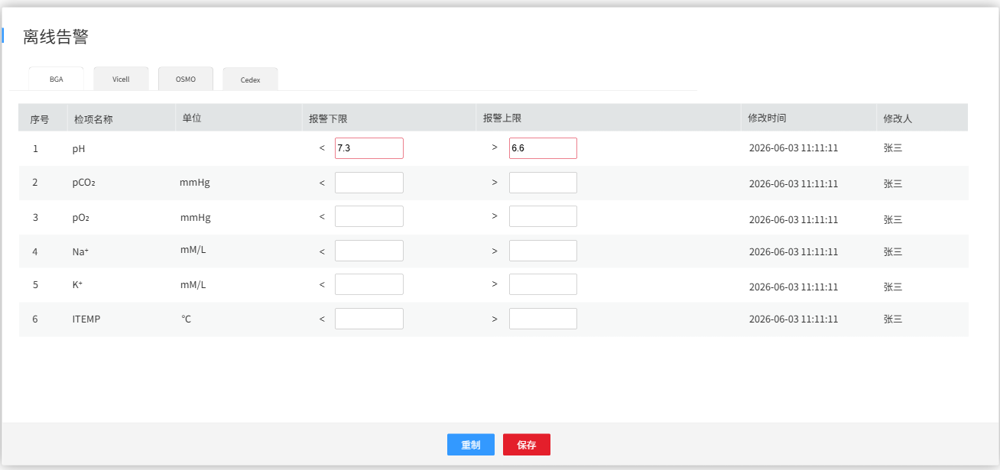
页面内一共包含4个Tab页，对应4个检测类型，每个tab页都包含以下内容：

        1.  序号：行号，自增即可
        2.  检项简称：当前培养id所在的实验室中配置的此类设备的检测项目的合集。比如，培养ID，属于实验室A，实验室A中配置了BGA1 、BGA2两台设备BGA1可以检测 项目1 、项目2、 项目3，BGA2 可检测项目3 、项目4 和项目5，当前BGA里可以配置的指标包含 项目1 、项目 2 、项目3 、项目4 、项目5。
        3.  单位：根据检测项目自动带出
        4.  报警下限：选填，前端页面展示〈 ，默认使用〈判断。不填写默认不设告警限制，支持小数点后最多4位，允许填写0。下限值要小于上限值，否则文本框标红提示。
        5.  报警上限：选填，前端页面展示> ，默认使用>判断。不填写默认不设告警限制，支持小数点后最多4位，允许填写0。上限值要大于下限值，否则文本框标红提示。
        6.  修改人
        7.  修改时间
        8.  报警方式：复选框，支持多选，选择内容包括短信、电话、邮件、站内信共计4种
        9.  报警状态：可打开或关闭告警通知。支持单个修改，也支持一键全部打开或关闭。
        10.  操作：
            1.  重置：清空所有输入内容
            2.  保存：保存时需校验同一指标的上限值必须大于下限值，如果填写错误红框提示错误。保存成功即直接应用（该实验室产生的相关检测项根据此规则产生通知告警）
##### 空闲的反应器（3.1）

场景：该反应器为空闲状态，即完全空闲或已被培养ID关联但所有培养均未设置培养开始时间和培养结束时间

包含设置操作、设备信息、在线数据、关联培养信息4个部分。关联培养信息部分根据反应器是否有被培养ID关联存在两种不同的信息展示方式。

> **[图 image442.png | 章节：反应器 / 反应器详情（3.1） / 培养详情（3.1） / 空闲的反应器（3.1） | 上下文：包含设置操作、设备信息、在线数据、关联培养信息4个部分。关联培养信息部分根据反应器是否有被培养ID关联存在两种不同的信息展示方式。]**
> **OCR 文本：**
> 药明生物SMP系统 | 首页 | A实验室工作台 | B实验室工作台 | 数据管理 | 系统设置>
> FX055
> 培养信息 | 任务队列 | 远程服务
> 监控设置 | 关闭报警器
> 设备信息 | 操作、 | 在线数据 | 操作、
> 设备编号 | tesgggg-node-0
> 反应器型号 | 品牌-型号 | PH | Temp | 指标 | 指标 | 指标 | 指标 | 指标
> 设备管理员 | 张三 | 7.101 | 7.1-7.3 | 34°℃ | 当前数值 | 当前数值 | 当前数值 | 当前数值 | 当前数值 | 当前数值
> 30.5.1-33°C | 上下限 | 上下限 | 上下限 | 上下限 | 上下限 | 上下限
> 未确认培养日期 | 未确认培养日期
> 培养ID：7736653738 | ·培养ID：7736653738
> -项目：XXXX | ·项目：XXXX
> 批次：XXXX | ·批次：XXXX
> 成员：张三、李四、王五 | ·成员：张三、李四、王五

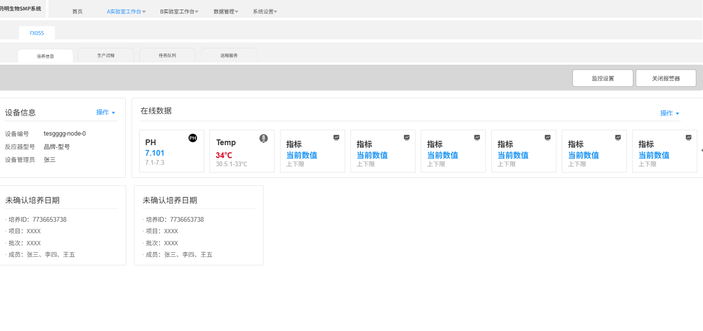
> **[图 image443.png | 章节：反应器 / 反应器详情（3.1） / 培养详情（3.1） / 空闲的反应器（3.1） | 上下文：包含设置操作、设备信息、在线数据、关联培养信息4个部分。关联培养信息部分根据反应器是否有被培养ID关联存在两种不同的信息展示方式。]**
> **OCR 文本：**
> 药明生物SMP系统 | 首页 | A实验室工作台 | B实验室工作台 | 数据管理 | 系统设置
> FX055
> 培养信息 | 生产过程 | 任务限列 | 远程服务
> 监控设置 | 关闭报警器
> 设备信息 | 操作、 | 在线数据 | 操作、
> 设备编号 | tesgggg-node-0
> 反应器型号 | 品牌-型号 | PH | Temp | 指标 | 指标 | 指标 | 指标 | 指标 | 指标
> 设备管理员 | 张三 | 7.101 | 34°℃ | 当前数值 | 当前数值 | 当前数值 | 当前数值 | 当前数值 | 当前数值
> 7.1-7.3 | 30.5.1-33°C | 上下限 | 上下限 | 上下限 | 上下限 | 上下限 | 上下限
> 暂无培养预约或培养中

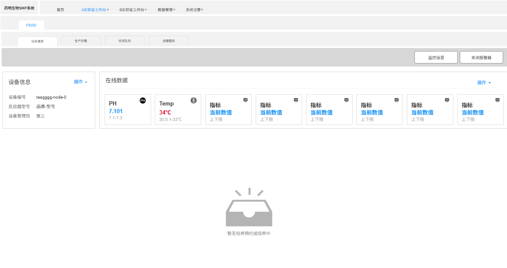
###### 设置操作（3.1）

1.  监控设置
同上述章节监控设置

1.  关闭报警器
同上述章节关闭报警器

###### 设备信息（3.1）

1.  展示信息
    1.  设备编号
    2.  反应器型号
    3.  设备负责人
2.  操作
    1.  默认连接：同上述已预约反应器中的章节默认连接
###### 在线数据（3.1）（3.2）

1.  单一指标可视化
同上述章节单一指标可视化

1.  操作
    1.  在线告警设置
-   默认带出最近一次反应器设备级别的告警设置（该反应器在空闲状态下，即完全空闲或已关联培养ID但未设置培养开始和结束时间时设置的告警设置）
-   若完全未设置过，则所有数字都为0，用户修改后保存为该反应器设备级别的告警设置
-   已设置过则支持修改报警设置，修改后与当前反应器关联，即此修改为对当前反应器生效。
-   支持单个指标打开或关闭报警状态；也支持一键打开或关闭报警状态
-   列表展示与编辑
逻辑同上述章节列表展示与编辑

    1.  更多数据
同上述章节更多数据

###### 关联培养信息（3.1）

关联培养信息根据是否关联培养ID分为两种情况：

1.  已被培养ID关联，但均未设置培养开始时间和培养结束时间：显示已被关联的培养ID，一个卡片对应一个培养ID，每个卡片包含以下内容：
> **[图 image444.png | 章节：反应器 / 反应器详情（3.1） / 培养详情（3.1） / 空闲的反应器（3.1） / 关联培养信息（3.1） | 上下文：1. 已被培养ID关联，但均未设置培养开始时间和培养结束时间：显示已被关联的培养ID，一个卡片对应一个培养ID，每个卡片包含以下内容：]**
> **OCR 文本：**
> 未确认培养日期 | 未确认培养日期
> -培养ID：7736653738 | -培养ID：7736653738
> -项目：XXXX | -项目：XXXX
> -批次：XXXX | -批次：XXXX
> -成员：张三、李四、王五 | -成员：张三、李四、王五

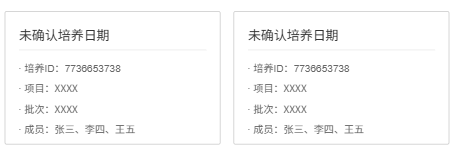
    1.  提示信息：文字提示“未确认培养日期”
    2.  培养ID
    3.  项目编号
    4.  批次编号
    5.  成员
1.  完全空闲：直接提示暂无培养预约或培养中
> **[图 image445.png | 章节：反应器 / 反应器详情（3.1） / 培养详情（3.1） / 空闲的反应器（3.1） / 关联培养信息（3.1） | 上下文：1. 完全空闲：直接提示暂无培养预约或培养中]**
> **OCR 文本：**
> 无培养预约或培养中

#### 生产过程（3.1）

查看当前培养ID的生产信息。包含基本信息和生产工作流程两个部分

> **[图 image446.png | 章节：反应器 / 反应器详情（3.1） / 生产过程（3.1） | 上下文：查看当前培养ID的生产信息。包含基本信息和生产工作流程两个部分]**
> **OCR 文本：**
> 生产
> DO | D0.1 | D0.2 | D0.3
> 2026-07-01 | config关联设置 | 灌注培养基 | Cedex
> 设备logo
> D1 | D1.1 | D1.2 | D1.3
> 2026-07-02 | 连接补料单元 | 补料 | 补糖
> 培养基本信息
> ·培养ID：7736653738
> ·开始时间：2026-07-10
> ·结束时间：2026-07-16
> -培养天数：7
> ·当前阶段：D5
> ·培养模式：普通培养
> ·设备编号：FX0333
> ·培养成员：张三、李四、王五

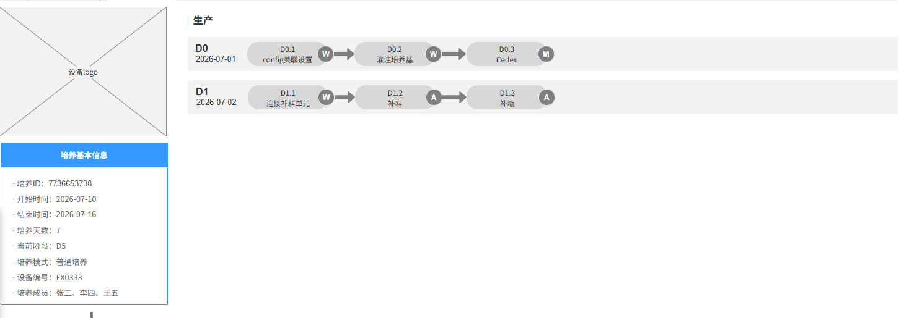
##### 基本信息（3.1）（3.2）

> **[图 image447.png | 章节：反应器 / 反应器详情（3.1） / 生产过程（3.1） / 基本信息（3.1）（3.2） | 上下文：##### 基本信息（3.1）（3.2）]**
> **OCR 文本：**
> 设备logo
> 培养基本信息
> 培养D：7736653738
> 开始时间：2026-07-10
> 结束时间：2026-07-16
> ·培养天数：7
> 当前阶段：D5
> ·培养模式：普通培养
> 设备编号：FX0333
> ·培养成员：张三、李四、王五

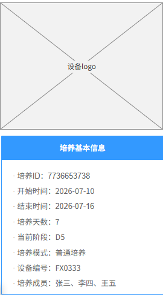
    1.  设备图片：根据当前设备型号自动关联带出图片
    2.  培养基本信息
        1.  培养ID
        2.  培养开始时间
        3.  培养结束时间
        4.  培养周期
        5.  当前阶段
        6.  培养模式
        7.  设备编号
        8.  培养成员
##### 生产工作流程（3.1）（3.2）

按天统一展示所有操作节点的执行顺序，点击节点可查看每个节点的操作详情

1.  顺序展示
> **[图 image448.png | 章节：反应器 / 反应器详情（3.1） / 生产过程（3.1） / 生产工作流程（3.1）（3.2） | 上下文：1. 顺序展示]**
> （新增图片：V4.0 副本无同图，未做 OCR，请核对图片文件）

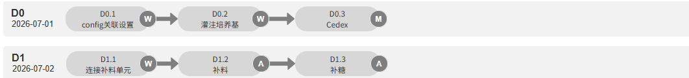
-   纵向按照培养天数从上往下排序，每天一行
-   培养天数：用D0,D1,...,Dn的格式表示开始培养后的第n天，从0开始计算。
-   日期：展示自然日期
-   横向为同一天，按照从早到晚的执行顺序从左至右展示，每个方块对应一个操作。
-   包含的操作如下：
1.  工作流二级节点
2.  补料记录，仅展示状态为已执行、执行出错、执行出错已修复的
3.  补糖记录，仅展示状态为已执行、执行出错、执行出错已修复的
4.  检测记录，包括离线检测和自动检测
-   每个操作显示以下内容：
1.  编号：使用类似Dn.m格式，表示培养天数加一天内的执行顺序，比如D0.2，表示培养天数为D0这一天的第2个操作节点
2.  操作的名称
| 操作节点 | 显示名称 |
|---|---|
| 工作流二级节点 | 显示对应流程的名称 |
| 补料记录 | “补料” |
| 补糖记录 | “补糖” |
| 检测记录 | 该检测记录对应的检测类型，比如BGA |

3.  操作标识符：一共包含三个不同类型的节点，分别使用不同标识区分
> **[图 image449.png | 章节：反应器 / 反应器详情（3.1） / 生产过程（3.1） / 生产工作流程（3.1）（3.2） | 上下文：3. 操作标识符：一共包含三个不同类型的节点，分别使用不同标识区分]**
> **OCR 文本：**
> 工作流节点
> 补料 | 补料
> BGA | OSMO

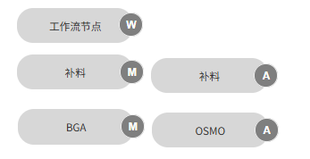
            1.  工作流二级节点使用W
            2.  补料/补糖/检测记录，如果是手动创建的任务则使用M
            3.  补料/补糖/检测记录，如果是自动生成的任务则使用A
1.  操作详情
不同操作，点击后展示不同的操作详情。

    1.  工作流二级节点：每个工作流节点都包含通用信息和操作信息，操作信息会根据二级节点的不同展示不同信息。
> **[图 image450.png | 章节：反应器 / 反应器详情（3.1） / 生产过程（3.1） / 生产工作流程（3.1）（3.2） | 上下文：1. 工作流二级节点：每个工作流节点都包含通用信息和操作信息，操作信息会根据二级节点的不同展示不同信息。]**
> **OCR 文本：**
> D0.2灌注培养基
> 灌注培养基
> 开始时间 | 2026-07-27 17:28:02
> 结束时间 | 2026-07-27 17:28:56
> 操作人 | 张三
> 培养基类型 | XXX
> 灌注量 | 1000g
> 关闭

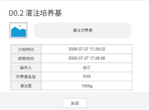
1.  通用信息
    1.  标题：编号加一级节点名称
    2.  图标：待后续完成工作流节点时补充完整
    3.  二级节点名称
    4.  开始时间：用户进入该工作流二级节点开始操作的时间
    5.  结束时间：用户完成该工作流二级节点的时间
    6.  操作人：展示用户的显示名称
2.  操作信息：待后续完成工作流节点时补充完整
    1.  补料记录
> **[图 image451.png | 章节：反应器 / 反应器详情（3.1） / 生产过程（3.1） / 生产工作流程（3.1）（3.2） | 上下文：1. 补料记录]**
> **OCR 文本：**
> DO.3补料
> 补料
> 开始时间 | 2026-07-27 17:28:02
> 结束时间 | 2026-07-27 17:28:56
> 系号 | PUMP3
> 补料培养基 | XXX
> 实际补科量 | 1000g
> 关闭

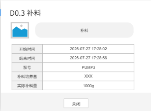
        1.  标题：编号加“补料”
        2.  图标
        3.  文字展示“补料”
        4.  开始时间：该任务的执行开始时间
        5.  结束时间：该任务的执行完成时间
        6.  泵名称：执行该任务的泵名称
        7.  料液名称：执行该任务的料液名称
        8.  实际补料量：任务执行完成后的实际补料量
    1.  补糖记录
> **[图 image452.png | 章节：反应器 / 反应器详情（3.1） / 生产过程（3.1） / 生产工作流程（3.1）（3.2） | 上下文：1. 补糖记录]**
> **OCR 文本：**
> DO.4补糖
> 补糖
> 开始时间 | 2026-07-27 17:28:02
> 结束时间 | 2026-07-27 17:28:56
> 系号 | PUMP3
> 补科培养基 | XX
> 实际补料量 | 1000g
> 补模萌摄浓度 | (g/L)
> 补糖前糖浓度 | (g/L)
> 关闭

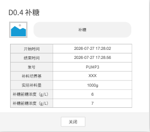
        1.  标题：编号加“补糖”
        2.  图标
        3.  文字展示“补糖”
        4.  开始时间：该任务的执行开始时间
        5.  结束时间：该任务的执行完成时间
        6.  泵名称：执行该任务的泵名称
        7.  料液名称：执行该任务的料液名称
        8.  实际补料量：任务执行完成后的实际补料量
        9.  补糖前糖浓度（g/L）：
        10.  补糖后糖浓度（g/L）：补糖后计算出的糖浓度
    1.  检测记录
> **[图 image453.png | 章节：反应器 / 反应器详情（3.1） / 生产过程（3.1） / 生产工作流程（3.1）（3.2） | 上下文：1. 检测记录]**
> **OCR 文本：**
> D0.5 BGA
> BGA
> 开始对间 | 2026-07-27 17:28:02
> 结束对间 | 2026-07-27 17:28:56
> 取样量 | 1ML
> 祥品ID | XOX-XOOX X
> 湿度 | 36.5 °C
> B釜名
> 关闭

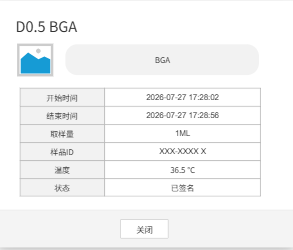
        1.  标题：编号加检测类型
        2.  图标
        3.  检测类型
        4.  开始时间：上样时间
        5.  结束时间：检测完成时间
        6.  取样量：取样体积，有则展示，没有则空或展示NA
        7.  样品ID
        8.  温度：BGA类型下展示
        9.  细胞类型：Vicell类型下展示
        10.  稀释倍数：Vicell和Cedex类型下展示
        11.  检测项简称：Cedex类型下展示该次检测的所有检测项简称
        12.  状态：显示该次检测所处状态
##### 工艺设置（3.1）（3.2）（5.1调整）

1.  工作流程
    1.  卡片形式展示所有工作流，当前培养已选中的工作流为绿色，其余为灰色。不支持编辑。
    2.  点击编辑按钮可弹窗修改工作流程
> **[图 image454.png | 章节：反应器 / 反应器详情（3.1） / 生产过程（3.1） / 工艺设置（3.1）（3.2）（5.1调整） | 上下文：2. 点击编辑按钮可弹窗修改工作流程]**
> **OCR 文本：**
> 工作流
> 仅支持对未开启的工作流节点进行增减
> Conlig关联置 | 开始培养
> 1、不合理 | 选择
> 2、不允许改来改去 | 选择
> 3、今天太晚了来不及改了 | 选择
> 随便吧
> 保存 | 关闭

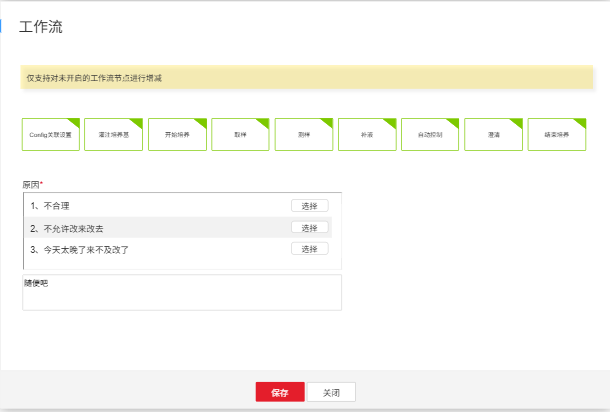
        1.  提示信息：文字提示“仅支持对未开启的工作流节点进行增减”
        2.  工作流流程卡片：展示所有工作流节点，通过颜色区分当前已选中或未选中。
            1.  弹窗上的矩形支持点击选择/取消
            2.  已经执行过的和正在执行中的工作流节点，不支持取消。比如现在已经到了补液流程，签名的关注培养基已经做完了，这时候就不能再取消了
    1.  原因：支持快速选中
    2.  保存：保存后若需要审批，则生成审批单，在审批单子中记录本次修改的内容，通过审核后，新的数据才可以覆盖之前的数据。审核过程中，再次点击进入，则所有字段都不允许编辑修改，顶部提示“正在审核中”，下方变为撤回按钮，撤回后再次支持修改。
1.  工艺方案：
-   展示所有可设置的工艺方案，已选中节点的方案为绿色，未选中的为灰色。工作流节点与方案的对应关系如下：
| 工作流节点 | 方案 |
|---|---|
| config关联设置 | config关联设置 |
| 灌注培养基 | 灌注培养基方案 |
| 自动控制 | 自动控制方案 |
| 取样 | 取样方案 |
| 测样 | 测样方案 |
| 补液 | 补料任务 |
| 补糖规则 |  |
| 澄清 | 澄清方案 |
| 结束培养 | 结束策略 |

-   已设置方案需标记已设置，未设置方案需标记为未设置。
-   点击可修改/设置方案：
1.  Config关联设置/灌注培养基/自动控制方案
    1.  工作流未完成前才允许修改
    2.  方案内容修改与创建模板时保持一致
2.  补料任务
> **[图 image455.png | 章节：反应器 / 反应器详情（3.1） / 生产过程（3.1） / 工艺设置（3.1）（3.2）（5.1调整） | 上下文：2. 补料任务]**
> **OCR 文本：**
> 补料任务
> 选择模版 | Please select...
> PUMP1 | PUMP2 | PUMP3 | PUMP4 | PUMP5 | PUMP6 | PUMP7 | PUMP8
> 新增 | 补料培养基：Glucose外置泵：PUMP-1009
> 序号 | 天* | 补料计划时间* | 补料类型* | 补料体积（%/g) | 操作
> 00 : 00 : 00 | 粘贴 | 百分比 | 粘贴 | 10 | 粘贴
> 00 : 00 : 00 | 粘贴 | 百分比 | 粘贴 | 10 | 粘贴 | 删除
> 原因*
> 1、不合理 | 选择
> 2、不允许改来改去 | 选择
> 3、今天太晚了来不及改了 | 选择
> 随便吧
> 保存 | 取消

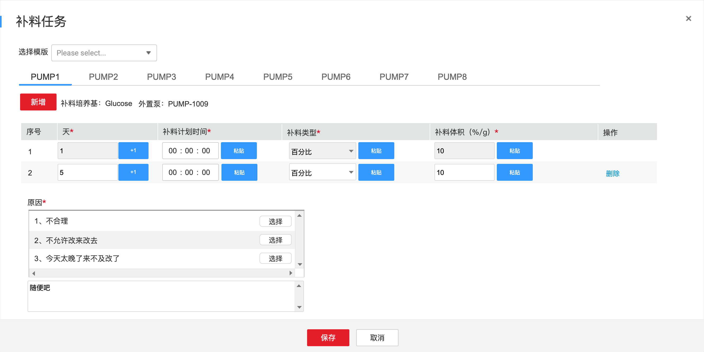
        1.  根据当前反应器对应培养ID的补液方案－补料任务将数据都自动带出。
        2.  展示外置泵信息：如果有使用外置泵，则需要将外置泵信息在补液培养基旁做展示
        3.  历史时间对应的计划不能修改和删除，只能调整未来计划
        4.  新增/调整未来计划时，此页面的模板、任务规则等的填写、校验逻辑与培养修改－初始化设置补料任务规则保持一致，详见章节补液模板③中的补料任务Tab页。
        5.  如果切换了选择模板，历史时间对应的计划仍然需要展示且不可修改和删除；同时，新增展示模板中其余天数的计划。比如说当前为培养的第3天，那么历史时间也就是第1、2天的计划需展示但不可修改和删除，如果第3天没有开始任何补液任务，那第3天的计划支持修改，否则第3天的也仅展示不可修改和删除，模板剩余天的计划需要展示，并支持修改/删除。
        6.  原因：修改补料任务后，原因为必填，支持快速选择
        7.  保存：如果设定为修改后需要审核，那么只有审核通过后当前修改才能生效，否则直接生效。审核过程中，再次点击进入，则所有字段都不允许编辑修改，顶部提示“正在审核中”，下方变为撤回按钮，撤回后再次支持修改。
1.  补糖规则
> **[图 image456.png | 章节：反应器 / 反应器详情（3.1） / 生产过程（3.1） / 工艺设置（3.1）（3.2）（5.1调整） | 上下文：1. 补糖规则]**
> **OCR 文本：**
> 补糖规则
> 选择模版 | Please select...
> 新增 | 糖耗： 2.1 g/L (2026-07-30 10:00) | 更多
> 泵名称 | 培养天数 (开始) | 培养天数 (结束) | 计划方式* | 细则* | 操作
> PUMP2 | 按规则 | 下限操作符* | 糖下限 (g/L)
> 删除
> 计算模式* | 残糖和乳酸 | 糖补料至 | (g/L)
> PUMP2 | 按数值 | 每日执行时间* | 00 : 00 : 00 | 糖补料体积 | (g) | 删除
> 原因*
> 1、不合理 | 选择
> 2、不允许改来改去 | 选择
> 3、今天太晚了来不及改了 | 选择
> 随便吧
> 保存 | 取消

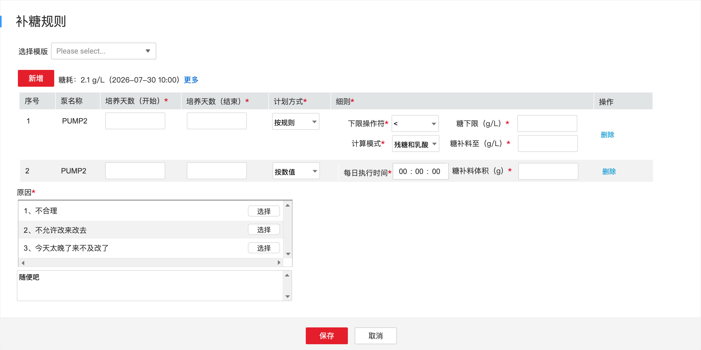
1.  根据当前反应器对应培养ID的补液方案－补糖规则将数据都自动带出。
2.  展示糖耗信息：默认展示最近一次计算出的糖耗和计算时间。点击更多按钮，弹窗展示当前培养ID历史日期所有的糖耗信息。
> **[图 image457.png | 章节：反应器 / 反应器详情（3.1） / 生产过程（3.1） / 工艺设置（3.1）（3.2）（5.1调整） | 上下文：2. 展示糖耗信息：默认展示最近一次计算出的糖耗和计算时间。点击更多按钮，弹窗展示当前培养ID历史日期所有的糖耗信息。]**
> **OCR 文本：**
> 糖耗变化
> 糖耗：单位g/L
> 0.8
> 0.6
> 0.4
> 0.2
> 07-01 | 07-02 | 07-03 | 07-04 | 07-05 | 07-06 | 07-07
> 日期
> 关闭

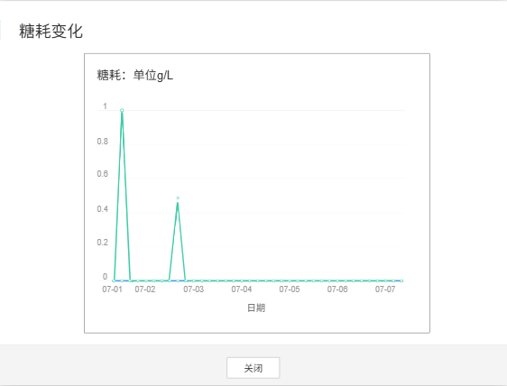
1.  历史时间对应的计划不能修改和删除，只能调整未来计划
2.  新增/调整未来计划时，此页面的模板、任务规则等的填写、校验逻辑与培养修改－初始化设置补糖规则保持一致，详见章节补液模板③中的补糖规则Tab页。
3.  如果切换了选择模板，历史时间对应的计划仍然需要展示且不可修改和删除；同时，新增展示模板中其余天数的计划。比如说当前为培养的第3天，那么历史时间也就是第1、2天的计划需展示但不可修改和删除，如果第3天没有开始任何补液任务，那第3天的计划支持修改，否则第3天的也仅展示不可修改和删除，模板剩余天的计划需要展示，并支持修改/删除。
4.  原因：修改补糖规则后，原因为必填，支持快速选择
5.  保存：如果设定为修改后需要审核，那么只有审核通过后当前修改才能生效，否则直接生效。审核过程中，再次点击进入，则所有字段都不允许编辑修改，顶部提示“正在审核中”，下方变为撤回按钮，撤回后再次支持修改。
#### 远程服务（3.1）（3.2）

显示当前反应器连接各程序/设备的连接状态和IP信息，一个IP对应一个卡片。

> **[图 image458.png | 章节：反应器 / 反应器详情（3.1） / 远程服务（3.1）（3.2） | 上下文：显示当前反应器连接各程序/设备的连接状态和IP信息，一个IP对应一个卡片。]**
> **OCR 文本：**
> 药明生物SMP系统 | 首页 | A实验室工作台 | B实验室工作台 | 数据管理 | 系统设置
> FX055
> 增养信息 | 生产过程 | 任务队列 | 远程服务
> 192.168.1.120 | 192.168.1.122 | 192.168.1.112
> ·OPC服务 | 补料地秤：ScaleOHAUS.V4 | ·报警器：A3
> 192.168.120:8085 | 192.168.122:8085 | 192.168.112:9095
> ·调度程序 | 蠕动泵：PUMP4 | ·继电：J6
> 192.168.1.120:8082 | 192.168.122:8086 | 重启 | 192.168.112:9094 | 重启

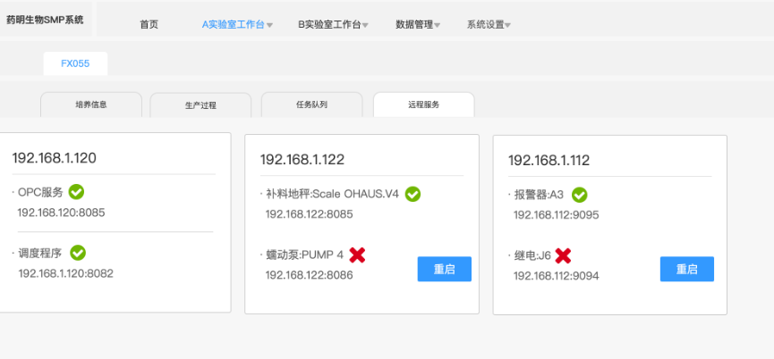
1.  显示IP地址、端口号、服务名称
2.  通讯正常时为绿色打勾符号，否则为红色打叉符号
    1.  通讯异常时，可点击重启按钮重启当前服务
3.  当前包含以下程序：
    1.  OPC程序
    2.  调度程序
    3.  补料地秤
    4.  声光报警器
    5.  继电器
    6.  外置泵
#### 任务队列（3.1）

##### 任务查询及展示操作（3.1）

在此页面可查询当前培养ID的各种不同任务的详情、日志和执行记录等。

> **[图 image459.png | 章节：反应器 / 反应器详情（3.1） / 任务队列（3.1） / 任务查询及展示操作（3.1） | 上下文：在此页面可查询当前培养ID的各种不同任务的详情、日志和执行记录等。]**
> **OCR 文本：**
> FX055
> 培养信息 | 生产过程 | 任务队列 | 远程服务
> 请选择任务类型 | 状态 | 创建人/修改人 | 2016/09/01-2016/09/20 | 检索 | 新增
> 序号 | 实验室 | 任务类型 | 状态 | 培养ID | 反应器编码 | 任务计划时间 | 执行开始时间 | 执行结束时间 | 创建人 | 修改时间 | 修改人 | 操作
> 实验室1 | 补料 | 待执行 | PY00001 | ST-V1 | 2026-06-01 12:21:34 | 2026-06-01 12:21:34 | 2026-06-01 12:21:34 | 张三 | 2026-06-01 12:21:34 | 张三 | 详情刷新复制日志执行记录
> 实验室2 | 补糖 | 已执行 | PY00002 | ST-V2 | 2026-06-01 12:21:34 | 2026-06-01 12:21:34 | 2026-06-01 12:21:34 | 张三 | 2026-06-01 12:21:34 | 张三 | 详情刷新复制日志执行记录
> 实验室2 | 取样 | 待申核 | PY00004 | ST-V4 | 2026-06-01 12:21:34 | 2026-06-01 12:21:34 | 2026-06-01 12:21:34 | 张三 | 2026-06-01 12:21:34 | 张三 | 详情刷新制日志执行记录
> 实验室2 | 已取消 | PY00002 | ST-V2 | 2026-06-01 12:21:34 | 2026-06-01 12:21:34 | 2026-06-01 12:21:34 | 张三 | 2026-06-01 12:21:34 | 张三 | 详情刷新制日志执行记录
> 上一页 | 10 | 下一页

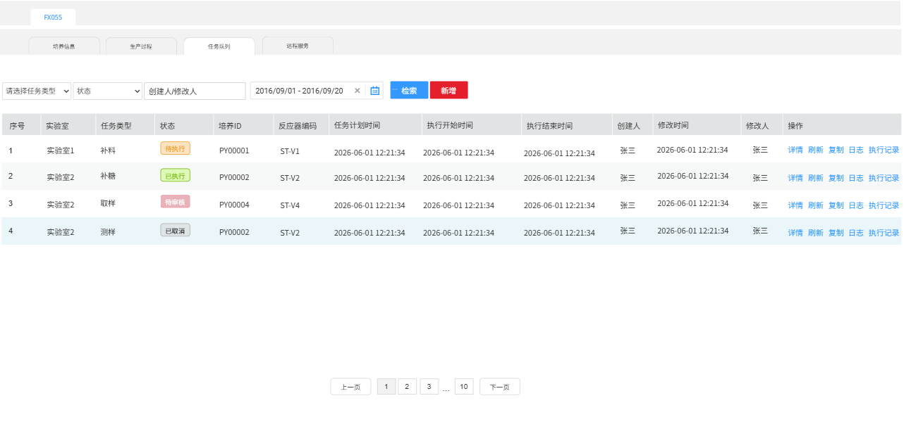
1.  新增：默认在当前反应器/控制器下新增任务，不同任务新增时需填写不同内容，具体设计分别见章节补液任务－新增（3.1）。（其余任务待后续补充）
2.  查询条件
此处的任务队列首先筛选出当前培养ID的所有相关任务，再结合以下条件联合查询：

1.  任务类型：下拉单选，非必选，下拉列表为所有的任务类型，包括补料、补糖、PH校准、取样、测样（本阶段主要完成主体列表以及补液相关任务即补料和补糖的设计，PH校准、取样、测样的任务在后续相关工作流中进行补充，任务类型随着系统完善也可能随之增加）
2.  状态：下拉单选，非必选。状态全集为待审核、待批准、待执行、执行出错待审核、执行中、执行出错、执行出错已修复、已执行、已取消、跨天取消、暂停中。不同类型任务的状态可能对应其中的某几种，此处列表显示全集即可。不同类型任务对应的具体状态说明及其切换见不同任务对应的具体章节。
3.  修改人
4.  起止时间： 任务计划时间、执行开始时间、执行结束时间 有任何一个时间符合都可查询出来。默认查询当前时间往前推20天，最长跨度支持20天。
5.  结果展示
根据查询条件联合查询符合的记录并列表展示

    1.  列表顺序
        1.  属于以下状态时，优先按照以下排序展示，同一状态下按照任务计划时间正排序，也就是距离当前时间越近的越靠前
            1.  执行中
            2.  暂停
            3.  执行出错
            4.  待审核
            5.  待批准
            6.  执行出错待审核
            7.  待执行
        2.  其他状态不区分先后，全部按照任务计划时间正排序，也就是执行时间距离当前时间越近的越靠前
    2.  列表展示字段
        1.  序号
        2.  实验室
        3.  任务类型
        4.  状态
        5.  培养ID
        6.  反应器编码
        7.  任务计划时间
        8.  执行开始时间
        9.  执行结束时间
        10.  创建人
        11.  修改人
        12.  修改时间
1.  任务操作
不同任务类型点击按钮后的弹窗内容不同，具体详见每种任务的具体章节。

##### 补液任务（3.1）

###### 补液任务生成与执行的业务说明（3.1）（3.2）

补料任务和补糖任务统称为补液任务，补液任务（包括补料和补糖）一定是在连接补料单元完成后才会产生，产生的途径有四种：

-   根据当前培养ID 的培养方案－补液方案（见章节培养方案修改③），在连接补料单元完成时后台自动生成相应所有的补液任务
1.  根据补液方案中的补糖规则自动生成的任务，任务类型是补糖任务
2.  根据补液任务方案中的补料任务自动生成的任务，任务类型是补料任务
-   修改了反应器详情－补液方案后，若已经完成了连接补料单元，后台自动生成新的补液任务，并把历史方案产生的未执行的任务自动取消；若未完成连接补料单元，则按照新的方案在连接补料单元完成时后台自动生成新的补液任务
1.  根据补液方案中的补糖规则自动生成的任务，任务类型是补糖任务
2.  根据补液任务方案中的补料任务自动生成的任务，任务类型是补料任务
-   在实验室工作台－任务队列－任务新增－补液任务新增模块，点击新增产生新的补液任务，根据选择的任务类型分别可生成补糖任务和补料任务
-   在实验室工作台－反应器详情－任务队列－补液任务－补液任务新增，添加新的补液任务，根据选择的任务类型分别可生成补糖任务和补料任务
-   补液任务执行过程中发生异常，用户在执行记录－异常处理tab页，选择采用自动模式额外补充，需要根据填写信息自动生成任务，新生成的任务类型与原任务类型一致
所有补液任务都通过任务调度程序一一排队执行，从任务产生到执行完成一共涉及11种状态，每种状态下可对任务执行不同操作并记录相关信息。

1.  任务调度程序
通过任务调度程序定期对任务队列进行轮巡完成任务的执行与监控，基本顺序如下：

    1.  判断当前任务是否到指定执行时间，且状态是待执行
注意：任务在到达计划执行时间，如果因为任何问题没有成功执行，下一轮还是会调度去执行，但是所有补液任务的顺序是不能更改的，只能按照原来的计划时间依次执行，如：任务1计划9:00执行任务2计划10:00，9点的时候任务1因为反应器报错无法执行，假设到10点这个错误还未解决，则任务2也会因为任务1没有成功执行而延后执行

    1.  当前任务今日按照时间排序是否还有未执行的待执行任务，每天必须按顺序执行，若存在未执行的则当前任务跳过不执行，直到前序任务全部执行完成。
    2.  该任务相关设备是否满足执行条件，包括：
        1.  反应器、反应器秤和补料秤出错，跳过不执行
        2.  泵正在执行其他任务中，跳过不执行
    3.  当前关联id对补液前是否要求确认残糖，如果要求确认，根据要求获取残糖值，如无法确认残糖则跳过。
    4.  符合以上条件时根据任务和泵速策略计算真实补料目标量、校准速度、高速速度、低速速度和理论超时时间
    5.  检查当前要使用的补料液体量是否够用，不够用则跳过不执行。
    6.  通过 IoT、OPCDA 或外置 Modbus 泵服务下发泵速。
    7.  通过地秤或反应器实时数据计算已补料量
    8.  记录补料过程明细、泵速下发记录、事件、异常（监控超时、超量、抖动、返水、堵塞、泵速为 0、通讯异常、泵错误码等）和任务状态。目前从已知的错误编码如下表所示：
> **[图 image460.png | 章节：反应器 / 反应器详情（3.1） / 任务队列（3.1） / 补液任务（3.1） / 补液任务生成与执行的业务说明（3.1）（3.2） | 上下文：8. 记录补料过程明细、泵速下发记录、事件、异常（监控超时、超量、抖动、返水、堵塞、泵速为 0、通讯异常、泵错误码等）和任务状态。目前从已知的错误编码如下表所示：]**
> （新增图片：V4.0 副本无同图，未做 OCR，请核对图片文件）

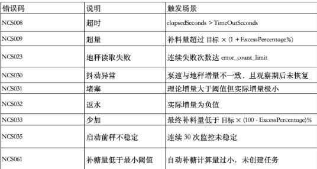
    1.  完成任务后停泵、更新任务和批次实时数据、释放设备占用。
-   注意：
1.  以下附件为原系统调度程序的说明文档（包含调度业务流程图、与底层设备的交互说明等），请开发人员仔细研究。
> 附件: oleObject2.bin（docx 内嵌 OLE 对象，未内联；原文件请在 需求说明书V5.1-1030.docx 中查看）
1.  原系统调度系统的其他说明
        1.  小试一期
原系统调度程序、系统界面、PLC程序等的关系如下图所示。小试1期的调度程序（包含补液任务的相关执行，包括根据给的泵速、补料量这些完成补液、补液过程中的异常监控、各种任务的线程）和PLC程序（包含控制机械臂、当前液瓶余量这些），这两部分程序是黑盒，只能调用或者直接读取数据库表。

> **[图 image463.png | 章节：反应器 / 反应器详情（3.1） / 任务队列（3.1） / 补液任务（3.1） / 补液任务生成与执行的业务说明（3.1）（3.2） | 上下文：原系统调度程序、系统界面、PLC程序等的关系如下图所示。小试1期的调度程序（包含补液任务的相关执行，包括根据给的泵速、补料量这些完成补液、补液过程中的异常监控、各种任务的线程）和PLC程序（包含控制机械臂、当前液瓶余量这些），这两部分程序是黑盒，只能调用或者直接读取数据库表。]**
> （新增图片：V4.0 副本无同图，未做 OCR，请核对图片文件）

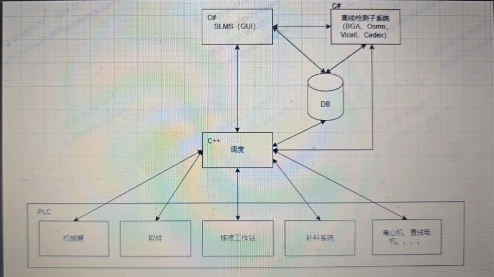
        1.  中试和小试二期
调度程序仅包含PLC程序（我们只能调用或读取数据库表），补液程序完成重新开发。

1.  补液任务状态
补液任务共包含11种状态，状态间的操作及切换如下图&表总结：

> **[图 image464.png | 章节：反应器 / 反应器详情（3.1） / 任务队列（3.1） / 补液任务（3.1） / 补液任务生成与执行的业务说明（3.1）（3.2） | 上下文：补液任务共包含11种状态，状态间的操作及切换如下图&表总结：]**
> （新增图片：V4.0 副本无同图，未做 OCR，请核对图片文件）

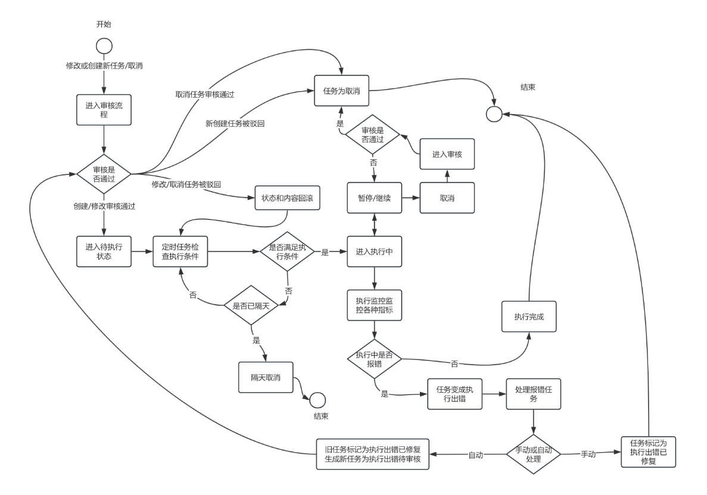

> **[图 image465.png | 章节：反应器 / 反应器详情（3.1） / 任务队列（3.1） / 补液任务（3.1） / 补液任务生成与执行的业务说明（3.1）（3.2） | 上下文：补液任务共包含11种状态，状态间的操作及切换如下图&表总结：]**
> （新增图片：V4.0 副本无同图，未做 OCR，请核对图片文件）

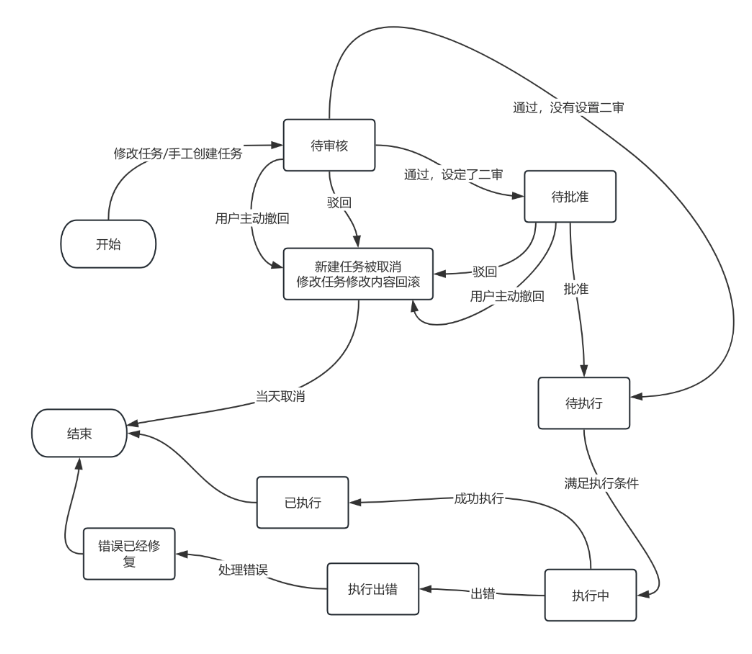
| **任务状态** | **说明** | **针对当前任务可执行的操作** | **备注** |
|---|---|---|---|
| 待审核 | 根据用户设定，新增/修改/取消任务需要进入审核 | 审核、撤回、驳回、查看 | 审核根据流程设定指定的人可审，被触发的申请只能本人撤回 |
| 待批准 | 要求进行双审批的任务，等待第二个人审批 | 批准、撤回、驳回、查看 | 审核根据流程设定指定的人可审，被触发的申请只能本人撤回 |
| 待执行 | 系统自动生成任务或通过审核的任务等待到达执行时间时的状态 | 取消、查看 | 培养成员可操作 |
| 执行出错待审核 | 执行出错后人工进行了修复并生成了新的自动任务，这个新的自动任务创建后默认为这个状态，旧任务标记为执行出错已修复 | 审核、撤回、驳回、查看 | 审核根据流程设定指定的人可审，被人触发的申请只能本人撤回 |
| 执行中 | 任务到达指定时间，且环境符合执行条件后进入执行中状态 | 暂停、查看 | 培养成员可操作 |
| 执行出错 | 执行过程中出现错误代码时候变成此状态 | 提交异常处理信息（修复）、查看 | 培养成员可操作 |
| 执行出错已修复 | 无论是通过手工修复还是自动修复，对执行出错的任务处理后变成此状态 | 查看 |  |
| 已执行 | 任务顺利执行成功后变成此状态 | 查看 |  |
| 已取消 | 驳回后取消，或者主动取消后审核通过，或者修改后自动取消的任务 | 查看 |  |
| 跨天取消 | 执行日期没能成功执行的任务，到第二天系统自动取消 | 查看 |  |
| 暂停中 | 执行中的状态点击暂停操作时变为暂停中 | 取消、继续执行、查看 | 培养成员可操作 |

1.  待审核：根据用户设定的审批功能，若需要审核，则对新增/修改/取消的任务置为待审核。对处于待审核状态的任务，在流程审批模块可进行审核（审核通过）、撤回（仅限创建人/修改人本人）、驳回（审核不通过）操作。
        1.  新增的任务撤回或被驳回，则该任务状态自动变为已取消，不支持再次修改提交。
        2.  修改的任务撤回或被驳回，则该修改的信息和任务状态需要回滚至修改提交审核前的内容
        3.  申请取消的任务撤回或被驳回，则该任务状态需要回滚至申请取消提交审核前的状态
        4.  新增/修改的任务审批通过后，任务状态变为待批准或待执行（取决于设定是否需要二次审批）
        5.  申请取消的任务审批通过后，任务状态变为待批准/已取消（取决于设定是否需要二次审批）
2.  待批准：根据用户设定的审批功能，若需要进行双审批，则在审核完成等待第二个人审批时，状态变成待批准。对于待批准的任务，在流程审批模块可进行批准（批准通过）、撤回（仅限创建人/修改人本人）、驳回（批准不通过）操作。
        1.  新增的任务撤回或被驳回，则该任务状态自动变为已取消，不支持再次修改提交。
        2.  修改的任务撤回或被驳回，则该修改的信息和任务状态需要回滚至修改提交审核前的内容
        3.  申请取消的任务撤回或被驳回，则该任务状态需要回滚至申请取消提交审核前的状态
        4.  新增/修改的任务审批通过后，任务状态变为待执行
        5.  申请取消的任务审批通过后，任务状态变为已取消
3.  待执行：根据用户设定的审批功能，自动生成但不需要审核的任务和已被审核/批准通过的任务，在排队等待执行的过程中变为待执行。对待执行的任务，对该培养有权限的用户可以主动取消该任务，在审核通过后状态变为已取消；若用户在反应器详情－补液方案中修改了补液任务并审核通过，则当前待执行的任务自动修改为已取消。
4.  执行出错待审核：任务执行出错后，填写异常处理信息时，如果选择自动方式完成额外补充则会生成新的任务，此时，旧任务的状态变为执行出错已修复，新任务的状态为执行出错待审核。对处于执行出错待审核状态的任务，在流程审批模块可进行审核（审核通过）、撤回（仅限创建人/修改人/修复人本人）、驳回（审核不通过）操作。若该任务撤回或被驳回，则该任务状态自动变为已取消，不支持再次修改提交。
5.  执行中：任务到达计划时间且符合所有条件正常开始执行，则变为执行中。对执行中的任务，对该培养有权限的人员可对其进行暂停操作。
6.  执行出错：任务执行出错后，状态变为执行出错
7.  执行出错已修复：任务执行出错后，提交异常处理信息后即变成执行出错已修复
8.  已执行：任务顺利执行成功后，变为已执行。
9.  已取消：新建/修改任务审核被驳回或者主动取消且被审核通过的任务或者修改方案自动取消相关任务，状态变为已取消
10.  跨天取消：计划执行时间的当天都没能成功开始执行，到第二天系统自动取消，状态变为跨天取消
11.  暂停中：对执行中的任务，对该培养有权限的人员可对其进行暂停操作，状态变为暂停中。点击暂停后，需要实际停止补液（注意，暂停后，实际下发泵速为0，此段时间不计入泵速生效时长，即判断补料是否超时时不把暂停的时间计入总时长）针对暂停中的任务，对该培养有权限的人员可点击重新继续执行或者取消。注意：暂停后继续执行时，液袋重量可能发生变化，需要以暂停后开始执行时的读数为基准计算补液量。比如，假设补液量50g，地秤起始重量为200g，暂停时的地秤重量为180g，暂停后再次开始执行时，需要重新读取秤的重量，假设为170g，那么按照补液量50g的目标，最终结束补液时地秤的重量应该为140g.
###### 补液任务－新增（3.1）（4.2调整）（5.0调整）

> **[图 image466.png | 章节：反应器 / 反应器详情（3.1） / 任务队列（3.1） / 补液任务（3.1） / 补液任务－新增（3.1）（4.2调整）（5.0调整） | 上下文：###### 补液任务－新增（3.1）（4.2调整）（5.0调整）]**
> **OCR 文本：**
> 新增
> 选择多泵多种补料，任务会拆分至最小单位，每个泵生成一个待审批任务。
> 培养ID | 6407FX033 | 任务类型 | 补料
> 时间规则 | 执行时间 | 反应器/控制器名称 | 培养基名称 | 补料类型* | 补料体积（%/g) | 泵速*
> 立即执行 | 2026-07-21 10:00:00 | FX033 6407FX033(D3) | PUMP1-FM020a | 百分比 | 10 | g/min | or | 小罐二段式
> 立即执行 | 2026-07-21 10:00:00 | FX033 6407FX033 (D3) | PUMP2-FM020b | 百分比 | 10 | 10 | or | 泵速策略
> 请选择 | FX033 6407FX033(D3) | PUMP3-FM020a | 数值 | g/min | or | 泵速策略
> 请选择 | FX033 6407FX033 (D3) | PUMP4-Glucose | 数值 | g/min | or | 泵速策略
> 原因*
> 1、不合理 | 选择
> 2、不允许改来改去 | 选择
> 3、今天太晚了来不及改了 | 选择
> 随便吧
> 保存 | 取消

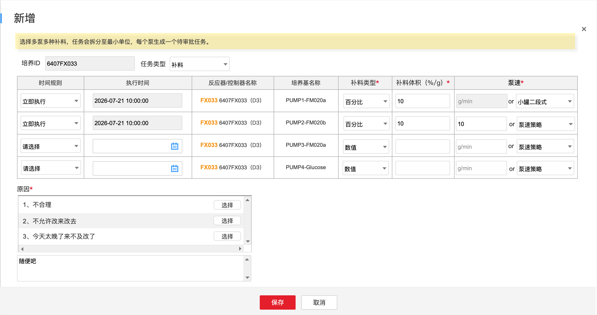
1.  选择任务类型：
    1.  培养ID：显示当前反应器正在培养的培养ID，仅展示，不支持修改
    2.  任务类型：下拉单选，必选，下拉列表包含补料、补糖、PH校准、PH调整、取样测样、搅拌调整、温度调整、通气调整。
2.  任务设置
根据当前选择的反应器、培养ID及任务类型，查询该培养的补液方案，在补液方案－固定泵中配置了信息的泵，才能新增任务，每个泵生成一个任务，每个任务按照设定进入或不进入审核，每个任务包含以下信息：

    1.  时间规则：下拉单选，列表包含立即执行、定时执行
    2.  执行时间：任务计划时间，根据所选的时间规则联动
        1.  选择立即执行：为当前时间
        2.  选择定时执行：可以选择某一个具体的时间执行
    3.  反应器名称：反应器名称、培养ID、培养天数拼接展示。
    4.  培养基名称：用泵名称－补液培养基拼接展示。任务类型时补料时，仅展示培养基不为糖的泵；任务类型为补糖时，仅展示培养基为糖的泵
    5.  补料类型：下拉单选，必选，补料任务包含数值和百分比，补糖任务只有数值。逻辑同章节补料类型。
    6.  补料体积：逻辑同章节补料体积（%/g）：当前面补料类型为百分比的时候，这里的单位是%，输入大于0小于100的数字，支持小数点后3位；当前面的补料类型为数值时，这里的单位是g，可以写数字，支持正整数。
    7.  泵速：逻辑同章节泵速策略：根据选择的反应器类型有不同的填写方式：
    8.  原因：支持快速选择已在字典中维护的原因，也支持手动填写。所有任务都为同一原因。
    9.  保存：如果同一天内已创建过同一个泵的补料任务，需要提醒用户（提醒但不阻止用户继续新增）
> **[图 image467.png | 章节：反应器 / 反应器详情（3.1） / 任务队列（3.1） / 补液任务（3.1） / 补液任务－新增（3.1）（4.2调整）（5.0调整） | 上下文：9. 保存：如果同一天内已创建过同一个泵的补料任务，需要提醒用户（提醒但不阻止用户继续新增）]**
> （新增图片：V4.0 副本无同图，未做 OCR，请核对图片文件）

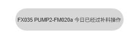
###### 补液任务－详情（3.1）（3.2）

点击进入详情页面后，首先，根据补料任务和补糖任务的不同展示的任务信息不同；其次，根据任务状态的不同有不同按钮来执行不同操作。

| **任务状态** | **按钮/操作** |
|---|---|
| 待审核 | 撤回 |
| 待批准 | 撤回 |
| 待执行 | 取消、修改 |
| 执行出错待审核 | 撤回 |
| 执行中 | 暂停 |
| 执行出错 | 无 |
| 执行出错已修复 | 无 |
| 已执行 | 无 |
| 已取消 | 无 |
| 跨天取消 | 无 |
| 暂停中 | 继续执行、取消 |

1.  待执行：待执行状态下，详情页包含任务信息、取消任务按钮、修改按钮、关闭按钮四个部分。
    1.  任务信息
默认进入为查看状态，所有任务信息仅展示，不可编辑。

        1.  补液方案－补糖规则－按规则生成的补糖任务
> **[图 image468.png | 章节：反应器 / 反应器详情（3.1） / 任务队列（3.1） / 补液任务（3.1） / 补液任务－详情（3.1）（3.2） | 上下文：1. 补液方案－补糖规则－按规则生成的补糖任务]**
> **OCR 文本：**
> 详情
> 培养ID | 培养周期 | 当前培养天数 | 初始培养体积(g) | 当前重量 | (g) | 残糖确认
> 8376363 | DO | 100 | 140 | GLC2B=2.95g/L, LACXX=0.41g/L
> 2027-07-23 09:23:23
> 时间规则 | 执行时间 | 反应器/控制器名称 | 培养基名称 | 下限操作符* | 糖下限* | 糖补料至 | （g/L）＊
> 立即执行 | 2026-07-21 10:00:00 | FX033 | PUMP4-Glucose
> 计算模式* | 当日补料前罐重 | (g) | 补糖前罐重 | (g) | 补糖前残糖量 | (g) | 补糖前残糖浓度(g/L) | 目标补糖量 | (g) | 泵速*
> 残糖和乳酸 | Speed1 | or | 泵速方案
> 补料糖浓度 | 补料体积  | (g) | 计算公式
> 目标补糖量=（目标残糖浓度-补糖前残糖浓度）*补糖前罐重/糖补料浓度
> 取消 | 修改 | 关闭

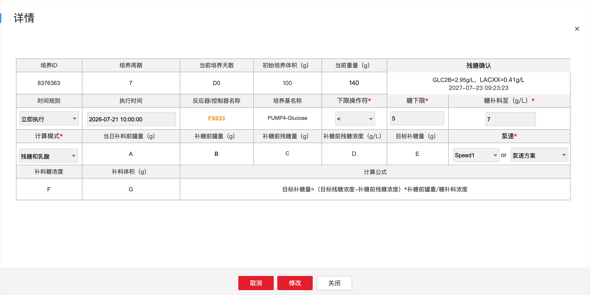
            1.  培养ID
            2.  培养周期
            3.  当前培养天数
            4.  初始培养体积（g）
            5.  当前重量（g）：任务执行开始时获取到的实时反应器重量。在任务执行前此处为空值，任务执行开始时获取到数值后在后续执行过程中不再更新数值。中试直接读取反应器重量，小试计算的理论数（计算公式：罐重= 初始培养体积+接种体积+当前的总补料量-当前的总取样量）（确认是需要SMP系统计算还是PLC程序计算写入数据库然后SMP读库，需要技术测沟通确认，药明方后续补充文档）
            6.  残糖确认：当天残糖确认操作时确认的检测指标及时间
            7.  时间规则
            8.  执行计划时间
            9.  反应器/控制器名称
            10.  培养基名称：泵名称加补料培养基名称结合展示
            11.  下限操作符号
            12.  糖下限
            13.  糖补料至（g/L）
            14.  计算模式
            15.  当日补料前罐重（g）：即当日所有补液任务开始前的反应器重量。每天过凌晨0点记录当前反应器重量。
            16.  补糖前罐重（g）：即该次补糖任务前的反应器重量。任务开始执行的当下时刻记录的罐重。
            17.  补糖前残糖浓度（g/L）：当天最近一次补液任务后计算得到的糖浓度，如果当天没有任何补液任务则是残糖确认功能确认的糖浓度
            18.  补糖前残糖量（g）：补糖前罐重补糖前残糖浓度
            19.  目标补糖量（g）：自动算出，不可手动编辑
| **计****算模式** | **数据来源/计算公式** |
|---|---|
| 残糖+乳酸 | 目标补糖量=（目标残糖浓度-补糖前残糖浓度-补糖前乳酸浓度）*补糖前罐重 |
| 残糖 | 目标补糖量=（目标残糖浓度-补糖前残糖浓度）*补糖前罐重 |

            20.  泵速策略
            21.  补料糖浓度：从对应选择的补料培养基自动获取该液体的糖浓度。
            22.  补料体积（g）：补料体积=（目标糖浓度-补糖前糖浓度）补糖前体积/补料糖浓度
            23.  计算公式：展示目标补糖量的计算公式
            24.  原因：展示创建/最近一次修改时填写的原因
        1.  其余补液任务
> **[图 image469.png | 章节：反应器 / 反应器详情（3.1） / 任务队列（3.1） / 补液任务（3.1） / 补液任务－详情（3.1）（3.2） | 上下文：1. 其余补液任务]**
> **OCR 文本：**
> 详情
> 培养ID | 培养周期 | 当前培养天数 | 初始培养体积（g) | 当前重量 | (g) | 残糖确认
> 8376363 | DO | 100 | 140 | GLC2B=2.95g/L，LACXX=0.41g/L
> 2027-07-23 09:23:23
> 时间规则 | 执行时间 | 反应器/控制器名称 | 培养基名称 | 补料类型* | 补料体积（%/g) | 泵速*
> 立即执行 | 2026-07-2110:00:00 | FX033 | PUMP1-FM020a | 百分比 | 10 | Speed1 | or | 泵速方案
> 补料计算依据 | 目标补料量 | 计算公式 | 计算详情
> 初始重量 | 14 | 目标补料量=（初始培养体积+接种体积）*补料体积（%） | 14= (100+40) *10%
> 原因*
> 新增的
> 取消 | 修改 | 关闭

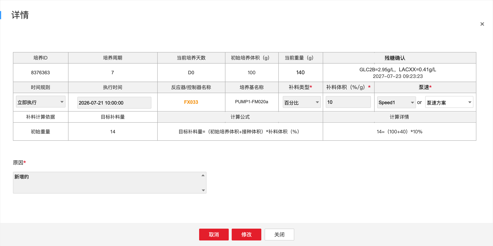
            1.  培养ID
            2.  培养周期
            3.  当前培养天数
            4.  初始培养体积（g）
            5.  接种体积（g）
            6.  当前重量（g）：任务执行开始时获取到的实时反应器重量。在任务执行前此处为空值，任务执行开始时获取到数值后在后续执行过程中不再更新数值。
            7.  残糖确认：当天残糖确认操作确认的检测项数值及时间
            8.  时间规则
            9.  执行计划时间
            10.  反应器/控制器名称
            11.  培养基名称：泵名称加补料培养基名称结合展示
            12.  补料类型：补料任务展示补料类型，补糖规则－按数值生成的补糖任务展示计划方式即按数值
            13.  补料体积：输入的补料体积
            14.  泵速
            15.  补料计算依据
            16.  目标补料量：自动算出，不可手动编辑。补料类型为百分比时，根据计算公式目标补料量=（初始培养体积+接种体积）补料体积计算得到；补料类型为数值时，目标补料量=补料体积
            17.  计算公式：补料类型为百分比时，仅展示计算公式，目标补料量=（初始培养体积+接种体积）补料体积（%）
            18.  计算详情：补料类型为百分比时，仅展示代入具体数值的计算公式和结果，比如14=（100+40）10%
            19.  原因：展示创建/最近一次修改时填写的原因，没有则展示空白
    1.  修改按钮：点击后，部分任务信息和原因支持修改并保存，修改成功后若设置为需要审核则变成待审核状态。
        1.  补液方案－补糖规则－按规则生成的补糖任务：会修改的内容如下，其余仅展示不可修改：
> **[图 image470.png | 章节：反应器 / 反应器详情（3.1） / 任务队列（3.1） / 补液任务（3.1） / 补液任务－详情（3.1）（3.2） | 上下文：1. 补液方案－补糖规则－按规则生成的补糖任务：会修改的内容如下，其余仅展示不可修改：]**
> **OCR 文本：**
> 修改
> 培养ID | 培养天数 | 当前培养天数 | 初始培养体积(g) | 接种体积(g) | 当前重量(g) | 残糖确认
> 8376363 | DO | 100 | 40 | 140 | GLC2B=2.95g/L, LACXX=0.41g/L
> 2027-07-23 09:23:23
> 时间规则 | 执行时间 | 反应器/控制器名称 | 培养基名称 | 下限操作符* | 糖下限* | 糖补料至（g/L）*
> 立即执行 | 2026-07-21 10:00:00 | FX033 | PUMP4-Glucose
> 计算模式* | 当日补料前键重(g) | 补糖前重 (g) | 补糖前残糖量(g) | 补糖前残糖浓度(g/L) | 目标补糖量(g) | 泵速
> 残糖和乳酸 | Speed1 | or | 泵速方案
> 补料糖浓度 | 补料体积(g) | 计算公式
> 目标补糖量=（目标残糖浓度-补糖前残糖浓度） | *补糖前罐重/糖补料浓度
> 1、十合理
> 2、十充存改未改去
> 1、天太要了来干及改了
> 保存 | 关闭

            1.  时间规则：同新增保持一致
            2.  执行时间：同新增保持一致
            3.  下限操作符：同新增保持一致
            4.  糖下限：同新增保持一致
            5.  糖补料至（g/L）：同新增保持一致
            6.  泵速策略：同新增保持一致
        1.  其余补液任务：会修改的内容如下，其余仅展示不可修改：
> **[图 image471.png | 章节：反应器 / 反应器详情（3.1） / 任务队列（3.1） / 补液任务（3.1） / 补液任务－详情（3.1）（3.2） | 上下文：1. 其余补液任务：会修改的内容如下，其余仅展示不可修改：]**
> **OCR 文本：**
> 修改
> 修改的时候只能修改之前的两行
> 不能追加其他泵
> 培养ID | 培养天数 | 当前培养天数 | 初始培养体积（g) | 接种体积 | (g) | 现总重量 | (g) | 残糖确认 | 泵速从泵的固定配置带过来
> GLC2B=2.95g/L | 在这里可以修改，但是不回写泵的固定配置
> 8376363 | DO | 100 | 40 | 140 | 2027-07-23 09:23:23
> 时间规则 | 执行时间 | 反应器/控制器名称 | 培养基名称 | 补料类型* | 补料体积 (%/g) | 泵速* | 如果当前任务所属培养id为
> 中试实验室的培养
> 立即执行 | 2026-07-21 10:00:00 | FX033 | PUMP1-FM020a | 百分比 | 10 | Speed1 | or | 泵速方案 | 则只有一个泵速的下拉
> 原因*
> 泵速方案
> 1、不合理 | 选择
> 2、不允许改来改去 | 选择
> 3、今天太晚了来不及改了 | 选择
> 随便吧
> 保存 | 关闭

            1.  时间规则：同新增保持一致
            2.  执行时间：同新增保持一致
            3.  补料类型：同新增保持一致
            4.  补料体积：同新增保持一致
            5.  泵速策略：同新增保持一致
            6.  目标补料量：根据上述字段修改后的数值自动计算，不可手动编辑。
    1.  取消任务按钮：补料任务和补糖任务，取消都同样必须填写原因
        1.  点击后，需要二次确认，且必须填写取消原因
> **[图 image472.png | 章节：反应器 / 反应器详情（3.1） / 任务队列（3.1） / 补液任务（3.1） / 补液任务－详情（3.1）（3.2） | 上下文：1. 点击后，需要二次确认，且必须填写取消原因]**
> **OCR 文本：**
> 确定要取消此任务吗，取消操作不可撤销哦
> 原因
> 1、不合理 | 选择
> 2、不允许改来改去 | 选择
> 3、今天太晚了来不及改了 | 选择
> 随便吧
> 取消 | 确定

        1.  填写原因并确定取消后，提示进入审批流，该任务状态变为待审核，审核通过后该任务取消
> **[图 image473.png | 章节：反应器 / 反应器详情（3.1） / 任务队列（3.1） / 补液任务（3.1） / 补液任务－详情（3.1）（3.2） | 上下文：1. 填写原因并确定取消后，提示进入审批流，该任务状态变为待审核，审核通过后该任务取消]**
> **OCR 文本：**
> 已进入审批
> 审核通过后任务变为取消
> 关闭

    1.  关闭按钮：点击关闭当前弹窗，表示不保存任何修改或操作。
1.  执行出错/执行出错已修复/已执行/已取消/跨天取消：详情页包含审核备注、任务信息、关闭按钮三个部分。
> **[图 image474.png | 章节：反应器 / 反应器详情（3.1） / 任务队列（3.1） / 补液任务（3.1） / 补液任务－详情（3.1）（3.2） | 上下文：1. 执行出错/执行出错已修复/已执行/已取消/跨天取消：详情页包含审核备注、任务信息、关闭按钮三个部分。]**
> **OCR 文本：**
> 详情
> 申核备注：我不允许你这么干
> 培养ID | 培养天数 | 当前培养天数 | 初始培养体积(g) | 接种体积(g) | 当前重量 (g) | 残糖确认
> 8376363 | DO | 100 | 40 | 140 | 2027-07-23 09:23:23 | GLC2B=2.05g/L
> 时间规则 | 执行时间 | 反应器/控制器名称 | 培养基名称 | 补科类型* | 补科体积(%/g) | 泵速
> 立即执行 | 2026-07-21 10:00:00 | FX033 | PUMP1-FM020a | 百分比 | 10 | Speed1 | or | 泵速方案
> 补料计算依据 | 目标补料量 | 计算公式 | 计算详情
> 初始重量 | 14 | 目标补料量=（初始培养体积+接种体积）*补料体积（%） | 14= (100+40) | *10%
> 原因*
> 随便吧
> 关闭

> **[图 image475.png | 章节：反应器 / 反应器详情（3.1） / 任务队列（3.1） / 补液任务（3.1） / 补液任务－详情（3.1）（3.2） | 上下文：1. 执行出错/执行出错已修复/已执行/已取消/跨天取消：详情页包含审核备注、任务信息、关闭按钮三个部分。]**
> **OCR 文本：**
> 详情
> 申核备注：我不允许你这么干
> 培养ID | 培养天数 | 当前培养天数 | 初始培养体积(g) | 接种体积（g) | 当前重量(g) | 残糖确认
> 8376363 | DO | 100 | 40 | 140 | GLC2B=2.95g/L, LACXX=0.41g/L | 2027-07-23 09:23:23
> 时间规则 | 执行时间 | 反应器/控制器名称 | 培养基名称 | 下限操作符* | 糖下限* | 糖补料至（g/L）*
> 立即执行 | 2026-07-21 10:00:00 | FX033 | PUMP4-Glucose
> 计算模式* | 当日补料前重(g) | 补糖前罐重(g) | 补糖前残糖量(g) | 补糖前残糖浓度(g/L) | 目标补糖量(g) | 泵速
> 残糖和乳酸 | Speed1 | JO | 泵速方案
> 补料糖浓度 | 补料体积(g) | 计算公式
> 目标补糖量= | （目标残糖浓度-补糖前残糖浓度） | *补糖前罐重/糖补料浓度
> 原因"
> 随便吧
> 关闭

    1.  审核备注：如果是审核/批准不通过被驳回的任务，展示驳回原因，仅展示，不可修改
    2.  任务信息：同章节任务信息
    3.  关闭按钮：关闭弹窗
1.  待审核/待批准/执行出错待审核：详情页包含审核备注、任务信息、撤回按钮、关闭按钮四个部分。
> **[图 image476.png | 章节：反应器 / 反应器详情（3.1） / 任务队列（3.1） / 补液任务（3.1） / 补液任务－详情（3.1）（3.2） | 上下文：1. 待审核/待批准/执行出错待审核：详情页包含审核备注、任务信息、撤回按钮、关闭按钮四个部分。]**
> **OCR 文本：**
> 详情
> 任务审核中
> 培养ID | 培养天数 | 当前培养天数 | 初始培养体积(g) | 接种体积(g) | ()吾事牌乐 | 残糖确认
> 8376363 | DO | 100 | 40 | 140 | 2027-07-23 09:23:23 | GLC2B=2.85g/L
> 时间规则 | 执行时间 | 反应器/控制器名称 | 培养基名称 | 补料类型* | 补料体积（(%/g）*
> 立即执行 | 2026-07-21 10:00:00 | FX033 | PUMP1-FM020a | 百分比 | 10 | Speed1 | or | 泵速方案
> 补料计算依据 | 目标补料量 | 计算公式 | 计算详情
> 初始重量 | 14 | 目标补料量=（初始培养体积+接种体积) | *补料体积(%) | 14= (100+40) | *10%
> 原因*
> 随便吧
> 关闭

> **[图 image477.png | 章节：反应器 / 反应器详情（3.1） / 任务队列（3.1） / 补液任务（3.1） / 补液任务－详情（3.1）（3.2） | 上下文：1. 待审核/待批准/执行出错待审核：详情页包含审核备注、任务信息、撤回按钮、关闭按钮四个部分。]**
> **OCR 文本：**
> 详情
> 任务中核中
> 培养ID | 培养天数 | 当前培养天数 | 初始培养体积(g) | 接种体积(g) | 当前重量(g) | 残糖确认
> 8376363 | DO | 100 | 40 | 140 | GLC2B=2.95g/L, LACXX=0.41g/L | 2027-07-23 09:23:23
> 时间规则 | 执行时间 | 反应器/控制器名称 | 培养基名称 | 下限操作符* | 糖下限* | 糖补料至（g/L）*
> 立即执行 | 2026-07-21 10:00:00 | FX033 | PUMP4-Glucose
> 计算模式 | 当日补料前键重(g) | 补糖前键重 (g) | 补糖前残糖量(g) | 补糖前残糖浓度(g/L) | 目标补糖量 | (8) | 泵速
> 残糖和乳酸 | Speed1 | or | 泵速方案
> 补料糖浓度 | 补料体积(g) | 计算公式
> 目标补糖量=（目标残糖浓度-补糖前残糖浓度) | *补糖前罐重/糖补料浓度
> 随便吧
> 撤回 | 关闭

    1.  审核备注：显示文字“任务审核中”
    2.  任务信息：同章节任务信息
    3.  撤回按钮：点击撤回，当前任务状态变为已取消
    4.  关闭按钮：关闭弹窗
1.  执行中：详情页包含任务信息、暂停按钮、关闭按钮三个部分。
> **[图 image478.png | 章节：反应器 / 反应器详情（3.1） / 任务队列（3.1） / 补液任务（3.1） / 补液任务－详情（3.1）（3.2） | 上下文：1. 执行中：详情页包含任务信息、暂停按钮、关闭按钮三个部分。]**
> **OCR 文本：**
> 详情
> 培养ID | 培养天数 | 当前培养天数 | 初始培养体积(g) | 接种体积(g) | 当的重量 | 残糖确认
> 8376363 | DO | 100 | 40 | 140 | 2027-07-23 09:23:23 | GLC2B=2.85g/L
> 时间规则 | 执行时间 | 反应器/控制器名称 | 培养基名称 | 补料类型* | 补料体积（%/g）* | 泵速
> 立即执行 | 2026-07-21 10:00:00 | FX033 | PUMP1-FM020a | 百分比 | 10 | Speed1 | or | 泵速方案
> 补料计算依据 | 目标补料量 | 计算公式 | 计算详情
> 初始重量 | 14 | 目标补料量=(初始培养体积+接种体积） | *补料体积(%) | 14= (100+40) | *10%
> 原因*
> 随便吧
> 暂停 | 关闭

> **[图 image479.png | 章节：反应器 / 反应器详情（3.1） / 任务队列（3.1） / 补液任务（3.1） / 补液任务－详情（3.1）（3.2） | 上下文：1. 执行中：详情页包含任务信息、暂停按钮、关闭按钮三个部分。]**
> **OCR 文本：**
> 详情
> 培养ID | 培养天数 | 当前培养天数 | 初始培养体积(g) | 接种体积(g) | 当前重量(g) | 残糖确认
> 8376363 | DO | 100 | 40 | 140 | GLC2B=2.95g/L, LACXX=0.41g/L | 2027-07-23 09:23:23
> 时间规则 | 执行时间 | 反应器/控制器名称 | 培养基名称 | 下限操作符* | 糖下限* | 糖补料至（g/L）*
> 立即执行 | 2026-07-21 10:00:00 | FX033 | PUMP4-Glucose
> 计算模式* | 当日补料前键重（g) | 补糖前键重(g) | 补糖前残糖量(g) | 补糖前残糖浓度(g/L) | 目标补糖量(g) | 泵速*
> 残糖和乳酸 | Speed1 | or | 泵速方案
> 补料糖浓度 | 补料体积(g) | 计算公式
> 目标补糖量=（目标残糖浓度-补糖前残糖浓度） | *补糖前罐重/糖补料浓度
> 原因"
> 随便吧
> 暂停 | 关闭

    1.  任务信息：同任务信息
    2.  暂停按钮：
        1.  点击后需要二次确认
> **[图 image480.png | 章节：反应器 / 反应器详情（3.1） / 任务队列（3.1） / 补液任务（3.1） / 补液任务－详情（3.1）（3.2） | 上下文：1. 点击后需要二次确认]**
> **OCR 文本：**
> 确定暂停任务吗
> 确定后将会下发停泵指令
> 取消

        1.  二次确认需要暂停后，当前任务状态变为已取消
    1.  关闭按钮：关闭弹窗
1.  暂停中：详情页包含任务详情、取消任务按钮、继续执行按钮、关闭按钮四个部分
> **[图 image481.png | 章节：反应器 / 反应器详情（3.1） / 任务队列（3.1） / 补液任务（3.1） / 补液任务－详情（3.1）（3.2） | 上下文：1. 暂停中：详情页包含任务详情、取消任务按钮、继续执行按钮、关闭按钮四个部分]**
> **OCR 文本：**
> 详情
> 培养ID | 培养天数 | 当前培养天数 | 初始培养体积(g) | 接种体积(g) | 当前重量(g) | 残糖确认
> 8376363 | DO | 100 | 40 | 140 | 2027-07-23 09:23:23 | GLC2B=2.95g/L
> 时间规则 | 执行时间 | 反应器/控制器名称 | 培养基名称 | 补料类型* | 补料体积（(%/g）* | 系速*
> 立即执行 | 2026-07-21 10:00:00 | FX033 | PUMP1-FM020a | 百分比 | 10 | Speed1 | or | 泵速方案
> 补料计算依据 | 目标补料量 | 计算公式 | 计算详情
> 初始重量 | 14 | 目标补料量=（初始培养体积+接种体积）*补料体积（%） | 14= (100+40) *10%
> 原因*
> 随便吧
> 取消任务 | 继续执行 | 关闭

> **[图 image482.png | 章节：反应器 / 反应器详情（3.1） / 任务队列（3.1） / 补液任务（3.1） / 补液任务－详情（3.1）（3.2） | 上下文：1. 暂停中：详情页包含任务详情、取消任务按钮、继续执行按钮、关闭按钮四个部分]**
> **OCR 文本：**
> 详情
> 培养ID | 培养天数 | 当前培养天数 | 初始培养体积(g) | 接种体积（g) | 当前重量(g) | 残糖确认
> 8376363 | DO | 100 | 40 | 140 | GLC2B=2.85g/L, LACXX=0.41g/L | 2027-07-23 09:23:23
> 时间规则 | 执行时间 | 反应器/控制器名称 | 培养基名称 | 下限操作符* | 糖下限* | 糖补料至（g/L）*
> 立即执行 | 2026-07-21 10:00:00 | FX033 | PUMP4-Glucose
> 计算模式* | 当日补料前重 | (g) | 补糖前重(g) | 补糖前残糖量(g) | 补糖前残糖浓度（g/L) | 目标补糖量(g) | 泵速*
> 残糖和乳酸 | Speed1 | or | 泵速方案
> 补料糖浓度 | 补料体积(g) | 计算公式
> 目标补糖量=（目标残糖浓度-补糖前残糖浓度）*补糖前罐重/糖补料浓度
> 随便吧
> 取消任务 | 继续执行 | 关闭

    1.  任务信息：同章节任务信息
    2.  取消任务按钮：
    3.  点击后，需要二次确认，且必须填写取消原因
> **[图 image472.png | 章节：反应器 / 反应器详情（3.1） / 任务队列（3.1） / 补液任务（3.1） / 补液任务－详情（3.1）（3.2） | 上下文：3. 点击后，需要二次确认，且必须填写取消原因]**
> **OCR 文本：**
> 确定要取消此任务吗，取消操作不可撤销哦
> 原因
> 1、不合理 | 选择
> 2、不允许改来改去 | 选择
> 3、今天太晚了来不及改了 | 选择
> 随便吧
> 取消 | 确定

    1.  填写原因并确定取消后，提示进入审批流，该任务状态变为待审核，审核通过后变为已取消。
> **[图 image473.png | 章节：反应器 / 反应器详情（3.1） / 任务队列（3.1） / 补液任务（3.1） / 补液任务－详情（3.1）（3.2） | 上下文：1. 填写原因并确定取消后，提示进入审批流，该任务状态变为待审核，审核通过后变为已取消。]**
> **OCR 文本：**
> 已进入审批
> 审核通过后任务变为取消
> 关闭

    1.  继续执行：点击继续执行则必须填写之前暂停的原因。
> **[图 image483.png | 章节：反应器 / 反应器详情（3.1） / 任务队列（3.1） / 补液任务（3.1） / 补液任务－详情（3.1）（3.2） | 上下文：1. 继续执行：点击继续执行则必须填写之前暂停的原因。]**
> **OCR 文本：**
> 别才执行了暂停操作，继续执行请补充一下刚才的暂停原因。
> 原因*
> 1、不合理 | 选择
> 2、不允许改来改去 | 选择
> 3、今天太晚了来不及改了 | 选择
> 随便吧
> 取消 | 继续执行

###### 补液任务－复制（3.1）

点击复制按钮，把任务相关信息都自动填入，但执行时间规则必须重新填写，保存后即新增一个任务，任务状态根据是否需要审核变为待审核或待执行。

注意，因为任务都是一个泵生成一个任务，所以复制新增的弹窗内一定只有一行任务信息。

> **[图 image484.png | 章节：反应器 / 反应器详情（3.1） / 任务队列（3.1） / 补液任务（3.1） / 补液任务－复制（3.1） | 上下文：注意，因为任务都是一个泵生成一个任务，所以复制新增的弹窗内一定只有一行任务信息。]**
> **OCR 文本：**
> 复制新增
> 培养ID | 培养周期 | 当前培养天数 | 初始培养体积(g) | 当前重量 | (g) | 残糖确认
> 8376363 | DO | 100 | 140 | GLC2B=2.95g/L，LACXX=0.41g/L
> 2027-07-2309:23:23
> 时间规则 | 执行时间 | 反应器/控制器名称 | 培养基名称 | 补料类型* | 补料体积(%/g) | 泵速*
> 定时执行 | 2026-08-4 16:00:00 | FX033 | PUMP1-FM020a | 百分比 | 10 | Speed1 | or | 泵速方案
> 补料计算依据 | 目标补料量 | 计算公式 | 计算详情
> 当前重量 | 目标补料量=当前重量*补料体积（%)
> 原因*
> 1、不合理 | 选择
> 2、不允许改来改去 | 选择
> 3、今天太晚了来不及改了 | 选择
> 随便吧
> 保存 | 关闭

###### 补液任务－日志（3.1）

查看当前任务的所有操作记录，根据操作时间倒序（距离现在时间由近到远）展示

> **[图 image485.png | 章节：反应器 / 反应器详情（3.1） / 任务队列（3.1） / 补液任务（3.1） / 补液任务－日志（3.1） | 上下文：查看当前任务的所有操作记录，根据操作时间倒序（距离现在时间由近到远）展示]**
> **OCR 文本：**
> 日志
> 操作时间 | 操作人 | 操作类型 | 操作结果
> 2026-07-11 00:09:18 | 张三 | 创建 | 进入待审核 | 随便创建一个
> 2026-07-11 00:09:18 | 大老王 | 审核通过 | 待执行
> 2026-07-11 00:09:18 | 王五 | 暂停 | 暂停
> 2026-07-11 00:09:18 | 王五 | 继续执行 | 执行中 | 泵坏了
> 2026-07-11 00:09:18 | 系统 | 停泵 | 执行出错 | 抖动异常
> 关闭

1.  操作时间
2.  操作人
3.  操作类型：会导致任务状态切换的操作或事件，比如审核通过、驳回、暂停、针对执行中异常事件采取的动作等。
4.  操作结果：操作后的任务状态或操作的结果。
5.  备注：操作的特别说明，比如录入的原因、具体异常事件说明等，没有则显示空。
###### 补液任务－执行记录（3.1）（3.2）

执行出错待审核、执行中、执行出错、执行出错已修复、已执行和暂停种共计6种状态下可查看相应执行记录。

根据任务类型和任务执行状况的不同，可查看到包含不同tab页签的执行记录，补液任务（包含补料任务和补糖任务）的执行记录具体如下：

1.  基本信息：展示当前任务的基本信息，只要有执行记录按钮即可看到此Tab页。包含以下内容：
    1.  反应器编码
    2.  项目编码
    3.  批次编码
    4.  培养ID
    5.  培养开始时间
    6.  培养结束时间
    7.  培养周期：该培养一共需要的天数，结束时间－开始时间
    8.  当前培养天数：表示当前处于培养的第几天
    9.  泵名称
    10.  补液培养基
    11.  补料方式
    12.  补料体积（g/%）
    13.  初始培养体积
    14.  补料前秤重量（g）：当前任务执行前读取补料秤的重量
    15.  补料后秤重量（g）：当前任务执行完成后读取补料秤的重量
    16.  补料目标重量（g）：当前任务的目标补料量
    17.  补料实际重量（g）：根据补料后秤重量－补料前秤重量计算得到
    18.  补料完成度：根据补料实际重量/补料目标重量计算得到
    19.  泵速策略
    20.  补料计算依据
    21.  补料前培养体积（g）：当前任务开始执行时的反应器重量/反应器培养体积
    22.  补糖前残糖量（g）：补糖任务开始执行前，利用当下的反应器重量和当天最近一次计算/确认得到的糖浓度计算得出，残糖量=罐重最近一次计算得到的残糖浓度
    23.  补糖后残糖量（g）：补糖任务执行完成时，利用当下的反应器重量和目标补糖浓度计算得出，残糖量=罐重目标补糖浓度
    24.  执行状态
2.  补糖信息：只有补糖任务才能看到此tab页。包含以下内容：
    1.  Cedex样品ID
    2.  残糖检测项目
    3.  残糖检测值
    4.  单位
    5.  当日补料前罐重
    6.  补糖前罐重
    7.  补糖前残糖量
    8.  补糖前残糖浓度
    9.  计算模式
    10.  补糖浓度下限（g/L）
    11.  残糖浓度比较运算符
    12.  目标糖浓度（g/L）
    13.  目标补糖量计算公式：根据计算模式不同展示不同计算公式，
    14.  补糖计算详情：根据补糖量计算公式，显示将具体数值代入的完整计算过程及结果，比如目标补糖量（g）1456=（6.5-3.5346272517）196.406/0.4
3.  泵速下发：补液任务在执行过程中下发的泵速的记录，只要有执行记录按钮即可看到此Tab页，包含以下信息：
    1.  序号：自增行号
    2.  时间：泵速下发时间
    3.  阶段：泵速下发时所处的阶段（校准/高速/低速）
    4.  速度：具体的泵速数值
4.  数据图表：执行任务时根据泵速策略的环控时间记录数据（这些数据在执行任务时，通过环控程序进行记录，都存在同一个表里），以折线图的形式展示，只要有执行记录按钮即可看到此Tab页。包含以下字段的可视化：
    1.  ExecNumber（g）：表示当前补了多少，根据执行前读数-补料秤当前度数计算得到
    2.  FeedingScaleweight（g）：补料秤读数（会随着时间变小）
    3.  pumpSpeed（g/min）：抓取的实时泵速
    4.  下发泵速：下发的泵速的数值（理论的速度，比如说在三段式泵速策略里面，会下发三次速度指令，校准阶段泵速、高速阶段泵速、低速阶段泵速，最后停泵速度为0）
5.  异常处理：任务执行过程中发生了异常事件后出现此tab页。
    1.  发生异常事件后，可填写异常处理信息，包含以下内容：
> **[图 image486.png | 章节：反应器 / 反应器详情（3.1） / 任务队列（3.1） / 补液任务（3.1） / 补液任务－执行记录（3.1）（3.2） | 上下文：1. 发生异常事件后，可填写异常处理信息，包含以下内容：]**
> **OCR 文本：**
> 执行记录
> 基本信息 | 泵速下发 | 数据图表 | 异常处理
> 异常事件 | XXXXXX， | 泵速异常堵塞，请检查泵
> 补料目标重量 | 1456g
> 异常后确认实际补料量* | 1398
> 补料量误差7.98%
> 异常原因描述* | 预设原因
> 1、不合理 | 选择
> 2、不允许改来改去 | 选择
> 3、今天太晚了来不及改了 | 选择
> 随便吧
> 额外补充方式* | 自动 | 手动
> 补料量* | 1398
> 泵速策略* | g/min | or | 请选择
> 保存 | 关闭

误差大于百分之5

> **[图 image487.png | 章节：反应器 / 反应器详情（3.1） / 任务队列（3.1） / 补液任务（3.1） / 补液任务－执行记录（3.1）（3.2） | 上下文：误差大于百分之5]**
> **OCR 文本：**
> 执行记录
> 基本信息 | 泵速下发 | 数据图表 | 异常处理
> 异常事件 | XXXXXX， | 泵速异常堵塞，请检查泵
> 补料目标重量 | 1456g
> 异常后确认实际补料量* | 1398
> 补料量误差3.98%
> 异常原因描述* | 预设原因
> 1、不合理 | 选择
> 2、不允许改来改去 | 选择
> 3、今天太晚了来不及改了 | 选择
> 随便吧
> 保存 | 关闭

小于等于5%时如上图

        1.  异常事件：仅展示，显示异常事件说明
        2.  补料目标重量：仅展示
        3.  异常后实际补料量：文本框，必填，默认值为根据补料异常停泵后补料秤重量－开始任务前补料秤重量，支持手动修改
        4.  补料量误差：仅展示，不可修改，单位为%，根据（补料目标重量－异常后实际补料量）/补料目标重量100自动计算得到
        5.  异常原因描述：必填，支持快速选中
        6.  额外补充方式：当补料量误差大于5%时，出现额外补充方式字段，共有两种方式，只能二选一：
            1.  自动：选择自动补充并保存信息后，当前任务状态变为执行出错已修复，并生成一个新的补料任务，状态为执行出错待审核。根据填写的目标补料量和泵速自动生成新的任务（任务计划执行时间是原任务的任务计划执行时间）
                1.  补料量：默认值为补料目标重量－异常后确认实际补料量，允许用户修改
                2.  泵速策略：同章节泵速策略：
            2.  手动：选择手动补充并保存信息后，当前任务状态变为执行出错已修复。即意味着此任务执行已完成，因此需根据手动填写的补料量信息，和正常执行完成的任务一样计算所有相关指标并保存，比如糖浓度、残糖量等等。
                1.  补料量：默认值为补料目标重量－异常后确认实际补料量，允许用户修改。
    1.  填写异常信息并保存后，则只可查看相关信息，包含以下内容：
> **[图 image488.png | 章节：反应器 / 反应器详情（3.1） / 任务队列（3.1） / 补液任务（3.1） / 补液任务－执行记录（3.1）（3.2） | 上下文：1. 填写异常信息并保存后，则只可查看相关信息，包含以下内容：]**
> **OCR 文本：**
> 查看 | 查看
> 基本信息 | 泵速下发 | 数据图表 | 异常处理 | 基本信息 | 泵速下发 | 数据图表 | 异常处理
> 异常事件XXXXXX，泵速异常堵塞，请检查泵 | 异常事件XXXXXX，泵速异常堵塞，请检查泵
> 补料目标重量 | 1456g | 补料目标重量1456g
> 异常后确认实际补料量 | 1398g | 补料量误差3.98% | 异常后确认实际补料量 | 1398g | 补料量误差3.98%
> 异常原因描述 | 外置泵坏了 | 异常原因描述外置泵坏了
> 额外补充方式手动 | 额外补充方式自动
> 补料量20g | 关联异常处理任务 | 查石
> 异常登记人张三 | 异常登记人张三
> 异常登记时间2026-07-2112:21:21 | 异常登记时间2026-07-2112:21:21
> 关闭 | 关闭

        1.  异常事件：显示发生的异常事件的说明
        2.  补料目标重量
        3.  异常后确认实际补料量
        4.  补料量误差
        5.  异常原因描述
        6.  额外补充方式
        7.  补料量：仅手动补充时展示
        8.  关联异常处理任务：仅自动补充时，显示“查看”按钮，点击则可跳转查看自动生成的关联新任务的任务详情
        9.  异常登记人：提交异常处理信息的用户显示名
        10.  异常登记时间：提交异常处理信息的时间
##### PH校准任务（4.2）

###### PH校准任务生成与执行的业务说明（4.2）

1.  PH校准任务的产生途径包含以下五种
1.  根据当前培养ID 的培养方案－灌注培养基方案（见章节培养方案修改③），在灌注培养基工作流-步骤5两次检测结果的确认过程中，会自动生成PH校准任务
2.  根据当前培养ID 的培养方案－自动控制方案（见章节培养方案修改③），在自动控制工作流-步骤3完成后，会自动生成PH校准任务
3.  在实验室工作台－任务队列－任务新增－PH校准任务新增模块，点击新增产生新的PH校准任务，此处产生的任务时自动任务。
4.  在实验室工作台－反应器详情－任务队列－PH校准任务－PH校准任务新增，添加新的PH校准任务。此处产生的任务是自动任务
5.  在检测分析页面，如果是BGA检测类型，可点击PH校准按钮添加新的PH校准任务。此处产生的任务是手动任务
2.  任务状态：同补液任务中的章节补液任务状态，补液任务的状态覆盖PH校准任务的状态，只是部分状态由于业务流程的不同导致压根不会触发。
1.  PH校准任务包含的任务状态：待审核、待批准、待执行、执行中、执行出错、执行出错已修复、已执行、已取消、跨天取消。
3.  PH校准任务的执行逻辑：见以下文件
> 附件: oleObject3.bin（docx 内嵌 OLE 对象，未内联；原文件请在 需求说明书V5.1-1030.docx 中查看）
###### PH校准任务-新增（4.2）（5.0调整）

> **[图 image490.png | 章节：反应器 / 反应器详情（3.1） / 任务队列（3.1） / PH校准任务（4.2） / PH校准任务-新增（4.2）（5.0调整） | 上下文：###### PH校准任务-新增（4.2）（5.0调整）]**
> （新增图片：V4.0 副本无同图，未做 OCR，请核对图片文件）

1.  任务类型：下拉单选，必选，下拉列表包含补料、补糖、PH校准、PH调整、取样测样、搅拌调整、温度调整、通气调整。
2.  任务设置
1.  校准对象的基本信息：展示当前选择的控制器编号、对应的培养ID及其当前阶段
2.  校准方式
    1.  执行时间：PH校准都是立即执行，展示当前时间即可
    2.  检测结果（检测时间）：下拉单选，必选。下拉列表为当前反应器&当前培养ID&当天所有BGA类型下的PH检测结果（未被作废的）及其检测时间，若不存在满足条件的，则不允许新增任务。
    3.  校准目标：必须在中间值、离线值两种方式中二选一。
3.  原因：根据实验室设置确定是否需要填写。需要填写时，则为必填，支持快速选中
4.  保存：
    1.  当前培养有选择灌注培养基或自动控制工作流才允许新增任务
    2.  当天必须有BGA检测且有未被作废的PH结果才可新增成功，否则提示用户当前没有满足条件的PH检测结果。
    3.  每个任务按照设定进入或不进入审核。
###### PH校准任务-详情（4.2）

> **[图 image491.png | 章节：反应器 / 反应器详情（3.1） / 任务队列（3.1） / PH校准任务（4.2） / PH校准任务-详情（4.2） | 上下文：###### PH校准任务-详情（4.2）]**
> （新增图片：V4.0 副本无同图，未做 OCR，请核对图片文件）

1.  校准信息
1.  反应器/控制器编号
2.  培养ID
3.  当前阶段
4.  执行时间：点击修改按钮后刷新为最新的当下时间
5.  检测结果（检测时间）：下拉单选，点击修改按钮后支持改选。
6.  校准方式：点击修改按钮后支持修改
2.  原因
3.  操作：点击进入详情页面后，根据任务状态的不同有不同按钮来执行不同操作。
| **任务状态** | **按钮/操作** | **备注** |
|---|---|---|
| 待审核 | 撤回 |  |
| 待批准 | 撤回 |  |
| 待执行 | 取消、修改 |  |
| 执行出错待审核 | - | 此任务没有此状态 |
| 执行中 | 无 |  |
| 执行出错 | 重试、忽略 | 重试、忽略按钮不在详情弹窗，在执行记录弹窗 |
| 执行出错已修复 | 无 | 执行出错后，在执行记录中点击忽略按钮，状态变为执行出错已修复 |
| 已执行 | 无 |  |
| 已取消 | 无 |  |
| 跨天取消 | 无 |  |
| 暂停中 | - | 此任务没有暂停操作，也就没有暂停中状态 |

1.  取消：
        1.  点击后，需要二次确认，且必须填写取消原因
> **[图 image472.png | 章节：反应器 / 反应器详情（3.1） / 任务队列（3.1） / PH校准任务（4.2） / PH校准任务-详情（4.2） | 上下文：1. 点击后，需要二次确认，且必须填写取消原因]**
> **OCR 文本：**
> 确定要取消此任务吗，取消操作不可撤销哦
> 原因
> 1、不合理 | 选择
> 2、不允许改来改去 | 选择
> 3、今天太晚了来不及改了 | 选择
> 随便吧
> 取消 | 确定

        1.  填写原因并确定取消后，提示进入审批流，该任务状态变为待审核，审核通过后该任务取消
> **[图 image473.png | 章节：反应器 / 反应器详情（3.1） / 任务队列（3.1） / PH校准任务（4.2） / PH校准任务-详情（4.2） | 上下文：1. 填写原因并确定取消后，提示进入审批流，该任务状态变为待审核，审核通过后该任务取消]**
> **OCR 文本：**
> 已进入审批
> 审核通过后任务变为取消
> 关闭

1.  修改：修改必需填写原因，根据设置进入或不进入审核状态
> **[图 image492.png | 章节：反应器 / 反应器详情（3.1） / 任务队列（3.1） / PH校准任务（4.2） / PH校准任务-详情（4.2） | 上下文：1. 修改：修改必需填写原因，根据设置进入或不进入审核状态]**
> （新增图片：V4.0 副本无同图，未做 OCR，请核对图片文件）

2.  撤回：
    1.  审核备注：显示文字“任务审核中”
    2.  撤回按钮：点击撤回，当前任务状态变为已取消
3.  关闭按钮：点击关闭当前弹窗，表示不保存任何修改或操作。
###### PH校准任务-日志（4.2）

查看当前任务的所有操作记录，根据操作时间倒序（距离现在时间由近到远）展示

> **[图 image485.png | 章节：反应器 / 反应器详情（3.1） / 任务队列（3.1） / PH校准任务（4.2） / PH校准任务-日志（4.2） | 上下文：查看当前任务的所有操作记录，根据操作时间倒序（距离现在时间由近到远）展示]**
> **OCR 文本：**
> 日志
> 操作时间 | 操作人 | 操作类型 | 操作结果
> 2026-07-11 00:09:18 | 张三 | 创建 | 进入待审核 | 随便创建一个
> 2026-07-11 00:09:18 | 大老王 | 审核通过 | 待执行
> 2026-07-11 00:09:18 | 王五 | 暂停 | 暂停
> 2026-07-11 00:09:18 | 王五 | 继续执行 | 执行中 | 泵坏了
> 2026-07-11 00:09:18 | 系统 | 停泵 | 执行出错 | 抖动异常
> 关闭

1.  操作时间
2.  操作人
3.  操作类型：会导致任务状态切换的操作或事件，比如审核通过、驳回、暂停、针对执行中异常事件采取的动作等。
4.  操作结果：操作后的任务状态或操作的结果。
5.  备注：操作的特别说明，比如录入的原因、具体异常事件说明等，没有则显示空。
##### PH校准任务-执行记录（4.2）

执行中、执行出错、执行出错已修复、已执行共计4种状态下可查看相应执行记录。

> **[图 image493.png | 章节：反应器 / 反应器详情（3.1） / 任务队列（3.1） / PH校准任务-执行记录（4.2） | 上下文：执行中、执行出错、执行出错已修复、已执行共计4种状态下可查看相应执行记录。]**
> （新增图片：V4.0 副本无同图，未做 OCR，请核对图片文件）

1.  基础信息：展示当前任务的基本信息，只要有执行记录按钮即可看到。包含以下内容
1.  状态
2.  模式
3.  执行开始时间
4.  执行结束时间
5.  项目编号
6.  批次编号
7.  培养ID
8.  反应器/控制器编号
9.  在线值
10.  离线值
11.  PH偏差值
12.  校准值
13.  触发规则
14.  错误原因：状态为执行出错/执行出错已修复时，能看到错误原因。
2.  操作：点击进入详情页面后，根据任务状态的不同有不同按钮来执行不同操作。
1.  重试
    1.  当前任务状态为执行出错时才有此按钮
    2.  点击表示重新执行此任务
2.  忽略
    1.  当前任务状态为执行出错时才有此按钮
    2.  点击表示当前任务已线下修复完成。
3.  关闭：点击关闭当前弹窗，不做任何其余操作
##### PH调整任务（4.2）

###### PH调整任务生成与执行的业务说明（4.2）（5.0）

1.  PH调整任务的产生途径包含以下三种
1.  根据当前培养ID 的培养方案－自动控制方案（见章节培养方案修改③），在自动控制工作流-步骤3完成后，会自动生成PH调整任务
2.  在实验室工作台－任务队列－任务新增－PH调整任务新增模块，点击新增产生新的PH调整任务，此处产生的任务时自动任务。
3.  在实验室工作台－反应器详情－任务队列－PH调整任务－PH调整任务新增，添加新的PH调整任务。此处产生的任务是自动任务
4.  根据当前培养ID的培养方案-灌注培养基方案（见章节培养方案修改③），在灌注培养基工作流-步骤4（中试）/步骤5（小试）下发参数时，会自动生成PH调整任务
2.  任务状态：同补液任务中的章节补液任务状态，补液任务的状态覆盖PH调整任务的状态，只是部分状态由于业务流程的不同导致压根不会触发。
1.  PH调整任务包含的任务状态：待审核、待批准、待执行、执行中、执行出错、执行出错已修复、已执行、已取消、跨天取消。
3.  PH调整任务的主要操作：
1.  将目标值、死区+、死区-参数下发至设备
2.  根据方案中的检测设置，可能生成取样测样任务
###### PH调整任务-新增（4.2）（5.0调整）

> **[图 image494.png | 章节：反应器 / 反应器详情（3.1） / 任务队列（3.1） / PH调整任务（4.2） / PH调整任务-新增（4.2）（5.0调整） | 上下文：###### PH调整任务-新增（4.2）（5.0调整）]**
> （新增图片：V4.0 副本无同图，未做 OCR，请核对图片文件）

1.  任务类型：下拉单选，必选，下拉列表包含补料、补糖、PH校准、PH调整、取样测样、搅拌调整、温度调整、通气调整。
2.  任务设置
1.  反应器/控制器的基本信息：展示当前选择的控制器编号、对应的培养ID及其当前阶段
2.  调整内容
    1.  时间规则：下拉单选，必选包含立即执行和定时执行两种
        1.  立即执行：为当前时间
        2.  定时执行：可以选择某一个具体的时间执行
    2.  执行时间：根据时间规则联动确定执行时间
    3.  目标值
    4.  死区+
    5.  死区-
3.  原因：根据实验室设置确定是否需要填写。需要填写时，则为必填，支持快速选中
4.  保存
    1.  每个任务按照设定进入或不进入审核。
    2.  开始培养工作流已完成的培养才能创建PH调整任务
    3.  当前培养有选择灌注培养基或自动控制工作流才允许新增任务
###### PH调整任务-详情（4.2）

> **[图 image495.png | 章节：反应器 / 反应器详情（3.1） / 任务队列（3.1） / PH调整任务（4.2） / PH调整任务-详情（4.2） | 上下文：###### PH调整任务-详情（4.2）]**
> （新增图片：V4.0 副本无同图，未做 OCR，请核对图片文件）

1.  调整信息
1.  反应器/控制器编号
2.  培养ID
3.  当前阶段
4.  时间规则：下拉单选，点击修改按钮后支持改选。
5.  执行时间
6.  目标值
7.  死区+
8.  死区-
2.  原因
3.  操作：点击进入详情页面后，根据任务状态的不同有不同按钮来执行不同操作。
| **任务状态** | **按钮/操作** | **备注** |
|---|---|---|
| 待审核 | 撤回 |  |
| 待批准 | 撤回 |  |
| 待执行 | 取消、修改 |  |
| 执行出错待审核 | - | 此任务没有此状态 |
| 执行中 | 无 |  |
| 执行出错 | 重试、忽略 | 重试、忽略按钮不在详情弹窗，在执行记录弹窗 |
| 执行出错已修复 | 无 | 执行出错后，在执行记录中点击忽略按钮，状态变为执行出错已修复 |
| 已执行 | 无 |  |
| 已取消 | 无 |  |
| 跨天取消 | 无 |  |
| 暂停中 | - | 此任务没有暂停操作，也就没有暂停中状态 |

1.  取消：
        1.  点击后，需要二次确认，且必须填写取消原因
> **[图 image472.png | 章节：反应器 / 反应器详情（3.1） / 任务队列（3.1） / PH调整任务（4.2） / PH调整任务-详情（4.2） | 上下文：1. 点击后，需要二次确认，且必须填写取消原因]**
> **OCR 文本：**
> 确定要取消此任务吗，取消操作不可撤销哦
> 原因
> 1、不合理 | 选择
> 2、不允许改来改去 | 选择
> 3、今天太晚了来不及改了 | 选择
> 随便吧
> 取消 | 确定

        1.  填写原因并确定取消后，提示进入审批流，该任务状态变为待审核，审核通过后该任务取消
> **[图 image473.png | 章节：反应器 / 反应器详情（3.1） / 任务队列（3.1） / PH调整任务（4.2） / PH调整任务-详情（4.2） | 上下文：1. 填写原因并确定取消后，提示进入审批流，该任务状态变为待审核，审核通过后该任务取消]**
> **OCR 文本：**
> 已进入审批
> 审核通过后任务变为取消
> 关闭

1.  修改：修改必需填写原因，根据设置进入或不进入审核状态
> **[图 image496.png | 章节：反应器 / 反应器详情（3.1） / 任务队列（3.1） / PH调整任务（4.2） / PH调整任务-详情（4.2） | 上下文：1. 修改：修改必需填写原因，根据设置进入或不进入审核状态]**
> （新增图片：V4.0 副本无同图，未做 OCR，请核对图片文件）

2.  撤回：
    1.  审核备注：显示文字“任务审核中”
    2.  撤回按钮：点击撤回，当前任务状态变为已取消
3.  关闭按钮：点击关闭当前弹窗，表示不保存任何修改或操作。
###### PH调整任务-日志（4.2）

查看当前任务的所有操作记录，根据操作时间倒序（距离现在时间由近到远）展示

> **[图 image485.png | 章节：反应器 / 反应器详情（3.1） / 任务队列（3.1） / PH调整任务（4.2） / PH调整任务-日志（4.2） | 上下文：查看当前任务的所有操作记录，根据操作时间倒序（距离现在时间由近到远）展示]**
> **OCR 文本：**
> 日志
> 操作时间 | 操作人 | 操作类型 | 操作结果
> 2026-07-11 00:09:18 | 张三 | 创建 | 进入待审核 | 随便创建一个
> 2026-07-11 00:09:18 | 大老王 | 审核通过 | 待执行
> 2026-07-11 00:09:18 | 王五 | 暂停 | 暂停
> 2026-07-11 00:09:18 | 王五 | 继续执行 | 执行中 | 泵坏了
> 2026-07-11 00:09:18 | 系统 | 停泵 | 执行出错 | 抖动异常
> 关闭

1.  操作时间
2.  操作人
3.  操作类型：会导致任务状态切换的操作或事件，比如审核通过、驳回、暂停、针对执行中异常事件采取的动作等。
4.  操作结果：操作后的任务状态或操作的结果。
5.  备注：操作的特别说明，比如录入的原因、具体异常事件说明等，没有则显示空。
###### PH调整任务-执行记录（4.2）

执行中、执行出错、执行出错已修复、已执行共计4种状态下可查看相应执行记录。

> **[图 image497.png | 章节：反应器 / 反应器详情（3.1） / 任务队列（3.1） / PH调整任务（4.2） / PH调整任务-执行记录（4.2） | 上下文：执行中、执行出错、执行出错已修复、已执行共计4种状态下可查看相应执行记录。]**
> （新增图片：V4.0 副本无同图，未做 OCR，请核对图片文件）

1.  基础信息：展示当前任务的基本信息，只要有执行记录按钮即可看到。包含以下内容
1.  状态
2.  模式
3.  执行开始时间
4.  执行结束时间
5.  项目编号
6.  批次编号
7.  培养ID
8.  反应器/控制器编号
9.  PH目标值
10.  死区+
11.  死区-
12.  触发规则：当前任务是自动控制工作流触发时，展示触发规则，否则置空
13.  错误原因：状态为执行出错/执行出错已修复时，能看到错误原因。
2.  操作
1.  重试
    1.  当前任务状态为执行出错时才有此按钮
    2.  点击表示重新执行此任务
2.  忽略
    1.  当前任务状态为执行出错时才有此按钮
    2.  点击表示当前任务已线下修复完成。
3.  关闭：点击关闭当前弹窗，不做任何其余操作
##### 搅拌调整任务（4.2）

###### 搅拌调整任务生成与执行的业务说明（4.2）（5.0调整）

1.  搅拌调整任务的产生途径包含以下四种
1.  根据当前培养ID 的培养方案－自动控制方案（见章节培养方案修改③），在自动控制工作流-步骤3完成后，会自动生成搅拌调整任务
2.  在实验室工作台－任务队列－任务新增－搅拌调整任务新增模块，点击新增产生新的搅拌调整任务，此处产生的任务时自动任务。
3.  在实验室工作台－反应器详情－任务队列－搅拌调整任务－搅拌调整任务新增，添加新的搅拌调整任务。此处产生的任务是自动任务
4.  根据当前培养ID的培养方案-灌注培养基方案（见章节培养方案修改③），在灌注培养基工作流-步骤4（中试）/步骤5（小试）下发参数时，会自动生成搅拌调整任务
2.  任务状态：同补液任务中的章节补液任务状态，补液任务的状态覆盖搅拌调整任务的状态，只是部分状态由于业务流程的不同导致压根不会触发。
1.  搅拌调整任务包含的任务状态：待审核、待批准、待执行、执行中、执行出错、执行出错已修复、已执行、已取消、跨天取消。
3.  搅拌调整任务的主要操作：反应器的MFC配置的氧气的指定通道的通气量满足了触发条件，则生成搅拌调整任务，任务的执行内容就是给指定反应器下发搅拌速度调整至输入的设定数值
###### 搅拌调整任务-新增（4.2）（5.0调整）

> **[图 image498.png | 章节：反应器 / 反应器详情（3.1） / 任务队列（3.1） / 搅拌调整任务（4.2） / 搅拌调整任务-新增（4.2）（5.0调整） | 上下文：###### 搅拌调整任务-新增（4.2）（5.0调整）]**
> （新增图片：V4.0 副本无同图，未做 OCR，请核对图片文件）

1.  任务类型：下拉单选，必选，下拉列表包含补料、补糖、PH校准、PH调整、取样测样、搅拌调整、温度调整、通气调整。
2.  任务设置
1.  反应器/控制器的基本信息：展示当前选择的控制器编号、对应的培养ID及其当前阶段
2.  调整内容
    1.  时间规则：下拉单选，必选包含立即执行和定时执行两种
        1.  立即执行：为当前时间
        2.  定时执行：可以选择某一个具体的时间执行
    2.  执行时间：根据时间规则联动确定执行时间
    3.  下发转速：文本框，必填，限制输入小于等于9999的正整数
3.  原因：根据实验室设置确定是否需要填写。需要填写时，则为必填，支持快速选中
4.  保存
    1.  每个任务按照设定进入或不进入审核。
    2.  当前培养有选择灌注培养基或自动控制工作流才允许新增任务
###### 搅拌调整任务-详情（4.2）

> **[图 image499.png | 章节：反应器 / 反应器详情（3.1） / 任务队列（3.1） / 搅拌调整任务（4.2） / 搅拌调整任务-详情（4.2） | 上下文：###### 搅拌调整任务-详情（4.2）]**
> （新增图片：V4.0 副本无同图，未做 OCR，请核对图片文件）

1.  调整信息
1.  反应器/控制器编号
2.  培养ID
3.  当前阶段
4.  时间规则：下拉单选，点击修改按钮后支持改选。
5.  执行时间
6.  下发转速
2.  原因
3.  操作：点击进入详情页面后，根据任务状态的不同有不同按钮来执行不同操作。
| **任务状态** | **按钮/操作** | **备注** |
|---|---|---|
| 待审核 | 撤回 |  |
| 待批准 | 撤回 |  |
| 待执行 | 取消、修改 |  |
| 执行出错待审核 | - | 此任务没有此状态 |
| 执行中 | 无 |  |
| 执行出错 | 重试、忽略 | 重试、忽略按钮不在详情弹窗，在执行记录弹窗 |
| 执行出错已修复 | 无 | 执行出错后，在执行记录中点击忽略按钮，状态变为执行出错已修复 |
| 已执行 | 无 |  |
| 已取消 | 无 |  |
| 跨天取消 | 无 |  |
| 暂停中 | - | 此任务没有暂停操作，也就没有暂停中状态 |

1.  取消：
        1.  点击后，需要二次确认，且必须填写取消原因
> **[图 image472.png | 章节：反应器 / 反应器详情（3.1） / 任务队列（3.1） / 搅拌调整任务（4.2） / 搅拌调整任务-详情（4.2） | 上下文：1. 点击后，需要二次确认，且必须填写取消原因]**
> **OCR 文本：**
> 确定要取消此任务吗，取消操作不可撤销哦
> 原因
> 1、不合理 | 选择
> 2、不允许改来改去 | 选择
> 3、今天太晚了来不及改了 | 选择
> 随便吧
> 取消 | 确定

        1.  填写原因并确定取消后，提示进入审批流，该任务状态变为待审核，审核通过后该任务取消
> **[图 image473.png | 章节：反应器 / 反应器详情（3.1） / 任务队列（3.1） / 搅拌调整任务（4.2） / 搅拌调整任务-详情（4.2） | 上下文：1. 填写原因并确定取消后，提示进入审批流，该任务状态变为待审核，审核通过后该任务取消]**
> **OCR 文本：**
> 已进入审批
> 审核通过后任务变为取消
> 关闭

1.  修改：修改必需填写原因，根据设置进入或不进入审核状态
> **[图 image500.png | 章节：反应器 / 反应器详情（3.1） / 任务队列（3.1） / 搅拌调整任务（4.2） / 搅拌调整任务-详情（4.2） | 上下文：1. 修改：修改必需填写原因，根据设置进入或不进入审核状态]**
> （新增图片：V4.0 副本无同图，未做 OCR，请核对图片文件）

2.  撤回：
    1.  审核备注：显示文字“任务审核中”
    2.  撤回按钮：点击撤回，当前任务状态变为已取消
3.  关闭按钮：点击关闭当前弹窗，表示不保存任何修改或操作。
###### 搅拌调整任务-日志（4.2）

查看当前任务的所有操作记录，根据操作时间倒序（距离现在时间由近到远）展示

> **[图 image485.png | 章节：反应器 / 反应器详情（3.1） / 任务队列（3.1） / 搅拌调整任务（4.2） / 搅拌调整任务-日志（4.2） | 上下文：查看当前任务的所有操作记录，根据操作时间倒序（距离现在时间由近到远）展示]**
> **OCR 文本：**
> 日志
> 操作时间 | 操作人 | 操作类型 | 操作结果
> 2026-07-11 00:09:18 | 张三 | 创建 | 进入待审核 | 随便创建一个
> 2026-07-11 00:09:18 | 大老王 | 审核通过 | 待执行
> 2026-07-11 00:09:18 | 王五 | 暂停 | 暂停
> 2026-07-11 00:09:18 | 王五 | 继续执行 | 执行中 | 泵坏了
> 2026-07-11 00:09:18 | 系统 | 停泵 | 执行出错 | 抖动异常
> 关闭

1.  操作时间
2.  操作人
3.  操作类型：会导致任务状态切换的操作或事件，比如审核通过、驳回、暂停、针对执行中异常事件采取的动作等。
4.  操作结果：操作后的任务状态或操作的结果。
5.  备注：操作的特别说明，比如录入的原因、具体异常事件说明等，没有则显示空。
###### 搅拌调整任务-执行记录（4.2）

执行中、执行出错、执行出错已修复、已执行共计4种状态下可查看相应执行记录。

> **[图 image501.png | 章节：反应器 / 反应器详情（3.1） / 任务队列（3.1） / 搅拌调整任务（4.2） / 搅拌调整任务-执行记录（4.2） | 上下文：执行中、执行出错、执行出错已修复、已执行共计4种状态下可查看相应执行记录。]**
> （新增图片：V4.0 副本无同图，未做 OCR，请核对图片文件）

1.  基础信息：展示当前任务的基本信息，只要有执行记录按钮即可看到。包含以下内容
1.  状态
2.  模式
3.  执行开始时间
4.  执行结束时间
5.  项目编号
6.  批次编号
7.  培养ID
8.  反应器/控制器编号
9.  下发转速
10.  触发规则：当前任务是自动控制工作流触发时，展示触发规则，否则置空
11.  错误原因：状态为执行出错/执行出错已修复时，能看到错误原因。
2.  操作
1.  重试
    1.  当前任务状态为执行出错时才有此按钮
    2.  点击表示重新执行此任务
2.  忽略
    1.  当前任务状态为执行出错时才有此按钮
    2.  点击表示当前任务已线下修复完成。
3.  关闭：点击关闭当前弹窗，不做任何其余操作
##### 温度调整任务（4.2）

###### 温度调整任务生成与执行的业务说明（4.2）（5.0调整）

1.  温度调整任务的产生途径包含以下四种
1.  根据当前培养ID 的培养方案－自动控制方案（见章节培养方案修改③），在自动控制工作流-步骤3完成后，会自动生成温度调整任务
2.  在实验室工作台－任务队列－任务新增－温度调整任务新增模块，点击新增产生新的温度调整任务，此处产生的任务时自动任务。
3.  在实验室工作台－反应器详情－任务队列－搅拌调整任务－温度调整任务新增，添加新的温度调整任务。此处产生的任务是自动任务
4.  根据当前培养ID的培养方案-灌注培养基方案（见章节培养方案修改③），在灌注培养基工作流-步骤4（中试）/步骤5（小试）下发参数时，会自动生成温度调整任务
2.  任务状态：同补液任务中的章节补液任务状态，补液任务的状态覆盖搅拌调整任务的状态，只是部分状态由于业务流程的不同导致压根不会触发。
1.  温度调整任务包含的任务状态：待审核、待批准、待执行、执行中、执行出错、执行出错已修复、已执行、已取消、跨天取消。
3.  温度调整任务的主要操作：达到触发条件后，给设备下发目标温度参数
###### 温度调整任务-新增（4.2）（5.0调整）

> **[图 image502.png | 章节：反应器 / 反应器详情（3.1） / 任务队列（3.1） / 温度调整任务（4.2） / 温度调整任务-新增（4.2）（5.0调整） | 上下文：###### 温度调整任务-新增（4.2）（5.0调整）]**
> （新增图片：V4.0 副本无同图，未做 OCR，请核对图片文件）

1.  任务类型：下拉单选，必选，下拉列表包含补料、补糖、PH校准、PH调整、取样测样、搅拌调整、温度调整、通气调整。
2.  任务设置
1.  反应器/控制器的基本信息：展示当前选择的控制器编号、对应的培养ID及其当前阶段
2.  调整内容
    1.  时间规则：下拉单选，必选包含立即执行和定时执行两种
        1.  立即执行：为当前时间
        2.  定时执行：可以选择某一个具体的时间执行
    2.  执行时间：根据时间规则联动确定执行时间
    3.  温度调整至：目标温度，文本框，必填，限制输入小于100的数值，支持1位小数，单位℃
3.  原因：根据实验室设置确定是否需要填写。需要填写时，则为必填，支持快速选中
4.  保存
    1.  每个任务按照设定进入或不进入审核。
    2.  当前培养有选择灌注培养基或自动控制工作流才允许新增任务
###### 温度调整任务-详情（4.2）

> **[图 image503.png | 章节：反应器 / 反应器详情（3.1） / 任务队列（3.1） / 温度调整任务（4.2） / 温度调整任务-详情（4.2） | 上下文：###### 温度调整任务-详情（4.2）]**
> （新增图片：V4.0 副本无同图，未做 OCR，请核对图片文件）

1.  调整信息
1.  反应器/控制器编号
2.  培养ID
3.  当前阶段
4.  时间规则：下拉单选，点击修改按钮后支持改选。
5.  执行时间
6.  温度调至
2.  原因
3.  操作：点击进入详情页面后，根据任务状态的不同有不同按钮来执行不同操作。
| **任务状态** | **按钮/操作** | **备注** |
|---|---|---|
| 待审核 | 撤回 |  |
| 待批准 | 撤回 |  |
| 待执行 | 取消、修改 |  |
| 执行出错待审核 | - | 此任务没有此状态 |
| 执行中 | 无 |  |
| 执行出错 | 重试、忽略 | 重试、忽略按钮不在详情弹窗，在执行记录弹窗 |
| 执行出错已修复 | 无 | 执行出错后，在执行记录中点击忽略按钮，状态变为执行出错已修复 |
| 已执行 | 无 |  |
| 已取消 | 无 |  |
| 跨天取消 | 无 |  |
| 暂停中 | - | 此任务没有暂停操作，也就没有暂停中状态 |

1.  取消：
        1.  点击后，需要二次确认，且必须填写取消原因
> **[图 image472.png | 章节：反应器 / 反应器详情（3.1） / 任务队列（3.1） / 温度调整任务（4.2） / 温度调整任务-详情（4.2） | 上下文：1. 点击后，需要二次确认，且必须填写取消原因]**
> **OCR 文本：**
> 确定要取消此任务吗，取消操作不可撤销哦
> 原因
> 1、不合理 | 选择
> 2、不允许改来改去 | 选择
> 3、今天太晚了来不及改了 | 选择
> 随便吧
> 取消 | 确定

        1.  填写原因并确定取消后，提示进入审批流，该任务状态变为待审核，审核通过后该任务取消
> **[图 image473.png | 章节：反应器 / 反应器详情（3.1） / 任务队列（3.1） / 温度调整任务（4.2） / 温度调整任务-详情（4.2） | 上下文：1. 填写原因并确定取消后，提示进入审批流，该任务状态变为待审核，审核通过后该任务取消]**
> **OCR 文本：**
> 已进入审批
> 审核通过后任务变为取消
> 关闭

1.  修改：修改必需填写原因，根据设置进入或不进入审核状态
> **[图 image504.png | 章节：反应器 / 反应器详情（3.1） / 任务队列（3.1） / 温度调整任务（4.2） / 温度调整任务-详情（4.2） | 上下文：1. 修改：修改必需填写原因，根据设置进入或不进入审核状态]**
> （新增图片：V4.0 副本无同图，未做 OCR，请核对图片文件）

2.  撤回：
    1.  审核备注：显示文字“任务审核中”
    2.  撤回按钮：点击撤回，当前任务状态变为已取消
3.  关闭按钮：点击关闭当前弹窗，表示不保存任何修改或操作。
###### 温度调整任务-日志（4.2）

查看当前任务的所有操作记录，根据操作时间倒序（距离现在时间由近到远）展示

> **[图 image485.png | 章节：反应器 / 反应器详情（3.1） / 任务队列（3.1） / 温度调整任务（4.2） / 温度调整任务-日志（4.2） | 上下文：查看当前任务的所有操作记录，根据操作时间倒序（距离现在时间由近到远）展示]**
> **OCR 文本：**
> 日志
> 操作时间 | 操作人 | 操作类型 | 操作结果
> 2026-07-11 00:09:18 | 张三 | 创建 | 进入待审核 | 随便创建一个
> 2026-07-11 00:09:18 | 大老王 | 审核通过 | 待执行
> 2026-07-11 00:09:18 | 王五 | 暂停 | 暂停
> 2026-07-11 00:09:18 | 王五 | 继续执行 | 执行中 | 泵坏了
> 2026-07-11 00:09:18 | 系统 | 停泵 | 执行出错 | 抖动异常
> 关闭

1.  操作时间
2.  操作人
3.  操作类型：会导致任务状态切换的操作或事件，比如审核通过、驳回、暂停、针对执行中异常事件采取的动作等。
4.  操作结果：操作后的任务状态或操作的结果。
5.  备注：操作的特别说明，比如录入的原因、具体异常事件说明等，没有则显示空。
###### 温度调整任务-执行记录（4.2）

执行中、执行出错、执行出错已修复、已执行共计4种状态下可查看相应执行记录。

> **[图 image505.png | 章节：反应器 / 反应器详情（3.1） / 任务队列（3.1） / 温度调整任务（4.2） / 温度调整任务-执行记录（4.2） | 上下文：执行中、执行出错、执行出错已修复、已执行共计4种状态下可查看相应执行记录。]**
> （新增图片：V4.0 副本无同图，未做 OCR，请核对图片文件）

1.  基础信息：展示当前任务的基本信息，只要有执行记录按钮即可看到。包含以下内容
1.  状态
2.  模式
3.  执行开始时间
4.  执行结束时间
5.  项目编号
6.  批次编号
7.  培养ID
8.  反应器/控制器编号
9.  温度调至
10.  触发规则：当前任务是自动控制工作流触发时，展示触发规则，否则置空
11.  错误原因：状态为执行出错/执行出错已修复时，能看到错误原因。
2.  操作
1.  重试
    1.  当前任务状态为执行出错时才有此按钮
    2.  点击表示重新执行此任务
2.  忽略
    1.  当前任务状态为执行出错时才有此按钮
    2.  点击表示当前任务已线下修复完成。
3.  关闭：点击关闭当前弹窗，不做任何其余操作
##### 通气调整任务（4.2）

###### 通气调整任务生成与执行的业务说明（4.2）

1.  通气调整任务的产生途径包含以下三种
1.  根据当前培养ID 的培养方案－自动控制方案（见章节培养方案修改③），在自动控制工作流-步骤3完成后，会自动生成通气调整任务
2.  在实验室工作台－任务队列－任务新增－通气调整任务新增模块，点击新增产生新的通气调整任务，此处产生的任务是自动任务。
3.  在实验室工作台－反应器详情－任务队列－通气调整任务－通气调整任务新增，添加新的通气调整任务。此处产生的任务是自动任务
2.  任务状态：同补液任务中的章节补液任务状态，补液任务的状态覆盖通气调整任务的状态，只是部分状态由于业务流程的不同导致压根不会触发。
1.  通气调整任务包含的任务状态：待审核、待批准、待执行、执行中、执行出错、执行出错已修复、已执行、已取消、跨天取消。
3.  通气调整任务的主要操作：对当前设备的MFC下发air的通气指令，根据当前培养的情况找到air所在的MFC编号，可能存在多个MFC对应air的情况，根据MFC的编号顺序找到第一个符合指定气体和通道的MFC，然后把指定MFC的相应通道，通气量开到指定的数值。
###### 通气调整任务-新增（4.2）（5.0调整）

必须在Config等方案中已设置完成MFC相关信息时，才能新增通气调整任务

-   已设置MFC信息
> **[图 image506.png | 章节：反应器 / 反应器详情（3.1） / 任务队列（3.1） / 通气调整任务（4.2） / 通气调整任务-新增（4.2）（5.0调整） | 上下文：- 已设置MFC信息]**
> （新增图片：V4.0 副本无同图，未做 OCR，请核对图片文件）

1.  任务类型：下拉单选，必选，下拉列表包含补料、补糖、PH校准、PH调整、取样测样、搅拌调整、温度调整、通气调整。
2.  任务设置
1.  反应器/控制器的基本信息：展示当前选择的控制器编号、对应的培养ID及其当前阶段
2.  调整方式
    1.  时间规则：下拉单选，必选包含立即执行和定时执行两种
        1.  立即执行：为当前时间
        2.  定时执行：可以选择某一个具体的时间执行
    2.  执行时间：根据时间规则联动确定执行时间
    3.  MFC设置信息：根据Config关联设置/灌注培养基/自动控制等方案中已设置好的MFC信息，筛选出气体类型为Air的通道，展示/配置以下信息
        1.  MFC编号：仅展示
        2.  气体类型：仅展示
        3.  通气通路：仅展示
        4.  通气量数值：文本框，选填，单位L/min，限制输入正数，支持2位小数。不填表示不调整，无需对应生成任务
3.  原因：根据实验室设置确定是否需要填写。需要填写时，则为必填，支持快速选中
4.  保存
1.  根据MFC设置信息，每一行（每个MFC气体通路设置）对应生成一个任务
2.  每个任务按照设定进入或不进入审核。
3.  当前培养有选择自动控制工作流才允许新增任务
4.  当前培养完成了开始培养工作流才能新增任务
-   未设置MFC相关信息
> **[图 image507.png | 章节：反应器 / 反应器详情（3.1） / 任务队列（3.1） / 通气调整任务（4.2） / 通气调整任务-新增（4.2）（5.0调整） | 上下文：- 未设置MFC相关信息]**
> （新增图片：V4.0 副本无同图，未做 OCR，请核对图片文件）

1.  任务类型：下拉单选，必选，下拉列表包含补料、补糖、PH校准、PH调整、取样测样、搅拌调整、温度调整、通气调整。
2.  反应器/控制器的基本信息：展示当前选择的控制器编号、对应的培养ID及其当前阶段
3.  文字提示：“未配置MFC，无法创建任务”
4.  操作：
1.  保存：按钮置灰，无法点击
2.  关闭：关闭当前弹窗
###### 通气调整任务-详情（4.2）

> **[图 image508.png | 章节：反应器 / 反应器详情（3.1） / 任务队列（3.1） / 通气调整任务（4.2） / 通气调整任务-详情（4.2） | 上下文：###### 通气调整任务-详情（4.2）]**
> （新增图片：V4.0 副本无同图，未做 OCR，请核对图片文件）

1.  调整信息
1.  反应器/控制器编号
2.  培养ID
3.  当前阶段
4.  时间规则：下拉单选，点击修改按钮后支持改选。
5.  执行时间
6.  MFC编号：仅展示
7.  气体类型：仅展示
8.  通气通路：仅展示
9.  通气量数值：文本框，必填，点击修改按钮后支持修改，单位L/min，限制输入正数，支持1位小数
2.  原因
3.  操作：点击进入详情页面后，根据任务状态的不同有不同按钮来执行不同操作。
| **任务状态** | **按钮/操作** | **备注** |
|---|---|---|
| 待审核 | 撤回 |  |
| 待批准 | 撤回 |  |
| 待执行 | 取消、修改 |  |
| 执行出错待审核 | - | 此任务没有此状态 |
| 执行中 | 无 |  |
| 执行出错 | 重试、忽略 | 重试、忽略按钮不在详情弹窗，在执行记录弹窗 |
| 执行出错已修复 | 无 | 执行出错后，在执行记录中点击忽略按钮，状态变为执行出错已修复 |
| 已执行 | 无 |  |
| 已取消 | 无 |  |
| 跨天取消 | 无 |  |
| 暂停中 | - | 此任务没有暂停操作，也就没有暂停中状态 |

1.  取消：
        1.  点击后，需要二次确认，且必须填写取消原因
> **[图 image472.png | 章节：反应器 / 反应器详情（3.1） / 任务队列（3.1） / 通气调整任务（4.2） / 通气调整任务-详情（4.2） | 上下文：1. 点击后，需要二次确认，且必须填写取消原因]**
> **OCR 文本：**
> 确定要取消此任务吗，取消操作不可撤销哦
> 原因
> 1、不合理 | 选择
> 2、不允许改来改去 | 选择
> 3、今天太晚了来不及改了 | 选择
> 随便吧
> 取消 | 确定

        1.  填写原因并确定取消后，提示进入审批流，该任务状态变为待审核，审核通过后该任务取消
> **[图 image473.png | 章节：反应器 / 反应器详情（3.1） / 任务队列（3.1） / 通气调整任务（4.2） / 通气调整任务-详情（4.2） | 上下文：1. 填写原因并确定取消后，提示进入审批流，该任务状态变为待审核，审核通过后该任务取消]**
> **OCR 文本：**
> 已进入审批
> 审核通过后任务变为取消
> 关闭

1.  修改：修改必需填写原因，根据设置进入或不进入审核状态
> **[图 image509.png | 章节：反应器 / 反应器详情（3.1） / 任务队列（3.1） / 通气调整任务（4.2） / 通气调整任务-详情（4.2） | 上下文：1. 修改：修改必需填写原因，根据设置进入或不进入审核状态]**
> （新增图片：V4.0 副本无同图，未做 OCR，请核对图片文件）

2.  撤回：
    1.  审核备注：显示文字“任务审核中”
    2.  撤回按钮：点击撤回，当前任务状态变为已取消
3.  关闭按钮：点击关闭当前弹窗，表示不保存任何修改或操作。
###### 通气调整任务-日志（4.2）

查看当前任务的所有操作记录，根据操作时间倒序（距离现在时间由近到远）展示

> **[图 image485.png | 章节：反应器 / 反应器详情（3.1） / 任务队列（3.1） / 通气调整任务（4.2） / 通气调整任务-日志（4.2） | 上下文：查看当前任务的所有操作记录，根据操作时间倒序（距离现在时间由近到远）展示]**
> **OCR 文本：**
> 日志
> 操作时间 | 操作人 | 操作类型 | 操作结果
> 2026-07-11 00:09:18 | 张三 | 创建 | 进入待审核 | 随便创建一个
> 2026-07-11 00:09:18 | 大老王 | 审核通过 | 待执行
> 2026-07-11 00:09:18 | 王五 | 暂停 | 暂停
> 2026-07-11 00:09:18 | 王五 | 继续执行 | 执行中 | 泵坏了
> 2026-07-11 00:09:18 | 系统 | 停泵 | 执行出错 | 抖动异常
> 关闭

1.  操作时间
2.  操作人
3.  操作类型：会导致任务状态切换的操作或事件，比如审核通过、驳回、暂停、针对执行中异常事件采取的动作等。
4.  操作结果：操作后的任务状态或操作的结果。
5.  备注：操作的特别说明，比如录入的原因、具体异常事件说明等，没有则显示空。
###### 通气调整任务-执行记录（4.2）

执行中、执行出错、执行出错已修复、已执行共计4种状态下可查看相应执行记录。

> **[图 image510.png | 章节：反应器 / 反应器详情（3.1） / 任务队列（3.1） / 通气调整任务（4.2） / 通气调整任务-执行记录（4.2） | 上下文：执行中、执行出错、执行出错已修复、已执行共计4种状态下可查看相应执行记录。]**
> （新增图片：V4.0 副本无同图，未做 OCR，请核对图片文件）

1.  基础信息：展示当前任务的基本信息，只要有执行记录按钮即可看到。包含以下内容
1.  状态
2.  模式
3.  执行开始时间
4.  执行结束时间
5.  项目编号
6.  批次编号
7.  培养ID
8.  反应器/控制器编号
9.  调整气路：MFC编号、气体类型、通气通路拼接展示
10.  流速调至：通气量数值
11.  触发规则：当前任务是自动控制工作流触发时，展示触发规则，否则置空
12.  错误原因：状态为执行出错/执行出错已修复时，能看到错误原因。
2.  操作
1.  重试
    1.  当前任务状态为执行出错时才有此按钮
    2.  点击表示重新执行此任务
2.  忽略
    1.  当前任务状态为执行出错时才有此按钮
    2.  点击表示当前任务已线下修复完成。
3.  关闭：点击关闭当前弹窗，不做任何其余操作
##### DO校准任务（4.2）

###### DO 校准任务生成与执行的业务说明（4.2）

1.  DO校准任务只能自动生成，不允许在任务队列中手动新增：根据当前培养ID 的培养方案－灌注培养基方案（见章节培养方案修改③），在灌注培养基工作流-步骤5完成后，会自动生成DO校准任务
2.  任务状态：同补液任务中的章节补液任务状态，补液任务的状态覆盖通气调整任务的状态，只是部分状态由于业务流程的不同导致压根不会触发。
1.  DO校准任务包含的任务状态：待审核、待批准、待执行、执行中、执行出错、执行出错已修复、已执行、已取消、跨天取消。
3.  DO校准任务的主要操作：在灌注培养基-步骤5中，完成第3次检测后，触发规则后，自动生成DO校准任务将DO零点值、DO 100%值、slope参数下发至设备。
###### DO校准任务-详情（4.2）（5.1调整）

> **[图 image511.png | 章节：反应器 / 反应器详情（3.1） / 任务队列（3.1） / DO校准任务（4.2） / DO校准任务-详情（4.2）（5.1调整） | 上下文：###### DO校准任务-详情（4.2）（5.1调整）]**
> （新增图片：V4.0 副本无同图，未做 OCR，请核对图片文件）

1.  调整信息
1.  反应器/控制器编号
2.  培养ID
3.  当前阶段
4.  执行时间
5.  DO零点值
6.  DO 100%值
7.  大气压
8.  温度
2.  操作：点击进入详情页面后，根据任务状态的不同有不同按钮来执行不同操作。
| **任务状态** | **按钮/操作** | **备注** |
|---|---|---|
| 待审核 | 撤回 |  |
| 待批准 | 撤回 |  |
| 待执行 | 取消 |  |
| 执行出错待审核 | - | 此任务没有此状态 |
| 执行中 | 无 |  |
| 执行出错 | 重试、忽略 | 重试、忽略按钮不在详情弹窗，在执行记录弹窗 |
| 执行出错已修复 | 无 | 执行出错后，在执行记录中点击忽略按钮，状态变为执行出错已修复 |
| 已执行 | 无 |  |
| 已取消 | 无 |  |
| 跨天取消 | 无 |  |
| 暂停中 | - | 此任务没有暂停操作，也就没有暂停中状态 |

1.  取消：
        1.  点击后，需要二次确认，且必须填写取消原因
> **[图 image472.png | 章节：反应器 / 反应器详情（3.1） / 任务队列（3.1） / DO校准任务（4.2） / DO校准任务-详情（4.2）（5.1调整） | 上下文：1. 点击后，需要二次确认，且必须填写取消原因]**
> **OCR 文本：**
> 确定要取消此任务吗，取消操作不可撤销哦
> 原因
> 1、不合理 | 选择
> 2、不允许改来改去 | 选择
> 3、今天太晚了来不及改了 | 选择
> 随便吧
> 取消 | 确定

        1.  填写原因并确定取消后，提示进入审批流，该任务状态变为待审核，审核通过后该任务取消
> **[图 image473.png | 章节：反应器 / 反应器详情（3.1） / 任务队列（3.1） / DO校准任务（4.2） / DO校准任务-详情（4.2）（5.1调整） | 上下文：1. 填写原因并确定取消后，提示进入审批流，该任务状态变为待审核，审核通过后该任务取消]**
> **OCR 文本：**
> 已进入审批
> 审核通过后任务变为取消
> 关闭

1.  撤回：
    1.  审核备注：显示文字“任务审核中”
    2.  撤回按钮：点击撤回，当前任务状态变为已取消
2.  关闭按钮：点击关闭当前弹窗，表示不保存任何修改或操作。
###### DO 校准任务-日志（4.2）

查看当前任务的所有操作记录，根据操作时间倒序（距离现在时间由近到远）展示

> **[图 image485.png | 章节：反应器 / 反应器详情（3.1） / 任务队列（3.1） / DO校准任务（4.2） / DO 校准任务-日志（4.2） | 上下文：查看当前任务的所有操作记录，根据操作时间倒序（距离现在时间由近到远）展示]**
> **OCR 文本：**
> 日志
> 操作时间 | 操作人 | 操作类型 | 操作结果
> 2026-07-11 00:09:18 | 张三 | 创建 | 进入待审核 | 随便创建一个
> 2026-07-11 00:09:18 | 大老王 | 审核通过 | 待执行
> 2026-07-11 00:09:18 | 王五 | 暂停 | 暂停
> 2026-07-11 00:09:18 | 王五 | 继续执行 | 执行中 | 泵坏了
> 2026-07-11 00:09:18 | 系统 | 停泵 | 执行出错 | 抖动异常
> 关闭

1.  操作时间
2.  操作人
3.  操作类型：会导致任务状态切换的操作或事件，比如审核通过、驳回、暂停、针对执行中异常事件采取的动作等。
4.  操作结果：操作后的任务状态或操作的结果。
5.  备注：操作的特别说明，比如录入的原因、具体异常事件说明等，没有则显示空。
###### DO校准任务-执行记录（4.2）

执行中、执行出错、执行出错已修复、已执行共计4种状态下可查看相应执行记录。

> **[图 image512.png | 章节：反应器 / 反应器详情（3.1） / 任务队列（3.1） / DO校准任务（4.2） / DO校准任务-执行记录（4.2） | 上下文：执行中、执行出错、执行出错已修复、已执行共计4种状态下可查看相应执行记录。]**
> （新增图片：V4.0 副本无同图，未做 OCR，请核对图片文件）

1.  基础信息：展示当前任务的基本信息，只要有执行记录按钮即可看到。包含以下内容
1.  状态
2.  模式
3.  执行开始时间
4.  执行结束时间
5.  项目编号
6.  批次编号
7.  培养ID
8.  反应器/控制器编号
9.  DO 零点值
10.  DO 100%值
11.  Slope
12.  错误原因：状态为执行出错/执行出错已修复时，能看到错误原因。
2.  操作
1.  重试
    1.  当前任务状态为执行出错时才有此按钮
    2.  点击表示重新执行此任务
2.  忽略
    1.  当前任务状态为执行出错时才有此按钮
    2.  点击表示当前任务已线下修复完成。
3.  关闭：点击关闭当前弹窗，不做任何其余操作
##### 取样测样任务（4.2）

###### 取样测样任务生成与执行的业务说明（4.2）

1.  取样测样任务的产生途径包含以下三种
1.  根据当前培养ID 的培养方案－自动控制方案（见章节培养方案修改③），在自动控制工作流-步骤5中，会自动生成取样测样任务
2.  在实验室工作台－任务队列－任务新增－取样测样任务新增模块，点击新增产生新的取样测样任务，此处产生的任务时自动任务。
3.  在实验室工作台－反应器详情－任务队列－搅拌调整任务－取样测样任务新增，添加新的取样测样任务。此处产生的任务是自动任务
2.  任务状态：同补液任务中的章节补液任务状态，补液任务的状态覆盖搅拌调整任务的状态，只是部分状态由于业务流程的不同导致压根不会触发。
1.  取样测样任务包含的任务状态：待审核、待批准、待执行、执行中、执行出错、执行出错已修复、已执行、已取消、跨天取消。
3.  取样测样任务的主要操作：
1.  类似离线检测模块，将检测参数下发至设备，只是此处为自动生成任务并自动下发
2.  目前仅小试有取样测样任务
3.  检测结果自动进入离线检测数据里，类型为自动（A）
###### 取样测样任务-新增（4.2）（4.2调整）

自动化任务使用哪台设备检测？固定某一台、调度里包含逻辑？

> **[图 image513.png | 章节：反应器 / 反应器详情（3.1） / 任务队列（3.1） / 取样测样任务（4.2） / 取样测样任务-新增（4.2）（4.2调整） | 上下文：自动化任务使用哪台设备检测？固定某一台、调度里包含逻辑？]**
> （新增图片：V4.0 副本无同图，未做 OCR，请核对图片文件）

1.  任务类型：下拉单选，必选，下拉列表包含补料、补糖、PH校准、PH调整、取样测样、搅拌调整、温度调整、通气调整。
2.  任务设置
1.  控制器编号
2.  对应的培养ID
3.  当前阶段
4.  检测时间
    1.  时间规则：下拉单选，必选包含立即执行和定时执行两种
        1.  立即执行：为当前时间
        2.  指定时间：可以选择某一个具体的时间执行
    2.  执行时间：根据时间规则联动确定执行时间
5.  检测选项：设置当前实验室拥有的检测类型的参数。目前共有以下四种，根据实验室联动展示设置
    1.  BGA
        1.  勾选框：选中则表示需要做此检测类型的检测
        2.  样品量：文本框，显示默认值120，单位µL，支持修改，限制范围为小于9999的正整数。
        3.  检测温度：文本框，显示默认值DefaultValue（表示反应器控制器的温度允许修改），单位℃，支持修改，限制范围为小于等于40的正数，支持输入2位小数。
    2.  Vicell
        1.  勾选框：选中则表示需要做此检测类型的检测
        2.  样品量：文本框，显示默认值600，单位µL，支持修改，限制范围为小于9999的正整数。
        3.  稀释倍数：文本框，显示默认值1，支持修改，限制输入为正整数。
        4.  检测量：根据公式自动计算，仅展示，不允许修改
-   样品量=检测量/稀释倍数
    3.  OSMO
        1.  勾选框：选中则表示需要做此检测类型的检测
        2.  样品量：文本框，显示默认值200，单位µL，支持修改，限制范围为小于9999的正整数。
    4.  Cedex
        1.  勾选框：选中则表示需要做此检测类型的检测
        2.  样品量：文本框，显示默认值350，单位µL，支持修改，限制范围为小于9999的正整数。
        3.  检测项：点击按钮，弹窗进行检测项设置。
> **[图 image306.png | 章节：反应器 / 反应器详情（3.1） / 任务队列（3.1） / 取样测样任务（4.2） / 取样测样任务-新增（4.2）（4.2调整） | 上下文：3. 检测项：点击按钮，弹窗进行检测项设置。]**
> **OCR 文本：**
> 检测项设置
> 组名1：检测项1 | 稀释倍数
> 检测项2 | 稀释倍数
> 口检测项3 | 稀释倍数
> 检测项4 | 稀释倍数
> 组名2：检测项5 | 稀释倍数
> 口检测项6 | 稀释倍数
> 检测项7 | 稀释倍数
> 口检测项8 | 稀释倍数
> 组名3：检测项9 | 稀释倍数
> 检测项10 | 稀释倍数
> 口检测项11 | 稀释倍数
> 检测项12 | 稀释倍数
> 确定 | 取消

                1.  支持多选，支持按组全选（按照检测项的分组名字段分组，没有填写分组名的全部属于“未分组”这一组），选中的指标中，如果存在前三位一样的情况，弹窗提示
> **[图 image514.png | 章节：反应器 / 反应器详情（3.1） / 任务队列（3.1） / 取样测样任务（4.2） / 取样测样任务-新增（4.2）（4.2调整） | 上下文：1. 支持多选，支持按组全选（按照检测项的分组名字段分组，没有填写分组名的全部属于“未分组”这一组），选中的指标中，如果存在前三位一样的情况，弹窗提示]**
> （新增图片：V4.0 副本无同图，未做 OCR，请核对图片文件）

                2.  检测项简称：可选的检测项目在资源管理－设备管理模块配置
                3.  稀释倍数：左侧数字默认为1，不可修改；右侧数字默认为1，支持修改。注意，右侧的稀释参数需要根据实际设备是否支持稀释对应填写（因为创建模板时，无法确定此模板会被使用在哪种类型的Cedex设备上）。
6.  原因：根据实验室设置确定是否需要填写。需要填写时，则为必填，支持快速选中
7.  保存：
    1.  每个检测类型都单独生成一个任务
    2.  每个任务按照设定进入或不进入审核。
    3.  当同一个培养ID的同一个检测类型，前后1小时内已有同样检测时，提醒是否仍需要创建
> **[图 image515.png | 章节：反应器 / 反应器详情（3.1） / 任务队列（3.1） / 取样测样任务（4.2） / 取样测样任务-新增（4.2）（4.2调整） | 上下文：3. 当同一个培养ID的同一个检测类型，前后1小时内已有同样检测时，提醒是否仍需要创建]**
> （新增图片：V4.0 副本无同图，未做 OCR，请核对图片文件）

###### 取样测样任务-详情（4.2）

> **[图 image516.png | 章节：反应器 / 反应器详情（3.1） / 任务队列（3.1） / 取样测样任务（4.2） / 取样测样任务-详情（4.2） | 上下文：###### 取样测样任务-详情（4.2）]**
> （新增图片：V4.0 副本无同图，未做 OCR，请核对图片文件）

1.  基本信息
1.  项目号&批次号
2.  校准反应器/控制器编号
3.  检测时间：展示时间规则、具体执行时间。
4.  检测选项详细内容
2.  原因
3.  操作：点击进入详情页面后，根据任务状态的不同有不同按钮来执行不同操作。
| **任务状态** | **按钮/操作** | **备注** |
|---|---|---|
| 待审核 | 撤回 |  |
| 待批准 | 撤回 |  |
| 待执行 | 取消、修改 |  |
| 执行出错待审核 | - | 此任务没有此状态 |
| 执行中 | 无 |  |
| 执行出错 | 无 | 取样测样执行过程中存在很多事件，在事件页面集中完成事件查询及处理 |
| 执行出错已修复 | 无 | 执行出错后，在执行记录中点击忽略按钮，状态变为执行出错已修复 |
| 已执行 | 无 |  |
| 已取消 | 无 |  |
| 跨天取消 | 无 |  |
| 暂停中 | - | 此任务没有暂停操作，也就没有暂停中状态 |

1.  取消：
        1.  点击后，需要二次确认，且必须填写取消原因
> **[图 image472.png | 章节：反应器 / 反应器详情（3.1） / 任务队列（3.1） / 取样测样任务（4.2） / 取样测样任务-详情（4.2） | 上下文：1. 点击后，需要二次确认，且必须填写取消原因]**
> **OCR 文本：**
> 确定要取消此任务吗，取消操作不可撤销哦
> 原因
> 1、不合理 | 选择
> 2、不允许改来改去 | 选择
> 3、今天太晚了来不及改了 | 选择
> 随便吧
> 取消 | 确定

        1.  填写原因并确定取消后，提示进入审批流，该任务状态变为待审核，审核通过后该任务取消
> **[图 image473.png | 章节：反应器 / 反应器详情（3.1） / 任务队列（3.1） / 取样测样任务（4.2） / 取样测样任务-详情（4.2） | 上下文：1. 填写原因并确定取消后，提示进入审批流，该任务状态变为待审核，审核通过后该任务取消]**
> **OCR 文本：**
> 已进入审批
> 审核通过后任务变为取消
> 关闭

1.  修改：修改必需填写原因，根据设置进入或不进入审核状态
> **[图 image517.png | 章节：反应器 / 反应器详情（3.1） / 任务队列（3.1） / 取样测样任务（4.2） / 取样测样任务-详情（4.2） | 上下文：1. 修改：修改必需填写原因，根据设置进入或不进入审核状态]**
> （新增图片：V4.0 副本无同图，未做 OCR，请核对图片文件）

> **[图 image518.png | 章节：反应器 / 反应器详情（3.1） / 任务队列（3.1） / 取样测样任务（4.2） / 取样测样任务-详情（4.2） | 上下文：1. 修改：修改必需填写原因，根据设置进入或不进入审核状态]**
> （新增图片：V4.0 副本无同图，未做 OCR，请核对图片文件）

2.  撤回：
    1.  审核备注：显示文字“任务审核中”
    2.  撤回按钮：点击撤回，当前任务状态变为已取消
3.  关闭按钮：点击关闭当前弹窗，表示不保存任何修改或操作。
###### 取样测样任务-取消并复制（4.2）

执行出错状态下的任务，才有此按钮，点击按钮后：

1.  原任务从【任务列表】里状态改为取消，并且从调度服务的【调度队列】里删除
2.  复制一条新的任务记录，任务执行时间默认与原任务一模一样，并且插入一条新的数据到【调度队列】
3.  根据实验室设置进入或不进入审批流程
-   注意：操作会触发小试原调度服务触发一系列对耗材的处理，必须严格按照原业务逻辑复现此功能。
###### 取样测样任务-日志（4.2）

查看当前任务的所有操作记录，根据操作时间倒序（距离现在时间由近到远）展示

> **[图 image485.png | 章节：反应器 / 反应器详情（3.1） / 任务队列（3.1） / 取样测样任务（4.2） / 取样测样任务-日志（4.2） | 上下文：查看当前任务的所有操作记录，根据操作时间倒序（距离现在时间由近到远）展示]**
> **OCR 文本：**
> 日志
> 操作时间 | 操作人 | 操作类型 | 操作结果
> 2026-07-11 00:09:18 | 张三 | 创建 | 进入待审核 | 随便创建一个
> 2026-07-11 00:09:18 | 大老王 | 审核通过 | 待执行
> 2026-07-11 00:09:18 | 王五 | 暂停 | 暂停
> 2026-07-11 00:09:18 | 王五 | 继续执行 | 执行中 | 泵坏了
> 2026-07-11 00:09:18 | 系统 | 停泵 | 执行出错 | 抖动异常
> 关闭

1.  操作时间
2.  操作人
3.  操作类型：会导致任务状态切换的操作或事件，比如审核通过、驳回、暂停、针对执行中异常事件采取的动作等。
4.  操作结果：操作后的任务状态或操作的结果。
5.  备注：操作的特别说明，比如录入的原因、具体异常事件说明等，没有则显示空。
###### 取样测样任务-执行记录（4.2）

执行中、执行出错、执行出错已修复、已执行共计4种状态下可查看相应执行记录。

> **[图 image519.png | 章节：反应器 / 反应器详情（3.1） / 任务队列（3.1） / 取样测样任务（4.2） / 取样测样任务-执行记录（4.2） | 上下文：执行中、执行出错、执行出错已修复、已执行共计4种状态下可查看相应执行记录。]**
> （新增图片：V4.0 副本无同图，未做 OCR，请核对图片文件）

1.  基础信息：展示当前任务的基本信息，只要有执行记录按钮即可看到。包含以下内容
1.  状态
2.  模式
3.  执行开始时间
4.  执行结束时间
5.  项目编号
6.  批次编号
7.  培养ID
8.  反应器/控制器编号
9.  检测类型
10.  检测设备编码
11.  触发规则：当前任务是灌注培养基触发时，展示触发规则，否则置空
12.  事件记录：展示自动化取样测样的调度程序中的事件记录
    1.  事件编码
    2.  事件描述
    3.  根本问题
    4.  处理内容
    5.  后续
2.  操作
1.  关闭：点击关闭当前弹窗，不做任何其余操作
### 工作流（3.2）（4.1调整）

系统工作流一级&二级流程梳理如下：

| **一级流程名称** | **二级流程名称** | **适用于** | **是否可重复操作** | **前置环节** |
|---|---|---|---|---|
| Config关联设置 | Config关联设置 | 小试，中试 | 否 | Config方案以预设完成 |
| 灌注培养基 | 培养基取样 | 小试，中试 | 是 | 无前置环节 |
| 开始培养 | 开始细胞培养 | 小试、中试 | 否 | 无前置环节 |
| 补液 | 连接补料单元 | 小试，中试 | 否 | 细胞培养已开始（工作流操作或已到达培养日期） |
| 更换料液 | 中试 | 是 | 二级流程连接补料单元已完成 |  |
| 液体补充（取样单元） | 小试 | 是 | 二级流程连接补料单元已完成 |  |
| 液体补充（补料单元） | 小试 | 是 | 二级流程连接补料单元已完成 |  |
| 补料（手工） | 小试 | 是 | 二级流程连接补料单元已完成 |  |
| 废液清理 | 小试 | 是 | 二级流程连接补料单元已完成 |  |
| 自动控制 | 过程控制 | 小试，中试 | 否 | 一级流程开始培养已完成 |
| 澄清 | 5个子节点（待定） | 中试，小试 | 否 | 二级流程连接补料单元已完成 |
| 结束 | 结束细胞培养 | 小试、中试 | 否 | 其余所有流程已全部完成 |

-   所有二级流程节点，在操作过程中都需要完整记录操作时间（即开启步骤1的时间到最后完成所有步骤的结束时间）、操作人以及涉及的相关信息
-   每个二级流程下会包含多个步骤，针对在工作流管理模块中上传了示意图的步骤，可点击步骤旁的说明符号弹出展示对应示意图。
> **[图 image520.png | 章节：反应器 / 工作流（3.2）（4.1调整） | 上下文：- 每个二级流程下会包含多个步骤，针对在工作流管理模块中上传了示意图的步骤，可点击步骤旁的说明符号弹出展示对应示意图。]**
> **OCR 文本：**
> 药明生物SMP系统 | 首页 | A实验室工作台 | B实验室工作台 | 数据管理 | 系统设置
> 工作流
> 连接补料单元 | 液体培养 (补料单元) | 上传了示意图的步骤， | 旁边增加说明符号，点击可弹出展示示意图
> 这里显示一级流程图标
> 步骤1开始 | 步骤2模式确认 | 步骤3手工连接补料管路和管路预填充
> 一级流程标题 | 1.1选择连接补料单元的生物反应器 | 房间： | 所有 | J01 | J02 | J03 | 其他条件：0 | 所有 | 方案已设 | 与我相关
> 这里显示一级流程图标 | 培养ID：6407FX033 | 3D4 | STR50-2 | 培养ID：6407FX034D1 | STR50-3 | 培养ID：6407FX035 | D2 | STR50-4
> pH: 未知 | pH:未知 | pH:未知
> 补液 | DO:未知 | DO:未知 | DO:未知
> TEMP：未知 | TEMP：未知 | TEMP：未知
> OzFlow Rate: 0.00L/min | OzFlow Rate: 0.00L/min | OzFlow Rate: 0.00L/min
> VCD:未知 | VCD:未知 | VCD：未知
> 这里显示一级流程图标 | Glucose: 未知 | Glucose: 未知 | Glucose: 未知
> 图标 | 负责人：张三、李四 | 图标 | 负责人：张三、李四 | 图标 | 负责人：张三、李四
> 未设置 | 已设置 | 已设置
> 一级流程标题
> 50L | 50L | 50L

#### Config关联设置（4.1）

以下为反应器/控制器的筛选和选中逻辑，必须全部满足才可正常开启开始培养工作流下的二级流程及其步骤：

1.  筛选逻辑
    1.  开始培养工作流的入口是某一个实验室工作台，即默认自带一个所属实验室的属性，仅显示属于当前实验室的反应器/控制器
    2.  对于每个二级工作流，前置环节完成的反应器/控制器才可显示。
    3.  对于二级工作流，基于二级工作流隐藏字段【是否可重复操作】，对于不可重复的工作流，已完成该步骤操作的反应器/控制器不显示
    4.  完全空闲的反应器/控制器（非工作状态，且未绑定任何培养ID）不显示
    5.  工作流中未选择开始培养工作流环节的培养所在的反应器/控制器不显示
    6.  本人非成员的培养id关联的反应器/控制器不显示，即没有培养权限的不展示
2.  选中逻辑
    1.  当前实验室为中试实验室时，培养模式为反应器培养的反应器才可被选中操作，培养模式为普通培养的不可被选中操作。
    2.  基于满足上述所有筛选逻辑的反应器/控制器，必须要在培养方案修改－config方案模块（详见章节Config关联设置（待后续补充））或反应器详情－培养详情－工艺设置模块（详见工艺设置（3.1））完成Config方案的填写并审核通过，即已设置过config方案的反应器/控制器才能选中并成功开启config关联设置工作流，否则，未设置方案的反应器被置灰，若点击选中则提示信息
##### Config关联设置-中试（4.1）

Config关联设置包含开始、设备状态确认、参数下发、充气/保压/换气共计4个步骤；

Config关联设置无前置环节；

Config关联设置在每个培养只能执行一次，不允许重复操作。

###### 步骤1-开始（4.1）

> **[图 image521.png | 章节：反应器 / 工作流（3.2）（4.1调整） / Config关联设置（4.1） / Config关联设置-中试（4.1） / 步骤1-开始（4.1） | 上下文：###### 步骤1-开始（4.1）]**
> （新增图片：V4.0 副本无同图，未做 OCR，请核对图片文件）

1.  步骤描述
展示该步骤的简单描述信息，步骤描述内容在数据库初始化，后续可在模块系统设置－工艺设置－工作流管理（详见章节工作流管理②（调整））手动修改描述信息。所以此处直接从数据库表获取即可。

1.  筛选条件
以下条件联合查询：

    1.  房间：展示同实验室的多个房间供选择（数据来源为集成反应器的场地字段），也可选择“所有”表示显示所有房间的反应器
    2.  其他条件
可选择所有或方案已设置，二选一

        1.  所有：默认选中此条件，所有是指满足章节筛选逻辑中的所有条件
        2.  方案已设置：满足章节筛选逻辑中所有条件的前提下，筛选出当前工作流相关的方案字段已经预设且审核通过的反应器
1.  反应器卡片
针对查询出符合条件的反应器，以每个反应器对应一个卡片的形式展示并支持选中（仅支持单选）开启操作

    1.  展示信息
        1.  培养ID
        2.  当前阶段：显示当前是培养的第几天
        3.  反应器编号
        4.  反应器图标
        5.  反应器规格：绿色小气泡样式展示该反应器规格
        6.  在线&离线指标名称及数值：展示当前反应器有采集的所有在线&离线指标及进入该页面时最新的实时数值
        7.  负责人：显示该培养的成员，若没有则展示批次成员，再没有展示项目成员
        8.  是否设置config方案标识：若已配置config方案则标记为已设置（绿色背景），否则为未设置（灰色背景）
    2.  选中进行下一步操作
        1.  支持单个选中后点击按钮进入步骤2。
        2.  已设置方案的反应器才能被选中，否则提示信息
> **[图 image522.png | 章节：反应器 / 工作流（3.2）（4.1调整） / Config关联设置（4.1） / Config关联设置-中试（4.1） / 步骤1-开始（4.1） | 上下文：2. 已设置方案的反应器才能被选中，否则提示信息]**
> **OCR 文本：**
> 未进行方案预设，不可进行操作

###### 步骤2-设备状态确认（4.1）

> **[图 image523.png | 章节：反应器 / 工作流（3.2）（4.1调整） / Config关联设置（4.1） / Config关联设置-中试（4.1） / 步骤2-设备状态确认（4.1） | 上下文：###### 步骤2-设备状态确认（4.1）]**
> （新增图片：V4.0 副本无同图，未做 OCR，请核对图片文件）

1.  步骤描述
2.  反应器卡片
1.  基本信息
    1.  培养ID
    2.  当前阶段
    3.  反应器编号
2.  服务连接情况服务
-   根据当前反应器的配置情况展示所有服务的连接状况（整个系统会涉及的服务见章节远程服务（3.1））。每个服务展示以下信息：
    1.  名称
    2.  IP
    3.  连接是否正常：不正常使用红色打叉符号标记，正常使用绿色打勾符号标记
    4.  重启按钮：连接不正常时，可点击重启按钮来重新启动服务
3.  气体压力范围确认：此处仅起到提醒作用，不需要和设备交互。默认进来都是“范围正常按钮”用户点击确认后变成绿色打勾符号表示已确认
    1.  Air实测MPa
    2.  O₂实测MPa
    3.  CO₂实测MPa
3.  操作
1.  下一步操作：服务连接全部正常且压力范围全部确认完成，才能正常点击下一步进入步骤3
2.  取消操作
点击取消，提示信息，点击确认取消后则不保存当前的任何数据，下次需要重新从步骤1开始操作。

> **[图 image524.png | 章节：反应器 / 工作流（3.2）（4.1调整） / Config关联设置（4.1） / Config关联设置-中试（4.1） / 步骤2-设备状态确认（4.1） | 上下文：点击取消，提示信息，点击确认取消后则不保存当前的任何数据，下次需要重新从步骤1开始操作。]**
> **OCR 文本：**
> 确定要取消吗？
> 取消后信息不保存，下次需要重新从步
> 骤一开始操作
> 取消 | 确定

###### 步骤3-参数下发（4.1）（5.0调整）

> **[图 image525.png | 章节：反应器 / 工作流（3.2）（4.1调整） / Config关联设置（4.1） / Config关联设置-中试（4.1） / 步骤3-参数下发（4.1）（5.0调整） | 上下文：###### 步骤3-参数下发（4.1）（5.0调整）]**
> （新增图片：V4.0 副本无同图，未做 OCR，请核对图片文件）

1.  步骤描述
2.  基本信息
1.  反应器编号
2.  培养ID
3.  控制回路与工艺参数：根据该反应器对应培养ID预设的config方案，将以下信息自动带出展示
1.  MFC信息
    1.  序号
    2.  MFC编号
    3.  气体
    4.  允许通路
    5.  初始化OUT：读取当下数值，区分与方案预设数值一致与不一致两个显示状态
        1.  读取数据的OPC程序如果发生异常，提示信息（注意，开发根据实际与OPC通讯的节点提示即可）
> **[图 image526.png | 章节：反应器 / 工作流（3.2）（4.1调整） / Config关联设置（4.1） / Config关联设置-中试（4.1） / 步骤3-参数下发（4.1）（5.0调整） | 上下文：1. 读取数据的OPC程序如果发生异常，提示信息（注意，开发根据实际与OPC通讯的节点提示即可）]**
> （新增图片：V4.0 副本无同图，未做 OCR，请核对图片文件）

    6.  控制模式：读取当下数值，区分与方案预设数值一致与不一致两个显示状态
2.  泵信息：仅筛选出有填写功能名称的泵
    1.  序号
    2.  泵编号
    3.  功能名称
    4.  转速/流量：读取当下数值，区分与方案预设数值一致与不一致两个显示状态
    5.  关联控制模式：读取当下数值，区分与方案预设数值一致与不一致两个显示状态
    6.  初始化OUT：读取当下数值，区分与方案预设数值一致与不一致两个显示状态
    7.  控制模式：读取当下数值，区分与方案预设数值一致与不一致两个显示状态
3.  控制回路
    1.  控制回路
    2.  关联
    3.  控制器输出
    4.  输出上下限
    5.  初始化OUT：读取当下数值，区分与方案预设数值一致与不一致两个显示状态
    6.  控制模式：读取当下数值，区分与方案预设数值一致与不一致两个显示状态
4.  PID设置
    1.  DO Control
    2.  PH Control
    3.  Vessel Temp Control
4.  操作
1.  下发参数并完成
    1.  确认信息后，点击按钮二次弹窗确认是否下发参数
> **[图 image527.png | 章节：反应器 / 工作流（3.2）（4.1调整） / Config关联设置（4.1） / Config关联设置-中试（4.1） / 步骤3-参数下发（4.1）（5.0调整） | 上下文：1. 确认信息后，点击按钮二次弹窗确认是否下发参数]**
> （新增图片：V4.0 副本无同图，未做 OCR，请核对图片文件）

    2.  点击开始下发按钮，将当前数值与方案预设数值不一致的参数下发至设备（具体tag对照表见以下文件），页面进入等待状态，不允许继续操作
> 附件: oleObject4.bin（docx 内嵌 OLE 对象，未内联；原文件请在 需求说明书V5.1-1030.docx 中查看）
        1.  如果设备返回设置成功信息，则直接进入步骤4
        2.  如果设备返回失败信息，则页面提示失败，需再次点击下发参数重新发送指令。
> **[图 image529.png | 章节：反应器 / 工作流（3.2）（4.1调整） / Config关联设置（4.1） / Config关联设置-中试（4.1） / 步骤3-参数下发（4.1）（5.0调整） | 上下文：2. 如果设备返回失败信息，则页面提示失败，需再次点击下发参数重新发送指令。]**
> （新增图片：V4.0 副本无同图，未做 OCR，请核对图片文件）

2.  跳过并完成：表示当前步骤已线下手动完成，进入步骤4
3.  取消
点击取消，提示信息，点击确认取消后则不保存当前的任何数据，下次需要重新从步骤1开始操作。

> **[图 image524.png | 章节：反应器 / 工作流（3.2）（4.1调整） / Config关联设置（4.1） / Config关联设置-中试（4.1） / 步骤3-参数下发（4.1）（5.0调整） | 上下文：点击取消，提示信息，点击确认取消后则不保存当前的任何数据，下次需要重新从步骤1开始操作。]**
> **OCR 文本：**
> 确定要取消吗？
> 取消后信息不保存，下次需要重新从步
> 骤一开始操作
> 取消 | 确定

###### 步骤4-充气/保压/换气（4.1）（5.1调整）（4.2调整）（5.0调整）

> **[图 image530.png | 章节：反应器 / 工作流（3.2）（4.1调整） / Config关联设置（4.1） / Config关联设置-中试（4.1） / 步骤4-充气/保压/换气（4.1）（5.1调整）（4.2调整）（5.0调整） | 上下文：###### 步骤4-充气/保压/换气（4.1）（5.1调整）（4.2调整）（5.0调整）]**
> （新增图片：V4.0 副本无同图，未做 OCR，请核对图片文件）

1.  步骤描述
2.  基本信息
1.  反应器编号
2.  培养ID
3.  充气/保压/换气工序参数：根据该反应器对应培养ID预设的config方案-工艺值tab页信息自动带出展示
1.  初始压力设置
2.  归零：点击按钮，给设备下发归零指令。下发成功后当前初始压力设置的数值变为0。
3.  充气目标
4.  粗充参数
5.  精充参数
6.  保压参数
7.  换气参数
4.  确认并开始执行：用户确认信息后点击按钮进入步骤4的第1个子步骤充气。
> **[图 image531.png | 章节：反应器 / 工作流（3.2）（4.1调整） / Config关联设置（4.1） / Config关联设置-中试（4.1） / 步骤4-充气/保压/换气（4.1）（5.1调整）（4.2调整）（5.0调整） | 上下文：4. 确认并开始执行：用户确认信息后点击按钮进入步骤4的第1个子步骤充气。]**
> （新增图片：V4.0 副本无同图，未做 OCR，请核对图片文件）

1.  子步骤进度条
    1.  步骤4一共包含充气、保压、换气3个子步骤，其中换气子步骤根据预设的Config方案中是否包含来确定是否展示。
    2.  每执行完成一个子步骤，进度条也随之向前一步
2.  充气步骤
    1.  相关参数
        1.  充气目标（mbar）
        2.  当前压力值（mbar）：需要实时刷新最新数值
        3.  当前流速（L/min）：需要实时刷新最新数值
        4.  预期充气时长（min）：计算方法如下图所示
            1.  充气阶段是压力从“初始压力（读取当前罐内压力）”升到“充气目标压力”的过程。一般情况就是0 mbar（因为罐内与大气连通，压力等于大气压）计算公式如下
            2.  需要的空气体积=反应器的容量
> **[图 image532.png | 章节：反应器 / 工作流（3.2）（4.1调整） / Config关联设置（4.1） / Config关联设置-中试（4.1） / 步骤4-充气/保压/换气（4.1）（5.1调整）（4.2调整）（5.0调整） | 上下文：2. 需要的空气体积=反应器的容量]**
> （新增图片：V4.0 副本无同图，未做 OCR，请核对图片文件）

        5.  已充气时长（min）：累积计时（时分秒）。执行过程中出现任何异常，计时停止。
    2.  执行记录：需保存的执行记录信息如下表所示
| **记录场景** | **记录内容** | **message** |
|---|---|---|
| 充气启动 | 启动时间、阶段名称、充气目标 | 粗充启动目标90%说明：充气分粗充和精冲两个阶段，粗充目标百分之90,精冲完成剩余百分之10,这个工艺是固定不可修改的 |
| MFC下发速度 | 下发时间、MFC编号、通道名称、下发速度 | MFCI Headspace Sparger 1下发速度1L/min说明： MFC1是MFC得编码， Headspace和Sparger 1、Sparger2这种叫做通道名称，以上例子是说使用MFC1里的气体通过Headspace和Sparger 1这两个通道进行充气 |
| 充气报错 | 报错时间、错误信息 | 设备报故障XXXX说明：这种情况一般都是设备报故障码，错误信息直接显示设备故障 |
| 粗充完成 | 完成时间、实际用时单位min支持小数点后1位、粗充完成时的实时压力值，单位mbar | 粗充完成，用时35min,当前压力31.6mbar |
| 精充启动 | 启动时间、阶段名称、充气目标 | 精充充启动目标100%说明：文案固定即可 |
| MFC下发速度 | 下发时间、MFC编号、通道名称、下发速度 | 精冲阶段也会下发MFC的空气流速，这个地方和第二行的规则是一样的 |
| 充气超时 | 发生时间、计算好的预期充气时长(单位min支持小数点后1位)、当前实际用了多长时间(单位min支持小数点后1位),当前气压的实时值单位mbar | 充气超时，预期时长36min,当前用时36.7min,当前气体压34.6mbar说明：用户在方案中设定好充气压力目标和用多大速度进行充气后，是可以算出理论(预期)充气时长的，如果到这个预估的时间后，充气压力还未到达目标的情况下，就叫做超时，这时会发生告警，并在日志里生成一个错误提醒，并要求用户选择是否继续延长充气时间，还是放弃后续操作 |
| 充气完成 | 完成时间、用时(从粗充开始计时，到精冲结束后的整体时间长度，单位min,支持小数点后1位),当前压力实时读数单位mbar | 充气完成用时35min当前压力35.1 mbar说明：在计算的理论时间内完成，或者超时后在用户允许延长充气时间的情况下，最终达到压力目标值后，充气就完成了 |
| 保压启动 | 启动时间、方案中设置的保压时长(单位min) | 启动保压，保压时长60min说明：记录开始时间后，开始重新计时，到达用户指定的时间长度后，然后读取最新的压力数字，然后计算降压幅度 |
| 保压失败 | 记录时间、累积用时(单位min,支持小数点后1位),当前压力值、当前压力降福 | 保压用时38min,当前压力15mbar,降压57%,不达合格阈值，保压失败说明：保压时间会比较长，我们的监控服务需要每隔几秒钟都去读一下当前的压力值，如果最新的压力降福，低于我们要求的数据范围以内的话，就会提示失败，并提前结束保压 |
| 保压成功 | 记录时间、累积用时(单位min,支持小数点后1位),当前压力值(单位mbar)、当前压力降福(%) | 保压完成用时60min当前压力值34.2 mbar,降幅2.3%,未超阈值保压成功说明：保压时间会要求比较长，我们的监控服务需要每隔几秒钟，就计算一下当前的压力值，如果最新的压力降福， 一直不低于我们要求的数据范围，直到到达用户要求的时间长度，我们的压力还是稳定在要求的范围内的话，那到时间后我们的保压就算成功了 |
| 通讯异常 | 异常时间、异常类型 | 在整个流程中，可能会出现OPC通讯异常，或其他的监控服务或中间服务异常的情况，需要出现告警和页面的错误捉示，错误提示后面要支持点击按钮重启服务。 |

    3.  数据图表
        1.  横轴为数据采集的自然时间；纵轴是指标数值，多个指标时则是多个Y轴。注意：具体展示频率开发人员以实际数据量为准。
        2.  途中包含的指标：罐体压力、用来重启和换气的所有MFC通道的流速（每个MFC通道对应一条折线）
-   注意，开发时需要和药明方技术人员沟通具体的数据来源。
        3.  鼠标在样本点上悬浮展示信息包含参数名称、采集时间、参数数值
        4.  样式美化：先包括所有Echart可用控件
> **[图 image533.png | 章节：反应器 / 工作流（3.2）（4.1调整） / Config关联设置（4.1） / Config关联设置-中试（4.1） / 步骤4-充气/保压/换气（4.1）（5.1调整）（4.2调整）（5.0调整） | 上下文：4. 样式美化：先包括所有Echart可用控件]**
> （新增图片：V4.0 副本无同图，未做 OCR，请核对图片文件）

    4.  操作：充气正常完成与充气异常场景下，需完成不同操作
        1.  充气正常完成：当前压力值大于等于充气目标时，充气正常完成，完成后显示“执行下一步”按钮，点击进入下一个子步骤即保压步骤
> **[图 image534.png | 章节：反应器 / 工作流（3.2）（4.1调整） / Config关联设置（4.1） / Config关联设置-中试（4.1） / 步骤4-充气/保压/换气（4.1）（5.1调整）（4.2调整）（5.0调整） | 上下文：1. 充气正常完成：当前压力值大于等于充气目标时，充气正常完成，完成后显示“执行下一步”按钮，点击进入下一个子步骤即保压步骤]**
> （新增图片：V4.0 副本无同图，未做 OCR，请核对图片文件）

        2.  充气异常：充气过程中报错，则充气暂停（下发0速度）&产生告警信息（在反应器详情的工作流提示数量+1）&计时停止，用户可以选择延长充气时长或终止操作。
> **[图 image535.png | 章节：反应器 / 工作流（3.2）（4.1调整） / Config关联设置（4.1） / Config关联设置-中试（4.1） / 步骤4-充气/保压/换气（4.1）（5.1调整）（4.2调整）（5.0调整） | 上下文：2. 充气异常：充气过程中报错，则充气暂停（下发0速度）&产生告警信息（在反应器详情的工作流提示数量+1）&计时停止，用户可以选择延长充气时长或终止操作。]**
> （新增图片：V4.0 副本无同图，未做 OCR，请核对图片文件）

            1.  延长充气时长：点击后继续充气(延续之前的充气流程)，重新继续计时。
            2.  终止：点击按钮表示当前工作流已全部操作完成，工作流结束。（用户选择手动处理后续流程，不在此系统继续操作）
3.  保压步骤
> **[图 image536.png | 章节：反应器 / 工作流（3.2）（4.1调整） / Config关联设置（4.1） / Config关联设置-中试（4.1） / 步骤4-充气/保压/换气（4.1）（5.1调整）（4.2调整）（5.0调整） | 上下文：3. 保压步骤]**
> （新增图片：V4.0 副本无同图，未做 OCR，请核对图片文件）

    1.  相关参数
        1.  稳定时长（min）：稳定时间到达后，压力值小于25则保压失败
        2.  保压时长（min）
        3.  降压合格阈值：降压幅度计算公式如下
-   公式：降压幅度=（保压开始时候的压力值-当前压力值）/保压开始时候的压力值100%。
-   如：当前压力值33.8mbar，充气目标时35mbar，实际充到35.1mbar开始保压力，那当前的降压幅度是（35.1-33.8）/35.1100%=3.7%，假设要求降压合格阈值为 ≤5% 则表示当前符合要求
        4.  当前压力值（mbar）：需实时刷新
        5.  启动时长：
            1.  首先针对稳定时长计时：累积计时（时分秒），保压出现异常时，计时停止
            2.  稳定时长到达且压力值小于25，此时针对保压时长开始重新计时：累积计时（时分秒），保压出现异常时，计时停止
    2.  执行记录：同充气步骤
    3.  数据图表：同充气步骤
    4.  操作：正常完成与异常场景下，需完成不同操作
        1.  正常完成
> **[图 image537.png | 章节：反应器 / 工作流（3.2）（4.1调整） / Config关联设置（4.1） / Config关联设置-中试（4.1） / 步骤4-充气/保压/换气（4.1）（5.1调整）（4.2调整）（5.0调整） | 上下文：1. 正常完成]**
> （新增图片：V4.0 副本无同图，未做 OCR，请核对图片文件）

            1.  执行下一步：降压幅度小于降压合格阈值表示保压步骤正常完成。当前预设的config方案需要换气工序时，点击进入下一个子步骤即换气步骤
            2.  跳过换气并完成：当前预设的config方案的换气工序选择跳过时，二次确认后表示整个config工作流都已完成。
> **[图 image538.png | 章节：反应器 / 工作流（3.2）（4.1调整） / Config关联设置（4.1） / Config关联设置-中试（4.1） / 步骤4-充气/保压/换气（4.1）（5.1调整）（4.2调整）（5.0调整） | 上下文：2. 跳过换气并完成：当前预设的config方案的换气工序选择跳过时，二次确认后表示整个config工作流都已完成。]**
> （新增图片：V4.0 副本无同图，未做 OCR，请核对图片文件）

        2.  保压异常
> **[图 image539.png | 章节：反应器 / 工作流（3.2）（4.1调整） / Config关联设置（4.1） / Config关联设置-中试（4.1） / 步骤4-充气/保压/换气（4.1）（5.1调整）（4.2调整）（5.0调整） | 上下文：2. 保压异常]**
> （新增图片：V4.0 副本无同图，未做 OCR，请核对图片文件）

            1.  自动保压：点击则表示需要从头重新开始执行充气和保压步骤
            2.  手动保压：
-   点击表示用户选择手动完成保压，不在系统继续完成保压。
-   当前预设的config方案需要换气工序时，点击进入下一个子步骤即换气步骤；
-   当前预设的config方案的换气工序选择跳过时，二次确认后表示整个config工作流都已完成。
> **[图 image540.png | 章节：反应器 / 工作流（3.2）（4.1调整） / Config关联设置（4.1） / Config关联设置-中试（4.1） / 步骤4-充气/保压/换气（4.1）（5.1调整）（4.2调整）（5.0调整） | 上下文：- 当前预设的config方案的换气工序选择跳过时，二次确认后表示整个config工作流都已完成。]**
> （新增图片：V4.0 副本无同图，未做 OCR，请核对图片文件）

4.  换气步骤
> **[图 image541.png | 章节：反应器 / 工作流（3.2）（4.1调整） / Config关联设置（4.1） / Config关联设置-中试（4.1） / 步骤4-充气/保压/换气（4.1）（5.1调整）（4.2调整）（5.0调整） | 上下文：4. 换气步骤]**
> （新增图片：V4.0 副本无同图，未做 OCR，请核对图片文件）

    1.  相关参数
        1.  换气倍数
        2.  置换气体类型
        3.  当前流速（L/min）
        4.  预期换气时长：计算方法如下图所示
            1.  换气是保持压力近似恒定的情况下，用新鲜气体置换罐内原有气体。你设定了“换气倍数（N）”，这意味着需要通入 N×V罐体体积的气体。比如说反应器体积是200L，换气倍数是2，那就是要充400L的气体；后续时间计算方式同充气
            2.  注意：当充气和换气阶段同时使用多个MFC的情况，实时流速要算加法
        5.  启动换气时长
    2.  执行记录
    3.  数据图表
    4.  操作：正常完成以及三种异常场景下，需完成不同操作
        1.  正常完成：当换气体积（换气体积的具体数值可直接读取）达到罐子体积换气倍数，换气正常完成。config工作流已全部完成，步骤4的完成按钮变为蓝色，可点击完成整个工作流
> **[图 image542.png | 章节：反应器 / 工作流（3.2）（4.1调整） / Config关联设置（4.1） / Config关联设置-中试（4.1） / 步骤4-充气/保压/换气（4.1）（5.1调整）（4.2调整）（5.0调整） | 上下文：1. 正常完成：当换气体积（换气体积的具体数值可直接读取）达到罐子体积换气倍数，换气正常完成。config工作流已全部完成，步骤4的完成按钮变为蓝色，可点击完成整个工作流]**
> （新增图片：V4.0 副本无同图，未做 OCR，请核对图片文件）

> **[图 image543.png | 章节：反应器 / 工作流（3.2）（4.1调整） / Config关联设置（4.1） / Config关联设置-中试（4.1） / 步骤4-充气/保压/换气（4.1）（5.1调整）（4.2调整）（5.0调整） | 上下文：1. 正常完成：当换气体积（换气体积的具体数值可直接读取）达到罐子体积换气倍数，换气正常完成。config工作流已全部完成，步骤4的完成按钮变为蓝色，可点击完成整个工作流]**
> （新增图片：V4.0 副本无同图，未做 OCR，请核对图片文件）

        2.  异常1换气超时
> **[图 image544.png | 章节：反应器 / 工作流（3.2）（4.1调整） / Config关联设置（4.1） / Config关联设置-中试（4.1） / 步骤4-充气/保压/换气（4.1）（5.1调整）（4.2调整）（5.0调整） | 上下文：2. 异常1换气超时]**
> （新增图片：V4.0 副本无同图，未做 OCR，请核对图片文件）

            1.  延长换气时间：点击后继续换气(延续之前的换气流程)，重新继续计时。
            2.  手动处理：二次确认后表示config工作流已全部完成
> **[图 image545.png | 章节：反应器 / 工作流（3.2）（4.1调整） / Config关联设置（4.1） / Config关联设置-中试（4.1） / 步骤4-充气/保压/换气（4.1）（5.1调整）（4.2调整）（5.0调整） | 上下文：2. 手动处理：二次确认后表示config工作流已全部完成]**
> （新增图片：V4.0 副本无同图，未做 OCR，请核对图片文件）

        3.  异常2服务异常
> **[图 image546.png | 章节：反应器 / 工作流（3.2）（4.1调整） / Config关联设置（4.1） / Config关联设置-中试（4.1） / 步骤4-充气/保压/换气（4.1）（5.1调整）（4.2调整）（5.0调整） | 上下文：3. 异常2服务异常]**
> （新增图片：V4.0 副本无同图，未做 OCR，请核对图片文件）

            1.  重启服务：重启OPC通讯服务
            2.  终止：停止换气步骤，不在系统完成后续操作，Config工作流全部完成
        4.  异常3设备故障
            1.  重试：重新尝试连接设备
            2.  终止：停止换气步骤，不在系统完成后续操作，Config工作流全部完成
5.  操作
1.  跳过并完成
    1.  二次弹窗确认是否需要跳过
> **[图 image547.png | 章节：反应器 / 工作流（3.2）（4.1调整） / Config关联设置（4.1） / Config关联设置-中试（4.1） / 步骤4-充气/保压/换气（4.1）（5.1调整）（4.2调整）（5.0调整） | 上下文：1. 二次弹窗确认是否需要跳过]**
> （新增图片：V4.0 副本无同图，未做 OCR，请核对图片文件）

    2.  二次确认后。跳过完成，表示config关联设置工作流也已全部完成
> **[图 image548.png | 章节：反应器 / 工作流（3.2）（4.1调整） / Config关联设置（4.1） / Config关联设置-中试（4.1） / 步骤4-充气/保压/换气（4.1）（5.1调整）（4.2调整）（5.0调整） | 上下文：2. 二次确认后。跳过完成，表示config关联设置工作流也已全部完成]**
> （新增图片：V4.0 副本无同图，未做 OCR，请核对图片文件）

2.  完成：只有当“确认并执行”按钮触发的子步骤全部完成后，此“完成”按钮才可正常点击，表示config关联设置工作流已全部完成。工作流完成后，再次进入展示完成界面，需记录操作人、操作开始和结束时间等。
> **[图 image549.png | 章节：反应器 / 工作流（3.2）（4.1调整） / Config关联设置（4.1） / Config关联设置-中试（4.1） / 步骤4-充气/保压/换气（4.1）（5.1调整）（4.2调整）（5.0调整） | 上下文：2. 完成：只有当“确认并执行”按钮触发的子步骤全部完成后，此“完成”按钮才可正常点击，表示config关联设置工作流已全部完成。工作流完成后，再次进入展示完成界面，需记录操作人、操作开始和结束时间等。]**
> （新增图片：V4.0 副本无同图，未做 OCR，请核对图片文件）

3.  取消
-   点击取消，保存历史信息，再次进入直接从步骤4继续操作。
> **[图 image550.png | 章节：反应器 / 工作流（3.2）（4.1调整） / Config关联设置（4.1） / Config关联设置-中试（4.1） / 步骤4-充气/保压/换气（4.1）（5.1调整）（4.2调整）（5.0调整） | 上下文：- 点击取消，保存历史信息，再次进入直接从步骤4继续操作。]**
> （新增图片：V4.0 副本无同图，未做 OCR，请核对图片文件）

##### Config关联设置-小试（4.1）

###### 步骤1-开始（4.1）（4.2调整）

> **[图 image551.png | 章节：反应器 / 工作流（3.2）（4.1调整） / Config关联设置（4.1） / Config关联设置-小试（4.1） / 步骤1-开始（4.1）（4.2调整） | 上下文：###### 步骤1-开始（4.1）（4.2调整）]**
> （新增图片：V4.0 副本无同图，未做 OCR，请核对图片文件）

1.  步骤描述
展示该步骤的简单描述信息，步骤描述内容在数据库初始化，后续可在模块系统设置－工艺设置－工作流管理（详见章节工作流管理②（调整））手动修改描述信息。所以此处直接从数据库表获取即可。

1.  筛选条件
以下条件联合查询：

    1.  Row：展示同实验室的多个Row供选择（数据来源为控制器的对应的库表），也可选择“所有”表示显示所有房间的控制器
    2.  其他条件
可选择所有或方案已设置，二选一

        1.  所有：默认选中此条件，所有是指满足章节筛选逻辑中的所有条件
        2.  方案已设置：满足章节筛选逻辑中所有条件的前提下，筛选出当前工作流相关的方案字段已经预设且审核通过的控制器
1.  反应器卡片
针对查询出符合条件的控制器，以每个控制器对应一个卡片的形式展示并支持选中（支持多选）开启操作

    1.  展示信息
        1.  培养ID
        2.  当前阶段：显示当前是培养的第几天
        3.  控制器编号
        4.  图标：该控制器对应反应器图标
        5.  在线&离线指标名称及数值：展示当前反应器有采集的所有在线&离线指标及进入该页面时最新的实时数值
        6.  是否设置config方案标识：若已配置config方案则标记为已设置（绿色背景），否则为未设置（灰色背景）
    2.  选中进行下一步操作
        1.  支持选中多个后进入步骤2。
        2.  已设置方案的反应器才能被选中，否则提示信息
> **[图 image522.png | 章节：反应器 / 工作流（3.2）（4.1调整） / Config关联设置（4.1） / Config关联设置-小试（4.1） / 步骤1-开始（4.1）（4.2调整） | 上下文：2. 已设置方案的反应器才能被选中，否则提示信息]**
> **OCR 文本：**
> 未进行方案预设，不可进行操作

###### 步骤2-设备状态确认（4.1）（4.2调整）

> **[图 image552.png | 章节：反应器 / 工作流（3.2）（4.1调整） / Config关联设置（4.1） / Config关联设置-小试（4.1） / 步骤2-设备状态确认（4.1）（4.2调整） | 上下文：###### 步骤2-设备状态确认（4.1）（4.2调整）]**
> （新增图片：V4.0 副本无同图，未做 OCR，请核对图片文件）

1.  步骤描述
2.  控制器信息：步骤1中选中的多个控制器，每个控制器对应一个卡片，支持再次删除选中的控制器，但至少保留一台。
1.  控制器编号
2.  培养ID
3.  当前阶段
3.  服务连接情况
1.  根据当前反应器的配置情况展示所有服务的连接状况（整个系统会涉及的服务见章节远程服务（3.1）），每个服务展示以下信息：
1.  名称
2.  IP
3.  连接是否正常：不正常使用红色打叉符号标记，正常使用绿色打勾符号标记
4.  重启按钮：连接不正常时，可点击重启按钮来重新启动服务
4.  操作
1.  下一步操作：全部服务连接正常时，才可点击下一步进入步骤3
2.  取消操作
点击取消，提示信息，点击确认取消后则不保存当前的任何数据，下次需要重新从步骤1开始操作。

> **[图 image524.png | 章节：反应器 / 工作流（3.2）（4.1调整） / Config关联设置（4.1） / Config关联设置-小试（4.1） / 步骤2-设备状态确认（4.1）（4.2调整） | 上下文：点击取消，提示信息，点击确认取消后则不保存当前的任何数据，下次需要重新从步骤1开始操作。]**
> **OCR 文本：**
> 确定要取消吗？
> 取消后信息不保存，下次需要重新从步
> 骤一开始操作
> 取消 | 确定

###### 步骤3-参数下发（4.1）（5.0调整）

> **[图 image553.png | 章节：反应器 / 工作流（3.2）（4.1调整） / Config关联设置（4.1） / Config关联设置-小试（4.1） / 步骤3-参数下发（4.1）（5.0调整） | 上下文：###### 步骤3-参数下发（4.1）（5.0调整）]**
> （新增图片：V4.0 副本无同图，未做 OCR，请核对图片文件）

1.  步骤描述
2.  控制器卡片：针对选中的多个控制器，每个控制器对应一个卡片展示信息，包含以下信息
1.  基本信息
    1.  控制器编号
    2.  培养ID
2.  展开/收起操作：每个控制器卡片可以执行针对详细信息的展开或收起操作
3.  MFC信息：同config关联设置-中试章节中的同MFC信息
4.  泵信息：同config关联设置-中试章节中的泵信息
5.  控制回路信息：同config关联设置-中试章节中的控制回路
6.  PID设置信息：PID设置
3.  操作
1.  下发参数并完成
    1.  点击开始下发按钮，将当前数值与方案预设数值不一致的参数下发至设备
    2.  点击则表示工作流全部步骤完成，从某个控制器点击再次进入则展示该控制器的对应完成界面，包含以下信息
> **[图 image554.png | 章节：反应器 / 工作流（3.2）（4.1调整） / Config关联设置（4.1） / Config关联设置-小试（4.1） / 步骤3-参数下发（4.1）（5.0调整） | 上下文：2. 点击则表示工作流全部步骤完成，从某个控制器点击再次进入则展示该控制器的对应完成界面，包含以下信息]**
> （新增图片：V4.0 副本无同图，未做 OCR，请核对图片文件）

        1.  基本信息
            1.  控制器编号
            2.  培养ID
        2.  MFC信息
        3.  泵信息
        4.  控制回路信息
        5.  PID设置信息
        6.  操作人
        7.  操作开始时间
        8.  操作结束时间
2.  跳过并完成：表示当前步骤已线下手动完成。
3.  取消：点击取消，提示信息，点击确认取消后则不保存当前的任何数据，下次需要重新从步骤1开始操作。
> **[图 image555.png | 章节：反应器 / 工作流（3.2）（4.1调整） / Config关联设置（4.1） / Config关联设置-小试（4.1） / 步骤3-参数下发（4.1）（5.0调整） | 上下文：3. 取消：点击取消，提示信息，点击确认取消后则不保存当前的任何数据，下次需要重新从步骤1开始操作。]**
> （新增图片：V4.0 副本无同图，未做 OCR，请核对图片文件）

#### 灌注培养基（4.2）

以下为反应器/控制器的筛选和选中逻辑，必须全部满足才可正常开启开始培养工作流下的二级流程及其步骤：

1.  筛选逻辑
    1.  开始培养工作流的入口是某一个实验室工作台，即默认自带一个所属实验室的属性，仅显示属于当前实验室的反应器/控制器
    2.  对于每个二级工作流，前置环节完成的反应器/控制器才可显示。
    3.  对于二级工作流，基于二级工作流隐藏字段【是否可重复操作】，对于不可重复的工作流，已完成该步骤操作的反应器/控制器不显示
    4.  完全空闲的反应器/控制器（非工作状态，且未绑定任何培养ID）不显示
    5.  工作流中未选择开始培养工作流环节的培养所在的反应器/控制器不显示
    6.  本人非成员的培养id关联的反应器/控制器不显示，即没有培养权限的不展示
2.  选中逻辑
    1.  当前实验室为中试实验室时，培养模式为反应器培养的反应器才可被选中操作，培养模式为普通培养的不可被选中操作。
    2.  基于满足上述所有筛选逻辑的反应器/控制器，必须要在培养方案修改－灌注培养基方案模块（详见章节灌注培养基方案（待后续补充））或反应器详情－培养详情－工艺设置模块（详见工艺设置（3.1））完成灌注培养基方案的填写并审核通过，即已设置过灌注培养基方案的反应器/控制器才能选中并成功开启灌注培养基工作流，否则，未设置方案的反应器被置灰，若点击选中则提示信息
##### 灌注培养基-中试（4.2）

###### 步骤1-开始（4.2）

> **[图 image556.png | 章节：反应器 / 工作流（3.2）（4.1调整） / 灌注培养基（4.2） / 灌注培养基-中试（4.2） / 步骤1-开始（4.2） | 上下文：###### 步骤1-开始（4.2）]**
> （新增图片：V4.0 副本无同图，未做 OCR，请核对图片文件）

1.  步骤描述
展示该步骤的简单描述信息，步骤描述内容在数据库初始化，后续可在模块系统设置－工艺设置－工作流管理（详见章节工作流管理②（调整））手动修改描述信息。所以此处直接从数据库表获取即可。

1.  筛选条件
以下条件联合查询：

    1.  房间：展示同实验室的多个房间供选择（数据来源为集成反应器的场地字段），也可选择“所有”表示显示所有房间的反应器
    2.  其他条件
可选择所有或方案已设置，二选一

        1.  所有：默认选中此条件，所有是指满足章节筛选逻辑中的所有条件
        2.  方案已设置：满足章节筛选逻辑中所有条件的前提下，筛选出当前工作流相关的方案字段已经预设且审核通过的反应器
1.  反应器卡片
针对查询出符合条件的反应器，以每个反应器对应一个卡片的形式展示并支持选中（仅支持单选）开启操作

    1.  展示信息
        1.  培养ID
        2.  当前阶段：显示当前是培养的第几天
        3.  反应器编号
        4.  反应器图标
        5.  反应器规格：绿色小气泡样式展示该反应器规格
        6.  在线&离线指标名称及数值：展示当前反应器有采集的所有在线&离线指标及进入该页面时最新的实时数值
        7.  负责人：显示该培养的成员，若没有则展示批次成员，再没有展示项目成员
        8.  是否设置方案标识：若已配置方案则标记为已设置（绿色背景），否则为未设置（灰色背景）
    2.  选中进行下一步操作
        1.  仅支持选中单个反应器，点击后进入步骤2
        2.  已设置方案的反应器才能被选中，否则提示信息
> **[图 image522.png | 章节：反应器 / 工作流（3.2）（4.1调整） / 灌注培养基（4.2） / 灌注培养基-中试（4.2） / 步骤1-开始（4.2） | 上下文：2. 已设置方案的反应器才能被选中，否则提示信息]**
> **OCR 文本：**
> 未进行方案预设，不可进行操作

###### 步骤2-设备状态确认（4.2）（5.0调整）

> **[图 image557.png | 章节：反应器 / 工作流（3.2）（4.1调整） / 灌注培养基（4.2） / 灌注培养基-中试（4.2） / 步骤2-设备状态确认（4.2）（5.0调整） | 上下文：###### 步骤2-设备状态确认（4.2）（5.0调整）]**
> （新增图片：V4.0 副本无同图，未做 OCR，请核对图片文件）

1.  步骤描述
2.  模式选择
1.  反应器编号
2.  培养ID
3.  培养周期
4.  进料模式：单选，手工或自动模式二选一
5.  取样检测：单选，手工或自动模式二选一。目前中试实验室的取样检测只支持手工。
6.  PH校准：单选，手工或自动模式二选一
7.  开启告警：单选，手工或自动模式二选一
    1.  进料模式选择手动时，只能开启告警只能选择手动
    2.  灌注培养基方案中目标重量、目标转速、目标温度、PH目标值、DO目标值对应的上限值、下限值、pv bad没有勾选任何一个时，开启告警只能选择手动
3.  进料泵选择
1.  根据当前反应器型号的泵的设置信息，每个泵对应一行，包含以下信息
1.  反应器型号
2.  泵名称
3.  手动/自动：表示当前补料泵的模式。手动使用红色打叉符号和文字“手动”标记，自动使用绿色打勾符号和文字“自动”标记
2.  泵的选中：支持批量选中后续步骤要作为补料泵使用的泵。选中的所有泵的模式必须为自动，否则不允许进入步骤3。
3.  一键变更模式
-   点击一键变更模式按钮，将手动模式切换为自动模式
4.  服务连接情况
-   根据当前反应器的配置情况展示所有服务的连接状况（整个系统会涉及的服务见章节远程服务（3.1））。每个服务展示以下信息：
1.  名称
2.  IP
3.  连接是否正常：不正常使用红色打叉符号标记，正常使用绿色打勾符号标记
4.  重启按钮：连接不正常时，可点击重启按钮来重新启动服务
5.  检测设备状态
-   展示四种检测设备对应服务的连接状况。每个服务展示以下信息：
1.  检测类型
2.  IP
3.  连接是否正常：不正常使用红色打叉符号标记，正常使用绿色打勾符号标记
4.  重启按钮：连接不正常时，可点击重启按钮来重新启动服务
6.  PID设置：直接从方案中获取展示，点击下发按钮后将参数下发设备
> **[图 image558.png | 章节：反应器 / 工作流（3.2）（4.1调整） / 灌注培养基（4.2） / 灌注培养基-中试（4.2） / 步骤2-设备状态确认（4.2）（5.0调整） | 上下文：6. PID设置：直接从方案中获取展示，点击下发按钮后将参数下发设备]**
> （新增图片：V4.0 副本无同图，未做 OCR，请核对图片文件）

7.  操作
1.  下一步操作：选中为进料泵的模式都为自动且所有服务连接正常且检测设备状态正常时，才可点击进入步骤3
2.  取消：
-   点击取消，提示信息，点击确认取消后则不保存当前的任何数据，下次需要重新从步骤1开始操作。
> **[图 image555.png | 章节：反应器 / 工作流（3.2）（4.1调整） / 灌注培养基（4.2） / 灌注培养基-中试（4.2） / 步骤2-设备状态确认（4.2）（5.0调整） | 上下文：- 点击取消，提示信息，点击确认取消后则不保存当前的任何数据，下次需要重新从步骤1开始操作。]**
> （新增图片：V4.0 副本无同图，未做 OCR，请核对图片文件）

###### 步骤3-方案及参数确认（4.2）（5.0调整）

> **[图 image559.png | 章节：反应器 / 工作流（3.2）（4.1调整） / 灌注培养基（4.2） / 灌注培养基-中试（4.2） / 步骤3-方案及参数确认（4.2）（5.0调整） | 上下文：###### 步骤3-方案及参数确认（4.2）（5.0调整）]**
> （新增图片：V4.0 副本无同图，未做 OCR，请核对图片文件）

> **[图 image560.png | 章节：反应器 / 工作流（3.2）（4.1调整） / 灌注培养基（4.2） / 灌注培养基-中试（4.2） / 步骤3-方案及参数确认（4.2）（5.0调整） | 上下文：###### 步骤3-方案及参数确认（4.2）（5.0调整）]**
> （新增图片：V4.0 副本无同图，未做 OCR，请核对图片文件）

1.  步骤描述
2.  工艺参数：根据该反应器对应培养ID预设的灌注培养基方案，将以下信息自动带出展示
1.  基础信息
    1.  控制器编号
    2.  培养基类型
    3.  目标重量(kg)
    4.  目标转速（mmp）
    5.  目标温度（℃）
    6.  PH目标值
    7.  DO目标值（%）
    8.  达阈重量(kg)
    9.  进料泵
    10.  秤读数
        1.  展示具体数值
        2.  清零按钮：点击发送清零指令，成功后变为绿色打勾符号表示清零成功。
    11.  加热
        1.  文字描述：固定文字显示“TCU”
        2.  重启按钮：点击发送重启指令。成功后变为绿色打勾符号表示启动成功。
    12.  首次检测温度
    13.  第二次检测温度稳定区间
2.  控制回路信息
3.  PID设置
4.  告警设置：展示目标重量、目标转速、目标温度、PH目标值、DO目标值对应的上限值、下限值、pv bad的勾选和填写信息
3.  电极登记信息
1.  PH 电极序列号
    1.  通道：下拉单选，必选，列表内容为1、2、3，用于确认连接电极的是哪一个通道。
    2.  序列号：文本框，必填。
2.  DO电极序列号
    1.  通道：下拉单选，必选，列表内容为为1、2、3，用于确认连接电极的是哪一个通道。
    2.  序列号：文本框，必填。
3.  DO零点值：文本框，必填。首先通过OPC读取最新数值，支持修改，读取失败也支持用户手动填入。限制数值小于5，支持小数点后2位。
4.  操作
1.  下一步：必填信息已填写&秤读数清零成功&加热重启成功后，下一步按钮可正常点击进入步骤4。
2.  取消
-   点击取消，提示信息，点击确认取消后则不保存当前的任何数据，下次需要重新从步骤1开始操作。
> **[图 image555.png | 章节：反应器 / 工作流（3.2）（4.1调整） / 灌注培养基（4.2） / 灌注培养基-中试（4.2） / 步骤3-方案及参数确认（4.2）（5.0调整） | 上下文：- 点击取消，提示信息，点击确认取消后则不保存当前的任何数据，下次需要重新从步骤1开始操作。]**
> （新增图片：V4.0 副本无同图，未做 OCR，请核对图片文件）

###### 步骤4-进料启动（4.2）（5.0调整）

根据步骤1中进料模式选择手工或自动分为两种场景。

-   自动进料
> **[图 image561.png | 章节：反应器 / 工作流（3.2）（4.1调整） / 灌注培养基（4.2） / 灌注培养基-中试（4.2） / 步骤4-进料启动（4.2）（5.0调整） | 上下文：- 自动进料]**
> （新增图片：V4.0 副本无同图，未做 OCR，请核对图片文件）

1.  步骤描述
2.  基础信息
1.  培养基类型：从预设的方案中获取
2.  目标重量（kg）：从预设的方案中获取
3.  达阈重量（kg）：从预设的方案中获取
4.  下发泵速：下拉单选，必选。列表内容为已创建的泵速策略，步骤2中选择了几个泵，这里就要展示并选择几个泵速。
5.  实时进料量（kg）：点击开始进料后，实时监控反应器重量变化作为进料量。（直接将反应器重量作为实时进料量）
6.  进料时长：从点击开始按钮开始计时（时分秒），中间如果点击停止也需停止计时。
3.  开始进料
1.  点击开始按钮，下发指令（下发泵速）控制PUMP补充培养基，按钮变为停止。
    1.  实时进料量达到达阈重量后，自动下发参数
        1.  下发目标转速、Auto、告警开启
        2.  下发目标温度、Auto、告警开启
    2.  根据需要下发的转速、温度各自生成对应的任务
2.  实时进料量达到目标重量前，允许点击停止按钮下发指令停止补充培养基
> **[图 image562.png | 章节：反应器 / 工作流（3.2）（4.1调整） / 灌注培养基（4.2） / 灌注培养基-中试（4.2） / 步骤4-进料启动（4.2）（5.0调整） | 上下文：2. 实时进料量达到目标重量前，允许点击停止按钮下发指令停止补充培养基]**
> （新增图片：V4.0 副本无同图，未做 OCR，请核对图片文件）

3.  实时进料量达到目标重量后
    1.  自动下发参数
        1.  自动停止进料，不允许再次点击按钮继续进料
        2.  下发目标重量对应的告警开启
    2.  此时步骤4已经全部完成，点击下一步进入步骤5。
> **[图 image563.png | 章节：反应器 / 工作流（3.2）（4.1调整） / 灌注培养基（4.2） / 灌注培养基-中试（4.2） / 步骤4-进料启动（4.2）（5.0调整） | 上下文：2. 此时步骤4已经全部完成，点击下一步进入步骤5。]**
> （新增图片：V4.0 副本无同图，未做 OCR，请核对图片文件）

4.  数据图表
1.  横轴时自然时间，纵轴时指标数值，多个指标时使用多个Y轴
2.  包含以下指标：使用的每个进料泵的泵速、进料量
> **[图 image564.png | 章节：反应器 / 工作流（3.2）（4.1调整） / 灌注培养基（4.2） / 灌注培养基-中试（4.2） / 步骤4-进料启动（4.2）（5.0调整） | 上下文：2. 包含以下指标：使用的每个进料泵的泵速、进料量]**
> （新增图片：V4.0 副本无同图，未做 OCR，请核对图片文件）

5.  执行记录：步骤4进料阶段包含以下执行记录
| **记录场景** | **记录内容** | **message** |
|---|---|---|
| 启动进料 | 启动时间、基础培养基名称、目标进料量 | 进料启动XXXXX名称目标xx kg说明：目标重量单位，根据反应器的容量，15L以下单位是g,15L以上是kg |
| PUMP下发速度 | 下发时间、PUMP编号、下发速度 | PUMP4下发速度100 L/min说明：PUMP4是PUMP的编码，根据使用的泵速策略，泵速可能中间经过一到两次的速度调整，每次下发新的速度都需要生成记录 |
| 进料报错 | 报错时间、错误信息 | 设备报故障XXXX说明：这种情况一般都是设备报故障码，错误信息直接显示设备故障 |
| 进料完成 | 完成时间、实际进料量(单位kg/B)支持小数点后2位、实际用时 | 进料完成实际进料8.56KG用时00:30:30 |
| 下发目标 | 下发时间、目标名称、目标值 | 下发转速目标120mmp下发PH目标7(-1、1)下发温度目标37C下发DO目标80%注意：目标值的下发是在进料量大于等于到达阅重量时就下发了，不用等到重量满足目标值 |
| 通讯异常 | 异常时间、异常类型 | 在整个流程中，可能会出现OPC通讯异常，或其他的监控服务或中问服务异常的情况，需要出现告警和页面的错误提示，错误提示后面要支持点击按钮重启服务。 |

6.  操作
1.  下一步：进料完成后，可正常点击下一步按钮进入步骤5。
2.  取消
-   点击取消，提示信息，点击确认取消后保存当前数据，再次进入可从当前步骤继续执行
> **[图 image565.png | 章节：反应器 / 工作流（3.2）（4.1调整） / 灌注培养基（4.2） / 灌注培养基-中试（4.2） / 步骤4-进料启动（4.2）（5.0调整） | 上下文：- 点击取消，提示信息，点击确认取消后保存当前数据，再次进入可从当前步骤继续执行]**
> （新增图片：V4.0 副本无同图，未做 OCR，请核对图片文件）

-   手工进料
> **[图 image566.png | 章节：反应器 / 工作流（3.2）（4.1调整） / 灌注培养基（4.2） / 灌注培养基-中试（4.2） / 步骤4-进料启动（4.2）（5.0调整） | 上下文：- 手工进料]**
> （新增图片：V4.0 副本无同图，未做 OCR，请核对图片文件）

1.  步骤描述
2.  基本信息
1.  文字提示：纯文字提示用户需要进行的操作，“请参照方案进行手工进料操作，重量达阈值后，请下发目标参数，手动检测任务将在条件满足时进行告警”
2.  培养基类型：从预设的方案中获取
3.  目标重量（kg）：从预设的方案中获取
4.  达阈重量（kg）：从预设的方案中获取
5.  实时进料量（kg）：系统需要实时监控实时进料量的变化，当实时进料量大于达阈重量时，下方的“下发目标值”变为正常可点击状态
6.  目标转速（mmp）：从预设的方案中获取
7.  目标转速对应的上下限/pv bad告警
8.  目标温度（℃）：从预设的方案中获取
9.  目标温度对应的上下限/pv bad告警
10.  PH目标值：从预设的方案中获取
11.  目标PH值对应的上下限/pv bad告警
12.  DO目标值（%）：从预设的方案中获取
13.  DO目标对应的上下限/pv bad告警
3.  下发目标值按钮：
    1.  实时进料量大于达阈重量后，按钮才可正常点击。
    2.  点击下发参数
        1.  下发目标转速、Auto
        1.  下发目标温度、Auto
    3.  根据需要下发的转速、温度各自生成对应的任务
    4.  参数若下发成功，则按钮置灰，提示目标值下发成功；若下发失败，则可再次点击重新下发
> **[图 image567.png | 章节：反应器 / 工作流（3.2）（4.1调整） / 灌注培养基（4.2） / 灌注培养基-中试（4.2） / 步骤4-进料启动（4.2）（5.0调整） | 上下文：4. 参数若下发成功，则按钮置灰，提示目标值下发成功；若下发失败，则可再次点击重新下发]**
> （新增图片：V4.0 副本无同图，未做 OCR，请核对图片文件）

    5.  只有成功下发后，才可正常点击下一步进入步骤5。
4.  转速告警按钮
1.  只有目标转速的上下限/pv bad有勾选时，才出现此按钮
2.  实时进料量大于达阈重量后，按钮才可正常点击。
3.  点击下发目标转速对应的上下限/pv bad参数
4.  若下发失败，可再次下发；若下发成功，不允许再次下发
5.  重量告警按钮
1.  只有目标重量的上下限/pv bad有勾选时，才出现此按钮
2.  实时进料量达到目标重量后，按钮才可正常点击。
3.  点击下发目标重量对应的上下限/pv bad参数
4.  若下发失败，可再次下发；若下发成功，不允许再次下发
6.  操作
1.  下一步：下发目标值成功后，下一步按钮可正常点击，点击后进入步骤5
2.  取消
-   点击取消，提示信息，点击确认取消后保存当前数据，再次进入可从当前步骤继续执行。
> **[图 image565.png | 章节：反应器 / 工作流（3.2）（4.1调整） / 灌注培养基（4.2） / 灌注培养基-中试（4.2） / 步骤4-进料启动（4.2）（5.0调整） | 上下文：- 点击取消，提示信息，点击确认取消后保存当前数据，再次进入可从当前步骤继续执行。]**
> （新增图片：V4.0 副本无同图，未做 OCR，请核对图片文件）

###### 步骤5-检测校准（4.2）（5.0调整）

> **[图 image568.png | 章节：反应器 / 工作流（3.2）（4.1调整） / 灌注培养基（4.2） / 灌注培养基-中试（4.2） / 步骤5-检测校准（4.2）（5.0调整） | 上下文：###### 步骤5-检测校准（4.2）（5.0调整）]**
> （新增图片：V4.0 副本无同图，未做 OCR，请核对图片文件）

1.  步骤描述
2.  进料及DO登记信息
1.  反应器编号
2.  培养基类型
3.  目标重量（kg）
4.  实时进料量（kg）
5.  PH序列号
6.  DO序列号
7.  DO零点值
8.  DO 100%值：首次进入此步骤时，没有该数值。在第二次检测结果确认的过程中可获取到数值并下发，具体方法如下：
    1.  通过 OPC 持续读取 DO 的瞬时 PV 值，然后计算这组数据的标准差（sd），当 sd ≤ 0.1并稳定2min时，就表示信号已经稳定，可以执行DO校准。
    2.  sd稳定后获取电流值（标签表的162行NA_PV），此电流值即为DO100%数值：传感器输出的原始电流值应为 80 nA，允许波动范围为 ±40 nA，即合格区间是 40 nA ~ 120 nA
    3.  将DO 100%值下发给设备（157行SPAN_NA）
    4.  读取设备温度，将大气压（默认数值为1013）和温度下发设备
3.  检测及校准要求
1.  一共包含2次手动检测
2.  必需先填写第一次检测结果并完成校准，才能填写第二次检测结果和再次校准
3.  检测信息展示及操作如下
    1.  第1次检测触发条件：从方案中获取
    2.  第2次检测触发条件：从方案中获取
    3.  PH校准要求&DO校准要求：从方案中获取
    4.  第1次检测内容：从方案中获取
    5.  第2次检测内容：从方案中获取
    6.  第1次检测结果：下拉单选，必选，列表为当前培养ID下BGA的所有检测的样品ID
    7.  第1次结果确认或修改按钮
    8.  第2次检测结果：下拉单选，必选，列表为当前培养ID下BGA的所有检测的样品ID。
    9.  第2次结果确认或修改按钮
-   两次检测的完整业务流程说明如下：
1.  触发第一次检测条件后，
    1.  自动下发目标温度对应的上下限/pv bad参数
    2.  用户手动完成第一次检测。
2.  在步骤5中的第一次检测结果下拉框选中该样品ID，点击确认按钮
3.  系统获取选中样品ID的PH检测结果，完成第一次PH校准
    1.  PH偏差（检测结果与当前的在线数值 的差值）不超范围，进行PH第一次校准
        1.  若PH校准方式为自动：触发一个自动PH校准任务（具体逻辑见文档PH校准逻辑说明）
        2.  若PH校准方式为手动：默认手动完成了PH校准所有操作。
    2.  PH偏差（检测结果与当前的在线数值 的差值）超范围，将异常通知用户，不进行PH校准。
4.  PH校准成功后，下发PH目标值、死区和上下限/pv bad参数；PH控制回路下发AUTO、关联气路控制模式下发CAS；下发DO目标值、上下限/pv bad参数；DO控制回路下发MAN
5.  PH校准和PH控制回路必须触发并成功后，第一次检测结果的确认按钮才消失，表示第一次检测结果确认完成，否则一直维持维修状态，可再次确认。
    1.  在PH校准和控制回路下发成功前，可再次检测并选择新的检测结果点击修改按钮重新开始PH校准和控制回路下发。
> **[图 image569.png | 章节：反应器 / 工作流（3.2）（4.1调整） / 灌注培养基（4.2） / 灌注培养基-中试（4.2） / 步骤5-检测校准（4.2）（5.0调整） | 上下文：1. 在PH校准和控制回路下发成功前，可再次检测并选择新的检测结果点击修改按钮重新开始PH校准和控制回路下发。]**
> （新增图片：V4.0 副本无同图，未做 OCR，请核对图片文件）

6.  触发第二次检测条件，用户手动完成检测。
7.  在步骤5中的第二次检测结果下拉框中选中对应样品ID，点击确认按钮。注意必须满足第二次检测触发条件，才允许下拉选择样品并确认。
8.  系统获取选中样品ID结果。
9.  根据检测结果，首先完成DO校准
    1.  校准方式为自动：
        1.  第二次检测DO校准要求不超过范围，SD稳定后抓取DO100%值；下发DO零点值、DO 100%值、大气压和设备温度；
        2.  第二次检测DO校准要求超过范围，发送异常通知，不进行DO校准
    2.  校准方式为手动：默认手动完成了DO校准所有操作
10.  DO校准完成后，下发DO目标值，DO控制回路下发AUTO、关联气路控制模式下发CAS
11.  必须在DO校准和控制回路下发完成后，进行PH校准
    1.  PH偏差（检测结果与当前的在线数值 的差值）不超范围，进行PH第一次校准
        1.  若PH校准方式为自动：首先触发一个自动PH校准任务然后PH控制回路下发AUTO、关联气路控制模式下发CAS。
        2.  若PH校准方式为手动：默认手动完成了PH校准所有操作。
    2.  PH偏差（检测结果与当前的在线数值 的差值）超范围，将异常通知用户，不进行PH校准。
12.  DO校准、DO控制回路、PH校准必须触发并成功后，第二次检测结果的确认按钮才消失，表示第二次检测结果确认完成，否则一直维持维修状态，可再次确认。
    1.  第一次检测完成前，不允许选择并确认第二次检测结果，提示信息
> **[图 image570.png | 章节：反应器 / 工作流（3.2）（4.1调整） / 灌注培养基（4.2） / 灌注培养基-中试（4.2） / 步骤5-检测校准（4.2）（5.0调整） | 上下文：1. 第一次检测完成前，不允许选择并确认第二次检测结果，提示信息]**
> （新增图片：V4.0 副本无同图，未做 OCR，请核对图片文件）

    2.  第二次检测的触发时间条件未达到时，不允许选择并确认第二次检测结果，提示
> **[图 image571.png | 章节：反应器 / 工作流（3.2）（4.1调整） / 灌注培养基（4.2） / 灌注培养基-中试（4.2） / 步骤5-检测校准（4.2）（5.0调整） | 上下文：2. 第二次检测的触发时间条件未达到时，不允许选择并确认第二次检测结果，提示]**
> （新增图片：V4.0 副本无同图，未做 OCR，请核对图片文件）

    3.  在DO校准、DO控制回路、PH校准下发成功前，可再次检测并选择新的检测结果点击确认重新开始DO校准、DO控制回路、PH校准。
> **[图 image569.png | 章节：反应器 / 工作流（3.2）（4.1调整） / 灌注培养基（4.2） / 灌注培养基-中试（4.2） / 步骤5-检测校准（4.2）（5.0调整） | 上下文：3. 在DO校准、DO控制回路、PH校准下发成功前，可再次检测并选择新的检测结果点击确认重新开始DO校准、DO控制回路、PH校准。]**
> （新增图片：V4.0 副本无同图，未做 OCR，请核对图片文件）

4.  操作：在两次检测后的校准和控制回路下发过程中，若发生异常，可执行不同操作
> **[图 image572.png | 章节：反应器 / 工作流（3.2）（4.1调整） / 灌注培养基（4.2） / 灌注培养基-中试（4.2） / 步骤5-检测校准（4.2）（5.0调整） | 上下文：4. 操作：在两次检测后的校准和控制回路下发过程中，若发生异常，可执行不同操作]**
> （新增图片：V4.0 副本无同图，未做 OCR，请核对图片文件）

    1.  手工处理完成继续：表示出现异常的当前流程剩余操作由用户手工处理完成，系统上可正常执行后续流程
    2.  重试：重新执行当前流程
    3.  终止：表示终止步骤5，即整个灌注培养基流程都已全部完成。
> **[图 image573.png | 章节：反应器 / 工作流（3.2）（4.1调整） / 灌注培养基（4.2） / 灌注培养基-中试（4.2） / 步骤5-检测校准（4.2）（5.0调整） | 上下文：3. 终止：表示终止步骤5，即整个灌注培养基流程都已全部完成。]**
> （新增图片：V4.0 副本无同图，未做 OCR，请核对图片文件）

4.  执行记录：步骤5包含的执行记录如下
| **记录场景** | **记录内容** | **message** |
|---|---|---|
| 检测结果正常 | 记录时间、样品id、检测结果的PH值，pOz值，pCO₂值、创建的关联PH校准任务编号 | 样品ID1234567检测结果PH=xx pOz=xx pCOz=xx符合校准要求创建PH校准任务666666 |
| 检测结果PH异常 | 记录时间、样品id、检测结果的PH值，pO₂值， p CO₂值 | 样品ID1234567检测结果PH=xx pOz=xx pCOz=xxx,△PH≥0.3不满足PH校准条件 |
| 检测结果pOz异常 | 记录时间、样品id、检测结果的PH值，pO:值，pCO:值 | 样品ID1234567检测结果PH=xx pOz=xx pCOz=xx,不满足110≤pOz≤180 |
| 检测结果pCOz异常 | 记录时间、样品id、检测结果的PH值，pO:值，pCO:值 | 样品ID1234567检测结果PH=xx pOz=xx pCOz=xxx,不满足40≤pCOz≤90 |
| PH校准成功 | 记录时间、任务编号、校准后PH值 | PH校准任务666666执行成功PH校准至离线值xx |
| PH控制回路下发代码失败 | 记录时间、异常类型 | 在整个流程中，可能会出现OPC通讯异常，或其他的监控服务或中间服务异常的情况，需要出现告警和页面的错误提示，错误提示后面要支持点击按钮重启服务。 |
| PH控制回路下发代码成功 | 下发时间、工艺参数名、下发参数值 | PH控制回路下发AUTO,MFC3Headspace下发CAS,PUMP3下发CAS说明：【PH控制回路下发AUTO】为固定内容，【MFC3Headspace]下发CAS,【PUMP3】下发CAS,为根据方案中配置的PH控制回路的下级 |
| 符合DO校准条件符合 | 记录时间、sd值、100%DO值、Slope值，DO校准任务编号 | 2min内sd=0.02,100%DO值=90nA,slope=0.89达到校准条件，创建DO校准任务77777 |
| DO校准条件不符合 | 记录时间、sd值、100%DO值、Slope值 | 2min内sd=0.02,100%DO值=90nA,slope=2不符合DO校准条件 |
| DO控制回路下发失败 | 记录时间、异常类型 | 在整个流程中，可能会出现OPC通讯异常，或其他的监控服务或中间服务异常的情况，需要出现告警和页面的错误提示，错误提示后面要支持点击按钮重启服务。 |
| DO控制回路下发成功 | 下发时间、工艺参数名、下发参数值 | DO控制回路下发AUTO,MFC2 Headspace下发CAS成功说明：【DO控制回路下发AUTO】为固定内容，【 MFC2 Headspace】下发CAS,为根据方案中配置的DO控制回路的下级，DO校准成功，如果△PH正常则自动创建第二次PH校准任务 |
| 第二次PH校准 | DO校准成功后，则自动重新检查第二次校准结果的PH值，是否符合PH校准条件 | 根据结果判断正常记录内容参考第一行，异常参考第二行 |

5.  数据图表：同步骤4的数据图表
6.  操作
1.  完成：步骤5的所有操作都正常完成后才可点击，表示灌注培养基工作流已全部完成，再次进入显示完成界面
> **[图 image574.png | 章节：反应器 / 工作流（3.2）（4.1调整） / 灌注培养基（4.2） / 灌注培养基-中试（4.2） / 步骤5-检测校准（4.2）（5.0调整） | 上下文：1. 完成：步骤5的所有操作都正常完成后才可点击，表示灌注培养基工作流已全部完成，再次进入显示完成界面]**
> （新增图片：V4.0 副本无同图，未做 OCR，请核对图片文件）

2.  取消：取消后步骤5的所有操作只支持线下完成，即点击取消也是完成了完整的灌注培养基工作流，再次进入显示完成界面。
> **[图 image575.png | 章节：反应器 / 工作流（3.2）（4.1调整） / 灌注培养基（4.2） / 灌注培养基-中试（4.2） / 步骤5-检测校准（4.2）（5.0调整） | 上下文：2. 取消：取消后步骤5的所有操作只支持线下完成，即点击取消也是完成了完整的灌注培养基工作流，再次进入显示完成界面。]**
> （新增图片：V4.0 副本无同图，未做 OCR，请核对图片文件）

##### 灌注培养基-小试（4.2）

###### 步骤1-开始（4.2）

> **[图 image576.png | 章节：反应器 / 工作流（3.2）（4.1调整） / 灌注培养基（4.2） / 灌注培养基-小试（4.2） / 步骤1-开始（4.2） | 上下文：###### 步骤1-开始（4.2）]**
> （新增图片：V4.0 副本无同图，未做 OCR，请核对图片文件）

1.  步骤描述
展示该步骤的简单描述信息，步骤描述内容在数据库初始化，后续可在模块系统设置－工艺设置－工作流管理（详见章节工作流管理②（调整））手动修改描述信息。所以此处直接从数据库表获取即可。

1.  筛选条件
以下条件联合查询：

    1.  Row：展示同实验室的多个Row供选择（数据来源为控制器的对应的库表），也可选择“所有”表示显示所有房间的控制器
    2.  其他条件
可选择所有或方案已设置，二选一

        1.  所有：默认选中此条件，所有是指满足章节筛选逻辑中的所有条件
        2.  方案已设置：满足章节筛选逻辑中所有条件的前提下，筛选出当前工作流相关的方案字段已经预设且审核通过的反应器
1.  反应器卡片
针对查询出符合条件的反应器，以每个反应器对应一个卡片的形式展示并支持选中（支持多选）开启操作

    1.  展示信息
        1.  培养ID
        2.  当前阶段：显示当前是培养的第几天
        3.  控制器编号
        4.  反应器图标
        5.  在线&离线指标名称及数值：展示当前反应器有采集的所有在线&离线指标及进入该页面时最新的实时数值
        6.  是否设置方案标识：若已配置方案则标记为已设置（绿色背景），否则为未设置（灰色背景）
    2.  选中进行下一步操作
        1.  支持选中多个个反应器，点击后进入步骤2
        2.  已设置方案的反应器才能被选中，否则提示信息
> **[图 image522.png | 章节：反应器 / 工作流（3.2）（4.1调整） / 灌注培养基（4.2） / 灌注培养基-小试（4.2） / 步骤1-开始（4.2） | 上下文：2. 已设置方案的反应器才能被选中，否则提示信息]**
> **OCR 文本：**
> 未进行方案预设，不可进行操作

###### 步骤2-设备状态确认（4.2）（5.0调整）

> **[图 image577.png | 章节：反应器 / 工作流（3.2）（4.1调整） / 灌注培养基（4.2） / 灌注培养基-小试（4.2） / 步骤2-设备状态确认（4.2）（5.0调整） | 上下文：###### 步骤2-设备状态确认（4.2）（5.0调整）]**
> （新增图片：V4.0 副本无同图，未做 OCR，请核对图片文件）

1.  步骤描述
2.  模式选择：基于步骤1选中的多个控制器，每个控制器都需要一个模式选择卡片，支持再次删除选中的控制器，但至少保留一台（删除时需要模式选择和进料泵选择一起删除）。
1.  控制器编号
2.  培养ID
3.  培养周期
4.  进料模式：单选，手工或自动模式二选一
5.  取样检测：单选，手工或自动模式二选一。
6.  PH校准：单选，手工或自动模式二选一
7.  开启告警：单选，手工或自动模式二选一
    1.  进料模式选择手动时，只能开启告警只能选择手动
    2.  灌注培养基方案中目标重量、目标转速、目标温度、PH目标值、DO目标值对应的上限值、下限值、pv bad没有勾选任何一个时，开启告警只能选择手动
3.  进料泵选择：基于步骤1选中的多个控制器，每个控制器都需要一个进料泵选择卡片，支持再次删除选中的控制器，但至少保留一台（删除时需要模式选择和进料泵选择一起删除）。
1.  根据当前反应器型号的泵的设置信息，每个泵对应一行，包含以下信息
1.  反应器型号
2.  泵名称
3.  手动/自动：表示当前补料泵的模式。手动使用红色打叉符号和文字“手动”标记，自动使用绿色打勾符号和文字“自动”标记
2.  泵的选中：支持批量选中后续步骤要作为补料泵使用的泵。选中的所有泵的模式必须为自动，否则不允许进入步骤3。
3.  一键变更模式
-   点击一键变更模式按钮，将手动模式切换为自动模式
4.  PID设置：基于步骤1选中的多个控制器，每个控制器都需要一个进料泵选择卡片。直接从方案中获取展示，点击下发按钮后将参数下发设备
> **[图 image558.png | 章节：反应器 / 工作流（3.2）（4.1调整） / 灌注培养基（4.2） / 灌注培养基-小试（4.2） / 步骤2-设备状态确认（4.2）（5.0调整） | 上下文：4. PID设置：基于步骤1选中的多个控制器，每个控制器都需要一个进料泵选择卡片。直接从方案中获取展示，点击下发按钮后将参数下发设备]**
> （新增图片：V4.0 副本无同图，未做 OCR，请核对图片文件）

5.  服务连接情况
-   根据当前反应器的配置情况展示所有服务的连接状况（整个系统会涉及的服务见章节远程服务（3.1））。每个服务展示以下信息：
1.  名称
2.  IP
3.  连接是否正常：不正常使用红色打叉符号标记，正常使用绿色打勾符号标记
4.  重启按钮：连接不正常时，可点击重启按钮来重新启动服务
6.  检测设备状态
-   展示四种检测设备对应服务的连接状况。每个服务展示以下信息：
1.  检测类型
2.  IP
3.  连接是否正常：不正常使用红色打叉符号标记，正常使用绿色打勾符号标记
4.  重启按钮：连接不正常时，可点击重启按钮来重新启动服务
7.  操作
1.  下一步操作：选中为进料泵的模式都为自动且所有服务连接正常且检测设备状态正常时，才可点击进入步骤3
2.  取消：
-   点击取消，提示信息，点击确认取消后则不保存当前的任何数据，下次需要重新从步骤1开始操作。
> **[图 image555.png | 章节：反应器 / 工作流（3.2）（4.1调整） / 灌注培养基（4.2） / 灌注培养基-小试（4.2） / 步骤2-设备状态确认（4.2）（5.0调整） | 上下文：- 点击取消，提示信息，点击确认取消后则不保存当前的任何数据，下次需要重新从步骤1开始操作。]**
> （新增图片：V4.0 副本无同图，未做 OCR，请核对图片文件）

###### 步骤3-方案及参数确认（4.2）（5.0调整）

> **[图 image578.png | 章节：反应器 / 工作流（3.2）（4.1调整） / 灌注培养基（4.2） / 灌注培养基-小试（4.2） / 步骤3-方案及参数确认（4.2）（5.0调整） | 上下文：###### 步骤3-方案及参数确认（4.2）（5.0调整）]**
> （新增图片：V4.0 副本无同图，未做 OCR，请核对图片文件）

1.  步骤描述
2.  控制器卡片：基于选中的多个控制器，每个控制器都需填写工艺参数及电极登记信息，可折叠或展开显示。根据该反应器对应培养ID预设的灌注培养基方案自动带出展示
1.  基础信息
    1.  控制器编号
    2.  培养基类型
    3.  目标重量(kg)
    4.  目标转速（mmp）
    5.  目标温度（℃）
    6.  PH目标值
    7.  DO目标值（%）
    8.  达阈重量(kg)
    9.  进料泵
    10.  秤读数：固定显示“-”
    11.  加热：固定显示文字“加热毯”
    12.  首次检测温度
    13.  第二次检测温度稳定区间
2.  控制回路信息
3.  PID设置
4.  告警设置：展示目标重量、目标转速、目标温度、PH目标值、DO目标值对应的上限值、下限值、pv bad的勾选和填写信息
5.  PH 电极序列号
    1.  通道：下拉单选，必选，列表内容为1、2、3，用于确认连接电极的是哪一个通道。
    2.  序列号：文本框，必填。
6.  DO电极序列号
    1.  通道：下拉单选，必选，列表内容为为1、2、3，用于确认连接电极的是哪一个通道。
    2.  序列号：文本框，必填。
7.  DO零点值：文本框，必填。首先通过OPC读取最新数值，支持修改，读取失败也支持用户手动填入。限制数值小于5，支持小数点后2位。
3.  操作
1.  下一步：必填信息已填写后，下一步按钮可正常点击进入步骤4
2.  取消
-   点击取消，提示信息，点击确认取消后则不保存当前的任何数据，下次需要重新从步骤1开始操作。
> **[图 image555.png | 章节：反应器 / 工作流（3.2）（4.1调整） / 灌注培养基（4.2） / 灌注培养基-小试（4.2） / 步骤3-方案及参数确认（4.2）（5.0调整） | 上下文：- 点击取消，提示信息，点击确认取消后则不保存当前的任何数据，下次需要重新从步骤1开始操作。]**
> （新增图片：V4.0 副本无同图，未做 OCR，请核对图片文件）

###### 步骤4-进料启动（4.2）（5.0调整）

> **[图 image579.png | 章节：反应器 / 工作流（3.2）（4.1调整） / 灌注培养基（4.2） / 灌注培养基-小试（4.2） / 步骤4-进料启动（4.2）（5.0调整） | 上下文：###### 步骤4-进料启动（4.2）（5.0调整）]**
> （新增图片：V4.0 副本无同图，未做 OCR，请核对图片文件）

1.  步骤描述
2.  提示信息：“请根据所有反应器的实际进料情况，待全部进料完成后点击下一步进行目标工艺值下发”
3.  基础信息与操作：基于选中的多个控制器，每个控制器都需展示以下信息并可以执行开始补料操作
1.  控制器编号
2.  培养ID
3.  培养基类型：从预设的方案中获取
4.  目标重量（kg）：从预设的方案中获取
5.  达阈重量（kg）：从预设的方案中获取
6.  下发泵速：下拉单选，必选。列表内容为已创建的泵速策略，步骤2中选择了几个泵，这里就要展示并选择几个泵速。
7.  实时进料量（kg）：小试是没有反应器秤的，因此实际进料量需要监控补料秤的度数，通过补料秤的数字减少，计算出进料的量，但是实际实验室的操作过程中，大多数灌注培养基的进料是使用了量程较大的外置秤，因此很大概率是读不到实际进料量，读不到时默认显示0。
8.  进料时长：从点击开始按钮开始计时（时分秒），中间如果点击停止也需停止计时。
9.  开始/停止按钮：当前控制器的进料模式为自动时，可点击开始/停止按钮，下发指令（下发泵速）控制PUMP开始/停止补充培养基；否则，按钮置灰，不允许操作。
10.  数据图表：当前控制器的进料模式为自动时，可点击按钮弹窗查看数据图表；否则，不允许操作。
    1.  横轴是自然时间，纵轴时指标数值，多个指标时使用多个Y轴
    2.  包含以下指标：使用的每个进料泵的泵速、进料量
> **[图 image564.png | 章节：反应器 / 工作流（3.2）（4.1调整） / 灌注培养基（4.2） / 灌注培养基-小试（4.2） / 步骤4-进料启动（4.2）（5.0调整） | 上下文：2. 包含以下指标：使用的每个进料泵的泵速、进料量]**
> （新增图片：V4.0 副本无同图，未做 OCR，请核对图片文件）

11.  下发目标值按钮：
    1.  点击下发参数
        1.  下发目标转速、Auto
        2.  下发目标温度、Auto
        3.  根据需要下发的转速、温度各自生成对应的任务
    2.  参数若下发成功，则按钮置灰，提示目标值下发成功；若下发失败，则可再次点击重新下发
> **[图 image580.png | 章节：反应器 / 工作流（3.2）（4.1调整） / 灌注培养基（4.2） / 灌注培养基-小试（4.2） / 步骤4-进料启动（4.2）（5.0调整） | 上下文：2. 参数若下发成功，则按钮置灰，提示目标值下发成功；若下发失败，则可再次点击重新下发]**
> （新增图片：V4.0 副本无同图，未做 OCR，请核对图片文件）

    3.  只有成功下发后，才可正常点击下一步进入步骤5。
12.  转速告警按钮
    1.  只有目标转速的上下限/pv bad有勾选时，才出现此按钮
    2.  点击下发目标转速对应的上下限/pv bad参数
    3.  若下发失败，可再次下发；若下发成功，不允许再次下发
13.  重量告警按钮
    1.  只有目标重量的上下限/pv bad有勾选时，才出现此按钮
    2.  点击下发目标重量对应的上下限/pv bad参数
    3.  若下发失败，可再次下发；若下发成功，不允许再次下发
4.  执行记录：
1.  筛选反应器：下拉单选，下拉列表为当前选中的所有反应器
2.  步骤4进料阶段包含以下执行记录
| **记录场景** | **记录内容** | **message** |
|---|---|---|
| 启动进料 | 启动时间、基础培养基名称、目标进料量 | 进料启动XXXXX名称目标xx kg说明：目标重量单位，根据反应器的容量，15L以下单位是g,15L以上是kg |
| PUMP下发速度 | 下发时间、PUMP编号、下发速度 | PUMP4下发速度100 L/min说明：PUMP4是PUMP的编码，根据使用的泵速策略，泵速可能中间经过一到两次的速度调整，每次下发新的速度都需要生成记录 |
| 进料报错 | 报错时间、错误信息 | 设备报故障XXXX说明：这种情况一般都是设备报故障码，错误信息直接显示设备故障 |
| 进料完成 | 完成时间、实际进料量(单位kg/B)支持小数点后2位、实际用时 | 进料完成实际进料8.56KG用时00:30:30 |
| 下发目标 | 下发时间、目标名称、目标值 | 下发转速目标120mmp下发PH目标7(-1、1)下发温度目标37C下发DO目标80%注意：目标值的下发是在进料量大于等于到达阅重量时就下发了，不用等到重量满足目标值 |
| 通讯异常 | 异常时间、异常类型 | 在整个流程中，可能会出现OPC通讯异常，或其他的监控服务或中问服务异常的情况，需要出现告警和页面的错误提示，错误提示后面要支持点击按钮重启服务。 |

5.  操作
1.  下一步：进料完成后，二次确认后进入步骤5。
> **[图 image581.png | 章节：反应器 / 工作流（3.2）（4.1调整） / 灌注培养基（4.2） / 灌注培养基-小试（4.2） / 步骤4-进料启动（4.2）（5.0调整） | 上下文：1. 下一步：进料完成后，二次确认后进入步骤5。]**
> （新增图片：V4.0 副本无同图，未做 OCR，请核对图片文件）

2.  取消
-   点击取消，提示信息，点击确认取消后保存当前数据，再次进入可从当前步骤继续执行（注意，执行过部分步骤的反应器再次操作时不允许批量操作）。
> **[图 image582.png | 章节：反应器 / 工作流（3.2）（4.1调整） / 灌注培养基（4.2） / 灌注培养基-小试（4.2） / 步骤4-进料启动（4.2）（5.0调整） | 上下文：- 点击取消，提示信息，点击确认取消后保存当前数据，再次进入可从当前步骤继续执行（注意，执行过部分步骤的反应器再次操作时不允许批量操作）。]**
> （新增图片：V4.0 副本无同图，未做 OCR，请核对图片文件）

> **[图 image583.png | 章节：反应器 / 工作流（3.2）（4.1调整） / 灌注培养基（4.2） / 灌注培养基-小试（4.2） / 步骤4-进料启动（4.2）（5.0调整） | 上下文：- 点击取消，提示信息，点击确认取消后保存当前数据，再次进入可从当前步骤继续执行（注意，执行过部分步骤的反应器再次操作时不允许批量操作）。]**
> （新增图片：V4.0 副本无同图，未做 OCR，请核对图片文件）

> **[图 image582.png | 章节：反应器 / 工作流（3.2）（4.1调整） / 灌注培养基（4.2） / 灌注培养基-小试（4.2） / 步骤4-进料启动（4.2）（5.0调整） | 上下文：- 点击取消，提示信息，点击确认取消后保存当前数据，再次进入可从当前步骤继续执行（注意，执行过部分步骤的反应器再次操作时不允许批量操作）。]**
> （新增图片：V4.0 副本无同图，未做 OCR，请核对图片文件）

###### 步骤5-检测校准（4.2）（5.0调整）

> **[图 image584.png | 章节：反应器 / 工作流（3.2）（4.1调整） / 灌注培养基（4.2） / 灌注培养基-小试（4.2） / 步骤5-检测校准（4.2）（5.0调整） | 上下文：###### 步骤5-检测校准（4.2）（5.0调整）]**
> （新增图片：V4.0 副本无同图，未做 OCR，请核对图片文件）

1.  步骤描述
2.  进料及DO登记信息：基于选中的多个控制器，每个控制器对应一个卡片
1.  控制器编号
2.  培养基类型
3.  目标重量（kg）
4.  实时进料量（kg）
5.  PH序列号
6.  DO序列号
7.  DO零点值
8.  DO 100%值
9.  数据图表
10.  第1次检测触发条件：从方案中获取
11.  第2次检测触发条件：从方案中获取
12.  PH校准要求&DO校准要求：从方案中获取
13.  第1次检测内容：从方案中获取
14.  第2次检测内容：从方案中获取
15.  第1次检测结果：
    1.  取样检测选择自动模式：下拉框，单选。
        1.  第一次触发检测后，自动生成检测任务，将样品ID自动回填至此下拉框，然后自动完成第一次检测后的PH校准任务、PH目标值/死区参数下发、PH控制回路Auto模式下发、PH目标值对应上下限/pv bad参数下发、DO控制回路MAN模式下发、DO目标值对应上下限/pv bad参数下发。
        2.  在自动回填样品ID后并触发PH校准和控制回路下发流程后，可以下拉切换其余样品ID（列表为当前培养ID下BGA的所有检测的样品ID），第1次结果修改按钮可正常点击，按照新选择的检测结果重新完成PH校准和控制回路下发流程
> **[图 image569.png | 章节：反应器 / 工作流（3.2）（4.1调整） / 灌注培养基（4.2） / 灌注培养基-小试（4.2） / 步骤5-检测校准（4.2）（5.0调整） | 上下文：2. 在自动回填样品ID后并触发PH校准和控制回路下发流程后，可以下拉切换其余样品ID（列表为当前培养ID下BGA的所有检测的样品ID），第1次结果修改按钮可正常点击，按照新选择的检测结果重新完成PH校准和控制回路下发流程]**
> （新增图片：V4.0 副本无同图，未做 OCR，请核对图片文件）

    2.  取样检测选择手动模式：逻辑同中试
16.  第1次结果修改按钮：在自动回填样品ID后并触发PH校准和控制回路下发流程后，修改按钮才可正常点击
17.  第2次检测结果
    1.  取样检测选择自动模式：下拉框，单选。
        1.  第二次触发检测后，自动生成检测任务，将样品ID自动回填至此下拉框，然后自动完成第二次检测后的DO校准、Do校准完成后下发DO目标值和DO控制回路Auto模式、PH校准和控制回路下发流程。
        2.  在自动回填样品ID后并触发DO校准、PH校准和控制回路下发流程后，可以下拉切换其余样品ID（列表为当前培养ID下BGA的所有检测的样品ID），第2次结果修改按钮可正常点击，按照新选择的检测结果重新完成DO校准、PH校准和控制回路下发流程
> **[图 image569.png | 章节：反应器 / 工作流（3.2）（4.1调整） / 灌注培养基（4.2） / 灌注培养基-小试（4.2） / 步骤5-检测校准（4.2）（5.0调整） | 上下文：2. 在自动回填样品ID后并触发DO校准、PH校准和控制回路下发流程后，可以下拉切换其余样品ID（列表为当前培养ID下BGA的所有检测的样品ID），第2次结果修改按钮可正常点击，按照新选择的检测结果重新完成DO校准、PH校准和控制回路下发流程]**
> （新增图片：V4.0 副本无同图，未做 OCR，请核对图片文件）

    2.  取样检测选择手动模式：逻辑同中试
18.  第2次结果修改按钮：在自动回填样品ID后并触发DO校准、PH校准和控制回路下发流程后，修改按钮才可正常点击
19.  操作：在两次检测后的校准和控制回路下发过程中，若发生异常，可执行不同操作
> **[图 image585.png | 章节：反应器 / 工作流（3.2）（4.1调整） / 灌注培养基（4.2） / 灌注培养基-小试（4.2） / 步骤5-检测校准（4.2）（5.0调整） | 上下文：19. 操作：在两次检测后的校准和控制回路下发过程中，若发生异常，可执行不同操作]**
> （新增图片：V4.0 副本无同图，未做 OCR，请核对图片文件）

    1.  手工处理完成继续：表示出现异常的当前流程剩余操作由用户手工处理完成，系统上可正常执行后续流程
    2.  重试：重新执行当前流程
    3.  终止：表示终止步骤6，即整个灌注培养基流程都已全部完成。
> **[图 image573.png | 章节：反应器 / 工作流（3.2）（4.1调整） / 灌注培养基（4.2） / 灌注培养基-小试（4.2） / 步骤5-检测校准（4.2）（5.0调整） | 上下文：3. 终止：表示终止步骤6，即整个灌注培养基流程都已全部完成。]**
> （新增图片：V4.0 副本无同图，未做 OCR，请核对图片文件）

3.  执行记录：步骤6包含的执行记录如下
| **记录场景** | **记录内容** | **message** |
|---|---|---|
| 自动创建第1次检测 | 记录时间、样品id | 满足第1次检测条件，创建自动检测任务7777 |
| 自动创建第2次检测 | 记录时间、样品id | 满足第2次检测条件，创建自动检测任务7778 |
| 检测结果正常 | 记录时间、样品id、检测结果的PH值，pOz值，pCO₂值、创建的关联PH校准任务编号 | 样品ID1234567检测结果PH=xx pOz=xx pCOz=xx符合校准要求创建PH校准任务666666 |
| 检测结果PH异常 | 记录时间、样品id、检测结果的PH值，pO₂值， p CO₂值 | 样品ID1234567检测结果PH=xx pOz=xx pCOz=xxx,△PH≥0.3不满足PH校准条件 |
| 检测结果pOz异常 | 记录时间、样品id、检测结果的PH值，pO:值，pCO:值 | 样品ID1234567检测结果PH=xx pOz=xx pCOz=xx,不满足110≤pOz≤180 |
| 检测结果pCOz异常 | 记录时间、样品id、检测结果的PH值，pO:值，pCO:值 | 样品ID1234567检测结果PH=xx pOz=xx pCOz=xxx,不满足40≤pCOz≤90 |
| PH校准成功 | 记录时间、任务编号、校准后PH值 | PH校准任务666666执行成功PH校准至离线值xx |
| PH控制回路下发代码失败 | 记录时间、异常类型 | 在整个流程中，可能会出现OPC通讯异常，或其他的监控服务或中间服务异常的情况，需要出现告警和页面的错误提示，错误提示后面要支持点击按钮重启服务。 |
| PH控制回路下发代码成功 | 下发时间、工艺参数名、下发参数值 | PH控制回路下发AUTO,MFC3Headspace下发CAS,PUMP3下发CAS说明：【PH控制回路下发AUTO】为固定内容，【MFC3Headspace]下发CAS,【PUMP3】下发CAS,为根据方案中配置的PH控制回路的下级 |
| 符合DO校准条件符合 | 记录时间、sd值、100%DO值、Slope值，DO校准任务编号 | 2min内sd=0.02,100%DO值=90nA,slope=0.89达到校准条件，创建DO校准任务77777 |
| DO校准条件不符合 | 记录时间、sd值、100%DO值、Slope值 | 2min内sd=0.02,100%DO值=90nA,slope=2不符合DO校准条件 |
| DO控制回路下发失败 | 记录时间、异常类型 | 在整个流程中，可能会出现OPC通讯异常，或其他的监控服务或中间服务异常的情况，需要出现告警和页面的错误提示，错误提示后面要支持点击按钮重启服务。 |
| DO控制回路下发成功 | 下发时间、工艺参数名、下发参数值 | DO控制回路下发AUTO,MFC2 Headspace下发CAS成功说明：【DO控制回路下发AUTO】为固定内容，【 MFC2 Headspace】下发CAS,为根据方案中配置的DO控制回路的下级，DO校准成功，如果△PH正常则自动创建第二次PH校准任务 |
| 第二次PH校准 | DO校准成功后，则自动重新检查第二次校准结果的PH值，是否符合PH校准条件 | 根据结果判断正常记录内容参考第一行，异常参考第二行 |

4.  操作
1.  完成：步骤6的所有操作都正常完成后才可点击，表示灌注培养基工作流已全部完成，再次进入显示完成界面
> **[图 image586.png | 章节：反应器 / 工作流（3.2）（4.1调整） / 灌注培养基（4.2） / 灌注培养基-小试（4.2） / 步骤5-检测校准（4.2）（5.0调整） | 上下文：1. 完成：步骤6的所有操作都正常完成后才可点击，表示灌注培养基工作流已全部完成，再次进入显示完成界面]**
> （新增图片：V4.0 副本无同图，未做 OCR，请核对图片文件）

2.  取消：取消后步骤6的所有操作只支持线下完成，即点击取消也是完成了完整的灌注培养基工作流，再次进入显示完成界面。
> **[图 image575.png | 章节：反应器 / 工作流（3.2）（4.1调整） / 灌注培养基（4.2） / 灌注培养基-小试（4.2） / 步骤5-检测校准（4.2）（5.0调整） | 上下文：2. 取消：取消后步骤6的所有操作只支持线下完成，即点击取消也是完成了完整的灌注培养基工作流，再次进入显示完成界面。]**
> （新增图片：V4.0 副本无同图，未做 OCR，请核对图片文件）

#### 开始培养（4.1）

以下为反应器/控制器的筛选和选中逻辑，必须全部满足才可正常开启开始培养工作流下的二级流程及其步骤：

1.  筛选逻辑
    1.  开始培养工作流的入口是某一个实验室工作台，即默认自带一个所属实验室的属性，仅显示属于当前实验室的反应器/控制器
    2.  对于每个二级工作流，前置环节完成的反应器/控制器才可显示。
    3.  对于二级工作流，基于二级工作流隐藏字段【是否可重复操作】，对于不可重复的工作流，已完成该步骤操作的反应器/控制器不显示
    4.  完全空闲的反应器/控制器（非工作状态，且未绑定任何培养ID）不显示
    5.  工作流中未选择开始培养工作流环节的培养所在的反应器/控制器不显示
    6.  本人非成员的培养id关联的反应器/控制器不显示，即没有培养权限的不展示
2.  选中逻辑
    1.  当前实验室为中试实验室时，培养模式为反应器培养的反应器才可被选中操作，培养模式为普通培养的不可被选中操作。
    2.  将当前反应器/控制器对应培养ID的培养开始时间不是今天的卡片置灰，不可被选中操作。
##### 开始细胞培养-中试（4.1）

开始细胞培养包含开始、接种、在线环控确认、OPC确认共计4个步骤。

开始细胞培养无前置环节。

###### 步骤1-开始（4.1）（4.2调整）

> **[图 image587.png | 章节：反应器 / 工作流（3.2）（4.1调整） / 开始培养（4.1） / 开始细胞培养-中试（4.1） / 步骤1-开始（4.1）（4.2调整） | 上下文：###### 步骤1-开始（4.1）（4.2调整）]**
> （新增图片：V4.0 副本无同图，未做 OCR，请核对图片文件）

1.  步骤描述
展示该步骤的简单描述信息，步骤描述内容在数据库初始化，后续可在模块系统设置－工艺设置－工作流管理（详见章节工作流管理②（调整））手动修改描述信息。所以此处直接从数据库表获取即可。

1.  筛选条件
以下条件联合查询：

    1.  房间：展示同实验室的多个房间供选择（数据来源为集成反应器的场地字段），也可选择“所有”表示显示所有房间的反应器
1.  反应器卡片
针对查询出符合条件的反应器，以每个反应器对应一个卡片的形式展示并支持选中（仅支持单选）开启操作

    1.  展示信息
        1.  培养ID
        2.  当前阶段：显示当前是培养的第几天
        3.  反应器编号
        4.  反应器图标
        5.  反应器规格：绿色小气泡样式展示该反应器规格
        6.  在线&离线指标名称及数值：展示当前反应器有采集的所有在线&离线指标及进入该页面时最新的实时数值
        7.  负责人：显示该培养的成员，若没有则展示批次成员，再没有展示项目成员
    2.  选中进行下一步操作
        1.  培养开始时间为今天的反应器才可被选中进行下一步操作
        2.  仅支持单选
###### 步骤2-接种（4.1）

> **[图 image588.png | 章节：反应器 / 工作流（3.2）（4.1调整） / 开始培养（4.1） / 开始细胞培养-中试（4.1） / 步骤2-接种（4.1） | 上下文：###### 步骤2-接种（4.1）]**
> （新增图片：V4.0 副本无同图，未做 OCR，请核对图片文件）

1.  步骤描述：同上述章节步骤描述
2.  反应器卡片
基于步骤1中选中的反应器，展示或填写以下信息：

    1.  展示信息：仅展示，不可编辑
        1.  培养ID
        2.  当前阶段：显示当前是培养的第几天
        3.  反应器编号
        4.  反应器图标
        5.  反应器规格：绿色小气泡样式展示该反应器规格
        6.  在线&离线指标名称及数值：展示当前反应器有采集的所有在线&离线指标及进入该页面时最新的实时数值
        7.  负责人：显示该培养的成员，若没有则展示批次成员，再没有展示项目成员
        8.  培养开始时间：展示具体日期，并展示绿色打勾符号。
    2.  填写信息：需手动录入信息
        1.  初始培养体积：文本框，必填，限制为数值。前端展示时，需根据所选反应器的规格联动变化。规格小于等于15L时，单位为g；规格大于15L时，单位为kg
        2.  细胞类型
            1.  前缀：文本框，选填。
            2.  细胞类型：下拉单选，必选。下拉列表来源于数据字典。
    3.  操作
        1.  下一步操作：必填信息都填写后可点击进入下一步
        2.  取消操作：
点击取消，提示信息，点击确认取消后则不保存当前的任何数据，下次需要重新从步骤1开始操作。

> **[图 image524.png | 章节：反应器 / 工作流（3.2）（4.1调整） / 开始培养（4.1） / 开始细胞培养-中试（4.1） / 步骤2-接种（4.1） | 上下文：点击取消，提示信息，点击确认取消后则不保存当前的任何数据，下次需要重新从步骤1开始操作。]**
> **OCR 文本：**
> 确定要取消吗？
> 取消后信息不保存，下次需要重新从步
> 骤一开始操作
> 取消 | 确定

###### 步骤3-在线环控确认（4.1）

> **[图 image589.png | 章节：反应器 / 工作流（3.2）（4.1调整） / 开始培养（4.1） / 开始细胞培养-中试（4.1） / 步骤3-在线环控确认（4.1） | 上下文：###### 步骤3-在线环控确认（4.1）]**
> （新增图片：V4.0 副本无同图，未做 OCR，请核对图片文件）

1.  步骤描述：同上述章节步骤描述
2.  报警设置
    1.  将该反应器对应培养ID级别的在线告警设置同步到此处，填写内容与规则具体见章节在线告警设置
    2.  所有信息支持修改，若此工作流全部完成则修改后的信息需同步至该反应器对应培养ID级别的在线告警设置
3.  操作
    1.  下一步操作：点击进入下一步
    2.  取消操作：
-   点击取消，提示信息，点击确认取消后则不保存当前的任何数据，下次需要重新从步骤1开始操作。
###### 步骤4-OPC确认（4.1）

> **[图 image590.png | 章节：反应器 / 工作流（3.2）（4.1调整） / 开始培养（4.1） / 开始细胞培养-中试（4.1） / 步骤4-OPC确认（4.1） | 上下文：###### 步骤4-OPC确认（4.1）]**
> （新增图片：V4.0 副本无同图，未做 OCR，请核对图片文件）

1.  步骤描述：同上述章节步骤描述
2.  服务连接状态：确认OPC服务连接是否正常，根据连接状态的不同展示不同信息
    1.  服务连接正常：服务连接正常时，展示IP地址并使用绿色打勾符号作为标识
> **[图 image591.png | 章节：反应器 / 工作流（3.2）（4.1调整） / 开始培养（4.1） / 开始细胞培养-中试（4.1） / 步骤4-OPC确认（4.1） | 上下文：1. 服务连接正常：服务连接正常时，展示IP地址并使用绿色打勾符号作为标识]**
> （新增图片：V4.0 副本无同图，未做 OCR，请核对图片文件）

    2.  服务连接异常
        1.  服务连接异常时，展示IP地址并使用红色打叉符号作为标识
        2.  服务连接异常时，显示重启按钮，点击重启服务，再次确认服务连接状态，展示最新服务连接结果
> **[图 image592.png | 章节：反应器 / 工作流（3.2）（4.1调整） / 开始培养（4.1） / 开始细胞培养-中试（4.1） / 步骤4-OPC确认（4.1） | 上下文：2. 服务连接异常时，显示重启按钮，点击重启服务，再次确认服务连接状态，展示最新服务连接结果]**
> （新增图片：V4.0 副本无同图，未做 OCR，请核对图片文件）

3.  操作
    1.  完成操作：只有当OPC服务连接正常时才可点击完成按钮。点击后工作流全部完成，再次进入展示完成页面，包含以下信息
        1.  完成标识：使用绿色符号+“已开始细胞培养”作为完成提示信息
        2.  细胞类型
        3.  初始培养体积
        4.  操作人
        5.  操作开始时间
        6.  操作结束时间
> **[图 image593.png | 章节：反应器 / 工作流（3.2）（4.1调整） / 开始培养（4.1） / 开始细胞培养-中试（4.1） / 步骤4-OPC确认（4.1） | 上下文：6. 操作结束时间]**
> （新增图片：V4.0 副本无同图，未做 OCR，请核对图片文件）

    2.  取消操作
-   点击取消，提示信息，点击确认取消后则不保存当前的任何数据，下次需要重新从步骤1开始操作。
##### 开始细胞培养-小试（4.1）

小试的开始细胞培养包括开始、接种、消毒管路填充、OPC确认共计四个步骤。

-   开始细胞培养无前置环节
-   未完成其中任何步骤的控制器才支持批量选中操作，否则仅支持选中单个控制器继续完成剩余步骤
-   已完成部分步骤的控制器，点击进入后直接定位到需要继续执行的步骤。
###### 步骤1-开始（4.1）（4.2调整）

> **[图 image594.png | 章节：反应器 / 工作流（3.2）（4.1调整） / 开始培养（4.1） / 开始细胞培养-小试（4.1） / 步骤1-开始（4.1）（4.2调整） | 上下文：###### 步骤1-开始（4.1）（4.2调整）]**
> （新增图片：V4.0 副本无同图，未做 OCR，请核对图片文件）

1.  步骤描述
展示该步骤的简单描述信息，步骤描述内容在数据库初始化，后续可在模块系统设置－工艺设置－工作流管理（详见章节工作流管理②（调整））手动修改描述信息。所以此处直接从数据库表获取即可。

1.  筛选条件
以下条件联合查询：

    1.  Row：展示同实验室的多个Row供选择（数据来源为控制器的对应的库表），也可选择“所有”表示显示所有房间的控制器
1.  控制器卡片
针对查询出符合条件的控制器，以每个控制器对应一个卡片的形式展示并支持选中（支持多选）开启操作

    1.  展示信息
        1.  培养ID
        2.  当前阶段：显示当前是培养的第几天
        3.  控制器编号
        4.  图标：显示当前控制器连接的台式反应器的图标
        5.  在线&离线指标名称及数值
    2.  选中进行下一步操作
        1.  培养开始时间为今天的控制器才可被选中进行下一步操作
        2.  支持多选后点击下一步。注意：开始细胞培养工作流已完成部分步骤但未全部完成所有步骤的控制器（在中间某一个步骤取点击消）不支持多选，仅支持选中单个控制器继续完成剩余步骤
###### 步骤2-接种（4.1）（4.2调整）

> **[图 image595.png | 章节：反应器 / 工作流（3.2）（4.1调整） / 开始培养（4.1） / 开始细胞培养-小试（4.1） / 步骤2-接种（4.1）（4.2调整） | 上下文：###### 步骤2-接种（4.1）（4.2调整）]**
> （新增图片：V4.0 副本无同图，未做 OCR，请核对图片文件）

1.  步骤描述：同上述章节步骤描述
2.  控制器卡片
基于步骤1中选中的控制器，每个控制器对应一个卡片展示或填写信息，支持再次删除选中的控制器，但至少保留一台。

    1.  展示信息：仅展示，不可编辑
        1.  培养ID
        2.  当前阶段：显示当前是培养的第几天
        3.  控制器编号
        4.  图标
        5.  在线&离线指标名称及数值：展示当前反应器有采集的所有在线&离线指标及进入该页面时最新的实时数值
        6.  培养开始时间：展示具体日期，并展示绿色打勾符号。
    2.  填写信息：需手动录入信息
        1.  初始培养体积：文本框，必填，限制为数值。前端展示时，需根据所选反应器的规格联动变化。规格小于等于15L时，单位为g；规格大于15L时，单位为kg
        2.  细胞类型：下拉单选，必选。下拉列表来源于数据字典。
        3.  反应器容量：根据当前控制器对应的台式反应器罐自动带出反应器容量（类别字段）。
    3.  操作
        1.  下一步操作：必填信息都填写后可点击进入下一步
        2.  取消操作：
点击取消，提示信息，点击确认取消后则不保存当前的任何数据，下次需要重新从步骤1开始操作。

> **[图 image524.png | 章节：反应器 / 工作流（3.2）（4.1调整） / 开始培养（4.1） / 开始细胞培养-小试（4.1） / 步骤2-接种（4.1）（4.2调整） | 上下文：点击取消，提示信息，点击确认取消后则不保存当前的任何数据，下次需要重新从步骤1开始操作。]**
> **OCR 文本：**
> 确定要取消吗？
> 取消后信息不保存，下次需要重新从步
> 骤一开始操作
> 取消 | 确定

###### 步骤3-消毒管路填充（4.1）

> **[图 image596.png | 章节：反应器 / 工作流（3.2）（4.1调整） / 开始培养（4.1） / 开始细胞培养-小试（4.1） / 步骤3-消毒管路填充（4.1） | 上下文：###### 步骤3-消毒管路填充（4.1）]**
> （新增图片：V4.0 副本无同图，未做 OCR，请核对图片文件）

1.  步骤描述：同上述章节步骤描述
2.  管路填充
    1.  基本信息：展示基本培养信息
        1.  培养ID
        2.  当前阶段
        3.  控制器编号
        4.  图标：该控制器对应台式反应器的图标
        5.  取样单元编号：该控制器对应的取样单元的编号
        6.  取样单元图标
    2.  填充设置
        1.  净重：文本框，限制为数值，单位g
        2.  泵速：输入数字或者选择速度代码，从两种速度确认方式中二选一
            1.  速度输入文本框：单位g/min，只能填入数值。
            2.  请选择速度代码：选择此方式时，下拉必选，单选，下拉列表为Speed1至Speed10。
    3.  填充操作
        1.  开始/停止按钮：点击按钮开始填充，再次点击则停止填充。可多次开始和停止。
        2.  如果需要开始和停止填充操作，净重和泵速则必须填写
-   注意：此处为操作取样单元的取样泵进行预填充操作，同样通过OPC程序驱动。该功能为已有功能，实现具体驱动泵的联调对接逻辑咨询药明方开发人员。
3.  操作
    1.  下一步操作：点击进入下一步
    2.  跳过操作：点击跳过当前步骤，进入下一步
    3.  取消操作：点击取消，历史步骤所有信息需要保存，后续可从此步骤继续执行。
###### 步骤4-确认完成（4.1）（4.2调整）

> **[图 image597.png | 章节：反应器 / 工作流（3.2）（4.1调整） / 开始培养（4.1） / 开始细胞培养-小试（4.1） / 步骤4-确认完成（4.1）（4.2调整） | 上下文：###### 步骤4-确认完成（4.1）（4.2调整）]**
> （新增图片：V4.0 副本无同图，未做 OCR，请核对图片文件）

1.  步骤描述：同上述章节步骤描述
2.  控制器卡片：除了展示基本信息外，还需要通过OPC程序读取当前控制器的所有MFC速度、加热膜温以及搅拌桨转速并展示（对应tag表见文件）
    1.  基本信息
        1.  培养ID
        2.  当前阶段
    2.  4.1确认启动气体控制器
        1.  示意图：此处为固定示意图片，直接使用即可，不可配置修改
        2.  MFC速度：显示读取到具体数值的MFC气体速度，读取到几行就展示几行，每行包含信息如下
            1.  MFC编号
            2.  通气通路
            3.  速度数值
        3.  数据状态：至少读取到一个MFC气体速度时，状态为正常，否则为异常
    3.  4.2确认启动加热膜
        1.  示意图：此处为固定示意图片，直接使用即可，不可配置修改
        2.  加热膜温度
        3.  数据状态：加热膜状态为开启且读取到温度数值时，状态为正常，否则为异常
    4.  4.3确认启动搅拌桨
        1.  示意图：此处为固定示意图片，直接使用即可，不可配置修改
        2.  搅拌桨转速
        3.  数据状态：搅拌桨读取到转速数值后，状态为正常，否则为异常
    5.  确认勾选：勾选后表示已确认当前反应器的气体控制器、加热膜、搅拌桨数据。
3.  操作
    1.  完成操作：
        1.  首先，确认是否有正常的反应器没有被勾选。如果存在，则提醒需要勾选，必须勾选才能完成当前步骤
> **[图 image598.png | 章节：反应器 / 工作流（3.2）（4.1调整） / 开始培养（4.1） / 开始细胞培养-小试（4.1） / 步骤4-确认完成（4.1）（4.2调整） | 上下文：1. 首先，确认是否有正常的反应器没有被勾选。如果存在，则提醒需要勾选，必须勾选才能完成当前步骤]**
> （新增图片：V4.0 副本无同图，未做 OCR，请核对图片文件）

        2.  然后，当前选中的反应器若存在异常的数据状态，弹窗提醒，必须点击确认后才能完成当前步骤
> **[图 image599.png | 章节：反应器 / 工作流（3.2）（4.1调整） / 开始培养（4.1） / 开始细胞培养-小试（4.1） / 步骤4-确认完成（4.1）（4.2调整） | 上下文：2. 然后，当前选中的反应器若存在异常的数据状态，弹窗提醒，必须点击确认后才能完成当前步骤]**
> （新增图片：V4.0 副本无同图，未做 OCR，请核对图片文件）

        3.  最后，完成此步骤标志完成完整的工作流，展示完成界面，包含以下信息
> **[图 image600.png | 章节：反应器 / 工作流（3.2）（4.1调整） / 开始培养（4.1） / 开始细胞培养-小试（4.1） / 步骤4-确认完成（4.1）（4.2调整） | 上下文：3. 最后，完成此步骤标志完成完整的工作流，展示完成界面，包含以下信息]**
> （新增图片：V4.0 副本无同图，未做 OCR，请核对图片文件）

            1.  完成标识：使用绿色符号+“已开始细胞培养”作为完成提示信息
            2.  细胞类型
            3.  初始培养体积
            4.  操作人
            5.  操作开始时间
            6.  操作结束时间
    2.  取消操作
-   点击取消，历史步骤所有信息需要保存，后续可从此步骤继续执行。
#### 补液（3.1）

以下为反应器/控制器的筛选和选中逻辑，必须全部满足才可正常开启补液工作流下的二级流程及其步骤：

1.  筛选逻辑
    1.  补液工作流的入口是某一个实验室工作台，即默认自带一个所属实验室的属性，仅显示属于当前实验室的反应器/控制器
    2.  对于每个二级工作流，前置环节完成的反应器/控制器才可显示。
    3.  对于二级工作流，基于二级工作流隐藏字段【是否可重复操作】，对于不可重复的工作流，已完成该步骤操作的反应器/控制器不显示
    4.  完全空闲的反应器/控制器（非工作状态，且未绑定任何培养ID）不显示
    5.  工作流中未选择这个工作流环节的培养所在的反应器/控制器不显示
    6.  本人非成员的培养id关联的反应器/控制器不显示，即没有培养权限的不展示
2.  选中逻辑
基于满足上述所有筛选逻辑的反应器/控制器，必须要在培养方案修改－补液方案模块（详见章节补液方案③）或反应器详情－培养详情－工艺设置模块（详见工艺设置（3.1））完成补液方案（固定泵、补料任务和补糖规则）的填写，即已设置过补液方案的反应器/控制器才能选中并成功开启补液工作流，否则，未设置方案的反应器被置灰，若点击选中则提示信息

> **[图 image522.png | 章节：反应器 / 工作流（3.2）（4.1调整） / 补液（3.1） | 上下文：基于满足上述所有筛选逻辑的反应器/控制器，必须要在培养方案修改－补液方案模块（详见章节补液方案③）或反应器详情－培养详情－工艺设置模块（详见工艺设置（3.1））完成补液方案（固定泵、补料任务和补糖规则）的填写，即已设置过补液方案的反应器/控制器才能选中并成功开启补液工作流，否则，未设置方案的反应器被置灰，若点击选中则提示信息]**
> **OCR 文本：**
> 未进行方案预设，不可进行操作

##### 连接补料单元-中试（3.1）（3.2）

连接补料单元包含开始、模式确认、手工连接补料管路和管路预填充共计三个步骤。

连接补料单元的前置环节为完成开始细胞培养工作流

###### 步骤1－开始（3.1）（4.1调整）

> **[图 image601.png | 章节：反应器 / 工作流（3.2）（4.1调整） / 补液（3.1） / 连接补料单元-中试（3.1）（3.2） / 步骤1－开始（3.1）（4.1调整） | 上下文：###### 步骤1－开始（3.1）（4.1调整）]**
> **OCR 文本：**
> 工作流
> 连接补料单元 | 液体培养 (补料单元)
> 这里显示一级流程图标
> 步骤1开始 | 步骤2模式确认 | 步骤3手工连接补料管路和管路预填充
> 一级流程标题 | 1.1选择连接补料单元的生物反应器 | 房间： | 所有 | J01 | J02 | J03 | 其他条件： | 所有 | 方案已设 | 与我相关
> 这里显示一级流程图标 | 培养ID：6407FX033 | D4 | STR50-2 | 培养ID：6407FX034 | D1 | STR50-3 | 培养ID：6407FX035 | D2 | STR50-4
> pH：未知 | pH：未知 | pH：未知
> 补液 | DO:未知 | DO：未知 | DO：未知
> TEMP：未知 | TEMP：未知 | TEMP：未知
> OzFlow Rate: 0.00L/min | OzFlow Rate: 0.00L/min | OzFlow Rate: 0.00L/min
> VCD：未知 | VCD：未知 | VCD：未知
> 这里显示一级流程图标 | Glucose：未知 | Glucose:未知 | Glucose:未知
> 图标 | 负责人：张三、李四 | 图标 | 负责人：张三、李四 | 图标 | 负责人：张三、李四
> 未设置 | 已设置 | 已设置
> 一级流程标题
> 50L | 50L | 50L

1.  步骤描述
展示该步骤的简单描述信息，步骤描述内容在数据库初始化，后续可在模块系统设置－工艺设置－工作流管理（详见章节工作流管理②（调整））手动修改描述信息。所以此处直接从数据库表获取即可。

1.  筛选条件
以下条件联合查询：

    1.  房间：展示同实验室的多个房间供选择（数据来源为集成反应器的场地字段），也可选择“所有”表示显示所有房间的反应器
    2.  其他条件
可选择所有或方案已设置，二选一

        1.  所有：默认选中此条件，所有是指满足章节筛选逻辑中的所有条件
        2.  方案已设置：满足章节筛选逻辑中所有条件的前提下，筛选出当前工作流相关的方案字段已经预设且审核通过的反应器
1.  反应器卡片
针对查询出符合条件的反应器，以每个反应器对应一个卡片的形式展示并支持选中（仅支持单选）开启操作

    1.  展示信息
        1.  培养ID
        2.  当前阶段：显示当前是培养的第几天
        3.  反应器编号
        4.  反应器图标
        5.  反应器规格：绿色小气泡样式展示该反应器规格
        6.  在线&离线指标名称及数值：展示当前反应器有采集的所有在线&离线指标及进入该页面时最新的实时数值
        7.  负责人：显示该培养的成员，若没有则展示批次成员，再没有展示项目成员
        8.  是否设置补液方案标识：若已配置补液方案则标记为已设置（绿色背景），否则为未设置（灰色背景）
    2.  选中进行下一步操作
        1.  已设置的反应器才能被选中，否则提示信息
> **[图 image522.png | 章节：反应器 / 工作流（3.2）（4.1调整） / 补液（3.1） / 连接补料单元-中试（3.1）（3.2） / 步骤1－开始（3.1）（4.1调整） | 上下文：1. 已设置的反应器才能被选中，否则提示信息]**
> **OCR 文本：**
> 未进行方案预设，不可进行操作

        1.  仅支持选中单个反应器
        2.  选中反应器后，点击“下一步”按钮，若选中单个反应器直接进入步骤2，否则提示并二次确定后进入步骤2。
> **[图 image602.png | 章节：反应器 / 工作流（3.2）（4.1调整） / 补液（3.1） / 连接补料单元-中试（3.1）（3.2） / 步骤1－开始（3.1）（4.1调整） | 上下文：2. 选中反应器后，点击“下一步”按钮，若选中单个反应器直接进入步骤2，否则提示并二次确定后进入步骤2。]**
> **OCR 文本：**
> 确定选择2个反应器
> 同时进行连接补料单元操作
> 取消 | 确定

###### 步骤2－模式确认（3.1）（3.2）（4.1调整）

> **[图 image603.png | 章节：反应器 / 工作流（3.2）（4.1调整） / 补液（3.1） / 连接补料单元-中试（3.1）（3.2） / 步骤2－模式确认（3.1）（3.2）（4.1调整） | 上下文：###### 步骤2－模式确认（3.1）（3.2）（4.1调整）]**
> **OCR 文本：**
> 药明生物SMP系统 | 首页 | A实验室工作台丶 | B实验室工作台√ | 数据管理 | 系统设置
> 工作流
> 初始连接补料单元 | 更换料液
> 这里显示一级流程图标
> 步骤1开始 | 步骤2 模式确认 | 步骤3手工连接补料管路和管路预填充
> 一级流程标题
> 2.1控制并确认使用泵模式
> 这里显示一级流程图标
> 培养基本信息 | STR50-3 | 补料泵 | 键变更模式 | 服务连接情况
> 补液
> ·培养ID：6407FX033D4 | STR 50L-3-PUMP1 （Na2C03）1L补料瓶皮重200g | 自动 | 台秤集采服务 | 重启
> ·培养周期：7天 | 192.168.1.1:1001
> STR 50L-3-PUMP2（FM020a）1L补料瓶皮重200g | 手动 | 空气泵服务 | 重启
> 这里显示一级流程图标 | ·培养方式：反应器培养 | 192.168.1.2:1002
> ·补糖计算依据：初始重量 | STR 50L-3-PUMP3（FM020b）1L补料瓶皮重200g | 自动 | 声光报警器 | 重启
> 192.168.1.3:1003
> 一级流程标题 | ·补料时计算补料引起的糖浓度变化：是 | STR 50L-3-PUMP4（Glucose）1L补料瓶皮重200g | 手动 | 调度服务 | 重启
> ·补液前确认残糖浓度：否 | 192.168.1.4:1004
> ·补糖计算模式：残糖+乳酸 | STR50L-3-PUMP5（FM020a）1L补料瓶皮重200g | 自动 | OPC服务 | 192.168.1.5:1005 | 重启
> 培养基本信息 | STR50-4 | 补料泵 | 一键变更模式 | 服务连接情况
> ·培养ID：6407FX034D4 | STR 50L-1-PUMP4（Na2C03）1L补料瓶皮重200g | 自动 | 台秤集采服务 | 重启
> ·培养周期：7天 | 192.168.1.1:1001
> STR 50L-1-PUMP4（FM020a）1L补料瓶皮重200g | 手动 | 空气泵服务 | 重启
> ·培养方式：反应器培养 | 192.168.1.2:1002
> ·补糖计算依据：初始重量 | STR 50L-1-PUMP4（FM020b）1L补料瓶皮重200g | 自动 | 声光报警器 | 重启
> 192.168.1.3:1003
> ·补料时计算补料引起的糖浓度变化：是 | STR 50L-1-PUMP5（Glucose）1L补料瓶皮重200g | 手动 | 调度服务 | 重启
> 补液前确认残糖浓度：否 | 192.168.1.4:1004
> ·补糖计算模式：残糖+乳酸 | STR 50L-1-PUMP6（FM020a）1L补料瓶皮重200g | 自动 | OPC服务 | 192.168.1.5:1005 | 重启
> 取消 | 下一步

1.  步骤描述：同上述章节步骤描述
2.  相关信息
基于步骤1选中的反应器，每个反应器一行展示以下三个部分信息

    1.  培养基本信息
        1.  反应器编号
        2.  培养ID
        3.  当前阶段
        4.  培养周期
        5.  培养方式
        6.  补料计算依据
        7.  补料时计算补料引起的糖浓度变化
        8.  补液前确认残糖浓度
        9.  补糖计算模式
    2.  补料泵
        1.  展示补液方案固定泵的连接信息，每个泵对应一行，包含以下信息
            1.  反应器型号
            2.  泵名称
            3.  补液培养基：该泵对应的补液培养基的名称
            4.  液袋名称：即补液方案中固定泵Tab页的耗材（中试来源于为液袋管理），展示该泵对应的液袋的描述字段
            5.  皮重：该泵对应液袋的皮重字段
            6.  手动/自动：表示当前补料泵的模式。手动使用红色打叉符号和文字“手动”标记，自动使用绿色打勾符号和文字“自动”标记
        2.  一键变更模式
点击一键变更模式按钮，向设备发送切换泵的模式的指令，将手动切换为自动

1.  服务连接情况
-   根据当前反应器的配置情况展示所有服务的连接状况（整个系统会涉及的服务见章节远程服务（3.1））
    1.  每个服务展示以下信息：
        1.  名称
        2.  IP
        3.  连接是否正常：不正常使用红色打叉符号标记，正常使用绿色打勾符号标记
        4.  重启按钮：连接不正常时，可点击重启按钮来重新启动服务
2.  操作
    1.  下一步操作
        1.  校验所有的泵是否都为自动模式且所有服务都连接正常，若是，则允许进入下一步，否则提示不允许进入下一步
    2.  取消操作
点击取消，提示信息，点击确认取消后则不保存当前的任何数据，下次需要重新从步骤1开始操作。

> **[图 image524.png | 章节：反应器 / 工作流（3.2）（4.1调整） / 补液（3.1） / 连接补料单元-中试（3.1）（3.2） / 步骤2－模式确认（3.1）（3.2）（4.1调整） | 上下文：点击取消，提示信息，点击确认取消后则不保存当前的任何数据，下次需要重新从步骤1开始操作。]**
> **OCR 文本：**
> 确定要取消吗？
> 取消后信息不保存，下次需要重新从步
> 骤一开始操作
> 取消 | 确定

###### 步骤3－手工连接补料管路和管路预填充（3.1）

> **[图 image604.png | 章节：反应器 / 工作流（3.2）（4.1调整） / 补液（3.1） / 连接补料单元-中试（3.1）（3.2） / 步骤3－手工连接补料管路和管路预填充（3.1） | 上下文：###### 步骤3－手工连接补料管路和管路预填充（3.1）]**
> **OCR 文本：**
> 工作流
> 初始连接补料单元 | 液体培养(补料单元）
> 这里显示一级流程图标
> 步骤1开始 | 步骤2模式确认 | 步骤3手工连接补料管路和管路预填充
> 一级流程标题
> 3.1反应器与补料管路逐一连接，完成所有补料液袋称重3.2补料培养基管路预填充（外置泵进行填充无需开始和停止)
> 这里显示一级流程图标
> 培养基本信息 | STR50-3 | 补料管路预填充
> 补液
> ·培养ID：6407FX033 | STR50L-3-PUMP1（Na2C03）1L补料瓶皮重200g | 净重* | 泵速* | g/min | 复制
> 这里显示一级流程图标 | ·培养天数：7天 | STR50L-3-PUMP2（FM020a）1L补料瓶皮重200g | 120 | 泵速* | 1000 | 复制
> 一级流程标题 | ·补料时计算补料引起的糖浓度变化：是 | ·培养方式：反应器培养 | ·补糖计算依据：初始重量 | ·补液前确认残糖浓度：否 | ·补糖计算模式：残糖+乳酸 | STR50-4 | STR50L-3-PUMP3（FM020b）1L补料瓶皮重200g | STR50L-3-PUMP4（Glucose）1L补料瓶皮重200g | STR50L-3-PUMP5（FM020a）1L补料瓶皮重200g | 泵速* | 泵速* | 泵速* | g/min | g/min | g/min | 复制 | 复制 | 复制 | 00000
> 培养基本信息 | 补料管路预填充
> ·培养ID：6407FX034 | STR50L-1-PUMP4（Na2C03）1L补料瓶皮重200g | 净重* | 泵速* | g/min | 复制
> ·培养天数：7天 | STR50L-1-PUMP4（FM020a）1L补料瓶皮重200g | 净重* | 120 | 泵速* | 1000 | 复制
> ·培养方式：反应器培养 | ·补糖计算依据：初始重量 | ·补料时计算补料引起的糖浓度变化：是 | ·补液前确认残糖浓度：否 | ·补糖计算模式：残糖+乳酸 | STR50L-1-PUMP4（FM020b）1L补料瓶皮重200g | STR50L-1-PUMP5（Glucose）1L补料瓶皮重200g | STR50L-1-PUMP6（FM020a）1L补料瓶皮重200g | 净重* | 泵速* | 泵速* | 泵速* | g/min | g/min  | g/min | 复制 | 复制 | 复制 | 00000
> 取消 | 完成 | 跳过并完成

1.  步骤描述：同上述章节步骤描述
2.  相关信息
    1.  培养基本信息：同上述章节培养基本信息
    2.  补料管路预填充信息
        1.  反应器编码
        2.  泵名称
        3.  补液培养基：该泵对应的补液培养基的名称
        4.  液袋：中试的耗材来源于液袋管理的描述字段，此处展示该泵对应的液袋的描述字段
        5.  皮重：该泵对应液袋的皮重字段
        6.  净重：文本框，限制为数值，最大不超过100，单位g，
            1.  对应地秤的精度为整数时，则此处也只能为整数
            2.  对应地秤的精度为小数时，则此处也为小数，且小数位数与地秤精度保持一致
        7.  泵速：文本框，限制为正整数，最大不能超过当前泵的最大量程
        8.  复制按钮：将当前行的净重和泵速信息复制到属于同一个培养ID的其余泵
        9.  开始/停止按钮
            1.  点击开始则下发泵速和净重信息给设备开始预填充；点击结束则下发停泵指令。
            2.  可以多个泵同时开启预填充。
            3.  需要详细记录每次与预填充的操作人、操作时间（包括开始和结束时间）、页面上展示的相关信息、净重、泵速
3.  操作
    1.  取消：同上述章节取消操作
    2.  完成：
        1.  有预填充操作：点击完成提示当前步骤已完成，也意味着连接补料单元这个二级流程同时完成
> **[图 image605.png | 章节：反应器 / 工作流（3.2）（4.1调整） / 补液（3.1） / 连接补料单元-中试（3.1）（3.2） / 步骤3－手工连接补料管路和管路预填充（3.1） | 上下文：1. 有预填充操作：点击完成提示当前步骤已完成，也意味着连接补料单元这个二级流程同时完成]**
> **OCR 文本：**
> 操作成功！
> 补料单元已成功连接
> 关闭

        1.  无任何预填充操作：
            1.  点击完成时，若没有进行过任何预填充操作，则弹窗提示是否需要跳过本步骤并完成
> **[图 image606.png | 章节：反应器 / 工作流（3.2）（4.1调整） / 补液（3.1） / 连接补料单元-中试（3.1）（3.2） / 步骤3－手工连接补料管路和管路预填充（3.1） | 上下文：1. 点击完成时，若没有进行过任何预填充操作，则弹窗提示是否需要跳过本步骤并完成]**
> **OCR 文本：**
> 确定要跳过预填充操作吗
> 跳过本步骤不影响工作流的完成
> 取消 | 确定

            1.  若二次确认则提示当前步骤已完成，也意味着连接补料单元这个二级流程同时完成
> **[图 image607.png | 章节：反应器 / 工作流（3.2）（4.1调整） / 补液（3.1） / 连接补料单元-中试（3.1）（3.2） / 步骤3－手工连接补料管路和管路预填充（3.1） | 上下文：1. 若二次确认则提示当前步骤已完成，也意味着连接补料单元这个二级流程同时完成]**
> **OCR 文本：**
> 跳过成功！
> 补料单元已成功连接
> 关闭

    1.  跳过并完成
        1.  点击后，弹窗提示是否需要跳过本步骤并完成
> **[图 image606.png | 章节：反应器 / 工作流（3.2）（4.1调整） / 补液（3.1） / 连接补料单元-中试（3.1）（3.2） / 步骤3－手工连接补料管路和管路预填充（3.1） | 上下文：1. 点击后，弹窗提示是否需要跳过本步骤并完成]**
> **OCR 文本：**
> 确定要跳过预填充操作吗
> 跳过本步骤不影响工作流的完成
> 取消 | 确定

        1.  若二次确认则提示当前步骤已完成，也意味着连接补料单元这个二级流程同时完成
> **[图 image607.png | 章节：反应器 / 工作流（3.2）（4.1调整） / 补液（3.1） / 连接补料单元-中试（3.1）（3.2） / 步骤3－手工连接补料管路和管路预填充（3.1） | 上下文：1. 若二次确认则提示当前步骤已完成，也意味着连接补料单元这个二级流程同时完成]**
> **OCR 文本：**
> 跳过成功！
> 补料单元已成功连接
> 关闭

##### 更换料液-中试（3.1）（3.2）

更换料液包括开始、更换液袋、补料管路填充共计三个步骤。

更换料液的前置环节为完成连接补料单元工作流。

###### 步骤1－开始（3.1）（3.2）（4.1调整）

> **[图 image608.png | 章节：反应器 / 工作流（3.2）（4.1调整） / 补液（3.1） / 更换料液-中试（3.1）（3.2） / 步骤1－开始（3.1）（3.2）（4.1调整） | 上下文：###### 步骤1－开始（3.1）（3.2）（4.1调整）]**
> **OCR 文本：**
> 药明生物SMP系统 | 首页 | A实验室工作台 | B实验室工作台√ | 数据管理 | 系统设置
> 工作流
> 连接补料单元 | 更换料液
> 这里显示一级流程图标
> 步骤1 开始 | 步骤2更换液袋 | 步骤3补料管路预填充
> 一级流程标题 | 1.1选择补料单元1.2选择更换液袋 | 房间： | 所有 | J01 | J02 | J03 | 其他条件: | 所有 | 与我相关
> 这里显示一级流程图标
> 培养ID：6407FX033D4 | 培养ID：6407FX034D1 | 培养ID：6407FX034D3
> STR50-2 | STR50-3 | STR50-4
> 规格：50L重量：39383g | 规格：50L重量：39383g | 规格：50L重量：39383g
> 补液
> PUMP1: Na2C03 50/5000g (1%) | PUMP1: Na2C03 5000/5000g (100%) | PUMP1: Na2C03 5000/5000g (100%)
> 这里显示一级流程图标
> PUMP2: FM020a 998/1000g (99.8%) | PUMP2: FM020a 998/1000g (99.8%) | PUMP2: FM020a 998/1000g (99.8%)
> 一级流程标题 | PUMP3: FM020b 888g 998/1000g (99.8%) | PUMP3: FM020b 888g 998/1000g (99.8%) | PUMP3: FM020b 888g 998/1000g (99.8%)
> PUMP4: Glucose 100/5000g (2%) | PUMP4: Glucose 100/5000g (2%) | PUMP4: Gluc0se 5000/5000g (100%)
> 下一步

1.  步骤描述：同上述章节步骤描述
2.  筛选条件：同上述章节筛选条件
3.  反应器卡片
针对查询出符合条件的反应器，以每个反应器对应一个卡片的形式展示并支持选中（仅支持单选）开启操作

    1.  基本信息
        1.  培养ID
        2.  当前阶段
        3.  控制器编码
        4.  规格
        5.  重量：获取反应器当前的实际重量
    2.  泵的连接信息
        1.  泵的名称
        2.  补液培养基
        3.  液袋现重量：即液袋余量，为计算出的理论值。液袋的余量=液袋容量-累积补液量。现重量小于该液袋的残余量时，将文字颜色标红告警。
        4.  液袋容量：根据当前泵配置的液袋自动获取容量
        5.  液袋现重量占液袋容量比例
    3.  选中进行下一步操作
        1.  每个反应器的泵可以独立选择
        2.  支持批量选中不同控制器的不同泵
        3.  批量选中时，不允许超过10个泵，否则提示信息
> **[图 image609.png | 章节：反应器 / 工作流（3.2）（4.1调整） / 补液（3.1） / 更换料液-中试（3.1）（3.2） / 步骤1－开始（3.1）（3.2）（4.1调整） | 上下文：3. 批量选中时，不允许超过10个泵，否则提示信息]**
> **OCR 文本：**
> 最多一次操作10个反应器哦

        1.  点击下一步按钮，进入步骤2
###### 步骤2－更换液袋（3.1）（3.2）

> **[图 image610.png | 章节：反应器 / 工作流（3.2）（4.1调整） / 补液（3.1） / 更换料液-中试（3.1）（3.2） / 步骤2－更换液袋（3.1）（3.2） | 上下文：###### 步骤2－更换液袋（3.1）（3.2）]**
> **OCR 文本：**
> 药明生物SMP系统 | 首页 | A实验室工作台丶 | B实验室工作台√ | 数据管理√ | 系统设置
> 工作流
> 连接补料单元 | 更换料液
> 这里显示一级流程图标
> 步骤1 开始 | 步骤2 更换液袋 | 步骤3补料管路预填充
> 一级流程标题
> 操作提示
> 这里显示一级流程图标
> STR50-2 | 培养ID：6407FX033(D4) | 规格：50L重量：39383g
> 补液
> PUMP1: Na2C03 | PUMP1: Na2C03
> 这里显示一级流程图标 | 50LBag皮重0.2g | 50L Bag
> 图标 | 50/5000g (1%) | 图标 | 皮重0.2g
> 一级流程标题 | 补充净量* | 单位g
> 原始的 | 新鲜的
> PUMP4: Glucose | PUMP4: Glucose
> 50LBag皮重0.2g | 50L Bag
> 图标 | 50/5000g (1%) | 图标 | 皮重0.2g
> 新鲜的 | 补充净量* | 单位g
> 原始的
> STR50-3 | 培养ID： 6407FX034 (D1) | 规格：50L重量：39383g
> PUMP4: Glucose | PUMP4: Glucose (450g/L)
> 50LBag皮重0.2g | 50L Bag
> 图标 | 50/5000g (1%) | 图标 | 皮重0.2g
> 新鲜的 | 补充净量* | 单位g
> 原始的
> 取消 | 下一步

1.  步骤描述：同上述章节步骤描述
2.  相关信息
基于步骤1选中的各个控制器的各个泵对应的液袋，每个液袋一行展示以下两个部分信息

1.  基本信息：同上述章节基本信息
2.  液袋更换信息对比
左右两边分开展示液袋的现状和更换后的对比信息

    1.  左侧－“原始的”
        1.  泵的名称
        2.  料液名称
        3.  液袋描述：原来的液袋对应的图标
        4.  液袋图标
        5.  液袋皮重
        6.  液袋现重量
        7.  液袋容量
        8.  液袋现重量占液袋容量占比
        9.  标签“原始的”，灰色背景
    2.  右侧－“新鲜的”
        1.  泵的名称
        2.  料液名称
        3.  液袋描述：下拉单选，必选，数据来自液袋管理模块中维护的描述字段
        4.  液袋图标：根据液袋描述自动带出新的图标
        5.  液袋皮重：根据液袋描述自动带出
        6.  补充净重：文本框，限制正整数，单位g
        7.  标签“新鲜的”，绿色背景
1.  操作
    1.  下一步操作
        1.  校验所有的泵对应的液袋描述和净重是否都已填写，若是，则允许进入下一步，否则提示不允许进入下一步
        2.  需要详细记录更换液袋的详细信息：操作人、操作时间（包括开始和结束时间）、页面上展示的相关信息（液袋描述、净重、型号等）
        3.  更新每个泵对应的液袋相关信息
    2.  取消操作
点击取消，提示信息，点击确认取消后则不保存当前的任何数据，下次需要重新从步骤1开始操作。

> **[图 image524.png | 章节：反应器 / 工作流（3.2）（4.1调整） / 补液（3.1） / 更换料液-中试（3.1）（3.2） / 步骤2－更换液袋（3.1）（3.2） | 上下文：点击取消，提示信息，点击确认取消后则不保存当前的任何数据，下次需要重新从步骤1开始操作。]**
> **OCR 文本：**
> 确定要取消吗？
> 取消后信息不保存，下次需要重新从步
> 骤一开始操作
> 取消 | 确定

###### 步骤3－补料管路填充（3.1）（3.2）

> **[图 image611.png | 章节：反应器 / 工作流（3.2）（4.1调整） / 补液（3.1） / 更换料液-中试（3.1）（3.2） / 步骤3－补料管路填充（3.1）（3.2） | 上下文：###### 步骤3－补料管路填充（3.1）（3.2）]**
> **OCR 文本：**
> 药明生物SMP系统 | 首页 | A实验室工作台 | B实验室工作台√ | 数据管理 | 系统设置
> 工作流
> 连接补料单元 | 液体培养 (补料单元）
> 这里显示一级流程图标
> 步骤1 开始 | 步骤2更换液袋 | 步骤3补料管路预填充
> 一级流程标题
> 操作提示
> 这里显示一级流程图标
> 补液 | 补料管路预填充
> STR50-2 | 培养ID：6407FX033 | (D4) | 规格：50L重量：39383g
> 这里显示一级流程图标
> PUMP1（(Na2C03）50LBag 皮重0.2g | 泵速* | g/min | 复制
> 一级流程标题 | PUMP4（Glucose）50LBag 皮重0.2g | 泵速* | g/min | 复制
> STR50-3 | 培养ID：6407FX034 | 4(D1) | 规格：50L重量：39383g
> PUMP4（Glucose）50LBag 皮重0.2g | 泵速* | 1000 | 复制
> 完成 | 跳过并完成

1.  步骤描述：同上述章节步骤描述
2.  相关信息
3.  基本信息：同上述章节基本信息
4.  液袋信息：基于更换后的液袋信息展示以下内容
    1.  泵的名称
    2.  料液名称
    3.  液袋描述
    4.  液袋皮重
    5.  泵速：文本框，限制为正整数，最大不能超过当前泵的最大量程
    6.  复制按钮：将当前行的净重和泵速信息复制到属于同一个培养ID的其余泵
    7.  开始/停止按钮
        1.  点击开始则下发泵速和净重信息给设备开始预填充；点击结束则下发停泵指令。
        2.  可以多个泵同时开启预填充。
        3.  需要详细记录每次预填充的操作人、操作时间（包括开始和结束时间）、页面上展示的相关信息、净重、泵速
5.  操作
    1.  取消：同上述章节取消操作
    2.  完成：
        1.  有预填充操作：点击完成提示当前步骤已完成，也意味着连接补料单元这个二级流程同时完成
> **[图 image612.png | 章节：反应器 / 工作流（3.2）（4.1调整） / 补液（3.1） / 更换料液-中试（3.1）（3.2） / 步骤3－补料管路填充（3.1）（3.2） | 上下文：1. 有预填充操作：点击完成提示当前步骤已完成，也意味着连接补料单元这个二级流程同时完成]**
> **OCR 文本：**
> 操作成功！
> 液袋更换成功
> 关闭

        1.  无任何预填充操作：
            1.  点击完成时，若没有进行过任何预填充操作，则弹窗提示是否需要跳过本步骤并完成
> **[图 image606.png | 章节：反应器 / 工作流（3.2）（4.1调整） / 补液（3.1） / 更换料液-中试（3.1）（3.2） / 步骤3－补料管路填充（3.1）（3.2） | 上下文：1. 点击完成时，若没有进行过任何预填充操作，则弹窗提示是否需要跳过本步骤并完成]**
> **OCR 文本：**
> 确定要跳过预填充操作吗
> 跳过本步骤不影响工作流的完成
> 取消 | 确定

            1.  若二次确认则提示当前步骤已完成，也意味着连接补料单元这个二级流程同时完成
> **[图 image613.png | 章节：反应器 / 工作流（3.2）（4.1调整） / 补液（3.1） / 更换料液-中试（3.1）（3.2） / 步骤3－补料管路填充（3.1）（3.2） | 上下文：1. 若二次确认则提示当前步骤已完成，也意味着连接补料单元这个二级流程同时完成]**
> **OCR 文本：**
> 跳过成功！
> 液袋更换成功
> 关闭

    1.  跳过并完成
        1.  点击后，弹窗提示是否需要跳过本步骤并完成
> **[图 image606.png | 章节：反应器 / 工作流（3.2）（4.1调整） / 补液（3.1） / 更换料液-中试（3.1）（3.2） / 步骤3－补料管路填充（3.1）（3.2） | 上下文：1. 点击后，弹窗提示是否需要跳过本步骤并完成]**
> **OCR 文本：**
> 确定要跳过预填充操作吗
> 跳过本步骤不影响工作流的完成
> 取消 | 确定

        1.  若二次确认则提示当前步骤已完成，也意味着连接补料单元这个二级流程同时完成
> **[图 image613.png | 章节：反应器 / 工作流（3.2）（4.1调整） / 补液（3.1） / 更换料液-中试（3.1）（3.2） / 步骤3－补料管路填充（3.1）（3.2） | 上下文：1. 若二次确认则提示当前步骤已完成，也意味着连接补料单元这个二级流程同时完成]**
> **OCR 文本：**
> 跳过成功！
> 液袋更换成功
> 关闭

##### 连接补料单元-小试（3.1）

小试连接补料单元包括开始、连接补料单元、补料管路预填充共计三个步骤。

连接补料单元的前置环节为细胞培养开始（完成开始细胞培养工作流或到达培养开始时间，条件满足其一即可）

###### 步骤1－开始（3.1）（4.1调整）

> **[图 image614.png | 章节：反应器 / 工作流（3.2）（4.1调整） / 补液（3.1） / 连接补料单元-小试（3.1） / 步骤1－开始（3.1）（4.1调整） | 上下文：###### 步骤1－开始（3.1）（4.1调整）]**
> **OCR 文本：**
> 工作流
> 连接补料单元 | 补料 (其他) | 液体补充 (补料单元) | 液体补充(补料单元) | 废液清理 | 补料 (手工)
> 这里显示一级流程图标
> 步骤1开始 | 步骤2连接补料单元 | 步骤3补料管路预填充
> 一级流程标题 | 1.1选择连接补料单元的生物反应器 | 布局： | 所有 | ROW1 | ROW2 | ROW3 | 其他条件： | 所有 | 方案已设 | 与我相关
> 这里显示一级流程图标
> 培养ID:6407FX033 D4 | FX033 | 培养ID:6407FX034 D4 | FX034 | 培养ID：6407FX035D4 | FX035
> 补液 | PH：未知 | PH：未知 | PH：未知
> 图标 | 温度：未知 | 图标 | 温度：未知 | 图标 | 温度：未知
> 容量：1598.7 | 容量：1598.7 | 容量：1598.7
> VCD: 14.900 (E06) | VCD: 14.900 (E06) | VCD: 14.900 (E06)
> 这里显示一级流程图标 | 未设置 | 已设置 | 已设置
> 一级流程标题
> 下一步

1.  步骤描述：同上述章节步骤描述
2.  筛选条件
以下条件联合查询：

    1.  Row：展示同实验室的多个Row供选择（数据来源为控制器的对应的库表），也可选择“所有”表示显示所有房间的控制器
    2.  其他条件
同上述章节其他条件

1.  控制器卡片
针对查询出符合条件的控制器，以每个控制器对应一个卡片的形式展示并支持选中（支持多选）开启操作

    1.  展示信息
        1.  培养ID
        2.  当前阶段
        3.  控制器编号
        4.  图标：显示当前控制器连接的台式反应器的图标
        5.  在线指标名称及其数值
        6.  是否设置补液方案标识
    2.  选中进行下一步操作
        1.  允许批量选中操作
        2.  已设置的反应器才能被选中，否则提示信息
> **[图 image522.png | 章节：反应器 / 工作流（3.2）（4.1调整） / 补液（3.1） / 连接补料单元-小试（3.1） / 步骤1－开始（3.1）（4.1调整） | 上下文：2. 已设置的反应器才能被选中，否则提示信息]**
> **OCR 文本：**
> 未进行方案预设，不可进行操作

        1.  选中控制器后，点击“下一步”按钮，提示是否需要开始连接补料单元，二次确定后进入步骤2。
> **[图 image615.png | 章节：反应器 / 工作流（3.2）（4.1调整） / 补液（3.1） / 连接补料单元-小试（3.1） / 步骤1－开始（3.1）（4.1调整） | 上下文：1. 选中控制器后，点击“下一步”按钮，提示是否需要开始连接补料单元，二次确定后进入步骤2。]**
> **OCR 文本：**
> 确定开始连接补料单元吗
> 取消 | 确定

###### 步骤2－连接补料单元（3.1）（3.2）（4.1调整）（4.2调整）

> **[图 image616.png | 章节：反应器 / 工作流（3.2）（4.1调整） / 补液（3.1） / 连接补料单元-小试（3.1） / 步骤2－连接补料单元（3.1）（3.2）（4.1调整）（4.2调整） | 上下文：###### 步骤2－连接补料单元（3.1）（3.2）（4.1调整）（4.2调整）]**
> **OCR 文本：**
> 工作流
> 连接补料单元 | 补料 (其他) | 液体补充(补料单元） | 液体补充(补料单元) | 废液清理 | 补料 (手工)
> 这里显示一级流程图标
> 步骤1开始 | 步骤2连接补料单元 | 步骤3补料管路预填充
> 一级流程标题
> 2.1罐子接种管与种子容器管路连接2.2手工操作接种细胞2.3编辑细胞信息
> 这里显示一级流程图标
> 培养ID: 6407FX034 D4 | FX034
> 补液 | PH：未知
> 图标 | 温度：未知
> 容量：1598.7
> 这里显示一级流程图标 | VCD: 14.900 (E06)
> F33.1 (CB7a)
> 一级流程标题 | 图标 | 现量/容量* | 单位g | /1000g
> F33.2 (CB7b)
> 图标 | 现量/容量*单位g | /1000g
> F33.3 (Glucos)
> 图标 | 现量/容量* | 单位g | /1000g
> 取消 | 下一步

1.  步骤描述：同上述章节步骤描述
2.  相关信息
基于步骤1选中的控制器，展示三个部分信息。支持再次删除选中的控制器，但至少保留一台。

    1.  培养信息
        1.  培养ID
        2.  当前阶段
        3.  控制器编号
    2.  控制器图标、在线&离线指标名称及数值
    3.  补料泵信息
小试一期的补料泵信息来自液瓶设置，小试二期的补料泵信息来自泵的默认连接。

        1.  液瓶图标
        2.  补料单元通道编号
        3.  料液名称
        4.  现量：文本框，必填，默认读取数据库表中PLC写入的数值，若没有则必须手动填写，限制正整数，可修改，单位g
        5.  容量：根据补液培养基/补料容器自动带出容量字段，根据单位换算为ml。
小试：1ml约等于1g

1.  操作
    1.  下一步操作
        1.  校验所有的现量字段是否都已填，若是，则允许进入下一步，否则提示不允许进入下一步
    2.  取消操作
点击取消，提示信息，点击确认取消后则不保存当前的任何数据，下次需要重新从步骤1开始操作。

> **[图 image524.png | 章节：反应器 / 工作流（3.2）（4.1调整） / 补液（3.1） / 连接补料单元-小试（3.1） / 步骤2－连接补料单元（3.1）（3.2）（4.1调整）（4.2调整） | 上下文：点击取消，提示信息，点击确认取消后则不保存当前的任何数据，下次需要重新从步骤1开始操作。]**
> **OCR 文本：**
> 确定要取消吗？
> 取消后信息不保存，下次需要重新从步
> 骤一开始操作
> 取消 | 确定

###### 步骤3－补料管路预填充（3.1）（3.2）

> **[图 image617.png | 章节：反应器 / 工作流（3.2）（4.1调整） / 补液（3.1） / 连接补料单元-小试（3.1） / 步骤3－补料管路预填充（3.1）（3.2） | 上下文：###### 步骤3－补料管路预填充（3.1）（3.2）]**
> **OCR 文本：**
> 工作流
> 连接补料单元 | 补料 (其他) | 液体补充(补料单元) | 液体补充(补料单元) | 废液清理 | 补料 (手工)
> 这里显示一级流程图标
> 步骤1开始 | 步骤2连接补料单元 | 步骤3补料管路预填充
> 一级流程标题
> 3.1所有补料管路预填充
> 这里显示一级流程图标
> 培养ID：6407FX034D4 | F34.1 (CB7a) | 净重* | 泵速* | g/min | Speed1:1g/min
> 这里显示一级流程图标 | 补液 | FX034 | 图标 | 图标 | F34 | F33.3（Glucos）净重* | F34.1 (CB7b) | 净重* | 泵速* | 泵速* | g/min | g/min | Speed1:1g/min | Speed1:1g/min | 000
> 一级流程标题

1.  步骤描述：同上述章节步骤描述
2.  相关信息
    1.  培养信息
        1.  培养ID
        2.  当前阶段
        3.  控制器编号及图标
        4.  补料单元编号及图标
    2.  补料泵信息
    3.  补料单元通道编号
    4.  料液名称
    5.  净重：净重：文本框，限制为正整数，最大不超过100，单位g
    6.  泵速：选择Speed1-10或输入固定泵速，二选一。输入固定泵速时，限制为正整数，最大不能超过当前泵的最大量程
    7.  开始/停止按钮
        1.  点击开始则下发泵速和净重信息给设备开始预填充；点击结束则下发停泵指令。
        2.  只能同时给一个泵进行预填充，只有当一个泵完成才能让另一个泵开始。
        3.  需要详细记录每次预填充的操作人、操作时间（包括开始和结束时间）、页面上展示的相关信息、净重、泵速
3.  操作
    1.  取消：同上述章节取消操作
    2.  完成：
        1.  有预填充操作：点击完成提示当前步骤已完成，也意味着连接补料单元这个二级流程同时完成
> **[图 image605.png | 章节：反应器 / 工作流（3.2）（4.1调整） / 补液（3.1） / 连接补料单元-小试（3.1） / 步骤3－补料管路预填充（3.1）（3.2） | 上下文：1. 有预填充操作：点击完成提示当前步骤已完成，也意味着连接补料单元这个二级流程同时完成]**
> **OCR 文本：**
> 操作成功！
> 补料单元已成功连接
> 关闭

        1.  无任何预填充操作：
            1.  点击完成时，若没有进行过任何预填充操作，则弹窗提示是否需要跳过本步骤并完成
> **[图 image606.png | 章节：反应器 / 工作流（3.2）（4.1调整） / 补液（3.1） / 连接补料单元-小试（3.1） / 步骤3－补料管路预填充（3.1）（3.2） | 上下文：1. 点击完成时，若没有进行过任何预填充操作，则弹窗提示是否需要跳过本步骤并完成]**
> **OCR 文本：**
> 确定要跳过预填充操作吗
> 跳过本步骤不影响工作流的完成
> 取消 | 确定

            1.  若二次确认则提示当前步骤已完成，也意味着连接补料单元这个二级流程同时完成
> **[图 image607.png | 章节：反应器 / 工作流（3.2）（4.1调整） / 补液（3.1） / 连接补料单元-小试（3.1） / 步骤3－补料管路预填充（3.1）（3.2） | 上下文：1. 若二次确认则提示当前步骤已完成，也意味着连接补料单元这个二级流程同时完成]**
> **OCR 文本：**
> 跳过成功！
> 补料单元已成功连接
> 关闭

    1.  跳过并完成
        1.  点击后，弹窗提示是否需要跳过本步骤并完成
> **[图 image606.png | 章节：反应器 / 工作流（3.2）（4.1调整） / 补液（3.1） / 连接补料单元-小试（3.1） / 步骤3－补料管路预填充（3.1）（3.2） | 上下文：1. 点击后，弹窗提示是否需要跳过本步骤并完成]**
> **OCR 文本：**
> 确定要跳过预填充操作吗
> 跳过本步骤不影响工作流的完成
> 取消 | 确定

        1.  若二次确认则提示当前步骤已完成，也意味着连接补料单元这个二级流程同时完成
> **[图 image607.png | 章节：反应器 / 工作流（3.2）（4.1调整） / 补液（3.1） / 连接补料单元-小试（3.1） / 步骤3－补料管路预填充（3.1）（3.2） | 上下文：1. 若二次确认则提示当前步骤已完成，也意味着连接补料单元这个二级流程同时完成]**
> **OCR 文本：**
> 跳过成功！
> 补料单元已成功连接
> 关闭

此流程仅适用与小试一期，小试补料泵共计4个，在此处固定为给第4个泵设置补料规则。

补料（其他）包含开始、连接补料单元、补料管路填充、补料共计4个步骤。

###### 步骤1－开始（3.1）

> **[图 image618.png | 章节：反应器 / 工作流（3.2）（4.1调整） / 补液（3.1） / 连接补料单元-小试（3.1） / 步骤1－开始（3.1） | 上下文：###### 步骤1－开始（3.1）]**
> **OCR 文本：**
> 工作流
> 连接补料单元 | 补料 (其他) | 液体补充(补料单元) | 液体补充(取样单元) | 废液清理 | 补料 (手工)
> 这里显示一级流程图标
> 步骤1开始 | 步骤2连接补料单元0 | 步骤3补料管路预填充 | 步骤4补料
> 一级流程标题 | 1.1选择补料罐体 | 布局： | 所有 | ROW1 | ROW2 | ROW3 | 其他条件： | 所有 | 方案已设 | 与我相关
> 这里显示一级流程图标
> 培养ID：6407FX033D4 | FX033 | 培养ID：6407FX034D4 | FX034 | 培养ID：6407FX035D4 | FX035
> 补液 | PH：未知 | PH：未知 | PH:未知
> 图标 | 温度：未知 | 图标 | 温度：未知 | 图标 | 温度：未知
> 容量：1598.7 | 容量：1598.7 | 容量：1598.7
> VCD: 14.900 (E06) | VCD: 14.900 (E06) | VCD: 14.900 (E06)
> 这里显示一级流程图标
> 一级流程标题
> 下一步

1.  步骤描述：同上述章节步骤描述
2.  筛选条件
以下条件联合查询：

    1.  Row：展示同实验室的多个Row供选择（数据来源为控制器的对应的库表），也可选择“所有”表示显示所有房间的控制器
    2.  其他条件
同上述章节其他条件

1.  控制器卡片
针对查询出符合条件的控制器，以每个控制器对应一个卡片的形式展示并支持选中（不支持多选）开启操作

    1.  展示信息
        1.  培养ID
        2.  当前阶段
        3.  控制器编号
        4.  图标：显示当前控制器连接的台式反应器的图标
        5.  在线指标名称及其数值
    2.  选中进行下一步操作
        1.  不允许批量选中操作，否则提示不支持批量操作
        2.  选中单个反应器后，点击“下一步”按钮，进入步骤2
###### 步骤2－连接补料单元（3.1）

> **[图 image619.png | 章节：反应器 / 工作流（3.2）（4.1调整） / 补液（3.1） / 连接补料单元-小试（3.1） / 步骤2－连接补料单元（3.1） | 上下文：###### 步骤2－连接补料单元（3.1）]**
> **OCR 文本：**
> 工作流
> 连接补料单元 | 补料 (其他) | 液体补充 (补料单元) | 液体补充 (取样单元) | 废液清理 | 补料 (手工)
> 这里显示一级流程图标
> 步骤1开始 | 步骤2连接补料单元 | 步骤3补料管路预填充 | 步骤4补料
> 一级流程标题
> 2.1生物反应器与补料单元其他补料管路连接
> 这里显示一级流程图标
> 补液 | 培养ID：6407FX033D4 | FX033
> pH：未知
> 图标 | 温度：未知
> 这里显示一级流程图标 | OzFlow Rate: 2.2L/min
> 容量：2000.0g
> VCD: 9.500 (E06)
> Lac: 0.134g/L
> 一级流程标题
> 取消

1.  步骤描述：同上述章节步骤描述
2.  控制器卡片
针对步骤1选中的控制器，以卡片的形式展示信息

1.  培养ID
2.  当前阶段
3.  控制器编号
4.  图标：显示当前控制器连接的台式反应器的图标
5.  在线指标名称及其数值
6.  操作
    1.  下一步操作：点击进入步骤3（此步骤未在系统上进行任何操作，仅起到让用户线下操作的提醒作用）
    2.  取消操作
点击取消，提示信息，点击确认取消后则不保存当前的任何数据，下次需要重新从步骤1开始操作。

> **[图 image524.png | 章节：反应器 / 工作流（3.2）（4.1调整） / 补液（3.1） / 连接补料单元-小试（3.1） / 步骤2－连接补料单元（3.1） | 上下文：点击取消，提示信息，点击确认取消后则不保存当前的任何数据，下次需要重新从步骤1开始操作。]**
> **OCR 文本：**
> 确定要取消吗？
> 取消后信息不保存，下次需要重新从步
> 骤一开始操作
> 取消 | 确定

###### 步骤3－补料管路填充（3.1）

> **[图 image620.png | 章节：反应器 / 工作流（3.2）（4.1调整） / 补液（3.1） / 连接补料单元-小试（3.1） / 步骤3－补料管路填充（3.1） | 上下文：###### 步骤3－补料管路填充（3.1）]**
> **OCR 文本：**
> 工作流
> 连接补料单元 | 补料 (其他) | 液体补充 (补料单元) | 液体补充(取样单元) | 废液清理 | 补料 (手工)
> 这里显示一级流程图标
> 步骤1开始 | 步骤2连接补料单元 | 步骤3补料管路预填充 | 步骤4补料0
> 级流程标题
> 3.1其他补料液体管路预填充
> 这里显示一级流程图标
> 补料管路预填充
> 补液 | 培养ID：6407FX034D4
> 液体名称* | CB7a
> 图标 | 图标
> 这里显示一级流程图标 | 净重*
> FX034 | F34 | 泵速* | Speed1
> 一级流程标题
> 取消 | 跳过 | 下一步
> 跳过前请选择补料培养基

1.  步骤描述：同上述章节步骤描述
2.  相关信息
    1.  培养信息
        1.  培养ID
        2.  当前阶段
        3.  控制器编号及其对应台式反应器图标
        4.  补料单元编号及图标
    2.  补料泵信息
    3.  液体名称：下拉单选，必选，数据来源于补液培养基
    4.  净重：净重：文本框，限制为正整数，最大不超过100，单位g
    5.  泵速：下拉单选，必选，列表为Speed1-10
    6.  开始/停止按钮
        1.  点击开始则下发泵速和净重信息给设备开始预填充；点击结束则下发停泵指令。
        2.  需要详细记录每次预填充的操作人、操作时间（包括开始和结束时间）、页面上展示的相关信息、净重、泵速
3.  操作
    1.  取消：同上述章节取消操作
    2.  跳过：跳过是指可以不进行预填充，但也必须选择一个液体。跳过后进入步骤4。
    3.  下一步
        1.  点击进入步骤4
        2.  需要详细记录每次预填充的操作人、操作时间（包括开始和结束时间）、页面上展示的相关信息、净重、泵速
###### 步骤4－补料（3.1）（3.2）

> **[图 image621.png | 章节：反应器 / 工作流（3.2）（4.1调整） / 补液（3.1） / 连接补料单元-小试（3.1） / 步骤4－补料（3.1）（3.2） | 上下文：###### 步骤4－补料（3.1）（3.2）]**
> **OCR 文本：**
> 药明生物SMP系统 | 首页 | A实验室工作台 | B实验室工作台 | 数据管理 | 系统设置
> 工作流
> 连按补科单元 | 补科 (其他) | 激体补充(补科单元) | 凌体补充(取样单元) | 废液清理 | 补科 (于工)
> 这里显示一级流程图标
> 步骤1开始 | 步骤2连接补料单元0 | 步骤3补料管路预填充 | 步骤4补料0
> 一级流程标题
> 4.1编辑补科信息，开始补料4.2补料完成拆除补料单元管路与液桶
> 这里显示一级流程图标
> 补液 | 培养ID:6407FX034 D4
> 液体名称* | CB7a
> 图标 | 图标
> 这里显示一级流程图标
> FX034 | F34 | 泵速* | Speed1
> 一级流程标题
> 取消 | 完成

1.  步骤描述：同上述章节步骤描述
2.  相关信息
    1.  培养信息
        1.  培养ID
        2.  当前阶段
        3.  控制器编号及其对应台式反应器图标
        4.  补料单元编号及图标
    2.  补料泵信息
        1.  液体名称：从步骤3填写的液体名称带过来，不可修改
        2.  净重：补料重量，文本框，限制为正整数，单位g
        3.  泵速：下拉单选，必选，列表为Speed1-10
3.  操作
    1.  取消
        1.  如果已经在步骤4进行了补料，则不可点击取消，提示信息
> **[图 image622.png | 章节：反应器 / 工作流（3.2）（4.1调整） / 补液（3.1） / 连接补料单元-小试（3.1） / 步骤4－补料（3.1）（3.2） | 上下文：1. 如果已经在步骤4进行了补料，则不可点击取消，提示信息]**
> **OCR 文本：**
> 您已经进行了补料操作，流程不可取
> 消，请点击完成退出流程

        1.  如果没有执行任何补料，则弹窗二次确认后取消，不保存任何信息
> **[图 image623.png | 章节：反应器 / 工作流（3.2）（4.1调整） / 补液（3.1） / 连接补料单元-小试（3.1） / 步骤4－补料（3.1）（3.2） | 上下文：1. 如果没有执行任何补料，则弹窗二次确认后取消，不保存任何信息]**
> **OCR 文本：**
> 确定要取消吗？
> 取消后信息不保存，下次需要重新从步
> 骤一开始操作
> 取消 | 确定

    1.  完成
        1.  点击完成步骤4－补料，同时表示补料（其他）这个二级流程也已完成
> **[图 image624.png | 章节：反应器 / 工作流（3.2）（4.1调整） / 补液（3.1） / 连接补料单元-小试（3.1） / 步骤4－补料（3.1）（3.2） | 上下文：1. 点击完成步骤4－补料，同时表示补料（其他）这个二级流程也已完成]**
> **OCR 文本：**
> 操作成功！
> 补料已完成
> 关闭

        1.  需要详细记录每次补料的操作人、操作时间（包括开始和结束时间）、页面上展示的相关信息、净重、泵速
        2.  补料完成后需和补料任务一样计算并记录完整的信息，包括：补料时间、培养ID、设备编码、泵名称、料液名称、补料量、补料前后的罐重、补料前后的糖量和糖浓度
##### 补料（手工）-小试（3.1）

补料（手工）工作流主要是用来记录用户手工进行补料的数据，也就是用户通过其他方式对反应器进行了补料，为了保证系统数据完整性，通过此流程单纯进行数据记录。

补料（手工）包括开始、手工补料共计两个步骤

-   注意
1.  这个工作流不驱动任何设备也不实际对反应器进行任何操作
2.  这里记录的数据需要更新反应器的重量，并根据补液规则设置，如果用户选择补料后要重新计算残糖的话，则需要本次补料液的重量和糖浓度重新计算当前罐子的残糖
###### 步骤1－开始（3.1）

> **[图 image625.png | 章节：反应器 / 工作流（3.2）（4.1调整） / 补液（3.1） / 补料（手工）-小试（3.1） / 步骤1－开始（3.1） | 上下文：###### 步骤1－开始（3.1）]**
> **OCR 文本：**
> 药明生物SMP系统 | 首页 | A实验室工作台 | B实验室工作台 | 数据管理 | 系统设置
> 工作流
> 连接补科单元 | 补科 (其他) | 液体补充(取样单元) | 液体补充(补料单元) | 度液消理 | 补料 (手工)
> 这里显示一级流程图标
> 步骤1开始 | 步骤2手工补料
> 一级流程标题
> 1.1选择补料罐体 | 布局： | 所有 | ROW1 | ROW2 | ROW3 | 其他条件： | 所有 | 与我相关
> 这里显示一级流程图标
> 培养ID： | 6407FX033 D4 | FX033 | 培养ID：6407FX034 D4 | FX034 | 培养ID：6407FX035D4 | FX035
> 补液 | PH:未知 | PH:未知 | PH:未知
> 图标 | 温度：未知 | 图标 | 温度：未知 | 图标 | 温度：未知
> 容量：1598.7 | 容量：1598.7 | 容量：1598.7
> VCD: 14.900 (E06) | VCD: 14.900 (E06) | VCD: 14.900 (E06)
> 这里显示一级流程图标
> 一级流程标题
> 取消 | 完成

1.  步骤描述：同上述章节步骤描述
2.  筛选条件
以下条件联合查询：

    1.  Row：展示同实验室的多个Row供选择（数据来源为控制器的对应的库表），也可选择“所有”表示显示所有房间的控制器
    2.  其他条件
同上述章节其他条件

1.  控制器卡片
针对查询出符合条件的控制器，以每个控制器对应一个卡片的形式展示并支持选中（支持多选）开启操作

    1.  展示信息
        1.  培养ID
        2.  当前阶段
        3.  控制器编号
        4.  图标：显示当前控制器连接的台式反应器的图标
        5.  在线指标名称及其数值
    2.  选中进行下一步操作
        1.  支持选中多个控制器同时操作，但不允许一次操作超过10个控制器，否则提示信息
> **[图 image626.png | 章节：反应器 / 工作流（3.2）（4.1调整） / 补液（3.1） / 补料（手工）-小试（3.1） / 步骤1－开始（3.1） | 上下文：1. 支持选中多个控制器同时操作，但不允许一次操作超过10个控制器，否则提示信息]**
> **OCR 文本：**
> 最多一次操作10个反应器哦

        1.  选中后，点击“下一步”按钮，进入步骤2
###### 步骤2-手工补料（3.1）（3.2）（4.2调整）

> **[图 image627.png | 章节：反应器 / 工作流（3.2）（4.1调整） / 补液（3.1） / 补料（手工）-小试（3.1） / 步骤2-手工补料（3.1）（3.2）（4.2调整） | 上下文：###### 步骤2-手工补料（3.1）（3.2）（4.2调整）]**
> **OCR 文本：**
> 药明生物SMP系统 | 首页 | A实验室工作台 | B实验室工作台 | 数据管理 | 系统设置
> 工作流
> 连接补科单元 | 补科 (其他) | 液体补充(取样单元） | 液体补充(补料单元) | 废液清理 | 补料 (手工)
> 这里显示一级流程图标
> 步骤1开始 | 步骤2手工补料
> 一级流程标题 | 2.1完成手工补料操作
> 这里显示一级流程图标
> 培养ID：6407FX033D4 | FX033 | 培养ID：6407FX035D4 | FX034 | 培养ID：6407FX035D4 | FX035
> 补液 | pH:未知 | pH:未知 | pH:未知
> 图标 | 温度：未知 | 图标 | 温度：未知 | 图标 | 温度：未知
> OzFlow Rate: 2.2L/min | OzFlow Rate: 2.2L/min | O:Flow Rate: 2.2L/min
> 容量：2000.0g | 容量：2000.0g | 容量：2000.0g
> 这里显示一级流程图标 | VCD: 9.500 (E06) | VCD: 9.500 (E06) | VCD: 9.500 (E06)
> Lac: 0.134g/L | Lac: 0.134g/L | Lac: 0.134g/L
> 一级流程标题 | 液体名称* | CB7a | 液体名称* | CB7b | 液体名称* | CB7a
> 补料体积* | 40 | 补料体积* | 1000 | 补料体积*
> 取消 | 完成

1.  步骤描述：同上述章节步骤描述
2.  相关信息
针对步骤1选中的控制器，以每个控制器对应一个卡片的形式展示并支持选中（支持多选）开启操作。支持再次删除选中的控制器，但至少保留一台

    1.  展示信息
        1.  培养ID
        2.  当前阶段
        3.  控制器编号
        4.  图标：显示当前控制器连接的台式反应器的图标
        5.  在线指标名称及其数值
    2.  补料信息
        1.  液体名称：下拉单选，必选，数值为泵的连接方案里对应泵的补液培养基，不可修改
        2.  补料体积：文本框，限制正整数，单位g
1.  操作
    1.  取消
        1.  点击取消，弹窗二次确认后取消，不保存任何信息
> **[图 image623.png | 章节：反应器 / 工作流（3.2）（4.1调整） / 补液（3.1） / 补料（手工）-小试（3.1） / 步骤2-手工补料（3.1）（3.2）（4.2调整） | 上下文：1. 点击取消，弹窗二次确认后取消，不保存任何信息]**
> **OCR 文本：**
> 确定要取消吗？
> 取消后信息不保存，下次需要重新从步
> 骤一开始操作
> 取消 | 确定

    1.  完成
        1.  点击完成步骤2－手工补料，同时表示补料（手工）这个二级流程也已完成
> **[图 image624.png | 章节：反应器 / 工作流（3.2）（4.1调整） / 补液（3.1） / 补料（手工）-小试（3.1） / 步骤2-手工补料（3.1）（3.2）（4.2调整） | 上下文：1. 点击完成步骤2－手工补料，同时表示补料（手工）这个二级流程也已完成]**
> **OCR 文本：**
> 操作成功！
> 补料已完成
> 关闭

        1.  需要详细记录每次补料的操作人、操作时间（包括开始和结束时间）、页面上展示的相关信息
        2.  补料完成后需和补料任务一样计算并记录完整的信息，包括：补料时间、培养ID、设备编码、泵名称、料液名称、补料量、补料前后的罐重、补料前后的糖量和糖浓度
##### 液体补充（取样单元）-小试（3.1）

液体补充（取样单元）工作流用来记录手工更换取样单元的除废液瓶之外（水和酒精）两个瓶子的结果，更换之后，需要重新记录液瓶的液体重量。每次更换，液瓶的现重量都默认被重置为满瓶，即液瓶容量。

液体补充（取样单元）包含开始、更换液瓶共计两个步骤。

###### 步骤1－开始（3.1）

> **[图 image628.png | 章节：反应器 / 工作流（3.2）（4.1调整） / 补液（3.1） / 液体补充（取样单元）-小试（3.1） / 步骤1－开始（3.1） | 上下文：###### 步骤1－开始（3.1）]**
> **OCR 文本：**
> 药明生物SMP系统 | A实验室工作台 | B实验室工作台 | 数据管理+ | 系统设置
> 工作流
> 连接补料单元 | 补料 (其他) | 凌体补充(补料单元) | 液体补亮(职样单元） | 腹液清理 | 补料 (手工)
> 这里显示一级流程图标
> 步粟1开始 | 步骤2更换液瓶
> 一级流程标题 | 1.1选择取样单元1.2选择更换的液瓶 | 布局： | 所有 | ROW1 | ROW2 | ROW3 | 其他条件： | 所有 | 方案已设 | 与我相关
> 这里显示一级流程图标
> 533 | $34 | $35
> 补液 | $33.1 | $33.2 | $34.1 | $34.2 | $35.1 | $35.2
> 1000ML Bucket | 1000ML Bucket | 1000ML Bucket | 1000ML Bucket | 1000ML Bucket | 1000ML Bucket
> 这里显示一级流程图标 | Water | 75% Ethyl alcohol | Water | 75% Ethyl alcohol | Water | 75% Ethyl alcohol
> 一级流程标题
> 1000/1000g | 991/1000g | 1000/1000g | 991/1000g | 1000/1000g | 991/1000g
> 100% | 99.1% | 100% | 99.1% | 100% | 99.1%
> 达择

1.  步骤描述：同上述章节步骤描述
2.  筛选条件
以下条件联合查询：

    1.  Row：展示同实验室的多个Row供选择（数据来源为控制器的对应的库表），也可选择“所有”表示显示所有房间的控制器对应的取样单元
    2.  其他条件
同上述章节其他条件

1.  取样单元卡片
针对查询出符合条件的控制器对应的取样单元，以每个取样单元对应一个卡片的形式展示并支持选中（支持多选）开启操作

    1.  展示信息
        1.  取样单元编号
        2.  取样单元通道编号
        3.  液瓶名称（同液瓶配置取样单元的卡片）
        4.  液体类型（同液瓶配置取样单元的卡片）
        5.  液瓶类型的图标
        6.  液瓶当前的液体量：直接读取数据库即可，药明底层PLC程序会将最新数据写入数据库。
        7.  液瓶容量
        8.  液瓶当前的液体量占液瓶容量占比
    2.  选中下一步操作
        1.  支持同一取样单元的不同通道分开独立选择
        2.  支持批量多选，支持选中不同取样单元的多个通道
        3.  不允许一次选中超过10个通道，否则，提示信息
> **[图 image629.png | 章节：反应器 / 工作流（3.2）（4.1调整） / 补液（3.1） / 液体补充（取样单元）-小试（3.1） / 步骤1－开始（3.1） | 上下文：3. 不允许一次选中超过10个通道，否则，提示信息]**
> **OCR 文本：**
> 最多一次操作10个液瓶哦

        1.  选中后，点击下一步进入步骤2
###### 步骤2－更换液瓶（3.1）（4.2调整）

> **[图 image630.png | 章节：反应器 / 工作流（3.2）（4.1调整） / 补液（3.1） / 液体补充（取样单元）-小试（3.1） / 步骤2－更换液瓶（3.1）（4.2调整） | 上下文：###### 步骤2－更换液瓶（3.1）（4.2调整）]**
> **OCR 文本：**
> 药明生物SMP系统 | 首页 | A实验室工作台 | B实验室工作台 | 数据管理 | 系统设置
> 工作流
> 连接补科单元 | 补料 (其他) | 液体补充(补科单元) | 液体补充(取样单元) | 废液清理 | 补料 (手工)
> 这里显示一级流程图标
> 步骤1开始 | 步骤2更换液瓶0
> 一级流程标题 | 2.1卸下原液桶2.2新鲜液桶管路连接
> 这里显示一级流程图标 | $33.2 | $33.2 | $34.2 | $34.2 | $35.2 | $35.2
> 1000ML Bucket | 1000ML Bucket | 1000ML Bucket | 1000ML Bucket | 1000ML Bucket | 1000ML Bucket
> 补液 | 75% Ethyl alcohol | 75% Ethyl alcohol | 75% Ethyl alcohol | 75% Ethyl alcohol | 75% Ethyl alcohol | 75% Ethyl alcohol
> 这里显示一级流程图标 | 原始的 | 新鲜的 | 原始的 | 新鲜的 | 原始的
> 一级流程标题 | 991/1000g | 1000/1000g | 991/1000g | 1000/1000g | 991/1000g | 1000/1000g
> 99.1% | 100% | 99.1% | 100% | 99.1% | 100%
> 取消 | 完成

1.  步骤描述：同上述章节步骤描述
2.  相关信息
基于步骤1选中的所有通道，每个通道都展示“原始的”和“新鲜的”这两个分别表示更换前后的对比信息。支持再次删除选中的通道，但至少保留一个。

    1.  原始的：与步骤1中的展示信息一致
        1.  取样单元编号
        2.  取样单元通道编号
        3.  液瓶名称（同液瓶配置取样单元的卡片）
        4.  液体类型（同液瓶配置取样单元的卡片）
        5.  液瓶类型的图标
        6.  液瓶当前的液体量：直接读取数据库即可，药明底层PLC程序会将最新数据写入数据库。
        7.  液瓶容量
        8.  液瓶当前的液体量占液瓶总容量占比
    2.  新鲜的
        1.  取样单元编号
        2.  取样单元通道编号
        3.  液瓶名称（同液瓶配置取样单元的卡片）
        4.  液体类型（同液瓶配置取样单元的卡片）
        5.  液瓶类型的图标
        6.  液瓶当前的液体量：更换后的当前液体量默认等于液瓶总容量
        7.  液瓶容量
        8.  液瓶当前的液体量占液瓶总容量占比：即100%
1.  操作
    1.  取消
点击取消，弹窗二次确认后取消，不保存任何信息

> **[图 image623.png | 章节：反应器 / 工作流（3.2）（4.1调整） / 补液（3.1） / 液体补充（取样单元）-小试（3.1） / 步骤2－更换液瓶（3.1）（4.2调整） | 上下文：点击取消，弹窗二次确认后取消，不保存任何信息]**
> **OCR 文本：**
> 确定要取消吗？
> 取消后信息不保存，下次需要重新从步
> 骤一开始操作
> 取消 | 确定

    1.  完成
        1.  点击完成步骤2－更换液瓶，同时表示液体补充（取样单元）这个二级流程也已完成
> **[图 image631.png | 章节：反应器 / 工作流（3.2）（4.1调整） / 补液（3.1） / 液体补充（取样单元）-小试（3.1） / 步骤2－更换液瓶（3.1）（4.2调整） | 上下文：1. 点击完成步骤2－更换液瓶，同时表示液体补充（取样单元）这个二级流程也已完成]**
> **OCR 文本：**
> 操作成功！
> 液瓶信息已更新
> 关闭

        1.  需要详细记录每次更换的操作人、操作时间（包括开始和结束时间）、培养ID、控制器编号以及页面上展示的更换后的相关信息
        2.  完成后，需要更新液瓶设置模块的相关信息
##### 液体补充（补料单元）-小试（3.1）

液体补充（补料单元）工作流用来记录手工更换补料单元液瓶的结果，更换之后，需要重新记录液瓶的液体重量即需要更新补料液体的初始重量。

液体补充（补料单元）包含开始、更换液瓶、补料管路预填充共计三个步骤。

###### 步骤1－开始（3.1）

> **[图 image632.png | 章节：反应器 / 工作流（3.2）（4.1调整） / 补液（3.1） / 液体补充（补料单元）-小试（3.1） / 步骤1－开始（3.1） | 上下文：###### 步骤1－开始（3.1）]**
> **OCR 文本：**
> 药明生物SMP系统 | 首页 | A实验室工作台 | B实验室工作台 | 数据管理 | 系统设置
> 工作流
> 废衣清理 | 禁科 (手工)
> 这里显示一级流程图标
> 步骤1开始 | 步骤2更换液瓶0 | 步骤3补料管路预填充
> 一级流程标题 | 1.1选择补料单元1.2选择更换的液瓶 | 布局： | 所有 | ROW1 | ROW2 | O ROW3 | 其他条件： | ○所有 | O方案已设○与我相关
> 这里显示一级流程图标
> F33 | F34
> 补液
> F33.1 | F33.2 | F33.3 | F33.4 | F34.1 | F34.2 | F34.3 | F34.4
> 这里显示一级流程图标 | 2000mL Bucket | 2000mL Bucket | 2000mL Bucket  | 200mL Bucket  | 2000mL Bucket  | 2000mL Bucket  | 2000mL Bucket  | 2000mL Bucket
> Na2C03 | FM020a | FM020b | Glucose | Na2C03 | FM020a | FM020b | Glucose
> 一级流程标题
> 2000/2000g | 100/2000g | 1970.8/2000g | 200/2000g | 2000/2000g | 100/2000g | 1970.8/2000g | 200/2000g
> 100% | 5% | 99% | 10% | 100% | 5% | 99% | 10%
> F35
> F35.1 | F35.2 | F35.3 | F35.4
> 2000mL Bucket | 2000mL Bucket | 2000mL Bucket  | 2000mL Bucket v
> Na2C03 | FM020a | FM020b | Glucose
> 2000/2000g | 100/2000g | 1970.8/2000g | 200/2000g
> 100% | 5% | 99% | 10%
> 下一步

1.  步骤描述：同上述章节步骤描述
2.  筛选条件
以下条件联合查询：

    1.  Row：展示同实验室的多个Row供选择（数据来源为控制器的对应的库表），也可选择“所有”表示显示所有房间的控制器对应的补料单元
    2.  其他条件
同上述章节其他条件

1.  补料单元卡片
针对查询出符合条件的控制器对应的补料单元，以每个补料单元对应一个卡片的形式展示并支持选中（支持多选）开启操作

    1.  展示信息
        1.  补料单元编号
        2.  补料单元通道编号
        3.  液瓶名称（同液瓶配置补料单元的卡片）
        4.  液体类型（同液瓶配置补料单元的卡片）
        5.  液瓶类型的图标
        6.  液瓶当前的液体量：直接读取数据库即可，药明底层PLC程序会将最新数据写入数据库。
        7.  液瓶容量
        8.  液瓶当前的液体量占液瓶容量占比
    2.  选中下一步操作
        1.  支持同一补料单元的不同通道分开独立选择
        2.  支持批量多选，支持选中不同补料单元的多个通道
        3.  不允许一次选中超过10个通道，否则，提示信息
> **[图 image629.png | 章节：反应器 / 工作流（3.2）（4.1调整） / 补液（3.1） / 液体补充（补料单元）-小试（3.1） / 步骤1－开始（3.1） | 上下文：3. 不允许一次选中超过10个通道，否则，提示信息]**
> **OCR 文本：**
> 最多一次操作10个液瓶哦

        1.  选中后，点击下一步进入步骤2
###### 步骤2－更换液瓶（3.1）

> **[图 image633.png | 章节：反应器 / 工作流（3.2）（4.1调整） / 补液（3.1） / 液体补充（补料单元）-小试（3.1） / 步骤2－更换液瓶（3.1） | 上下文：###### 步骤2－更换液瓶（3.1）]**
> **OCR 文本：**
> 药明生物SMP系统 | 首页 | A实验室工作台 | B实验室工作 | 数据管理 | 系统设置
> 工作潢
> (工)
> 这里显示一级流程图标
> 步骤1开始 | 步骤2更换液瓶0 | 梦骤3补料管路预填充
> 一级流程标题
> 2.1卸下原液桶2.2新鲜液橘管路连接
> 这里显示一级流程图标
> F33.2 | F33.2 | F33.4 | F33.4 | F34.2 | F34.2
> 2000mL Bucket | 2000mL Bucket | 2000mL Bucket | 2000mL Bucket | 2000mL Bucket | 2000mL Bucket
> FM020a | FM020a | Glucose | Glucose | FM020a | FM020a
> 这里显示一级流程图标
> 一级流程标题 | 原始的 | 新鲜的 | 原始的 | 原始的
> 100/2000g | /2000g | 100/2000g | /2000g | 100/2000g | /2000g
> 5% | 5% | 5%
> 下一步

1.  步骤描述：同上述章节步骤描述
2.  相关信息
基于步骤1选中的所有通道，每个通道都展示“原始的”和“新鲜的”这两个分别表示更换前后的对比信息。支持再次删除选中的通道，但至少保留一个

    1.  原始的：与步骤1中的展示信息一致
        1.  补料单元编号
        2.  补料单元通道编号
        3.  液瓶名称（同液瓶配置补料单元的卡片）
        4.  补料类型（同液瓶配置补料单元的卡片）
        5.  液瓶类型的图标
        6.  液瓶当前的液体量：直接读取数据库即可，药明底层PLC程序会将最新数据写入数据库。
        7.  液瓶容量
        8.  液瓶当前的液体量占液瓶总容量占比
    2.  新鲜的
        1.  补料单元编号
        2.  补料单元通道编号
        3.  液瓶名称（同液瓶配置补料单元的卡片）
        4.  补料类型（同液瓶配置补料单元的卡片）
        5.  液瓶类型的图标
        6.  液瓶当前的液体量：更换后的补料液体的重量。文本框，必填，限制正整数，单位g，必须小于等于液瓶容量
        7.  液瓶容量
        8.  液瓶当前的液体量占液瓶总容量占比：即100%
1.  操作
    1.  取消
点击取消，弹窗二次确认后取消，不保存任何信息

> **[图 image623.png | 章节：反应器 / 工作流（3.2）（4.1调整） / 补液（3.1） / 液体补充（补料单元）-小试（3.1） / 步骤2－更换液瓶（3.1） | 上下文：点击取消，弹窗二次确认后取消，不保存任何信息]**
> **OCR 文本：**
> 确定要取消吗？
> 取消后信息不保存，下次需要重新从步
> 骤一开始操作
> 取消 | 确定

    1.  下一步
        1.  点击完成步骤2－更换液瓶，进入步骤3
        2.  需要详细记录每次更换的操作人、操作时间（包括开始和结束时间）、培养ID、控制器编号、补料单元通道编号以及页面上展示的更换后的相关信息
###### 补料管路预填充（3.1）

> **[图 image634.png | 章节：反应器 / 工作流（3.2）（4.1调整） / 补液（3.1） / 液体补充（补料单元）-小试（3.1） / 补料管路预填充（3.1） | 上下文：###### 补料管路预填充（3.1）]**
> **OCR 文本：**
> 药明生物SMP系统 | 首页 | A实验室工作台 | B实验室工作台 | 数据管理 | 系统设置
> 工作流
> 初始连接补科单元 | 补料 (其他) | 激体补充(补科单元) | 激体补充(取群单元） | 皮激清理 | 补科 (于工)
> 这里显示一级流程图标
> 步骤1开始 | 步骤2更换液瓶 | 步骤3补料管路预填充
> 一级流程标题
> 3.1管路预填充
> 这里显示一级流程图标
> 补料管路预填充
> 补液 | FX033 | 培养ID：6407FX033D1规格：20L重量：15007g
> F33.2 (FM020a) 2000/2000g | 泵速 | Speed1:1g/min | g/min | 开始时间/结束时间
> 这里显示一级流程图标
> F33.4 (Glucose) 2000/2000g | 泵速 | 选择Speed | g/min | 10:09:12/结束时间
> 一级流程标题
> FX034 | 培养ID：6407FX034D1规格：20L重量：19383g
> PUMP4 (FM020a) 2000/2000g | 50 | 泵速 | 选择Speed | g/min | 10:09:12/10:09:30
> 完成 | 跳过井完成

1.  步骤描述：同上述章节步骤描述
2.  相关信息
根据步骤2中的补料单元通道，按照控制器分类，每个通道一行展示相关信息

    1.  培养信息
        1.  控制器编号
        2.  培养ID
        3.  当前阶段
        4.  规格
        5.  重量：获取当前反应器重量
    2.  补料单元信息
        1.  补料单元通道编码
        2.  补料类型
        3.  步骤2更换后的液瓶当前重量/液瓶容量
        4.  净重：净重：文本框，限制为正整数，最大不超过100，单位g
        5.  泵速：选择Speed1-10或输入固定泵速，二选一。输入固定泵速时，限制为正整数，最大不能超过当前泵的最大量程
        6.  开始/停止按钮
            1.  点击开始则下发泵速和净重信息给设备开始预填充；点击结束则下发停泵指令。
            2.  只能同时给一个泵进行预填充，只有当一个泵完成才能让另一个泵开始。
            3.  需要详细记录每次预填充的操作人、操作时间（包括开始和结束时间）、页面上展示的相关信息、净重、泵速
        7.  开始/停止时间
1.  操作
    1.  取消：同上述章节取消操作
    2.  完成：
        1.  有预填充操作：点击完成提示当前步骤已完成，也意味着液体补充（补料单元）这个二级流程同时完成
> **[图 image635.png | 章节：反应器 / 工作流（3.2）（4.1调整） / 补液（3.1） / 液体补充（补料单元）-小试（3.1） / 补料管路预填充（3.1） | 上下文：1. 有预填充操作：点击完成提示当前步骤已完成，也意味着液体补充（补料单元）这个二级流程同时完成]**
> **OCR 文本：**
> 操作成功！
> 液瓶信总已更新
> 关闭

        1.  无任何预填充操作：
            1.  点击完成时，若没有进行过任何预填充操作，则弹窗提示是否需要跳过本步骤并完成
> **[图 image606.png | 章节：反应器 / 工作流（3.2）（4.1调整） / 补液（3.1） / 液体补充（补料单元）-小试（3.1） / 补料管路预填充（3.1） | 上下文：1. 点击完成时，若没有进行过任何预填充操作，则弹窗提示是否需要跳过本步骤并完成]**
> **OCR 文本：**
> 确定要跳过预填充操作吗
> 跳过本步骤不影响工作流的完成
> 取消 | 确定

            1.  若二次确认则提示当前步骤已完成，也意味着液体补充（补料单元）这个二级流程同时完成
> **[图 image635.png | 章节：反应器 / 工作流（3.2）（4.1调整） / 补液（3.1） / 液体补充（补料单元）-小试（3.1） / 补料管路预填充（3.1） | 上下文：1. 若二次确认则提示当前步骤已完成，也意味着液体补充（补料单元）这个二级流程同时完成]**
> **OCR 文本：**
> 操作成功！
> 液瓶信总已更新
> 关闭

    1.  跳过并完成
        1.  点击后，弹窗提示是否需要跳过本步骤并完成
> **[图 image606.png | 章节：反应器 / 工作流（3.2）（4.1调整） / 补液（3.1） / 液体补充（补料单元）-小试（3.1） / 补料管路预填充（3.1） | 上下文：1. 点击后，弹窗提示是否需要跳过本步骤并完成]**
> **OCR 文本：**
> 确定要跳过预填充操作吗
> 跳过本步骤不影响工作流的完成
> 取消 | 确定

        1.  若二次确认则提示当前步骤已完成，也意味着液体补充（补料单元）这个二级流程同时完成
> **[图 image635.png | 章节：反应器 / 工作流（3.2）（4.1调整） / 补液（3.1） / 液体补充（补料单元）-小试（3.1） / 补料管路预填充（3.1） | 上下文：1. 若二次确认则提示当前步骤已完成，也意味着液体补充（补料单元）这个二级流程同时完成]**
> **OCR 文本：**
> 操作成功！
> 液瓶信总已更新
> 关闭

##### 废液清理-小试（3.1）

废液清理工作流用来记录手工更换取样单元－废液瓶的工作，废液瓶为用户在线下手工更换，此工作流用来记录这一个工作日志的过程。更换之后，需要重新记录液瓶的现液体重量。每次更换，废液瓶的现重量都默认被重置为0。

废液清理包括开始、更换液瓶共计两个步骤

###### 步骤1－开始（3.1）

> **[图 image636.png | 章节：反应器 / 工作流（3.2）（4.1调整） / 补液（3.1） / 废液清理-小试（3.1） / 步骤1－开始（3.1） | 上下文：###### 步骤1－开始（3.1）]**
> **OCR 文本：**
> 药明生物SMP系统 | 首页 | A实验室工作台 | B实验室工作台 | 数据管理 | 系统设置
> 工作流
> 连接补科单元 | 补料 (其他) | 液体补充(取样单元） | 液体补充(补料单元) | 废液清理 | 补料 (于工)
> 这里显示一级流程图标
> 步骤1开始 | 步骤2更换液瓶0
> 一级流程标题
> 1.1选择取样单元1.2选择废液瓶 | 布局： | 所有 | ROW1 | ROW2 | ROW3 | 其他条件： | 所有 | 与我相关
> 这里显示一级流程图标
> $34 | $35
> 补液
> $33.3 | $34.3 | $35.3
> 1000ML Bucket | 1000ML Bucket | 1000ML Bucket
> 这里显示一级流程图标 | Waste | Waste | Waste
> 一级流程标题
> 0/1000g | 990/1000g | 1000/1000g
> 0% | %66 | 100%
> 选择 | 已选

1.  步骤描述：同上述章节步骤描述
2.  筛选条件
以下条件联合查询：

    1.  Row：展示同实验室的多个Row供选择（数据来源为控制器的对应的库表），也可选择“所有”表示显示所有房间的控制器对应的取样单元的废液瓶
    2.  其他条件
同上述章节其他条件

1.  取样单元卡片
针对查询出符合条件的控制器对应的取样单元，以每个取样单元－废液瓶对应一个卡片的形式展示并支持选中（支持多选）开启操作

    1.  展示信息
        1.  取样单元编号
        2.  取样单元通道编号
        3.  液瓶名称（同液瓶配置取样单元的卡片）
        4.  液体类型（同液瓶配置取样单元的卡片）
        5.  液瓶类型的图标
        6.  液瓶当前的液体量：直接读取数据库即可，药明底层PLC程序会将最新数据写入数据库。
        7.  液瓶容量
        8.  液瓶当前的液体量占液瓶容量占比
    2.  选中下一步操作
        1.  支持批量多选
        2.  不允许一次选中超过10个通道，否则，提示信息
> **[图 image629.png | 章节：反应器 / 工作流（3.2）（4.1调整） / 补液（3.1） / 废液清理-小试（3.1） / 步骤1－开始（3.1） | 上下文：2. 不允许一次选中超过10个通道，否则，提示信息]**
> **OCR 文本：**
> 最多一次操作10个液瓶哦

        1.  选中后，点击下一步进入步骤2
###### 步骤2－更换液瓶（3.1）（4.2调整）

> **[图 image637.png | 章节：反应器 / 工作流（3.2）（4.1调整） / 补液（3.1） / 废液清理-小试（3.1） / 步骤2－更换液瓶（3.1）（4.2调整） | 上下文：###### 步骤2－更换液瓶（3.1）（4.2调整）]**
> **OCR 文本：**
> 药明生物SMP系统 | 首页 | A实验室工作台 | B实验室工作台 | 数据管理 | 系统设置
> 工作流
> 连接补料单元 | 补料 (其他) | 液体补充(取样单元) | 液体补充（(补科单元） | 度液清理 | 补料 (手工)
> 这里显示一级流程图标
> 步骤1开始 | 步骤2更换液瓶
> 一级流程标题 | 2.1卸下原液桶2.2新鲜液桶管路连接
> 这里显示一级流程图标
> $34.3 | $34.3 | $35.3 | $35.3
> 1000ML Bucket | 1000ML Bucket | 1000ML Bucket | 1000ML Bucket
> 补液 | Waste | Waste | Waste | Waste
> 这里显示一级流程图标
> 原始的 | 新鲜的 | 原始的 | 新鲜的
> 一级流程标题
> 991/1000g | 0/1000g | 991/1000g | 0/1000g
> 99.1% | 0% | 99.1% | 0%
> 取消 | 完成

1.  步骤描述：同上述章节步骤描述
2.  相关信息
基于步骤1选中的所有取样单元－废液瓶，每个都展示“原始的”和“新鲜的”这两个分别表示更换前后的对比信息。支持再次删除选中的通道，但至少保留一个

    1.  原始的：与步骤1中的展示信息一致
        1.  取样单元编号
        2.  取样单元通道编号
        3.  液瓶名称（同液瓶配置取样单元的卡片）
        4.  液体类型（同液瓶配置取样单元的卡片）
        5.  液瓶类型的图标
        6.  液瓶当前的液体量：直接读取数据库即可，药明底层PLC程序会将最新数据写入数据库。
        7.  液瓶容量
        8.  液瓶当前的液体量占液瓶总容量占比
    2.  新鲜的
        1.  取样单元编号
        2.  取样单元通道编号
        3.  液瓶名称（同液瓶配置取样单元的卡片）
        4.  液体类型（同液瓶配置取样单元的卡片）
        5.  液瓶类型的图标
        6.  液瓶当前的液体量：更换后的默认数值为0，不允许修改
        7.  液瓶容量
        8.  液瓶当前的液体量占液瓶总容量占比：即0%
1.  操作
    1.  取消
点击取消，弹窗二次确认后取消，不保存任何信息

> **[图 image623.png | 章节：反应器 / 工作流（3.2）（4.1调整） / 补液（3.1） / 废液清理-小试（3.1） / 步骤2－更换液瓶（3.1）（4.2调整） | 上下文：点击取消，弹窗二次确认后取消，不保存任何信息]**
> **OCR 文本：**
> 确定要取消吗？
> 取消后信息不保存，下次需要重新从步
> 骤一开始操作
> 取消 | 确定

    1.  完成
        1.  点击完成步骤2－更换液瓶，同时表示废液清理这个二级流程也已完成
> **[图 image638.png | 章节：反应器 / 工作流（3.2）（4.1调整） / 补液（3.1） / 废液清理-小试（3.1） / 步骤2－更换液瓶（3.1）（4.2调整） | 上下文：1. 点击完成步骤2－更换液瓶，同时表示废液清理这个二级流程也已完成]**
> **OCR 文本：**
> 操作成功！
> 废液瓶信息已更新
> 关闭

        1.  需要详细记录每次更换的操作人、操作时间（包括开始和结束时间）、培养ID、控制器编号以及页面上展示的更换后的相关信息
        2.  完成后，需要更新液瓶设置模块的相关信息
#### 自动控制（4.2）

以下为反应器/控制器的筛选和选中逻辑，必须全部满足才可正常开启开始培养工作流下的二级流程及其步骤：

1.  筛选逻辑
    1.  开始自动控制工作流的入口是某一个实验室工作台，即默认自带一个所属实验室的属性，仅显示属于当前实验室的反应器/控制器
    2.  对于每个二级工作流，前置环节完成的反应器/控制器才可显示。
    3.  对于二级工作流，基于二级工作流隐藏字段【是否可重复操作】，对于不可重复的工作流，已完成该步骤操作的反应器/控制器不显示
    4.  完全空闲的反应器/控制器（非工作状态，且未绑定任何培养ID）不显示
    5.  工作流中未选择开始培养工作流环节的培养所在的反应器/控制器不显示
    6.  本人非成员的培养id关联的反应器/控制器不显示，即没有培养权限的不展示
2.  选中逻辑
    1.  当前实验室为中试实验室时，培养模式为反应器培养的反应器才可被选中操作，培养模式为普通培养的不可被选中操作。
    2.  基于满足上述所有筛选逻辑的反应器/控制器，必须要在培养方案修改－自动控制方案模块（详见章节自动控制方案（4.1））或反应器详情－培养详情－工艺设置模块（详见工艺设置（3.1））完成自动控制方案的填写并审核通过，即已设置过自动控制方案的反应器/控制器才能选中并成功开启自动控制工作流，否则，未设置方案的反应器被置灰，若点击选中则提示信息
##### 自动控制-中试（4.2）

自动控制的前置环节为开始细胞培养。

###### 步骤1-开始（4.2）

> **[图 image639.png | 章节：反应器 / 工作流（3.2）（4.1调整） / 自动控制（4.2） / 自动控制-中试（4.2） / 步骤1-开始（4.2） | 上下文：###### 步骤1-开始（4.2）]**
> （新增图片：V4.0 副本无同图，未做 OCR，请核对图片文件）

1.  步骤描述
展示该步骤的简单描述信息，步骤描述内容在数据库初始化，后续可在模块系统设置－工艺设置－工作流管理（详见章节工作流管理②（调整））手动修改描述信息。所以此处直接从数据库表获取即可。

1.  筛选条件
以下条件联合查询：

    1.  房间：展示同实验室的多个房间供选择（数据来源为集成反应器的场地字段），也可选择“所有”表示显示所有房间的反应器
    2.  其他条件
可选择所有或方案已设置，二选一

        1.  所有：默认选中此条件，所有是指满足章节筛选逻辑中的所有条件
        2.  方案已设置：满足章节筛选逻辑中所有条件的前提下，筛选出当前工作流相关的方案字段已经预设且审核通过的反应器
1.  反应器卡片
针对查询出符合条件的反应器，以每个反应器对应一个卡片的形式展示并支持选中（仅支持单选）开启操作

    1.  展示信息
        1.  培养ID
        2.  当前阶段：显示当前是培养的第几天
        3.  反应器编号
        4.  反应器图标
        5.  反应器规格：绿色小气泡样式展示该反应器规格
        6.  在线&离线指标名称及数值：展示当前反应器有采集的所有在线&离线指标及进入该页面时最新的实时数值
        7.  负责人：显示该培养的成员，若没有则展示批次成员，再没有展示项目成员
        8.  是否设置方案标识：若已配置方案则标记为已设置（绿色背景），否则为未设置（灰色背景）
    2.  选中进行下一步操作
        1.  仅支持选中单个反应器，点击后进入步骤2
        2.  已设置方案的反应器才能被选中，否则提示信息
> **[图 image522.png | 章节：反应器 / 工作流（3.2）（4.1调整） / 自动控制（4.2） / 自动控制-中试（4.2） / 步骤1-开始（4.2） | 上下文：2. 已设置方案的反应器才能被选中，否则提示信息]**
> **OCR 文本：**
> 未进行方案预设，不可进行操作

###### 步骤2-设备状态确认（4.2）

> **[图 image640.png | 章节：反应器 / 工作流（3.2）（4.1调整） / 自动控制（4.2） / 自动控制-中试（4.2） / 步骤2-设备状态确认（4.2） | 上下文：###### 步骤2-设备状态确认（4.2）]**
> （新增图片：V4.0 副本无同图，未做 OCR，请核对图片文件）

1.  步骤描述
2.  培养基本信息
1.  反应器编号
2.  培养ID
3.  培养周期
4.  培养开始时间
5.  培养结束时间
6.  培养方式
3.  服务连接情况
-   根据当前反应器的配置情况展示所有服务的连接状况（整个系统会涉及的服务见章节远程服务（3.1））。每个服务展示以下信息：
1.  名称
2.  IP
3.  连接是否正常：不正常使用红色打叉符号标记，正常使用绿色打勾符号标记
4.  重启按钮：连接不正常时，可点击重启按钮来重新启动服务
4.  检测设备状态
-   展示四种检测设备对应服务的连接状况。每个服务展示以下信息：
1.  检测类型
2.  IP
3.  连接是否正常：不正常使用红色打叉符号标记，正常使用绿色打勾符号标记
4.  重启按钮：连接不正常时，可点击重启按钮来重新启动服务
5.  操作
1.  下一步操作：所有服务连接正常且检测设备状态正常时，才可点击进入步骤3
2.  取消：
-   点击取消，提示信息，点击确认取消后则不保存当前的任何数据，下次需要重新从步骤1开始操作。
> **[图 image555.png | 章节：反应器 / 工作流（3.2）（4.1调整） / 自动控制（4.2） / 自动控制-中试（4.2） / 步骤2-设备状态确认（4.2） | 上下文：- 点击取消，提示信息，点击确认取消后则不保存当前的任何数据，下次需要重新从步骤1开始操作。]**
> （新增图片：V4.0 副本无同图，未做 OCR，请核对图片文件）

###### 步骤3-规则确认（4.2）（5.1调整）

> **[图 image641.png | 章节：反应器 / 工作流（3.2）（4.1调整） / 自动控制（4.2） / 自动控制-中试（4.2） / 步骤3-规则确认（4.2）（5.1调整） | 上下文：###### 步骤3-规则确认（4.2）（5.1调整）]**
> （新增图片：V4.0 副本无同图，未做 OCR，请核对图片文件）

1.  步骤描述
2.  自动控制方案：根据当前反应器对应培养ID已设置的自动控制方案，自动带出信息
1.  文字提示：“请检查方案中设置的自动控制规则，如需修改请到反应器详情中修改自动控制方案，并通过审核后，再完成此工作流。”
2.  反应器编号
3.  取样测样
    1.  条件：培养天数（开始）、培养天数（结束）、取测时间三个字段拼接展示
    2.  调整/执行：展示测试方案中勾选所需的检测类型
    3.  方式：展示测试方案中的方式字段
4.  PH校准
    1.  条件：培养天数（开始）、培养天数（结束）两个字段拼接展示
    2.  调整/执行：PH校准的规则
    3.  方式：PH校准的调整方式
5.  PH调整
    1.  条件：PH调整的触发条件
    2.  调整/执行：PH调整的调整至字段内容
    3.  方式：PH调整的调整方式
6.  通气调整
    1.  条件：培养天数（开始）、培养天数（结束）、超窗设置三个字段拼接展示
    2.  调整/执行：通气调整的调整方式（气体、通道、速度）
    3.  方式：通气调整的调整方式（手动/自动）
7.  搅拌调整
    1.  条件：培养天数（开始）、培养天数（结束）、触发条件三个字段拼接展示
    2.  调整/执行：搅拌调整的转速调整至字段
    3.  方式：搅拌调整的调整方式（手动/自动）
-   注意：触发条件判断时，都已该气体对应所有通路的累积加和为标准
8.  微泡开启
    1.  条件：培养天数（开始）、培养天数（结束）、触发条件三个字段拼接展示
    2.  调整/执行：微泡开启的微泡开启字段
    3.  方式：微泡开启的调整方式（手动/自动）
9.  温度调整
    1.  条件：触发条件
    2.  调整/执行：对应温度调整至字段
    3.  方式：微泡开启的调整方式（手动/自动）
10.  培养结束策略
    1.  条件：展示培养结束的多个触发条件
        1.  培养时间到达通知：展示培养结束时间
        2.  存活率低于设定值通知：培养开始是啊金、培养结束时间与存活率判断条件拼接展示
    2.  调整/执行：固定文字“结束培养”
    3.  方式：“-”
3.  操作
1.  下一步操作：
    1.  二次确认后，不会立即生成任务，而是首先根据规则启动监控，当触发条件达到时，才会生成一个立即执行（计划执行时间为当下时刻）的任务
    2.  每个规则都单独对应生成一个任务
> **[图 image642.png | 章节：反应器 / 工作流（3.2）（4.1调整） / 自动控制（4.2） / 自动控制-中试（4.2） / 步骤3-规则确认（4.2）（5.1调整） | 上下文：2. 每个规则都单独对应生成一个任务]**
> （新增图片：V4.0 副本无同图，未做 OCR，请核对图片文件）

    3.  温度调整中，会设置VCD预测到达后的检测要求，如果达到了VCD预测时间点则需要自动生成一个自动取测任务。VCD预测逻辑如下
        1.  计算公式如下：
> **[图 image643.png | 章节：反应器 / 工作流（3.2）（4.1调整） / 自动控制（4.2） / 自动控制-中试（4.2） / 步骤3-规则确认（4.2）（5.1调整） | 上下文：1. 计算公式如下：]**
> （新增图片：V4.0 副本无同图，未做 OCR，请核对图片文件）

        2.  逻辑说明如下
            1.  时间可计算的前提是，至少有两次Vicell检测结果的VCD数据
            2.  有两次测试值之后，开始对每行VCD目标值（VCD≥后面的那个数字）到达的时间进行推算
            3.  如果推算的时间点为今天之内&预测时间前后各1小时内当前培养不存在同类型检测任务，将在推算的时间点上安排Vicell检测生成任务。否则发送告警通知用户。
            4.  如果预期时间非今日，则需要等到达相应日期时，检查是否存在新的VCD实测数，如果实测已满足目标，则不需要直接触发调整，如果仍不满足则，重新计算目标VCD到达时间，如果预测时间在今日内则判断预测时间前后1小时内已经有当前培养是否存在同类型检测任务，如果有则不需要生成，发送告警通知用户即可
> **[图 image644.png | 章节：反应器 / 工作流（3.2）（4.1调整） / 自动控制（4.2） / 自动控制-中试（4.2） / 步骤3-规则确认（4.2）（5.1调整） | 上下文：4. 如果预期时间非今日，则需要等到达相应日期时，检查是否存在新的VCD实测数，如果实测已满足目标，则不需要直接触发调整，如果仍不满足则，重新计算目标VCD到达时间，如果预测时间在今日内则判断预测时间前后1小时内已经有当前培养是否存在同类型检测任务，如果有则不需要生成，发送告警通知用户即可]**
> （新增图片：V4.0 副本无同图，未做 OCR，请核对图片文件）

        3.  样例说明
> **[图 image645.png | 章节：反应器 / 工作流（3.2）（4.1调整） / 自动控制（4.2） / 自动控制-中试（4.2） / 步骤3-规则确认（4.2）（5.1调整） | 上下文：3. 样例说明]**
> （新增图片：V4.0 副本无同图，未做 OCR，请核对图片文件）

    4.  PH校准、PH调整、通气调整、搅拌调整、微泡开启、温度调整完成后，如果方案选择需要做完成后检测，则需要根据完成后检测设置内容自动生成取测任务
2.  取消：
-   点击取消，提示信息，点击确认取消后则不保存当前的任何数据，下次需要重新从步骤1开始操作。
> **[图 image555.png | 章节：反应器 / 工作流（3.2）（4.1调整） / 自动控制（4.2） / 自动控制-中试（4.2） / 步骤3-规则确认（4.2）（5.1调整） | 上下文：- 点击取消，提示信息，点击确认取消后则不保存当前的任何数据，下次需要重新从步骤1开始操作。]**
> （新增图片：V4.0 副本无同图，未做 OCR，请核对图片文件）

###### 步骤4-启动完成（4.2）

规则（各类任务）生成成功后，根据监控服务反馈的启动状态分为两种场景

1.  服务启动成功：显示成功界面，后续再次进入同样显示成功界面
> **[图 image646.png | 章节：反应器 / 工作流（3.2）（4.1调整） / 自动控制（4.2） / 自动控制-中试（4.2） / 步骤4-启动完成（4.2） | 上下文：1. 服务启动成功：显示成功界面，后续再次进入同样显示成功界面]**
> （新增图片：V4.0 副本无同图，未做 OCR，请核对图片文件）

2.  服务启动失败：页面直接toast提示错误，用户可点击重试，直至成功为止。
##### 自动控制-小试（4.2）

###### 步骤1-开始（4.2）

> **[图 image647.png | 章节：反应器 / 工作流（3.2）（4.1调整） / 自动控制（4.2） / 自动控制-小试（4.2） / 步骤1-开始（4.2） | 上下文：###### 步骤1-开始（4.2）]**
> （新增图片：V4.0 副本无同图，未做 OCR，请核对图片文件）

1.  步骤描述
2.  筛选条件
以下条件联合查询：

    1.  Row：展示同实验室的多个Row供选择（数据来源为控制器的对应的库表），也可选择“所有”表示显示所有房间的控制器
    2.  其他条件
可选择所有或方案已设置，二选一

        1.  所有：默认选中此条件，所有是指满足章节筛选逻辑中的所有条件
        2.  方案已设置：满足章节筛选逻辑中所有条件的前提下，筛选出当前工作流相关的方案字段已经预设且审核通过的反应器
1.  控制器卡片
针对查询出符合条件的控制器，以每个控制器对应一个卡片的形式展示并支持选中（支持多选）开启操作

    1.  展示信息
        1.  培养ID
        2.  当前阶段
        3.  控制器编号
        4.  图标：显示当前控制器连接的台式反应器的图标
        5.  在线指标&离线指标名称及其数值
        6.  是否设置自动控制方案标识
    2.  选中进行下一步操作
        1.  允许批量选中操作
        2.  已设置的反应器才能被选中，否则提示信息
> **[图 image522.png | 章节：反应器 / 工作流（3.2）（4.1调整） / 自动控制（4.2） / 自动控制-小试（4.2） / 步骤1-开始（4.2） | 上下文：2. 已设置的反应器才能被选中，否则提示信息]**
> **OCR 文本：**
> 未进行方案预设，不可进行操作

###### 步骤2-设备状态确认（4.2）

> **[图 image648.png | 章节：反应器 / 工作流（3.2）（4.1调整） / 自动控制（4.2） / 自动控制-小试（4.2） / 步骤2-设备状态确认（4.2） | 上下文：###### 步骤2-设备状态确认（4.2）]**
> （新增图片：V4.0 副本无同图，未做 OCR，请核对图片文件）

1.  步骤描述
2.  批量控制器信息：基于选中的多个控制器，每个控制器都需展示以下信息。支持再次删除选中的控制器，但至少保留一台
1.  控制器编号
2.  培养ID
3.  当前阶段
3.  服务连接情况
-   根据当前反应器的配置情况展示所有服务的连接状况（整个系统会涉及的服务见章节远程服务（3.1））。每个服务展示以下信息：
1.  名称
2.  IP
3.  连接是否正常：不正常使用红色打叉符号标记，正常使用绿色打勾符号标记
4.  重启按钮：连接不正常时，可点击重启按钮来重新启动服务
4.  检测设备状态
-   展示四种检测设备对应服务的连接状况。每个服务展示以下信息：
1.  检测类型
2.  IP
3.  连接是否正常：不正常使用红色打叉符号标记，正常使用绿色打勾符号标记
4.  重启按钮：连接不正常时，可点击重启按钮来重新启动服务
5.  操作
1.  下一步操作：所有服务连接正常且检测设备状态正常时，才可点击进入步骤3
2.  取消：
-   点击取消，提示信息，点击确认取消后则不保存当前的任何数据，下次需要重新从步骤1开始操作。
> **[图 image555.png | 章节：反应器 / 工作流（3.2）（4.1调整） / 自动控制（4.2） / 自动控制-小试（4.2） / 步骤2-设备状态确认（4.2） | 上下文：- 点击取消，提示信息，点击确认取消后则不保存当前的任何数据，下次需要重新从步骤1开始操作。]**
> （新增图片：V4.0 副本无同图，未做 OCR，请核对图片文件）

###### 步骤3-规则确认（4.2）

> **[图 image649.png | 章节：反应器 / 工作流（3.2）（4.1调整） / 自动控制（4.2） / 自动控制-小试（4.2） / 步骤3-规则确认（4.2） | 上下文：###### 步骤3-规则确认（4.2）]**
> （新增图片：V4.0 副本无同图，未做 OCR，请核对图片文件）

1.  步骤描述
2.  自动控制方案：基于选中的多个控制器，每个控制器都根据对应培养ID已设置的自动控制方案，自动带出信息。每个控制器的方案信息支持展开/收起操作。
1.  文字提示：“请检查方案中设置的自动控制规则，如需修改请到反应器详情中修改自动控制方案，并通过审核后，再完成此工作流。”
2.  反应器编号
3.  取样测样
    1.  条件：培养天数（开始）、培养天数（结束）、取测时间三个字段拼接展示
    2.  调整/执行：展示测试方案中勾选所需的检测类型
    3.  方式：展示测试方案中的方式字段
4.  PH校准
    1.  条件：培养天数（开始）、培养天数（结束）两个字段拼接展示
    2.  调整/执行：PH校准的规则
    3.  方式：PH校准的调整方式
5.  PH调整
    1.  条件：PH调整的触发条件
    2.  调整/执行：PH调整的调整至字段内容
    3.  方式：PH调整的调整方式
6.  通气调整
    1.  条件：培养天数（开始）、培养天数（结束）、超窗设置三个字段拼接展示
    2.  调整/执行：通气调整的调整方式（气体、通道、速度）
    3.  方式：通气调整的调整方式（手动/自动）
7.  搅拌调整
    1.  条件：培养天数（开始）、培养天数（结束）、触发条件三个字段拼接展示
    2.  调整/执行：搅拌调整的转速调整至字段
    3.  方式：搅拌调整的调整方式（手动/自动）
-   注意：触发条件判断时，都已该气体对应所有通路的累积加和为标准
8.  微泡开启
    1.  条件：培养天数（开始）、培养天数（结束）、触发条件三个字段拼接展示
    2.  调整/执行：微泡开启的微泡开启字段
    3.  方式：微泡开启的调整方式（手动/自动）
9.  温度调整
    1.  条件：触发条件
    2.  调整/执行：对应温度调整至字段
    3.  方式：微泡开启的调整方式（手动/自动）
10.  培养结束策略
    1.  条件：展示培养结束的多个触发条件
        1.  培养时间到达通知：展示培养结束时间
        2.  存活率低于设定值通知：培养开始是啊金、培养结束时间与存活率判断条件拼接展示
    2.  调整/执行：固定文字“结束培养”
    3.  方式：“-”
3.  操作
1.  下一步操作
    1.  二次确认后，不会立即生成任务，而是首先根据规则启动监控，当触发条件达到时，才会生成一个立即执行（计划执行时间为当下时刻）的任务
    2.  每个规则都单独对应生成一个任务
> **[图 image642.png | 章节：反应器 / 工作流（3.2）（4.1调整） / 自动控制（4.2） / 自动控制-小试（4.2） / 步骤3-规则确认（4.2） | 上下文：2. 每个规则都单独对应生成一个任务]**
> （新增图片：V4.0 副本无同图，未做 OCR，请核对图片文件）

2.  取消：
-   点击取消，提示信息，点击确认取消后则不保存当前的任何数据，下次需要重新从步骤1开始操作。
> **[图 image555.png | 章节：反应器 / 工作流（3.2）（4.1调整） / 自动控制（4.2） / 自动控制-小试（4.2） / 步骤3-规则确认（4.2） | 上下文：- 点击取消，提示信息，点击确认取消后则不保存当前的任何数据，下次需要重新从步骤1开始操作。]**
> （新增图片：V4.0 副本无同图，未做 OCR，请核对图片文件）

###### 步骤4-启动完成（4.2）

规则（各类任务）生成成功后，根据监控服务反馈的启动状态分为两种场景

1.  服务启动成功：显示成功界面，后续再次进入同样显示成功界面
> **[图 image646.png | 章节：反应器 / 工作流（3.2）（4.1调整） / 自动控制（4.2） / 自动控制-小试（4.2） / 步骤4-启动完成（4.2） | 上下文：1. 服务启动成功：显示成功界面，后续再次进入同样显示成功界面]**
> （新增图片：V4.0 副本无同图，未做 OCR，请核对图片文件）

2.  服务启动失败：页面直接toast提示错误，用户可点击重试，直至成功为止。
#### 澄清（待后续补充）

#### 结束培养（4.1）

以下为反应器/控制器的筛选和选中逻辑，必须全部满足才可正常开启结束培养工作流下的二级流程及其步骤：

1.  筛选逻辑
    1.  结束培养工作流的入口是某一个实验室工作台，即默认自带一个所属实验室的属性，仅显示属于当前实验室的反应器/控制器
    2.  必须保证其余所有已选的工作流全部完成才能执行结束培养工作流
    3.  对于每个二级工作流，前置环节完成的反应器/控制器才可显示。
    4.  对于二级工作流，基于二级工作流隐藏字段【是否可重复操作】，对于不可重复的工作流，已完成该步骤操作的反应器/控制器不显示
    5.  完全空闲的反应器/控制器（非工作状态，且未绑定任何培养ID）不显示
    6.  工作流中未选择开始培养工作流环节的培养所在的反应器/控制器不显示
    7.  本人非成员的培养id关联的反应器/控制器不显示，即没有培养权限的不展示
2.  选中逻辑
    1.  培养结束时间为今天的反应器/控制器才支持多选，否则只能单选操作
        1.  连续选中多个培养结束时间为今天的反应器/控制器，此时不支持选中一个培养结束时间不是今天的反应器/控制器，需弹窗提示信息“仅支持正常结束的培养进行批量操作”
        2.  首先选中了培养结束时间不是今天的反应器/控制器，此时不支持选中任何其余反应器/控制器，需弹窗提示信息“异常结束只能单罐操作”
##### 结束细胞培养-中试（4.1）

结束细胞培养分为正常结束和异常结束两种场景：

1.  正常结束：计划结束时间（创建该培养时填写的培养结束时间）为今天（操作当天日期）
1.  包含开始、模式确认、完成培养共计3个步骤
2.  细胞结束培养无前置环节
2.  异常结束：计划结束时间不为今天（操作当天日期）
1.  包含开始、完成培养共计2个步骤
2.  细胞结束培养无前置环节
###### 步骤1-开始（4.1）（4.2调整）（5.1调整）

> **[图 image650.png | 章节：反应器 / 工作流（3.2）（4.1调整） / 结束培养（4.1） / 结束细胞培养-中试（4.1） / 步骤1-开始（4.1）（4.2调整）（5.1调整） | 上下文：###### 步骤1-开始（4.1）（4.2调整）（5.1调整）]**
> （新增图片：V4.0 副本无同图，未做 OCR，请核对图片文件）

1.  步骤描述
展示该步骤的简单描述信息，步骤描述内容在数据库初始化，后续可在模块系统设置－工艺设置－工作流管理（详见章节工作流管理②（调整））手动修改描述信息。所以此处直接从数据库表获取即可。

1.  筛选条件
以下条件联合查询：

    1.  房间：展示同实验室的多个房间供选择（数据来源为集成反应器的场地字段），也可选择“所有”表示显示所有房间的反应器
1.  反应器卡片
针对查询出符合条件的反应器，以每个反应器对应一个卡片的形式展示并支持选中（仅支持单选）开启操作

    1.  展示信息
        1.  培养ID
        2.  当前阶段：显示当前是培养的第几天
        3.  反应器编号
        4.  反应器图标
        5.  反应器规格：绿色小气泡样式展示该反应器规格
        6.  在线&离线指标名称及数值：展示当前反应器有采集的所有在线&离线指标及进入该页面时最新的实时数值
        7.  负责人：显示该培养的成员，若没有则展示批次成员，再没有展示项目成员
        8.  计划结束时间：该反应器对应培养ID创建时填写的培养结束时间
    2.  操作
        1.  下一步操作
            1.  计划结束时间都为今天的反应器才支持多选，点击下一步进入步骤2
            2.  计划结束时间不为今天的反应器仅支持单选，点击下一步进入步骤2
        2.  取消操作：点击取消，提示信息，点击确认取消后则不保存当前的任何数据，下次需要重新从步骤1开始操作。
> **[图 image524.png | 章节：反应器 / 工作流（3.2）（4.1调整） / 结束培养（4.1） / 结束细胞培养-中试（4.1） / 步骤1-开始（4.1）（4.2调整）（5.1调整） | 上下文：2. 取消操作：点击取消，提示信息，点击确认取消后则不保存当前的任何数据，下次需要重新从步骤1开始操作。]**
> **OCR 文本：**
> 确定要取消吗？
> 取消后信息不保存，下次需要重新从步
> 骤一开始操作
> 取消 | 确定

###### 步骤2-模式确认（4.1）

> **[图 image651.png | 章节：反应器 / 工作流（3.2）（4.1调整） / 结束培养（4.1） / 结束细胞培养-中试（4.1） / 步骤2-模式确认（4.1） | 上下文：###### 步骤2-模式确认（4.1）]**
> （新增图片：V4.0 副本无同图，未做 OCR，请核对图片文件）

1.  步骤描述
2.  反应器卡片：基于步骤1选中的所有控制器，每个控制器都包含以下两部分
1.  培养基本信息
    1.  反应器编号
    2.  培养ID
    3.  培养开始时间
    4.  计划结束时间
    5.  培养周期
    6.  培养方式
    7.  负责人
2.  补料泵信息
        1.  展示所有泵（包含补液模块配置的、Config关联设置/灌注培养基/自动控制等模块配置的所有泵）的连接信息，每个泵对应一行，包含以下信息
            1.  反应器型号
            2.  泵名称
            3.  料液名称：补料泵则展示该泵对应的料液名称
            4.  液袋名称：补料泵则展示补液方案中固定泵Tab页的耗材（中试来源于为液袋管理），展示该泵对应的液袋的描述字段
            5.  皮重：补料泵则展示该泵对应液袋的皮重字段
            6.  功能名称：Config关联设置/灌注培养基/自动控制等模块配置的泵则展示该泵对应的功能名称
            7.  手动/自动：表示当前泵的模式。手动模式使用红色打叉符号和文字“手动”标记，自动模式使用绿色打勾符号和文字“自动”标记。点击切换和切换成功都需弹窗提示。
> **[图 image652.png | 章节：反应器 / 工作流（3.2）（4.1调整） / 结束培养（4.1） / 结束细胞培养-中试（4.1） / 步骤2-模式确认（4.1） | 上下文：7. 手动/自动：表示当前泵的模式。手动模式使用红色打叉符号和文字“手动”标记，自动模式使用绿色打勾符号和文字“自动”标记。点击切换和切换成功都需弹窗提示。]**
> （新增图片：V4.0 副本无同图，未做 OCR，请核对图片文件）

        2.  一键变更模式
            1.  点击一键变更模式按钮，向设备发送切换泵的模式的指令，即需要将模式为自动的泵却换为手动模式。点击切换和切换成功都需弹窗提示。
> **[图 image652.png | 章节：反应器 / 工作流（3.2）（4.1调整） / 结束培养（4.1） / 结束细胞培养-中试（4.1） / 步骤2-模式确认（4.1） | 上下文：1. 点击一键变更模式按钮，向设备发送切换泵的模式的指令，即需要将模式为自动的泵却换为手动模式。点击切换和切换成功都需弹窗提示。]**
> （新增图片：V4.0 副本无同图，未做 OCR，请核对图片文件）

1.  操作
    1.  下一步操作
        1.  校验所有的泵是否都为手动模式，若是，则允许进入下一步，否则提示不允许进入下一步
    2.  取消操作
点击取消，提示信息，点击确认取消后则不保存当前的任何数据，下次需要重新从步骤1开始操作。

> **[图 image653.png | 章节：反应器 / 工作流（3.2）（4.1调整） / 结束培养（4.1） / 结束细胞培养-中试（4.1） / 步骤2-模式确认（4.1） | 上下文：点击取消，提示信息，点击确认取消后则不保存当前的任何数据，下次需要重新从步骤1开始操作。]**
> （新增图片：V4.0 副本无同图，未做 OCR，请核对图片文件）

###### 步骤3-完成培养（4.1）

> **[图 image654.png | 章节：反应器 / 工作流（3.2）（4.1调整） / 结束培养（4.1） / 结束细胞培养-中试（4.1） / 步骤3-完成培养（4.1） | 上下文：###### 步骤3-完成培养（4.1）]**
> （新增图片：V4.0 副本无同图，未做 OCR，请核对图片文件）

> **[图 image655.png | 章节：反应器 / 工作流（3.2）（4.1调整） / 结束培养（4.1） / 结束细胞培养-中试（4.1） / 步骤3-完成培养（4.1） | 上下文：###### 步骤3-完成培养（4.1）]**
> （新增图片：V4.0 副本无同图，未做 OCR，请核对图片文件）

1.  步骤描述
2.  反应器卡片：每个反应器对应一个卡片
1.  培养ID
2.  当前阶段
3.  反应器编号
4.  图标
5.  反应器规格
6.  在线&离线指标名称及数值
7.  负责人
8.  计划结束时间：若计划结束时间等于今天，则标识为绿色打勾符号；否则标识为红色三角符号
3.  操作
1.  完成操作
    1.  计划结束时间等于今天时，点击完成按钮，需二次弹窗确认结束培养，二次确认后提示已结束培养。此时，培养正常结束，状态为“已结束”。需记录实际结束培养时间（等于计划结束时间）
    2.  计划结束时间不等于今天时，点击完成按钮，弹窗填写异常结束原因，保存后根据实验室设置确认是否需要进入审批流程。
> **[图 image656.png | 章节：反应器 / 工作流（3.2）（4.1调整） / 结束培养（4.1） / 结束细胞培养-中试（4.1） / 步骤3-完成培养（4.1） | 上下文：2. 计划结束时间不等于今天时，点击完成按钮，弹窗填写异常结束原因，保存后根据实验室设置确认是否需要进入审批流程。]**
> （新增图片：V4.0 副本无同图，未做 OCR，请核对图片文件）

        1.  不需要审批或审批通过后培养结束，状态为“已取消”，需记录实际培养结束时间
        2.  审批过程中或审批不通过，培养状态保持不变
    3.  结束培养工作流完成（培养正常结束或培养异常结束且审批通过）后显示完成页面
> **[图 image657.png | 章节：反应器 / 工作流（3.2）（4.1调整） / 结束培养（4.1） / 结束细胞培养-中试（4.1） / 步骤3-完成培养（4.1） | 上下文：3. 结束培养工作流完成（培养正常结束或培养异常结束且审批通过）后显示完成页面]**
> （新增图片：V4.0 副本无同图，未做 OCR，请核对图片文件）

            1.  完成标识：使用绿色符号+“已开始细胞培养”作为完成提示信息
            2.  操作人
            3.  操作开始时间
            4.  操作结束时间：异常结束时为审核通过的时间
2.  取消操作
-   点击取消，提示信息，点击确认取消后则不保存当前的任何数据，下次需要重新从步骤1开始操作。
> **[图 image658.png | 章节：反应器 / 工作流（3.2）（4.1调整） / 结束培养（4.1） / 结束细胞培养-中试（4.1） / 步骤3-完成培养（4.1） | 上下文：- 点击取消，提示信息，点击确认取消后则不保存当前的任何数据，下次需要重新从步骤1开始操作。]**
> （新增图片：V4.0 副本无同图，未做 OCR，请核对图片文件）

##### 结束细胞培养-小试（4.1）

结束细胞培养分为正常结束和异常结束两种场景：

1.  正常结束：计划结束时间（创建该培养时填写的培养结束时间）为今天（操作当天日期）
1.  包含开始、完成培养、关闭设备共计3个步骤
2.  细胞结束培养无前置环节
2.  异常结束：计划结束时间不为今天（操作当天日期）
1.  包含开始、完成培养共计2个步骤
2.  细胞结束培养无前置环节
###### 步骤1-开始（4.1）（4.2调整）

> **[图 image659.png | 章节：反应器 / 工作流（3.2）（4.1调整） / 结束培养（4.1） / 结束细胞培养-小试（4.1） / 步骤1-开始（4.1）（4.2调整） | 上下文：###### 步骤1-开始（4.1）（4.2调整）]**
> （新增图片：V4.0 副本无同图，未做 OCR，请核对图片文件）

1.  步骤描述
展示该步骤的简单描述信息，步骤描述内容在数据库初始化，后续可在模块系统设置－工艺设置－工作流管理（详见章节工作流管理②（调整））手动修改描述信息。所以此处直接从数据库表获取即可。

1.  筛选条件
以下条件联合查询：

    1.  Row：展示同实验室的多个Row供选择（数据来源为控制器的对应的库表），也可选择“所有”表示显示所有房间的控制器对应的补料单元
1.  反应器卡片
针对查询出符合条件的反应器，以每个反应器对应一个卡片的形式展示并支持选中（支持多选）开启操作

    1.  展示信息
        1.  培养ID
        2.  当前阶段：显示当前是培养的第几天
        3.  控制器编号
        4.  图标：该控制器对应台式反应器的图标
        5.  在线&离线指标名称及数值：展示当前反应器有采集的所有在线&离线指标及进入该页面时最新的实时数值
        6.  计划结束时间：该控制器对应培养ID创建时填写的培养结束时间
    2.  操作
        1.  下一步操作
            1.  计划结束时间都为今天的反应器才支持多选，点击下一步进入步骤2
            2.  计划结束时间不为今天的反应器仅支持单选，点击下一步需跳过步骤2直接进入步骤3
###### 步骤2-完成培养（4.1）（4.2调整）

> **[图 image660.png | 章节：反应器 / 工作流（3.2）（4.1调整） / 结束培养（4.1） / 结束细胞培养-小试（4.1） / 步骤2-完成培养（4.1）（4.2调整） | 上下文：###### 步骤2-完成培养（4.1）（4.2调整）]**
> （新增图片：V4.0 副本无同图，未做 OCR，请核对图片文件）

> **[图 image661.png | 章节：反应器 / 工作流（3.2）（4.1调整） / 结束培养（4.1） / 结束细胞培养-小试（4.1） / 步骤2-完成培养（4.1）（4.2调整） | 上下文：###### 步骤2-完成培养（4.1）（4.2调整）]**
> （新增图片：V4.0 副本无同图，未做 OCR，请核对图片文件）

1.  步骤描述
2.  控制器卡片：支持再次删除选中的控制器，但至少保留一台
1.  文字提示：计划结束时间不等于今天时，文字提示信息“此培养未到指定结束时间，如果需要调整结束时间正常结束，请先从反应器发起修改申请流程；如需异常结束，请点击“完成”按钮后甜腻邪恶异常结束原因”
2.  培养ID
3.  当前阶段：显示当前是培养的第几天
4.  控制器编号
5.  图标：该控制器对应台式反应器的图标
6.  在线&离线指标名称及数值：展示当前反应器有采集的所有在线&离线指标及进入该页面时最新的实时数值
7.  计划结束时间：该控制器对应培养ID创建时填写的培养结束时间
    1.  计划结束时间等于今天时，用绿色打勾符号标识
    2.  计划结束时间不等于今天时，用红色三角符号标识
3.  操作
1.  完成操作
    1.  计划结束时间等于今天时，点击“完成”按钮进入步骤3。
    2.  计划结束时间不等于今天时，点击“完成”按钮弹窗填写异常结束原因，保存后根据实验室设置确认是否需要进入审批流程。
> **[图 image662.png | 章节：反应器 / 工作流（3.2）（4.1调整） / 结束培养（4.1） / 结束细胞培养-小试（4.1） / 步骤2-完成培养（4.1）（4.2调整） | 上下文：2. 计划结束时间不等于今天时，点击“完成”按钮弹窗填写异常结束原因，保存后根据实验室设置确认是否需要进入审批流程。]**
> （新增图片：V4.0 副本无同图，未做 OCR，请核对图片文件）

        1.  不需要审批或审批通过后培养结束，状态为“已取消”，记录实际培养结束时间。培养成功取消后，工作流全部完成，再次进入将展示完成界面
> **[图 image663.png | 章节：反应器 / 工作流（3.2）（4.1调整） / 结束培养（4.1） / 结束细胞培养-小试（4.1） / 步骤2-完成培养（4.1）（4.2调整） | 上下文：1. 不需要审批或审批通过后培养结束，状态为“已取消”，记录实际培养结束时间。培养成功取消后，工作流全部完成，再次进入将展示完成界面]**
> （新增图片：V4.0 副本无同图，未做 OCR，请核对图片文件）

        2.  审批过程中或审批不通过，培养状态保持不变
2.  取消操作
-   点击取消，提示信息，点击确认取消后则不保存当前的任何数据，下次需要重新从步骤1开始操作。
> **[图 image664.png | 章节：反应器 / 工作流（3.2）（4.1调整） / 结束培养（4.1） / 结束细胞培养-小试（4.1） / 步骤2-完成培养（4.1）（4.2调整） | 上下文：- 点击取消，提示信息，点击确认取消后则不保存当前的任何数据，下次需要重新从步骤1开始操作。]**
> （新增图片：V4.0 副本无同图，未做 OCR，请核对图片文件）

###### 步骤3-关闭设备（4.1）

> **[图 image665.png | 章节：反应器 / 工作流（3.2）（4.1调整） / 结束培养（4.1） / 结束细胞培养-小试（4.1） / 步骤3-关闭设备（4.1） | 上下文：###### 步骤3-关闭设备（4.1）]**
> （新增图片：V4.0 副本无同图，未做 OCR，请核对图片文件）

1.  步骤描述
2.  控制器卡片：每个控制器对应一个卡片，包含以下信息
1.  基本信息
    1.  培养ID
    2.  当前阶段
    3.  控制器编号
2.  MFC信息：根据当前控制器对应反应器的MFC通道数量展示，每个MFC通道对应一行，每行包含
    1.  序号：自增即可
    2.  MFC编号：使用MFC+编号组合展示
    3.  初始化OUT：固定为0
    4.  控制模式：固定为MAN
3.  泵信息：根据当前控制器对应反应器的泵的数量展示，每个MFC通道对应一行，每行包含
    1.  序号：自增即可
    2.  泵编号：使用PUMP+编号组合展示
    3.  初始化OUT：固定为0
    4.  控制模式：固定为MAN
4.  控制回路信息：
    1.  序号
    2.  控制回路：固定为DO控制回路、PH控制回路、Vessel Temp、Agitator四种
    3.  初始化OUT：固定为0
    4.  控制模式：固定为MAN
3.  操作
1.  跳过并完成
1.  点击按钮，弹窗二次确认是否需要跳过，确认跳过后弹窗提示培养结束。
> **[图 image666.png | 章节：反应器 / 工作流（3.2）（4.1调整） / 结束培养（4.1） / 结束细胞培养-小试（4.1） / 步骤3-关闭设备（4.1） | 上下文：1. 点击按钮，弹窗二次确认是否需要跳过，确认跳过后弹窗提示培养结束。]**
> （新增图片：V4.0 副本无同图，未做 OCR，请核对图片文件）

2.  培养正常结束后，工作流全部完成，再次进入将展示完成界面
> **[图 image667.png | 章节：反应器 / 工作流（3.2）（4.1调整） / 结束培养（4.1） / 结束细胞培养-小试（4.1） / 步骤3-关闭设备（4.1） | 上下文：2. 培养正常结束后，工作流全部完成，再次进入将展示完成界面]**
> （新增图片：V4.0 副本无同图，未做 OCR，请核对图片文件）

2.  完成
    1.  点击按钮，弹窗二次确认是否需要下发归零指令
    2.  二次确认需要下发归零指令时，根据步骤3信息发送归零指令，弹窗提示培养结束
> **[图 image668.png | 章节：反应器 / 工作流（3.2）（4.1调整） / 结束培养（4.1） / 结束细胞培养-小试（4.1） / 步骤3-关闭设备（4.1） | 上下文：2. 二次确认需要下发归零指令时，根据步骤3信息发送归零指令，弹窗提示培养结束]**
> （新增图片：V4.0 副本无同图，未做 OCR，请核对图片文件）

3.  培养正常结束后，工作流全部完成，再次进入将展示完成界面
> **[图 image667.png | 章节：反应器 / 工作流（3.2）（4.1调整） / 结束培养（4.1） / 结束细胞培养-小试（4.1） / 步骤3-关闭设备（4.1） | 上下文：3. 培养正常结束后，工作流全部完成，再次进入将展示完成界面]**
> （新增图片：V4.0 副本无同图，未做 OCR，请核对图片文件）

3.  取消
-   点击取消，提示信息，点击确认取消后则不保存当前的任何数据，下次需要重新从步骤1开始操作。
> **[图 image664.png | 章节：反应器 / 工作流（3.2）（4.1调整） / 结束培养（4.1） / 结束细胞培养-小试（4.1） / 步骤3-关闭设备（4.1） | 上下文：- 点击取消，提示信息，点击确认取消后则不保存当前的任何数据，下次需要重新从步骤1开始操作。]**
> （新增图片：V4.0 副本无同图，未做 OCR，请核对图片文件）

### 任务队列（3.1）

#### 任务查询及展示操作（3.1）

在此页面可查询所有任务的详情、日志和执行记录等。

此处任务列表展示、任务列表的操作与反应器详情中任务队列的任务查询及展示（3.1）完全一致，区别点是：

1.  此处可以查看到所有反应器、所有培养ID的所有任务。
2.  新增任务时，需要多一个确认反应器及培养ID的步骤，用于指定新增的任务所属的反应器及培养ID
> **[图 image669.png | 章节：反应器 / 任务队列（3.1） / 任务查询及展示操作（3.1） | 上下文：2. 新增任务时，需要多一个确认反应器及培养ID的步骤，用于指定新增的任务所属的反应器及培养ID]**
> **OCR 文本：**
> 药明生物SMP系统 | 首页 | A实验室工作台 | B实验室工作台 | 数据管理 | 系统设置
> 任务队列
> 请选择实验室 | 培养ID | 反应器编码 | 请选择任务类型 | 状态 | 创建人/修改人 | 2016/09/01-2016/09/20 | 检索 | 新增
> 序号 | 实验室 | 任务类型 | 状态 | 培养ID | 反应器编码 | 任务计划时间 | 执行开始时间 | 执行结束时间 | 创建人 | 修改时间 | 修改人 | 操作
> 实验室1 | 补料 | 待执行 | PY00001 | ST-V1 | 2026-06-01 12:21:34 | 2026-06-0112:21:34 | 2026-06-01 12:21:34 | 张三 | 2026-06-01 12:21:34 | 张三 | 详情刷新复制日志执行记录
> 实验室2 | 补糖 | 已执行 | PY00002 | ST-V2 | 2026-06-01 12:21:34 | 2026-06-01 12:21:34 | 2026-06-01 12:21:34 | 张三 | 2026-06-01 12:21:34 | 张三 | 详情刷新复制日志执行记录
> 实验室2 | 取样 | 【待审核 | PY00004 | ST-V4 | 2026-06-01 12:21:34 | 2026-06-01 12:21:34 | 2026-06-01 12:21:34 | 张三 | 2026-06-01 12:21:34 | 张三 | 详情刷新复制日志执行记录
> 实验室2 | 测样 | 已取消 | PY00002 | ST-V2 | 2026-06-01 12:21:34 | 2026-06-01 12:21:34 | 2026-06-0112:21:34 | 张三 | 2026-06-01 12:21:34 | 张三 | 详情刷新复制日志执行记录
> 10 | 下一页

1.  新增
不同类型任务新增时需填写不同内容，具体设计见章节任务新增（3.1）。（目前只有章节补液任务－新增（3.1），其余任务新增后续补充完整）

1.  查询条件
以下条件联合查询：

    1.  实验室：当前用户有授权的实验室，下拉单选，非必选
    2.  培养ID：文本框，支持模糊搜索
    3.  反应器编码：文本框，支持模糊搜索
    4.  任务类型/状态/修改人/起止时间：与反应器详情－任务查询及展示操作中的章节查询条件保持一致
1.  结果展示：与反应器详情－任务查询及展示操作中的章节结果展示保持一致
2.  任务操作：与反应器详情－任务查询及展示操作中的章节任务操作保持一致
#### 任务新增（3.1）

##### 补液任务－新增（3.1）（3.2）（5.0调整）

点击新增后，任务可按照以下两个步骤完成新增：

1.  选择任务类型和反应器
> **[图 image670.png | 章节：反应器 / 任务队列（3.1） / 任务新增（3.1） / 补液任务－新增（3.1）（3.2）（5.0调整） | 上下文：1. 选择任务类型和反应器]**
> **OCR 文本：**
> 新增
> 实验室* | 实验室1 | 任务类型* | 补料 | 培养ID | Please select.. | 反应器 | Please select..
> FX033培养ID：6407FX033D4 | FX034培养ID:6407FX033D4 | 团FX035培养ID：6407FX033D4
> PUMP2-FM020a | PUMP2-FM020a | PUMP2-FM020a
> PUMP3-FM020b |  PUMP3-FM020b |  PUMP3-FM020b
> PUMP4-Glucose | PUMP4-Glucose |  PUMP4-Glucose
> 下一步 | 取消

    1.  实验室：下拉单选，必选
    2.  任务类型：下拉单选，必选，下拉列表本阶段目前只有补料，后续PH校准、取样、测样的任务在相关工作流中会陆续进行补充，任务类型随着系统完善也可能随之增加
    3.  培养ID：下拉多选，非必选，筛选出已完成“连接补料单元”工作流且培养状态为“进行中”或“已逾期”的培养ID
    4.  反应器：下拉多选，非必选，筛选出已完成“连接补料单元”工作流且培养状态为“进行中”或“已逾期”的反应器（中试为集成反应器，小试为控制器）
    5.  反应器详情展示与选择：根据前4个查询条件查询出符合条件的反应器，
        1.  以每个反应器一个卡片的形式展示以下信息：
            1.  反应器名称
            2.  培养ID
            3.  培养周期：根据当前时间－培养开始时间计算得到培养周期
            4.  泵－补液培养基信息：在该培养的补液方案－固定泵中配置了信息的泵，用泵名称－补液培养基拼接展示
        2.  在选中的反应器和泵下才能对应创建补料任务：
            1.  支持单个反应器全选，全选即选中该反应器下所有泵
            2.  支持仅选中某个反应器的某些泵
            3.  支持选中多个反应器
        3.  如果同一个反应器，同一天内已经创建过同一个泵的补液任务，需要提醒用户（但不阻止用户新增）
> **[图 image671.png | 章节：反应器 / 任务队列（3.1） / 任务新增（3.1） / 补液任务－新增（3.1）（3.2）（5.0调整） | 上下文：3. 如果同一个反应器，同一天内已经创建过同一个泵的补液任务，需要提醒用户（但不阻止用户新增）]**
> （新增图片：V4.0 副本无同图，未做 OCR，请核对图片文件）

1.  任务设置
完成第1步选择任务类型和反应器后，完成每个泵具体任务的新增，与章节任务设置保持一致。

> **[图 image672.png | 章节：反应器 / 任务队列（3.1） / 任务新增（3.1） / 补液任务－新增（3.1）（3.2）（5.0调整） | 上下文：完成第1步选择任务类型和反应器后，完成每个泵具体任务的新增，与章节任务设置保持一致。]**
> **OCR 文本：**
> 新增
> 选择多个反应器的多种补料，任务会拆分至最小单位，每个泵生成一个待审批任务。
> 时间规则 | 执行时间 | 反应器/控制器名称 | 培养基名称 | 补料类型* | 补料体积（%/g）* | 泵速*
> 立即执行 | 2026-07-21 10:00:00 | FX033 6407FX033 (D3) | PUMP2-FM020a | 百分比 | Speed | 泵速策略
> 立即执行 | 2026-07-21 10:00:00 | FX033 6407FX034 (D3) | PUMP3-FM020b | 百分比 | Speed | 泵速策略
> 定时执行 | FX034 6407FX034 (D4) | PUMP2-FM020a | 数值 | Speed | 泵速策略
> 原因*
> 1、不合理 | 选择
> 2、不允许改来改去 | 选择
> 3、今天太晚了来不及改了 | 选择
> 随便吧
> 保存 | 关闭

##### PH校准任务-新增（4.2）

PH校准任务通过两个步骤完成任务新增：

1.  选择任务类型及反应器
> **[图 image673.png | 章节：反应器 / 任务队列（3.1） / 任务新增（3.1） / PH校准任务-新增（4.2） | 上下文：1. 选择任务类型及反应器]**
> （新增图片：V4.0 副本无同图，未做 OCR，请核对图片文件）

1.  任务类型：下拉单选，必选，下拉列表包含补料、补糖、PH校准、PH调整、取样测样、搅拌调整、温度调整、通气调整。
2.  培养ID：下拉多选，非必选，筛选出当前实验室&培养状态为“进行中”或“已逾期”&开始培养工作流已完成的所有的培养ID
3.  反应器：下拉多选，非必选，筛选出当前实验室&培养状态为“进行中”或“已逾期”&开始培养工作流已完成的所有的培养ID对应的反应器（中试为集成反应器，小试为控制器）
4.  反应器详情展示与选择：根据前3个查询条件查询出符合条件的反应器，以每个反应器一个卡片的形式展示相应信息，反应器根据场地布局展示
    1.  反应器名称
    2.  培养ID
    3.  当前阶段
5.  支持选中多个反应器点击下一步进行任务设置
2.  任务设置
> **[图 image674.png | 章节：反应器 / 任务队列（3.1） / 任务新增（3.1） / PH校准任务-新增（4.2） | 上下文：2. 任务设置]**
> （新增图片：V4.0 副本无同图，未做 OCR，请核对图片文件）

1.  提示信息：“选择多个反应器。任务会拆分至最小单位，如实验室要求任务审核，则每个校准任务会生成一个审批单子”
2.  完成第1步选择任务类型和反应器后，完成每个反应器具体任务的新增，与章节任务设置保持一致。
3.  支持在此处再次删除已选中的反应器。
4.  保存
    1.  每个反应器都对应生成单独的校准任务
    2.  检测结果（检测时间）字段选中符合条件的结果的行才能对应生成校准任务
    3.  每个任务根据设置进入或不进入审批流程
##### PH调整任务-新增（4.2）

PH调整任务通过两个步骤完成任务新增：

1.  选择任务类型及反应器
> **[图 image673.png | 章节：反应器 / 任务队列（3.1） / 任务新增（3.1） / PH调整任务-新增（4.2） | 上下文：1. 选择任务类型及反应器]**
> （新增图片：V4.0 副本无同图，未做 OCR，请核对图片文件）

1.  任务类型：下拉单选，必选，下拉列表包含补料、补糖、PH校准、PH调整、取样测样、搅拌调整、温度调整、通气调整。
2.  培养ID：下拉多选，非必选，筛选出当前实验室&培养状态为“进行中”或“已逾期”&开始培养工作流已完成的所有的培养ID
3.  反应器：下拉多选，非必选，筛选出当前实验室&培养状态为“进行中”或“已逾期”&开始培养工作流已完成的所有的培养ID对应的反应器（中试为集成反应器，小试为控制器）
4.  反应器详情展示与选择：根据前3个查询条件查询出符合条件的反应器，以每个反应器一个卡片的形式展示相应信息，反应器根据场地布局展示
    1.  反应器名称
    2.  培养ID
    3.  当前阶段
5.  支持选中多个反应器点击下一步进行任务设置
2.  任务设置
> **[图 image675.png | 章节：反应器 / 任务队列（3.1） / 任务新增（3.1） / PH调整任务-新增（4.2） | 上下文：2. 任务设置]**
> （新增图片：V4.0 副本无同图，未做 OCR，请核对图片文件）

1.  提示信息：“选择多个反应器。任务会拆分至最小单位，如实验室要求任务审核，则每个校准任务会生成一个审批单子”
2.  完成第1步选择任务类型和反应器后，完成每个反应器具体任务的新增
3.  支持在此处再次删除已选中的反应器。
4.  保存
    1.  每个反应器都对应生成单独的任务
    2.  每个任务根据设置进入或不进入审批流程
##### 搅拌调整任务-新增（4.2）

搅拌调整任务通过两个步骤完成任务新增：

1.  选择任务类型及反应器
> **[图 image673.png | 章节：反应器 / 任务队列（3.1） / 任务新增（3.1） / 搅拌调整任务-新增（4.2） | 上下文：1. 选择任务类型及反应器]**
> （新增图片：V4.0 副本无同图，未做 OCR，请核对图片文件）

1.  任务类型：下拉单选，必选，下拉列表包含补料、补糖、PH校准、PH调整、取样测样、搅拌调整、温度调整、通气调整。
2.  培养ID：下拉多选，非必选，筛选出当前实验室&培养状态为“进行中”或“已逾期”&开始培养工作流已完成的所有的培养ID
3.  反应器：下拉多选，非必选，筛选出当前实验室&培养状态为“进行中”或“已逾期”&开始培养工作流已完成的所有的培养ID对应的反应器（中试为集成反应器，小试为控制器）
4.  反应器详情展示与选择：根据前3个查询条件查询出符合条件的反应器，以每个反应器一个卡片的形式展示相应信息，反应器根据场地布局展示
    1.  反应器名称
    2.  培养ID
    3.  当前阶段
5.  支持选中多个反应器点击下一步进行任务设置
2.  任务设置
> **[图 image676.png | 章节：反应器 / 任务队列（3.1） / 任务新增（3.1） / 搅拌调整任务-新增（4.2） | 上下文：2. 任务设置]**
> （新增图片：V4.0 副本无同图，未做 OCR，请核对图片文件）

1.  提示信息：“选择多个反应器。任务会拆分至最小单位，如实验室要求任务审核，则每个校准任务会生成一个审批单子”
2.  完成第1步选择任务类型和反应器后，完成每个反应器具体任务的新增
3.  支持在此处再次删除已选中的反应器。
4.  保存
    1.  每个反应器都对应生成单独的任务
    2.  每个任务根据设置进入或不进入审批流程
##### 温度调整任务-新增（4.2）

温度调整任务通过两个步骤完成任务新增：

1.  选择任务类型及反应器
> **[图 image673.png | 章节：反应器 / 任务队列（3.1） / 任务新增（3.1） / 温度调整任务-新增（4.2） | 上下文：1. 选择任务类型及反应器]**
> （新增图片：V4.0 副本无同图，未做 OCR，请核对图片文件）

1.  任务类型：下拉单选，必选，下拉列表包含补料、补糖、PH校准、PH调整、取样测样、搅拌调整、温度调整、通气调整。
2.  培养ID：下拉多选，非必选，筛选出当前实验室&培养状态为“进行中”或“已逾期”&开始培养工作流已完成的所有的培养ID
3.  反应器：下拉多选，非必选，筛选出当前实验室&培养状态为“进行中”或“已逾期”&开始培养工作流已完成的所有的培养ID对应的反应器（中试为集成反应器，小试为控制器）
4.  反应器详情展示与选择：根据前3个查询条件查询出符合条件的反应器，以每个反应器一个卡片的形式展示相应信息，反应器根据场地布局展示
    1.  反应器名称
    2.  培养ID
    3.  当前阶段
5.  支持选中多个反应器点击下一步进行任务设置
2.  任务设置
> **[图 image677.png | 章节：反应器 / 任务队列（3.1） / 任务新增（3.1） / 温度调整任务-新增（4.2） | 上下文：2. 任务设置]**
> （新增图片：V4.0 副本无同图，未做 OCR，请核对图片文件）

1.  提示信息：“选择多个反应器。任务会拆分至最小单位，如实验室要求任务审核，则每个校准任务会生成一个审批单子”
2.  完成第1步选择任务类型和反应器后，完成每个反应器具体任务的新增
3.  支持在此处再次删除已选中的反应器。
4.  保存
    1.  每个反应器都对应生成单独的任务
    2.  每个任务根据设置进入或不进入审批流程
##### 通气调整任务-新增（4.2）（5.0调整）

通气调整任务通过两个步骤完成任务新增：

1.  选择任务类型及反应器
> **[图 image678.png | 章节：反应器 / 任务队列（3.1） / 任务新增（3.1） / 通气调整任务-新增（4.2）（5.0调整） | 上下文：1. 选择任务类型及反应器]**
> （新增图片：V4.0 副本无同图，未做 OCR，请核对图片文件）

1.  任务类型：下拉单选，必选，下拉列表包含补料、补糖、PH校准、PH调整、取样测样、搅拌调整、温度调整、通气调整。
2.  培养ID：下拉多选，非必选，筛选出当前实验室&培养状态为“进行中”或“已逾期”&开始培养工作流已完成&MFC信息已在相关方案中设置完成的所有的培养ID
3.  反应器：下拉多选，非必选，筛选出当前实验室&培养状态为“进行中”或“已逾期”&开始培养工作流已完成&MFC信息已在相关方案中设置完成的所有的培养ID对应的反应器（中试为集成反应器，小试为控制器）
4.  反应器详情展示与选择：根据前3个查询条件查询出符合条件的反应器，以每个反应器一个卡片的形式展示相应信息，反应器根据场地布局展示
    1.  反应器名称
    2.  培养ID
    3.  当前阶段
    1.  MFC设置信息：根据Config关联设置/灌注培养基/自动控制等方案中已设置好的MFC信息，筛选出气体类型为Air的通道，展示/配置以下信息
        1.  MFC编号：仅展示
        2.  气体类型：仅展示
        3.  通气通路：仅展示
5.  支持选中多个反应器的多个MFC通路点击下一步进行任务设置
2.  任务设置
> **[图 image679.png | 章节：反应器 / 任务队列（3.1） / 任务新增（3.1） / 通气调整任务-新增（4.2）（5.0调整） | 上下文：2. 任务设置]**
> （新增图片：V4.0 副本无同图，未做 OCR，请核对图片文件）

1.  提示信息：“选择多个反应器。任务会拆分至最小单位，如实验室要求任务审核，则每个校准任务会生成一个审批单子”
2.  完成第1步选择任务类型、反应器、MFC通路后，完成每个MFC通路具体任务的新增
    1.  反应器/控制器编号
    2.  培养ID
    3.  当前阶段
    4.  时间规则：下拉单选，必选包含立即执行和定时执行两种
        1.  立即执行：为当前时间
        2.  定时执行：可以选择某一个具体的时间执行
    5.  执行时间：根据时间规则联动确定执行时间
    6.  MFC编号：仅展示
    7.  气体类型：仅展示
    8.  通气通路：仅展示
    9.  通气量数值：文本框，选填，单位L/min，限制输入正数，支持1位小数。不填表示不调整，无需对应生成任务
3.  支持在此处再次删除已选中的反应器的某个MFC通路。
4.  保存
    1.  每个MFC通路都对应生成单独的任务
    2.  每个任务根据设置进入或不进入审批流程
##### 取样测样任务-新增（4.2）

取样测样任务通过两个步骤完成任务新增：

1.  选择任务类型及反应器
> **[图 image673.png | 章节：反应器 / 任务队列（3.1） / 任务新增（3.1） / 取样测样任务-新增（4.2） | 上下文：1. 选择任务类型及反应器]**
> （新增图片：V4.0 副本无同图，未做 OCR，请核对图片文件）

1.  任务类型：下拉单选，必选，下拉列表包含补料、补糖、PH校准、PH调整、取样测样、搅拌调整、温度调整、通气调整。
2.  培养ID：下拉多选，非必选，筛选出当前实验室&培养状态为“进行中”或“已逾期”&开始培养工作流已完成的所有的培养ID
3.  反应器：下拉多选，非必选，筛选出当前实验室&培养状态为“进行中”或“已逾期”&开始培养工作流已完成的所有的培养ID对应的反应器（中试为集成反应器，小试为控制器）
4.  反应器详情展示与选择：根据前3个查询条件查询出符合条件的反应器，以每个反应器一个卡片的形式展示相应信息，反应器根据场地布局展示
    1.  反应器名称
    2.  培养ID
    3.  当前阶段
5.  支持选中多个反应器点击下一步进行任务设置
2.  任务设置
> **[图 image680.png | 章节：反应器 / 任务队列（3.1） / 任务新增（3.1） / 取样测样任务-新增（4.2） | 上下文：2. 任务设置]**
> （新增图片：V4.0 副本无同图，未做 OCR，请核对图片文件）

1.  提示信息：“选择多个反应器。任务会拆分至最小单位，如实验室要求任务审核，则每个校准任务会生成一个审批单子”
2.  完成第1步选择任务类型和反应器后，完成每个反应器具体任务的新增
3.  支持在此处再次删除已选中的反应器。
4.  保存
    1.  每个反应器的每个检测类型都对应生成单独的任务
    2.  每个任务根据设置进入或不进入审批流程
### 流程审批（3.1）

#### 业务说明（3.1）

1.  审批单来源
根据当前用户的数据权限查询、展示、操作审批单，系统内操作根据审批设置确定是否需要产生审批单，目前审批单涉及以下三大类：

    1.  任务审批：所有在任务队列对任务进行的创建、修改和取消，每一个任务都单独关联一个审批单
    2.  培养执行操作：开启培养后，在反应器详情页面对各类信息和方案等的修改（每一个字段/操作的修改都单独关联一个审批单）以及在工作流触发的审批。
    3.  工艺初始化：工艺流程及其对应工艺方案在创建培养时预先填写完成，每一个培养ID的每一个方案都单独关联一个审批单。
1.  审批单梳理
每个审批单会包含两级模块信息和具体操作类型，用于描述审批单的产生来源和基本信息，目前已有的审批单梳理如下附件（后续随着需求梳理会持续增加）。

> 附件: Workbook6.xlsx（docx 内嵌 OLE 对象，未内联；原文件请在 需求说明书V5.1-1030.docx 中查看）
1.  审批单状态
    1.  审批流程及状态切换如下图所示：
> **[图 image682.png | 章节：反应器 / 流程审批（3.1） / 业务说明（3.1） | 上下文：1. 审批流程及状态切换如下图所示：]**
> （新增图片：V4.0 副本无同图，未做 OCR，请核对图片文件）

> **[图 image683.png | 章节：反应器 / 流程审批（3.1） / 业务说明（3.1） | 上下文：1. 审批流程及状态切换如下图所示：]**
> （新增图片：V4.0 副本无同图，未做 OCR，请核对图片文件）

    1.  各状态间的切换及支持的操作说明如下表所示：
| **状态名称** | **说明** | **可执行操作** |
|---|---|---|
| 待审核 | 用户创建/系统生成新数据/用户修改等动作触发数据生成和变化后触发 | 审核通过、撤回 |
| 待批准 | 如果设置了二道审核的话第一道审核通过后进入待批准状态 | 批准通过、撤回 |
| 已通过 | 只有一道审核的情况下，待审核状态下批准就叫已通过 如果有两道审核的情况下必须已批准之后才叫已通过 | 无 |
| 已取消 | 用户主动撤回变成取消 审核被驳回变成取消。 注意，此处的取消是指本次新增/修改不生效 | 无 |

#### 流程审批（3.1）（3.2）

目前涉及的可以配置审批流程的场景如下附件

> 附件: oleObject5.bin（docx 内嵌 OLE 对象，未内联；原文件请在 需求说明书V5.1-1030.docx 中查看）
> **[图 image685.png | 章节：反应器 / 流程审批（3.1） / 流程审批（3.1）（3.2） | 上下文：目前涉及的可以配置审批流程的场景如下附件]**
> **OCR 文本：**
> 药明生物SMP系统 | 首页 | A实验室工作台√ | B实验室工作台√ | 数据管理√ | 系统设置
> 流程审批
> 请选择实验室 | 培养ID | 审批模块 | 二级模块 | 状态 | 操作人/审核人 | 2016/09/01-2016/09/20 | 检索 | 新增
> 序号 | 实验室 | 审核模块一级 | 审核模块二级 | 操作类型 | 培养ID | 状态 | 操作时间 | 操作人 | 审核时间 | 审核人 | 批准时间 | 批准人 | 操作
> 实验室1 | 培养基本信息 | 培养ID | 修改 | PY00001 | 待审核 | 2026-06-01 12:21:34 | 王五 | 2026-06-0112:21:34 | 张三 | 详情 | 日志
> 实验室2 | 培养基本信息 | 开始时间 | 修改 | PY00002 | 2026-06-01 12:21:34 | 王五 | 2026-06-0112:21:34 | 张三 | 详情 | 日志
> 实验室2 | 任务审批 | 补料任务 | 新增 | PY00004 | 待审核 | 2026-06-0112:21:34 | 王五 | 2026-06-0112:21:34 | 张三 | 详情 | 日志
> 实验室2 | 工艺方案 | 结束策略 | 新增 | PY00002 | 已取消 | 2026-06-0112:21:34 | 王五 | 2026-06-0112:21:34 | 张三 | 详情 | 日志
> 上一页 | 10 | 下一页

1.  查询条件
    1.  实验室：下拉单选，必选，列表为当前用户有授权的所有实验室，默认为当前用户登录系统所在实验室
    2.  培养ID：支持模糊检索
    3.  审批一级模块：下拉单选，非必选
    4.  审批二级模块：下拉单选，非必选，二级要与一级联动
    5.  状态：审核状态 ，下拉单选，列表包含待审核、待批准、已通过、已取消
    6.  操作人/审核人/批准人：支持操作人/审核人/批准人的显示名和用户名模糊检索
    7.  起止时间：支持操作时间/审核时间/批准时间的搜索，只要一个时间在输入的时间条件内均可搜索出
2.  列表展示
查询结果翻页展示，按提交时间倒排，最新的在最上面，包含以下字段：

    1.  序号
    2.  实验室
    3.  审核一级模块
    4.  审核二级模块
    5.  操作类型：说明是初始化、修改还是新增操作引起的审核单
    6.  培养ID
    7.  状态
    8.  操作时间：最近一次修改/新增/撤回该审批单的时间
    9.  操作人：最近一次修改/新增/撤回该审批单的用户显示名称
    10.  审核时间
    11.  审核人
    12.  批准时间
    13.  批准人
1.  操作－查看详情
    1.  根据不同审批单的来源展示不同的详情弹窗
-   任务审批/工艺修改
> **[图 image686.png | 章节：反应器 / 流程审批（3.1） / 流程审批（3.1）（3.2） | 上下文：- 任务审批/工艺修改]**
> **OCR 文本：**
> 审批详情
> 本次修改如审核通过后，如对ID命名或工艺方案产生影响，需要用户手工修改，根据之前方案生成的补料，补糖任务将会自动取消！
> 基本信息 | I备注
> 操作时间 | 操作人 | 操作类型 | 一级模块 | 二级模块 | 状态 | 相关培养 | 相关任务
> 2026-07-11 | 预设原因
> 00:09:18 | 张三 | 修改 | 任务审批 | 补料任务 | 待审核 | 查看
> 1、不合理 | 选择
> 数据明细 | 2、不允许改来改去
> 修改字段 | 修改前 | 修改后 | 3、今天太晚了来不及改了
> 开始时间 | 2026-07-01 | 2026-07-05
> 结束时间 | 2026-07-14 | 2026-07-15
> 培养天数 | 14 | 10 | 批注
> 随使吧
> 1补充说明
> 创建的时候写错了
> 驳回 | 审核通过

        1.  提示信息：如果是对任务/工艺进行了修改操作，提示“本次修改如审核通过后，如对ID命名或工艺方案产生影响，需要用户手动修改，根据之前方案生成的补料、补糖任务将会自动取消”
        2.  基本信息
            1.  操作时间
            2.  操作人
            3.  操作类型
            4.  审批一级模块
            5.  审批二级模块
            6.  状态
            7.  相关培养：点击“查看”按钮，弹窗查看培养信息，仅可查看，不可编辑修改
> **[图 image687.png | 章节：反应器 / 流程审批（3.1） / 流程审批（3.1）（3.2） | 上下文：7. 相关培养：点击“查看”按钮，弹窗查看培养信息，仅可查看，不可编辑修改]**
> **OCR 文本：**
> 培养ID
> |基本信息
> 项目编号：XXXX | 批次编号：XXXX | 培养状态：XXXX | 培养编码：PY0018376
> 反应器名称：ST50L-1 | 规格：50L | 空气泵：SXXX1 | 补料地秤：SCALEV1
> 开始时间：2026-07-01 | 结束时间2026-07-14 | 天数：14 | 初始重量（ | (g) : 40
> |工作流
> 灌注培养基 | 开始培养 | 取样 | 测样 | 补液 | 自动控制 | 结束培养
> 丨工艺预设参考模版
> config关联设置：Xxx模版 | 灌注培养基：XXX模版 | 自动控制：XXX模版
> 取样：无 | 测样：无 | 补料：无
> 澄清：XXX模版 | 结束策路：XXX模版
> 关闭

                1.  基本信息：包含项目编号、批次编号、培养状态、培养ID、反应器名称、规格、空气泵、补料地秤、培养开始时间、培养结束时间、培养周期、初始重量（g）。注意，此处的基本信息均展示修改前的数据。
                2.  工作流：展示当前培养的工作流
                3.  工艺预设参考模板：展示所有方案名称及其使用的模板名称。注意，此处方案不显示具体明细，如果在设置的时候有参考模板，则需要额外显示它参考关联的模板名称，若没有则不展示。
            1.  相关任务：如果任务审批产生的审批才有此字段。点击“查看”按钮，弹窗查看任务详情（即与任务队列中对应任务的查看详情弹窗一样），只可查看不可编辑修改。注意，如果是修改产生的审批，此处展示的是修改前的数据。
> **[图 image688.png | 章节：反应器 / 流程审批（3.1） / 流程审批（3.1）（3.2） | 上下文：1. 相关任务：如果任务审批产生的审批才有此字段。点击“查看”按钮，弹窗查看任务详情（即与任务队列中对应任务的查看详情弹窗一样），只可查看不可编辑修改。注意，如果是修改产生的审批，此处展示的是修改前的数据。]**
> **OCR 文本：**
> 详情
> 时间规则 | 执行时间 | 反应器/控制器名称 | 培养基名称 | 补料类型* | 补料体积(%/g) | 聚速*
> 立即执行 | 2026-07-21 10:00:00 | FX033 6407FX033 (D3) | PUMP1-FM020a | 百分比 | 10 | g/min | or | 小罐二段式
> 关闭

        1.  数据明细：列举本次修改内容的修改前和修改后的全部字段；如果是新增，则修改前数据默认为NaN或 - 表示
-   注意：若修改了培养ID的场景下，系统需要额外做一个唯一性校验，即校验修改后的新id是否出现重复的情况，如果出现重复，进行提醒，且审核通过按钮不可点击，即只可驳回该审批单。
> **[图 image689.png | 章节：反应器 / 流程审批（3.1） / 流程审批（3.1）（3.2） | 上下文：- 注意：若修改了培养ID的场景下，系统需要额外做一个唯一性校验，即校验修改后的新id是否出现重复的情况，如果出现重复，进行提醒，且审核通过按钮不可点击，即只可驳回该审批单。]**
> **OCR 文本：**
> 修改后的培养ID不唯一

        1.  补充说明
展示发生新增/修改/撤回时填写的原因，若没有则空白

        1.  原因
支持快速选择填入。如果选择驳回或取消，则该原因为必填，否则提示信息

> **[图 image690.png | 章节：反应器 / 流程审批（3.1） / 流程审批（3.1）（3.2） | 上下文：支持快速选择填入。如果选择驳回或取消，则该原因为必填，否则提示信息]**
> **OCR 文本：**
> 驳回请填写批注

-   工艺初始化
> **[图 image691.png | 章节：反应器 / 流程审批（3.1） / 流程审批（3.1）（3.2） | 上下文：- 工艺初始化]**
> **OCR 文本：**
> 审批详情
> 基本信息 | 审核意见
> 操作时间 | 操作人 | 操作类型 | 一级模块 | 二级模块 | 状态 | 相关任务 | 预设批注
> 2026-07-11 | 00:09:18 | 张三 | 初始化 | 工艺方案 | 补料任务 | 待审核 | 查看 | 1、 | 不合理
> 数据明细 | 2、不允许改来改去
> 工艺类型 | 内容 | 3、 | 今天太晚了来不及改了 | 选择
> 固定泵 | ST50L-PUMP1/FM020a/50LBAG/中试泵速策略
> 固定泵 | ST50L-PUMP2/FM020b/50LBAG/中试泵速策路 | 批注
> 固定泵 | ST50L-PUMP3/Glucose/50LBAG/中试泵速策路 | 随使吧
> 补料计划 | 1-2天/PUMP1/FM020a/圈定值/60g
> 补料计划 | 3-7天/PUMP2/FM020a/圈定值/60g
> 补糖计划 | 1-7天/按规则/≤/残糖+乳酸/5到7
> 1补充说明
> 驳回 | 申核通过

        1.  基本信息：同上述章节基本信息
        2.  数据明细：将用户设置的计划的每一行展示清楚。比如，补液方案就要展示所有固定泵、补料任务、补糖规则的全部填写内容。
        3.  补充说明：同上述章节补充说明
        4.  原因：同上述章节原因
    1.  不同状态下的审批单可执行的审批操作不同。注意，有审核权限的用户才可在此进行审批操作，否则只能查看，比如操作人就只可查看。
        1.  待审核：下方的操作按钮出现审核通过和驳回。通过后状态变为待批准或已通过；驳回则变为已取消
> **[图 image692.png | 章节：反应器 / 流程审批（3.1） / 流程审批（3.1）（3.2） | 上下文：1. 待审核：下方的操作按钮出现审核通过和驳回。通过后状态变为待批准或已通过；驳回则变为已取消]**
> **OCR 文本：**
> 驳回 | 审核通过

        1.  待批准：下方的操作按钮出现审核通过和驳回。通过后状态变为已通过；驳回则变为已取消
> **[图 image692.png | 章节：反应器 / 流程审批（3.1） / 流程审批（3.1）（3.2） | 上下文：1. 待批准：下方的操作按钮出现审核通过和驳回。通过后状态变为已通过；驳回则变为已取消]**
> **OCR 文本：**
> 驳回 | 审核通过

        1.  已通过：下方只有关闭按钮，点击关闭弹窗
        2.  已取消：下方只有关闭按钮，点击关闭弹窗
1.  操作－查看日志
    1.  查看当前这条审核记录的操作日志，从操作人产生此审批，到每个环节的审核人的操作时间、动作、结果以及填写批注的原因全部展示
        1.  操作时间
        2.  操作人
        3.  操作类型
        4.  操作结果
        5.  批注：展示原因
    2.  默认按照时间正排序，从上到下，从最早到最新，不需要翻页，弹窗查看后只能关闭。
> **[图 image693.png | 章节：反应器 / 流程审批（3.1） / 流程审批（3.1）（3.2） | 上下文：2. 默认按照时间正排序，从上到下，从最早到最新，不需要翻页，弹窗查看后只能关闭。]**
> **OCR 文本：**
> 审批日志
> 操作时间 | 操作人 | 操作类型 | 操作结果 | 批注
> 2026-07-11 00:09:18 | 张三 | 修改 | 进入待审核
> 2026-07-11 00:09:18 | 大老王 | 审核 | 取消 | 谁让你跨改的
> 关闭

### 批次对比（4.2）（5.0调整）（5.1调整）

> **[图 image694.png | 章节：反应器 / 批次对比（4.2）（5.0调整）（5.1调整） | 上下文：### 批次对比（4.2）（5.0调整）（5.1调整）]**
> （新增图片：V4.0 副本无同图，未做 OCR，请核对图片文件）

1.  整体页面说明
1.  第一列完成已选择反应器的再次统一筛选及基础字段展示
2.  第二列及之后的每一列代表一个反应器，支持反应器的选择、删除、排序、培养天数选择及其对应基础字段数值展示
2.  第一列-已选择反应器筛选
1.  隐藏相同：开/关，选择开时，表示当选择的所有反应器的某个字段的数值都相同时，隐藏该字段
2.  高亮差异：开/关，选择开时，表示当选择的所有反应器的某个字段的数值不都相同时，该字段对应的行高亮显示
3.  天数选择：下拉单选，列表内容为所有已选择反应器天数的并集。选择后，将每个反应器的天数都自动选择为同样的天数。
4.  全部清空：点击按钮，删除所有已选择的反应器
3.  每一列基础字段展示
1.  基本信息
    1.  项目编号
    2.  批次号
    3.  培养ID
    4.  创建用户
    5.  培养开始时间
    6.  培养结束时间
    7.  天：计算步骤如下
        1.  首先计算当前时间-开始培养的时间
        2.  然后将结果换算为小时数
        3.  最后用小时数/24，得到带小数点的天，四舍五入保留小数点后1位
        4.  前边拼接字母“D”展示，例如D0.9，D3.4
    8.  反应器编号
    9.  反应器规格：中试根据容量计算出规格，小试为类别+容量单位
    10.  基础培养基名称
    11.  细胞类型
    12.  初始培养体积（g）
2.  在线数据
    1.  包含该培养整个培养阶段采集的所有在线指标
    2.  具体数值（报警区间）：
        1.  具体数值：以检测结果（BGA，反应器）中选择的检测结果的检测时间为准，获取离这个时间最近的一笔在线数据
        2.  报警区间：该指标在对应培养ID的培养级别在线报警的上下限
    3.  点击图标按钮，查看指标的详细趋势
        1.  当前指标按天显示折线图，当前培养从D-1（培养开始时间之前的数据的时间统一用D-1表示）到目前当天的天数为止的数据
        2.  打开时默认显示当前列设置的天数的数据，如果未选择默认是当天的数据
        3.  每次查看范围都是一天的数据，x轴以小时为单位
        4.  因为在线数据采集比较频繁，实际开发自行调整数据采集点的密度，可根据加载效果控制一天内最多可显示的数据点位。
> **[图 image695.png | 章节：反应器 / 批次对比（4.2）（5.0调整）（5.1调整） | 上下文：4. 因为在线数据采集比较频繁，实际开发自行调整数据采集点的密度，可根据加载效果控制一天内最多可显示的数据点位。]**
> （新增图片：V4.0 副本无同图，未做 OCR，请核对图片文件）

3.  检测结果（BGA）
    1.  检测时间：下拉单选，列表内容为当前培养ID下的BGA的所有检测的样品ID+状态+检测完成时间
    2.  根据选择的样品ID展示所有检测指标的具体数值
    3.  点击图标按钮，查看指标的趋势
        1.  当前指标的检测折线图
        2.  X轴显示D0 D1 D2……也就是以天为单位显示检测结果
        3.  根据检测次数的密度，x轴支持单位调节
4.  检测结果（Vicell）：与BGA同理
5.  检测结果（OSMO）：与BGA同理
6.  检测结果（Cedex）：与BGA同理
4.  第二列及后续列反应器选择：点击新增或换一个按钮弹窗选择需要进行对比的反应器
> **[图 image696.png | 章节：反应器 / 批次对比（4.2）（5.0调整）（5.1调整） | 上下文：4. 第二列及后续列反应器选择：点击新增或换一个按钮弹窗选择需要进行对比的反应器]**
> （新增图片：V4.0 副本无同图，未做 OCR，请核对图片文件）

1.  查询条件
-   当前批次对比的入口为实验室工作台，因此自带实验室属性，实验室&以下条件联合查询
    1.  培养状态：下拉单选，列表内容为培养的所有状态，包含未开始、进行中、已取消、已结束、已过期、已逾期6种状态
    2.  细胞类型：下拉单选，列表来自数据字典
    3.  反应器规格：根据集成反应器的容量计算得到的规格或台式反应器罐的类别筛选
    4.  起止时间（日期）：根据培养开始时间筛选
2.  结果展示与操作：按培养开始时间倒排，最新的在最上面
    1.  序号
    2.  位置：场地信息
    3.  培养ID
    4.  反应器编码
    5.  反应器规格
    6.  细胞类型
    7.  培养状态
    8.  培养开始时间
    9.  创建人
    10.  操作：点击“选择”按钮，表示该培养ID被选中做批次对比，按钮变为“已选择”，此处选择后不可取消，最多可选中30个批次进行对比
    11.  已选择：
        1.  新增选择反应器：一一展示已选中的培养ID，此处可以删除选中的培养ID。注意：每次的批次对比操作要累积记录，除非关闭了此页面。
        2.  换一个切换选择反应器：没有此部分的展示与操作，点击后即刻切换成该培养ID完成对比信息。
3.  操作：
    1.  点击新增选择反应器
        1.  确认：根据已选择的培养ID自动带出信息完成对比信息展示，一列对应一个培养ID
        2.  取消：取消此次操作，关闭弹窗
    2.  点击换一个切换选择反应器：没有任何按钮，选择某一个未被选择过的培养ID，即刻切换成该培养ID完成对比信息
5.  第二列及后续列反应器基础信息展示与操作
1.  培养ID
2.  当前阶段
3.  反应器编号
4.  反应器图片
5.  Top按钮：点击后将当前反应器置顶到第一个
6.  往前/后按钮：点击将当前反应器往前/后挪一个
7.  删除：点击删除当前反应器
8.  天数选择
    1.  下拉单选，列表为当前培养ID到目前为止的所有天数。例如，D0，D1等
    2.  默认值：
        1.  进行中的培养ID，默认选择今天；后续其余新增用于对比的培养ID也默认选中同一天，如果没有则选择离这一天最近的（比如已结束的则为最后一天）
        2.  已结束的培养ID，默认选择最后一天；后续其余新增用于对比的培养ID也默认选中同一天，如果没有则选择离这一天最近的（比如进行中的则为当天）
6.  导出：将当前页面已查询处的数据导出，模板如下
> 附件: oleObject6.bin（docx 内嵌 OLE 对象，未内联；原文件请在 需求说明书V5.1-1030.docx 中查看）
### 事件（4.2）

事件模块仅小试实验室有，事件记录来源于调度程序，功能必须原样保留。

-   所有事件数据存储在CDP OperateUnite Events表
-   查询当前实验室的所有事件记录
-   EventType=10且（Status=9或Status=11）的记录不需要查询展示
-   EventType=10，Status为0的事件才需要处理操作
> **[图 image698.png | 章节：反应器 / 事件（4.2） | 上下文：- EventType=10，Status为0的事件才需要处理操作]**
> （新增图片：V4.0 副本无同图，未做 OCR，请核对图片文件）

1.  查询条件
-   以下条件联合查询：
1.  模式
2.  类型
3.  状态
4.  培养ID/信息/反应器编号：共同模糊搜索
5.  起止事件：根据开始时间查询
6.  快捷查询时间段按钮：点击查询最近特定时间段的所有记录。包含1H、3H、24H、3D、7D、15D
2.  结果展示与操作：查询结果翻页展示，按开始时间倒排，最新的在最上面，包含以下字段
1.  序号
2.  模式
3.  事件类型
4.  信息
5.  培养ID
6.  开始事件
7.  结束事件
8.  状态：已处理/未处理。EventType=10，Status为0的事件需要处理操作，处理完成后为已处理，否为未处理
9.  操作
    1.  处理：EventType=10，Status为0的事件，未处理状态下需要此按钮，点击弹窗进行处理操作，保存后状态变为已处理
> **[图 image699.png | 章节：反应器 / 事件（4.2） | 上下文：1. 处理：EventType=10，Status为0的事件，未处理状态下需要此按钮，点击弹窗进行处理操作，保存后状态变为已处理]**
> （新增图片：V4.0 副本无同图，未做 OCR，请核对图片文件）

        1.  培养编号
        2.  反应器编号
        3.  错误消息
        4.  错误时间
        5.  错误编码
        6.  处理人
        7.  处理时间
        8.  根本原因：从根本原因字典获取；支持快速选中填入，选中后拼接成字符串存到RootCause
        9.  处理内容：从处理内容字典获取；支持快速选中填入，选中后拼接成字符串存到HandingContent
        10.  后续操作
            1.  重试：HandingResult=1
            2.  继续：HandingResult=3
    2.  查看：EventType=10，Status为0的事件，已处理状态下需要此按钮，点击弹窗查看处理信息
        1.  培养编号
        2.  反应器编号
        3.  错误消息
        4.  错误时间
        5.  错误编码
        6.  处理人
        7.  处理时间
        8.  根本原因
        9.  处理内容
        10.  后续操作
### 培养记录（4.2）

> **[图 image700.png | 章节：反应器 / 培养记录（4.2） | 上下文：### 培养记录（4.2）]**
> （新增图片：V4.0 副本无同图，未做 OCR，请核对图片文件）

1.  查询条件
-   以下条件联合查询：
1.  项目号：下拉多选，当前实验室下当前用户有权限的项目号
2.  批次号：下拉多选，根据项目号联动获取对应批次号
3.  培养ID：文本框，支持模糊搜索
4.  设备：文本框，根据台式控制器/集成反应器编号模糊搜索
5.  培养状态：下拉单选，列表包含进行中、已取消、已逾期、已结束共计4种状态
6.  起止时间：可根据培养开始时间和培养结束时间同时进行匹配搜索
7.  创建人：文本框，根据创建人模糊搜索
2.  结果展示与操作：查询结果按照创建时间倒排，最新创建的培养在最上方，每条记录展示以下信息
1.  序号：行号，自增即可
2.  项目编号
3.  批次编号
4.  培养ID
5.  集成反应器/台式控制器编码
6.  培养开始时间：开始培养工作流确认的实际培养开始时间（日期+时间点）
7.  培养结束时间：结束培养工作流确认的实际培养结束时间（日期+时间点），若当前为结束，则至空
8.  细胞类型：连接补料单元-接种步骤中确认的细胞类型，中试需要将前缀也拼接展示
9.  培养体积（g）
10.  Viability：最近一次Vicell的Viability检测结果
11.  VCD：最近一次Vicell的VCD检测结果
12.  培养状态
13.  创建人
14.  详情
15.  检测记录：点击跳转至数据管理-检测分析-检测记录页面，需同时将培养ID作为筛选条件自动检索
16.  详情：见详情章节
#### 培养详情（4.2）

根据对应培养ID，展示相应的基本培养信息和培养方案等，所有信息都仅可查看，不可修改。

1.  方案详情
> **[图 image701.jpeg | 章节：反应器 / 培养记录（4.2） / 培养详情（4.2） | 上下文：1. 方案详情]**
> （新增图片：V4.0 副本无同图，未做 OCR，请核对图片文件）

1.  基本信息
    1.  项目编号
    2.  批次编号
    3.  培养ID
    4.  培养状态
    5.  反应器编码
    6.  规格/空气泵/补料地秤：中试实验室展示规格/空气泵/补料地秤
    7.  反应器容量/天平编号：小试实验室展示反应器容量和天平编号
    8.  培养开始时间
    9.  培养结束时间
    10.  培养周期
    11.  初始培养体积
2.  工艺方案
    1.  工作流程：展示当前培养选择的所有一级流程
    2.  补料计算依据
    3.  补料前确认残糖浓度
    4.  残糖确认方式
    5.  补糖计算模式
    6.  补料时计算补料引起的糖浓度变化
    7.  创建人
    8.  创建时间
    9.  修改人：最近一次修改人
    10.  修改时间：最近一次修改时间
3.  详细方案信息：该培养ID的每个一级流程都对应一个方案，可点击查看弹窗展示，每个方案的展示内容与设置页面完全一致，但不支持修改。
2.  补液记录：此处的补液记录包含补液任务、补液工作流-补料（手工）、自动化控制台三个模块产生的补液记录。按照开始时间倒排，翻页展示。
> **[图 image702.png | 章节：反应器 / 培养记录（4.2） / 培养详情（4.2） | 上下文：2. 补液记录：此处的补液记录包含补液任务、补液工作流-补料（手工）、自动化控制台三个模块产生的补液记录。按照开始时间倒排，翻页展示。]**
> （新增图片：V4.0 副本无同图，未做 OCR，请核对图片文件）

1.  开始时间
2.  结束时间
3.  模式：手动（M）/自动（A）
4.  补液类型
5.  泵名称
6.  补料液体
7.  实际补液量
8.  用户：该任务的创建人/工作流的操作人的显示名
3.  取测记录：此处的需要包含所有取测记录，包含离线检测、自动化检测、LoadSample。按照检测完成时间倒排，翻页展示。
> **[图 image703.png | 章节：反应器 / 培养记录（4.2） / 培养详情（4.2） | 上下文：3. 取测记录：此处的需要包含所有取测记录，包含离线检测、自动化检测、LoadSample。按照检测完成时间倒排，翻页展示。]**
> （新增图片：V4.0 副本无同图，未做 OCR，请核对图片文件）

1.  上样时间：检测需求下发的时间/自动化检测的检测时间/LoadSample的下发时间
2.  检测完成时间
3.  模式
4.  检测类型
5.  设备编码
6.  检测结果：点击查看按钮，弹窗展示所有检测结果
7.  用户：离线检测的发送人/LoadSample的操作人/自动化检测的任务下发人
4.  其他任务：展示任务队列里出去补料和补糖任务外的其余所有任务的相关信息。按照执行开始时间倒排，翻页展示。
> **[图 image704.png | 章节：反应器 / 培养记录（4.2） / 培养详情（4.2） | 上下文：4. 其他任务：展示任务队列里出去补料和补糖任务外的其余所有任务的相关信息。按照执行开始时间倒排，翻页展示。]**
> （新增图片：V4.0 副本无同图，未做 OCR，请核对图片文件）

1.  执行开始时间
2.  执行结束时间
3.  模式
4.  任务类型
5.  指令内容：下发指令时记录的message
6.  用户：工作流的操作人/任务的发起人
5.  工作流：当前培养所有操作过的工作流相关信息。按照操作开始时间倒排，翻页展示。
> **[图 image705.png | 章节：反应器 / 培养记录（4.2） / 培养详情（4.2） | 上下文：5. 工作流：当前培养所有操作过的工作流相关信息。按照操作开始时间倒排，翻页展示。]**
> （新增图片：V4.0 副本无同图，未做 OCR，请核对图片文件）

1.  操作开始时间
2.  操作结束时间
3.  一级流程名称
4.  二级流程名称
5.  操作内容：对应工作流中每个步骤填写的所有字段内容
6.  执行日志：中试的config和灌注培养基有执行日志
> **[图 image706.png | 章节：反应器 / 培养记录（4.2） / 培养详情（4.2） | 上下文：6. 执行日志：中试的config和灌注培养基有执行日志]**
> （新增图片：V4.0 副本无同图，未做 OCR，请核对图片文件）

7.  用户：操作人的显示名称
### 实验室告警（4.2）

整体页面查询、筛选操作逻辑基本与系统设置-实验室设置-告警查询页面章节保持一致，唯一区别点是当前仅查询属于当前实验室的告警记录（没有实验室下拉选项）

> **[图 image707.png | 章节：反应器 / 实验室告警（4.2） | 上下文：整体页面查询、筛选操作逻辑基本与系统设置-实验室设置-告警查询页面章节保持一致，唯一区别点是当前仅查询属于当前实验室的告警记录（没有实验室下拉选项）]**
> （新增图片：V4.0 副本无同图，未做 OCR，请核对图片文件）

