# 实验室工作台（5.0调整）（5.1调整）

## 库存&耗材（5.0）

### 基础业务说明（5.0）

-   此页面数据基本均由数据库表直接维护
-   状态：页面上取样单元、移液器、耗材、检测设备、机械臂等显示的状态都统一包含三种状态共包含空闲、工作中、错误三个状态。从设备表CDP_LabDevice的DevecieStatus字段获取
> **[图 image708.png | 章节：库存&耗材（5.0） / 基础业务说明（5.0） | 上下文：- 状态：页面上取样单元、移液器、耗材、检测设备、机械臂等显示的状态都统一包含三种状态共包含空闲、工作中、错误三个状态。从设备表CDP_LabDevice的DevecieStatus字段获取]**
> （新增图片：V4.0 副本无同图，未做 OCR，请核对图片文件）

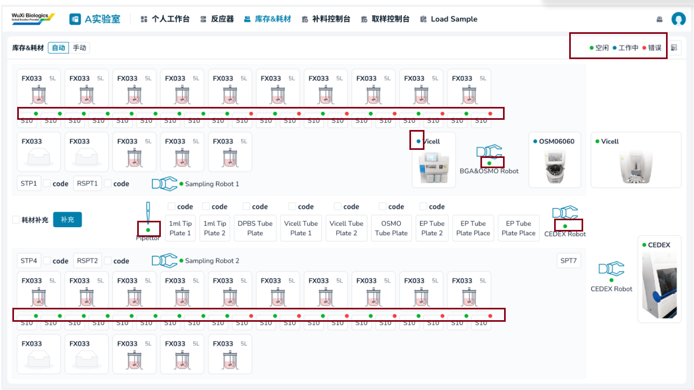
1.  0：Offline，空闲
2.  1：Idle，空闲
3.  2：Busy，工作中
4.  3：Error，错误
-   孔位状态：点击移液器、耗材、机械臂等弹窗显示各个孔位的状态，共包含空闲、已占用、有液体三个状态
> **[图 image709.png | 章节：库存&耗材（5.0） / 基础业务说明（5.0） | 上下文：- 孔位状态：点击移液器、耗材、机械臂等弹窗显示各个孔位的状态，共包含空闲、已占用、有液体三个状态]**
> （新增图片：V4.0 副本无同图，未做 OCR，请核对图片文件）

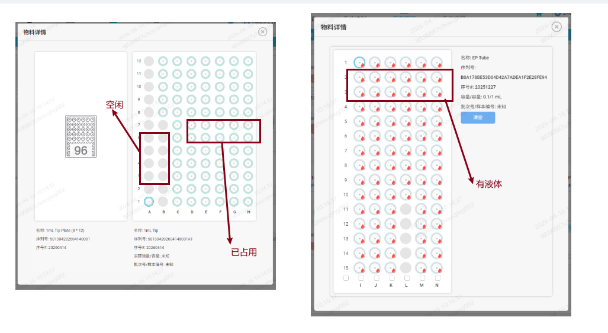
1.  空闲：当前孔位完全空闲，没有放置试管/杯子等容器
2.  已占用：当前孔位有放置试管/杯子等容器但容器内没有液体
3.  有液体：当前孔位有放置试管/杯子等容器且容器内有液体
| **设备** | **孔位状态** |
|---|---|
| STP1/STP4 | 空闲、已占用 |
| RSTP1/RSTP2 | 空闲、已占用、有液体 |
| STP3/STP7 | 空闲、有液体 |
| STP6 | 空闲、已占用、有液体 |
| SamplingRobot1/SamplingRobot2 | 空闲、已占用、有液体 |
| Pipettor | 空闲、已占用、有液体 |
| 1ml Tip Plate1/1ml Tip Plate2 | 空闲、已占用 |
| DPBS Tube Plate | 空闲、已占用、有液体 |
| Vicell Tube Plate1/Vicell Tube Plate2 | 空闲、已占用、有液体 |
| OSMO Tube Plate | 空闲、已占用、有液体 |
| EP Tube Plate2 | 空闲、已占用、有液体 |
| EP Tube Plate Place | 空闲、有液体 |
| EP Centrifuge | 空闲、有液体 |
| MainRobot | 空闲、已占用、有液体 |
| CedexRobot | 空闲、已占用、有液体 |
| BGA&OSMORobot | 空闲、已占用、有液体 |
| BGA检测设备 | 空闲、已占用、有液体 |
| OSMO检测设备 | 空闲、已占用、有液体 |
| Vicell检测设备 | 空闲、已占用、有液体 |
| cedex检测设备 | 空闲、已占用、有液体 |

### 库存&耗材（5.0）（5.1调整）

> **[图 image710.png | 章节：库存&耗材（5.0） / 库存&耗材（5.0）（5.1调整） | 上下文：### 库存&耗材（5.0）（5.1调整）]**
> （新增图片：V4.0 副本无同图，未做 OCR，请核对图片文件）

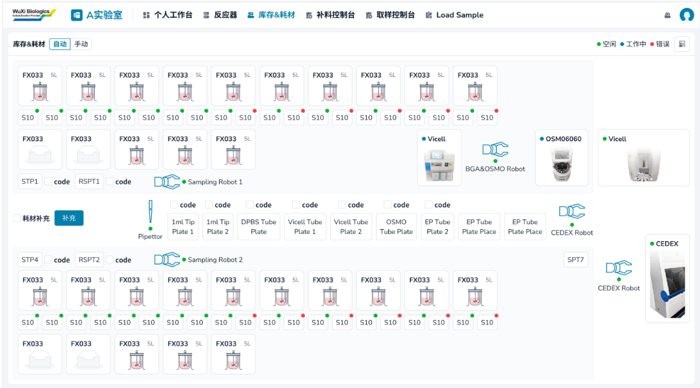
1.  模式选择
选择自动或手动模式，此模式对整个实验室生效

1.  切换到自动模式后，工作流不允许进行任何操作
2.  切换到自动模式后，四台用于执行自动化取测任务的检测设备不允许下发检测需求
3.  切换到自动模式后，任务队列所有任务才能自动执行，否则一直等待
4.  LoadSample模块
    1.  点击确认按钮，如果当前是自动模式则需要用户二次确认将模式切换为手动
    2.  点击开始按钮时，如果当前是手动模式则需用户二次确认将模式切换到自动模式
5.  每次切换到自动模式，需要校验当前耗材是否足够所有取样测样任务的进行，具体逻辑见文件
> 附件: oleObject7.bin（docx 内嵌 OLE 对象，未内联；原文件请在 需求说明书V5.1-1030.docx 中查看）
1.  系统状态
-   查看各机械臂对应子系统（固定）的网络状态。
> **[图 image712.png | 章节：库存&耗材（5.0） / 库存&耗材（5.0）（5.1调整） | 上下文：- 查看各机械臂对应子系统（固定）的网络状态。]**
> （新增图片：V4.0 副本无同图，未做 OCR，请核对图片文件）

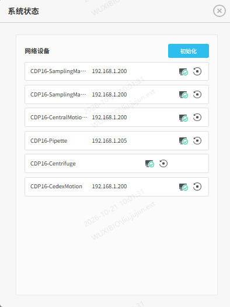
1.  名称
2.  IP
3.  状态
4.  初始化：支持单个和统一初始化机械臂，让机械臂恢复到初始为止
2.  控制器&取样单元卡片
-   一个控制器对应一个取样单元，具体对应关系来源于数据库表
1.  控制器
    1.  编号
    2.  图标：当前控制器预约了台式反应器罐时（选择了具体的反应器罐并指定了开始和结束时间），显示对应台式反应器罐图标；否则显示缺省图标
    3.  物料详情：点击卡片弹窗展示以下信息
> **[图 image713.png | 章节：库存&耗材（5.0） / 库存&耗材（5.0）（5.1调整） | 上下文：3. 物料详情：点击卡片弹窗展示以下信息]**
> （新增图片：V4.0 副本无同图，未做 OCR，请核对图片文件）

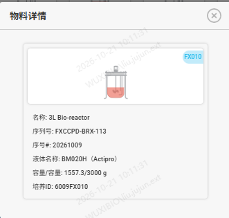
        1.  控制器编号
        2.  图标
        3.  名称：对应反应器罐的描述字段
        4.  序列号
        5.  序号#
        6.  液体名称
        7.  容量/容量：台式反应器罐的当前理论容量/总容量
        8.  培养ID
2.  取样单元
    1.  编号
    2.  状态
    3.  取样单元详情
> **[图 image714.png | 章节：库存&耗材（5.0） / 库存&耗材（5.0）（5.1调整） | 上下文：3. 取样单元详情]**
> （新增图片：V4.0 副本无同图，未做 OCR，请核对图片文件）

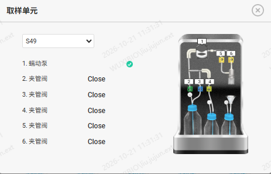
        1.  编号：下拉单选，列表内容为所有的取样单元编号，默认为当前取样编号，可修改
        2.  蠕动泵：显示当前蠕动泵的工作状态，包含三种
            1.  未知：当前培养ID未完成连接补料单元工作流
            2.  Doing：当前培养ID已完成连接补料单元工作流且当前取样单元正在取样中
            3.  Done：当前培养ID已完成连接补料单元工作流但未在取样中
        3.  夹管阀：一共5个夹管阀。显示当前夹管阀的工作状态，包含三种
            1.  未知：当前培养ID未完成连接补料单元工作流
            2.  Open：当前培养ID已完成连接补料单元工作流且夹管阀已打开
            3.  Close：当前培养ID已完成连接补料单元工作流且夹管阀已关闭
    4.  物料详情：点击编号显示液瓶设置-取样单元的相关信息
> **[图 image715.png | 章节：库存&耗材（5.0） / 库存&耗材（5.0）（5.1调整） | 上下文：4. 物料详情：点击编号显示液瓶设置-取样单元的相关信息]**
> （新增图片：V4.0 副本无同图，未做 OCR，请核对图片文件）

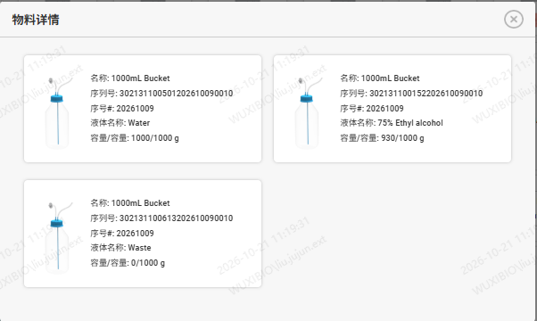
        1.  名称：液瓶名称
        2.  序列号
        3.  序号
        4.  液体名称：即液体类型
        5.  容量/容量：当前实际使用容量/液瓶标准容量
3.  STP1/STP4
放置空容器的载具，机械臂从此处拿取空容器去对应取样单元取液体，用作后续检测

1.  编号
2.  补充耗材code：勾选框，当点击耗材补充时出现并支持选中/取消选中。
3.  物料详情：点击编号展示详情
> **[图 image716.png | 章节：库存&耗材（5.0） / 库存&耗材（5.0）（5.1调整） | 上下文：3. 物料详情：点击编号展示详情]**
> （新增图片：V4.0 副本无同图，未做 OCR，请核对图片文件）

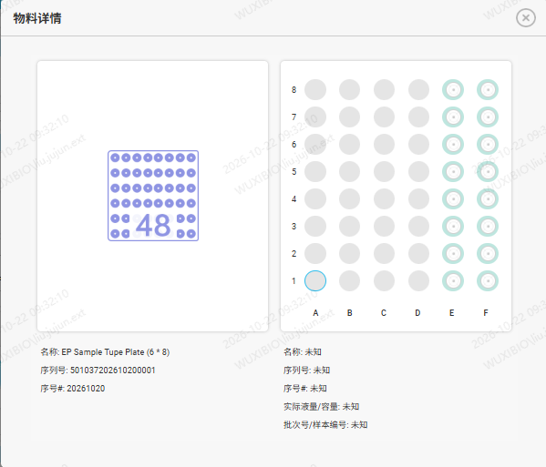
    1.  载具说明
        1.  示意图：一个68的孔位矩阵缩略图，显示总的孔位数量
        2.  名称
        3.  序列号
        4.  序号
    2.  当前状态说明
        1.  整体显示一个68的孔位矩阵。纵向从下至上是1-8；注意前端页面展示时，STP1横向从左至右是A-F，STP4是F-A
        2.  每个孔位对应一个孔号，比如A1，H6
        3.  每个孔位对应一个孔位状态
        4.  点击每个孔位显示对应孔位的详情，包含
            1.  名称
            2.  序列号
            3.  序号
            4.  实际液量/容量
            5.  批次号/样品编号
1.  RSTP1/RSTP2
-   从取样单元去除液体后放置在此托盘，用于留样备用
1.  编号
2.  补充耗材code：勾选框，当点击耗材补充时出现并支持选中/取消选中。
3.  物料详情：点击编号展示详情
> **[图 image717.png | 章节：库存&耗材（5.0） / 库存&耗材（5.0）（5.1调整） | 上下文：3. 物料详情：点击编号展示详情]**
> （新增图片：V4.0 副本无同图，未做 OCR，请核对图片文件）

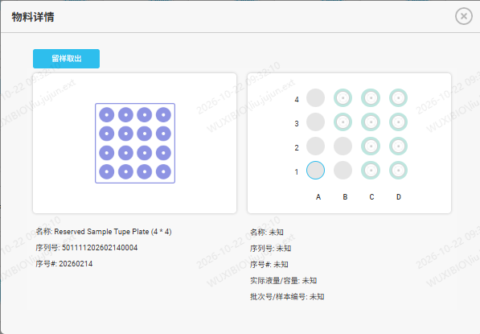
    1.  留样取出：选中某一个状态为有液体的孔位，点击留样取出后将状态改为空闲
    2.  载具说明
        1.  示意图：一个44的孔位矩阵缩略图，显示总的孔位数量
        2.  名称
        3.  序列号
        4.  序号
    3.  当前状态说明
        1.  整体显示一个44孔位矩阵。纵向从下至上是1-4；注意前端页面展示时，RSTP1横向从左至右是A-D，RSTP4是D-A
        2.  每个孔位对应一个孔号，比如A1，H6。
        3.  每个孔位对应一个孔位状态
        4.  点击每个孔位显示对应孔位的详情，包含
            1.  名称
            2.  序列号
            3.  序号
            4.  实际液量/容量
            5.  批次号/样品编号
2.  STP3/STP7
取样机械臂从STP1/STP2处抓取后会首先放置在STP3/STP7处。

1.  编号
2.  物料详情：点击编号展示详情
> **[图 image718.png | 章节：库存&耗材（5.0） / 库存&耗材（5.0）（5.1调整） | 上下文：2. 物料详情：点击编号展示详情]**
> （新增图片：V4.0 副本无同图，未做 OCR，请核对图片文件）

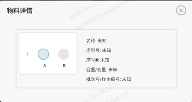
    1.  整体显示一个21孔位矩阵。纵向是1；横向从左至右是A-B
    2.  每个孔位对应一个孔号，比如A1。
    3.  每个孔位对应一个孔位状态
    4.  点击每个孔位显示对应孔位的详情，包含
        1.  名称
        2.  序列号
        3.  序号
        4.  实际液量/容量
        5.  批次号/样品编号
1.  STP6
机械臂从EP-Tube Plate Place处抓取放置在STP6，用作Cedex检测

1.  编号
2.  物料详情：点击编号展示详情
> **[图 image719.png | 章节：库存&耗材（5.0） / 库存&耗材（5.0）（5.1调整） | 上下文：2. 物料详情：点击编号展示详情]**
> （新增图片：V4.0 副本无同图，未做 OCR，请核对图片文件）

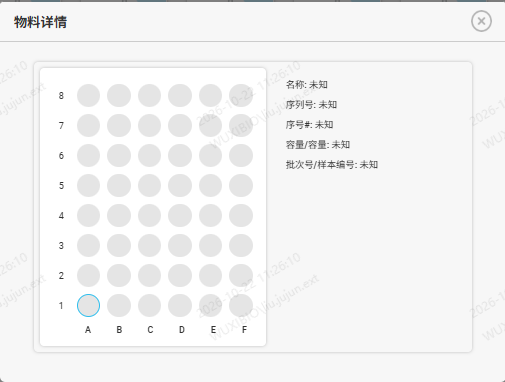
    1.  整体显示一个68孔位矩阵。纵向是1-8；横向从左至右是A-F
    2.  每个孔位对应一个孔号，比如A1。
    3.  每个孔位对应一个孔位状态
    4.  点击每个孔位显示对应孔位的详情，包含
        1.  名称
        2.  序列号
        3.  序号
        4.  实际液量/容量
        5.  批次号/样品编号
1.  Sampling Robot1/Sampling Robot2
从STP1/STP4处抓取，放置到STP3/STP7处。

1.  编号
2.  图标
3.  状态
4.  物料详情：点击展示详情
> **[图 image720.png | 章节：库存&耗材（5.0） / 库存&耗材（5.0）（5.1调整） | 上下文：4. 物料详情：点击展示详情]**
> （新增图片：V4.0 副本无同图，未做 OCR，请核对图片文件）

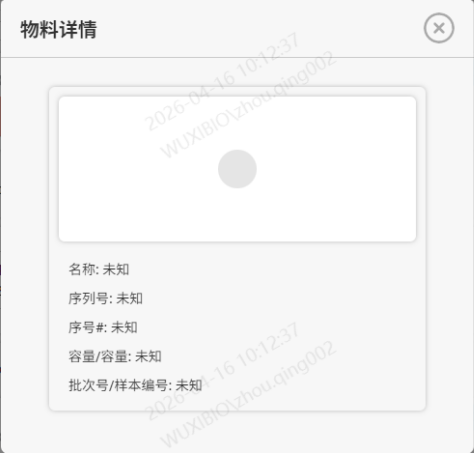
    1.  机械臂只有一个孔位，孔位需要显示当前状态
    2.  名称
    3.  序列号
    4.  序号#
    5.  容量/容量
    6.  批次号/样本编号
1.  Pipettor
移液器。

1.  编号
2.  图标
3.  状态
4.  物料详情：点击展示详情
> **[图 image720.png | 章节：库存&耗材（5.0） / 库存&耗材（5.0）（5.1调整） | 上下文：4. 物料详情：点击展示详情]**
> （新增图片：V4.0 副本无同图，未做 OCR，请核对图片文件）

    1.  移液器只有一个孔位，孔位需要显示当前状态
    2.  名称
    3.  序列号
    4.  序号#
    5.  容量/容量
    6.  批次号/样本编号
1.  1ml Tip Plate1/1ml Tip Plate2
可以放置空容器/枪头的载具，从DPBS TubePlate获取稀释液放入Vicell Tube Plate1/Vicell Tube Plate2，完成稀释后才能完成Vicell检测

1.  编号
2.  补充耗材code：勾选框，当点击耗材补充时出现并支持选中/取消选中。
3.  物料详情：点击编号展示详情
> **[图 image721.png | 章节：库存&耗材（5.0） / 库存&耗材（5.0）（5.1调整） | 上下文：3. 物料详情：点击编号展示详情]**
> （新增图片：V4.0 副本无同图，未做 OCR，请核对图片文件）

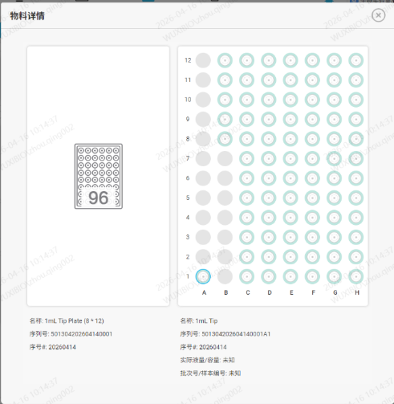
    1.  载具说明
        1.  示意图：一个812的孔位矩阵缩略图，显示总的孔位数量
        2.  名称
        3.  序列号
        4.  序号
    2.  当前状态说明
        1.  整体显示一个812的孔位矩阵。纵向从下至上是1-12；横向从左至右是A-H
        2.  每个孔位对应一个孔号，比如A1，H6
        3.  每个孔位对应一个孔位状态
        4.  点击每个孔位显示对应孔位的详情，包含
            1.  名称
            2.  序列号
            3.  序号
            4.  实际液量/容量
            5.  批次号/样品编号
1.  DPBS Tube Plate
放置装有稀释液的容器的载具。

1.  编号
2.  补充耗材code：勾选框，当点击耗材补充时出现并支持选中/取消选中。
3.  物料详情：点击编号展示详情
> **[图 image722.png | 章节：库存&耗材（5.0） / 库存&耗材（5.0）（5.1调整） | 上下文：3. 物料详情：点击编号展示详情]**
> （新增图片：V4.0 副本无同图，未做 OCR，请核对图片文件）

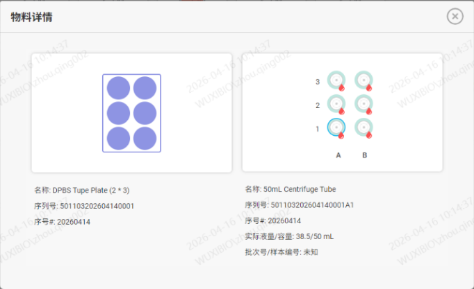
    1.  载具说明
        1.  示意图：一个23的孔位矩阵缩略图，显示总的孔位数量
        2.  名称
        3.  序列号
        4.  序号
    2.  当前状态说明
        1.  整体显示一个23的孔位矩阵。纵向从下至上是1-3；横向从左至右是A-B
        2.  每个孔位对应一个孔号，比如A1
        3.  每个孔位对应一个孔位状态
        4.  点击每个孔位显示对应孔位的详情，包含
            1.  名称
            2.  序列号
            3.  序号
            4.  实际液量/容量
            5.  批次号/样品编号
1.  Vicell Tube Plate1/Vicell Tube Plate2
Vicell设备检测时使用的是杯子，需要在此处将容器换成杯子。

1.  编号
2.  补充耗材code：勾选框，当点击耗材补充时出现并支持选中/取消选中。
3.  物料详情：点击编号展示详情
> **[图 image723.png | 章节：库存&耗材（5.0） / 库存&耗材（5.0）（5.1调整） | 上下文：3. 物料详情：点击编号展示详情]**
> （新增图片：V4.0 副本无同图，未做 OCR，请核对图片文件）

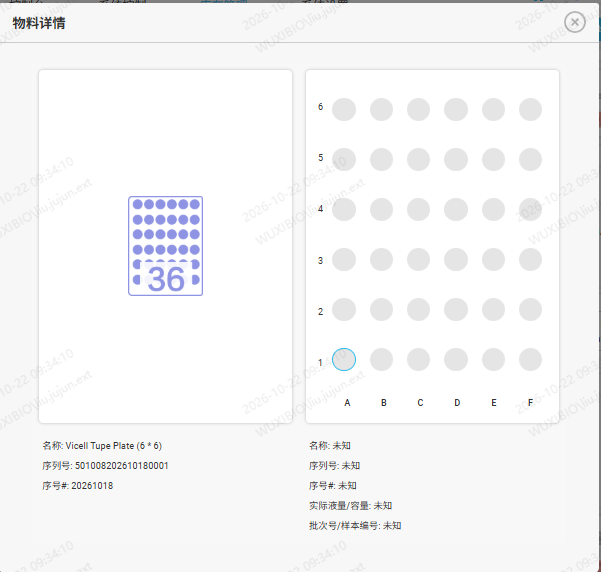
    1.  载具说明
        1.  示意图：一个66的孔位矩阵缩略图，显示总的孔位数量
        2.  名称
        3.  序列号
        4.  序号
    2.  当前状态说明
        1.  整体显示一个66的孔位矩阵。纵向从下至上是1-6；横向从左至右是A-F
        2.  每个孔位对应一个孔号，比如A1
        3.  每个孔位对应一个孔位状态
        4.  点击每个孔位显示对应孔位的详情，包含
            1.  名称
            2.  序列号
            3.  序号
            4.  实际液量/容量
            5.  批次号/样品编号
1.  OSMO Tube Plate
Vicell设备检测时使用的是杯子，需要在此处将容器换成杯子。

1.  编号
2.  补充耗材code：勾选框，当点击耗材补充时出现并支持选中/取消选中。
3.  物料详情：点击编号展示详情
> **[图 image724.png | 章节：库存&耗材（5.0） / 库存&耗材（5.0）（5.1调整） | 上下文：3. 物料详情：点击编号展示详情]**
> （新增图片：V4.0 副本无同图，未做 OCR，请核对图片文件）

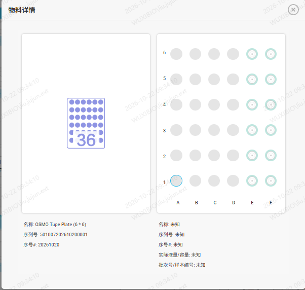
    1.  载具说明
        1.  示意图：一个66的孔位矩阵缩略图，显示总的孔位数量
        2.  名称
        3.  序列号
        4.  序号
    2.  当前状态说明
        1.  整体显示一个66的孔位矩阵。纵向从下至上是1-6；横向从左至右是A-F
        2.  每个孔位对应一个孔号，比如A1
        3.  每个孔位对应一个孔位状态：此载具包含
        4.  点击每个孔位显示对应孔位的详情，包含
            1.  名称
            2.  序列号
            3.  序号
            4.  实际液量/容量
            5.  批次号/样品编号
1.  EP Tube Plate2
Vicell设备检测时使用的是杯子，需要在此处将容器换成杯子。

1.  编号
2.  补充耗材code：勾选框，当点击耗材补充时出现并支持选中/取消选中。
3.  物料详情：点击编号展示详情
> **[图 image725.png | 章节：库存&耗材（5.0） / 库存&耗材（5.0）（5.1调整） | 上下文：3. 物料详情：点击编号展示详情]**
> （新增图片：V4.0 副本无同图，未做 OCR，请核对图片文件）

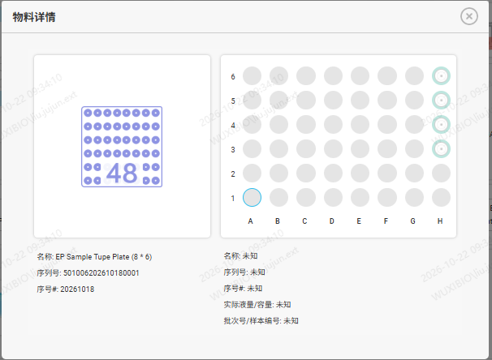
    1.  载具说明
        1.  示意图：一个86的孔位矩阵缩略图，显示总的孔位数量
        2.  名称
        3.  序列号
        4.  序号
    2.  当前状态说明
        1.  整体显示一个86的孔位矩阵。纵向从下至上是1-6；横向从左至右是A-H
        2.  每个孔位对应一个孔号，比如A1
        3.  每个孔位对应一个孔位状态
        4.  点击每个孔位显示对应孔位的详情，包含
            1.  名称
            2.  序列号
            3.  序号
            4.  实际液量/容量
            5.  批次号/样品编号
1.  EP Tube Plate Place
用于装容器的载具，机械臂从此处抓取样品送往STP6完成检测

1.  编号
2.  物料详情：点击编号展示详情
> **[图 image726.png | 章节：库存&耗材（5.0） / 库存&耗材（5.0）（5.1调整） | 上下文：2. 物料详情：点击编号展示详情]**
> （新增图片：V4.0 副本无同图，未做 OCR，请核对图片文件）

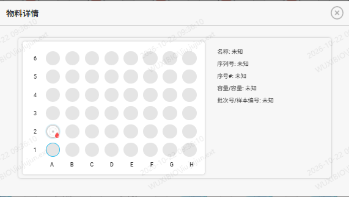
    1.  整体显示一个86孔位矩阵。纵向是1-6；横向从左至右是A-H
    2.  每个孔位对应一个孔号，比如A1。
    3.  每个孔位对应一个孔位状态
    4.  点击每个孔位显示对应孔位的详情，包含
        1.  名称
        2.  序列号
        3.  序号
        4.  实际液量/容量
        5.  批次号/样品编号
1.  EP Centrifuge
离心机，用于完成离心操作

1.  编号
2.  状态
3.  物料详情：点击编号展示详情
> **[图 image727.png | 章节：库存&耗材（5.0） / 库存&耗材（5.0）（5.1调整） | 上下文：3. 物料详情：点击编号展示详情]**
> （新增图片：V4.0 副本无同图，未做 OCR，请核对图片文件）

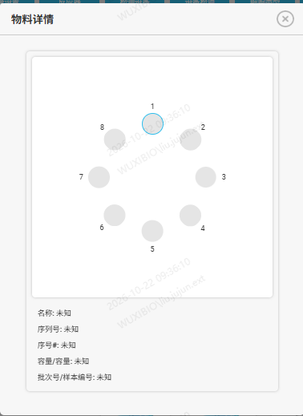
    1.  整体显示一个6个孔位的圆盘。
    2.  每个孔位对应一个孔号，孔号直接使用1-5的数字表示。
    3.  每个孔位对应一个孔位状态
    4.  点击每个孔位显示对应孔位的详情，包含
        1.  名称
        2.  序列号
        3.  序号
        4.  实际液量/容量
        5.  批次号/样品编号
1.  Main Robot
从EP Tube Plate Place处抓取放置到STP6处或从Vicell Tube Plate1/Vicell Tube Plate2处抓取放置到Vicell检测设备。

1.  编号
2.  图标
3.  状态
4.  物料详情：点击展示详情
> **[图 image720.png | 章节：库存&耗材（5.0） / 库存&耗材（5.0）（5.1调整） | 上下文：4. 物料详情：点击展示详情]**
> （新增图片：V4.0 副本无同图，未做 OCR，请核对图片文件）

    1.  机械臂只有一个孔位，孔位需要显示当前状态
    2.  名称
    3.  序列号
    4.  序号#
    5.  容量/容量
    6.  批次号/样本编号
1.  Cedex Robot
从STP6处抓取，放置到Cedex检测设备。

1.  编号
2.  图标
3.  状态
4.  物料详情：点击展示详情
> **[图 image720.png | 章节：库存&耗材（5.0） / 库存&耗材（5.0）（5.1调整） | 上下文：4. 物料详情：点击展示详情]**
> （新增图片：V4.0 副本无同图，未做 OCR，请核对图片文件）

    1.  机械臂只有一个孔位，孔位需要显示当前状态
    2.  名称
    3.  序列号
    4.  序号#
    5.  容量/容量
    6.  批次号/样本编号
1.  BGA&OSMO Robot
从EP Tube Plate Place/OSMO Tube Plate蘸取液体放置BGA/OSMO 检测设备。

1.  编号
2.  图标
3.  状态
1.  耗材补充
1.  是否补充：勾选框，勾选后，相应载具变为可选状态
2.  全选：所有载具被选中
3.  全部取消：所有载具都取消选中
4.  补充：全部载具的孔位的状态变为初始状态（每个载具的初始状态存储在对应的模板表中，直接将模板表中的字段复制到表征当前状态的表的对应字段中）注意，此处的补充操作是系统本身将相应数据库表对应字段修改，无需和调度程序交互，所以用户在完成此操作时必须确认已线下完成此操作。
2.  BGA检测设备
完成BGA检测任务。

1.  检测类型
2.  设备示意图
3.  状态
4.  物料详情：点击弹窗显示详情
> **[图 image720.png | 章节：库存&耗材（5.0） / 库存&耗材（5.0）（5.1调整） | 上下文：4. 物料详情：点击弹窗显示详情]**
> （新增图片：V4.0 副本无同图，未做 OCR，请核对图片文件）

    1.  BGA是单管，只有一个孔位，孔位需要显示当前状态
    2.  名称
    3.  序列号
    4.  序号#
    5.  容量/容量
    6.  批次号/样本编号
1.  OSMO检测设备
完成OSMO检测任务。

1.  检测类型
2.  设备示意图
3.  状态
4.  物料详情：点击弹窗显示详情
> **[图 image728.png | 章节：库存&耗材（5.0） / 库存&耗材（5.0）（5.1调整） | 上下文：4. 物料详情：点击弹窗显示详情]**
> （新增图片：V4.0 副本无同图，未做 OCR，请核对图片文件）

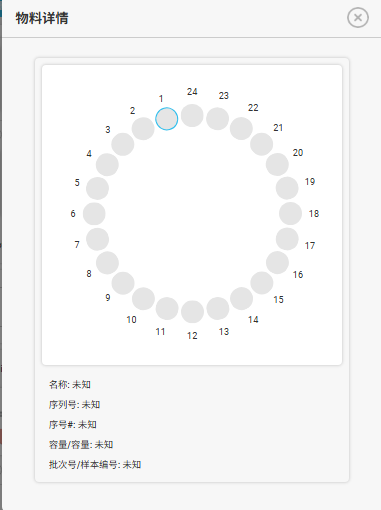
    1.  OSMO是圆盘形态，包含24个孔位
    2.  每个孔位对应一个1-24的编号
    3.  每个孔位需要显示当前状态
    4.  点击孔位展示对应详情
        1.  名称
        2.  序列号
        3.  序号#
        4.  容量/容量
        5.  批次号/样本编号
1.  Vicell检测设备
完成Vicell检测任务。

1.  检测类型
2.  设备示意图
3.  状态
4.  物料详情：点击弹窗显示详情
> **[图 image729.png | 章节：库存&耗材（5.0） / 库存&耗材（5.0）（5.1调整） | 上下文：4. 物料详情：点击弹窗显示详情]**
> （新增图片：V4.0 副本无同图，未做 OCR，请核对图片文件）

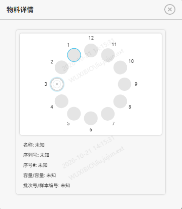
    1.  Vicell是圆盘形态，包含12个孔位
    2.  每个孔位对应一个1-12的编号
    3.  每个孔位需要显示当前状态
    4.  点击孔位展示对应详情
        1.  名称
        2.  序列号
        3.  序号#
        4.  容量/容量
        5.  批次号/样本编号
1.  cedex检测设备
完成Cedex检测任务

1.  编号
2.  设备示意图
3.  状态
4.  物料详情：点击展示详情
> **[图 image730.png | 章节：库存&耗材（5.0） / 库存&耗材（5.0）（5.1调整） | 上下文：4. 物料详情：点击展示详情]**
> （新增图片：V4.0 副本无同图，未做 OCR，请核对图片文件）

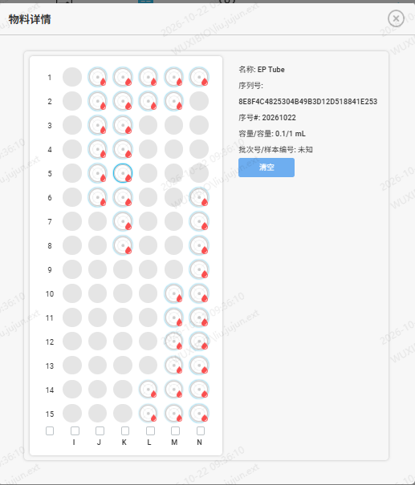
    1.  整体显示一个615孔位矩阵。纵向从下至上是15-1；横向从左至右是I-N
    2.  每个孔位对应一个孔号，比如N12。
    3.  每个孔位对应一个孔位状态
    4.  点击每个孔位显示对应孔位的详情，包含
        1.  名称
        2.  序列号
        3.  序号
        4.  实际液量/容量
        5.  批次号/样品编号
        6.  清空按钮：点击清空托盘，即所有孔位变成空闲状态
