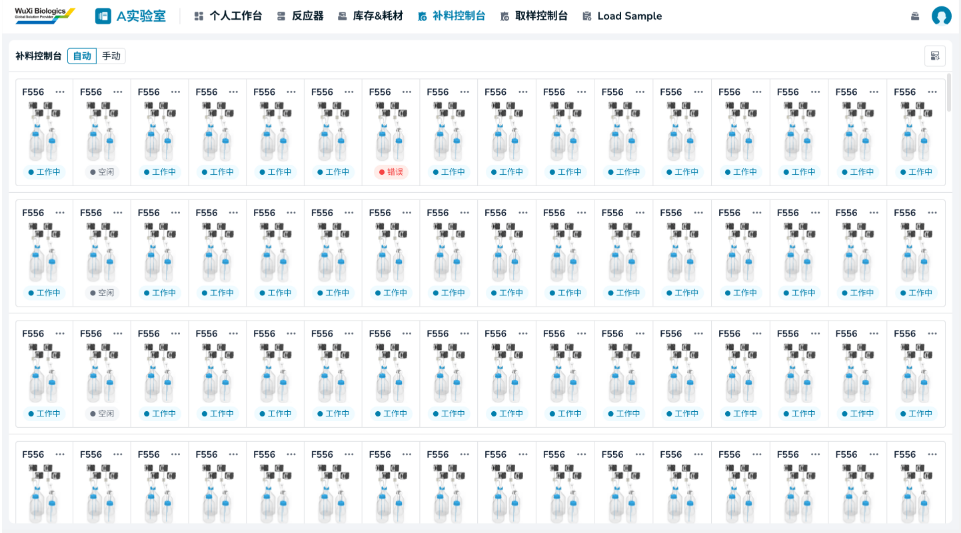
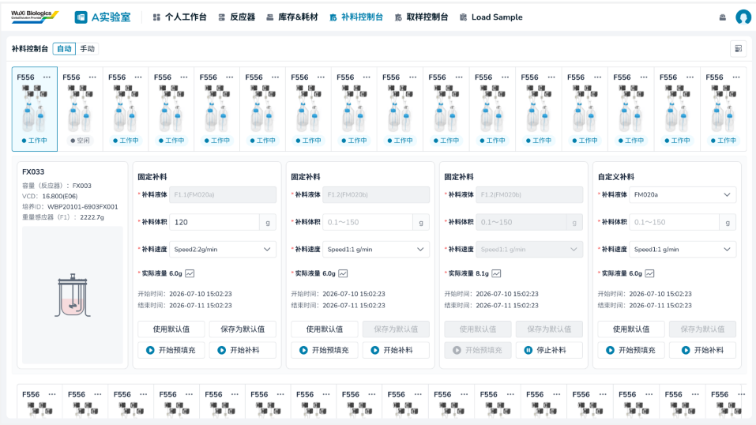
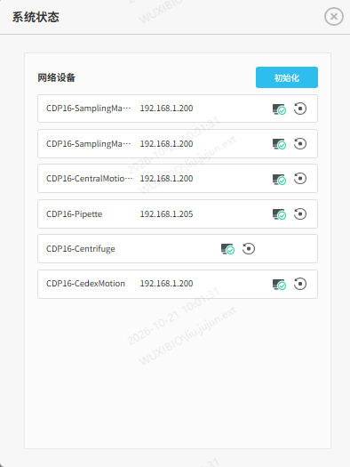
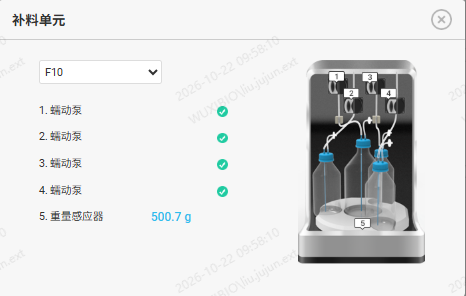
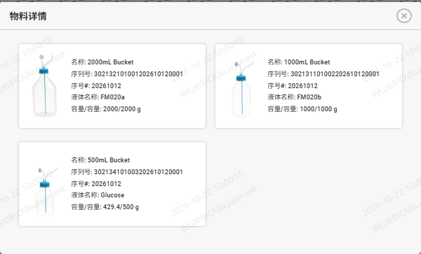

# 实验室工作台（5.0调整）（5.1调整）

## 补料控制台（5.0）

> **[图 image731.png | 章节：补料控制台（5.0） | 上下文：## 补料控制台（5.0）]**
> （新增图片：V4.0 副本无同图，未做 OCR，请核对图片文件）

> **[图 image732.png | 章节：补料控制台（5.0） | 上下文：## 补料控制台（5.0）]**
> （新增图片：V4.0 副本无同图，未做 OCR，请核对图片文件）

1.  模式选择
选择自动或手动模式，此模式对整个实验室生效

1.  切换到自动模式后，工作流不允许进行任何操作
2.  切换到自动模式后，检测分析页面不允许下发检测需求
3.  切换到自动模式后，任务队列所有任务才能自动执行，否则一直等待
4.  LoadSample模块，点击开始按钮时，需将模式切换到自动模式
5.  每次切换到自动模式，需要校验当前耗材是否足够所有取样测样任务的进行，具体逻辑见文件
1.  系统状态
-   查看各机械臂对应子系统（固定）的网络状态。
> **[图 image712.png | 章节：补料控制台（5.0） | 上下文：- 查看各机械臂对应子系统（固定）的网络状态。]**
> （新增图片：V4.0 副本无同图，未做 OCR，请核对图片文件）

1.  名称
2.  IP
3.  状态
4.  初始化：支持单个和统一初始化机械臂，让机械臂恢复到初始为止
2.  补料单元详情：每个补料单元一个卡片，一一按照布局展示
1.  编号
2.  图标
3.  状态
4.  补料单元详情
> **[图 image733.png | 章节：补料控制台（5.0） | 上下文：4. 补料单元详情]**
> （新增图片：V4.0 副本无同图，未做 OCR，请核对图片文件）

    1.  编号：下拉单选，列表内容为所有的补料单元编号，默认为当前补料单元编号，可修改
    2.  蠕动泵：共计4个，显示当前蠕动泵的工作状态，包含三种
        1.  未知：当前培养ID未完成连接补料单元工作流
        2.  Doing：当前培养ID已完成连接补料单元工作流且当前补料单元正在补料中
        3.  Done：当前培养ID已完成连接补料单元工作流但未在补料中
    3.  重量感应器：读取当前补料单元对应秤的数值
    4.  补料单元示意图
3.  物料详情：点击编号显示液瓶设置-补料单元的相关信息
> **[图 image734.png | 章节：补料控制台（5.0） | 上下文：3. 物料详情：点击编号显示液瓶设置-补料单元的相关信息]**
> （新增图片：V4.0 副本无同图，未做 OCR，请核对图片文件）

1.  名称：液瓶名称
2.  序列号
3.  序号
4.  液体名称：即补料类型
5.  容量/容量：当前实际使用容量/液瓶标准容量
4.  补料单元-补料操作：每个补料单元，都可以完成4个泵的补料操作
1.  控制器编号：该补料单元对应的控制器编号
2.  图标：若该控制器关联了台式反应器罐，则展示反应器罐图标；否则展示缺省图标
3.  容量：当前反应器罐理论容量
4.  VCD&样品ID：最新一次VCD检测的样品ID及结果
5.  重量感应器读取的数值
6.  固定补料：三个固定泵的补料
    1.  补料液体：补料单元编号+泵号+料液名称（从当前培养ID的补液方案获取）拼接展示，不支持修改
    2.  补料体积：文本框，必填，限制数值范围0.1~150，单位g
    3.  补料速度：选择此方式时，下拉单选，必选，下拉列表为Speed1至Speed10的速度代码
    4.  实际液量
        1.  显示当前具体数值
        2.  点击查看详细趋势图
    5.  开始时间
    6.  结束时间
    7.  使用默认值：自动将保存的默认值填入
    8.  保存默认值：见当前填写的补料体积和补料速度保存为默认值
    9.  开始预填充：按钮，点击开始预填充
    10.  结束预填充：按钮，点击结束预填充
    11.  开始补料：按钮，点击开始补料
    12.  结束补料：按钮，点击结束补料
7.  自定义补料：第四个泵的补料
    1.  补料液体：下拉单选，必选，数据来源于补液培养基
    2.  净重：文本框，限制为正整数，单位g
    3.  泵速：下拉单选，必选，列表为Speed1-10的速度代码
    4.  补料体积：文本框，必填，限制数值范围0.1~150，单位g
    5.  补料速度：选择此方式时，下拉单选，必选，下拉列表为Speed1至Speed10的速度代码
    6.  实际液量
        1.  显示当前具体数值
        2.  点击查看详细趋势图
    7.  开始时间
    8.  结束时间
    9.  使用默认值：自动将保存的默认值填入
    10.  保存默认值：见当前填写的补料体积和补料速度保存为默认值
    11.  开始预填充：按钮，点击开始预填充
    12.  结束预填充：按钮，点击结束预填充
    13.  开始补料：按钮，点击开始补料
    14.  结束补料：按钮，点击结束补料
