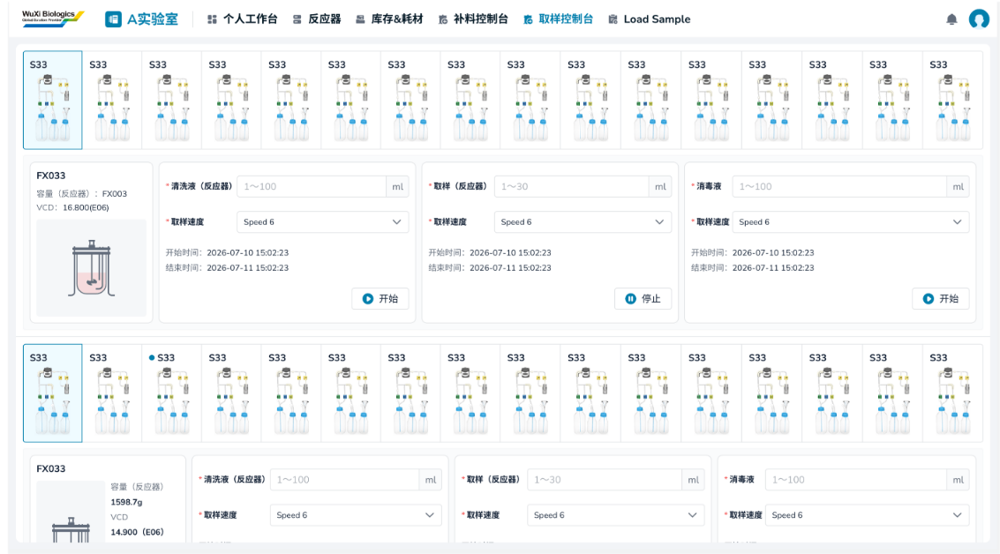
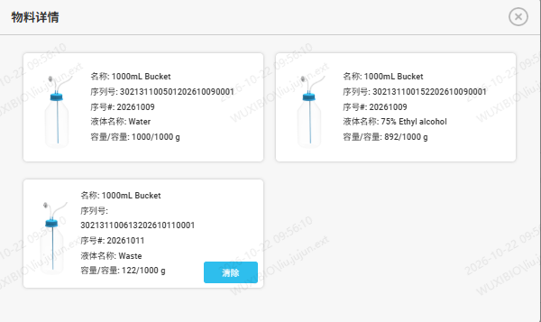

# 实验室工作台（5.0调整）（5.1调整）

## 取样控制台（5.0）

> **[图 image735.png | 章节：取样控制台（5.0） | 上下文：## 取样控制台（5.0）]**
> （新增图片：V4.0 副本无同图，未做 OCR，请核对图片文件）

每个取样单元一个卡片，一一按照布局展示

1.  物料详情：点击显示液瓶设置-取样单元的相关信息
> **[图 image736.png | 章节：取样控制台（5.0） | 上下文：1. 物料详情：点击显示液瓶设置-取样单元的相关信息]**
> （新增图片：V4.0 副本无同图，未做 OCR，请核对图片文件）

1.  名称：液瓶名称
2.  序列号
3.  序号
4.  液体名称：即液体类型
5.  容量/容量：当前实际使用容量/液瓶标准容量
6.  清除：如果液体名称是waste才有此清除按钮，触发操作与废液清理工作流-更换液瓶步骤逻辑一致，即将当前使用容量改为0。
2.  取样操作：控制每个取样单元自动完成三类操作
1.  控制器编号：该补料单元对应的控制器编号
2.  图标：若该控制器关联了台式反应器罐，则展示反应器罐图标；否则展示缺省图标
3.  容量：当前反应器罐理论容量
4.  VCD&样品ID：最新一次VCD检测的样品ID及结果
5.  清洗液（反应器）
    1.  样品量：文本框，单位ml，限制数值范围1~100
    2.  开始时间：点击开始按钮的时间
    3.  结束时间：自动结束的时间或手动点击停止按钮的时间
    4.  开始
    5.  停止
6.  取样（反应器）
    1.  样品量：文本框，单位ml，限制数值范围1~30
    2.  取样速度：下拉单选，必选，列表为Speed1-10的速度代码
    3.  开始时间
    4.  结束时间
    5.  开始
    6.  停止
7.  消毒液操作
    1.  样品量：文本框，单位ml，限制数值范围1~100。默认显示最近一次有执行开始操作的数值
    2.  取样速度：下拉单选，必选，列表为Speed1-10的速度代码（仅小试一期有），默认显示最近一次有执行开始操作的数值
    3.  开始时间：默认显示最近一次操作的开始时间
    4.  结束时间：默认显示最近一次操作的结束时间
    5.  开始
    6.  停止
