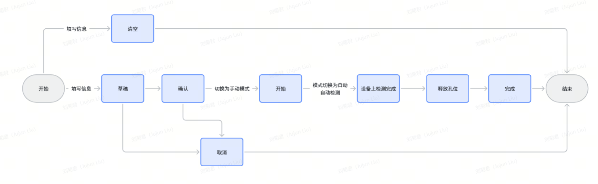
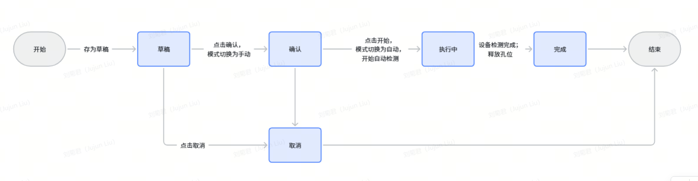
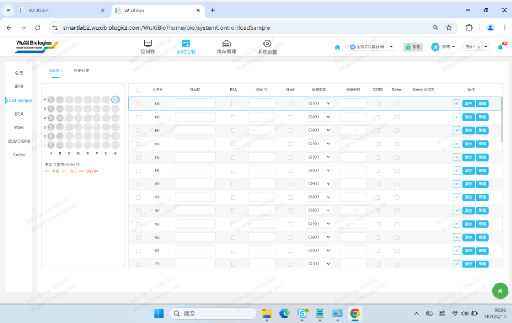
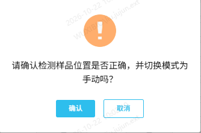
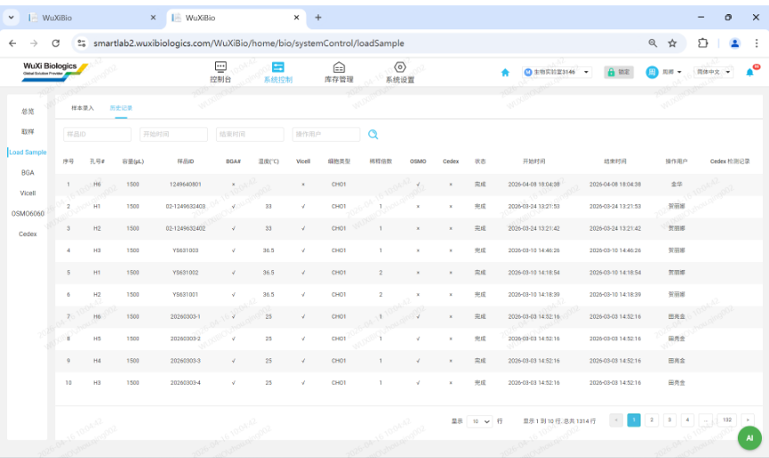

# 实验室工作台（5.0调整）（5.1调整）

## Load Sample（5.0）

### 测样业务说明（5.1调整）

1.  操作流程
> **[图 image737.png | 章节：Load Sample（5.0） / 测样业务说明（5.1调整） | 上下文：1. 操作流程]**
> （新增图片：V4.0 副本无同图，未做 OCR，请核对图片文件）

注意：

1.  释放孔位在原系统是BatchJob处理，不需要调度系统处理
1.  检测记录状态切换流程
> **[图 image738.png | 章节：Load Sample（5.0） / 测样业务说明（5.1调整） | 上下文：1. 检测记录状态切换流程]**
> （新增图片：V4.0 副本无同图，未做 OCR，请核对图片文件）

### 样本录入（5.0）（5.1调整）

> **[图 image739.png | 章节：Load Sample（5.0） / 样本录入（5.0）（5.1调整） | 上下文：### 样本录入（5.0）（5.1调整）]**
> （新增图片：V4.0 副本无同图，未做 OCR，请核对图片文件）

1.  载具
1.  整体为一个横向从左至右为A-H、纵向从下至上为1-6的矩阵
2.  每个孔位对应一个孔号，比如A1，H6
3.  每个孔位需要显示当前状态，包括空闲、有液体两种状态。当前孔位有填写相应检测需求并变为草稿、确认、执行中状态时变为有液体；未填写或检测完成或取消检测后变为空闲
4.  A&B 两列不允许用于自动检测，置灰，不允许操作。
2.  录入区：根据H6到A1的顺序，每个孔位对应一行（注意A&B 两列对应行置灰不允许填写），可录入测样信息并执行相应操作
1.  行勾选：支持多选后统一进行草稿/确认/开始/取消/清空操作
2.  孔号#：根据当前记录的不同状态（草稿、确认、执行中）使用不同颜色
3.  样品ID
4.  BGA检测
    1.  勾选框：选中表示此次测样需要做BGA
    2.  温度（摄氏度）：文本框，必填，数值范围15-40，1位小数
5.  Vicell检测
    1.  勾选框：选中表示此次测样需要做Vicell
    2.  细胞类型：下拉选项，单选，下拉数据来源数据字典配置
    3.  稀释倍数：文本框，必填，一位小数，数值范围1.0至20.0
6.  OSMO检测
    1.  勾选框：选中表示此次测样需要做OSMO
7.  Cedex检测
    1.  勾选框：选中表示此次测样需要做Cedex
    2.  Cedex测试项：选中cedex后，出现按钮，点击设置所需测试项
        1.  当前通道为空闲状态时，点击后弹窗选择检测项目，支持多选，支持按组全选（按照检测项的分组名字段分组，没有填写分组名的全部属于“未分组”这一组），选择后展示所选数量，可选的检测项目在资源管理－设备管理模块配置
        2.  稀释倍数：左侧数字默认为1，不可修改；当前设备勾选了支持修改稀释倍数时，右侧数字默认为1，支持修改，限制范围为1-100的整数。
8.  操作
    1.  +1：点击自动在下一行填入当前行样品ID增1后的样品ID
    2.  清空：当前行仅填写了相关信息，未进行草稿/确认/开始操作时，可点击清空当前行已填写内容
    3.  草稿：点击存为草稿
    4.  确认
        1.  只有变为草稿状态的记录，才支持确认操作
        2.  点击后需弹窗确认是否将实验室变为手动模式
> **[图 image740.png | 章节：Load Sample（5.0） / 样本录入（5.0）（5.1调整） | 上下文：2. 点击后需弹窗确认是否将实验室变为手动模式]**
> （新增图片：V4.0 副本无同图，未做 OCR，请核对图片文件）

        3.  二次确认后，将实验室模式切换为手动
        4.  当前记录的状态变为确认，确认按钮变为开始
    5.  开始
        1.  只有确认动作完成后，确认按钮将变为开始按钮
        2.  点击开始，弹窗确认是否将实验室模式变为自动模式
        3.  二次确认将模式切换为自动后，当前记录开始自动测样，状态变为执行中
    6.  取消
        1.  点击取消操作，状态变为取消，即不再进行测样
        2.  当前行已填写信息清空
### 历史纪录（5.0）

查询展示所有录入的记录

> **[图 image741.png | 章节：Load Sample（5.0） / 历史纪录（5.0） | 上下文：查询展示所有录入的记录]**
> （新增图片：V4.0 副本无同图，未做 OCR，请核对图片文件）

1.  查询条件
-   以下条件联合查询
1.  样品ID：支持模糊搜索
2.  开始时间
3.  结束时间
4.  操作用户
2.  结果展示
-   按照开始时间倒排展示
1.  序号
2.  孔号
3.  容量（µL）
4.  样品ID
5.  BGA#：可区分此次测样是否包含（包含：√；不包含：×）
6.  温度（摄氏度）
7.  Vicell：可区分此次测样是否包含（包含：√；不包含：×）
8.  细胞类型
9.  稀释倍数
10.  OSMO：可区分此次测样是否包含（包含：√；不包含：×）
11.  Cedex：可区分此次测样是否包含（包含：√；不包含：×）
12.  状态
13.  开始时间
14.  结束时间
15.  操作用户
16.  Cedex检测项：当前测样记录有Cedex检测时，有测试项按钮，点击弹窗展示选中的测试项。
